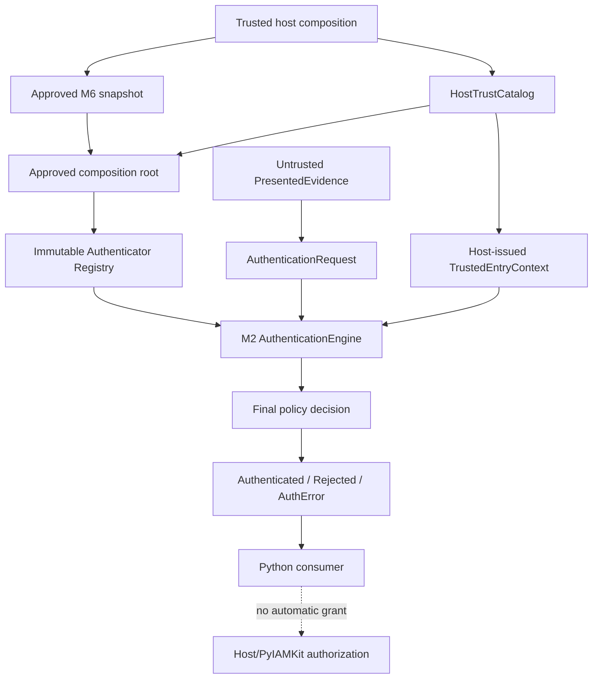
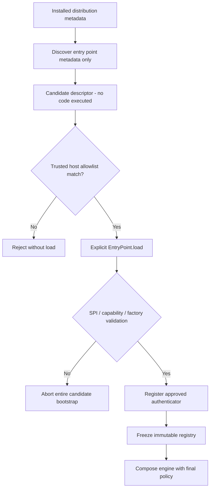

# M7 - PyAuthKit Public SDK, Extension SPI & Plugin Admission - Implementation Plan

> **Nom de fichier canonique proposé** : `docs/roadmap/M7_PYAUTHKIT_IMPLEMENTATION_PLAN.md`  
> **Projet** : PyAuthKit  
> **Milestone** : M7 - SDK, extensions et intégration minimale  
> **Slice GitHub cible** : PR-10  
> **Gate de sortie** : `GATE27-08`  
> **Date** : 6 novembre 2026  
> **Statut** : `PROPOSED / READY FOR DESIGN REVIEW` - aucun travail M7 n'est déclaré implémenté par le présent document  
> **Langue** : français, noms des contrats et idiomes Python en anglais  
> **Version documentaire** : 1.0.0-proposed  
> **Baseline GitHub vérifiée** : `main@ac4669e86cd690170ab5f3c2b0c7945258e35f9d`  
> **Preuve CI baseline** : [GitHub Actions #42214747735](https://github.com/tawounfouet/pyauthkit/actions/runs/42214747735), `12/12 SUCCESS`  
> **Cadre** : Software Design & Learning, Domain-Driven Design, architecture hexagonale, Fail Closed, Contract Testing, Security by Design

---

## 0. Résumé exécutif et décision d'entrée

**Décision proposée : `GO DEV M7 / PR-10`.** M0-M2 et les mécanismes M3 Password, M4 API Key, M5 JWT, M6 Configuration & Audit sont présents dans `main`. La suite intégrée de référence comporte **628 tests PASS**, **78 fichiers analysés par mypy strict** et **12 jobs CI réussis** sur le SHA indiqué ci-dessus. Ce résultat autorise à commencer le développement M7, sans transformer les statuts de sécurité antérieurs en GO.

**Les gates `GATE27-04`, `GATE27-05`, `GATE27-06` et `GATE27-07` demeurent `NO-GO SECURITY / INDEPENDENT REVIEW PENDING`.** Leur code peut être utilisé comme base de développement, mais il ne constitue pas une surface d'authentification qualifiée pour la production. M7 doit préserver cette distinction et ne pas activer accidentellement les mécanismes expérimentaux M6, notamment `audit_delivery=required` qui est explicitement refusé dans la configuration publique.

**Objectif contractuel de M7** : un intégrateur doit pouvoir construire une application **Python pur**, utilisant un contexte de confiance prédéfini par l'hôte, puis brancher un `Authenticator` conforme au SPI sans modifier `domain` ou `application`. Un plugin installé doit pouvoir être **découvert sans exécution**, puis **admis explicitement avant toute opération de chargement de code**. Un plugin inconnu, incompatible, non autorisé ou défaillant ne doit jamais être activé implicitement ni provoquer un succès d'authentification.

**Priorité de livraison** : l'API publique, le guide Python pur, l'admission de plugins opt-in, les tests de contrats, les extras et les preuves de packaging. Les adapters HTTP complets et l'ergonomie Django/Flask sont différés; une démonstration FastAPI extrêmement limitée peut être ajoutée uniquement si elle ne contamine pas le core et si elle réutilise une composition hôte qualifiée pour son périmètre.

**Principe directeur :** `Trust boundary -> invariant -> contract -> implementation -> negative tests -> evidence -> gate`.

### 0.1 Résultat attendu en une phrase

> PR-10 apporte une **surface SDK explicitement cataloguée et vérifiable**, plus une **chaîne de découverte, admission, chargement, activation et gel de plugins**, sans jamais permettre à un plugin de choisir le tenant fiable, de forger un succès final ni de transformer une authentification en autorisation.

### 0.2 Ce que ce plan n'est pas

- Ni une implémentation livrée, ni un rapport de tests M7, ni une validation de sécurité indépendante.
- Ni un engagement de compatibilité `1.0` : le paquet reste `0.1.0a1`, pré-alpha.
- Ni un moteur général d'autorisation, de sessions, de tokens, MFA, OIDC, passkeys ou PyIAMKit.
- Ni une autorisation de publication PyPI, de déploiement ou de relâchement des règles GitHub.
- Ni une garantie d'isolation OS pour un plugin Python : son chargement peut exécuter du code avec les privilèges du processus.

---

## 1. Références, autorité et état de preuve

### 1.1 Références normatives

| Référence | Rôle pour M7 | Décision de gouvernance |
| --- | --- | --- |
| `27_PYAUTHKIT_IMPLEMENTATION_ROADMAP.md` §20, §56, §79 | Périmètre M7, `GATE27-08`, PR-10 | Autorité de planning et critères de sortie |
| `24_PYAUTHKIT_PUBLIC_API_AND_SDK_DESIGN.md` | Taxonomie runtime/SDK, `SDK-REQ-*`, `SDK-INV-*`, `SDK-DEC-*` | API candidate; décisions ouvertes à arbitrer |
| `18_PYAUTHKIT_PORTS_ADAPTERS_AND_PLUGIN_ARCHITECTURE.md` | `EXT-REQ-*`, trust boundaries, plugin lifecycle et SPI | Règles de discovery, admission, registration |
| `22_PYAUTHKIT_FRAMEWORK_INTEGRATIONS.md` | Frontières framework / HTTP / async | Adapter complet séparé, hors noyau M7 |
| `20_PYAUTHKIT_SECURITY_THREAT_MODEL.md` | Menaces supply chain, trust, fuites, confusion de méthodes | Revue de sécurité obligatoire si frontière modifiée |
| `26_PYAUTHKIT_TESTING_AND_QUALIFICATION_STRATEGY.md` | Contrats, adversarial, packaging, preuve par SHA | Les suites doivent produire des artefacts consultables |
| `PYAUTHKIT_SOFTWARE_DESIGN_LEARNING_CONVENTION.md` | DoR, DoD, learning cards, ADR, learning tags | Problem First, Pattern Second, Evidence Before Claims |
| Dépôt GitHub `main`, PR #75, PR #82 | État réellement implémenté | Source prioritaire pour la topologie du code et CI |

Aucune proposition ci-dessous ne modifie silencieusement un invariant `SDK-INV-*`, `EXT-REQ-*`, `FR-*`, `SEC-*` ou `PRN-*`. Une incompatibilité déclenche une ADR et une mise en attente de la fonctionnalité affectée.

### 1.2 Baseline constatée, non travaux M7

| Élément | État sur le SHA de référence | Conséquence pour M7 |
| --- | --- | --- |
| `AuthenticationEngine.authenticate(request, *, entry)` | `IMPLEMENTED` | Conserver cette signature existante; ne pas inventer `trusted_entry=` comme API déjà codée |
| `AuthenticationRequest`, `PresentedEvidence`, `AuthenticationResult` | `IMPLEMENTED` | Réutiliser les objets réels, sans DTO alternatif donnant des droits |
| `HostTrustCatalog.resolve_for_host_route(route_id)` | `IMPLEMENTED` | L'hôte, et non la requête, choisit un entry de confiance |
| `Authenticator` et `AuthenticatorLookup` | `IMPLEMENTED` dans `ports/authenticator.py` | Base du SPI; pas de nouveau protocole redondant |
| `AuthenticatorRegistryBuilder.freeze()` | `IMPLEMENTED` | Maintenir une registration explicite et snapshot immuable |
| `EvidenceMethod` | `PASSWORD`, `API_KEY`, `JWT` | Plugins M7 limités aux méthodes connues; nouvelle méthode = évolution de domaine séparée |
| `compose_authentication_engine(...)` + compositions M4/M5 | `IMPLEMENTED` | Conserver les vérifications spécialisées et les refus au bootstrap |
| `src/pyauthkit/py.typed` | Déjà présent | Vérifier PEP 561 dans les distributions, plutôt que le recréer |
| Extras `password`, `jwt`, `aws`, `qualification` | Déjà dans `pyproject.toml` | Vérifier leurs imports et compatibilité sans ajouter d'extra artificiel |
| `pyauthkit.plugins` et découverte/activation `entry_points` | **Non constatés dans `main`** | Travaux M7 à développer, non déclarés implémentés |
| Catalogue de re-exports publics et contrat SPI versionné | **Non constatés comme produit M7 qualifié** | Principal livrable de PR-10 |
| Audit M6 `required` | Configuration publique refusée | Aucun helper SDK ne doit permettre son activation |

### 1.3 Baseline d'intégration

- `main`: `ac4669e86cd690170ab5f3c2b0c7945258e35f9d`.
- M3 PR #75 et M6 PR #82 : fusionnées pour le développement pré-alpha.
- CI `main` au SHA correspondant : `12/12 SUCCESS`, avec une suite générale de 628 tests et un typage strict sur 78 fichiers.
- Tests spécifiques existants M3 PostgreSQL/Redis/HTTP, M4 PostgreSQL/Redis/HTTP, M5 JOSE/JWKS, M6 config/audit et M6 HTTP en jobs dédiés.
- Dossiers ouverts : GATE27-04 issue #74, GATE27-05 issue #77 (et revue #79), GATE27-06 issue #81, GATE27-07 issue #83.

Si `main` évolue avant le démarrage de PR-10, refaire l'inventaire et remplacer cette baseline par le **SHA exact** effectivement utilisé.

---

## 2. Problem statement, acteurs et frontières de confiance

### 2.1 Problème réel

Le code M0-M6 est utilisable par composition directe, mais le consommateur Python ne dispose pas encore d'une surface SDK M7 clairement publiée avec des garanties de compatibilité et un protocole d'admission des extensions. Introduire un simple `load_plugins()` ou un builder capable d'accepter des profils de confiance du client créerait une faille d'architecture.

### 2.2 Acteurs

- **Application Host / Composition Owner** : approuve configuration, routes, capabilities, packages, policy finale, configuration des secrets et ressources.
- **SDK Consumer** : construit les `AuthenticationRequest`, invoque le moteur, traite le résultat sans inventer d'AuthZ.
- **Plugin Publisher / Author** : fournit un port de vérification ou un resolver substituable, dans les limites du contrat.
- **Plugin Admission Authority** : propriétaire hôte, seul habilité à autoriser une distribution, une version, un entry point, une capability et sa composition.
- **Security Reviewer** : évalue les preuves et les scénarios d'abus, distinct du développeur qui implémente.
- **PyIAMKit / application policy** : détenteur d'une éventuelle décision d'autorisation, jamais implicite dans M7.

### 2.3 Trust boundaries à préserver

| ID M7 local | Frontière | Entrée non fiable | Autorité / invariant |
| --- | --- | --- | --- |
| `M7-TB-01` | Consommateur -> moteur | Evidence, identité revendiquée, headers | Seul le `HostTrustCatalog` fournit `TrustedEntryContext` |
| `M7-TB-02` | Metadata packaging -> admission | Entry point, nom de distribution, version | Un descripteur découvert n'est pas une approbation |
| `M7-TB-03` | Admission -> code Python exécuté | `EntryPoint.load()` et factory | Admission explicite et préflight avant *toute* exécution de plugin |
| `M7-TB-04` | Plugin -> engine | `AuthenticatorOutcome`, erreurs | Le plugin ne construit pas `Authenticated`; décision finale M2 |
| `M7-TB-05` | Plugin -> ressources externes | Credential store, secrets, HTTP | Ports et grants hôtes; pas de source globale permissive |
| `M7-TB-06` | SDK -> IAM | Principal authentifié | AuthN != AuthZ, pas de provisioning implicite |
| `M7-TB-07` | Package -> environnement d'exécution | Extras et transitive deps | Core importable sans cloud, framework ni cryptographie facultative |
| `M7-TB-08` | Concurrence/arrêt -> plugins | Async tasks et ressources | Pas de succès post-annulation, fermeture/ownership explicites |

### 2.4 Invariants P0 non négociables

1. Aucun tenant, issuer, audience, keyset, méthode ou plugin n'est choisi depuis une entrée client non fiable.
2. Découverte != admission != chargement != activation. Aucune étape ne doit être fusionnée implicitement.
3. La simple énumération d'`entry_points` ne déclenche **ni `load()`, ni import du module de plugin, ni instanciation**.
4. L'admission vérifie avant chargement l'identité canonique de distribution, la version installée, le groupe/nom d'entry point, et l'ensemble des capabilities attendues **dans la mesure vérifiable sans exécuter le code**. Les déclarations non vérifiables restent candidates jusqu'au contrôle post-load.
5. Un plugin non autorisé ne peut pas modifier le registry, devenir fallback, appeler le `AuthenticationPolicyGate` en remplacement ni produire le résultat final `Authenticated`.
6. Le registry est figé avant le trafic; aucun hot reload partiel et aucune mutation à chaud par plugin.
7. Les exceptions de tiers, deadlines, fermetures ou erreurs de contrat ne produisent jamais de succès.
8. Pas de fuite de preuve, secret, JWT, scopes sensibles ou authenticator state dans `repr`, logs, exceptions ou sérialisation publique.
9. L'absence d'extra facultatif donne un échec de bootstrap borné, jamais une dégradation de la sécurité.
10. Le SDK ne publie pas les fonctions expérimentales comme garanties de production; `audit_delivery=required` demeure refusé.

---

## 3. Périmètre et stratégie de livraison

### 3.1 In scope - PR-10, obligatoire

- Inventaire et catalogue **réels** des types et signatures publics `PUBLIC_RUNTIME`, `PUBLIC_VALUE`, `PUBLIC_BOOTSTRAP`, `EXTENSION_SPI`, `INTERNAL`, `EXPERIMENTAL`.
- Façade ou composition ergonomique minimale **sans nouveau moteur**, reposant sur les classes M2/M6 existantes.
- Guide Python pur **exécutable**, avec composition hôte explicite, vrai vérificateur ou mock clairement annoncé et tests de son exécution.
- SPI `Authenticator` v1 documenté et contract tests partagés; lifecycle/ownership explicites pour providers facultatifs.
- Metadata discovery opt-in fondée sur `importlib.metadata.entry_points(group=...)` mais **strictement séparée** de `EntryPoint.load()`.
- Admission explicite par allowlist hôte, avant chargement, puis vérification post-load avant registration/`freeze()`.
- Résolution déterministe des collisions/duplicate/mismatch SPI; refus fail-closed et absence de fallback.
- Compatibilité des extras, dépendances facultatives, version Python/OS, installation wheel/sdist et `py.typed`.
- Documentation de sécurité, guides consommateur/auteur de plugin, cartes pédagogiques, ADR, matrice de qualification et CI M7.

### 3.2 Optional / strictement borné

- Démonstration FastAPI *consommateur*, à code de référence indépendant du package, si Python pur et sécurité du SPI sont déjà prouvés.
- Reporting de capabilities admises (sans détails de secrets ou de trust non nécessaires).
- Test multi-processus de distribution du plugin si utile au contract runtime, sans prétention d'isolation OS.

### 3.3 Hors périmètre M7

- Facade sync universelle, Django `AuthenticationBackend`, DRF permissions ou Flask middleware produit officiellement supporté.
- Auto-install, auto-upgrade, téléchargement de plugins depuis réseau, runtime arbitrary `pip install`, runtime `engine.load_plugin(name_from_request)`.
- Sandbox de code Python hostile, hot reload de plugins, orchestration de plugins multi-processus, marketplace.
- Nouvelle méthode `EvidenceMethod` inconnue dans le domaine sans ADR dédiée.
- Méthodes MFA, sessions, token issuance, Federation/OIDC, WebAuthn, delegated agents et adaptive auth.
- Activation du chemin expérimental `required` M6 et toute qualification de sécurité M3-M6 non couverte par ce plan.
- Publication d'une release ou promesse SemVer stable globale avant décision M8/M9.

### 3.4 Tranches verticales proposées

1. **Slice A - SDK Contract First** : inventaire, classes, politique d'exports, Python pur testé.
2. **Slice B - SPI First** : contrat, tests de substituabilité, lifecycle et erreurs.
3. **Slice C - Plugin Security Boundary** : metadata only, policy d'admission, chargement explicite, freeze.
4. **Slice D - Qualification & Packaging** : scénarios P0/P1, extras, cross-OS, docs, gate.

Chaque tranche doit être isolable, testable et réversible. PR-10 peut contenir ces commits successifs, sous réserve d'une revue de taille; la roadmap ne demande pas une multiplication artificielle des PR.

---

## 4. Architecture cible et interactions

### 4.1 Flux SDK de consommation



Le graphe décrit une **architecture cible de consommation**, non un nouvel objet `SDK` obligatoire. Aucun noeud ne doit permettre d'extraire un `TrustedEntryContext` de `AuthenticationRequest`.

### 4.2 Flux d'admission du plugin



**Important :** toute opération de chargement de code se situe dans le processus Python et est potentiellement dangereuse. La politique d'admission doit reposer sur une source hôte de confiance, pas sur un manifeste auto-déclaré. Même un plugin approuvé peut être compromis : l'admission n'est pas une sandbox, et les protections de la chaîne logicielle/distribution restent indispensables.

### 4.3 Modèle de responsabilités

| Composant proposé | Couche | Rôle précis | Ne fait pas |
| --- | --- | --- | --- |
| `Public API Manifest` | Docs + tests | Répertorie symboles et stabilité | Ne crée pas de nouveaux exports implicites |
| `SDK composition helper` (si justifié) | Composition | Assemble M6Runtime approuvé, API ergonomique | Ne contourne pas M4/M5 secret/JWT trust preflight |
| `Authenticator SPI` | Port | Méthode + `verify` async + outcome | Ne produit pas `Authenticated` |
| `PluginDescriptor` candidat | Plugin metadata | Détient identités et capacités bornées | N'est pas une preuve de confiance ou signature |
| `PluginAdmissionPolicy` candidate | Composition | Compare l'identité à l'allowlist approuvée | Ne dérive pas d'HTTP header ou du plugin lui-même |
| `PluginLoader` candidat | Composition | Exécute explicitement un plugin déjà admis | Ne fait pas d'auto-load de tout le virtualenv |
| `AuthenticatorRegistryBuilder` existant | Composition | Refuse duplicates, freeze | N'est pas muté pendant les requêtes |
| `LifecycleOwner` candidat | Host | Encadre acquisition/fermeture des ressources | Ne force pas un protocole sync universel |

---

## 5. Design des contrats candidats

### 5.1 API publique : minimiser la stabilité promise

**Décisions à arbitrer en premier** : `SDK-DEC-001`, `002`, `003`, `004`, `006`, `008`, `009`, `015`, `016`, `017`, `019`, `020`.

**Baseline exacte :**

```python
# EXISTING as of main@ac4669e...; not a new proposed signature.
result = await runtime.engine.authenticate(request, entry=trusted_entry)
```

Le `trusted_entry` de cet exemple est obtenu **uniquement** via la résolution hôte d'un `HostTrustCatalog`. Toute façade candidate (par exemple un `SdkAuthenticator` ou `AuthenticationService`) doit rester un wrapper transparent de l'API M2, sans créer de nouvelle façon de fabriquer un principal authentifié. **À privilégier** : un petit module de composition/fonction plutôt qu'une classe omnisciente si l'usage Python pur est déjà suffisamment ergonomique.

**Exports documentaires candidats :**

| Classification | Exemples présents dans main | Action M7 proposée |
| --- | --- | --- |
| `PUBLIC_RUNTIME` | `AuthenticationEngine.authenticate` | Documenter la signature réelle, contract tests, erreurs et cancellation |
| `PUBLIC_VALUE` | `AuthenticationRequest`, `PresentedEvidence`, `EvidenceMethod`, résultats | Exports explicites et tests de conservation des discriminants |
| `PUBLIC_BOOTSTRAP` | `ConfigurationSnapshot`, `M6Runtime`, `compose_authentication_engine`, `HostTrustCatalog` | Clarifier ce qui est consommable sans exposer `_compose_approved_runtime` |
| `EXTENSION_SPI` | `Authenticator`, `VerificationContext`, resolver/guard ports | Compatibilité v1 déclarée par cible et tests, pas stable 1.0 implicite |
| `INTERNAL` | `_verification`, `_compose_approved_runtime`, marques internes | Ne pas ré-exporter, pas de garantie de compatibilité |
| `EXPERIMENTAL` | `ReceiptedDecisionGateway`, SQLite audit required, qualification HTTP | Exclure de la façade stable; documenter limitation G7 |

**Décision de design recommandée :** éviter un `from pyauthkit import *` surchargé. Une surface publique stable en sous-modules documentés, éventuellement avec quelques re-exports au root, réduit l'API à maintenir. Les tests doivent vérifier les `__all__` déclarés et interdire les imports Web/cloud involontaires.

### 5.2 SPI v1 : réutiliser le contrat existant

```python
# CONTRACT SKETCH: authenticator already exists in ports/authenticator.py.
# A version/capability descriptor is a proposed additional M7 contract.
class Authenticator(Protocol):
    @property
    def method(self) -> EvidenceMethod: ...

    async def verify(
        self, request: AuthenticationRequest, context: VerificationContext
    ) -> AuthenticatorOutcome: ...
```

Contraintes : exact `EvidenceMethod` admis, preuve non fiable, scope hôte, deadlines/cancellation, `AuthenticatorOutcome` strict, pas de final-result forgé, sanitation d'exceptions, pas de mutation du registry, pas de fuite cross-tenant. **Un `Protocol` valide structurellement n'est pas une preuve de sécurité.** Les extensions sont testées par la même suite de contrat que les authenticators internes.

**Version SPI** : proposer `SPI_MAJOR=1` pour le mécanisme contractuel, sous `SDK-DEC-015`, sans prétendre qu'une constante existe déjà. Rejeter une version majeure inconnue. Versions mineures, compatibilité ascendante, capabilités requises et migrations sont déterminées par ADR avant implémentation. Aucune sélection d'algorithme cryptographique ne doit venir d'un champ générique non approuvé du plugin.

**Limite importante :** `EvidenceMethod` étant actuellement fermé sur Password/API Key/JWT, le support d'un « nouveau mécanisme » ne doit pas inventer silencieusement une valeur runtime inconnue. Pour PR-10, démontrer la substitution d'un `Authenticator` conforme à une méthode admise. L'ajout d'une méthode sera une évolution distincte soumise au Domain Model et aux gates pertinents.

### 5.3 Plugin descriptor - données et validation

Schéma conceptuel **proposé** et à arbitrer via ADR, sans garantie de code existant :

```text
CandidatePluginDescriptor:
  distribution_name: canonical-normalized project name
  distribution_version: normalized installed version
  entry_point_group: "pyauthkit.authenticators.v1"  # proposal
  entry_point_name: bounded ascii identifier
  entry_point_value: declared module:object string
  spi_major: 1                         # claimed, checked post-load
  claimed_capabilities: finite set     # metadata is not authority
  origin: installed distribution metadata

TrustedPluginGrant (host-owned):
  approved_distribution_name
  approved_distribution_version_constraint / exact version
  approved_entry_point_group_and_name
  approved_capabilities_and_methods
  optional_artifact_digest / provenance requirements
```

**Règle pré-load** : le descripteur retourné par discovery est inerte. La policy compare à l'allowlist externe hôte, détecte duplicates/ambiguïtés et refuse ce qui est non approuvé. Ne pas appeler `ep.load()` pour « regarder ce qu'est » un plugin inconnu.

**Règle post-load** : vérifier factory, contrat, version SPI et capabilities réelles, puis construire les objets via un contexte explicitement accordé par l'hôte. Les entrées non conformes ne sont jamais enregistrées. En cas d'échec après exécution de code, l'admission ne peut pas *annuler* ses effets collatéraux : le host doit avoir approuvé le code avant chargement et doit interrompre l'activation, fermer les ressources créées dans la mesure du possible, et signaler l'erreur. Ne pas prétendre à une isolation que Python in-process n'offre pas.

### 5.4 Discovery safe-by-default

**Séquence opérationnelle :**

1. Discovery explicitement activée par la configuration hôte, **off par défaut**.
2. Lire `importlib.metadata.entry_points(group=...)` dans le processus local, puis extraire uniquement les attributs de métadonnées nécessaires.
3. Canonicaliser les noms selon les pratiques packaging Python appropriées et borner tailles/format.
4. Vérifier allowlist (`distribution`, `version`, `group`, `name`, `capability`), collisions, multiplicité et provenance.
5. **Seulement après admission** appeler `EntryPoint.load()` : cette étape exécute du code Python.
6. Valider la factory, instancier avec ports et grants bornés, vérifier les capabilities et le SPI.
7. Composer le registry existant, vérifier sa couverture exacte des `HostBinding`, `freeze()` et rendre l'engine.
8. Aucun chargement ultérieur à la demande d'une requête d'authentification.

**Attention sur les métadonnées** : la liaison `EntryPoint.dist` et les données d'installation ne constituent pas une attestation cryptographique. Si l'objectif exige une vérification d'artefact, l'algorithme de provenance/digest et la trusted source seront définis par une ADR spécifique; une version déclarée ne suffit pas.

### 5.5 Lifecycle et échecs

- Admettre explicitement si un plugin possède un `async close()` / async context manager ou si une stratégie de cleanup appartient au host. Ne pas obliger tous les ports à implémenter une méthode fictive inutile.
- Documenter les ownerships des clients réseau, sockets et workers; ne pas fermer une ressource partagée pendant les requêtes en vol.
- Erreur à l'admission : `ConfigurationRejected` ou exception de bootstrap dédiée, expurgée; aucune activation partielle.
- Erreur lors de `verify` : moteur M2 normalise en non-succès, preserves cancellation semantics, aucune exception de tiers brute renvoyée au consommateur.
- Timeout/cancellation : l'absence de résultat du plugin ne doit jamais être traitée comme succès, sans imposer un faux rollback de thread.
- Plugin fail/retry : aucun fallback vers un autre authenticator ou un autre profil sans politique explicite de l'hôte.

---

## 6. Structure de fichiers cible et conventions

Structure candidate **à confirmer après reconnaissance des imports et du layout exact** :

```text
src/pyauthkit/
  __init__.py                       # conserver surface minimale
  domain/                           # EXISTANT, éviter les edits M7 non justifiés
  application/                      # EXISTANT, ne pas dupliquer le moteur
  composition/
    registry.py                     # EXISTANT, conserver freeze et collisions
    public.py                       # CANDIDAT: composition ergonomique sûre
  ports/
    authenticator.py                # EXISTANT: SPI à documenter
  plugins/                          # CANDIDAT: nouveau sous-package M7
    __init__.py
    descriptors.py                  # metadata candidate, sans import de code plugin
    discovery.py                    # entry_points metadata only
    admission.py                    # allowlist hôte + version SPI
    loader.py                       # chargement explicitement post-admission
    lifecycle.py                    # seulement si un vrai besoin le justifie
  py.typed                         # EXISTANT, vérifier la distribution

tests/
  contract/test_m7_authenticator_spi.py
  unit/test_m7_sdk_public_api.py
  unit/test_m7_plugin_discovery.py
  unit/test_m7_plugin_admission.py
  integration/test_m7_approved_plugin_composition.py
  security/test_m7_plugin_fail_closed.py
  security/test_m7_public_api_privacy.py
  architecture/test_m7_optional_imports.py     # ou test existant équivalent
  packaging/test_m7_wheel_entry_points.py      # optionnel si outillage dédié

qualification/m7_sdk/
  synthetic_plugin/                 # fake/test-only distribution et entry point
  examples/                         # exécution Python pur
  manifest.md                       # SHA, statuts, environnement, preuves

docs/
  roadmap/PR-10_EXECUTION.md
  qualification/GATE27-08_M7_SDK_AND_PLUGIN_DECISION.md
  qualification/M7_ORACLE_EVIDENCE_MANIFEST.md
  adr/0035-m7-public-api-stability-surface.md  # numéro réservé/proposé
  adr/0036-m7-plugin-admission-and-spi.md      # numéro réservé/proposé
  learning/M7_PUBLIC_SDK_AND_EXPLICIT_COMPOSITION_CARD.md
  learning/M7_PLUGIN_METADATA_DISCOVERY_VS_EXECUTION_CARD.md
  guides/python-quickstart.md
  guides/plugin-author-guide.md
  guides/public-api-reference.md
  guides/compatibility-and-extras.md
```

**Ce layout n'est pas une instruction de créer toutes les classes à l'aveugle.** Une première inspection peut regrouper certains modules si une solution plus simple suffit (KISS/YAGNI). Les noms d'ADR sont proposés; réserver les vrais identifiants après vérification des nouveaux fichiers présents dans `main`.

---

## 7. Work Breakdown Structure - tâches exécutables

| ID | Livrable | Dépendances | Taille relative | Priorité | Preuve de sortie |
| --- | --- | --- | --- | --- | --- |
| `M7-WP-01` | Snapshot et inventaire exports/API existants | main vert | S | P0 | Carte réelle des symbols et dépendances |
| `M7-WP-02` | ADR API publique/stabilité et décision SDK-DEC prioritaire | WP-01 | M | P0 | ADR approuvée pour implémentation |
| `M7-WP-03` | Façade minimale ou simple composition documentée | WP-01/02 | M | P0 | Python pur, exact host trust, aucun succès forgé |
| `M7-WP-04` | Contract tests SPI v1 communs | WP-02 | M | P0 | Conformance réelle et tests adverses |
| `M7-WP-05` | Descripteur plugin et safe metadata discovery | WP-02/04 | M | P0 | Aucun `load` lors de discovery |
| `M7-WP-06` | Admission hôte / versions / capabilities / collisions | WP-05 | L | P0 | Allowlist prior to any execution |
| `M7-WP-07` | Loader contrôlé + freeze registry | WP-04/06 | L | P0 | Activation uniquement approuvée; erreur = aucun runtime |
| `M7-WP-08` | Lifecycle, shutdown, cancellation et panne tiers | WP-07 | M | P1 | Pas de fuite/activation partielle |
| `M7-WP-09` | Quickstart Python pur + plugin auteur | WP-03/07 | M | P0 | Exemples exécutés en CI |
| `M7-WP-10` | Wheel/sdist, py.typed, extras et Python/OS | WP-03/07 | M | P0 | Fresh env import + optional extras matrix |
| `M7-WP-11` | Matrice oracles M7/GATE27-08, threat model, ADR, cards | WP-04..10 | M | P0 | Preuves vérifiables au SHA exact |
| `M7-WP-12` | PR-10 review, CI, gate DEV/SEC, merge contrôlée | WP-01..11 | M | P0 | CI exacte + avis sécurité + décision explicite |

Les tailles sont **relatives** (`XS/S/M/L/XL`) conformément à la roadmap, sans engagement calendaire inventé. `M7-WP-*` est un identifiant opérationnel **proposé pour PR-10**, pas un ticket GitHub déjà créé.

### 7.1 Exécution pas à pas

#### Phase 0 - Reconnaissance, DoR et ADR

1. Créer `feat/m7-public-sdk-plugin-admission-pr10` à partir du dernier SHA `main` vert.
2. Relever `git ls-files src/pyauthkit`, `pyproject.toml`, les sous-packages, `__all__`, `py.typed`, `entry_points`, tests/CI réels.
3. Établir une table `existing/proposed/rejected/deferred` pour chaque surface candidate.
4. Ajouter le plan dans `docs/roadmap`, créer `PR-10_EXECUTION.md`, lier le gate `GATE27-08` sans le déclarer PASS.
5. Arbitrer `SDK-DEC-001/002/009/015/016/017/019/020` par ADR, consigner trade-offs et alternatives.

**Exit Phase 0** : aucun prototype ne dépend d'un symbole inexistant ou d'un gate imaginairement approuvé.

#### Phase 1 - Python SDK core-first

1. Mettre en place les exports délibérés sans import transitif `fastapi`, `django`, `boto3`, `jwt`, `argon2` au niveau root.
2. Réutiliser `AuthenticationEngine`, `AuthenticationRequest`, `TrustedEntryContext` et `HostTrustCatalog`; garder le nom exact du paramètre `entry`.
3. Ajouter uniquement la plus petite composition UX justifiée par un usage Python pur démontré.
4. Exemple exécutable avec un authenticator réel du périmètre ou fake **explicitement marqué synthetic**, et politique finale hôte.
5. Refus prouvés : entry forgé/cross catalog, evidence incorrecte, timeout, absence d'authenticator, résultat non valide.

**Exit Phase 1** : quickstart Python pur PASS et aucun nouveau chemin de création de `Authenticated`.

#### Phase 2 - SPI et plugin admission

1. Figer le contrat consommable d'`Authenticator` v1 (sans prétendre à 1.0 globale).
2. Créer une distribution de test installable exposant un entry point synthétique.
3. Implémenter discovery metadata only, contrôles de groupe, taille, version, collisions, identité de distribution.
4. Construire un allowlist host-owned explicite; discovery `False` par défaut.
5. Admettre avant `load()`, puis valider les capacités et le contrat après chargement.
6. Assembler via l'`AuthenticatorRegistryBuilder` existant, et geler la configuration avant trafic.
7. Refuser mismatch, méthode inconnue, duplicate, plugin malveillant/incomplet, factory qui lève, fake positive, différences de génération.

**Exit Phase 2** : l'extension conforme fonctionne sans modifier le core, mais une extension installée sans autorisation n'est jamais exécutée.

#### Phase 3 - Packaging, ergonomie et test intégrateur

1. Vérifier l'installation wheel/sdist fraîche avec core seul et `py.typed` embarqué.
2. Vérifier séparément les extras Password, JWT, AWS et qualification, sans les rendre obligatoires au core.
3. Écrire guide de migration/dépréciation pré-alpha et matrice de support par surface.
4. Tester une application Python pur dans un environnement isolé à partir d'une wheel **réellement construite**, pas uniquement du checkout du repo.
5. Tester deux distributions de plugins en collision et une version SPI inconnue sans exécution accidentelle.
6. Évaluer une démo FastAPI optionnelle en dehors du package, sans nouveau SDK officiel Web.

**Exit Phase 3** : aucun fichier de test ou plugin fake ne fuite dans le wheel runtime; les exports sont importables sans extras non requis.

#### Phase 4 - GATE27-08 et merge de développement

1. Refaire la suite `main` intégrée et les jobs M3/M4/M5/M6 sur le **SHA exact** de PR-10.
2. Exécuter le nouveau job M7 dédié, sur wheel et métadonnées de distributions, y compris scénarios négatifs.
3. Compléter le manifest `M7-T01..T30` (proposition locale, voir section 8), notes de risques, ADR, liste des P0/P1, contrôle des imports.
4. Vérifier qu'aucun P0 du périmètre M7 applicable n'est `FAIL`, `BLOCKED` ou `INCONCLUSIVE` avant un `GO` sécurité M7.
5. Obtenir une décision indépendante si un `GO QUALIFIED` est recherché. Un `GO DEV` de mainteneur ne peut pas se substituer à cette décision.
6. Fusionner uniquement selon les règles de branche en vigueur, sur le HEAD testé, sans bypass et seulement si l'autorisation de fusion du responsable est explicite.
7. Vérifier la CI post-merge du SHA `main` et consigner le rapport. Ne pas publier de release.

---

## 8. Catalogue des oracles M7 - proposition de qualification

Les identifiants `M7-T01..T30` sont **proposés par ce plan**, non issus d'une liste déjà officialisée dans la roadmap et **non PASS** à la date du document. Ils doivent devenir des tests/dossiers rattachés au SHA réel et un statut `PASS / FAIL / BLOCKED / NOT_APPLICABLE justifié / INCONCLUSIVE`.

| Oracle | Priorité | Comportement attendu / test négatif | Preuve attendue |
| --- | --- | --- | --- |
| M7-T01 | P0 | Core importable sans FastAPI, Django, cloud, JWT ou Argon2 optionnel | Fresh venv |
| M7-T02 | P0 | Quickstart Python pur utilise une entrée hôte approuvée | Integration |
| M7-T03 | P0 | Header/JSON non fiable ne choisit pas tenant ou trust profile | Security |
| M7-T04 | P0 | Authenticated uniquement après M2 final policy | Contract |
| M7-T05 | P0 | Rejected/AuthError sans principal et sans secret | Unit/property |
| M7-T06 | P0 | Unknown method ne devient pas autre méthode/fallback | Security |
| M7-T07 | P0 | Fake/foreign TrustedEntryContext est refusé | Security |
| M7-T08 | P0 | Nouveau authenticator conforme se compose sans édition domain/engine | Extension integration |
| M7-T09 | P0 | `AuthenticatorOutcome` malformé ne produit pas succès | Contract/security |
| M7-T10 | P0 | Exception plugin à l'exécution donne erreur non positive, expurgée | Fault injection |
| M7-T11 | P0 | Timeout/cancellation n'accorde jamais Authenticated | Async test |
| M7-T12 | P0 | Discovery sans `EntryPoint.load()` ni import de plugin | Instrumented side effect sentinel |
| M7-T13 | P0 | Discovery OFF par défaut, même si distribution installée | Fresh venv + sentinel |
| M7-T14 | P0 | Plugin inconnu/refusé ne s'exécute pas du tout | Import-sentinel test |
| M7-T15 | P0 | Seule allowlist hôte autorise un load précis | Admission test |
| M7-T16 | P0 | Identité distribution/version mismatch provoque refus | Packaging metadata |
| M7-T17 | P0 | Duplicate entry point ou collision de méthode refuse bootstrap | Unit/integration |
| M7-T18 | P0 | Mismatch `SPI_MAJOR` refuse registration | Contract |
| M7-T19 | P0 | Méthode ou capability inconnue refuse bootstrap | Security |
| M7-T20 | P0 | Plugin ne peut pas modifier registry après `freeze()` | State/concurrency |
| M7-T21 | P0 | Un plugin ne peut pas changer le final policy gate via l'API autorisée | Architecture/security |
| M7-T22 | P0 | Transfert cross-scope/tenant via un resolver tiers refusé | Multi-tenant contract |
| M7-T23 | P1 | Fermeture async de ressources explicitement owned, sans fermeture partagée prématurée | Lifecycle test |
| M7-T24 | P1 | Les exceptions d'admission ne révèlent ni secrets ni config sensible | Canary and logs |
| M7-T25 | P0 | Imports/API référencés dans docs correspondent aux symboles installés | Docstest/API snapshot |
| M7-T26 | P1 | Wheel contient `py.typed` et métadonnées des extras annoncés | Artifact inspection |
| M7-T27 | P0 | Wheel importable sans les extras non requis | Multi-env isolation |
| M7-T28 | P0 | M6 `audit_delivery=required` ne devient pas activable via SDK/plugin | Security regression |
| M7-T29 | P1 | M3/M4/M5/M6 CI et builds précédents sans régression | CI exact SHA |
| M7-T30 | P0 | Manifest lie résultats, commit, OS/Python et gate sans faux PASS | Evidence audit |

**Couverture de menace prioritaire** : `SDK-THR-001`, `002`, `003`, `005`, `006`, `007`, `008`, `012`, `013`, `015`, `017`, `023`; `EXT-TB-06/07/11`. Les vecteurs JWT/password sous-jacents restent sous G4-G7, non automatiquement requalifiés par M7.

---

## 9. Architecture Fitness Functions et CI

### 9.1 Jobs à préserver

- Quality: Ruff check/format, mypy strict, pytest complet, architecture fitness, workflow security guard.
- Security: pip-audit, Bandit et detect-secrets, avec dépendances et faux positifs contrôlés.
- Packaging: wheel/sdist smoke Linux Python 3.12/3.13/3.14, macOS 3.12, Windows 3.12 selon la matrice actuelle.
- M3 host PostgreSQL/Redis/HTTP, M4 host PostgreSQL/Redis/HTTP, M5 JWT/JWKS, M6 configuration/audit et M6 HTTP référence.

### 9.2 Job M7 recommandé

Nom proposé : `m7_sdk_plugins` avec les étapes suivantes :

```yaml
# DESIGN SKETCH ONLY; integrate with the actual .github/workflows/ci.yml.
m7_sdk_plugins:
  name: M7 SDK and explicit plugin admission (candidate)
  runs-on: ubuntu-latest
  timeout-minutes: 20
  steps:
    - name: Checkout pinned
      uses: actions/checkout@<existing-approved-pinned-sha>
      with:
        persist-credentials: false
    - name: Python pinned
      uses: actions/setup-python@<existing-approved-pinned-sha>
      with:
        python-version: "3.12"
    - name: Install M7 test environment
      run: python -m pip install ".[dev,password,qualification,jwt,aws]"
    - name: Run SDK and plugin contracts
      run: python -m pytest -v tests/contract/test_m7_authenticator_spi.py tests/unit/test_m7_plugin_discovery.py tests/unit/test_m7_plugin_admission.py tests/integration/test_m7_approved_plugin_composition.py tests/security/test_m7_plugin_fail_closed.py
    - name: Test clean wheel and metadata-only discovery
      run: python scripts/smoke_m7_sdk_plugins.py
```

**Ne pas copier directement les placeholders de SHA dans la CI**. Réutiliser les SHA de GitHub Actions déjà approuvés par le dépôt, puis faire valider les contrôles de sécurité du workflow. Les fichiers de tests sont des **cibles proposées**, à ajuster aux noms effectivement créés.

### 9.3 Architecture checks automatiques

| Check | Condition d'échec |
| --- | --- |
| `M7-FIT-01` | Import du root entraîne un import transitoire Web/cloud/crypto optionnelle |
| `M7-FIT-02` | `domain/` ou `application/` importe `plugins/` ou un framework |
| `M7-FIT-03` | Appel à `EntryPoint.load()` depuis `discovery.py` ou pendant import du package |
| `M7-FIT-04` | Registration de plugin accessible après freeze ou depuis HTTP user input |
| `M7-FIT-05` | API d'extension expose une factory publique de `Authenticated` |
| `M7-FIT-06` | Nouvel export public non recensé dans le catalogue |
| `M7-FIT-07` | Extra manquant cause import failure du core |
| `M7-FIT-08` | Module expérimental M6 est requalifié implicitement `PUBLIC_RUNTIME` |

Les fitness functions statiques sont **une défense supplémentaire**; elles ne remplacent pas les tests dynamiques de chargement et les revues de sécurité.

---

## 10. Gate M7 et décisions GO/NO-GO

### 10.1 `GATE27-08` - critères de sortie normatifs

Selon la roadmap :

> Un intégrateur réalise un script Python pur fonctionnel de bout en bout avec confiance préconfigurée ; un plugin non approuvé reste inactif ; un authenticator conforme se branche sans casser Domain/Engine.

La grille de décision proposée :

| Critère | Vérification concrète | Bloquant si |
| --- | --- | --- |
| `G8-01` | Python pur installé depuis wheel, expérience intégrateur | Exemple fonctionne uniquement depuis le checkout |
| `G8-02` | Host trust issuer / route isolation | Tenant client ou fake context accepté |
| `G8-03` | SPI versionné et substituable | L'extension exige une modification du moteur |
| `G8-04` | Aucun `load()` lors de discovery | Import/effet collatéral observé |
| `G8-05` | Allowlist avant load | Plugin non admis exécuté |
| `G8-06` | Collision/mismatch/incompatible refuse bootstrap | Registration ambiguë ou fallback |
| `G8-07` | Final policy et résultat préservés | Authenticator/plugin forge un succès final |
| `G8-08` | Erreurs et lifecycle sûrs | Exception brute, secret, succès après panne |
| `G8-09` | Core imports, extras et py.typed conformes | Core entraîne dépendance cloud/Web |
| `G8-10` | Docs/API sont vérifiées et cohérentes | Signature fictive présentée comme existante |
| `G8-11` | CI complète sur exact SHA et manifest | Test critique skipped/NOT_RUN déclaré PASS |
| `G8-12` | Revue et décision signées | Aucune autorité/indépendance identifiable |

**Dénomination `G8-*`** : sous-critères opérationnels proposés ici, pas un registre déjà ratifié. Toute catégorie P0 `FAIL`, `BLOCKED` ou `INCONCLUSIVE` empêche **GO QUALIFIED**. La fusion d'un prototype en pré-alpha, si explicitement autorisée, doit conserver son `NO-GO SECURITY` et ne pas masquer les risques.

### 10.2 Règles de progression

- `GO DEV` : développement et préparation de PR-10 autorisés à partir de `main` vert.
- `GO MERGE DEV` : revue, règles GitHub, tests requis verts, périmètre explicitement pré-alpha et fusion autorisée par le mainteneur; **n'implique pas `GO QUALIFIED`**.
- `GO QUALIFIED M7` : exigences applicables G8 prouvées, indépendamment revues, manifest exact et décision formelle.
- `NO-GO M7` : plugin exécuté avant admission, contournement de policy, tenant forgé, succès sans preuve, fuite de secrets, SPIs non compatibles, tests P0 incomplets.
- `NO-GO RELEASE` : dès qu'un gate de sécurité applicable M3-M8 ou une approbation release requise reste ouverte; aucune publication PyPI.

### 10.3 Ce qui ne doit pas être confondu

1. `CI SUCCESS` != extension sûre face à un code tiers hostile.
2. `Protocol` ou `@runtime_checkable` != vérification cryptographique.
3. `entry_points` installé != plugin autorisé.
4. `PluginDescriptor` rempli != trust acquis.
5. `GO DEV M7` != M3/M4/M5/M6 security GO.
6. `pip install` réussi != release signée et approuvée.

---

## 11. Gouvernance GitHub et traçabilité PR-10

**Branche cible proposée** : `feat/m7-public-sdk-plugin-admission-pr10`.

**Titre PR** : `feat(m7): public SDK contract and explicit plugin admission (PR-10)`.

**Labels conseillés** : `milestone:m7`, `category:security`, `type:feature`, `status:pre-alpha` uniquement si ces labels existent déjà; ne pas inventer ou modifier de règles pour satisfaire un outil.

**Checklist PR** :

- [ ] Baseline SHA et CI `main` relevés.
- [ ] API cataloguée : `PUBLIC_RUNTIME` / `PUBLIC_BOOTSTRAP` / `EXTENSION_SPI` / `EXPERIMENTAL`.
- [ ] Liste des nouvelles APIs/ports réellement présents, pas des sketches.
- [ ] ADR et Design Learning Cards avec motivations, alternatives, anti-patterns.
- [ ] Discovery inerte : preuve instrumentée qu'aucun import/`load` implicite n'a lieu.
- [ ] Allowlist externe et version SPI, tests collisions/mismatch/cross-tenant.
- [ ] Fakes et distributions de test isolés hors wheel runtime.
- [ ] Guide Python pur exécutable dans l'environnement wheel propre.
- [ ] Matrice extras et core import sans dépendances optionnelles.
- [ ] M3-M6 régressions et scans de sécurité réexécutés.
- [ ] Gate M7 explicite, manifest avec SHA exact, environnement, résultats.
- [ ] PR review conforme aux règles du dépôt et statut de sécurité non usurpé.
- [ ] CI post-merge main confirmée si fusion autorisée.
- [ ] Aucun tag/release/packaging publié sans décision M8/M9.

**Artefacts de preuve par exécution** : `commit_sha`, `branch`, `workflow_run_url`, `job_name`, `test_suite`, `test_outcome`, `python_version`, `os`, `wheel_digest` si pertinent, `known_gaps`, `reviewer`, `decision_date`, `status`.

---

## 12. Décisions ouvertes et ADR à rédiger

| Décision | Question | Option simple recommandée | Condition de clôture |
| --- | --- | --- | --- |
| `M7-DEC-01 / SDK-DEC-001..003` | Signature/runtime public ? | Conserver `authenticate(request, *, entry)`; façade minimale | Exemple Python pur et tests de trust |
| `M7-DEC-02 / SDK-DEC-009` | Re-exports du root ? | Très peu de re-exports; sous-modules explicites | Catalogue API + compatibilité |
| `M7-DEC-03 / SDK-DEC-015` | Version SPI ? | Major `1` candidat, invalidation explicite | Contrats et migration |
| `M7-DEC-04 / SDK-DEC-016` | Groupe d'entry points ? | Groupe versionné dédié, bootstrap opt-in | Test metadata only / admission |
| `M7-DEC-05 / SDK-DEC-017` | Extras vs distributions ? | Réutiliser les extras existants, sans auto-discovery | Wheel smoke + import minimal |
| `M7-DEC-06 / SDK-DEC-019` | Typage PEP 561 ? | Conserver `py.typed` déjà présent et le tester | Mypy/wheel inspection |
| `M7-DEC-07 / SDK-DEC-020/024` | Compatibilité pré-alpha ? | Surface classifiée, migration notes; pas de 1.0 fictif | Dossier de compatibilité |
| `M7-DEC-08` | Ownership cleanup async ? | Host-owned unless specific plugin acquired resource | Cancellation/close tests |
| `M7-DEC-09` | Capabilities aux méthodes connues ? | Limiter à `PASSWORD/API_KEY/JWT` dans PR-10 | Tests inconnus fail-closed |
| `M7-DEC-10` | Quelle sécurité de provenance distribution ? | Allowlist exacte + version; signature/digest si exigé par host | ADR threat model et preuve |

Une ADR est obligatoire si la décision modifie une frontière de confiance, l'état de sécurité par défaut, la signature publique ou le versionnement du SPI. Les décisions non nécessaires à PR-10 peuvent rester `DEFERRED`, jamais être annoncées `ACCEPTED` implicitement.

---

## 13. Registre de risques ciblé

| Risque | Gravité candidate | Détection/atténuation | État initial |
| --- | --- | --- | --- |
| Exécution de code plugin non approuvé via `load()` | P0 | Aucun load avant allowlist, tests sentinelles | OPEN |
| Confusion plugin metadata / preuve de confiance | P0 | Host-owned policy, provenance, version et revue des distributions | OPEN |
| Forge ou contournement du résultat final AuthN | P0 | Réutiliser M2 final gate, tests adverses | OPEN |
| Cross-tenant/cross-profile resolver plugin | P0 | Scope bound, contract tests, no global fallback | OPEN |
| Erreur tierce divulguant secret / provoquant succès | P0 | Sanitation, canaries et fault injection | OPEN |
| Collision d'entry points et registry ambigüe | P0 | Refus bootstrap, IDs exacts | OPEN |
| Extension incompatible après upgrade | P1 | Contract version, pin, migration notes | OPEN |
| Dépendances optionnelles importées au runtime core | P1 | Fresh venv import, architecture fitness | OPEN |
| Ressource async fermée/annulée incorrectement | P1 | Lifecycle/ownership/cancellation | OPEN |
| Présentation de M6 required comme production-ready | P0 | Exclusion des exports stables, regressions négatives | OPEN |
| Confusion entre développement fusionné et sécurité GO | P0 | Gates M3-M7 séparés, manifest exact SHA | OPEN |

Le statut `OPEN` de cette table signifie que **les risques restent à traiter dans M7**. Il ne préjuge pas d'une vulnérabilité avérée du code actuel ni d'un test déjà échoué.

---

## 14. Design Learning - savoirs à acquérir et produire

| Concept | Problème concret rencontré | Alternative plus simple à comparer | Artefact pédagogique |
| --- | --- | --- | --- |
| **Dependency Inversion Principle** | Authenticator tiers sans dépendance d'implémentation | Instanciation directe | Learning Card SPI |
| **Hexagonal / Ports & Adapters** | Core indépendant des transports et plugins | Fonction ciblée injectée | Graphe d'import + tests |
| **Strategy (GoF)** | Vérificateurs selon `EvidenceMethod` | Mapping explicite existant | ADR seulement si polymorphisme nouveau |
| **Builder / Factory** | Bootstrap à invariants multiples | Fonction pure de composition | Comparatif et pourquoi éviter overengineering |
| **Immutable Snapshot** | Registry non mutable pendant trafic | `MappingProxyType` existant | Test de concurrence |
| **Admission Policy** | Code tiers chargé uniquement s'il est approuvé | Liste de classes importées explicitement | Learning Card discovery/activation |
| **Contract Testing** | SPI substituable sans faux sentiment de sécurité | Fake orchestration seulement | Suite positive/négative commune |
| **Supply Chain Security** | Distribution installée non fiable | Manifest déclaratif auto-approuvé (à refuser) | Threat model/ADR provenance |
| **Async Resource Ownership** | Fermeture et cancellation entre plugins | Hook de cleanup explicite | Tests lifecycle |
| **KISS / YAGNI** | Éviter un framework plugin généraliste | Factories/configuration explicites | Journal de décisions |

**Conventions obligatoires** : nommer les patterns uniquement lorsqu'ils correspondent à une propriété du code, annoter les frontières `[SECURITY: ...]` quand utile, garder les docstrings du domaine métier, documenter les tests d'échec et rattacher toute preuve à une exécution réelle.

---

## 15. Ordre de travail conseillé

```text
MAIN GREEN (M3-M6 code integrated, security gates still open)
   |
   v
M7-WP-01 inventory + SDK decisions
   |
   +--> M7-WP-03 Python core quickstart
   |         |
   |         v
   |      SDK contract smoke
   |
   +--> M7-WP-04 SPI contract tests
             |
             v
        M7-WP-05 metadata-only discovery
             |
             v
        M7-WP-06 allowlist + admission
             |
             v
        M7-WP-07 explicit load + registry freeze
             |
             v
        M7-WP-08 lifecycle/failure hardening
             |
             +--> M7-WP-09 docs/examples
             +--> M7-WP-10 packaging/extras
                          |
                          v
                    M7-WP-11 evidence/G8
                          |
                          v
                    M7-WP-12 PR review/CI
```

**Cadence** : suivre des slices réellement petites, en gardant en parallèle les revues sécurité M3-M6. Ne pas attendre leur clôture pour apprendre/implémenter M7, mais ne pas transformer cette progression en permission de release.

---

## 16. Critères de fin du plan

Un premier **M7 development candidate** est considéré prêt pour revue uniquement si :

1. Un script Python pur fonctionne de bout en bout avec le package installé depuis wheel et un contexte hôte approuvé.
2. Un plugin tiers de démonstration conforme au SPI se compose sans modifier M2 ou le domaine.
3. Un plugin installé mais non admis n'est ni importé ni exécuté.
4. Un plugin admis mais incompatible échoue avant que le registry figé devienne disponible.
5. La policy finale, la séparation AuthN/AuthZ, les erreurs et l'absence de secrets restent inchangées.
6. Le noyau reste sans dépendance facultative non requise, et les extras sont qualifiés.
7. Le paquet expérimental M6 ne devient pas `required` ni sécurisé par simple exposition SDK.
8. Les tests G8 P0 applicables sont exécutés, avec statut exact et traces sur le SHA cible.
9. La matrice M3-M6 existante ne régresse pas, la CI de la PR puis la CI `main` passent si la fusion a été décidée.
10. Les statuts de gate sécurité sont maintenus distincts de l'état de développement et approuvés seulement par des reviewers habilités.

**Résultat de ce document** : un plan M7 exploitable et traçable, pas encore un `GATE27-08 GO` ni un code M7 implémenté.

---

## 17. Prochaines actions opérationnelles immédiates

1. Créer la branche PR-10 depuis le dernier `main` vert et enregistrer son SHA dans `docs/roadmap/PR-10_EXECUTION.md`.
2. Inventorier les imports et les exports existants, puis arbitrer les `SDK-DEC-*` bloquants et le contrat SPI v1.
3. Développer un quickstart Python pur avant toute façade de confort supplémentaire.
4. Créer un plugin **synthétique installé** dont l'import produit un effet sentinelle afin de prouver la séparation discovery/activation.
5. Implémenter une allowlist hôte précise, le chargement explicite, le contrôle du contrat et le `freeze()`.
6. Ajouter les tests `M7-T01..T30` et le job CI sans modifier les gates et sans publier d'artefact.
7. Préparer le dossier de revue `GATE27-08` au SHA exact.

---

## Annexe A. Sources GitHub vérifiées pour cette version du plan

- Roadmap canonique : [`docs/specs/27_PYAUTHKIT_IMPLEMENTATION_ROADMAP.md`](https://github.com/tawounfouet/pyauthkit/blob/main/docs/specs/27_PYAUTHKIT_IMPLEMENTATION_ROADMAP.md), milestone M7 §20 et PR-10 §79.
- Code de référence : [`src/pyauthkit/application/engine.py`](https://github.com/tawounfouet/pyauthkit/blob/main/src/pyauthkit/application/engine.py), [`src/pyauthkit/ports/authenticator.py`](https://github.com/tawounfouet/pyauthkit/blob/main/src/pyauthkit/ports/authenticator.py), [`src/pyauthkit/composition/registry.py`](https://github.com/tawounfouet/pyauthkit/blob/main/src/pyauthkit/composition/registry.py), [`src/pyauthkit/configuration/bootstrap.py`](https://github.com/tawounfouet/pyauthkit/blob/main/src/pyauthkit/configuration/bootstrap.py).
- Statut fusionné : [`PR #75`](https://github.com/tawounfouet/pyauthkit/pull/75), [`PR #82`](https://github.com/tawounfouet/pyauthkit/pull/82).
- CI main exacte : [run #42214747735](https://github.com/tawounfouet/pyauthkit/actions/runs/42214747735).
- Gates sécurité ouverts : [`#74`](https://github.com/tawounfouet/pyauthkit/issues/74), [`#77`](https://github.com/tawounfouet/pyauthkit/issues/77), [`#81`](https://github.com/tawounfouet/pyauthkit/issues/81), [`#83`](https://github.com/tawounfouet/pyauthkit/issues/83).

## Annexe B. Traçabilité des éléments proposés

| Préfixe | Signification | Autorité |
| --- | --- | --- |
| `M7-WP-*` | Travaux opérationnels propres à ce plan | PROPOSED, à convertir en tickets |
| `M7-T*` | Oracles candidats de qualification | PROPOSED, à automatiser et auditer |
| `M7-TB-*` | Trust boundaries M7 locales | PROPOSED, à relier à `EXT-TB-*` |
| `M7-DEC-*` | Décisions de design du plan | PROPOSED, à arbitrer dans ADR |
| `G8-*` | Sous-critères de gate locaux | PROPOSED, non ratifiés |
| `SDK-DEC-*`, `SDK-INV-*`, `SDK-REQ-*`, `EXT-REQ-*` | Identifiants des spécifications PyAuthKit déjà fournies | Références sources, pas statuts de code |

---

**Conclusion** : démarrer M7 via PR-10 est cohérent avec la roadmap officielle et la baseline fusionnée. La valeur immédiate est un **SDK lisible et un modèle de plugins explicite, vérifiable et refusant l'exécution implicite**. Le succès de cette PR sera mesuré par l'usage Python pur, les contrats et les tests adverses, non par le nombre de classes nouvelles ni par une déclaration prématurée de sûreté de production.