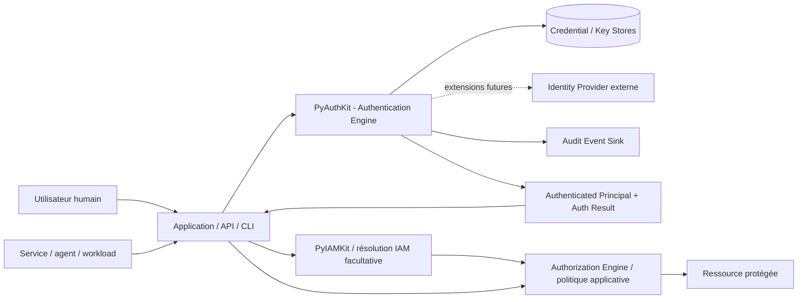
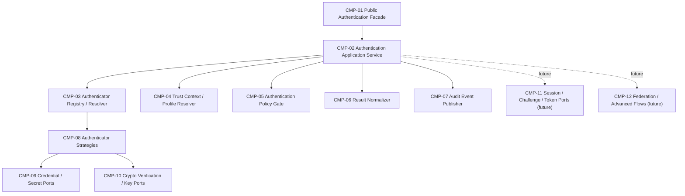
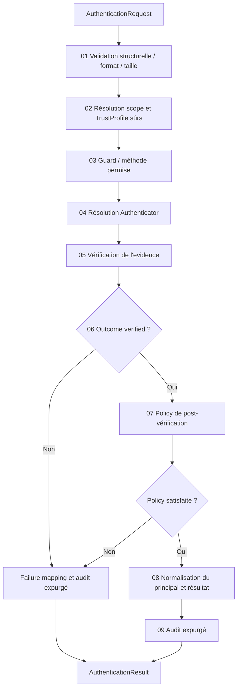
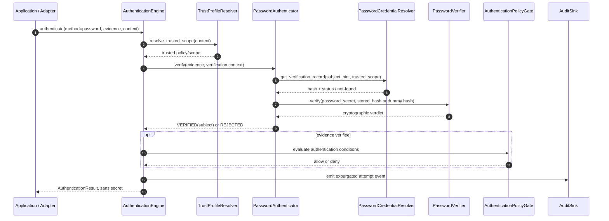
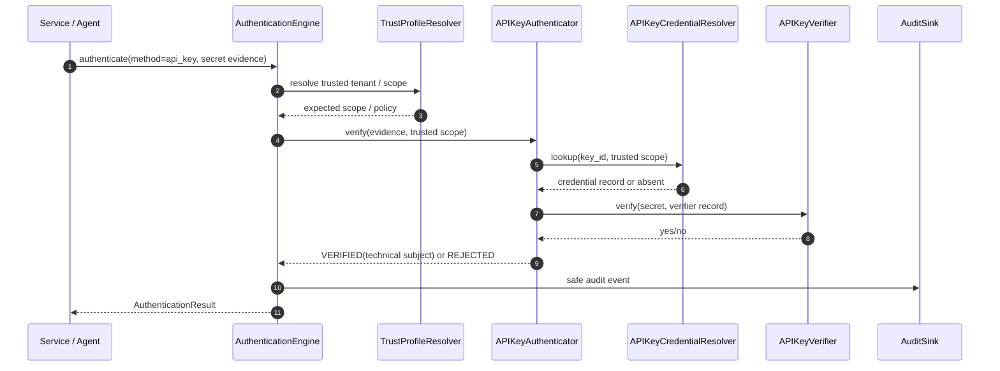
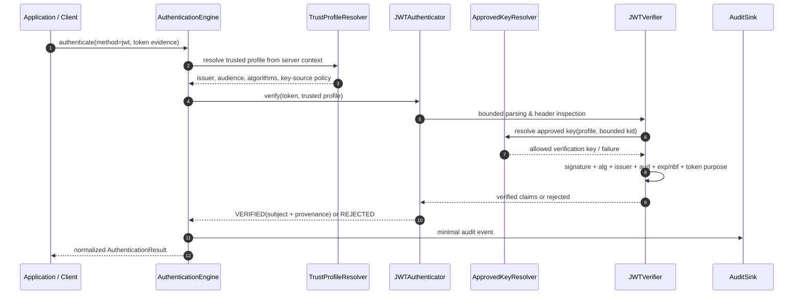
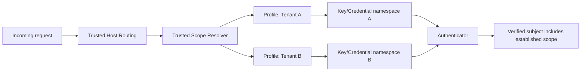
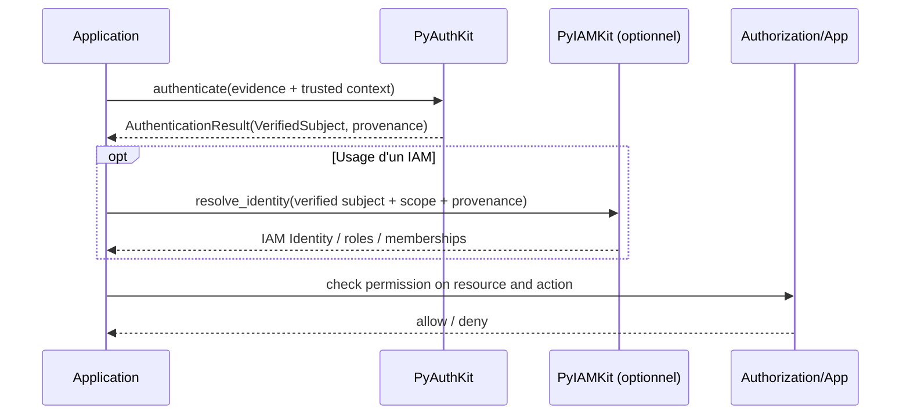

# 03_PYAUTHKIT_SYSTEM_ARCHITECTURE

# PyAuthKit - Architecture système

| Métadonnée | Valeur |
|---|---|
| Produit | **PyAuthKit** |
| Document | `03_PYAUTHKIT_SYSTEM_ARCHITECTURE.md` |
| Type | Architecture système logique, contractuelle et de sécurité |
| Statut | **Architecture candidate - à valider par ADR et tests** |
| Version documentaire | `0.1.0-draft` |
| Date | 27 octobre 2026 |
| Sources internes | `00_PYAUTHKIT_EXPRESSION_DU_BESOIN.md`, `01_PYAUTHKIT_REQUIREMENTS_ANALYSIS.md`, `02_PYAUTHKIT_PRODUCT_VISION_AND_ARCHITECTURE_PRINCIPLES.md` |
| Documents détaillés suivants | `04_PYAUTHKIT_DOMAIN_OBJECTS.md`, `05_PYAUTHKIT_ENTITIES_AND_VALUE_OBJECTS.md`, `06_PYAUTHKIT_DOMAIN_RELATIONSHIPS_AND_ERD.md`, `07_PYAUTHKIT_DOMAIN_INVARIANTS_AND_BUSINESS_RULES.md` |
| Langue | Français ; noms de contrats et patterns en anglais |

> **Architecture statement** - PyAuthKit est une bibliothèque Python **in-process**, autonome et *framework-agnostic*, organisée selon **Domain + Application + Ports & Adapters**, qui valide des preuves d'authentification suivant un profil de confiance explicite, établit un sujet authentifié, puis retourne un résultat indépendant de toute décision d'autorisation.

> **Statut des propositions** - Le présent document décrit un **design cible**, pas un dépôt implémenté ni un contrat public déjà publié. Un choix marqué **[CANDIDAT]** reste ouvert ; **[CIBLE MVP]** désigne un comportement attendu pour le premier noyau ; **[DIFFÉRÉ]** indique une extension architecturée mais non construite au MVP ; **[INVARIANT]** est une contrainte de sécurité à vérifier. Les décisions `DEC-*` de `01` et `ADRC-*` de `02` ne sont pas automatiquement acceptées ici.

> **Frontière fondamentale** - **Authentication ≠ Identity Management ≠ Authorization**. PyAuthKit établit une preuve et un principal ; PyIAMKit ou l'application résout l'identité organisationnelle et les permissions. Une authentification réussie **n'autorise aucune action** en elle-même.

---

## 1. Objet, sources et niveau d'abstraction

### 1.1 Objet

Le document `00` formalise le besoin ; `01` rend ce besoin vérifiable par des exigences `FR`, `ARC`, `SEC`, `NFR`, `INT` et critères `ACC` ; `02` définit la vision et les principes `PRN-01..PRN-18`. Le présent `03` matérialise ces éléments en une **architecture système cohérente** :

1. périmètre et contexte d'exécution ;
2. composants du noyau et responsabilités exclusives ;
3. vues C4 de contexte, conteneur logique et composants ;
4. dépendances entre modules Python et règles d'import ;
5. contrats d'entrée et de sortie, et résultat intermédiaire des authenticators ;
6. ports, adapters, composition root et configuration ;
7. pipeline MVP, stratégies de sélection et validation des preuves ;
8. trust boundaries, multi-tenant et mesures transversales ;
9. séquences Password, API Key et JWT ;
10. gestion des erreurs, concurrence, observabilité et modes de panne ;
11. intégration facultative avec PyIAMKit, Web, agents et services ;
12. packaging, qualification, traçabilité et décisions ouvertes.

### 1.2 Sources et traçabilité

| Référence | Apport au présent document |
|---|---|
| `00 §1-6` | Problème, mission, frontière PyAuthKit/PyIAMKit |
| `00 §7-12` | Principals, mécanismes, pipeline, objets conceptuels |
| `00 §15-28` | Sessions, tokens, credentials, fédération, agnosticisme, sécurité, audit et tenant |
| `00 §33-36` | Hors-périmètre, MVP, trajectoire et critères de réussite |
| `01 §5-9` | `FR-001..064`, `ARC-001..018`, `SEC-001..024`, `NFR-*`, `INT-*` |
| `01 §12-16` | Ports candidats, MVP, critères `ACC-001..030`, registre `DEC-01..22` |
| `02 §4-11` | Responsabilités, `PRN-*`, DDD, Hexagonal, patterns et sécurité |
| `02 §12-20` | Plugins, async, trust context, packaging et `ADRC-01..13` |
| `02 §23-25` | Questions requises et livrables attendus de `03` |

Ne pas créer de nouvel identifiant `FR-*` ou `SEC-*` dans `03` : ces séries sont **gérées par `01`**. Les identifiants architecturaux `CMP-*`, `PORT-*`, `TB-*`, `SEQ-*` et `FIT-*` sont locaux à `03`.

### 1.3 Ce que ce document ne fige pas

- Le modèle définitif des entities, value objects et aggregates (`04-07`).
- Les signatures et noms publics définitifs du package (`24`).
- Les algorithmes/paramètres de cryptographie et de password hashing (`10`, `20`).
- Les schémas de stockage SQL/Redis, migrations et backends (`19`).
- Les normes d'assurance annoncées ou revendiquées (`12`).
- Les protocoles de fédération détaillés (`14-15`).
- Le roadmap de versions définitif (`27`).

### 1.4 Conventions

- **Principal** : sujet de sécurité générique, humain ou non humain.
- **AuthenticatedPrincipal** : sujet établi par une preuve vérifiée et conservant sa provenance.
- **Evidence** : donnée présentée pour prouver une prétention ; **jamais présumée valide**.
- **ClaimedIdentity** : identifiant affirmé avant vérification.
- **VerifiedSubject** : sujet et son contexte de confiance après vérification.
- **TrustProfile** : configuration *trusted*, bornée et validée : méthode, issuer, audience, algorithmes, clé/résolveur et scope applicable.
- **AuthenticationContext** : contexte technique et de confiance d'une tentative, avec distinction entre champs déclarés et établis.
- **AuthenticatorOutcome** : verdict interne provenant d'une stratégie de vérification.
- **AuthenticationResult** : résultat public normalisé émis par le moteur après contrôles transverses.
- **C4** : modèle de vues architecturales ; les « conteneurs » décrits ci-dessous sont logiques, pas des services ou processus distincts.

---

## 2. Décisions structurantes proposées

| Réf. | Proposition de design | Statut | Justification / contrôle |
|---|---|---|---|
| `A-01` | Moteur Python in-process comme bibliothèque, sans serveur imposé | [CIBLE MVP] | `ARC-001`, `INT-001`; installation core pur |
| `A-02` | `domain` indépendant ; `application` orchestre ; `ports` abstraits ; `adapters` en périphérie | [CIBLE MVP] | `ARC-003`, `ARC-005`, `PRN-02/03` |
| `A-03` | API publique `async authenticate(request) -> AuthenticationResult` | [CIBLE MVP] | `FR-001/002`; `DEC-15` reste ouvert pour façade sync |
| `A-04` | `Authenticator` Strategy + `Registry` explicite | [CIBLE MVP] | `FR-004/010`, `ARC-002/004` |
| `A-05` | Méthode explicite en premier ; aucune dégradation/fallback implicite | [CIBLE MVP] | `FR-005`, `SEC-018`; `DEC-07` |
| `A-06` | Verdict interne séparé du résultat public | [CANDIDAT] | Séparer validation de preuve et politiques/résultat ; `DEC-06` |
| `A-07` | Scope de confiance résolu depuis configuration fiable, jamais depuis une claim seule | [INVARIANT] | `SEC-006..008`, `SEC-022` |
| `A-08` | Password, API Key, JWT **validation** dans le MVP | [CIBLE MVP] | `00 §34`, `FR-022..027` |
| `A-09` | JWT émission, sessions, MFA, challenge runtime et fédération après MVP | [DIFFÉRÉ] | `01 §13`, `ADRC-07`, `DEC-11..13` |
| `A-10` | Audit minimisé ; aucune donnée secrète dans events/logs | [INVARIANT] | `FR-061/064`, `SEC-001/020` |
| `A-11` | Intégrations PyIAMKit, FastAPI, Django, Flask et providers facultatives | [CIBLE ARCHITECTURE] | `ARC-018`, `INT-001..` |
| `A-12` | Aucune règle de permission RBAC/ABAC dans Authentication Engine | [INVARIANT] | `ARC-012/013`, `PRN-01` |
| `A-13` | Politique de distribution, versions Python, sync API et backend productif différés à des ADR | [OUVERT] | `DEC-01`, `DEC-15..17`, `DEC-20` |

**Règle de gouvernance :** les décisions `A-*` constituent des orientations de ce document. Seul un ADR accepté peut rendre définitivement contraignant un arbitrage explicitement ouvert dans `01`.

---

## 3. Principes non négociables et invariants système

### 3.1 Invariants de confiance

| Invariant | Conséquence système | Couverture |
|---|---|---|
| `INV-SYS-01` Succès ⇒ preuve vérifiée | Pas de construction de `AuthenticatedPrincipal` par simple parsing de credentials | `SEC-019`, `ACC-002/006` |
| `INV-SYS-02` Refus ⇒ aucun principal authentifié | `AuthenticationResult.principal` absent si invalid/denied/error | `SEC-018/019` |
| `INV-SYS-03` Aucune méthode de repli cachée | Un authenticator inconnu, cassé ou non configuré échoue de manière fermée | `FR-005`, `ACC-009` |
| `INV-SYS-04` Configuration de confiance fiable | Aucune claim JWT ou entrée utilisateur n'ajoute un issuer ou algorithme approuvé | `SEC-006/008` |
| `INV-SYS-05` Isolation du scope de confiance | Credentials, secrets et JWKS sont résolus sous un contexte tenant/realm établi | `SEC-022`, `ACC-026` |
| `INV-SYS-06` Secrets non observables | Pas de password, API key ou JWT brut dans log/event/repr/exception | `SEC-001`, `ACC-018` |
| `INV-SYS-07` Auth ≠ AuthZ | Un principal authentifié ne transporte pas implicitement un droit de ressource | `ARC-012/013` |
| `INV-SYS-08` Défaillance ⇒ jamais succès | Exception, timeout, interruption ou indisponibilité n'aboutissent pas à `AUTHENTICATED` | `ACC-016` |
| `INV-SYS-09` Authenticator scoped & stateless | Aucun état de requête secret conservé par un singleton partagé | `ACC-015` |
| `INV-SYS-10` Extensions non privilégiées par défaut | Un plugin est activé explicitement dans un périmètre autorisé | `PRN-14`, `SEC-005` |

### 3.2 Règle de dépendance

La dépendance du **code source** pointe vers l'intérieur :

```text
        integrations (FastAPI / Django / CLI / agents)
                               │
                               ▼
         bootstrap / composition root ───────┐
                               │             │
                               ▼             ▼
                   adapters            infrastructure
                               \       /
                                \     /
                                 ▼   ▼
                        application + ports
                                 │
                                 ▼
                               domain

         domain  -X-> FastAPI, Django, SQLAlchemy, Redis,
                        Google SDK, PyIAMKit, web requests
```

`domain` et `application` peuvent dépendre de définitions abstraites de ports, mais **jamais** des implémentations de périphérie. Dans l'exécution réelle, les adapters implémentent les ports et sont **injectés** depuis le composition root.

### 3.3 Immutabilité et contrôles des données

- Les objets d'entrée/sortie sont traités comme des **snapshots par tentative** ; modèle exact à fixer (`DEC-03`).
- Les identifiants, provenance et timestamps sont des données métier ; **les secrets ne le sont pas**.
- Les types **ClaimedIdentity** et **VerifiedSubject** restent conceptuellement distincts : on ne peut pas construire le second sans verdict valide.
- La frontière `tenant_id` ne se réduit jamais à `request.context.tenant_id` envoyé par le demandeur.
- Une assertion d'un IdP n'est pas une permission locale ; mapping et autorisation restent extérieurs.

---

## 4. Vue C4 - Niveau 1 : contexte système

### 4.1 Diagramme de contexte



Le composant `PyAuthKit` est **embarqué** dans le processus de l'application. Les boîtes `Credential / Key Stores`, IdP et event sink sont des dépendances possibles, pas un déploiement intégré. Le chemin `IdP` est une **extension post-MVP**.

### 4.2 Responsabilités externes

| Acteur / système | Fourni à PyAuthKit | Récupère ou décide |
|---|---|---|
| Application intégratrice | Evidence, méthode, trust scope, identifiant de tentative, dépendances | Résultat et éventuel principal |
| API / CLI / agent adapter | Traduction d'input en `AuthenticationRequest` | Traduction d'output en transport approprié |
| Credential storage | Identifiant de vérification, hash, état, métadonnées non secrètes | Ne décide pas du résultat final |
| Key resolver | Clés approuvées d'un trust profile | Ne valide pas à lui seul un sujet |
| PyIAMKit | Référence de sujet authentifié et provenance | Identité, groupes, rôles, politiques IAM |
| Authorization engine / application | Principal et contexte de requête | Autorise/refuse une ressource |
| Event sink | Événement expurgé et corrélé | Journalisation/monitoring sans secret |
| IdP externe (futur) | Assertions/protocoles fédérés | Le core vérifie une configuration locale de confiance |

### 4.3 Limite de confiance du contexte

La requête est **partiellement non fiable**. Le service hôte établit les paramètres de confiance via une configuration et un contexte serveur. Exemples : tenant validé depuis un routage fiable ou une liaison de client préexistante ; issuer et audience attendus configurés ; méthodes permises par une politique serveur.

Une valeur `tenant_id`, `issuer`, `alg` ou `aud` venant de l'extérieur peut être **un indice** pour rechercher une configuration bornée, jamais une autorisation de créer arbitrairement une confiance.

---

## 5. Vue C4 - Niveau 2 : conteneurs logiques et déploiement

### 5.1 PyAuthKit est une librairie, non un microservice

Les « containers » ci-dessous sont des **frontières de packaging/composants**, pas des pods séparés :

```text
┌──────────────────────── PROCESSUS HÔTE ────────────────────────┐
│                                                               │
│  Application / FastAPI / Django / CLI / Worker                 │
│             │                                                 │
│       Adapter entrant                                         │
│             │                                                 │
│       AuthenticationEngine facade                             │
│             │                                                 │
│        Application use cases + Domain                         │
│             │                                                 │
│       Ports sortants                                          │
│             │                                                 │
│   ┌─────────┼──────────────────┐                              │
│   ▼         ▼                  ▼                              │
│ Password  APIKey              JWT + Key Resolver               │
│ Adapter   Adapter             Adapter                          │
└───┬─────────┬──────────────────┬───────────────────────────────┘
    │         │                  │
    ▼         ▼                  ▼
 App DB    Credential Store     Trust Key Store / Approved JWKS

    OPTIONAL: Audit sink, MFA adapters, IdPs, Redis, PyIAMKit
```

### 5.2 Topologies supportées conceptuellement

| Topologie | MVP ? | Conditions |
|---|---|---|
| Monolithe Python sans HTTP | Oui | Entrée directe, dependencies injectées |
| Service FastAPI/Starlette | Adapter ultérieur | Pas d'import Web dans le core |
| Django + DRF | Adapter ultérieur | Pas de couplage du domaine aux modèles User ou ORM |
| CLI local | Oui via code applicatif | Ne jamais afficher les secrets en sortie |
| API machine-to-machine | Oui | API Key/JWT, pas de session humaine obligatoire |
| Agent runtime | Oui côté modèle, adapter ultérieur | Principal `AGENT`, provenance et policy externes |
| Cluster multi-workers | Sous conditions | Adapters réellement partagés et sûrs ; pas de store mémoire en production distribuée |
| Sidecar / service distant PyAuthKit | Non requis | Produit distinct possible sans altérer le cœur embarqué |

### 5.3 Cycle de vie des instances

- `AuthenticationEngine` : potentiellement longue durée, état **de configuration** immuable après bootstrap.
- `AuthenticatorRegistry` : mutation seulement pendant composition/bootstrap ; idéalement figé au moment de servir.
- `Authenticator` : instance partageable uniquement si **réentrante** et sans état mutable par tentative.
- `AuthenticationAttempt`, evidence et context : propres à une invocation.
- Connections et pools de stockage : gérés par leurs adapters et leur *lifespan* hôte.
- `Clock` et `EventSink` : injectables, avec politiques de fermeture explicites si ressources détenues.

---

## 6. Vue C4 - Niveau 3 : composants internes

### 6.1 Carte des composants



### 6.2 Catalogue, ownership et périmètre

| ID | Composant | Responsabilité unique | Entrées / sorties | Phase |
|---|---|---|---|---|
| `CMP-01` | `AuthenticationFacade` | Point d'entrée public stable | Request → Result | MVP |
| `CMP-02` | `AuthenticationService` | Orchestrer chaque tentative et garantir invariants | Request + services → résultat | MVP |
| `CMP-03` | `AuthenticatorRegistry` | Association mécanisme/capabilities vers stratégie | `method`, scope → `Authenticator` | MVP |
| `CMP-04` | `TrustProfileResolver` | Obtenir profil fiable applicable à une tentative | trusted caller context → profile | MVP |
| `CMP-05` | `AuthenticationPolicyGate` | Autoriser méthode et contrôler pré/postconditions de preuve | request/profile/outcome → allow/deny | MVP minimal, avancé ensuite |
| `CMP-06` | `ResultNormalizer` | Construire le type public sans fuite de détails | outcome + correlation → result | MVP |
| `CMP-07` | `AuditPublisher` | Produire événements sûrs sans coupler le core au sink | événement expurgé → sink | MVP minimal |
| `CMP-08` | `Authenticator` strategies | Vérifier un mécanisme **particulier** | evidence + verification context → outcome | MVP Password/APIKey/JWT |
| `CMP-09` | Credential ports | Consulter des données de validation adaptées | subject hint/key handle → record | MVP |
| `CMP-10` | Crypto / key ports | Hash/verifier JWT, time, résolution de clés approuvées | profile + token/hash → verdict | MVP |
| `CMP-11` | State ports | Cycle de vie session, challenge, token et continuité | identifiants + store → état | [DIFFÉRÉ] |
| `CMP-12` | Federation / flow engine | MFA, OIDC, SAML, WebAuthn, risque, step-up | flow context → verdict/continuation | [DIFFÉRÉ] |

**Distinction importante :** un `PolicyGate` d'authentification peut exiger une méthode/assurance, mais n'accorde jamais une permission métier. Son mode MVP peut être un simple contrôle de méthodes et de profils. Un moteur ABAC/RBAC appartient à la couche d'autorisation extérieure.

### 6.3 Boundaries par composant

- `CMP-02` est le seul propriétaire du **flux global de tentative**.
- `CMP-08` détient la vérification spécifique au mécanisme ; ne décide pas des rôles IAM.
- `CMP-04` est la source contrôlée de la configuration de confiance ; `CMP-08` ne télécharge pas une clé depuis une URL imposée par le token.
- `CMP-06` est le seul point normalisé de création d'un `AuthenticationResult` public ; l'invariant « succès ⇒ preuve » y est revérifié.
- `CMP-07` ne reçoit que des types de données auditables *allowlisted* ; ne sérialise jamais `AuthenticationRequest`.
- `CMP-01` ne décide ni du transport HTTP ni du statut HTTP : responsabilité de l'intégration.

---

## 7. Architecture en couches et frontières de modules

### 7.1 Partition cible

```text
pyauthkit/
├── __init__.py                 # exports publics stables, sans imports facultatifs
├── domain/                     # concepts et invariants métier purs
│   ├── principals.py           # claimed / verified, typologies
│   ├── evidence.py             # représentation / protection des preuves
│   ├── requests.py             # contrat d'entrée conceptuel
│   ├── results.py              # états et résultats normalisés
│   ├── trust.py                # types de confiance, profils immuables
│   ├── errors.py               # catégories d'erreurs de domaine
│   └── events.py               # événements sûrs et typés
├── application/
│   ├── engine.py               # facade publique / application service
│   ├── registry.py             # stratégie et résolution explicites
│   ├── policy.py               # gate d'authentification, MVP minimal
│   ├── orchestration.py        # déroulement d'une tentative
│   └── normalization.py        # outcome interne -> result externe
├── ports/
│   ├── authenticators.py       # contrat de Strategy
│   ├── credentials.py          # resolvers / verifiers
│   ├── keys.py                 # resolveurs de clés et crypto
│   ├── clock.py                # temps injectable
│   ├── audit.py                # événements sécurisés
│   └── future/                 # NON obligatoire pour le bootstrap
│       ├── sessions.py
│       ├── challenges.py
│       └── tokens.py
├── authenticators/             # adapters métier d'authentification MVP
│   ├── password.py
│   ├── api_key.py
│   └── jwt.py
├── adapters/                   # périphérie / dépendances interchangeables
│   ├── memory/                 # références non productives
│   ├── crypto/                 # bibliothèques éprouvées
│   └── audit/                  # implémentations concrètes
├── integrations/               # optionnelles : modules peuvent venir plus tard
│   ├── fastapi/
│   ├── django/
│   ├── flask/
│   ├── iam/
│   └── agents/
└── bootstrap/
    ├── wiring.py               # composition root explicite
    └── configuration.py        # configuration contrôlée et validée
```

**Ceci est une arborescence candidate, pas une obligation de créer tous les fichiers dès `0.1.x`.** Le futur document de repository architecture et le bootstrap final fixeront les modules exacts. Les noms `ports` et `domain` ne supposent pas une granularité maximale : regrouper des modules est acceptable si l'invariant de dépendances est respecté.

### 7.2 Matrice des imports autorisés

| Source \ Cible | Domain | Ports | Application | Authenticators/adapters | Integrations | Bootstrap |
|---|---|---|---|---|---|---|
| Domain | Oui | **Non** | Non | Non | Non | Non |
| Ports | Oui | Oui | Non | Non | Non | Non |
| Application | Oui | Oui | Oui | **Non** | Non | Non |
| Authenticators/adapters | Oui | Oui | **Éviter** | Oui | Non | Non |
| Integrations | Oui | Oui | Oui | Selon usage | Oui | Non |
| Bootstrap | Oui | Oui | Oui | Oui | Oui si installé | Oui |

Précision : une interface de `Authenticator` peut être déclarée sous `ports`, la stratégie l'implémente sous `authenticators`, et le registre la consomme via **le port**, sans import de classes concrètes.

### 7.3 Règles programmatiquement testables

1. `import pyauthkit` ne doit importer ni Django ni FastAPI ni PyIAMKit.
2. Aucun module `domain` n'importe `application`, `adapters` ou `integrations`.
3. Aucun module `application` n'importe `jwt`, `password`, `api_key` comme implémentations concrètes.
4. La configuration de provider n'est jamais stockée dans une global mutable non contrôlée.
5. La substitution d'un port par un fake doit être possible sans patcher du code interne.
6. Un nouveau plugin ne nécessite pas une modification d'un `if provider == ...` dans `engine`.
7. L'import des extras facultatifs ne casse pas l'installation de base.

### 7.4 Patterns réels, sans classes décoratives

| Pattern | Localisation logique | Pourquoi | Contre-indication |
|---|---|---|---|
| **Strategy** (GoF Behavioral) | `Authenticator` implementations | Variante de vérification sélectionnable | Stratégie qui fait aussi IAM et stockage |
| **Adapter** (GoF Structural) | Ports → crypto/store/IdP/Web | Isolation des dépendances externes | Adapter qui définit le domaine |
| **Factory** (GoF Creational, candidat) | `bootstrap` | Instancier/assembler composants | Factory dans chaque module métier |
| **Registry** (idiome architectural) | `application.registry` | Association méthode → Strategy | Mutation non contrôlée en production |
| **Facade** (GoF Structural) | `AuthenticationEngine` | Simplifier l'usage client | Façade contenant toute la logique |
| **Observer / Domain Events** | `AuditPublisher` | Découplage audit | Événements exposant des secrets |
| **Chain/Pipeline** | Future flows | Étapes et challenges composables | Workflow généraliste dans MVP |
| **State** | Future challenges/sessions | Règles de transition | États distribués sans atomicité |
| **Repository** (DDD/architectural) | Ports de persistance adaptés | Abstraire des records utiles | CRUD générique imposé au domaine |

Aucun microservices, CQRS, event sourcing, service locator global ou bus distribué n'est exigé au MVP (`02 §9`, KISS/YAGNI).

---
## 8. Ports entrants, ports sortants et ownership

### 8.1 Ports entrants / driving ports

| ID | Port | Opération candidate | Consommateur |
|---|---|---|---|
| `PORT-IN-01` | `AuthenticationEngine` | `authenticate(request)` | Python, CLI, Web adapters, agents |
| `PORT-IN-02` | `AuthenticatorRegistry` | `register(authenticator)` au bootstrap, `resolve(selector)` à l'exécution | Bootstrap/application |
| `PORT-IN-03` | `AuthenticationCapabilities` | `supported_methods()` sans révéler les profils de secrets | Intégrateur/configuration |
| `PORT-IN-04` | `AuthenticationInspection` (optionnel) | Diagnostic contrôlé des stratégies chargées | Exploitation (non exposé publiquement par défaut) |

**Note :** `PORT-IN-02..04` peuvent être des méthodes sur façade ou des services internes ; leur présence dans la liste n'impose pas quatre interfaces formelles.

### 8.2 Ports sortants / driven ports MVP

| ID | Port candidat | Rôle | Contraintes de confiance |
|---|---|---|---|
| `PORT-OUT-01` | `PasswordCredentialResolver` | Accéder à un hash, à son algorithme et à son statut | Scope serveur, aucun password brut stocké |
| `PORT-OUT-02` | `PasswordVerifier` | Vérifier secret soumis contre hash sécurisé | Backend cryptographique éprouvé, pas de plaintext persisté |
| `PORT-OUT-03` | `ApiKeyCredentialResolver` | Trouver record par identifiant non secret, scope et statut | Isolation tenant ; secret complet jamais indexable publiquement |
| `PORT-OUT-04` | `ApiKeyVerifier` | Vérifier matériel secret présenté contre preuve stockée | Comparaison de dérivés sûre ; longueur/format bornés |
| `PORT-OUT-05` | `TrustProfileResolver` | Obtenir méthode/profil issuer/audience/algorithmes attendus | Source contrôlée, pas de confiance dérivée d'une claim |
| `PORT-OUT-06` | `VerificationKeyResolver` | Résoudre les clés **approuvées** pour ce profil | Pas de téléchargement arbitraire depuis le token ; SSRF protégé |
| `PORT-OUT-07` | `SignedTokenVerifier` | Vérifier signature + contraintes de profil | Pas d'`alg` contrôlé par input non borné |
| `PORT-OUT-08` | `AuthenticationEventSink` | Consommer événements minimisés | Pas de secret ni token brut ; politique d'échec explicite |
| `PORT-OUT-09` | `Clock` | Fournir l'heure injectée aux contrôles temporels | Horloge testable, gestion explicite de dérive |
| `PORT-OUT-10` | `AttemptGuard` (hook) | Décision de limitation/tentatives sans gestion IAM | Clés de garde dérivées de contexte sûr, pas de divulgation |

### 8.3 Ports post-MVP

| ID | Port | Justification | Dépendance documentaire |
|---|---|---|---|
| `PORT-FUT-01` | `ChallengeStore` | Single-use, expiry, reprise de MFA/magic link | `11`, `12` |
| `PORT-FUT-02` | `SessionStore` | Création, validation, révocation et rotation | `13`, `19` |
| `PORT-FUT-03` | `TokenIssuer` | Émission, lifecycle et rotation distincts de validation | `13` |
| `PORT-FUT-04` | `FederationProvider` | OIDC/SAML et comptes externes | `14` |
| `PORT-FUT-05` | `RiskEvaluator` | Contexte risque externe / adaptive | `17` |
| `PORT-FUT-06` | `NotificationChannel` | Challenge email/SMS via provider isolé | `11` |
| `PORT-FUT-07` | `DeviceAssertionVerifier` | WebAuthn, certificats ou workload attestation | `15`, `16` |
| `PORT-FUT-08` | `IdentityBridge` | Intégration PyIAMKit sans dépendance du core | `23` |

### 8.4 Granularité / Interface Segregation Principle

Ne pas créer un unique `SecurityRepository` avec `verify_password`, `find_api_key`, `sign_token`, `send_email` et `revoke_session`. Chaque stratégie ne doit recevoir **que les capacités nécessaires**.

Exemple d'anti-pattern :

```python
# Anti-pattern conceptuel : couplage fonctionnel et infrastructurel.
class EverythingSecurityStore:
    def read_user(self, ...): ...
    def check_password(self, ...): ...
    def issue_jwt(self, ...): ...
    def send_sms(self, ...): ...
    def grant_role(self, ...): ...  # Hors PyAuthKit !
```

Contrat recommandé : petits ports aux responsabilités observables, et **contrats de tests identiques** pour chaque implémentation substituable.

---

## 9. Modèle logique des données échangées

### 9.1 Chaîne sémantique

```text
CLAIM / INPUT               VERIFICATION                RESULT

ClaimedIdentity ─────────┐
Evidence (untrusted) ────┼─► Authenticator + TrustProfile
TrustedRequestScope ─────┘            │
                                      ▼
                             AuthenticatorOutcome
                         ┌────────────┴─────────────┐
                         │                          │
                     VERIFIED                   REJECTED
                         │                          │
                         ▼                          ▼
                   VerifiedSubject                 None
                         │                          │
                    PolicyGate                  Failure Code
                         │                          │
                         └───────────┬──────────────┘
                                     ▼
                           AuthenticationResult
```

### 9.2 Contrats conceptuels (non figés)

```python
# PSEUDOCODE DE CONCEPTION - non destiné à être copié en production.
# Noms, classes, champs, mutabilité et exceptions seront tranchés dans 04-08/24.
from dataclasses import dataclass, field
from enum import Enum
from typing import Any, Mapping

class AuthStatus(str, Enum):
    AUTHENTICATED = "authenticated"
    REJECTED = "rejected"
    ERROR = "error"
    CHALLENGE_REQUIRED = "challenge_required"  # réservé aux flows futurs

@dataclass(frozen=True)
class VerifiedSubject:
    subject_id: str
    principal_type: str                # HUMAN, SERVICE, AGENT, WORKLOAD, ...
    issuer_id: str                     # provenance validée, jamais une claim brute
    trust_scope_id: str                # tenant/realm ou autre scope établi

@dataclass(frozen=True)
class AuthenticationContext:
    # Ne pas traiter les champs fournis par le client comme 'trusted' par défaut.
    channel: str
    request_correlation_id: str | None = None
    caller_hints: Mapping[str, str] = field(default_factory=dict)

@dataclass(frozen=True)
class TrustedEntryContext:
    # Assemblé par le code serveur / composition root, non par le client.
    application_binding: str
    validated_route_binding: str

@dataclass(frozen=True)
class AuthenticationRequest:
    method: str
    evidence: Any                      # objet secret spécialisé, représentation sûre
    context: AuthenticationContext     # hints client: non fiables en eux-mêmes
    trusted_entry_context: TrustedEntryContext

@dataclass(frozen=True)
class AuthenticatorOutcome:
    verified: bool
    subject: VerifiedSubject | None
    internal_reason: str | None = None
    proof_metadata: Mapping[str, str] = field(default_factory=dict)

@dataclass(frozen=True)
class AuthenticationResult:
    status: AuthStatus
    principal: VerifiedSubject | None
    attempt_id: str
    public_error_code: str | None = None
```

**Attention :** `Any` n'est utilisé ici que pour **éviter de figer prématurément** une hiérarchie de secrets ; la future API devrait utiliser des types d'evidence fermés, protocoles ou unions discriminées et contrôler leur sérialisation. `TrustedEntryContext` est un **objet que l'hôte doit construire à partir de sources préapprouvées** : sa simple présence comme type Python ne le rend pas infalsifiable si l'application accepte des valeurs client non vérifiées. Aucun secret brut ne doit être inclus dans `__repr__`, exception ou événement. `issuer_id` ne signifie pas que PyIAMKit a créé ou résolu une identité locale.

### 9.3 Result public vs outcome interne

| Dimension | `AuthenticatorOutcome` | `AuthenticationResult` |
|---|---|---|
| Responsable | Stratégie de vérification | Application/Normalizer |
| Portée | Détails internes du mécanisme | API stable, transport-neutral |
| Indique preuve vérifiée | Oui | Via `status=AUTHENTICATED` et principal |
| Contient erreurs internes | Option contrôlée | Code public neutralisé |
| Expose principal vérifié | Sujet établi seulement après validation | Sujet vérifié si succès |
| Politiques globales appliquées | Pas nécessairement | Oui avant succès final |
| Données secrètes | **Jamais** | **Jamais** |
| Peut réclamer un challenge futur | Extension à définir | `CHALLENGE_REQUIRED` réservé |

Cela empêche que `JWTAuthenticator` ou `PasswordAuthenticator` produise une réussite finale *sans* que le moteur ait appliqué tous les contrôles transversaux.

### 9.4 États et invariants de normalisation

| État | Sens | `principal` | Exposition |
|---|---|---|---|
| `AUTHENTICATED` | Evidence vérifiée + profil et policies satisfaits | Obligatoire | Résultat public |
| `REJECTED` | Preuve invalide ou policy non satisfaite | **Absent** | Code générique |
| `ERROR` | Échec technique / configuration empêchant la validation | **Absent** | Code de sécurité neutre |
| `CHALLENGE_REQUIRED` | Suite de flow requise | Aucun principal **finalement** authentifié ; contexte partiel séparé | [DIFFÉRÉ] |

Si un premier facteur a réussi mais qu'une continuation MFA est obligatoire, le résultat **ne doit pas être interprété comme une authentification finale**. Un éventuel sujet *partiellement vérifié* appartient à l'état de flow interne, pas au `AuthenticatedPrincipal` exposé comme succès.

### 9.5 Principal et origin ne sont pas synonymes

Types de principals : `HUMAN`, `SERVICE`, `APPLICATION`, `AGENT`, `DEVICE`, `WORKLOAD` (liste ouverte) ; l'origine (`LOCAL`, `OIDC`, `SAML`, `EXTERNAL_PROVIDER`, etc.) est un **axe distinct proposé** plutôt qu'un type `EXTERNAL` qui ferait disparaître la nature de la machine ou de l'humain. Ce point reste `DEC-05`, à confirmer dans `04-06`.

### 9.6 Niveau d'assurance

L'architecture réserve des métadonnées de facteurs et de confiance, mais **ne calcule aucun `AAL2` ou `AAL3` automatique** à partir du simple nombre de factors. L'alignement à un standard nécessite un profil et une évaluation explicites. Les labels exacts sont traités dans `12` (`DEC-18`).

---

## 10. Contrat interne des authenticators et registry

### 10.1 Intentions

Un authenticator doit :

1. déclarer une méthode ou capacité précise ;
2. recevoir une evidence du type attendu et un contexte de vérification **validé** ;
3. consulter uniquement les ports autorisés à ce mécanisme ;
4. vérifier la preuve ;
5. retourner un verdict sans exposer de secret, ni enregistrer de permission IAM ;
6. être testable avec des doubles, et sûr en concurrence.

### 10.2 Signature candidate

```python
# PSEUDOCODE DE CONCEPTION, pas une API publique validée.
from typing import Protocol

class Authenticator(Protocol):
    @property
    def method(self) -> str: ...

    async def verify(
        self,
        request: AuthenticationRequest,
        context: "VerificationContext",  # contient TrustProfile serveur
    ) -> AuthenticatorOutcome: ...
```

La valeur du `method` (`"password"`, `"api_key"`, `"jwt"`) constitue une **identité logique** de stratégie, pas le nom d'un fournisseur ; les providers OIDC futurs disposeront d'une configuration contextualisée, pas de `if google` dans le core.

### 10.3 Résolution explicite

```text
method déclarée
   │
   ▼
normalisation stricte du sélecteur
   │
   ▼
registry.resolve(method, scope)
   ├── exactement une stratégie autorisée ─► verify(...)
   ├── zéro stratégie ─────────────────────► REJECTED/UNSUPPORTED_METHOD
   └── ambiguïté de configuration ────────► ERROR/CONFIGURATION_ERROR
```

**Proposition :** la détection automatique de méthode par forme de token ou `Authorization` header reste hors MVP. Si elle est introduite, elle doit être **bornée**, explicite et ne jamais sélectionner automatiquement un mécanisme moins sûr.

### 10.4 Enregistrement et gel

```python
# Exemple conceptuel de wiring, aucune classe n'est une promesse d'API stable.
registry = AuthenticatorRegistry()
registry.register("password", password_authenticator)
registry.register("api_key", api_key_authenticator)
registry.register("jwt", jwt_authenticator)
registry.freeze()  # mutation interdite pendant le traitement de requêtes

engine = AuthenticationEngine(registry=registry, ...)
```

Le `freeze()` est **une option de design**, pas un contrat déjà fixé. Il vise à éviter les races entre chargement de plugins et authentifications concurrentes.

### 10.5 Politique de plugin

- **Opt-in** : l'existence d'un entry point installé n'autorise pas son exécution.
- **Capabilities** explicites : une extension annonce méthodes/types d'evidence compatibles.
- **Configuration isolée** : secrets/scopes fournis par l'hôte, pas auto-découverts depuis un token.
- **Validation au bootstrap** : duplication de méthode, contrat incompatible ou dépendances absentes signalés tôt.
- **Compatibilité** : contract tests contre `Authenticator`, types de sortie et erreurs.
- **Sécurité** : la bibliothèque ne sait pas rendre un plugin Python arbitraire « sandboxé » ; les extensions sont du **code de confiance à auditer et pinner**.

### 10.6 Contre-exemples interdits

```python
# Mauvais : sélection centrale par fournisseur.
if provider == "google": ...
elif provider == "github": ...

# Mauvais : JWT accepté parce qu'il contient un sub.
sub = decode_without_verification(token)["sub"]
return AuthenticatedPrincipal(subject_id=sub)

# Mauvais : fallback invisible sur panne du JWT verifier.
try:
    return verify_jwt(token)
except Exception:
    return verify_api_key(token)
```

---

## 11. Pipeline d'authentification MVP

### 11.1 Étapes logiques



### 11.2 Description opérationnelle

| Étape | Responsable | Vérification | Échec |
|---|---|---|---|
| 01 | Facade/Service | Méthode et format d'evidence reconnus, taille bornée, context minimal | Rejet neutre |
| 02 | TrustProfileResolver | Source de confiance, tenant/realm établis, profil actif, cible attendue | Error/Reject sans repli |
| 03 | AttemptGuard/PolicyGate | Méthode permise ; limitation si adapter disponible | Policy rejected/rate limited |
| 04 | Registry | Une stratégie enregistrée et autorisée | Unsupported / configuration error |
| 05 | Authenticator | Validation spécifique au mécanisme et aux conditions de confiance | Rejected/Error |
| 06 | Application | `verified` cohérent avec subject validé | Invariant violation → Error |
| 07 | Authentication Policy | Conditions globales du profil et de la tentative | Rejected/challenge futur |
| 08 | Normalizer | `AuthenticatedPrincipal` seulement si preuve et politique passées | Error si incohérence |
| 09 | AuditPublisher | Événement minimal, identifiant de corrélation | Politique de publication explicite |

### 11.3 Pseudocode d'orchestration (conceptuel)

```python
async def authenticate(self, request: AuthenticationRequest) -> AuthenticationResult:
    # PSEUDOCODE : détails de timeout/erreurs/telemetry à finaliser.
    attempt_id = self.ids.new_attempt_id()
    audit = SafeAuditBuilder(attempt_id=attempt_id)
    try:
        validated = self.request_validator.validate(request)
        trust = await self.trust_profiles.resolve(validated.trusted_entry_context)
        await self.guard.check(validated, trust)
        authenticator = self.registry.resolve(validated.method, trust)
        outcome = await authenticator.verify(validated, trust.verification_context())

        if not outcome.verified or outcome.subject is None:
            return self.results.rejected(attempt_id, audit.safe_reason(outcome))

        decision = await self.auth_policy.evaluate(validated, trust, outcome)
        if not decision.allowed:
            return self.results.rejected(attempt_id, "AUTHENTICATION_REJECTED")

        return self.results.authenticated(attempt_id, outcome.subject)
    except KnownAuthenticationRejection:
        return self.results.rejected(attempt_id, "AUTHENTICATION_REJECTED")
    except KnownDependencyFailure:
        return self.results.error(attempt_id, "AUTHENTICATION_UNAVAILABLE")
    except BaseException:
        # En production, il faut traiter spécifiquement cancellation et
        # exceptions non récupérables : ce bloc ne doit pas les avaler.
        raise
    finally:
        await self.audit_policy.publish_safely(audit)
```

**L'exemple illustre l'ordre de responsabilité et non la sémantique exacte de Python `CancelledError`, la livraison d'audit ou les méthodes `async`**. Le contrat final devra préserver annulation/timeouts, ne pas avaler les erreurs fatales, et ne pas transformer une panne de sécurité en succès.

### 11.4 Points d'extension sans sur-ingénierie

- Avant vérification : `RequestValidator`, `TrustProfileResolver`, `AttemptGuard`.
- Pendant : `Authenticator` spécialisé + ports de credentials et crypto.
- Après : `AuthenticationPolicyGate`, `ResultNormalizer`, audit.
- **Post-MVP** : challenge, MFA factor composition, continuation, session/token issuance et adaptive risk.

### 11.5 Temps et mémoire

- Au MVP, **aucun état de flow authentifié persistant** n'est nécessaire pour la simple validation Password/API Key/JWT.
- L'ID de tentative appartient au périmètre d'observabilité ; sa création ne rend pas la tentative persistante.
- Le `AuthenticationRequest`/evidence ne doit pas être conservé par défaut après résultat.
- L'émission de tokens n'est pas déduite de la validation d'un JWT entrant.

---

## 12. Séquence `SEQ-01` - Password Authentication (MVP)

### 12.1 Objectif

Valider un password soumis par un **humain** ou autre principal explicitement autorisé, contre un *hash* sécurisé fourni par un resolver, sans traiter la simple présence d'un identifiant comme preuve suffisante.

### 12.2 Séquence



### 12.3 Chaîne de traitement

1. Le caller fournit un identifiant **déclaré** et le password comme *secret evidence*.
2. L'intégration n'enregistre jamais le password dans les logs ni les erreurs.
3. Le moteur vérifie méthode/scope et charge la stratégie.
4. Le resolver renvoie hash, statut, identifiant interne et éventuellement politiques de vérification ; **pas de password en clair**.
5. Le verifier effectue une vérification par une primitive cryptographique appropriée au password hashing.
6. La stratégie refuse un hash invalide, un compte de credential désactivé ou un résultat de vérification négatif.
7. Le résultat normalisé ne fournit un sujet qu'après validation et policy.

### 12.4 Choix techniques encore ouverts

- `DEC-09` : bibliothèque de password hashing, paramètres/migration de hash et politique de rehash.
- Le *dummy hash* pour identifiant inconnu est une **mesure candidate** d'atténuation des différences de temps, pas une garantie générale contre l'énumération.
- Le verrouillage et la limitation d'essais peuvent être appliqués via `AttemptGuard` ou la plateforme hôte ; sans provider configuré, aucune promesse de sécurité contre brute-force distribué ne doit être formulée.
- L'intégration avec un annuaire externe ou l'IAM est un adapter ou une résolution de credential, **pas** un import du modèle `User` Django dans le domaine.

### 12.5 Tests négatifs structurants

| Test | Résultat attendu | Réf. |
|---|---|---|
| Password erroné | `REJECTED`, aucun principal | `ACC-003` |
| Credential absent | Même catégorie publique d'échec qu'un password incorrect, selon politique | `SEC-017` |
| Hash corrompu / algorithme interdit | Aucun succès ; erreur sûre, audit interne | `SEC-003/018` |
| Resolver indisponible | Aucun succès, classification technique | `ACC-016` |
| `repr()` ou log d'un objet de preuve | Aucune valeur secrète visible | `ACC-018` |
| Panne du guard obligatoire | Refus ou error sûr, jamais bypass | `SEC-016/018` |

---

## 13. Séquence `SEQ-02` - API Key Authentication (MVP)

### 13.1 Objectif

Authentifier une application, service, workload ou agent par une API key attribuée à un sujet **sans exiger une session Web**. L'attribution de scopes et permissions métiers reste séparée de la **preuve d'authenticité**.

### 13.2 Modèle de credential proposé

```text
API KEY (présentée)
 ├── key_id / public prefix  --> identifiant de recherche non secret
 └── secret material        --> valeur sensible, non journalisée

PERSISTENCE (adapter)
 ├── key_id, issuer / tenant scope, status, expiration
 ├── fingerprint / keyed verifier material
 ├── verified subject reference
 └── metadata non secrètes
```

Le format et la dérivation du stockage doivent rester **configurables et examinés en sécurité**. Les API keys à forte entropie peuvent admettre une dérivation dédiée ; elles **ne se traitent pas nécessairement comme des passwords humains**. Ne pas confondre une empreinte HMAC, un hash général et un password hashing lent sans menace explicitée.

### 13.3 Séquence



### 13.4 Règles de sécurité

- Clé générée avec entropie et longueur adaptées ; **aucune clé arbitrairement faible** approuvée par défaut.
- `key_id` n'est pas un secret et ne suffit jamais à authentifier.
- Expiration et révocation évaluées selon le scope configuré.
- Aucun mécanisme de « création automatique » d'identité ou de permission à partir d'une clé non reconnue.
- Rotation future et chevauchement de clés décidés dans le modèle de credentials (`FR-018/019`, `DEC-08`).
- Représentations et événements ne contiennent pas de key ni de secret dérivé exploitable.

### 13.5 Tests négatifs

| Test | Résultat attendu |
|---|---|
| Mauvaise clé / préfixe inconnu | Rejet, pas de principal (`ACC-005`) |
| Key révoquée | Rejet, pas de succès dégradé |
| Key tenant A présentée dans scope B | Rejet, isolation des records (`ACC-026`, phase de validation isolation) |
| API Key malformed/très longue | Validation bornée, pas de DoS de parsing |
| Store down | Error sécurisé, aucun fallback implicite |
| Logs/traces | Aucune valeur brute de clé (`ACC-018`) |

---

## 14. Séquence `SEQ-03` - JWT Validation (MVP)

### 14.1 Objectif et limites

Valider un **JWT entrant** en s'appuyant sur un **profil de confiance préétabli**. JWT est un **format de token**, pas une preuve d'authentification universelle : le contexte doit définir le **type de token acceptable**, l'issuer, l'audience et l'usage voulu.

**Périmètre MVP :** validation JWT signés autorisés ; **hors MVP** : émission JWT, serveur OAuth, OIDC complet, refresh token lifecycle, JWE généralisé, introspection opaque et distribution de clés productives non encore qualifiées.

### 14.2 TrustProfile JWT candidat

```yaml
# Exemple illustratif - non prêt pour la production.
trust_profiles:
  internal_api:
    trusted_scope: "tenant_a/service_api"   # résolu via config serveur
    method: "jwt"
    expected_issuer: "https://issuer.example.test/"
    expected_audience: "py-service-api"
    expected_token_use: "access"             # profil à documenter
    allowed_algorithms: ["RS256"]            # exemple, non valeur universelle
    verification_keys: "configured-key-resolver"
    require_expiration: true
    require_subject: true
    max_clock_skew_seconds: 30                # valeur candidate, pas normative
```

Ne jamais accepter `expected_issuer` ou `verification_keys` tel que fourni dans les claims d'un token non vérifié. Le profil est sélectionné via configuration approuvée et contexte de l'application hôte.

### 14.3 Séquence



### 14.4 Validation obligatoire candidate

1. Valider le format et la taille maximale du token avant opérations coûteuses.
2. Sélectionner le **profil de confiance** via contexte serveur fiable.
3. Rejeter les algorithmes non autorisés, y compris toute variante « none » non explicitement validée par une politique exceptionnelle (à ne pas supporter au MVP).
4. Utiliser une bibliothèque cryptographique maintenue ; ne pas implémenter soi-même JWS.
5. Vérifier la signature **avec une clé autorisée pour le profil et l'algorithme**, pas une clé choisie par une URL du token.
6. Vérifier la correspondance d'`issuer`, `audience`, `exp`, `nbf` et autres claims obligatoires du profil ; contrôler `iat` lorsque pertinent et convenu.
7. Rejeter le mauvais **token purpose/type**, y compris la confusion ID Token / access token si le profil les distingue.
8. Produire un `VerifiedSubject` uniquement depuis les claims de la **charge vérifiée** et validée.
9. Appliquer la policy d'authentification externe à la stratégie, puis normaliser le résultat.
10. Émettre un audit expurgé contenant, au besoin, identifiants de profil internes non sensibles, pas le JWT brut.

### 14.5 Attention aux champs JWT non fiables

| Champ | Menace | Décision candidate |
|---|---|---|
| `alg` | Algorithm confusion / downgrade | Allowlist par profil, clé liée à un algorithme |
| `kid` | Injection / résolution clé non contrôlée | Lookup borné dans sources préapprouvées |
| `jku`, `x5u` | SSRF via URL contrôlée par l'attaquant | Aucune récupération libre ; URL allowlistée/configurée seulement |
| `iss` | Substitution issuer | Comparaison avec issuer attendu avant succès |
| `aud` | Rejeu auprès d'un autre destinataire | Audience requise et validée selon profil |
| `typ`, `token_use`, claims d'usage | Confusion de type de token | Profils disjoints pour usages différents |
| `sub` | Usurpation si non vérifié | À exploiter seulement après signature et claims validés |
| `exp`, `nbf` | Acceptation hors validité | Contrôles temporels bornés avec clock testable |

Les recommandations techniques de vérification JWT s'inspirent de **RFC 8725, JSON Web Token Best Current Practices** : https://www.rfc-editor.org/rfc/rfc8725.html. Elles ne constituent pas une déclaration automatique de conformité de PyAuthKit.

### 14.6 JWKS : architecture, pas implémentation obligatoire

Une implémentation `JWKSKeyResolver` future pourra :

- se connecter uniquement aux endpoints **explicitement approuvés** par profil ;
- utiliser une politique de timeout, redirection, DNS/SSRF et réseau définie par l'hôte ;
- limiter la taille de réponse, le nombre de clés et les formats admis ;
- maintenir un cache borné, avec rotation et invalidation documentées ;
- ne jamais traiter une erreur réseau comme une validation réussie ;
- éviter de laisser l'en-tête `kid` imposer un endpoint arbitraire.

La politique « cache stale pendant panne » doit être **décidée** dans `DEC-10` et revue sous ses conséquences de révocation ; aucun comportement implicite n'est ici promis.

### 14.7 Tests de sécurité

| Scénario | Résultat |
|---|---|
| Signature correcte, profil issuer/audience/usage satisfait | `AUTHENTICATED` (`ACC-006`) |
| Signature altérée | `REJECTED` (`ACC-007`) |
| Expiration dépassée | `REJECTED` (`ACC-008`) |
| Mauvaise audience/issuer | `REJECTED` (`ACC-008`) |
| Algorithme différent de l'allowlist | `REJECTED` (`SEC-006`) |
| ID token présenté à un profil access token | `REJECTED` (confusion de type) |
| Clé `kid` inconnue | `REJECTED` ou `ERROR` selon politique, jamais succès |
| URL de JWK imposée par token | Non suivie, rejetée si hors config |
| Token issuer tenant A sous profil tenant B | Rejet (`SEC-022`) |
| Key resolver down | Aucun succès, code sûr (`ACC-016`) |

---
## 15. Frontières de confiance et flux sensibles

### 15.1 Catalogue des trust boundaries

| ID | Frontière | Entrée risquée | Contrôle candidat | Exigences |
|---|---|---|---|---|
| `TB-01` | Client → application | Identifiants et evidence arbitraires | Contrôle transport, taille, format, secrets | `SEC-001/017` |
| `TB-02` | Application → PyAuthKit | Context et tenant hints fournis par appelant | Séparer `caller_hints` de `trusted_scope` | `SEC-022` |
| `TB-03` | Core → Credential Store | Identifiant présenté / accès records | Résolution scoped, permissions minimales | `SEC-003/004/022` |
| `TB-04` | Core → Key Resolver | `kid`, `issuer` ou `jku` non fiables | TrustProfile stable, sources approuvées, bornes | `SEC-006..009` |
| `TB-05` | Authenticator → Result | Outcome erroné ou falsifié | Verified-only principal, normalisation stricte | `SEC-018/019` |
| `TB-06` | Engine → Audit/telemetry | Credentials et PII dans events | Allowlist, redaction, codes neutres | `SEC-001/020`, `FR-064` |
| `TB-07` | PyAuthKit → PyIAMKit | Subject fédéré / technique | Provenance, mapping et scope préservés | `ARC-012/018` |
| `TB-08` | AuthenticatedPrincipal → Authorization | Confusion auth/authz | Autorisation explicite hors engine | `ARC-013` |
| `TB-09` | Bootstrap → plugin tiers | Code arbitraire et dépendances transitive | Opt-in, signatures/artifacts, audit des plugins | `PRN-14` |
| `TB-10` | Infrastructure → multi-tenant configuration | Mélange tenants / realms | Configuration scope, clés et resolvers disjoints | `SEC-022` |

### 15.2 Schéma des zones de confiance

```text
 ZONE 0 : NON FIABLE            ZONE 1 : INTÉGRATION              ZONE 2 : NOYAU FIABLE
┌──────────────────┐         ┌───────────────────────┐        ┌────────────────────────┐
│ User / Token /   │         │ Parsing, limits,      │        │ Trusted context /      │
│ Claims / Headers │───────► │ trusted app routing   │───────►│ policy + verification  │
└──────────────────┘         └───────────────────────┘        └───────────┬────────────┘
      UNTRUSTED                        TRUSTED ADAPTER                        │
                                                                            ▼
                                             ZONE 3 : ADAPTERS PRIVILÉGIÉS
                                                Credential store / Key store
                                                Crypto verifier / Audit sink
                                                                            │
                                                                            ▼
                                               Verified Subject / Safe Result
```

### 15.3 Transitions obligatoires

- **Header HTTP → Evidence** : le parseur peut extraire une valeur sans la considérer authentique.
- **`tenant_hint` → trusted tenant** : transition seulement via routage/association préapprouvée ; sinon refuser.
- **`kid` → key lookup** : transition seulement dans une source configurée.
- **Credential record → VerifiedSubject** : transition seulement après preuve et vérification des statuts nécessaires.
- **VerifiedSubject → IAM** : aucune transition automatique vers « administrateur » ; résolution et autorisation explicites.
- **Application → Audit** : toutes les informations passent par un sérialiseur sécurisé dédié.

### 15.4 Menaces couvertes par la conception

| Menace | Mesure architecturale | Résidu / limite |
|---|---|---|
| JWT alg confusion | Allowlist + liaison clé/algorithme | Bibliothèque crypto à auditer et tester |
| SSRF via JWK URL | URI de clés approuvée, pas d'URL dérivée du JWT | DNS/redirect/egress à contrôler dans adapter |
| User enumeration | Codes publics et logique temporelle à revoir | Timing réseau dépend de l'hôte et du store |
| Brute-force/credential stuffing | AttemptGuard et rate limiting intégrables | Le moteur seul ne protège pas une infra distribuée |
| Session fixation | Session adapter futur, rotation | Hors MVP |
| Cross-tenant credential confusion | Trust scope + stores/keys scoped | Choix de trusted routing à qualifier |
| Replay OTP / magic link | Challenge store atomique futur | Hors MVP |
| Secret logging | Types secret-safe et safe events | Applications hôtes doivent aussi être revues |
| Plugin malicious | Chargement explicite et supply-chain policy | Python n'assure pas le sandboxing in-process |
| OAuth login CSRF / callback attack | State, nonce, PKCE, callback allowlist via adapter | Hors MVP |
| Authorization bypass | Séparation auth/authz contractuelle | L'hôte reste responsable des permissions |

---

## 16. Multi-tenancy, realm et isolation logique

### 16.1 Architecture cible

`00 §28` demande la compatibilité multi-tenant sans imposer le modèle organisationnel. PyAuthKit doit donc pouvoir recevoir un **contexte de confiance établi** ; il ne crée ni tenant ni organisation.



### 16.2 Modèle de trust scope candidat

```text
TrustedScope
 ├── scope_id           : identifiant canonique interne
 ├── tenant_id          : tenant validé, facultatif en mono-tenant
 ├── realm_id           : espace de confiance, optionnel
 ├── application_id     : consumer attendu
 ├── allowed_methods    : méthodes permises
 ├── credential_namespace
 ├── approved_issuers   : liste / référence contrôlée
 ├── approved_key_sources
 └── policy_profile_id
```

**Ne jamais utiliser** `tenant_id` non vérifié comme partition de clé sans lier ce champ à une configuration de confiance. Le détail du mapping de domaines/clients/tenants appartient à l'hôte ou à un adapter spécialisé.

### 16.3 Règles d'isolation

1. La résolution des passwords et API keys reçoit le **scope établi** et doit s'y limiter.
2. Une clé pour tenant A n'authentifie pas un sujet du tenant B, même si un identifiant de clé se ressemble.
3. Le cache de clés de vérification doit être partitionné par configuration/issuer/scope appropriés.
4. La provenance conservée dans le résultat permet à PyIAMKit de réaliser son mapping sans ambiguïté.
5. Toute policy globale ou par tenant est fournie depuis une source approuvée au bootstrap ou lors d'un lookup sûr.
6. Les événements d'audit peuvent porter un scope opaque et non sensible ; pas de claims brutes.
7. Les cas mono-tenant ne nécessitent pas d'instance organisationnelle PyIAMKit, seulement un trust scope local cohérent.

### 16.4 Conditions multi-tenant hors MVP

- Administration multi-tenant et gouvernance IAM : **hors PyAuthKit**.
- Isolation logique complète en backends Redis/SQL ou bases séparées : à qualifier dans `19`.
- Tests `ACC-026` : **avancés dans `01`**, mais la contrainte de ne jamais mélanger deux profils de confiance s'applique **déjà** à la conception du MVP.

---

## 17. Gestion des erreurs, défaillances et annulation

### 17.1 Deux audiences, deux niveaux de détail

Un consommateur public ne doit pas apprendre si un sujet existe, quelle clé a échoué ou quel provider est indisponible si cela n'est pas nécessaire. L'observabilité interne, avec accès restreint, peut conserver un **code technique non sensible** et une corrélation.

```text
Internal diagnostics                        Public contract
────────────────────────────────────────────────────────────────
PASSWORD_HASH_MISMATCH   ────────────┐
ACCOUNT_CREDENTIAL_ABSENT ────────────┼──► AUTHENTICATION_REJECTED
API_KEY_REVOKED          ────────────┘
TRUST_PROFILE_INVALID    ────────────────► AUTHENTICATION_UNAVAILABLE
STORE_TIMEOUT            ────────────────► AUTHENTICATION_UNAVAILABLE
UNSUPPORTED_METHOD       ────────────────► UNSUPPORTED_METHOD (si politique permet)
```

### 17.2 Matrice de classification

| Cause | Outcome interne | Result public | Retry automatique ? |
|---|---|---|---|
| Password/API key incorrect | `REJECTED` | `AUTHENTICATION_REJECTED` | **Non**, pas par défaut |
| Credential révoqué/expiré | `REJECTED` | Rejet neutre | Non |
| JWT malformé / signature invalide | `REJECTED` | Rejet neutre | Non |
| Méthode inconnue | `REJECTED` ou contract error | Unsupported / rejet neutre | Non |
| Config trust inexistante | `ERROR` | Unavailable | Non |
| Dépendance indisponible | `ERROR` | Unavailable | **À décider** au niveau infrastructure |
| Policy de confiance non satisfaite | `REJECTED` | Rejet neutre | Non |
| Plugin lève une exception non prévue | `ERROR` | Unavailable / internal | Non |
| Timeout de vérification | `ERROR` | Unavailable | Non par défaut |
| Annulation caller | **Annulée** (état d'exécution) | Gérée par caller, pas succès | Ne pas relancer sans décision |
| Flow future demande MFA | `CHALLENGE_REQUIRED` | Challenge sûr (pas succès final) | Continuation explicite |

### 17.3 Exceptions vs résultats : règle candidate

- **Rejet attendu d'une preuve ou policy** : `AuthenticationResult(status=REJECTED)`.
- **Erreur technique gérable** : `AuthenticationResult(status=ERROR)` ou exception typed réservée à l'hôte ; **`DEC-06` à arbitrer**.
- **Erreur de programmation / invalid bootstrap** : exception explicite et échec de démarrage.
- **Annulation** : à propager selon la sémantique de l'event loop, avec cleanup limité et sûr.
- **Timeout** : borné, catégorisé comme indisponibilité ou erreur ; n'autorise jamais un principal.

### 17.4 Retry et idempotence

La validation d'un password, API key ou JWT peut sembler pure, mais les effets annexes (`AttemptGuard`, métriques, audit, timestamps `last_used`) peuvent ne pas l'être. Par conséquent :

- **Pas de retry aveugle de `authenticate()`** par défaut ; il pourrait multiplier les tentatives ou brouiller l'audit.
- Refaire un lookup read-only peut éventuellement être autorisé par un adapter si ses garanties et budgets sont documentés.
- L'`attempt_id` est unique par invocation ; la réutilisation pour reprise d'un flow sera traitée ultérieurement.
- Les stores de challenges futurs devront fournir **consommation atomique et anti-rejeu**, pas seulement `get()` puis `delete()`.

### 17.5 Failure modes des hooks de sécurité

| Hook | S'il est déclaré obligatoire et échoue | S'il est facultatif |
|---|---|---|
| TrustProfileResolver | **Fail closed** | Non facultatif pour une stratégie utilisant trust scope |
| CredentialResolver | **Fail closed** | Non facultatif au mécanisme concerné |
| KeyResolver | **Fail closed** | Non facultatif pour JWT à signature |
| AttemptGuard | Refus sécurisé ou indisponibilité | Degradation explicite seulement si policy de l'hôte l'autorise |
| AuditSink | Politique de sûreté préétablie (fail-closed ou dégradation contrôlée) | Événement local minimal ou absence explicitement documentée |
| RiskEvaluator (futur) | Décision par policy | Optionnel hors flows qui exigent son verdict |

**L'architecture ne fixe pas un choix universel « audit down = toutes les authentifications refusées ».** Le caractère obligatoire d'un sink dépend de la politique et du contexte réglementaire ; décision `DEC-21` à formaliser.

---

## 18. Concurrence, async, isolation de l'état et ressources

### 18.1 Modèle d'exécution

- Une invocation `authenticate()` correspond à une **tentative logique isolée**.
- L'API async est la voie principale candidate (`FR-002`, `PRN-12`).
- Chaque adapter I/O doit éviter le blocage prolongé de la boucle événementielle.
- Les primitives cryptographiques et password hashing peuvent être **CPU-bound** ; si nécessaire, les exécuter via backend adapté sans masquer leur coût et sans saturer un pool partagé.
- Aucun secret de requête ne doit rester dans une variable globale ou singleton mutable.
- Un moteur partagé entre requêtes ne doit pas capturer de principal au niveau d'instance.

### 18.2 Choix sync/async (`DEC-15`)

| Option | Avantage | Limite | Orientation |
|---|---|---|---|
| API async seule | Contrat simple, compatible Web async | CLI sync doit gérer execution loop | **Candidat MVP** |
| Façade sync optionnelle | UX simple scripts et apps sync | Ambiguïté si appelée dans event loop existante | **À décider** |
| Double implémentation sync et async | Flexibilité maximale | Duplication/races et maintenance | À éviter si non justifié |

La façade sync **ne doit pas** appeler arbitrairement `asyncio.run()` dans une boucle déjà active.

### 18.3 Timeouts et cancellation

- Définir un budget par tentative, hérité ou fixé par l'hôte.
- Les adapters réseau I/O doivent posséder leurs propres timeouts plus stricts ou compatibles avec le budget global.
- Une annulation ne doit ni terminer une validation comme « authentifiée », ni laisser de ressources verrouillées.
- `finally` peut effectuer du cleanup sûr, mais l'envoi d'audit I/O non borné à ce stade ne doit pas bloquer la sortie indéfiniment.
- Les tâches détachées pour audit doivent être **gérées par le lifespan hôte** ou un dispatcher borné, pas lancées sans ownership ni supervision.

### 18.4 Testabilité concurrente

| Test | Garantie attendue |
|---|---|
| N requêtes valides indépendantes | Pas de croisement des subjects ou contextes |
| N requêtes mélangeant tenants A/B | Aucun key/record leak cross-tenant |
| Registry figé pendant trafic | Pas de mutations concurrentes |
| Cancellation d'un lookup externe | Pas d'authentification fantôme |
| Password verifier lent | Budget respecté, pas de deadlock |
| Pool crypto saturé | Erreur contrôlée, pas de fallback faible |
| EventSink lent | Politique de backpressure et panne explicite |

### 18.5 Temps, hasard et IDs

Injecter un `Clock` testable et une source de génération d'identifiants sécurisée appropriée. Ne pas utiliser une horloge mutable globale dans des tests concurrents. Le niveau de robustesse des IDs de tentative doit être suffisant pour la corrélation, sans faire croire qu'un ID est lui-même un token d'accès.

---

## 19. Configuration, bootstrap et composition root

### 19.1 Objectif

Les dépendances concrètes ne sont **pas créées dans le domaine**. L'application hôte compose :

```text
Trusted Configuration
   ├── load + validate profiles
   ├── instantiate stores/verifiers/keys
   ├── construct authenticators
   ├── register methods/capabilities
   ├── attach guard/policy/event sink
   ├── freeze composition
   └── expose AuthenticationEngine
```

### 19.2 Composition minimale conceptuelle

```python
# PSEUDOCODE - noms et signatures non stabilisés.
config = AuthConfig.load_from_trusted_source(...)
config.validate_or_raise()

password_authenticator = PasswordAuthenticator(
    resolver=host_password_resolver,
    verifier=approved_password_verifier,
)
api_key_authenticator = APIKeyAuthenticator(
    resolver=host_api_key_resolver,
    verifier=approved_api_key_verifier,
)
jwt_authenticator = JWTAuthenticator(
    signed_token_verifier=approved_jwt_verifier,
    key_resolver=approved_key_resolver,
)
registry = AuthenticatorRegistry()
registry.register("password", password_authenticator)
registry.register("api_key", api_key_authenticator)
registry.register("jwt", jwt_authenticator)
registry.freeze()

engine = AuthenticationEngine(
    registry=registry,
    trust_profiles=TrustedProfileResolver(config.trust_profiles),
    auth_policy=ConfiguredAuthenticationPolicy(config),
    attempt_guard=host_attempt_guard,
    event_sink=SafeEventSink(host_audit_backend),
)
```

Ce design expose l'intention : **l'utilisateur choisit les composants**. Une éventuelle `create_default_engine()` ne doit pas masquer des choix de confiance à haut risque. Les defaults sûrs sont des options explicitement documentées, pas des clés/secrets préremplis.

### 19.3 Ordre de validation au bootstrap

1. Configuration parseable, schema connu, champs inconnus traités selon politique.
2. Toutes les méthodes activées disposent d'un authenticator conforme.
3. Absence de collisions et de doublons dans le registry.
4. Algorithmes/signature profiles et sources de clés bornés.
5. Trust scope et méthodes autorisées cohérents.
6. Ports obligatoires présents selon méthodes activées.
7. Durées et budgets raisonnables, non négatifs et sans « infinite » implicite.
8. Compatibilité version majeure des plugins déclarée.
9. Journaliser **uniquement** l'état de configuration non secret, sans dump de config brute.

### 19.4 Configuration multi-tenant

La configuration doit pouvoir associer plusieurs `TrustedScope` à des politiques différentes, sans rendre le choix de scope dépendant d'un paramètre libre envoyé par le client. Si une application autorise plusieurs tenants, elle garantit elle-même le routage initial selon ses règles d'accès et de confiance.

### 19.5 Hot reload et rotation

**[DIFFÉRÉ]** Rechargement dynamique des profils, clés et providers. Si ajouté, une stratégie d'atomic swap de configuration versionnée devra éviter qu'une requête traite moitié ancienne/moitié nouvelle configuration. La rotation de clés ne doit pas casser les validations en cours de manière non déterministe.

---

## 20. Sécurité des credentials, hashing et key management

### 20.1 Objectif architectural

Le core **ne réimplémente pas** de primitive cryptographique standard si une bibliothèque éprouvée existe. Il définit des **contrats de vérification** et laisse la sélection de bibliothèque, paramètres et cycle de vie des secrets aux adapters validés et à la configuration.

### 20.2 Passwords

- Stockage exclusivement sous hash de mot de passe salé, avec paramètres adaptés et maintenus.
- Ne pas stocker de password brut ni un hash rapide générique comme seule défense de password humain.
- Ne jamais utiliser de comparaison directe de chaines plaintext pour prouver le password.
- Les politiques de création, reset et migration de hash seront définies par leur document spécialisé ; validation pure au MVP.
- Les messages d'échec et timings ne doivent pas révéler inutilement l'existence d'un compte.
- Paramètres, algorithmes, dépendances et upgrades sont **`DEC-09`**.

### 20.3 API Keys

- Format candidat en deux composants : identifiant de recherche et secret aléatoire fort.
- Stockage sous vérificateur adapté à la menace : dérivé/empreinte résistant aux attaques utiles pour le format et l'entropie retenus.
- Si utilisation d'un HMAC avec clé serveur (`pepper`), la rotation et la protection de cette clé doivent être décrites.
- Révocation et expiration contrôlées avant succès ; aucune key historique active par omission.
- Aucune clé brute réaffichée après la phase de création dans les logs ou résultats.

### 20.4 JWT / clés de signature

- Le moteur **valide** les JWT dans le MVP ; n'est pas serveur d'émission.
- La sélection du key resolver est basée sur une configuration préapprouvée.
- L'algorithme ne vient pas du token sans validation par allowlist.
- Cache JWKS (s'il existe) : source fiable, partition, TTL, politique de stale et rotation explicités.
- Rejet du mauvais issuer, mauvais audience et token d'un type non attendu.
- Le key material doit être fourni et conservé selon une politique de secrets appropriée ; aucun secret de signature en clair dans un exemple de production.

### 20.5 Externalisation et responsabilité

Les clés de chiffrement, certificats, politiques HSM/KMS, secret managers et connexions TLS sont des **infrastructures/adapters**. PyAuthKit peut les consommer, mais ne prétend pas offrir à lui seul un KMS, une PKI ou un coffre de secrets complet (`00 §33`).

---

## 21. Audit, événements et observabilité

### 21.1 Catégories d'événements

Le MVP peut publier **au minimum** :

- `AuthenticationStarted` (si politique de journalisation le demande) ;
- `AuthenticationSucceeded` ;
- `AuthenticationFailed` ;
- `AuthenticationErrored` (proposition, si panne technique) ;
- `AuthenticatorResolved` ou `MethodRejected` en diagnostic interne sans contenu sensible.

Les événements de challenges, sessions, tokens, facteurs et credentials sont **prévus pour plus tard**, selon `FR-062` et `00 §27`.

### 21.2 Schéma sûr candidat

```json
{
  "schema_version": "0.1-draft",
  "event_type": "authentication.failed",
  "attempt_id": "attempt-opaque-uuid",
  "timestamp": "2026-10-27T19:00:00Z",
  "method": "password",
  "result_category": "rejected",
  "public_reason": "AUTHENTICATION_REJECTED",
  "trust_scope_ref": "safe-scope-id",
  "correlation_id": "optional-safe-correlation"
}
```

Le `trust_scope_ref` ne doit pas introduire d'identifiant personnel exploitable ou de fuite de structure tenant ; sa présence est soumise à une **politique de classification**. Les IDs et timestamps ci-dessus sont illustratifs ; aucune donnée réelle.

### 21.3 Liste de données explicitement interdites

- Password brut ou hash de password complet.
- API Key brute, dérivé secret réutilisable ou token de session.
- JWT brut et cookies d'authentification.
- `Authorization` / `Cookie` HTTP headers complets.
- OTP, challenge secret, passkey assertion sensible non nécessaire.
- Payload brut `AuthenticationRequest`, objets `Credential`, secrets de configuration.
- Tracebacks contenant des valeurs secrètes sans redaction.

### 21.4 Indicateurs

| Métrique candidate | Dimensions autorisées | Attention |
|---|---|---|
| `auth_attempts_total` | méthode, outcome, environnement | Éviter IDs de user/tenant à haute cardinalité |
| `auth_duration_seconds` | méthode, catégorie résultat | Définir point de début/fin, histograms |
| `auth_dependency_errors_total` | famille de port, erreur neutre | Ne pas divulguer hostnames privés |
| `auth_plugin_failures_total` | plugin ID approuvé | Contrôler niveaux d'accès |
| `auth_policy_rejections_total` | règle anonymisée | Ne pas enregistrer secrets de policy |

### 21.5 Tracing et propagation de contexte

- `attempt_id` est propre à une tentative ; `correlation_id` peut être fourni par la plateforme hôte.
- Les traces ne doivent pas contenir de token brut ni de stack contenant des credentials.
- La propagation d'un trace context depuis l'extérieur suit les règles de confiance de l'hôte ; un ID fourni par client n'est pas nécessairement unique ni confidentiel.
- Les intégrations OpenTelemetry/SIEM sont des adapters **facultatifs** (à préciser dans `21_PYAUTHKIT_AUDIT_EVENTS_AND_OBSERVABILITY.md`).

### 21.6 Politique d'échec

- Publication sûre par builder allowlisté avant appel du sink.
- Un sink qui échoue n'autorise jamais par accident une preuve invalide.
- Si l'audit est **requis pour valider la tentative**, la panne conduit au refus/indisponibilité selon policy.
- Si l'audit est **best effort**, le résultat cryptographique reste inchangé, mais la perte est mesurée et signalée par un mécanisme de supervision sûr.
- Les buffers asynchrones doivent posséder limites, backpressure et politique de shutdown.

### 21.7 Privacy by design

Les durées de rétention, pseudonymisation, base juridique éventuelle et règles de suppression des traces relèvent de la plateforme hôte et des spécifications d'audit, sous réserve des obligations applicables. La bibliothèque ne doit pas présumer qu'un stockage historique personnel illimité est acceptable.

---

## 22. Intégration avec PyIAMKit et avec l'autorisation

### 22.1 Contrat minimal cible



### 22.2 `AuthenticatedPrincipal` versus `IAM Identity`

| Propriété | AuthenticatedPrincipal (PyAuthKit) | Identity / Account (PyIAMKit) |
|---|---|---|
| Sujet cryptographiquement/pratiquement établi | Oui, selon mécanisme et profil | Référence d'origine vérifiée consommée |
| Type humain/service/agent | Oui | Peut être enrichi |
| `issuer + subject + trust_scope` | Oui, provenance indispensable | Mappé sur identité locale |
| Groupe/organisation | Non autoritatif pour l'IAM | Oui |
| Rôle et permission | **Non** | Oui selon système IAM |
| Provisioning/deprovisioning | **Non** | Oui |
| Décision d'accès ressource | **Non** | Service d'autorisation / application, éventuellement lié IAM |

### 22.3 Contrat de données proposé

```json
{
  "subject_id": "opaque-verified-subject",
  "principal_type": "SERVICE",
  "issuer_id": "configured-issuer-id",
  "trust_scope_id": "trusted-scope",
  "authentication_method": "jwt",
  "authentication_time": "2026-10-27T19:00:00Z",
  "evidence_provenance": "verified-token-profile-id"
}
```

Cet exemple **ne transporte pas** `roles`, `permissions` ou `is_admin`. Les champs exacts et la confidentialité de l'interface seront fixés dans `23_PYAUTHKIT_PYIAMKIT_INTEGRATION_CONTRACT.md` (`DEC-19`).

### 22.4 Compatibilité sans PyIAMKit

- `import pyauthkit` et `engine.authenticate(...)` doivent fonctionner sans `pyiamkit` installé.
- Si `pyiamkit` est disponible, l'intégration doit être déclenchée explicitement par le caller ou un adapter.
- Aucun ORM, nom de table, modèle d'organisation ou politique IAM ne doit conditionner la validité d'une preuve cryptographique.

### 22.5 Interface avec agents et workloads

Les principals `AGENT` et `WORKLOAD` sont des **types de sujets**, pas des autorisations supplémentaires. Un agent ne devient pas détenteur des droits de son créateur sans délégation explicite et vérifiée. La modélisation de tokens délégués, attestation de workload, expiration courte et contexte d'exécution est renvoyée à `16` et aux intégrations avec PyAgentsKit/PyAgentRuntime.

---

## 23. Intégrations Web, CLI, services et agents

### 23.1 Façade transport-neutral

Une même requête conceptuelle doit pouvoir provenir d'un endpoint Web, d'une CLI ou d'un service Python. L'adapter transforme :

```text
External transport request
        │
        ▼
Framework adapter
  ├── parse evidence safely
  ├── enforce body/header size limits
  ├── construct trusted server-side context
  ├── invoke engine.authenticate
  └── map status to HTTP / CLI / service response
```

### 23.2 Répartition des contrôles de sécurité

| Sujet | Core | Adapter hôte |
|---|---|---|
| Vérification credentials | Oui via stratégies | Fournit ports/configuration |
| `Authorization: Bearer` header | Non | Parsing HTTP et contrôle de taille |
| CSRF, cookies et SameSite | Non | **Oui**, selon framework |
| CORS | Non | **Oui**, si interface HTTP |
| TLS termination | Non | **Oui**, couche infra |
| Application session cookie | Abstraction future | Gestion du cookie par hôte |
| MFA challenge orchestration | Futur core | Transport UI/SMS/email via adapter |
| OIDC redirect/callback/state/PKCE | Validation/flow futur | Endpoints et sécurité du transport |
| Erreurs HTTP status | Non | Traduction depuis codes neutres |
| Gestion des permissions | **Non** | IAM + moteur d'autorisation |

### 23.3 Exemple FastAPI conceptuel

```python
# PSEUDOCODE - pas encore un code utilisable tel quel.
# L'initialisation de auth_engine et de trusted_scope provient de l'application.
async def authenticate_request(http_request, auth_engine):
    evidence = extract_and_validate_bearer_header(http_request)
    trusted_context = resolve_server_trust_context(http_request)
    auth_request = build_auth_request(
        method="jwt",
        evidence=evidence,
        trusted_context=trusted_context,
    )
    result = await auth_engine.authenticate(auth_request)
    return map_to_http_response(result)  # sans accorder de permission
```

**Ne pas construire** le scope de confiance à partir d'un simple header arbitraire `X-Tenant-ID` sans résolution, liaison et validation côté serveur.

### 23.4 Intégration Django/DRF

- Adapter vers objets Django User/Authentication classes éventuellement, **sans importer Django dans le domaine**.
- Le backend Django peut récupérer un `AuthenticatedPrincipal`, puis lier explicitement une identité IAM ou utilisateur local suivant ses règles.
- Le `SessionStore` Django n'est pas imposé au core ; le choix d'usage de session Web appartient à l'adapter.

### 23.5 CLI / workers / agent runtimes

- Un programme CLI peut injecter credentials via une source appropriée ; éviter secrets dans arguments shell et historique.
- Les workers/batch utilisent les mêmes méthodes API Key/JWT mais sans mécanisme de cookie.
- Les agents doivent utiliser une identité propre ou délégation bornée ; pas de `Principal(type=AGENT)` sans **vérification réelle**.
- Le résultat est consommable dans PyAgentsKit ou Synqentra, mais ni le graphe d'agents ni l'ERP n'imposent de dépendance au core PyAuthKit.

---

## 24. Architecture prospective des capacités post-MVP

### 24.1 Objectif

Préserver l'évolutivité sans prétendre implémenter dès `0.x` tous les flows. Les éléments futurs ont des **points d'extension identifiés**, mais ne doivent pas entraîner la création prématurée d'un workflow engine généraliste.

### 24.2 Flows et challenges

```text
AuthenticationAttempt (future)
      │
      ▼
Flow Definition + Policy
      │
      ├── Factor 1 verified
      │
      ├── Challenge required ──► ChallengeStore (atomic + TTL)
      │                                  │
      │                                  ▼
      │                        continuation + replay protection
      │                                  │
      └── final policy ──────────────────┘
                     │
                     ▼
            AuthenticationResult
```

- Flow state séparé d'une session authentifiée.
- Transition `CHALLENGE_REQUIRED` ≠ `AUTHENTICATED`.
- Tous les challenges sensibles ont expiration, binding et protection contre le rejeu.
- Atomicité requise pour consommation single-use et transitions concurrentes.
- State pattern et Chain/Pipeline **justifiés uniquement** lorsque les flows évolués existent.

### 24.3 Sessions et tokens

| Domaine | Sous-composant futur | Responsabilité |
|---|---|---|
| Sessions | `SessionStore`, `SessionManager` | Création/validation/expiration/rotation/révocation |
| Token management | `TokenIssuer`, `TokenValidator`, `RevocationPort` | Émission/validation/révocation comme responsabilités distinctes |
| Challenge state | `ChallengeStore` | État temporaire consommable et anti-rejeu |
| Assurance | `AssuranceEvaluator` | Déterminer le niveau déclaré dans un profil approuvé |
| Adaptive risk | `RiskEvaluator` | Fournir des signaux sans les confondre avec permissions |

**Important :** JWT n'est pas le modèle universel de token. Le système peut gérer tokens opaques, JWT, challenge tokens, session handles et assertions distinctes sans réduire les entités à `JwtToken`.

### 24.4 OIDC, SAML et social login

- OIDC est un protocole d'authentification **au-dessus** d'OAuth 2.0 ; OAuth 2.0 seul est essentiellement un cadre d'autorisation déléguée (`00 §8.13`).
- Les providers sociaux sont des adapters ; le core ne porte pas la connaissance de Google, GitHub, Microsoft, etc.
- La gestion de `state`, `nonce`, PKCE, redirect/callback doit être explicite avec ses propriétés de binding et anti-rejeu.
- Un résultat OIDC/SAML valide conserve issuer, subject, contexte et provenance, **sans créer automatiquement un compte IAM**.

### 24.5 WebAuthn et passkeys

- Cryptographic assertions, challenge serveur à durée bornée, association au relying party, origine et compteur/état selon règles applicables.
- Aucune déclaration d'assurance automatique par la simple présence d'une passkey.
- `WebAuthnAdapter` et `PasskeyAuthenticator` restent des extensions, pas une dépendance du noyau.

### 24.6 Machine-to-machine et agent auth

- OAuth Client Credentials (selon profil), certificats/mTLS, signed assertions, workload identity.
- Un certificat présenté ne prouve pas à lui seul une autorisation applicative.
- Délégation d'agent : l'identité de l'agent, l'autorité de délégation et les permissions du délégant doivent être examinées séparément par les systèmes concernés.

### 24.7 Adaptive authentication et step-up

- Le `RiskEvaluator` peut recevoir des signaux externes ; PyAuthKit ne constitue pas à lui seul un moteur de fraude.
- Le `PolicyGate` peut exiger un challenge supplémentaire si le contexte/assurance est insuffisant.
- **Ne jamais** transformer une policy de risque indisponible en acceptation permissive sans décision explicite validée.

---
## 25. Packaging, déploiement et dépendances optionnelles

### 25.1 Packaging recommandé

Le produit de base reste une **librairie PyPI installable** avec dépendances minimales. Les interfaces Web/IAM/IdP ne doivent pas être requises pour une validation Password/API Key/JWT côté Python pur.

| Package logique | Nature | Installation |
|---|---|---|
| `pyauthkit` (core) | Domain, application, ports, registry, result | Obligatoire |
| `pyauthkit.authenticators` | Password/API Key/JWT selon dépendances crypto retenues | MVP ; découpage final à décider |
| `pyauthkit.adapters.memory` | Stores factices/référence et tests | Référence, pas pour déploiement distribué |
| `pyauthkit.integrations.fastapi` | Mapping HTTP/DI | Optionnel |
| `pyauthkit.integrations.django` | Auth backend/DRF adapter | Optionnel |
| `pyauthkit.integrations.flask` | Flask adapter | Optionnel |
| `pyauthkit.integrations.iam` | Conversion vers PyIAMKit | Optionnel |
| `pyauthkit.integrations.oidc` | Provider OIDC | Post-MVP |
| `pyauthkit.integrations.redis` | Sessions/challenges distribués | Post-MVP |

L'existence de ces import paths reste **[CANDIDAT]**. `DEC-16` décidera extras PyPI (`[fastapi]`, `[django]`, `[oidc]`) versus packages séparés.

### 25.2 Déploiement : dépendances externes

- **Aucun serveur PyAuthKit** ni bus d'événements imposé.
- Base de données : via `CredentialResolver`, pas un schéma ORM obligatoire.
- KMS/HSM : optionnels via ports approuvés.
- Monitoring : hooks ou adapters optionnels.
- Tests : faux stores locaux, faux clock et in-memory event sink.
- Si production multi-instance : adopter un backend compatible pour tout état partagé et revoir caches/rotation.

### 25.3 Gouvernance des dépendances

1. Pinner/borner versions de librairies crypto selon politique de supply chain du projet.
2. Tester le core avec uniquement ses dependencies minimales.
3. Lancer des jobs de test par extras pertinents.
4. Tester absence de imports transverses non voulus.
5. Audit des dépendances transitives et de la provenance des paquets.
6. Ne jamais utiliser une bibliothèque non maintenue pour des primitives de sécurité sans revue documentée.

### 25.4 Compatibilité

Les versions Python, OS et la stabilité des interfaces font partie des arbitrages `DEC-01` et `DEC-20`. Aucune matrice de compatibilité n'est supposée ici par défaut. Le produit devra publier les versions **effectivement testées**, et non une promesse générique « Python 3.10+ » sans qualification.

---

## 26. Testabilité : architecture fitness functions (`FIT-*`)

### 26.1 Tests structurels P0

| ID | Test automatisable | Verdict attendu | Source |
|---|---|---|---|
| `FIT-001` | Installer/importer le core sans framework Web | Pass | `ARC-001`, `ACC-001` |
| `FIT-002` | Installer/importer le core sans PyIAMKit | Pass | `ARC-018`, `ACC-014` |
| `FIT-003` | Examiner imports `domain` | Aucune dépendance périphérique | `ARC-005` |
| `FIT-004` | Examiner imports `application` | Ne référence pas adapters concrets | `ARC-003/004` |
| `FIT-005` | Ajouter un authenticator factice tiers | Aucun changement core requis | `FR-010`, `ACC-011` |
| `FIT-006` | Provoquer méthode non enregistrée | Rejet, aucun fallback | `FR-005`, `ACC-009` |
| `FIT-007` | Remplacer un resolver par fake | Même suite de contract tests | `ARC-008`, `ACC-012` |
| `FIT-008` | Scanner logs, exceptions et `repr` pendant tests | Aucun secret/token brut | `SEC-001`, `ACC-018` |

### 26.2 Tests fonctionnels MVP

| ID | Scénario | Couverture |
|---|---|---|
| `FIT-009` | Password valide donne un VerifiedSubject | `ACC-002` |
| `FIT-010` | Password invalide ne produit jamais de principal | `ACC-003` |
| `FIT-011` | API Key valide pour service donne sujet technique | `ACC-004/017` |
| `FIT-012` | API Key inconnue/révoquée est rejetée | `ACC-005` |
| `FIT-013` | JWT valide selon TrustProfile autorisé | `ACC-006` |
| `FIT-014` | Signature invalide est rejetée | `ACC-007` |
| `FIT-015` | JWT expiré, issuer et audience erronés rejetés | `ACC-008` |
| `FIT-016` | Plusieurs méthodes distinctes sont résolues correctement | `ACC-010` |
| `FIT-017` | Audit corrélable sans secrets | `ACC-013` |
| `FIT-018` | Défaillance du resolver ne produit jamais `AUTHENTICATED` | `ACC-016` |
| `FIT-019` | Requêtes concurrentes ne croisent pas state/secret | `ACC-015` |
| `FIT-020` | Principal agent/workload supporté dans modèle | `ACC-017` |

### 26.3 Tests de sécurité additionnels recommandés

| ID | Scénario de menace | Attente |
|---|---|---|
| `FIT-021` | JWT `alg=none` ou alg non approuvé | Rejet |
| `FIT-022` | JWT avec `jku` externe malicieuse | Pas de fetch arbitraire |
| `FIT-023` | `kid` inattendu/énorme/caractères spéciaux | Validation bornée, pas d'injection |
| `FIT-024` | JWT de type inadéquat (ID/access confusion) | Rejet selon profile |
| `FIT-025` | Tenant A credentials dans tenant B | Rejet si environnement multi-tenant |
| `FIT-026` | Unicode/control chars et entrées volumineuses | Pas de secret leak ou parsing non borné |
| `FIT-027` | Registry muté pendant trafic | Refus de mutation si gel activé |
| `FIT-028` | Timeouts / cancellations pendant lookup | Pas de réussite fantôme |
| `FIT-029` | Sink d'audit échoue | Application de la policy d'échec choisie |
| `FIT-030` | Plugin invalide/méthode dupliquée au bootstrap | Échec de configuration contrôlé |

### 26.4 Outils de qualification candidats

- `pytest` pour tests unitaires et comportementaux.
- `pytest-asyncio` ou équivalent selon le runner retenu.
- `hypothesis` pour property-based et fuzzing de formats structurés.
- Tests d'architecture des imports (outil à choisir), sans dépendance obligatoire en runtime.
- Typage statique (`mypy`, `pyright` ou autre à décider).
- Benchmarks reproductibles des hot paths, avec backend documenté.
- Analyse de dépendances, secret scanning et audit CI (outil à décider).

La liste est une proposition d'outillage ; aucune dépendance n'est imposée avant la roadmap et le bootstrap.

### 26.5 Critères de sortie du MVP

Le **GO** de l'architecture MVP nécessite au minimum :

1. Core importable/installable sans Web et IAM.
2. API async normalisée validée sur Python versions réellement supportées.
3. Password/API Key/JWT testés en succès et refus.
4. JWT : alg/issuer/audience/temps/type/profile correctement vérifiés selon le profil publié.
5. Aucune fuite de secret dans logs, exceptions, `repr`, événements.
6. Plugin tiers ajouté sans éditer le core.
7. Rejet sans fallback pour méthodes, scopes et trust profiles non reconnus.
8. Tests concurrence et panne de dépendances réussis.
9. Audit minimal corrélable et sûr.
10. Documentation des responsabilités du caller (HTTP, rate limiting, secrets, IAM, autorisation).

La couverture et les seuils de performance **chiffrés** restent `DEC-02` : on ne peut pas déclarer des SLA sans mesures.

---

## 27. Matrice de traçabilité architecture ↔ exigences

### 27.1 Capacités MVP

| Domaine architecture | FR | ARC | SEC | ACC | Component/Sequence |
|---|---|---|---|---|---|
| Public engine, résultat normalisé | `FR-001/002/006/008/009` | `ARC-007/011` | `SEC-018/019` | `ACC-001/016` | `CMP-01/02/06`, §9-11 |
| Authenticator registry/plugin | `FR-003/004/005/010/027` | `ARC-002/004/006` | `SEC-018` | `ACC-009/010/011` | `CMP-03/08`, §10 |
| Principal + evidence/context | `FR-011..016` | `ARC-005/009` | `SEC-019/022` | `ACC-017` | §9, §15-16 |
| Password verifier | `FR-017/020/022/023` | `ARC-003/008` | `SEC-001..003` | `ACC-002/003/018` | `SEQ-01`, §12/20 |
| API Key verifier | `FR-024/052` | `ARC-003/008` | `SEC-001/002/004` | `ACC-004/005` | `SEQ-02`, §13/20 |
| JWT verifier | `FR-025/026/042` | `ARC-010/014` | `SEC-006..009` | `ACC-006..008` | `SEQ-03`, §14/20 |
| Audit & events | `FR-007/061/064` | `ARC-007` | `SEC-001/020` | `ACC-013/018` | `CMP-07`, §21 |
| Framework/IAM neutrality | `FR-008` | `ARC-001/012/018` | `SEC-019` | `ACC-001/014` | §4/7/22-23 |
| Async / concurrency / failure | `FR-002/009` | `ARC-011` | `SEC-018` | `ACC-015/016` | §17-18 |
| Trusted scope configuration | `FR-013/016` | `ARC-014` | `SEC-022` | `ACC-026` (avancé) | `CMP-04`, §15-16/19 |

### 27.2 Trajectoire post-MVP

| Capacité | FR correspondants | Architecture préparée | Détail attendu |
|---|---|---|---|
| Bearer opaque, OTP, TOTP, MFA | `FR-029..033` | Challenge + Flow ports | `11`, `12` |
| Sessions | `FR-038..041` | `SessionStore` | `13`, `19` |
| Tokens lifecycle | `FR-042..044` | Issuer / Validator / Revocation | `13` |
| OIDC/social/SAML | `FR-045..050` | Federation adapters | `14` |
| WebAuthn/passkeys/magic link | `FR-034..036` | Challenge/Device verification | `15` |
| M2M/client creds/cert/agent | `FR-051..056` | Machine/Workload ports | `16` |
| Risk/adaptive/step-up | `FR-037/057..060` | Policy + RiskEvaluator | `12`, `17` |
| Audit approfondi | `FR-062/063` | Event sink + adapters | `21` |

### 27.3 Couverture des principes `02 §5`

| Principe | Conséquence concrète dans `03` |
|---|---|
| `PRN-01` bounded authentication | §4, §22 : pas de permissions IAM |
| `PRN-02` domain first | §7, §9 : langage du domaine indépendant |
| `PRN-03` abstractions first | §8, §19 : ports et injection |
| `PRN-04` explicit trust | §15-16 : trust scopes et frontières |
| `PRN-05` fail closed | §17 : classification des défaillances |
| `PRN-06` verified evidence | §9-11 : outcome et normalizer |
| `PRN-07` one core many authenticators | §10 : Strategy + Registry |
| `PRN-08` preserve proof semantics | §9, §14 : provenance et type de JWT |
| `PRN-09` separate policies | §6, §11 : policy gate séparé |
| `PRN-10` composable future flows | §24 : conception future sans runtime MVP |
| `PRN-11` storage as port | §8, §25 : adapters substituables |
| `PRN-12` async-safe | §18 : annulation, concurrence et lifecycle |
| `PRN-13` safe observability | §21 : événements expurgés |
| `PRN-14` safe extension | §10 : plugins opt-in |
| `PRN-15` tenant trust boundary | §16 : isolation par scope établi |
| `PRN-16` no labels by marketing | §9.6 : aucune assurance auto-certifiée |
| `PRN-17` secure defaults | §14, §19-20 : profils approuvés |
| `PRN-18` docs/tests as interface | §26 : fitness functions et contract tests |

---

## 28. Arbitrages et architecture decision records en attente

Les questions suivantes restent **ouvertes** même lorsqu'une recommandation est proposée. Un ADR doit préciser contexte, alternatives, décision finale, conséquences et critères de test.

| Décision (`01`) | Alternative A | Alternative B | Recommandation de `03` | Document de décision |
|---|---|---|---|---|
| `DEC-01` Versions Python | Plage large | Matrice réduite testée | Ne promettre que ce que CI valide | Bootstrap |
| `DEC-02` Budgets NFR | Seuils arbitraires | Mesures puis seuils | Mesures d'abord | `26` |
| `DEC-03` Modèles | `dataclass` | `attrs`/Pydantic optionnel | Python pur pour domaine, à qualifier | `04-05` |
| `DEC-04` Authenticator | `Protocol` | ABC | `Protocol` candidat, sans dogme | `10` |
| `DEC-05` `EXTERNAL` | PrincipalType | Provenance distincte | Provenance distincte | `04-06` |
| `DEC-06` Résultat vs exceptions | `Result(ERROR)` | Exceptions techniques typées | Rejets dans Result ; erreurs techniques à arbitrer | `08`, `24` |
| `DEC-07` Méthode | Explicite | Auto-detection | Explicite par défaut | `10` |
| `DEC-08` Evidence/secret | Type polymorphique | Union discriminée | Secret-safe types fortement typés | `05`, `10` |
| `DEC-09` Password hashing | Adapter paramétré | Algorithme unique | Adapter robuste configurable | `10`, `20` |
| `DEC-10` JWT keys | Clés locales | JWKS approuvé | Both derrière profile et resolver | `10`, `20` |
| `DEC-11` JWT emission | Validation only | Émission en MVP | **Validation only** | `13` |
| `DEC-12` Sessions | Flow/session confondus | États séparés | États séparés | `11`, `13` |
| `DEC-13` Flow engine | Workflow général | Simple extension future | Reporter workflow runtime | `11` |
| `DEC-14` Multi-tenant | Tenant hint libre | Trusted scope | Trusted scope serveur | `20` |
| `DEC-15` API sync/async | Async only | Façade sync optionnelle | Async main, sync plus tard si utile | `24` |
| `DEC-16` Extras | Extras dans même distribution | Packages séparés | Garder modules optionnels ; distribuer ensuite | Packaging |
| `DEC-17` Storage | In-memory | SQL/Redis immédiats | Fakes/local MVP, productifs post-MVP | `19` |
| `DEC-18` Assurance | Label simpliste | Profiles documentés | Profiles documentés | `12` |
| `DEC-19` PyIAMKit | Import direct | Adapter externe minimal | Adapter externe minimal | `23` |
| `DEC-20` Versioning | Compatibilité implicite | Politique explicite | Politique explicite avant publication | Roadmap |
| `DEC-21` Audit | Toujours blocking | Best effort/configurable | Politique explicite selon contexte | `21` |
| `DEC-22` Web security | Core gère cookies/CSRF | Adapter hôte | Adapter hôte | `22` |

### 28.1 ADR prioritaires avant toute implémentation de sécurité

1. `ADR-AUTH-001` - Modèle d'outcome et erreurs (`DEC-06`).
2. `ADR-AUTH-002` - Frontière du scope de confiance et tenant (`DEC-14`).
3. `ADR-AUTH-003` - Authenticator interface et stratégie de résolution (`DEC-04/07`).
4. `ADR-AUTH-004` - Password verifier et paramètres sûrs (`DEC-09`).
5. `ADR-AUTH-005` - JWT validation profiles, algorithms et key lookup (`DEC-10`).
6. `ADR-AUTH-006` - Audit failure mode, correlation et minimisation (`DEC-21`).
7. `ADR-AUTH-007` - API async et policy d'annulation (`DEC-15`).

Le préfixe d'ADR et les noms ci-dessus sont **des suggestions** ; ils ne signifient pas qu'un fichier ADR existe déjà ou qu'une décision a été acceptée.

### 28.2 Questions ouvertes à examiner

- Comment transmettre un trusted scope depuis l'hôte sans le confondre avec un hint fourni par client ?
- Un authenticator peut-il retourner plusieurs subjects, et sinon comment refuser une ambiguïté ?
- Comment encoder une preuve partielle MFA sans exposer prématurément `AuthenticatedPrincipal` ?
- Comment garantir le budget d'annulation lorsqu'un backend cryptographique natif n'est pas immédiatement interruptible ?
- Le pipeline audit minimal est-il *before-return*, durable, ou best-effort ?
- Le key resolver JWT doit-il autoriser des clés symétriques au MVP et avec quelles restrictions de profil ?
- Quand une plateforme accepte plusieurs JWT token types, comment empêcher leur substitution ?
- Comment publier une API sync sans ouvrir de chemin de sécurité divergent ?
- Quel ordre exact entre rate limiting, lookup et messages d'échec afin de limiter les fuites latérales ?
- Quel compromis entre minimisation de PII et forensic dans l'audit ?

---

## 29. Exemples de scénarios d'acceptation bout-en-bout

### 29.1 `E2E-01` - Login humain par password

**Given** une application Python pure avec un `PasswordCredentialResolver` et une politique locale ; **When** un mot de passe correct est présenté ; **Then** la vérification est exécutée et `AUTHENTICATED` est retourné avec un subject vérifié. Aucune permission IAM n'est calculée (`ACC-001/002`).

### 29.2 `E2E-02` - API machine par API key

**Given** un service identifié dans un store scoped ; **When** une API Key valide est transmise ; **Then** PyAuthKit émet un principal `SERVICE` vérifié, sans créer de session de navigateur (`ACC-004/017`).

### 29.3 `E2E-03` - Token JWT de bon issuer mais mauvaise audience

**Given** un profil limité à audience A ; **When** un JWT signé valide et destiné à B est présenté ; **Then** la tentative est rejetée malgré la signature valide (`ACC-008`, `SEC-007`).

### 29.4 `E2E-04` - Méthode mal configurée

**Given** un profil sans authenticator déclaré pour une méthode ; **When** cette méthode est demandée ; **Then** aucun autre mécanisme n'est tenté et l'erreur est sûre (`ACC-009`).

### 29.5 `E2E-05` - Dépendance credential indisponible

**Given** un resolver qui lève une indisponibilité ; **When** une tentative password/API key est exécutée ; **Then** aucun `AuthenticatedPrincipal` n'est produit et la catégorie d'erreur reste neutre (`ACC-016`).

### 29.6 `E2E-06` - Intégration PyIAMKit facultative

**Given** une installation sans PyIAMKit ; **When** `pyauthkit` est importé et invoqué ; **Then** le moteur fonctionne indépendamment. Lorsque PyIAMKit est ajouté, l'application peut résoudre l'identité organisationnelle dans une étape séparée (`ACC-014`, `INT-001`).

### 29.7 `E2E-07` - Validation sous charge concurrente

**Given** des principals distincts et des evidences distinctes ; **When** des requêtes concurrentes sont exécutées ; **Then** aucun résultat ne contient le sujet d'une autre tentative (`ACC-015`).

### 29.8 `E2E-08` - Secret non observable

**Given** un password/API key/JWT sentinelle ; **When** l'application active debug, logging, traces et audit ; **Then** la sentinelle est absente de toutes les sorties et exceptions inspectées (`ACC-018`, `SEC-001`).

### 29.9 `E2E-09` - Isolement multi-tenant (qualification avancée)

**Given** deux scopes fiables A et B ; **When** une clé/tokén attribué à A est soumis à la configuration B ; **Then** la preuve ne s'authentifie pas dans B (`ACC-026`). Ce scénario n'impose pas une interface multi-tenant complète dans le MVP mais vérifie la bonne isolation des profils activés.

### 29.10 `E2E-10` - MFA incomplet (après MVP)

**Given** une policy exigeant Password + TOTP ; **When** seul le password est vérifié ; **Then** aucun `AuthenticatedPrincipal` final n'est exposé et un challenge borné est requis. Un nouveau succès n'arrive qu'après facteurs demandés, anti-rejeu et policy (`ACC-019/020`).

---

## 30. Critères de revue et gouvernance de l'architecture

### 30.1 Definition of Ready pour passer à `04-07`

- Périmètre et frontières validés conceptuellement.
- Glossaire `Principal`, `Evidence`, `VerifiedSubject`, `TrustProfile`, `Result`, `Session` distinct.
- Source de confiance du tenant et profil JWT explicitée.
- Catégories de résultats cohérentes avec les flows futurs.
- Liste des décisions `DEC-03..08`, `DEC-14` transmise à l'étude du domaine.
- Pas de modification implicite des exigences `FR/SEC/ARC` de `01`.

### 30.2 Definition of Done du design de composant

Chaque composant implémentable doit posséder :

1. un propriétaire de responsabilité et un port d'entrée identifié ;
2. des préconditions et postconditions ;
3. une liste de secrets manipulés et règles d'observabilité ;
4. les conditions de refus/panne/cancellation ;
5. les tests contractuels et de sécurité ;
6. les dépendances autorisées par la matrice §7 ;
7. la trace d'exigences `01` et des décisions ADR acceptées ;
8. une documentation des garanties non fournies par le composant.

### 30.3 Conditions de refus d'une implémentation

Refuser une PR ou redéfinir l'approche si elle :

- importe ORM, FastAPI, Django ou PyIAMKit depuis `domain` ;
- valide un JWT en désactivant des contrôles d'issuer/audience attendus ;
- prend des paramètres de confiance librement depuis les claims non vérifiées ;
- produit un principal authentifié après exception ou challenge non terminé ;
- invente des rôles/permissions à partir d'une vérification d'identité ;
- journalise un secret ou une requête brute ;
- ajoute des branches provider-specific dans le core ;
- remplace une primitive crypto reconnue par une implémentation maison sans justification forte et revue experte ;
- promet un niveau d'assurance réglementaire sans evidence de conformité.

---

## 31. Plan de déclinaison documentaire

| Ordre | Document | Question principale | Inputs de `03` |
|---|---|---|---|
| `04` | `04_PYAUTHKIT_DOMAIN_OBJECTS.md` | Quelles sont les notions métier ? | §9, §24 |
| `05` | `05_PYAUTHKIT_ENTITIES_AND_VALUE_OBJECTS.md` | Entités, VOs, IDs, mutabilité ? | §9, §16 |
| `06` | `06_PYAUTHKIT_DOMAIN_RELATIONSHIPS_AND_ERD.md` | Quelles relations et cardinalités ? | §9, §24 |
| `07` | `07_PYAUTHKIT_DOMAIN_INVARIANTS_AND_BUSINESS_RULES.md` | Quels invariants sont obligatoires ? | §3, §15-17 |
| `08` | `08_PYAUTHKIT_COMMANDS_QUERIES_AND_USE_CASES.md` | Quels use cases et résultats ? | §11-14, §17, §29 |
| `09` | `09_PYAUTHKIT_AUTHENTICATION_ENGINE_MODEL.md` | Comment orchestrer ? | §6, §10-11 |
| `10` | `10_PYAUTHKIT_AUTHENTICATOR_AND_CREDENTIAL_MODEL.md` | Comment valider Password/APIKey/JWT ? | §8, §10, §12-14, §20 |
| `11` | `11_PYAUTHKIT_AUTHENTICATION_FLOW_AND_CHALLENGE_MODEL.md` | Comment poursuivre un flow ? | §24.2 |
| `12` | `12_PYAUTHKIT_MFA_AND_ASSURANCE_MODEL.md` | Comment composer facteurs/assurance ? | §9.6, §24 |
| `13` | `13_PYAUTHKIT_SESSION_AND_TOKEN_MODEL.md` | Quelle gestion d'état ? | §24.3 |
| `14` | `14_PYAUTHKIT_FEDERATION_OIDC_OAUTH_SAML_MODEL.md` | Comment gérer les fédérations ? | §24.4 |
| `15` | `15_PYAUTHKIT_WEBAUTHN_PASSKEY_AND_PASSWORDLESS_MODEL.md` | Comment gérer passwordless ? | §24.5 |
| `16` | `16_PYAUTHKIT_MACHINE_WORKLOAD_AND_AGENT_AUTH_MODEL.md` | Comment prouver les sujets non humains ? | §22.5, §24.6 |
| `17` | `17_PYAUTHKIT_ADAPTIVE_AUTH_AND_RISK_MODEL.md` | Comment gérer risk et step-up ? | §24.7 |
| `18` | `18_PYAUTHKIT_PORTS_ADAPTERS_AND_PLUGIN_ARCHITECTURE.md` | Comment garantir l'extensibilité ? | §7-10 |
| `19` | `19_PYAUTHKIT_STORAGE_AND_PERSISTENCE_ARCHITECTURE.md` | Quels stores et garanties transactionnelles ? | §8, §16, §20 |
| `20` | `20_PYAUTHKIT_SECURITY_THREAT_MODEL.md` | Quelles menaces et mitigations ? | §14-17, §20 |
| `21` | `21_PYAUTHKIT_AUDIT_EVENTS_AND_OBSERVABILITY.md` | Quels événements et SLO ? | §21 |
| `22` | `22_PYAUTHKIT_FRAMEWORK_INTEGRATIONS.md` | Quelles responsabilités Web ? | §23 |
| `23` | `23_PYAUTHKIT_PYIAMKIT_INTEGRATION_CONTRACT.md` | Quel contrat IAM minimal ? | §22 |
| `24` | `24_PYAUTHKIT_PUBLIC_API_AND_SDK_DESIGN.md` | Quelle API publique stable ? | §8-11 |
| `25` | `25_PYAUTHKIT_CONFIGURATION_MODEL.md` | Quels trust profiles et bootstrap ? | §16, §19 |
| `26` | `26_PYAUTHKIT_TESTING_AND_QUALIFICATION_STRATEGY.md` | Comment prouver les garanties ? | §26-29 |
| `27` | `27_PYAUTHKIT_IMPLEMENTATION_ROADMAP.md` | Quel découpage de releases ? | §25-30 |
| `28` | `28_PYAUTHKIT_IMPLEMENTATION_BOOTSTRAP_PLAN.md` | Quel premier code, CI, quality gates ? | §7, §19, §26 |

---

## 32. Conclusion et décision d'architecture recommandée

**PyAuthKit ne doit pas être un wrapper autour de quelques fonctions de login, ni une seconde implémentation de PyIAMKit.** Son noyau doit être une **frontière de vérification de preuves** avec une configuration de confiance explicite et des résultats normalisés indépendants de l'environnement hôte.

Le design proposé stabilise cinq décisions essentielles à confirmer en ADR :

1. Un **core Python autonome** embarqué et modulaire, sans serveur/ORM/Web/IAM obligatoire.
2. Un **AuthenticationEngine** comme façade et application service, orchestration séparée des stratégies.
3. Des **Authenticator Strategies** (Password/API Key/JWT au MVP), derrière **ports et adapters**.
4. Une **frontière de confiance** pilotée par profils serveur pour credentials, issuers, audiences, clés et tenants.
5. Une **sortie normalisée**, sans secrets ni permissions, sécurisée en cas de refus, de panne et de concurrence.

Le modèle des objets, leurs invariants formels et les signatures publiques sont les **prochaines étapes de conception** : ils devront concrétiser cette architecture **sans la transformer silencieusement en implémentation supposée existante**.

> **Prochain document** : `04_PYAUTHKIT_DOMAIN_OBJECTS.md` - inventorier et classifier les concepts métier à partir de l'architecture, des exigences et du vocabulaire `Authentication`.

---

## Annexe A - Glossaire architectural

| Terme | Définition de travail |
|---|---|
| Authentication | Processus de vérification d'une prétention d'identité par une preuve |
| Authorization | Décision d'accès à une action ou ressource ; hors engine |
| Identity Management | Gestion cycle de vie, groupes, comptes, organisations, rôles ; PyIAMKit |
| Principal | Sujet de sécurité humain ou technique |
| ClaimedIdentity | Identifiant affirmé, non vérifié |
| Evidence | Preuve/secret/assertion présentée à un vérificateur |
| Authenticator | Stratégie qui vérifie une catégorie d'evidence |
| AuthenticatorOutcome | Verdict interne de vérification |
| AuthenticatedPrincipal | Sujet considéré authentifié après validation et policy |
| TrustProfile | Configuration fiable de vérification et de scope |
| TrustedScope | Scope serveur approuvé, éventuellement tenant/realm/application |
| Context | Informations utiles à une tentative, séparées selon provenance/trust |
| Challenge | Épreuve supplémentaire imposée par flow, future capacité |
| Session | Continuité d'authentification, future gestion d'état |
| Token | Artefact porteur de claims ou référence opaque ; JWT est un format |
| Port | Contrat abstrait définissant une interaction nécessaire |
| Adapter | Implémentation d'un port pour une technologie/provider concret |
| Composition Root | Endroit où sont instanciées/injectées les dépendances |
| Strategy | Pattern pour substituer des variantes de comportement |
| Registry | Mapping contrôlé de méthodes vers authenticators |
| Fail Closed | Aucun succès obtenu par défaut en cas d'inconnu/panne |
| Assurance | Niveau de garantie lié à un profil et preuves qualifiés |
| Provenance | Origine validée du sujet/preuve, préservée vers le consumer |
| Correlation ID | Identifiant pour rapprocher des événements (pas une preuve) |

---

## Annexe B - Références externes de sécurité

Ces références **complètent** les documents `00`, `01` et `02` pour les sujets de sécurité. Elles constituent une base de revue, **pas** une certification de conformité du projet :

1. **RFC 8725 - JSON Web Token Best Current Practices** : https://www.rfc-editor.org/rfc/rfc8725.html - validation d'algorithmes, séparation d'usages et sources de clés, protection contre confusion de JWT et URLs non fiables.
2. **NIST SP 800-63B-4 - Authentication and Authenticator Management** (publication finale 2025) : https://csrc.nist.gov/pubs/sp/800/63/b/4/final - profils d'authentification, gestion des authenticators et assurance ; ne pas attribuer un AAL sans conditions vérifiées.
3. **NIST SP 800-63-4 - Digital Identity Guidelines** (publication finale 2025) : https://csrc.nist.gov/pubs/sp/800/63/4/final - séparation identité/authentification/fédération et vocabulaire de confiance.

Une analyse d'écart normative, le suivi des errata et l'applicabilité des exigences selon le public cible doivent être réalisés dans `20_PYAUTHKIT_SECURITY_THREAT_MODEL.md` et les spécifications de protocoles. Les références sont informatives à ce stade.

---

## Annexe C - Historique documentaire

| Version | Date | Évolution |
|---|---|---|
| `0.1.0-draft` | 27/10/2026 | Première architecture système candidate : vues C4, composants, modules, ports, séquences MVP, frontières de confiance, intégrations, qualification et ADR ouverts |
