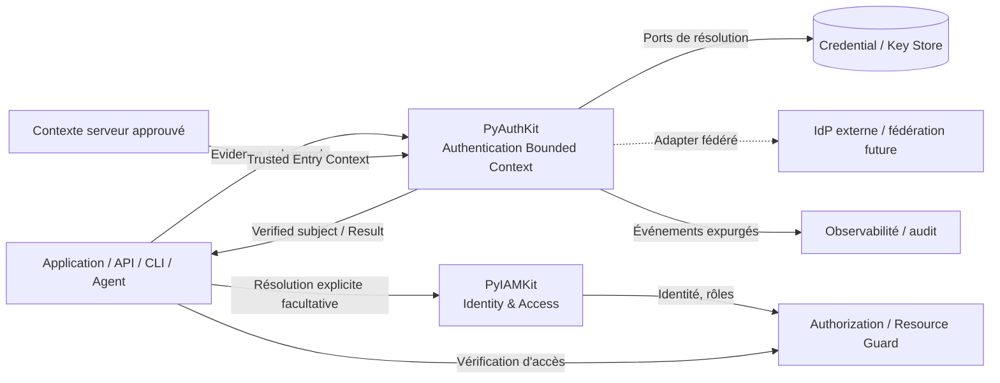
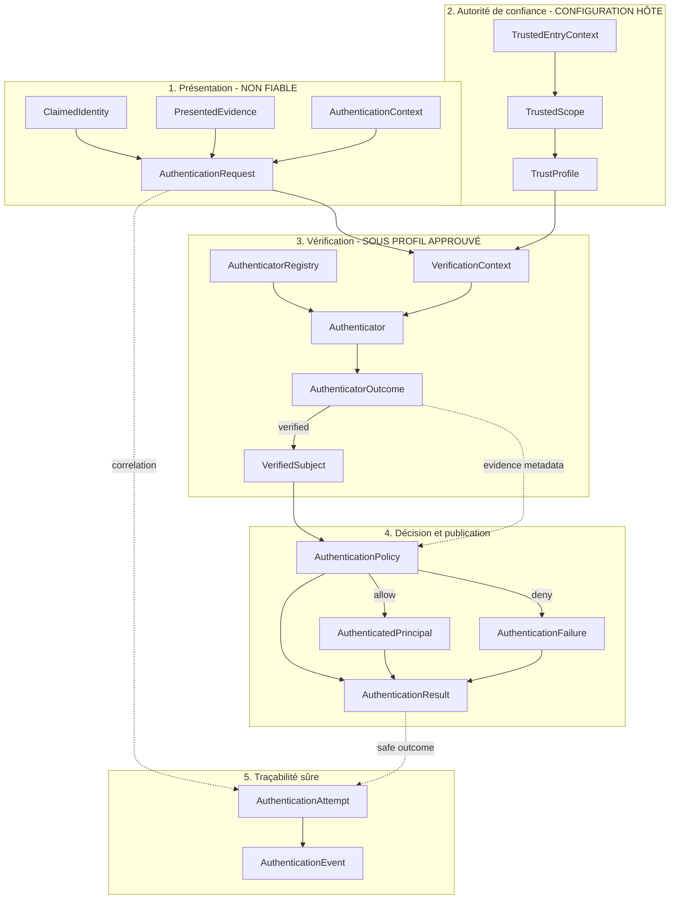
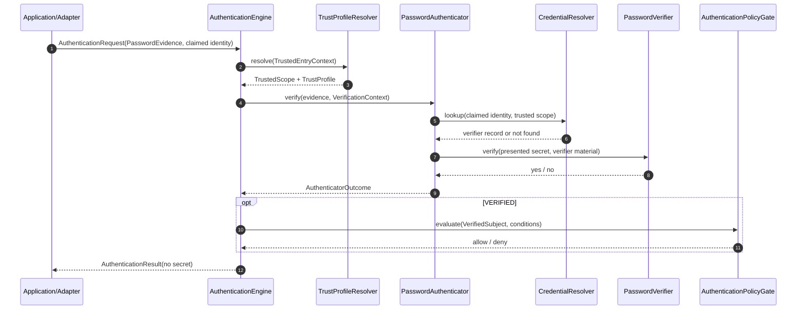

# 04_PYAUTHKIT_DOMAIN_OBJECTS

# PyAuthKit - Domain Objects

> **Document :** `04_PYAUTHKIT_DOMAIN_OBJECTS.md`  
> **Produit :** PyAuthKit - Authentication Engine for the Modern Python Ecosystem  
> **Type :** Modélisation conceptuelle du domaine / inventaire d'objets et frontières d'autorité  
> **Version documentaire :** `0.1.0` - proposition de conception  
> **Date :** 28 octobre 2026  
> **Statut :** `PROPOSED` - non approuvé par ADR, non implémenté ni qualifié  
> **Langue :** français ; vocabulaire des concepts, types et API en anglais  
> **Périmètre :** Bounded Context `Authentication`, MVP Password/API Key/JWT et extensions documentées  
> **Document suivant :** `05_PYAUTHKIT_ENTITIES_AND_VALUE_OBJECTS.md`

---

## Guide de lecture et portée

Le présent document définit **les concepts qui existent dans le domaine de l'authentification et leurs responsabilités**. Il n'impose pas une classe Python par ligne, une table SQL par objet ou un service par sous-domaine. La classification exacte en `Entity`, `Value Object`, `Aggregate`, `Domain Service`, `DTO`, `Port` ou `Adapter` sera confirmée dans `05`, `06`, `07` et les spécifications spécialisées.

| Parcours | Sections | Usage |
|---|---|---|
| Orientation | 0-3 | Objet, domaine, autorité et langage |
| Vue globale | 4-7 | Inventaire, cartes et relations |
| Noyau MVP | 8-12 | Request, evidence, trust, verification, principal, policy, result, attempt, credentials |
| Capacités futures | 13-22 | Flows, MFA, sessions, federation, risk, agents et dimensions transversales |
| Frontières | 23-26 | Ports, intégrations, données, événements |
| Conception & qualification | 27-32 | Invariants, tests, learning cards, traçabilité, arbitrages |
| Annexes | A-D | Schémas, nomenclature, scénarios et suite documentaire |

### Sources internes et ordre de priorité

1. `00_PYAUTHKIT_EXPRESSION_DU_BESOIN.md` : intention, acteurs, champs couverts et limites IAM.
2. `01_PYAUTHKIT_REQUIREMENTS_ANALYSIS.md` : exigences (`FR`, `SEC`, `ARC`, `INT`), décisions ouvertes (`DEC`) et critères d'acceptation (`ACC`).
3. `02_PYAUTHKIT_PRODUCT_VISION_AND_ARCHITECTURE_PRINCIPLES.md` : bounded context, principes `PRN-01..18`, doctrine DDD et architecture hexagonale.
4. `03_PYAUTHKIT_SYSTEM_ARCHITECTURE.md` : interfaces et composants logiques, `A-01..13`, `INV-SYS-*`, scénarios de sécurité et trust boundaries.
5. `PYAUTHKIT_SOFTWARE_DESIGN_LEARNING_CONVENTION.md` : méthode de conception, vocabulaire, preuves, anti-patterns et Design Learning Cards.

**Règle de préservation :** les nouveaux identifiants `DO-*`, `DOM-INV-*`, `DOM-TST-*` et `DO-DEC-*` appartiennent **uniquement** à ce document. Ils ne remplacent pas les identifiants des références et ne valent pas décision acceptée. Les éventuelles divergences sont signalées comme propositions, jamais corrigées silencieusement.

**Statuts utilisés :** `MVP TARGET`, `POST-MVP`, `CONCEPTUAL`, `PROPOSED`, `OPEN`. Aucun ne signifie `IMPLEMENTED`.

---

## 0. Résumé exécutif

PyAuthKit répond à une question bornée : **une preuve présentée par un acteur permet-elle, sous les conditions de confiance établies par l'application, d'authentifier un sujet déterminé ?**

Le modèle conceptuel doit rendre impossible la confusion de ces quatre niveaux :

```text
DECLARED                        VERIFIED                    PUBLISHED

ClaimedIdentity                VerifiedSubject             AuthenticationResult
PresentedEvidence  ─────────► (preuve vérifiée) ────────► (décision finale)
        +                             ▲                           │
AuthenticationRequest                 │                           ▼
        +                      AuthenticatorOutcome          AuthenticatedPrincipal
TrustedEntryContext                   ▲                   (si succès seulement)
        │                             │                           │
        └──► TrustedScope + TrustProfile + AuthenticationPolicy   │
                                                             contrat explicite
                                                                   │
                                                                   ▼
                                                           PyIAMKit (optionnel)
                                                           puis autorisation
```

Le résultat d'une stratégie de vérification **n'est pas** automatiquement le succès public : le moteur peut encore appliquer des contrôles globaux. Une identité externe vérifiée **n'est pas** nécessairement un utilisateur local ; un authentifié **n'est pas** nécessairement autorisé ; un token **n'est pas** nécessairement un JWT ; un premier facteur réussi **n'est pas** un succès MFA.

### 0.1 Résultats attendus de `04`

- Fournir un langage commun pour humains, machines, agents et systèmes externes.
- Nommer chaque objet selon son **rôle dans Authentication**, non selon un pattern GoF.
- Situer chaque objet dans la chaîne : entrée, sélection de confiance, vérification, établissement du sujet, décision, suivi et audit.
- Distinguer données non fiables, preuves vérifiées et décisions publiables.
- Distinguer objets métier, coordination applicative, ports et détails techniques.
- Identifier la durée de vie, les invariants conceptuels, les risques et les phases `MVP`/`POST-MVP`.
- Préparer `05` et `06` sans figer prématurément les agrégats et le schéma SQL.

### 0.2 Arbitrages structurants non finalisés

| Sujet | Orientation retenue pour poursuivre | À trancher |
|---|---|---|
| Principal | Concept générique d'acteur ; représentation vérifiée distincte | `Principal` entité ou référence ? (`DEC-05`) |
| Identity | Information revendiquée, externe ou IAM ; **pas** un compte géré par le core | Forme de la référence IAM et mapping |
| VerifiedSubject | Sujet établi seulement par contrôle de preuve et trust profile | Forme immutable et construction contrôlée |
| AuthenticationAttempt | Tentative traçable pouvant exister sans stockage | Identité/durée de vie/persistance |
| TrustProfile | Configuration de confiance approuvée et bornée | Versionnement et gouvernance (`DEC-*`) |
| AuthenticatorOutcome | Verdict interne propre à un authenticator | Modèle fermé / diagnostics (`DEC-06`) |
| AuthenticationResult | Verdict final public, sans autorisation | États, façade sync/async et API |
| Sessions / MFA / Federation | Modèle prévu, implémentation non présumée | Agrégats et atomicité après MVP |

---

## 1. Périmètre métier de l'authentification

### 1.1 L'opération à modéliser

Une cérémonie d'authentification tente de relier une **preuve** (`evidence`) à un **sujet** (`subject`) au regard d'un **mécanisme** (`method`) et d'un **contexte de confiance** (`trusted scope`, `trust profile`, `policy`).

Elle ne répond pas par elle-même à la question de savoir si le sujet possède un compte interne, un rôle dans l'organisation, une permission sur une ressource ou une délégation légitime. Ces questions nécessitent des décisions explicites supplémentaires.

### 1.2 Acteurs et principaux candidats

| Catégorie | Exemples | Preuves envisageables | Précaution de domaine |
|---|---|---|---|
| `HUMAN` | Utilisateur, administrateur, client | Password, passkey, OIDC, MFA | Email et nom ne prouvent pas l'identité |
| `APPLICATION` | Application cliente | Client credential, key, assertion | App ≠ utilisateur humain |
| `SERVICE` | API, microservice, daemon | API key, mTLS, JWT | Scope et issuer propres au service |
| `WORKLOAD` | Pod, worker, job CI/CD | Workload identity, attestations, jeton | Durée de vie et binding d'exécution |
| `AGENT` | Agent IA, automation | Credential de workload, assertion, token lié | Ne reçoit pas implicitement les droits du créateur |
| `DEVICE` | Terminal, appareil IoT | Certificat, clé, mécanisme attestation | Identité device ≠ identité de l'utilisateur |

L'origine `LOCAL`, `OIDC`, `SAML`, `EXTERNAL_PROVIDER` ou autre est **distincte** du `PrincipalType`. Un humain fédéré reste `HUMAN` ; un agent d'origine externe peut rester `AGENT`. Cette séparation constitue une proposition à confirmer dans `05` (`DEC-05`).

### 1.3 Capacités incluses / exclues

| Dans le domaine PyAuthKit | Hors domaine ou autorité externe |
|---|---|
| Recevoir et vérifier evidence/credentials | Provisioning complet des identités IAM |
| Résoudre un contexte et profil de confiance | Gestion des groupes, organisations, rôles |
| Établir un sujet authentifié | RBAC / ABAC / permissions sur ressources |
| Appliquer des politiques **d'authentification** | Décisions d'autorisation de la ressource |
| Gérer factors, challenges, flows (futur) | Gouvernance globale et access reviews IAM |
| Sessions et artefacts d'authentification (futur) | Annuaire LDAP ou serveur IAM complet imposé |
| Événements d'authentification expurgés | SIEM, PKI ou gestionnaire de secrets universel |

### 1.4 Trois vérités et leur propriétaire

| Forme | Signification | Autorité |
|---|---|---|
| `Presented Claim` | « Je suis ce sujet », accompagné d'une pièce | L'appelant **revendique**, sans établir |
| `Verified Evidence / Subject` | La preuve satisfait un mécanisme et une configuration approuvée | Vérificateur + politique de confiance PyAuthKit |
| `Authentication Decision` | Les conditions de succès final ont été satisfaites | Orchestration / politique PyAuthKit |
| `IAM Identity / Authorization` | Compte, relation à l'organisation, permissions | PyIAMKit ou application hôte, **hors Authentication** |

L'autorité de configuration (`who may configure a TrustProfile`) appartient à l'application hôte ou à une administration explicitement digne de confiance ; elle n'est jamais conférée par une assertion à vérifier.

---

## 2. Ubiquitous Language : termes à ne pas confondre

| Concept | Définition conceptuelle | Confusion interdite |
|---|---|---|
| `Actor` | Entité externe participant à une interaction | Entité DDD persistante par défaut |
| `Principal` | Acteur humain ou non humain concerné par l'authentification | `User` ORM |
| `PrincipalType` | Nature de cet acteur | Origine de son identité |
| `Subject` | Identifiant situé dans un espace de nommage | Email globalement unique |
| `ClaimedIdentity` | Identité affirmée, non vérifiée | Sujet vérifié |
| `Identity` | Identité représentée/déclarée/externe, selon contexte | Droit d'accès |
| `Credential` | Moyen ou enregistrement d'authentification, parfois secret | Evidence déjà vérifiée |
| `Evidence` | Donnée ou preuve présentée à vérifier | Résultat de la vérification |
| `ProofMetadata` | Information dérivée d'une vérification validée | Copie de l'evidence brute |
| `Authenticator` | Comportement de vérification spécialisé | IdP externe complet |
| `AuthenticatorOutcome` | Verdict interne du vérificateur | Succès final du moteur |
| `VerifiedSubject` | Sujet établi sous profil de confiance précis | Compte IAM |
| `AuthenticatedPrincipal` | Représentation publique fiable après politique finale | Permission |
| `AuthenticationRequest` | Commande normalisée à la frontière applicative | Objet HTTP brut |
| `AuthenticationContext` | Données contextuelles, parfois déclaratives | Contexte serveur automatiquement fiable |
| `TrustedEntryContext` | Entrée construite par intégration approuvée | Champ client nommé `trusted` |
| `TrustedScope` | Partition de confiance autorisée | `tenant_hint` client |
| `TrustProfile` | Paramétrage des preuves, clés, usages et sources admis | Claims du token présenté |
| `AuthenticationPolicy` | Règle d'acceptation et exigence de preuve | Policy RBAC |
| `AuthenticationAttempt` | Occurrence identifiable d'une tentative | Session utilisateur |
| `AuthenticationFlow` | Enchaînement de vérifications/étapes | Authenticator individuel |
| `AuthenticationChallenge` | Épreuve temporaire, potentiellement one-time | Accès déjà acquis |
| `AuthenticationFactor` | Catégorie de facteur réellement démontré | Simple canal, IP ou géolocalisation |
| `AuthenticationAssurance` | Assurance justifiée dans un référentiel explicite | Nombre de facteurs seul |
| `AuthenticationSession` | Continuité d'état après ou pendant cérémonie | JWT obligatoire |
| `Token` | Artefact d'usage défini, opaque ou structuré | JWT dans tous les cas |
| `Issuer` | Autorité qui émet une assertion ou credential | Origine approuvée parce que déclarée |
| `RiskSignal` | Observation susceptible d'informer une policy | Facteur de possession indépendant |
| `AuthenticationEvent` | Événement d'audit sans données sensibles | Publication d'un secret |

### 2.1 Règles de vocabulaire

1. **`claimed` avant preuve ; `verified` après contrôle ; `authenticated` après décision finale.**
2. `Issuer + Subject + TrustedScope` peut contribuer à identifier un sujet ; aucun `sub` isolé ne constitue une identité universelle.
3. `AuthenticationPolicy` n'accorde aucune permission sur un document, une API métier ou une table.
4. Un `Credential` persistant est différent du secret **présenté** durant une tentative.
5. Un `Token` possède une destination, un type et des conditions de confiance ; il n'est pas une preuve universellement réutilisable.
6. Les termes `factor`, `challenge`, `session` et `assurance` correspondent à des concepts distincts, même s'ils coopèrent au sein d'un flow.

---

## 3. Frontières du domaine et context map

### 3.1 Bounded Context principal

`Authentication` est le **bounded context** de référence. Ses sous-domaines candidats (`Credential Verification`, `Trust & Policy`, `Flow & Challenge`, `Session & Token`, etc.) sont des **responsabilités** ; ils ne doivent pas devenir automatiquement des packages, projets, tables ou microservices.



### 3.2 Anti-Corruption Layer

Pour préserver le modèle, les données propres à Google, Microsoft Entra ID, GitHub, un annuaire, un ORM Django ou un store Redis sont adaptées aux contrats de PyAuthKit. La charge utile d'un provider **n'est pas** un objet de domaine `Identity` ou `VerifiedSubject` tant que ses contraintes de confiance n'ont pas été satisfaites.

### 3.3 PyIAMKit : contrat, pas dépendance du noyau

```text
PyAuthKit
  └── AuthenticationResult(AUTHENTICATED, verified principal)
          │
          ▼  (conversion et résolution explicites dans l'application)
PyIAMKit
  ├── IAM Identity / Account
  ├── Organizations / Groups
  ├── Roles / Permissions
  └── Policy / Governance
          │
          ▼
Authorization Decision  -> Protected Resource
```

Un résultat PyAuthKit peut être consommé sans PyIAMKit. Un sujet vérifié peut ne correspondre à aucun compte IAM ; le résultat de l'authentification n'est pas rétroactivement faux pour cette seule raison, mais l'accès dépend alors de la politique de l'application.

---

## 4. Inventaire canonique provisoire `DO-*`

Le terme **objet** désigne ici un concept ou un rôle du domaine, pas la promesse d'une classe concrète.

### 4.1 Noyau d'authentification et preuve (MVP)

| ID | Nom conceptuel | Rôle | Phase | Classification candidate |
|---|---|---|---|---|
| DO-001 | `Principal` | Acteur authentifiable générique | MVP | Domain Concept |
| DO-002 | `PrincipalType` | Nature de l'acteur | MVP | Enum / VO |
| DO-003 | `ClaimedIdentity` | Affirmation d'identité non vérifiée | MVP | VO d'entrée |
| DO-004 | `AuthenticationRequest` | Demande normalisée | MVP | Command / DTO |
| DO-005 | `PresentedEvidence` | Matériau fourni au contrôle | MVP | Secret-bearing input |
| DO-006 | `AuthenticationContext` | Contexte de tentative | MVP | VO/DTO avec provenance |
| DO-007 | `TrustedEntryContext` | Liaison établie côté hôte | MVP | Configuration d'entrée approuvée |
| DO-008 | `TrustedScope` | Partition de confiance sélectionnée | MVP | VO approuvé |
| DO-009 | `TrustProfile` | Contraintes d'une preuve admissible | MVP | Configuration validée |
| DO-010 | `Authenticator` | Comportement de vérification | MVP | Port / Strategy |
| DO-011 | `AuthenticatorRegistry` | Inventaire de mécanismes admis | MVP | Service applicatif |
| DO-012 | `VerificationContext` | Profil/résolveurs temporels de vérification | MVP | Context object |
| DO-013 | `AuthenticatorOutcome` | Verdict interne | MVP | Result object |
| DO-014 | `VerifiedSubject` | Identité du sujet sous preuve vérifiée | MVP | VO candidat |
| DO-015 | `AuthenticatedPrincipal` | Représentation publique finale du sujet | MVP | VO candidat |
| DO-016 | `AuthenticationPolicy` | Conditions de succès authentifiant | MVP | Policy |
| DO-017 | `AuthenticationResult` | Réponse normalisée finale | MVP | Result object |
| DO-018 | `AuthenticationAttempt` | Occurrence/trace d'un essai | MVP | Entity logique candidate |
| DO-019 | `AuthenticationFailure` | Diagnostic typé et contrôlé | MVP | VO / error model |
| DO-020 | `AuthenticationEvent` | Fait d'audit expurgé | MVP | Event contract |

### 4.2 Credentials et vérification (MVP + extension)

| ID | Nom | Rôle | Phase | Classification candidate |
|---|---|---|---|---|
| DO-021 | `Credential` | Concept de moyen d'authentification | MVP | Concept racine |
| DO-022 | `CredentialRecord` | Enregistrement et état d'un credential | MVP selon adapter | Entity candidate |
| DO-023 | `CredentialReference` | Référence non secrète au moyen | MVP | VO |
| DO-024 | `PasswordEvidence` | Secret présenté lors du login | MVP | Secret input |
| DO-025 | `PasswordVerifierRecord` | Hash et paramètres de vérification | MVP | Record adapté depuis store |
| DO-026 | `APIKeyEvidence` | Clé présentée | MVP | Secret input |
| DO-027 | `APIKeyVerifierRecord` | Identifiant, material de vérification et état | MVP | Record adapté |
| DO-028 | `JWTBearerEvidence` | JWT entrant non vérifié | MVP | Untrusted input |
| DO-029 | `VerifiedTokenClaims` | Claims admis après contrôles | MVP | VO de sortie dérivée |
| DO-030 | `VerificationKeyReference` | Référence à clé de vérification approuvée | MVP | VO / reference |
| DO-031 | `CredentialLifecycle` | Création, rotation, révocation | POST-MVP élargi | Policy / lifecycle |

### 4.3 Flows, facteurs et gestion de continuité (après MVP)

| ID | Nom | Rôle | Phase | Classification candidate |
|---|---|---|---|---|
| DO-032 | `AuthenticationFlow` | Progression de cérémonie | POST-MVP | Process model |
| DO-033 | `AuthenticationFlowState` | Statut de progression | POST-MVP | State VO / enum |
| DO-034 | `AuthenticationChallenge` | Épreuve temporaire | POST-MVP | Entity candidate |
| DO-035 | `AuthenticationFactor` | Facteur réellement évalué | POST-MVP | VO |
| DO-036 | `FactorVerification` | Preuve de facteur réussi/échoué | POST-MVP | Event/VO |
| DO-037 | `AuthenticationAssurance` | Assurance établie selon un profil | POST-MVP | VO + policy |
| DO-038 | `StepUpRequirement` | Exigence d'authentification supérieure | POST-MVP | VO / policy input |
| DO-039 | `AuthenticationSession` | État de continuité de l'auth | POST-MVP | Entity / Aggregate candidat |
| DO-040 | `SessionReference` | Identifiant opaque de session | POST-MVP | VO |
| DO-041 | `Token` | Artefact de destination/usage défini | POST-MVP pour issuance | Concept / VO |
| DO-042 | `TokenGrant` | Émission ou renouvellement sous policy | POST-MVP | Process/VO candidat |
| DO-043 | `FederatedAssertion` | Assertion provenant d'une autorité externe | POST-MVP | Untrusted input initial |
| DO-044 | `FederatedIdentityReference` | Sujet externe vérifié et situé | POST-MVP | VO |
| DO-045 | `AuthenticationRiskAssessment` | Évaluation de risque contextualisée | POST-MVP | Decision/VO |
| DO-046 | `RiskSignal` | Signal de risque avec provenance | POST-MVP | VO |
| DO-047 | `DelegationEvidence` | Pièce de délégation vérifiable | POST-MVP | Evidence |
| DO-048 | `WorkloadBinding` | Contexte d'exécution lié à une preuve | POST-MVP | VO / policy |

### 4.4 Rôles logiciels explicitement **non** assimilés à des entités du domaine

| Rôle | Pourquoi le distinguer |
|---|---|
| `AuthenticationEngine` | Service d'application / orchestration ; ni principal ni aggregate |
| `TrustProfileResolver` | Service/port de sélection de configuration approuvée |
| `AuthenticationPolicyGate` | Évaluation de conditions finales de confiance |
| `ResultNormalizer` | Transformation du verdict interne en contrat public |
| `PasswordVerifier` | Fonction/port cryptographique spécialisé, pas `Password` entity |
| `APIKeyVerifier` | Vérification d'une clé selon un modèle de menace |
| `JWTVerifier` | Vérification cryptographique + claims selon profil borné |
| `CredentialStore` / `CredentialResolver` | Ports techniques, pas table ou ORM obligatoire |
| `VerificationKeyResolver` | Port vers clés approuvées, pas autorité implicite |
| `AuthenticationEventSink` | Sortie d'événement, pas domaine métier d'audit global |
| `OIDCProviderAdapter`, `SAMLAdapter` | Adapters externes, **non** concepts fondamentaux de l'identité |
| `FastAPIAdapter`, `DjangoAdapter` | Adapters de transport, **non** dépendances du core |

---

## 5. Carte du domaine : flux, ownership et objets



**Lecture du schéma :** les liens indiquent des responsabilités ou transformations conceptuelles, pas nécessairement des références de champs ou des appels à distance. `AuthenticationAttempt` n'exige pas une écriture SQL pour chaque vérification. Les règles réelles de cardinalité et d'ownership sont réservées à `06`.

### 5.1 Matrice d'autorité

| Objet ou fait | Émetteur / propriétaire logique | Accepteur / vérificateur | Publie un droit ? |
|---|---|---|---|
| Claimed identity | Client | Aucun, avant authentification | Non |
| Presented evidence | Client | Authenticator sous trust profile | Non |
| Trust scope/profile | Application hôte approuvée / configuration | Moteur et politiques | Non |
| Verified subject | Vérificateur sous contrat de preuve | Policy gate / moteur | Non |
| Authenticated principal | Moteur après décision finale | Application, IAM optionnel | Non |
| Authentication result | Moteur | Application appelante | Non |
| IAM identity | PyIAMKit / système IAM | Autorisation | Pas à lui seul |
| Resource access decision | Service d'autorisation | Resource guard | Oui/non selon policy externe |

---

## 6. Cycle de vie conceptuel et états

### 6.1 Une tentative simple (MVP)

```text
RECEIVED
  ↓ validate input + resolve trusted context
ACCEPTED_FOR_VERIFICATION
  ↓ choose authorized authenticator
VERIFYING
  ├── evidence invalid ─────► REJECTED
  ├── security dependency failure ─────► ERROR
  ├── evidence verified ────► APPLY_AUTHENTICATION_POLICY
  │                                 ├── denied ─► REJECTED
  │                                 └── allowed ─► AUTHENTICATED
  └── cancellation ────────► CANCELLED (trace interne; pas de succès)
```

Les étiquettes `RECEIVED`, `VERIFYING`, `APPLY_AUTHENTICATION_POLICY`, `CANCELLED` sont des **étapes/états internes candidats**, pas l'énumération publique approuvée de `AuthenticationResult`. Le document `03 §9.4` prévoit publiquement `AUTHENTICATED`, `REJECTED`, `ERROR` ; `CHALLENGE_REQUIRED` est réservé à la suite.

### 6.2 Évolution des capacités

| Niveau | Caractéristique | État d'objet nécessaire ? |
|---|---|---|
| Password simple | Un secret vérifié, verdict | Tentative traçable ; session non obligatoire |
| API Key | Matériau présenté + record scoped | Credential record possible ; session non obligatoire |
| JWT bearer | Validation stateless sous profil | Aucune session nécessaire pour simple validation |
| MFA | Plusieurs étapes liées par challenge | État de flow sécurisé et contrôlé |
| WebAuthn | Challenge signé, origin/RP binding | Challenge one-time et vérification forte |
| Session durable | Continuité, renouvellement, révocation | Entity/aggregate plausible |
| Delegated agent | Preuve et délégation séparées | Chaîne de provenance et vérifications supplémentaires |

### 6.3 State Machine ≠ GoF State Pattern

Un `AuthenticationChallenge` peut avoir `PENDING`, `SUCCEEDED`, `EXPIRED`, `CONSUMED` et les transitions associées, **sans** introduire quatre classes `State` ; un enum et des guards peuvent être plus simples. Le pattern GoF ne se justifie que si les comportements spécifiques aux états gagnent à être déportés en objets substituables.

---

## 7. Registre des frontières de confiance `DO-TB-*`

| ID | Frontière | Objet concerné | Obligation |
|---|---|---|---|
| DO-TB-01 | Input client → demande | `AuthenticationRequest` | Valider taille, forme, méthode, type et provenance |
| DO-TB-02 | Hint d'identité → sujet vérifié | `ClaimedIdentity` / `VerifiedSubject` | Pas de promotion sans preuve |
| DO-TB-03 | Indice de tenant → scope approuvé | `AuthenticationContext` / `TrustedScope` | Résolution côté serveur |
| DO-TB-04 | Token non vérifié → profil JWT | `JWTBearerEvidence` / `TrustProfile` | Aucun issuer/alg/key approuvé depuis le token seul |
| DO-TB-05 | Provider externe → domaine | `FederatedAssertion` | Signature/issuer/audience/nonce/state selon protocole |
| DO-TB-06 | Outcome de stratégie → résultat public | `AuthenticatorOutcome` / `AuthenticationResult` | Policy gate et normalisation obligatoires |
| DO-TB-07 | Preuve factorielle → assurance | `FactorVerification` / `AuthenticationAssurance` | Interdiction d'auto-attribuer un niveau |
| DO-TB-08 | Authentification → IAM | `AuthenticatedPrincipal` / `IAM Identity` | Mapping explicite, pas d'octroi de rôle |
| DO-TB-09 | Domaine → logs/audit | `AuthenticationEvent` | Minimisation, expurgation, aucune preuve brute |
| DO-TB-10 | Config dynamique/plugins → noyau | `TrustProfile` / `Authenticator` | Autorisation, compatibilité et validation au bootstrap |
| DO-TB-11 | Authentification agent → délégation | `DelegationEvidence` | Droits non hérités implicitement |
| DO-TB-12 | Cache/store → acceptation | `CredentialRecord` / session | Révocation, expiration et cohérence conformes au contrat |

---

## 8. Fiches du noyau : entrée, identité revendiquée et evidence

### 8.1 `DO-001` - Principal

**Problème.** Les acteurs ne sont pas tous des utilisateurs humains.  
**Responsabilité.** Désigner un acteur que l'on tente d'authentifier, sans présumer qu'il est déjà reconnu ni autorisé.  
**Questions.** Le `Principal` est-il un concept abstrait ou une entité propre ? Que représente son identifiant avant preuve ?

**Distinctions :** `Principal` (acteur), `ClaimedIdentity` (affirmation), `VerifiedSubject` (référence vérifiée), `AuthenticatedPrincipal` (représentation finalement publiée). Pour le MVP, il est acceptable de n'implémenter que les représentations nécessaires sans instancier une classe `Principal` fourre-tout.

**Design :** Domain Concept ; principe `Explicit Modeling`; aucun GoF requis.  
**Risque :** une API qui appelle `User` un service, ou une classe `Principal(is_authenticated=True)` construisible par n'importe quel client.  
**Preuve :** tests sur les différentes catégories de sujets et absence de `roles`/`permissions` dans le résultat.

### 8.2 `DO-002` - PrincipalType

**Rôle.** Décrire `HUMAN`, `APPLICATION`, `SERVICE`, `WORKLOAD`, `AGENT`, `DEVICE` sans les confondre avec `LOCAL`, `OIDC` ou `SAML`. La classification est configurable/évolutive par contrat et ne détermine **aucune** permission.  
**Question ouverte.** Des catégories très proches peuvent nécessiter une taxonomie hiérarchique ou un type composite, sans en imposer une au MVP.

### 8.3 `DO-003` - ClaimedIdentity

**Problème.** L'appelant fournit souvent un email, username, `client_id`, `key_id` ou autre indice.  
**Responsabilité.** Conserver l'affirmation d'identité, son type et sa provenance **déclarée**.  
**Invariants candidats.** Taille bornée ; pas de présomption d'unicité globale ; ne se transforme pas seule en `VerifiedSubject`.  
**Exemple.** `email='alice@example.test'` est un indice pour localiser un verifier record, pas la preuve que le demandeur contrôle ce compte.

**Design :** Value-like Input, pas `IAM Identity`.  
**Tests :** user inconnu, collision inter-tenant, email identique chez deux issuers, tentative d'injection d'attributs `verified=true`.

### 8.4 `DO-004` - AuthenticationRequest

**Problème.** Éviter que chaque framework transporte ses propres structures HTTP au cœur du moteur.  
**Responsabilité.** Porter un choix de méthode autorisée, une evidence spécialisée, un contexte déclaratif et un contexte d'entrée approuvé injecté par l'hôte.

**Données conceptuelles :**

| Champ candidat | Provenance | Remarque |
|---|---|---|
| `method` | Entrée, validée contre configuration | Ne permet pas de sélectionner une méthode interdite |
| `evidence` | Demandeur | Sensible ; représentation expurgée |
| `context` | Client / transport / hôte | Provenance de chaque attribut explicite |
| `trusted_entry_context` | Intégration hôte approuvée | Pas construit à partir d'un champ client libre |
| `correlation_id` | Hôte ou mécanisme de corrélation contrôlé | Ne doit pas révéler un secret |

**Design :** Application Command / DTO ; immutable snapshot candidat. **Ne pas** valider un JWT en lisant son `issuer` comme configuration fiable.  
**Test :** même use case depuis CLI et FastAPI, entrée malformée bornée, aucun secret dans `repr()` ou `str()`.

### 8.5 `DO-005` - PresentedEvidence

**Problème.** Le matériau d'authentification n'est ni uniforme ni généralement public.  
**Responsabilité.** Représenter la preuve *présentée*, sans la qualifier de valide.

Formes candidates `PasswordEvidence`, `APIKeyEvidence`, `JWTBearerEvidence`, et plus tard `WebAuthnAssertion`, `CertificateEvidence`, `FederatedAssertion`.

**Principes :** `Information Hiding`, `Sensitive Data Minimization`, non sérialisation par défaut.  
**Attention :** `frozen=True` ne garantit ni l'effacement mémoire ni une protection matérielle de secrets Python ; les détails de protection doivent être étudiés avec le modèle de menace.

### 8.6 `DO-006` - AuthenticationContext

**Responsabilité.** Agréger des attributs de tentative comme canal, adresse réseau observée, user agent, application, device hint, tenant hint, risk signals éventuels, `request_id`.  
**Distinction.** Certains attributs sont fiables parce qu'établis par un proxy ou hôte correctement configuré ; d'autres sont des **claims** du client. Un simple `dict` ne suffit pas à attester leur provenance.

**Modèle recommandé.** Étiquetage des origines ou objets séparés pour les champs déclarés et les liaisons fiables.  
**Test :** `X-Forwarded-For` client non autorisé ne devient pas IP réputée fiable ; `tenant_hint` ne résout pas seul le trust scope.

### 8.7 `DO-007` - TrustedEntryContext

**Responsabilité.** Capturer les bindings établis à l'entrée : application hôte, route validée, tenant/realm sélectionné dans une configuration de confiance, client connu, etc.  
**Ownership.** Application/adapter entrant, à partir d'une source sûre.  
**Interdiction.** Permettre au caller arbitraire de fournir `TrustedEntryContext(tenant='other')` puis considérer le type Python comme une preuve.

**Design :** Trust Boundary Object ; ce terme est un **rôle**, pas un pattern GoF canonique.

---

## 9. Fiches de confiance : scope, profil et politique

### 9.1 `DO-008` - TrustedScope

**Problème.** Un même identifiant ou credential peut être valide dans un realm mais jamais dans un autre.  
**Responsabilité.** Définir la partition de confiance à l'intérieur de laquelle les clés, credentials, méthodes et autorités sont admis.

Exemples de dimensions : tenant, realm, application cliente, environnement et usage (selon modèle retenu). Un `TrustedScope` n'est pas nécessairement une `Organization` de PyIAMKit.

**Invariants candidats :** provenance approuvée ; configuration cohérente ; aucun cross-tenant credential lookup non autorisé.  
**Anti-pattern :** `scope = request.tenant_id` sans validation serveur.  
**Tests :** secret tenant A dans B ; collision de `key_id` ; issuer admis seulement dans un realm.

### 9.2 `DO-009` - TrustProfile

**Problème.** Vérifier une signature sans savoir **quelle autorité** est admise, pour **quel usage**, **dans quel scope**, ne suffit pas.  
**Responsabilité.** Réunir les exigences de confiance correspondant à un mécanisme et une utilisation prévus.

| Dimension | Exemples de configuration | Garantie recherchée |
|---|---|---|
| Scope | Trusted realm/application | Isolation |
| Méthode | `password`, `api_key`, `jwt` | Absence de fallback |
| Source/issuer | Ensemble approuvé | Aucune confiance auto-déclarée |
| Audience | Service/API attendu | Résistance à la réutilisation |
| Type de token | Access token, ID token, etc. | Prévention de confusion de type |
| Algorithmes | Allowlist par profil | Pas de choix libre dans le token |
| Clés | Resolver/sources approuvés | Éviter substitutions et SSRF |
| Temps | Expiration, not-before, tolérance | Conditions temporelles explicites |
| État/version | Version active, statut | Rotation/config déterministe |

**Règle :** la présence de `kid` ou `iss` dans un token non vérifié peut seulement servir d'indice **borné au trust profile déjà sélectionné**, pas d'autorité permettant de créer un profil.

**Design :** Configuration immuable validée, `DIP` via key resolver, domaine `Trust`.  
**Statut :** niveau de granularité du profil encore à formaliser dans `25` ; aucun schéma YAML n'est normatif ici.

### 9.3 `DO-016` - AuthenticationPolicy

**Problème.** Une preuve peut être cryptographiquement valide mais inadéquate pour le contexte.  
**Responsabilité.** Évaluer les conditions d'une cérémonie : mécanisme autorisé, fraîcheur, assurance attendue, résultat de guard, risque, facteurs exigés (futur), portée.

**N'est pas :** `CanViewInvoicePolicy` ni gestion des rôles.  
**Exemples :** exiger une preuve récente avant une opération sensible ; refuser un token signé mais émis pour un usage non admis ; demander un step-up sous risque élevé.

**Classification :** Domain Policy ou Application Policy selon le propriétaire effectif de la règle ; `Strategy` seulement si les politiques sont réellement interchangeables.  
**Test :** vérification réussie mais policy refusée ⇒ `AuthenticationResult.REJECTED`, pas de principal final.

### 9.4 Politique ≠ profil ≠ resolver

```text
TrustProfile          = QUELS mécanismes, autorités et paramètres sont fiables ?
TrustProfileResolver  = COMMENT retrouver le profil approuvé dans un scope ?
AuthenticationPolicy  = QUELLES conditions de cérémonie doivent être satisfaites ?
Authenticator         = COMMENT vérifier cette famille d'evidence ?
AuthenticationEngine  = COMMENT orchestrer et publier le résultat ?
```

Ils coopèrent mais ne doivent pas devenir un `AuthManager` unique responsable de toute l'IAM et de l'autorisation.

---

## 10. Fiches de vérification : mécanisme, outcome, subject

### 10.1 `DO-010` - Authenticator

**Problème.** Les méthodes Password, API Key et JWT requièrent des vérifications différentes mais doivent respecter un contrat commun.  
**Responsabilité.** Évaluer une evidence du type qu'il supporte, sous profil de confiance approuvé, et retourner un `AuthenticatorOutcome`.

**Ne fait pas :** créer un utilisateur IAM ; octroyer des permissions ; choisir librement un issuer externe ; retourner directement un succès public en contournant la policy globale.

**Design.** Strategy candidate si plusieurs mécanismes interchangeables respectent un même contrat ; `typing.Protocol` ou petite interface ; composition par le moteur.  
**Anti-pattern.** `if provider=='google'` intégré à une classe métier géante.  
**Tests.** Contrats de substituabilité et suite négative propre à chaque mécanisme.

### 10.2 `DO-011` - AuthenticatorRegistry

**Problème.** Résoudre de manière sûre le mécanisme demandé sans recréer des branches globales ou utiliser n'importe quel plugin trouvé.  
**Responsabilité.** Associer les méthodes à des authenticators disponibles **et** autorisés par scope/config.

**Décisions proposées :** enregistrement explicite, gel éventuel après bootstrap, rejet si méthode inconnue, refus en cas d'ambiguïté de configuration.  
**Design.** Registry (idiome d'architecture locale, pas GoF canonique), éventuellement Factory au composition root.  
**Tests.** Doublon, plugin désactivé, méthode inconnue, méthode présente mais non autorisée dans le profil.

### 10.3 `DO-012` - VerificationContext

**Responsabilité.** Donner au vérificateur son environnement **fiable** : profil, scope, horloge ou source de temps contrôlée, dépendances de vérification, références de configuration.  
**Différence avec `AuthenticationContext`.** Ce dernier peut contenir des indices non fiables ; `VerificationContext` est construit seulement après résolution de confiance.

**Risque.** Transformer `VerificationContext` en `ServiceLocator` universel ou le rendre modifiable par le client.  
**Statut.** Content et ownership à finaliser dans `09`, `10` et `25`.

### 10.4 `DO-013` - AuthenticatorOutcome

**Problème.** Séparer succès local du mécanisme et décision globale de PyAuthKit.  
**Responsabilité.** Porter `VERIFIED`, `REJECTED` ou échec technique normalisé selon un contrat **interne** ; fournir un sujet seulement si la preuve est vérifiée et des métadonnées non secrètes.

**Invariant.** `verified=False` ne peut exposer un sujet pouvant être publié comme authentifié. Les diagnostics internes ne doivent pas être affichés directement à l'appelant.

**Design.** Result Object ; aucune classe par motif d'erreur n'est imposée.  
**Tests.** Outcome forgé incohérent rejeté ; policy globale refusant un `VERIFIED` ; erreur de provider sans succès.

### 10.5 `DO-014` - VerifiedSubject

**Problème.** `sub='123'` n'a pas de sens universel sans provenance et contexte.  
**Responsabilité.** Désigner un sujet **effectivement établi** avec la source approuvée et la portée de vérification.

Informations candidates : identifiant opaque, `issuer_id` configuré, `trusted_scope_id`, `principal_type`, méthode et référence de preuve dérivée si nécessaire. Il ne doit ni contenir le password/API key/JWT brut ni des permissions IAM.

**Construction :** aucune entrée client ne doit suffire à créer une référence de sujet déclarée `verified`. Le contrat Python exact (factory interne, types cachés, validation runtime) sera défini dans `05`/`10`. **Un type statique seul ne garantit pas la confiance.**

**Tests :** sujets identiques sous deux issuers distincts ; absence d'issuer pour flux qui l'exige ; ancien token non conforme à son audience ; comparaison scoped.

### 10.6 `DO-015` - AuthenticatedPrincipal

**Responsabilité.** Représenter le principal qui peut être publié **après** vérification et application des politiques transverses.  
**Frontière.** `VerifiedSubject` = ce que le mécanisme prouve ; `AuthenticatedPrincipal` = ce que le moteur accepte pour la cérémonie. Les deux peuvent être représentés par des types distincts ou un contrat enrichi selon décision.

**Interdiction :** `principal.roles = ['admin']` comme conséquence du login ; la résolution IAM reste explicite.  
**Statut.** L'architecture `03 §9` présente provisoirement `VerifiedSubject` dans le champ public `principal` ; la pertinence de conserver **deux types** est une décision ouverte. `04` ne modifie pas cette signature.

---

## 11. Fiches de décision : résultat, échec, tentative, événement

### 11.1 `DO-017` - AuthenticationResult

**Responsabilité.** Rendre à l'appelant une issue stable, indépendante du transport. Le résultat reflète **les contrôles finaux**, pas seulement l'issue cryptographique.

| État candidat | Sémantique | Principal final | Suite |
|---|---|---|---|
| `AUTHENTICATED` | Preuve et conditions satisfaites | Obligatoire | Autorisation séparée |
| `REJECTED` | Preuve ou politique refusée | Absent | Échec générique public |
| `ERROR` | Validation impossible pour raison technique/config | Absent | Pas de succès par dégradation |
| `CHALLENGE_REQUIRED` | Suite de cérémonie nécessaire | **Aucun principal final** | POST-MVP, état partiel séparé |

L'existence d'un `AuthenticationResult` en mémoire ne prouve pas qu'un événement a été persisté ni qu'une session a été créée.

**Design.** Result Object, union d'états fermée à étudier en `05`/`24`.  
**Tests.** Aucune combinaison `REJECTED + principal` ; aucun succès sans subject ; aucune fuite de motifs internes sensibles.

### 11.2 `DO-019` - AuthenticationFailure

**Responsabilité.** Distinguer erreurs d'evidence (`INVALID_CREDENTIALS`), méthode non admise, contexte non fiable, expiration/révocation, violation de policy et défaillance de sécurité, **sans** révéler les détails exploitables au client.

Deux audiences sont prévues :

- diagnostic interne minimal, typé, expurgé et corrélé ;
- code public stable et neutre, compatible avec protection contre l'énumération.

Une `AuthenticationFailure` n'est pas forcément une exception Python ; les exceptions hors contrat, annulations et fautes de programmation relèvent d'une stratégie distincte à fixer.

### 11.3 `DO-018` - AuthenticationAttempt

**Problème.** Corréler entrée, vérification, résultat et observabilité sans imposer une session persistante.  
**Responsabilité.** Identité d'essai, timestamps, résultat final, méthodes et métadonnées minimales.

**Modèle DDD candidat.** Entity logique si l'identité de l'essai et son cycle de vie importent ; l'implémentation MVP peut simplement porter un `attempt_id` et des événements sans repository.  
**Risque.** Confondre `attempt_id` avec `session_id`, conserver l'evidence brute, ou annoncer `COMPLETED` alors qu'une annulation a interrompu le contrôle.  
**Test.** Un échec de store n'entraîne jamais `AUTHENTICATED` ; une tentative peut être traçable sans session.

### 11.4 `DO-020` - AuthenticationEvent

**Responsabilité.** Décrire des faits utiles : `AuthenticationStarted`, `CredentialRejected`, `AuthenticationSucceeded`, `AuthenticationFailed` et, plus tard, `ChallengeCreated`, `SessionRevoked`, `TokenIssued`, etc.

**Schéma minimal candidat :** `event_type`, `attempt_id`, `occurred_at`, identifiants pseudonymisés si nécessaires, méthode, profil/version, `safe_reason_code` ; **jamais** l'evidence, secret, token brut ni assertion signée entière.

**Domain Event ≠ broker ≠ SIEM.** La livraison est réalisée par un port d'audit avec politique explicite. Certains événements sont plus justement des *security telemetry events* que des Domain Events DDD : catégorisation à confirmer dans `21`.

---

## 12. Objets de credentials et frontière des secrets

### 12.1 `DO-021` - Credential

Le mot `Credential` doit être traité comme un **concept racine**, pas nécessairement une classe de base héritée par tous les mécanismes. Ses variantes peuvent concerner un secret contrôlé localement, une clé/API key, une clé publique WebAuthn, un certificat, une assertion fédérée, un mot de passe hashé ou une preuve éphémère.

**Séparation recommandée :**

```text
Credential (concept)
  ├── Presented Evidence    : ce qui arrive, non fiable, parfois secret
  ├── Verifier Record       : ce qu'un store approuvé retourne pour comparer
  ├── Credential Reference  : identifiant public ou opaque scoped
  └── Credential Lifecycle  : état/rotation/révocation si responsabilité locale
```

Ne pas fabriquer un objet universel avec `secret`, `public_key`, `password_hash`, `certificate`, `jwt`, `refresh_token` et 20 champs facultatifs.

### 12.2 `DO-022` - CredentialRecord

**Responsabilité.** Représenter l'état stocké ou résolu d'un moyen : `active/revoked`, dates, propriétaire vérifiable, scope, paramètres d'algorithme, références de vérification.  
**DDD candidat.** Entity si identité et rotation/révocation doivent être suivies ; simple record provenant d'un port lorsque PyAuthKit est seulement vérificateur d'un store externe.  
**Question clé.** Qui possède la vérité et les mutations ? PyAuthKit, un coffre, une application, PyIAMKit ou un IdP ?

### 12.3 `DO-023` - CredentialReference

**Responsabilité.** Identifier sans révéler : `key_id`, handle scoped ou référence de credential.  
**Interdiction.** Une référence de recherche ne prouve pas la possession du secret.  
**Test.** `key_id` seul ne permet aucun succès.

### 12.4 `DO-024/025` - PasswordEvidence et PasswordVerifierRecord

**Entrée :** mot de passe présenté comme secret non journalisable.  
**Vérification :** comparer via une bibliothèque de password hashing appropriée contre un record contenant hash, paramètres et état.  
**Sécurité :** politique d'énumération de comptes, paramètres de hash, rehash sous contrat, stratégie de limitation d'essais à documenter. Aucun secret en clair n'est stocké dans le domaine par défaut.

**Design.** Un `PasswordAuthenticator` spécialisé ; un `PasswordCredentialResolver` port ; un `PasswordVerifier` dédié.  
**Test.** Mot de passe erroné, record absent/corrompu, store indisponible, données secrètes en sortie/log.

### 12.5 `DO-026/027` - APIKeyEvidence et APIKeyVerifierRecord

**Entrée :** secret à forte entropie, éventuellement avec préfixe de lookup non secret.  
**Vérification :** record scoped, état, expiration, matériel de vérification sûr. La stratégie de hash/verifier doit répondre au modèle de menace d'une API key et n'est pas automatiquement celle d'un mot de passe humain.

**Design.** `APIKeyAuthenticator` indépendant, `APIKeyCredentialResolver` port.  
**Test.** Clé révoquée, expirée, inconnue, croisement tenant, collisions de préfixe, absence d'authentification par préfixe seul.

### 12.6 `DO-028/029/030` - JWTBearerEvidence, VerifiedTokenClaims et VerificationKeyReference

**Entrée :** JWT bearer brut et non fiable ; header/payload ne doivent pas être promus en configuration.  
**Vérification :** type/usage admis, algorithme allowlisté, signature, issuer, audience, expiration, not-before, et autres claims requis par le profil.  
**Sortie :** uniquement les claims **retenus et vérifiés** nécessaires à la résolution d'un sujet ; le texte du token n'est pas dans le résultat public.

**`VerificationKeyReference` :** référence à une clé parmi les clés autorisées pour le profil déjà approuvé. Un `kid` non vérifié n'autorise pas de récupération d'URL arbitraire ni de confiance envers un JWKS externe inconnu.

**Distinctions :** JWT validation (MVP) ≠ issuance JWT ≠ introspection opaque ≠ OIDC complet.  
**Test.** `alg=none`, confusion HS/RS, substitution `kid`, issuer inconnu, audience incorrecte, type de token erroné, expiration, signature modifiée, URL arbitraire.

### 12.7 `DO-031` - CredentialLifecycle (phase ultérieure)

La rotation, suspension, expiration, révocation et invalidation de credentials constituent une responsabilité distincte de leur **vérification**. Le propriétaire peut être externe ; l'API doit expliciter les garanties de cohérence, la propagation de révocation et la fenêtre éventuelle de rotation plutôt que les supposer uniformes.

---

## 13. Objets futurs : AuthenticationFlow et état de progression

### 13.1 `DO-032` - AuthenticationFlow

**Problème.** Une vérification isolée ne modélise pas les séquences Password + TOTP, WebAuthn, SSO fédéré ou step-up.  
**Responsabilité.** Décrire une cérémonie ayant une intention, un sujet éventuellement partiellement établi, une suite d'étapes et une conclusion qui ne peut être annoncée prématurément.

**Éléments conceptuels candidats :** `flow_id`, `trusted_scope`, mécanismes autorisés, état courant, contexte de commencement, expiration, référence de policy, étapes accomplies, événements de continuation, issue terminale. Les types détaillés appartiennent à `11`.

**Frontière de sûreté.** Un premier facteur `VERIFIED` ne suffit pas à publier `AUTHENTICATED` si la policy exige d'autres facteurs.

**DDD :** Process Model / Process Manager candidat ; aggregate seulement si les invariants et l'atomicité l'exigent. Le terme *Saga* n'est pas justifié pour un flow local simplement multi-étapes.

### 13.2 `DO-033` - AuthenticationFlowState

**Responsabilité.** Représenter la progression et interdire les transitions illégales.

```text
STARTED
  │
  ├──► WAITING_FOR_CHALLENGE ──► CONTINUING ──► COMPLETED
  │                                   ├──► FAILED
  │                                   └──► WAITING_FOR_CHALLENGE
  ├──► FAILED
  ├──► CANCELLED
  └──► EXPIRED

COMPLETED / FAILED / CANCELLED / EXPIRED
       = états terminaux (politique exacte à définir)
```

Il s'agit d'un **modèle conceptuel**, non d'une state machine déjà adoptée. Le nombre de tentatives de challenge, la reprise après interruption, les transitions concurrentes et la politique de conservation seront définis dans `11`.

### 13.3 Cycle de vie et atomicité

- Un flow est **lié** à la portée de confiance d'origine : une continuation ne peut pas changer silencieusement de tenant ou de méthode.
- L'état partiellement vérifié n'est pas une session authentifiée ni un droit d'accès.
- La reprise exige une preuve de possession d'un handle de continuation, non une simple connaissance d'un `flow_id` prédictible.
- Le timeout, la consommation d'un challenge, l'annulation et les retries doivent posséder des transitions testées.
- L'orchestrateur ne doit pas dépendre d'un fournisseur SMS ou email particulier.

**Patterns pédagogiques possibles :** State Machine (modèle), Workflow/Process Manager (orchestration), State Pattern GoF **seulement si démontré nécessaire**.

---

## 14. Objets futurs : challenges, facteurs et assurance

### 14.1 `DO-034` - AuthenticationChallenge

**Problème.** Exiger une action supplémentaire et s'assurer qu'une réponse n'est pas réutilisée hors contexte.  
**Responsabilité.** Représenter une épreuve temporaire liée à un flow, une portée et des conditions de consommation.

Champs candidats : `challenge_id`, `flow_id`, `challenge_type`, `issued_at`, `expires_at`, `state`, `attempt_limit`, `nonce_reference`, `subject_binding`, `trusted_scope`, `consumed_at`.

**Invariants candidats :** impossibilité de réussir après expiration, usage unique lorsqu'exigé, consommation atomique, liaison au bon flow/realm ; aucune preuve brute dans les événements.

**DDD.** Entity candidate avec identité et cycle de vie ; aggregate root candidat si la cohérence doit être autonome. La question de la transaction avec `AuthenticationFlow` est ouverte.

### 14.2 `DO-035` - AuthenticationFactor

**Problème.** On ne doit pas dire « MFA » parce que deux vérifications quelconques se sont produites.  
**Responsabilité.** Qualifier les facteurs de connaissance, possession, inhérence et les caractéristiques réelles de leurs mécanismes.

| Catégorie indicative | Exemples | Avertissement |
|---|---|---|
| Knowledge | Mot de passe, PIN | Deux mots de passe ne sont pas deux facteurs indépendants |
| Possession | OTP app, cryptographic authenticator | Le canal SMS et son niveau de risque demandent analyse |
| Inherence | Biométrie locale dans une cérémonie adaptée | Ne pas présumer une biométrie vérifiée par PyAuthKit seul |
| Federation | Authentification déléguée | **Mécanisme/origine**, pas facteur distinct garanti |
| Contextual signal | IP, localisation, device hints | **Signal de risque**, pas facteur MFA par défaut |

Les catégories `FEDERATED` et `CONTEXTUAL` figuraient comme possibilités dans l'expression du besoin ; `04` propose de les séparer de la taxonomie des **facteurs indépendants** pour éviter une assurance fictive. Cette proposition doit être arbitrée dans `12`.

### 14.3 `DO-036` - FactorVerification

**Responsabilité.** Documenter ce qui a été **effectivement** vérifié : mécanisme, instant, contexte, caractéristiques d'indépendance et de résistance aux attaques.  
**Risque.** Confondre un challenge envoyé avec un facteur réussi.  
**Test.** TOTP expiré/rejoué, facteur validé dans un autre flow, double facteur de même catégorie, vérification abandonnée.

### 14.4 `DO-037` - AuthenticationAssurance

**Problème.** Une étiquette `AAL2` ou `AAL3` ne doit jamais être attribuée automatiquement en raison d'un booléen `mfa=True`.  
**Responsabilité.** Porter la conclusion d'une évaluation d'assurance, sa base normative/versionnée si revendiquée, les caractéristiques de preuve et son instant.

**Statut.** VO et policy candidats ; référence explicite requise pour toute déclaration de conformité à un standard. L'algorithme appartient à `12`, avec validation normative spécialisée si conformité revendiquée.

### 14.5 `DO-038` - StepUpRequirement

**Responsabilité.** Décrire ce qu'une application exige comme supplément de preuve pour une action sensible.  
**Exemple :** authentification récente et confirmation résistante au phishing avant validation d'une opération à haut risque.  
**Frontière.** L'application métier décide **que** l'action exige un step-up ; PyAuthKit évalue **comment** l'exigence d'authentification est satisfaite. L'application décide ensuite si la ressource est autorisée.

---

## 15. Objets futurs : sessions et tokens

### 15.1 `DO-039` - AuthenticationSession

**Problème.** Après authentification, une application peut avoir besoin de continuité, renouvellement et révocation sans répéter toute la cérémonie.  
**Responsabilité.** Porter une continuité authentifiée délimitée : principal, scope, instant d'auth, expiration, mécanisme d'authentification, assurance, version/rotation et état de révocation.

**Invariants proposés :**

1. Une session ne naît pas d'un résultat rejeté ou d'un sujet seulement revendiqué.
2. Une session révoquée/expirée n'est pas acceptée ; aucun renouvellement implicite ne réactive une session compromise.
3. Une rotation change les identifiants qui doivent changer sans perdre l'audit de continuité.
4. Les stratégies de stockage, de cookie et de CSRF sont explicitement traitées à la frontière du transport.
5. Les updates concurrents de révocation/rotation ne peuvent pas produire deux états actifs contradictoires sans politique définie.

**DDD :** Entity, Aggregate Root **candidat** si elle gouverne son cycle de vie ; les frontières de transaction avec `TokenGrant` et `AuthenticationFlow` restent ouvertes.  
**Patterns :** State Machine (concept), Repository ou Unit of Work uniquement si la persistance l'exige ; aucun GoF requis.

### 15.2 `DO-040` - SessionReference

**Responsabilité.** Fournir une référence opaque/non prédictible selon le contexte.  
**Sécurité.** Une session reference pouvant agir comme bearer secret doit être traitée comme un secret, même si son nom évoque un simple ID. Une référence persistée côté serveur et le cookie/token présenté n'ont pas nécessairement la même représentation.

### 15.3 `DO-041` - Token

**Responsabilité.** Désigner un artefact, avec des **sémantiques d'usage** : bearer access, ID token, refresh, session, one-time challenge, assertion, etc.

**Ne pas confondre :**

```text
Token purpose         : pourquoi est-il émis / accepté ?
Token format          : opaque, JWT, autre ?
Token issuer          : quelle autorité sous quelle confiance ?
Token audience        : pour qui ?
Token lifecycle       : expiration, rotation, révocation selon contrat ?
```

Le MVP **vérifie** des JWT entrants. Il ne produit pas par défaut de token ni ne devient un Authorization Server OAuth.

### 15.4 `DO-042` - TokenGrant

**Responsabilité candidate.** Représenter une émission ou un renouvellement autorisé, si PyAuthKit choisit d'en être responsable.  
**Risques :** substitution du sujet, mauvaise audience, réutilisation de refresh token, fuite de bearer, confusion ID token/access token, secrets dans logs.

**À arbitrer.** `TokenGrant` pourrait être un objet d'application et non une entité durable, ou l'émission de tokens pourrait être déléguée à un adapter/serveur spécialisé. Décision non prise par ce document.

### 15.5 Session ≠ Token ≠ Flow

| Aspect | Flow | Session | Token |
|---|---|---|---|
| Fonction | Terminer une cérémonie | Maintenir une continuité | Transporter une preuve/affirmation/autorisation définie |
| Peut exister sans le reste | Oui | Oui, selon conception | Oui |
| Durée de vie | Courte, liée à cérémonie | Plus longue, révocable | Selon type, usage et profil |
| Source de confiance | Challenge/états + scope | État/session store & policy | Vérification du format/issuer/usage |
| Danger de confusion | Succès partiel ≠ login | Session ≠ permission éternelle | JWT ≠ identité automatiquement reconnue |

---

## 16. Objets futurs : fédération et identité externe

### 16.1 `DO-043` - FederatedAssertion

**Problème.** Un IdP externe affirme une identité au moyen d'un protocole spécialisé.  
**Responsabilité.** Représenter **l'assertion reçue**, dont la validité n'est pas acquise à sa réception.

Pour OIDC, valider les paramètres pertinents du flow, les tokens et leur binding ; pour SAML, valider signatures, destination, audience et autres conditions applicables. Les détails protocolaires appartiennent à `14` et ne doivent pas être résumés en un appel générique `trust_external_user()`.

**Attention.** OAuth 2.0 seul est un cadre d'autorisation déléguée, pas une authentification utilisateur complète ; le flux OIDC ajoute les éléments d'identité appropriés.

### 16.2 `DO-044` - FederatedIdentityReference

**Responsabilité.** Conserver la référence vérifiée `(trusted issuer/provider, external subject, trusted scope)` lorsque nécessaire.  
**Risque.** Assimiler un identifiant externe à un `User.id` local ou lier automatiquement deux comptes possédant le même email.

**Contrats candidats :** issuer stable, subject stable au regard des garanties du provider, provenance vérifiée, mapping IAM explicite et révocable lorsque l'application le permet.

### 16.3 Social login est une expérience, pas une catégorie de sujet

Un `GoogleOIDCAuthenticator` ou `GitHubAuthenticator` peut être un adapter, mais le domaine reste centré sur une **fédération vérifiée**. L'utilisateur peut être `HUMAN`, le provider `GOOGLE`, et le mode d'origine `OIDC` : ce sont trois axes distincts.

### 16.4 Federation trust map

```text
Application / PyAuthKit
     │
     ├── Approved Provider Configuration  (trusted)
     │      issuer / client / redirect / keys / allowed protocol
     │
     └── Redirect / Assertion Received   (untrusted until validated)
                 │
                 ▼
         Federation Protocol Adapter
                 │
                 ▼
          Verified External Subject
                 │
                 ▼
       Authentication Policy + Result
                 │
                 ▼
       Optional IAM identity resolution
```

Un provider externe n'est pas nécessairement disponible à la demande, et un résultat de cache ou une panne réseau ne doit pas être converti en succès par facilité.

---

## 17. Objets futurs : risque et authentification adaptative

### 17.1 `DO-046` - RiskSignal

**Problème.** Le contexte peut accroître les exigences d'authentification, sans constituer lui-même un facteur.  
**Responsabilité.** Porter une observation contextualisée : origine, timestamp, fiabilité, scope, classification éventuelle et état de validation.

Exemples : nouvel appareil, indicateur de localisation improbable, IP inhabituelle, historique de tentatives, réputation d'un environnement d'exécution. Un signal manquant, ancien ou contradictoire doit posséder une sémantique explicite.

### 17.2 `DO-045` - AuthenticationRiskAssessment

**Responsabilité.** Synthétiser des signaux et une policy en une évaluation de risque, idéalement avec raison et version de règles, puis déterminer si une continuation/step-up est nécessaire.

**Règles :**

- `RiskSignal` peut être une donnée fournie par un service externe et donc devoir être validée.
- `RiskAssessment` ne remplace pas la vérification d'un credential.
- La classification `LOW`, `MEDIUM`, `HIGH` ne prouve pas une conformité normative universelle.
- Une panne d'évaluateur obligatoire doit suivre un comportement de sécurité spécifié, pas déclencher un bypass.

**Design.** Policy/Strategy seulement si plusieurs évaluations substituables existent ; *model* et *decision* ne sont pas le même objet.

---

## 18. Objets futurs : agents, services, workloads et délégation

### 18.1 Principal non humain

Un service, workload ou agent se présente comme un sujet authentifiable. PyAuthKit peut confirmer une preuve liée à cet acteur, **mais ne peut pas déduire** que l'acteur possède automatiquement les droits de son auteur ou d'un autre utilisateur.

| Sujet | Preuve potentielle | Dimension supplémentaire |
|---|---|---|
| Service API | API key, client credentials, mTLS | Client/service identity binding |
| Worker / Kubernetes workload | Workload token, attestation, certificat | Namespace/cluster/service account selon confiance |
| Agent IA | Credential propre, assertion courte | Instance, exécution, auteur et délégation éventuelle |
| Device | Certificat / clé | Device binding, rotation, compromission |

### 18.2 `DO-047` - DelegationEvidence

**Problème.** Un agent authentifié peut vouloir agir *au nom de* quelqu'un.  
**Responsabilité.** Représenter une assertion de délégation à **vérifier** : acteur délégant, agent bénéficiaire, contexte, audience, période, limites annoncées et provenance.

**Frontière.** L'authentification peut valider que l'assertion est authentique et destinée au bon usage ; la décision de permettre une action déléguée relève d'une policy d'autorisation/mandat, potentiellement PyIAMKit ou application hôte.

**Invariant.** `agent_is_authenticated` n'implique pas `agent_may_act_as_owner`.

### 18.3 `DO-048` - WorkloadBinding

**Responsabilité.** Attacher l'authentification d'un workload à une identité d'environnement approuvée (cluster, service account, job, client, audience, durée de vie) lorsque le mécanisme choisi le requiert.

**Risque.** Accepter un token émis pour un autre service ou un workload différent ; remplacer un binding d'exécution par un simple nom fourni dans un JSON.

### 18.4 Application à l'écosystème

- **PyAgentsKit / PyAgentRuntime** : consomment un principal ou des informations de preuve, sans que le moteur d'authentification ordonne leurs workflows.
- **PyIAMKit** : décide de l'appartenance, des relations, des rôles et des permissions.
- **Synqentra** : utilise PyAuthKit pour une preuve de sujet avant une décision d'accès au domaine métier.
- **PyRuntimeKit** : peut fournir le contexte d'exécution d'un workload, mais ce contexte doit être validé selon les frontières de confiance.

---

## 19. Dimensions transversales des objets

### 19.1 Origine, provenance et autorité

Pour chaque objet, documenter :

- qui l'a créé ou fourni ;
- à quel instant ;
- dans quel scope ;
- si la valeur est `CLAIMED`, `OBSERVED`, `VERIFIED` ou `TRUSTED_CONFIGURATION` ;
- quel mécanisme la valide ;
- qui peut la modifier ;
- si elle peut être exposée à l'utilisateur, au domaine IAM ou à l'audit.

**Ces étiquettes sont conceptuelles**, non une enum unique obligatoire.

### 19.2 Temporalité

| Famille | Dates pertinentes | Risque |
|---|---|---|
| Evidence/token | `issued_at`, `not_before`, `expires_at` | Accepter hors fenêtre |
| Verified subject | `verified_at` / âge de preuve | Réutilisation d'une authentification trop ancienne |
| Credential record | `created_at`, `revoked_at`, `expires_at` | Credential révoqué encore accepté |
| Trust profile | version, activation/rotation | Lire une configuration incohérente |
| Challenge | `issued_at`, `expires_at`, `consumed_at` | Replay / course concurrente |
| Session | `authenticated_at`, `renewed_at`, `expires_at` | Fixation, renouvellement ou révocation inappropriés |
| Risk signal | `observed_at`, `evaluated_at` | Signal périmé ou mal attribué |

Une date de création d'objet n'est pas toujours sa date de validité métier ; la source d'horloge et la tolérance de dérive sont des dépendances vérifiables.

### 19.3 Concurrence et atomicité

- Une validation JWT stateless ne nécessite pas d'aggregate durable, mais nécessite une gestion correcte de clés/configuration sous charge.
- Le lookup de credential et les contrôles de révocation doivent respecter les garanties explicitement annoncées.
- Un challenge one-time impose une consommation sans double réussite, souvent un compare-and-set ou opération atomique adaptée.
- Une session rotative doit empêcher l'acceptation contradictoire d'identifiants déjà invalidés selon son contrat.
- Un authenticator partagé doit rester stateless au regard des données secrètes **par tentative**.

### 19.4 Confidentialité / data minimization

| Donnée | Résultat public | Audit/logs | Store de vérification |
|---|---|---|---|
| Password en clair | Jamais | Jamais | Jamais |
| API key complète | Jamais | Jamais | Vérificateur non réversible adapté |
| JWT bearer brut | Jamais | Jamais | Non requis par défaut |
| `key_id` | Selon besoin minimal | Parfois pseudonymisé | Oui, scoped |
| Subject reference | Si autorisé | Pseudonyme ou référence minimisée | Selon contrat |
| Issuer/trust profile version | Métadonnées si utiles | Référence non secrète | Configuration approuvée |
| Failure internal detail | Jamais en clair | Code borné et expurgé | Non |
| Claims vérifiés | Sous sélection stricte | Minimisés | Pas nécessairement |

`repr()`/`str()`/exceptions, traces distribuées, journaux de proxy, dumps et métriques constituent autant de surfaces de fuite potentielles.

---

## 20. Origine et propriété des objets : matrice de responsabilité

| Objet / famille | Autorité en entrée | Autorité après traitement | Responsable de conservation éventuelle |
|---|---|---|---|
| `ClaimedIdentity` | Appelant | Aucune, isolément | Par défaut aucune |
| `PresentedEvidence` | Appelant | Authenticator vérifie ; ne devient pas trusted en bloc | Éphémère, non stocké par défaut |
| `AuthenticationContext` | Client + hôte, selon champs | Validation et provenance | Éphémère / audit minimisé |
| `TrustedEntryContext` | Hôte approuvé | Trust resolver | Configuration hôte |
| `TrustedScope` / `TrustProfile` | Administration approuvée | Moteur respecte | Configuration / référentiel autorisé |
| `CredentialVerifierRecord` | Credential store autorisé | Verifier | Backend propriétaire |
| `VerifiedSubject` | Vérificateur dans le cadre approuvé | Policy gate | Résultat éphémère / éventuelle session |
| `AuthenticationResult` | Moteur | Consommateur | Selon règles applicatives |
| `AuthenticationAttempt` | Moteur / corrélation | Moteur/audit | Event sink si requis |
| `AuthenticationSession` | Moteur ou composant spécialisé | Session policy | Session store |
| `FederatedAssertion` | IdP externe | Adapter protocolaire + trust profile | Non conservée brute par défaut |
| `IAM Identity` | IAM | IAM | PyIAMKit / autre système IAM |

Un `CredentialRecord` peut être un *read model* adapté par un port, plutôt qu'une donnée dont PyAuthKit est propriétaire. Ne pas imposer à tous les consommateurs le même modèle de stockage.

---

## 21. Résultats de vérification : cas limites et cohérence

### 21.1 Vérification et policy finale

| Vérification | Policy | Résultat final | Justification |
|---|---|---|---|
| Preuve invalide | Non évaluée ou échec sûr | `REJECTED` | Aucun sujet établi |
| Preuve valide | Autorisée | `AUTHENTICATED` | Sujet vérifié et conditions satisfaites |
| Preuve valide | Refusée | `REJECTED` | Succès local ≠ succès final |
| Preuve valide | MFA supplémentaire exigé | `CHALLENGE_REQUIRED` (futur) | Pas de principal final |
| Vérificateur indisponible | Inconnue | `ERROR` | Aucun fallback en succès |
| Trust profile absent/ambigu | Non applicable | `ERROR`/`REJECTED` selon politique publique | Jamais d'autorité inventée |
| Annulation en cours | Non terminée | Pas de succès | Propagation de cancellation à spécifier |

### 21.2 `AuthenticatorOutcome` n'est pas une preuve cryptographique sérialisable

Un outcome contient un **verdict dérivé** et des métadonnées ; il ne doit pas devenir un objet librement injectable dans une autre demande en tant que preuve universelle. La manière de protéger les frontières internes et l'intégrité des objets est une exigence de design, pas une propriété automatique de Python.

### 21.3 Statut inconnu et futurs codes

Un enum trop permissif ou un champ booléen `success` associé à `challenge_required=True` favorise les états contradictoires. Le modèle `05` devra étudier un résultat discriminé (variants) tout en préservant l'API projetée dans `03`.

---

## 22. Schémas conceptuels de comportements transversaux

### 22.1 Un même sujet, plusieurs méthodes

```text
               Subject in trusted namespace
                         │
               +---------+---------+
               │         │         │
          Password      Passkey    Federated IdP
               │         │         │
               ▼         ▼         ▼
          Evidence   Assertion   External assertion
               │         │         │
               +---------+---------+
                         │
                 Verified subject
                         │
            Authentication policy decision
                         │
                 Authenticated principal
```

La possibilité conceptuelle de plusieurs moyens n'impose **aucun** auto-linking des identités de providers distincts. Un mapping de comptes est une décision IAM explicite.

### 22.2 Même mécanisme, résultats différents selon scope

```text
API Key K, key_id = 'abc'
       │
       ├─ TrustedScope(A) → record A → vérification possible
       │
       └─ TrustedScope(B) → aucun record approuvé → REJECTED
```

La notion de scope n'est pas un simple préfixe de base de données : elle est une frontière de confiance ayant une politique de configuration et de résolution.

### 22.3 Authenticator valide sans constituer d'autorité IAM

```text
JWT signature valid
       +
issuer / audience / token type / time valid
       +
trust scope approved
       ↓
VerifiedSubject
       ↓
AuthenticationPolicyGate
       ↓
AuthenticationResult(AUTHENTICATED)
       ↓
No IAM account? -> application decides next action
```

La résolution IAM manquante ne doit pas fabriquer de permission et ne doit pas être masquée par un défaut permissif.

---

## 23. Carte des services de domaine, services d'application et ports

### 23.1 Pourquoi ne pas appeler tout « Domain Object » ?

En DDD, un objet de domaine n'est pas identique à une classe Python, un port, un repository ou une tâche de runtime. Pour conserver des frontières compréhensibles, le document classe les **rôles de design** séparément.

| Composant | Rôle pressenti | Domaine pur ? | Pattern possible, non automatique |
|---|---|---|---|
| `AuthenticationEngine` | Application Service / Facade | Non, orchestre le domaine | Facade, composition |
| `Authenticator` | Contrat de vérification | Port/interface du domaine ou application | Strategy si preuves |
| `PasswordAuthenticator` | Comportement spécialisé | Adapter de mécanisme / application | Strategy implementation |
| `JWTAuthenticator` | Comportement spécialisé | Adapter spécialisé | Strategy implementation |
| `AuthenticatorRegistry` | Catalogue de stratégies | Application/bootstrap | Registry |
| `TrustProfileResolver` | Résolution sous trust boundary | Application/port | Resolver, pas GoF |
| `AuthenticationPolicyGate` | Service de décision de ceremony | Domain/Application Policy | Policy Object |
| `CredentialResolver` | Lookup de verifier record | Port sortant | Repository si domaine réellement propriétaire |
| `PasswordVerifier` | Vérification cryptographique adaptée | Port/adaptateur crypto | Aucun GoF requis |
| `VerificationKeyResolver` | Résolution de clé approuvée | Port sortant | Adapter |
| `Clock` | Source de temps testable | Port utilitaire | DIP |
| `AttemptGuard` | Rate limit / règles de sécurité | Service externe ou port | Policy/Guard |
| `EventSink` | Audit/observabilité | Port sortant | Pub/Sub possible, non imposé |
| `SessionStore` | Conservation et mutation session | Port sortant futur | Repository / CAS si besoin |
| `ChallengeStore` | TTL et consommation unique | Port sortant futur | Atomic state transition |

### 23.2 Règles de dépendance

```text
              HOST / ENTRY ADAPTERS
                        │
                        ▼
           APPLICATION USE CASES
          (AuthenticationEngine)
                        │
             +----------+----------+
             ▼                     ▼
        DOMAIN MODEL         PORT CONTRACTS
             ▲                     ▲
             │                     │
             +-------- ADAPTERS ---+
                   (DB, Key, IdP,
                    FastAPI, Django,
                    Audit, KMS)
```

Le core de domaine ne doit pas importer Django, FastAPI, SQLAlchemy, Redis, les SDK Google/Microsoft ou PyIAMKit. La définition exacte de la direction de chaque interface sera stabilisée dans `18`.

### 23.3 Patterns nommés uniquement lorsque les preuves existent

| Problème réel | Design simple | Pattern envisageable si pression |
|---|---|---|
| Trois mécanismes avec même consommateur | Registry de callables et fonctions | Strategy, si contrats/stabilité prouvés |
| Store SQL interchangeable avec memory | Petit `Protocol` de lookup | Adapter / Repository selon ownership |
| Variantes de policy d'authentification | Fonction pure | Strategy/Policy Object si variation croissante |
| Challenge avec 3 états | Enum + validations | GoF State **seulement si** comportement polymorphe |
| Notification d'audit | Event callback | Observer/Event-driven si découplage utile |
| Création d'un `AuthenticationRequest` | Constructeur explicite | Factory seulement si construction complexe |

**Leçon.** Un port n'est pas automatiquement un pattern Repository ; une state machine n'implique pas GoF State ; un domain event n'implique pas Observer ; un `Command` applicatif ne prouve pas GoF Command.

---

## 24. Séquences d'objets pour les trois méthodes du MVP

### 24.1 Password - chaîne conceptuelle



**Objets primaires :** `AuthenticationRequest`, `ClaimedIdentity`, `PasswordEvidence`, `TrustedScope`, `TrustProfile`, `PasswordVerifierRecord`, `AuthenticatorOutcome`, `VerifiedSubject`, `AuthenticationResult`, `AuthenticationAttempt`.

**Échecs structurants :** mot de passe incorrect, record inexistant, hash corrompu, store indisponible, profile incohérent, guard obligatoire défaillant. Aucun n'aboutit à un succès par fallback.

### 24.2 API Key - chaîne conceptuelle

```text
APIKeyEvidence(key_id hint + secret)
    + AuthenticationRequest
    + TrustedEntryContext
              ↓
          TrustedScope
              ↓
      APIKeyCredentialResolver
              ↓
   APIKeyVerifierRecord (scoped)
              ↓
       APIKeyAuthenticator
              ↓
     AuthenticatorOutcome
              ↓
   Policy -> AuthenticationResult
```

**Invariants majeurs :** `key_id` seul ne suffit pas ; révoqué/expiré ne réussit pas ; tenant A ≠ tenant B ; aucun secret dans les résultats ou les logs.

### 24.3 JWT validation - chaîne conceptuelle

```text
JWTBearerEvidence(raw, untrusted)
              +
    TrustedEntryContext
              ↓
    Resolve Approved TrustProfile
              ↓
    Bound Key Selection/Resolution
              ↓
   Signature + Claims Validation
              ↓
       VerifiedTokenClaims
              ↓
        VerifiedSubject
              ↓
   AuthenticationPolicyGate
              ↓
       AuthenticationResult
```

**Invariants majeurs :** `alg`, `jku`, `kid`, `iss` reçus ne modifient pas le catalogue de confiance ; les claims ne sont utilisés pour établir le sujet qu'après vérification appropriée ; un JWT destiné à un usage incompatible est rejeté.

---

## 25. Contrat conceptuel PyAuthKit ↔ PyIAMKit

### 25.1 Données minimales candidates

```text
AuthenticatedPrincipal / VerifiedSubject
├── subject_id         : opaque, scoped
├── principal_type     : human/service/agent/workload/etc.
├── issuer_id          : autorité configurée et vérifiée
├── trusted_scope_id   : scope établi côté hôte
├── method             : mécanisme vérifié
├── verified_at        : instant de vérification
└── provenance_ref     : référence non secrète, si nécessaire

EXCLUS du contrat de preuve :
  roles, permissions, groups, is_admin, organization membership
```

La présence des champs exacts reste candidate, conformément à `03 §22.3` ; le contrat final doit être défini dans `23_PYAUTHKIT_PYIAMKIT_INTEGRATION_CONTRACT.md`.

### 25.2 Table de translation

| PyAuthKit | PyIAMKit / hôte | Erreur à éviter |
|---|---|---|
| `VerifiedSubject` | `ExternalIdentityReference` ou équivalent | Fusionner sur email uniquement |
| `AuthenticatedPrincipal` | Résolution d'Identity/Account | Traiter la preuve comme provisionnement automatique |
| `TrustedScope` | Contexte tenant/org confirmé | Mapper un tenant client brut à une organisation |
| `AuthenticationAssurance` | Condition d'accès éventuelle | Déduire un rôle depuis AAL |
| `DelegationEvidence` | Décision de délégation/mandat | Hériter tous les droits du délégant |
| `AuthenticationResult` | Entrée de la décision d'accès | Interpréter `AUTHENTICATED` comme `AUTHORIZED` |

### 25.3 Aucune dépendance obligatoire

L'application doit pouvoir vérifier un service avec une API key ou un JWT sans créer un compte dans PyIAMKit. L'interopérabilité est un **adapter facultatif**.

---

## 26. Événements et observabilité : modèle de publication sans fuite

### 26.1 Événements candidats

| Événement | Déclencheur logique | Contenu sûr candidat |
|---|---|---|
| `AuthenticationStarted` | Début de tentative | attempt/correlation id, method |
| `CredentialRejected` | Vérification négative | reason code généralisé |
| `AuthenticationSucceeded` | Décision finale positive | method, scope ref, time |
| `AuthenticationFailed` | Échec final | safe reason, type d'issue |
| `ChallengeCreated` | Challenge émis (futur) | challenge ref non secret, ttl class |
| `ChallengeSucceeded` | Validation (futur) | challenge ref, method |
| `SessionCreated` | Session active (futur) | session ref expurgée |
| `SessionRevoked` | Révocation (futur) | session correlation ref |
| `TokenIssued` | Émission contrôlée (futur) | token type / issuer ref, jamais token |
| `CredentialRotated` | Rotation reconnue (futur) | credential ref, state, version |

### 26.2 Faits, métriques et logs ne sont pas interchangeables

- **Domain Event :** fait du domaine ayant une portée sémantique.
- **Security/Audit Event :** fait de sécurité/tracabilité destiné à une surveillance ou une obligation contractuelle.
- **Metric :** mesure agrégée, non une preuve individuelle d'identité.
- **Trace :** corrélation d'exécution ; ses attributs sont contrôlés pour éviter la fuite des credentials.

La délivrance d'événements et les garanties de panne (`best-effort`, exigence d'audit obligatoire, outbox, etc.) restent à spécifier dans `21` ; aucune livraison exactement-une-fois n'est inférée de ce modèle.

### 26.3 Politique de diagnostic

L'outil de diagnostic peut distinguer `UNKNOWN_METHOD`, `INVALID_EVIDENCE`, `UNTRUSTED_ISSUER`, `SCOPE_MISMATCH`, `STORE_UNAVAILABLE` et `POLICY_DENIED` **en interne** selon besoin, alors que les réponses externes doivent rester suffisamment génériques pour éviter une divulgation exploitable. Le schéma précis est un arbitrage `24`.

---

## 27. Invariants de domaine préliminaires `DOM-INV-*`

Ce registre est une **proposition préparatoire** pour `07_PYAUTHKIT_DOMAIN_INVARIANTS_AND_BUSINESS_RULES.md`. Il complète `03 §3` (`INV-SYS-*`) sans le remplacer. Chaque invariant aura ensuite un propriétaire, des préconditions, des cas limites et des tests.

### 27.1 Confiance et établissement du sujet

| ID | Invariant candidat | Domaine / phase | Référence de cohérence |
|---|---|---|---|
| DOM-INV-001 | Aucune preuve non vérifiée ne produit un sujet authentifié final | MVP | `INV-SYS-01` |
| DOM-INV-002 | Un résultat autre que `AUTHENTICATED` ne publie aucun principal final | MVP | `INV-SYS-02` |
| DOM-INV-003 | Une erreur technique ou une annulation n'est jamais convertie en succès | MVP | `INV-SYS-08` |
| DOM-INV-004 | Une méthode inconnue, ambiguë ou interdite n'utilise aucun fallback implicite | MVP | `INV-SYS-03` |
| DOM-INV-005 | Un champ déclaré par l'appelant ne crée pas d'autorité de confiance | MVP | `INV-SYS-04` |
| DOM-INV-006 | Un sujet est situé dans sa provenance/issuer et son scope validé | MVP | `02 §7.6`, `03 §9` |
| DOM-INV-007 | Le résultat de l'Authenticator passe par les politiques transversales avant publication | MVP | `03 §9.3` |
| DOM-INV-008 | Une authentification réussie n'accorde aucune permission de ressource | MVP | `INV-SYS-07` |
| DOM-INV-009 | L'identité externe n'est pas liée automatiquement à un compte IAM sur simple email | MVP/futur | `02 §7`, `03 §22` |
| DOM-INV-010 | Un plugin d'authentification n'est pas approuvé par sa seule présence | MVP | `INV-SYS-10` |

### 27.2 Credentials, secrets et tokens

| ID | Invariant candidat | Domaine / phase | Référence de cohérence |
|---|---|---|---|
| DOM-INV-011 | Un secret présenté n'est jamais copié tel quel dans un résultat ou un événement | MVP | `INV-SYS-06` |
| DOM-INV-012 | Un record absent, révoqué, expiré ou mal scoped ne peut authentifier | MVP | `03 §12-14` |
| DOM-INV-013 | Une API key n'est pas authentifiée par son seul `key_id`/préfixe | MVP | `03 §13` |
| DOM-INV-014 | JWT `issuer`, `alg` et `kid` non vérifiés ne définissent pas le trust profile | MVP | `03 §14` |
| DOM-INV-015 | Un token est accepté seulement pour un usage et audience admis | MVP | `03 §14` |
| DOM-INV-016 | Le scope de confiance du lookup et de la clé vérifiée demeure cohérent | MVP | `INV-SYS-05` |
| DOM-INV-017 | Le matériel secret ne peut être exposé par une représentation ou exception ordinaire | MVP | `01 §7`, `03 §20` |
| DOM-INV-018 | La révocation/rotation respecte les garanties d'état effectivement contractées | MVP/futur | `03 §13`, `19` futur |

### 27.3 Flows, facteurs, sessions et agents

| ID | Invariant candidat | Domaine / phase | Référence de cohérence |
|---|---|---|---|
| DOM-INV-019 | Un premier facteur réussi ne constitue pas un login final si d'autres sont requis | POST-MVP | `03 §9.4`, `11` futur |
| DOM-INV-020 | Un challenge expiré ou consommé ne réussit pas de nouveau lorsque usage unique requis | POST-MVP | `11` futur |
| DOM-INV-021 | La continuation d'un flow reste liée à son scope/subject/épreuve autorisés | POST-MVP | `11` futur |
| DOM-INV-022 | Aucun niveau d'assurance normative ne naît d'un simple `mfa=True` | POST-MVP | `03 §9.6`, `12` futur |
| DOM-INV-023 | Un signal de risque n'est pas compté comme facteur indépendant par défaut | POST-MVP | `01 §10`, `12` futur |
| DOM-INV-024 | Une session expirée ou révoquée n'est pas réactivée par défaut | POST-MVP | `13` futur |
| DOM-INV-025 | Une session provient d'une authentification finale valable pour son scope | POST-MVP | `13` futur |
| DOM-INV-026 | Une identité d'agent authentifiée ne porte pas implicitement les droits de son créateur | POST-MVP | `03 §22.5`, `16` futur |
| DOM-INV-027 | Une délégation revendiquée n'est pas une délégation vérifiée/autorisé | POST-MVP | `16` futur |
| DOM-INV-028 | Un workload ne peut réutiliser une preuve destinée à un autre environnement/usage | POST-MVP | `16` futur |

### 27.4 Métadonnées, temps, corrélation et audit

| ID | Invariant candidat | Domaine / phase | Référence de cohérence |
|---|---|---|---|
| DOM-INV-029 | Une tentative et une session ont des identités et durées de vie distinctes | MVP/futur | `03 §11.5` |
| DOM-INV-030 | Un événement d'audit ne contient aucune evidence brute | MVP | `03 §21` |
| DOM-INV-031 | Une information `verified` porte une preuve et une provenance de vérification réelles | MVP | `02 PRN-06` |
| DOM-INV-032 | Un TrustProfile ne devient pas implicitement valide via un cache stale non gouverné | MVP | `03 §19`, `25` futur |
| DOM-INV-033 | L'âge/expiration des preuves utilise une horloge et une policy explicites | MVP/futur | `03 §18` |
| DOM-INV-034 | Un diagnostic public ne doit pas exposer une information secrète ou permettant l'énumération sous politique applicable | MVP | `03 §17` |
| DOM-INV-035 | L'état d'une tentative ne garantit pas à lui seul la livraison d'un événement | MVP | `03 §21.6` |
| DOM-INV-036 | `DOCUMENTED`, `IMPLEMENTED`, `TESTED` et `QUALIFIED` sont des statuts distincts | Gouvernance | Convention §0.2 |

### 27.5 Décomposition par propriétaire

```text
AuthenticationEngine / Application
  -> DOM-INV-001, 002, 003, 004, 007, 008, 029

Trust / Profile / Scope
  -> DOM-INV-005, 006, 010, 014, 016, 032

Credential / Authenticator
  -> DOM-INV-011, 012, 013, 015, 017, 018

Flow / Challenge / Factors / Session
  -> DOM-INV-019, 020, 021, 022, 023, 024, 025

Agent / Workload Integration
  -> DOM-INV-026, 027, 028

Observability / Time / Governance
  -> DOM-INV-030, 031, 033, 034, 035, 036
```

Ces regroupements expriment des **propriétaires conceptuels**, non une obligation de modules physiques correspondant exactement à chaque ligne.

---

## 28. Tests de domaine et preuves attendues `DOM-TST-*`

La conception est considérée **testable** lorsqu'une propriété produit des cas positifs et négatifs observables. Les exemples ci-dessous sont des **cibles de qualification**, pas des tests exécutés.

### 28.1 Matrice des tests de base

| Test | Objets centraux | Propriété à démontrer | Phase |
|---|---|---|---|
| DOM-TST-001 | Request, Evidence, Result | Secret correct sous profil approuvé → succès | MVP |
| DOM-TST-002 | Outcome, Result | Mot de passe incorrect → refus sans principal | MVP |
| DOM-TST-003 | ClaimedIdentity, VerifiedSubject | Une identité déclarée ne peut se promouvoir | MVP |
| DOM-TST-004 | Registry, TrustProfile | Méthode non configurée → pas de fallback | MVP |
| DOM-TST-005 | TrustedScope, CredentialRecord | Cross-tenant key → rejet | MVP |
| DOM-TST-006 | JWTBearerEvidence, TrustProfile | `kid`, `iss`, `alg` malveillants ne reconfigurent pas le trust | MVP |
| DOM-TST-007 | VerifiedTokenClaims | Signature invalide, mauvais issuer/audience/type → rejet | MVP |
| DOM-TST-008 | AuthenticatorOutcome, Policy | Preuve valide + policy refusée → rejet | MVP |
| DOM-TST-009 | AuthenticationFailure, logs | Aucune preuve brute dans repr, exception et audit | MVP |
| DOM-TST-010 | AuthenticationAttempt | Tentative corrélable sans session persistante | MVP |
| DOM-TST-011 | CredentialResolver, Result | Store indisponible → `ERROR`, jamais succès | MVP |
| DOM-TST-012 | AuthenticatedPrincipal | Pas de rôles/permissions injectés implicitement | MVP |
| DOM-TST-013 | AuthenticationFlow, Factor | 1er facteur réussi + MFA requis → pas de succès final | POST-MVP |
| DOM-TST-014 | AuthenticationChallenge | Deux réponses concurrentes à un one-time challenge → au plus une consommation | POST-MVP |
| DOM-TST-015 | AuthenticationAssurance | Assurance non calculée par nombre de `True` | POST-MVP |
| DOM-TST-016 | AuthenticationSession | Session révoquée/expirée → rejet | POST-MVP |
| DOM-TST-017 | FederatedIdentityReference | Sujet identique chez deux issuers ≠ même identité | POST-MVP |
| DOM-TST-018 | DelegationEvidence | Agent authentifié sans mandat → pas de droits délégués | POST-MVP |
| DOM-TST-019 | WorkloadBinding | Assertion destinée à autre audience/workload → rejet | POST-MVP |
| DOM-TST-020 | RiskAssessment | Panne évaluateur obligatoire → fail-closed | POST-MVP |

### 28.2 Suites de tests par propriété de conception

| Type de test | Ce qu'il établit | Ce qu'il n'établit pas |
|---|---|---|
| Unit test | Calcul / transition locale / validation | Sécurité complète du système |
| Contract test | Substituabilité de ports et authenticators | Résilience du provider distant |
| Property-based | Invariant pour des entrées sous préconditions | Audit externe / conformité normative |
| Architecture test | Sens des imports et isolation du core | Absence de vulnérabilité logique |
| Security regression test | Blocage de scénarios d'attaque connus | Couverture de toutes les attaques |
| Integration test | Adaptateur réel et gestion d'échec | Production readiness globale |
| Load/concurrency test | Comportement sous charge, races ciblées | Universalité d'un SLA |
| Compliance evidence | Alignement évalué à un profil versionné | Certificat sans évaluateur/autorité |

### 28.3 Property-based tests candidats

- Pour tout `AuthenticationResult` autre que `AUTHENTICATED`, `principal` est absent.
- Pour toute méthode interdite dans le trust profile, le moteur ne vérifie pas via une autre méthode sans demande explicite.
- Pour tout `CredentialRecord` révoqué selon garanties du store, aucune évidence associée ne réussit.
- Pour tout couple d'issuers/realms distincts, des `subject_id` textuellement égaux ne sont pas fusionnés automatiquement.
- Pour tout challenge à consommation unique, les réponses concurrentes ne produisent jamais deux succès validés sous le même état.
- Pour toute politique de redaction, les événements et représentations de sortie ne contiennent aucun secret d'entrée.

Les générateurs de tests doivent préserver les préconditions (par exemple, clés approuvées et profils de confiance cohérents) et ne doivent pas être confondus avec un mécanisme cryptographique de production.

### 28.4 Architecture fitness functions candidates

```text
DOMAIN must not import django / fastapi / sqlalchemy / redis / boto3
DOMAIN must not import pyiamkit
AUTHENTICATION_RESULT must not expose roles / permissions / is_admin
AUTHENTICATOR must not call arbitrary JWKS URLs from untrusted claims
CREDENTIAL_EVIDENCE must not appear in audit event payloads
SESSION / CHALLENGE advanced features must remain optional to MVP core
```

Une règle statique d'imports n'empêche pas à elle seule le couplage sémantique ; la revue de design demeure nécessaire.

---

## 29. Design Learning Cards : problème, concept, pattern et preuve

Cette section applique la `PYAUTHKIT_SOFTWARE_DESIGN_LEARNING_CONVENTION.md`. Les objets sont d'abord expliqués **par leur problème**, ensuite par les principes/patterns éventuellement utiles.

### 29.1 Card A - `VerifiedSubject` : preuve avant identité

| Dimension | Analyse |
|---|---|
| Problem | Le client prétend être `subject=admin`, mais cette déclaration n'établit rien |
| Domain Concept | Claimed identity ≠ verified subject |
| Trust Boundary | Untrusted input → approved verifier → verified value |
| Domain Role | Référence située d'un sujet établi |
| Invariant | Pas de `VerifiedSubject` sur evidence invalide |
| Design Principle | Explicit Modeling, Information Hiding, fail-closed |
| GoF Pattern | Aucun nécessaire |
| Python Mechanism | Types séparés, constructor/factory contrôlés selon décision |
| Anti-pattern | `VerifiedSubject(**request.json())` |
| Tests | Fausse preuve, issuer différent, scope différent, output sans secret |

**Leçon :** la séparation sémantique peut être un excellent design même sans design pattern GoF.

### 29.2 Card B - `Authenticator` : comportements variables

| Dimension | Analyse |
|---|---|
| Problem | Password, API Key et JWT ont des algorithmes de preuve différents |
| Design Pressure | Une API stable doit accueillir un nouveau mécanisme sans modifier le moteur |
| Domain Role | Vérificateur d'une famille d'evidence |
| Principle | OCP, DIP, SRP |
| Pattern Candidate | Strategy (si les contrats de substituabilité existent) |
| Python Mechanism | `Protocol`, composition et registry explicite |
| Simpler Alternative | Trois fonctions déclarées statiquement dans un petit mapping |
| Trade-off | Indirection, bootstrap et test de plugin |
| Tests | Contrat commun, méthode non admise, timeout, résultat cohérent |

**Leçon :** un `Protocol` n'est pas **la preuve** de Strategy. La présence réelle d'une famille de comportements substituables constitue la preuve.

### 29.3 Card C - `TrustProfile` : configuration approuvée avant cryptographie

| Dimension | Analyse |
|---|---|
| Problem | Un token peut désigner un issuer et un algorithme malveillants |
| Trust Boundary | Client-controlled JWT header → configured allowed profile |
| Domain Role | Définir les usages et autorités admis |
| Principle | Secure by Design, fail-closed, explicit trust |
| Pattern | Aucun GoF requis ; configuration immutable candidate |
| Python Mechanism | VO validé et resolver via port |
| Failure Semantics | Missing/ambiguous/invalid profile → no success |
| Tests | `alg` inattendu, mauvaise audience, `kid` non autorisé, JWKS externe arbitraire |

**Leçon :** la structure des types est moins importante que le **sens de l'autorité** et sa provenance.

### 29.4 Card D - `AuthenticationResult` : résultat discriminé

| Dimension | Analyse |
|---|---|
| Problem | Un simple booléen masque des issues de continuation, refus et erreur |
| Role | Publiquer une issue finale sûre |
| Invariant | Non-success → no principal |
| Principle | Make invalid states unrepresentable, SoC |
| Pattern | Result Object ; GoF non nécessaire |
| Python Mechanism | Enum + dataclasses/union discriminée selon étude |
| Alternative | `success: bool`, plus simple mais insuffisant pour les flows futurs |
| Tests | Toutes combinaisons statut/principal ; échec de policy |

### 29.5 Card E - `AuthenticationChallenge` : one-time et concurrence

| Dimension | Analyse |
|---|---|
| Problem | Deux réponses concurrentes ne doivent pas réutiliser le même challenge |
| Domain Role | Épreuve avec durée de vie et garde de transition |
| Domain Invariant | At-most-one valid consumption when one-time |
| Principle | Encapsulation, atomicity, explicit lifecycle |
| Pattern | State machine ; GoF State non requis d'emblée |
| Python Mechanism | Enum, guarded method, CAS via store port |
| Tests | Replay, expiration, concurrency, wrong flow/scope |

### 29.6 Card F - `FederatedIdentityReference` : provider ≠ identité locale

| Dimension | Analyse |
|---|---|
| Problem | Deux IdPs peuvent émettre `sub=42` pour deux sujets distincts |
| Domain Role | Identifier le sujet externe dans un espace de noms fiable |
| Principle | Separation of Concerns, information hiding |
| Pattern | Adapter/Anti-Corruption Layer pour la traduction du provider |
| Python Mechanism | VO de provenance, adapter spécifique |
| Trade-off | Métadonnées de provenance et mapping IAM explicite |
| Tests | Issuers différents, emails identiques, mauvais audience/nonce |

### 29.7 Card G - `DelegationEvidence` : identité ≠ autorisation déléguée

| Dimension | Analyse |
|---|---|
| Problem | Un agent effectue une action au nom d'un humain |
| Domain Role | Preuve de mandat à vérifier, distincte de l'identité de l'agent |
| Boundary | Agent authentication → separate delegation verification → authorization |
| Principle | Least privilege, explicit trust, SoC |
| Pattern | Aucun GoF obligatoire ; policy dans le domaine approprié |
| Python Mechanism | Types distincts pour actor, subject, delegation claim |
| Tests | Absence/expiration de mandat, wrong audience, agent sans droits hérités |

### 29.8 Card H - `AuthenticationAttempt` : événement ≠ session

| Dimension | Analyse |
|---|---|
| Problem | Corréler les essais même quand l'authentification échoue |
| Role | Identité de tentative et état minimal d'audit |
| Principle | Observability without disclosure |
| Pattern | Entity candidate, mais aucun Repository imposé |
| Python Mechanism | Correlation ID, immutable safe event |
| Trade-off | Audit coûteux, minimisation, conservation |
| Tests | No secrets, no session for stateless JWT, trace sur échec |

---

## 30. Anti-patterns conceptuels et conventions de nommage

### 30.1 Anti-patterns à éviter

| Anti-pattern | Pourquoi il est dangereux | Correction de conception |
|---|---|---|
| `Principal` = `User` ORM | Casse l'agnosticisme et les principals non humains | Reference/VO de sujet |
| `authenticated = bool(request.user_id)` | Confond déclaration et preuve | Evidence et verifier |
| `JWT header chooses issuer/JWKS` | Injection de confiance | TrustProfile serveur approuvé |
| `AuthenticationResult(is_admin=True)` | Déborde vers IAM/AuthZ | Contrat minimal + mapping externe |
| `Credentials` fourre-tout | Champs facultatifs incohérents et secrets fuyants | Evidence et verifier records spécialisés |
| `MFA = password + IP` | Risque de fausse assurance | Catégories de facteurs vérifiés distinctes |
| `Challenge == Session` | Continue un login sans garde suffisante | Cycles de vie séparés |
| `token == JWT` | Couplage format et fonction | Sémantique d'usage distincte |
| `SessionManager` responsable du login, des rôles et de SQL | God Object | Services / ports dédiés |
| `Authenticator` réalise `if google/if azure/if github` | Provider leakage | Adapters configurables |
| `TrustProfile` muté en cours d'essai | Décisions non reproductibles | Snapshot/version de profil pour l'opération |
| `@dataclass(frozen=True)` considéré comme secret manager | Protection mémoire illusoire | Minimisation et secret handling |
| `Login success` ⇒ `authorized` | Confusion Authentication / Authorization | Décision d'accès séparée |
| `Agent logged in` ⇒ `acting as owner` | Escalade de privilèges | Délégation prouvée et autorisée |
| `domain imports pyiamkit` | Couplage du bounded context | Adapter d'intégration facultatif |
| `PatternXYZAuthenticator` | Nomme le pattern plutôt que l'intention | `JWTAuthenticator`, `PasswordAuthenticator` |

### 30.2 Noms naturels recommandés

```text
AuthenticationRequest
AuthenticationContext
TrustedScope
TrustProfile
AuthenticatorOutcome
VerifiedSubject
AuthenticatedPrincipal
AuthenticationResult
AuthenticationAttempt
PasswordEvidence
APIKeyEvidence
JWTBearerEvidence
AuthenticationChallenge
AuthenticationSession
FederatedIdentityReference
```

Les suffixes `Service`, `Repository`, `Factory` ou `Strategy` ne sont pas bannis ; ils doivent décrire une **responsabilité réellement présente**, et non décorer une architecture.

### 30.3 Objets à ne pas créer par réflexe

- Un `User` dans PyAuthKit si le sujet peut être représenté sans persistance IAM.
- Un `PrincipalRepository` si seule une référence de sujet vérifiée est nécessaire.
- Un `AuthenticationAggregateRoot` regroupant toutes les tentatives, tokens et sessions.
- Une hiérarchie abstraite par méthode alors que des fonctions/protocoles composables suffisent.
- Un `OAuthServer`, `SAMLServer`, `PKIManager` ou `SIEMManager` uniquement pour démontrer l'extensibilité.
- Un `EventSourcingEngine` au prétexte qu'il existe des événements d'audit.

---

## 31. Matrice de traçabilité vers les documents de référence

### 31.1 Objets majeurs et source de motivation

| Objet | `00` | `01` | `02` / `03` | Convention |
|---|---|---|---|---|
| `Principal`, `VerifiedSubject` | §6-7, §12, §30 | §10 | `02 §7`, `03 §9, §22` | §11, §34 |
| `AuthenticationRequest` | §10, §24 | §5, §12 | `03 §9, §11` | §25 |
| `Credential`, `Evidence` | §8, §17 | §5, §10 | `03 §12-14, §20` | §28-30 |
| `TrustedScope`, `TrustProfile` | §28 | §7, §10 | `02 PRN-04/15`, `03 §16` | §27, §42 |
| `Authenticator`, `Registry` | §24-25 | §5 | `02 §9`, `03 §10` | §26, §31 |
| `AuthenticationResult` | §12, §24 | §10, §12 | `03 §9` | §33 |
| `AuthenticationAttempt` | §12, §27 | §10 | `03 §11, §21` | §35 |
| `AuthenticationPolicy` | §13-14 | §5.9 | `02 §7, §10`, `03 §11` | §32 |
| `AuthenticationFlow`, `Challenge` | §10-11 | §5.6, §11 | `03 §24` | §36 |
| `Factor`, `Assurance` | §8.8, §12 | §10 | `02 §11`, `03 §24` | §36 |
| `Session`, `Token` | §15-16 | §5.7 | `03 §24` | §37-38 |
| `FederatedAssertion` | §9, §18 | §5.8 | `03 §24` | §39 |
| `RiskAssessment` | §13 | §5.9 | `03 §24` | §32 |
| `DelegationEvidence` | §7.4, §31 | §5.8 | `03 §22.5` | §41 |

### 31.2 Architecture et exigences

| Décision de conception candidate | Exigence/principe mobilisé | Artefact futur |
|---|---|---|
| Principal distinct de compte IAM | `ARC-012/013`, `PRN-01` | `05`, `23` |
| Preuve séparée de l'identité revendiquée | `SEC-019`, `PRN-06` | `05`, `07`, `10` |
| Trust scope résolu côté serveur | `SEC-006..008`, `SEC-022`, `PRN-15` | `07`, `20`, `25` |
| Authenticator interchangeable | `FR-004/010`, `ARC-002/004` | `09`, `10`, `18` |
| Verdict interne ≠ résultat public | `DEC-06`, `PRN-05/08` | `05`, `09`, `24` |
| Sessions/tokens différés | `00 §34`, `03 A-09` | `13`, `27` |
| MFA/Challenge différés | `03 A-09`, `PRN-10` | `11`, `12` |
| Federation via adapters | `PRN-03/08`, `INT-*` | `14`, `18` |
| Audit sans secrets | `SEC-001/020`, `PRN-13` | `21` |
| Absence de permission dans résultat | `ARC-012/013`, `INV-SYS-07` | `23` |

Ces correspondances sont orientatives. Les références `FR-*`, `SEC-*` et `DEC-*` doivent être relues dans leur document source avant d'être utilisées comme engagements de release.

### 31.3 Documents qui transformeront `04` en contrats détaillés

| Document | Précisions attendues |
|---|---|
| `05_PYAUTHKIT_ENTITIES_AND_VALUE_OBJECTS.md` | Classification justifiée, identité, immutabilité, lifecycle, typed models |
| `06_PYAUTHKIT_DOMAIN_RELATIONSHIPS_AND_ERD.md` | Relations, cardinalités, ownership, persistance facultative |
| `07_PYAUTHKIT_DOMAIN_INVARIANTS_AND_BUSINESS_RULES.md` | Invariants formels, préconditions, décisions, tests |
| `08_PYAUTHKIT_COMMANDS_QUERIES_AND_USE_CASES.md` | Opérations d'application et comportement observable |
| `09_PYAUTHKIT_AUTHENTICATION_ENGINE_MODEL.md` | Orchestration, policy gate, normalisation, erreurs |
| `10_PYAUTHKIT_AUTHENTICATOR_AND_CREDENTIAL_MODEL.md` | Types de preuves, contrats de verifier, états de credentials |
| `11_PYAUTHKIT_AUTHENTICATION_FLOW_AND_CHALLENGE_MODEL.md` | State machine, nonces, TTL, atomicité, reprise |
| `12_PYAUTHKIT_MFA_AND_ASSURANCE_MODEL.md` | Taxonomie des facteurs, exigences, niveaux d'assurance |
| `13_PYAUTHKIT_SESSION_AND_TOKEN_MODEL.md` | Gestion d'état et artefacts, révocation, rotation |
| `14_PYAUTHKIT_FEDERATION_OIDC_OAUTH_SAML_MODEL.md` | Flows, assertions, protocoles, trust |
| `16_PYAUTHKIT_MACHINE_WORKLOAD_AND_AGENT_AUTH_MODEL.md` | Attestations, bindings, délégation |
| `20_PYAUTHKIT_SECURITY_THREAT_MODEL.md` | Menaces et tests adversariaux |
| `23_PYAUTHKIT_PYIAMKIT_INTEGRATION_CONTRACT.md` | Sujet vérifié → identity mapping et limites AuthZ |
| `24_PYAUTHKIT_PUBLIC_API_AND_SDK_DESIGN.md` | Signatures publiques et erreurs |
| `25_PYAUTHKIT_CONFIGURATION_MODEL.md` | Validation et gouvernance de TrustProfile/Scope |

---

## 32. Questions ouvertes, ADR candidats et décision de passage à `05`

### 32.1 Registre `DO-DEC-*`

| ID | Question ouverte | Options / arbitrage requis | Critère de choix |
|---|---|---|---|
| DO-DEC-01 | `Principal` a-t-il une entité autonome ? | Concept abstrait / référence/Entity | Cycle de vie réellement propriétaire de PyAuthKit |
| DO-DEC-02 | `VerifiedSubject` et `AuthenticatedPrincipal` sont-ils deux types publics ? | Séparés / type enrichi / aliases contrôlés | Éviter promotion de trust et états illégaux |
| DO-DEC-03 | Quelle est la structure exacte du résultat ? | Enum+VO / union discriminée | Compatibilité, testabilité, clarté des issues |
| DO-DEC-04 | Quelles informations le `AuthenticationContext` peut-il porter ? | Hints séparés / champs avec provenance | Ne pas confondre client et serveur |
| DO-DEC-05 | Comment versionner et capturer `TrustProfile` ? | Immutable snapshot/version ref | Vérification reproductible et rotations sûres |
| DO-DEC-06 | `AuthenticationAttempt` est-il une entité persistée ? | Logique/éphémère/persistée | Audit, volume, privacy, stockage agnostique |
| DO-DEC-07 | Qui possède `CredentialRecord` ? | Application/Store/Auth core | Séparation du stockage et de l'identité |
| DO-DEC-08 | Quel est le discriminant des evidence ? | Union typée / protocoles / classes fermées | Sécurité sérialisation et ergonomie |
| DO-DEC-09 | Où demeure la policy d'authentification ? | Domaine / application | Règle de preuve vs orchestration |
| DO-DEC-10 | Quelle atomicité entre flow et challenge ? | Aggregate commun / cohérence par port | Replay, races, disponibilité |
| DO-DEC-11 | `AuthenticationSession` est-elle Aggregate Root ? | Entity seule / aggregate | Invariants de révocation/rotation |
| DO-DEC-12 | Quels token types PyAuthKit émet-il réellement ? | Validation seule / issuance ciblée | Frontière produit, standards, risque |
| DO-DEC-13 | Comment représenter facteurs et assurance ? | Taxonomie par propriétés / profil normatif | Éviter assurance fictive |
| DO-DEC-14 | Quel trust multi-tenant est requis au MVP ? | Isolation logique obligatoire, topologie ouverte | Scopes approuvés et tests inter-tenant |
| DO-DEC-15 | Quels champs de preuve dans l'audit ? | Références pseudonymisées minimales | Sécurité, conformité données, diagnostics |
| DO-DEC-16 | Quel contrat d'identité fédérée / IAM ? | Provenance + subject opaque | Empêcher auto-linking et escalade |
| DO-DEC-17 | Quel niveau de support d'agents/délégation ? | Principal type seul / protocoles étendus | Authenticité ≠ mandat |
| DO-DEC-18 | Politique de configuration des plugins ? | Enregistrement explicite/allowlist | Supply chain et intégrité |

### 32.2 ADR à envisager

- `ADR-AUTH-001` - Séparation sémantique de `ClaimedIdentity`, `VerifiedSubject` et `AuthenticatedPrincipal`.
- `ADR-AUTH-002` - Ownership de `TrustProfile`, `TrustedScope` et règles de résolution d'autorité.
- `ADR-AUTH-003` - Issue de vérification interne vs résultat public final.
- `ADR-AUTH-004` - Modèle de credentials : evidence, verifier record et lifecycle.
- `ADR-AUTH-005` - Profil de vérification JWT et séparation de l'autorité du token.
- `ADR-AUTH-006` - Modèle de persistance et rétention des tentatives/audit.
- `ADR-AUTH-007` - Modèle futur de flows, challenges et consommation unique.

**Ces identifiants sont des intitulés proposés ; ne pas les considérer comme ADR acceptés ou existants dans le dépôt.**

### 32.3 Critères de Ready pour `05`

- [x] Bounded Context Authentication et frontières IAM explicités.
- [x] Chaîne claim → verification → result définie conceptuellement.
- [x] Principaux concepts/objets identifiés et nommés.
- [x] Responsabilités, lifecycle et données sensibles distingués.
- [x] MVP/post-MVP séparés.
- [x] Ports/services/adapters distingués des objets du domaine.
- [x] Invariants préliminaires et tests négatifs listés.
- [x] Points de conception non tranchés conservés comme `OPEN`.
- [ ] Classification finale Entity/VO/Aggregate soumise à arbitrage dans `05`.
- [ ] Contrats d'API et implémentations soumis à validation dans les documents dédiés.

Les cases cochées attestent la **présence dans ce document**, non la réussite de tests logiciels.

### 32.4 Conclusion

PyAuthKit ne doit pas être modélisé autour d'un grand `User` ou d'un dictionnaire générique de `credentials`. Son langage repose sur les **frontières** entre ce qui est déclaré, ce qui est vérifié, ce qui est approuvé et ce qui est finalement publié.

Sa modélisation gagne en rigueur lorsqu'elle conserve distincts les objets de valeur éphémères, les identités à cycle de vie réel, les politiques, les mécanismes de vérification, les contrats externes et les composants d'orchestration.

> **North Star :** *Model the claim, establish the trust, verify the evidence, publish only the justified result - then let IAM and authorization do their own work.*

**Document suivant :** `05_PYAUTHKIT_ENTITIES_AND_VALUE_OBJECTS.md`.

---

# Annexe A - Vue textuelle compacte des objets et frontières

```text
AUTHENTICATION BOUNDED CONTEXT
│
├── INPUT / CLAIMED  [MVP]
│   ├── Principal / PrincipalType
│   ├── ClaimedIdentity
│   ├── AuthenticationRequest
│   ├── PresentedEvidence
│   │   ├── PasswordEvidence
│   │   ├── APIKeyEvidence
│   │   └── JWTBearerEvidence
│   ├── AuthenticationContext
│   └── TrustedEntryContext  <-- constructed by trusted host
│
├── TRUST / POLICY  [MVP]
│   ├── TrustedScope
│   ├── TrustProfile
│   ├── VerificationContext
│   └── AuthenticationPolicy
│
├── VERIFICATION  [MVP]
│   ├── Authenticator [contract]
│   ├── AuthenticatorRegistry [application]
│   ├── Credential / CredentialReference
│   ├── CredentialRecord / VerifierRecords
│   ├── AuthenticatorOutcome
│   ├── VerifiedSubject
│   └── VerifiedTokenClaims
│
├── DECISION / AUDIT  [MVP]
│   ├── AuthenticatedPrincipal [candidate]
│   ├── AuthenticationResult
│   ├── AuthenticationFailure
│   ├── AuthenticationAttempt
│   └── AuthenticationEvent
│
├── FLOW / CONTINUITY  [POST-MVP]
│   ├── AuthenticationFlow / FlowState
│   ├── AuthenticationChallenge
│   ├── AuthenticationFactor / FactorVerification
│   ├── AuthenticationAssurance / StepUpRequirement
│   ├── AuthenticationSession / SessionReference
│   └── Token / TokenGrant
│
├── FEDERATION / RISK / AGENTS  [POST-MVP]
│   ├── FederatedAssertion / FederatedIdentityReference
│   ├── RiskSignal / AuthenticationRiskAssessment
│   ├── DelegationEvidence
│   └── WorkloadBinding
│
└── INTEGRATION BOUNDARIES
    ├── CredentialStore / KeyResolver [ports]
    ├── EventSink / SessionStore [ports]
    ├── Framework / Provider Adapters [outer layer]
    └── PyIAMKit / Authorization [outside domain]
```

# Annexe B - Exemple Python purement sémantique (non exécutable tel quel)

> **Attention :** le bloc suivant illustre la séparation des concepts et ne fournit **ni** une bibliothèque de login prête pour production, **ni** une API publique stabilisée, **ni** une implémentation cryptographique sûre. Les constructions et types sont schématiques.

```python
# PSEUDOCODE DE CONCEPTION. NE PAS COPIER COMME IMPLEMENTATION DE SECURITE.
from dataclasses import dataclass
from enum import Enum

class AuthenticationStatus(Enum):
    AUTHENTICATED = "authenticated"
    REJECTED = "rejected"
    ERROR = "error"
    CHALLENGE_REQUIRED = "challenge_required"  # future feature

@dataclass(frozen=True)
class ClaimedIdentity:
    identifier: str  # never treated as proof

@dataclass(frozen=True)
class VerifiedSubject:
    subject_id: str
    issuer_id: str       # must originate from approved verification
    trust_scope_id: str  # must originate from trusted scope resolution

@dataclass(frozen=True)
class AuthenticationResult:
    status: AuthenticationStatus
    subject: VerifiedSubject | None
    attempt_id: str

# Security invariant, not a full runtime implementation:
#     status != AUTHENTICATED -> subject must be None
# The only code path allowed to construct a publishable success
# must have checked approved trust profile, verified evidence,
# and applied the final authentication policy.
```

**Leçon de design :** `frozen dataclass` est adapté à certaines valeurs mais n'installe pas une frontière de confiance infalsifiable. Un utilisateur Python peut construire les exemples ci-dessus sans cryptographie. Les mécanismes d'intégrité, de construction et de contrôle runtime doivent être ajoutés et testés au niveau approprié.

# Annexe C - Scénarios de revue et exercices pédagogiques

| Exercice | Question à poser | Leçon de conception |
|---|---|---|
| Un email est présent dans une demande | Est-ce une identité prouvée ? | Claim ≠ verified identity |
| Un `JWTAuthenticator` vérifie la signature | Est-ce suffisant ? | Issuer/audience/type/scope/policy |
| Deux providers ont le même `sub` | Est-ce le même sujet ? | Issuer-qualified subject |
| API key avec même préfixe chez deux tenants | Quelle clé est vérifiable ? | TrustedScope et isolation |
| Après password correct, TOTP attendu | Peut-on publier un principal final ? | Flow state ≠ final result |
| Un agent présente une clé correcte | Peut-il agir comme son auteur ? | Identity ≠ delegation / authorization |
| JWT signé mais token d'un autre type | Le signer suffit-il ? | Token purpose confusion |
| Le store de credentials tombe | Que doit renvoyer le moteur ? | Fail-closed / typed failure |
| Une session est renouvelée deux fois en concurrence | Quel est l'état final ? | Concurrency / rotation invariant |
| Un provider demande un nouveau claim | Faut-il changer le modèle du domaine ? | Adapter / Anti-Corruption Layer |
| Une classe se nomme `StrategyAuthenticator` | Quel besoin exprime le nom ? | Domain-first naming |
| Des tests passent sans vrais attack cases | Peut-on dire secure/qualified ? | Evidence before compliance claims |

# Annexe D - Glossaire des statuts et principes de conception

| Terme | Interprétation dans cette spécification |
|---|---|
| `CONCEPTUAL` | Concept énoncé ; ni contrat final ni implémentation |
| `PROPOSED` | Décision candidate documentée |
| `SPECIFIED` | Contrat détaillé rédigé et traçable |
| `ACCEPTED` | Décision validée via gouvernance/ADR |
| `IMPLEMENTED` | Code disponible dans un commit identifié |
| `TESTED` | Suites exécutées avec preuves associées |
| `QUALIFIED` | Critères définis couverts avec preuves pertinentes |
| `RELEASED` | Artefact réellement publié et identifié |
| `DDD` | Discipline de langage, frontières, identités et invariants |
| `Value Object` | Concept défini par la valeur, non par identité propre |
| `Entity` | Concept dont l'identité et le cycle de vie comptent |
| `Aggregate` | Frontière de cohérence transactionnelle, si nécessaire |
| `Domain Policy` | Règle du domaine, pouvant être variable |
| `Application Service` | Orchestration des use cases et ports |
| `Port` | Contrat indépendant des détails externes |
| `Adapter` | Intégration concrète d'un contrat vers un système |
| `Strategy` | Famille réelle de comportements substituables |
| `State Machine` | Modèle d'états/transitions, **pas** GoF State par défaut |
| `Fail-Closed` | Une preuve/condition non vérifiée ne devient pas acceptée |
| `Trust Boundary` | Frontière entre données/autorités de confiance distinctes |

---

**Fin du document - `04_PYAUTHKIT_DOMAIN_OBJECTS.md`**
