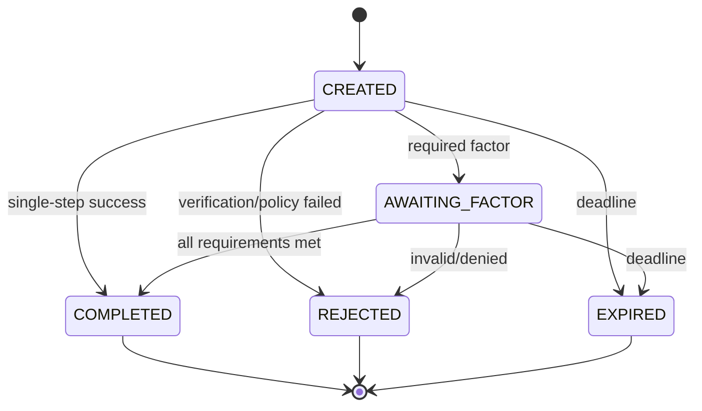
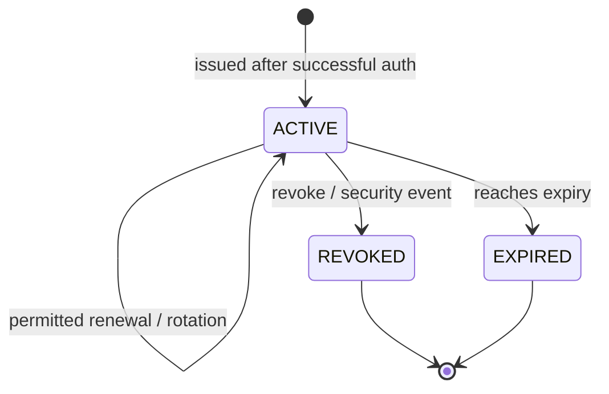
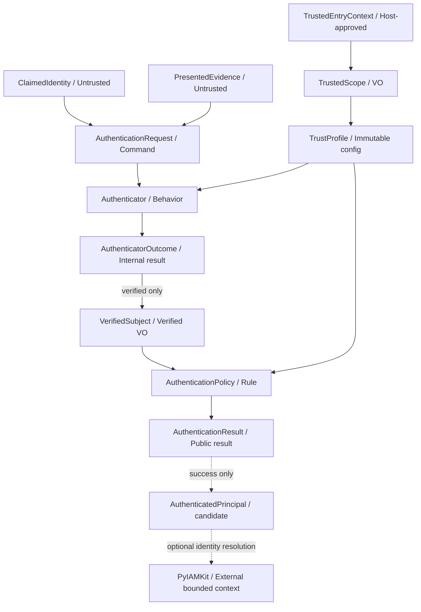
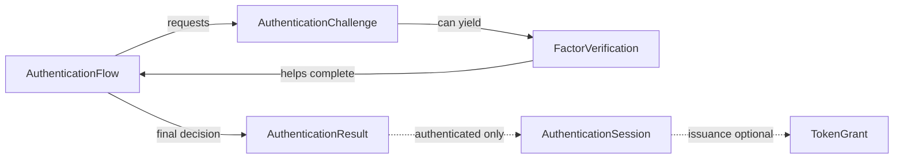

# 05_PYAUTHKIT_ENTITIES_AND_VALUE_OBJECTS

# PyAuthKit - Entities and Value Objects

> **Document :** `05_PYAUTHKIT_ENTITIES_AND_VALUE_OBJECTS.md`  
> **Produit :** PyAuthKit - Authentication Engine for the Modern Python Ecosystem  
> **Nature :** Tactical Domain-Driven Design / classification, modèle des entités et objets-valeur  
> **Version documentaire :** `0.1.0` - proposition de conception  
> **Date :** 28 octobre 2026  
> **Statut :** `PROPOSED` - les choix restent soumis aux ADR et à la qualification  
> **Langue :** français ; vocabulaire logiciel et identifiants Python en anglais  
> **Bounded Context :** `Authentication`  
> **Périmètre MVP :** validation Password, API Key, JWT ; contexte de confiance ; décision ; résultat  
> **Périmètre différé :** MFA/challenges, sessions et token issuance, OIDC/SAML, passkeys, délégation, adaptive auth  
> **Document précédent :** `04_PYAUTHKIT_DOMAIN_OBJECTS.md`  
> **Document suivant :** `06_PYAUTHKIT_DOMAIN_RELATIONSHIPS_AND_ERD.md`

---

## Guide de lecture

Ce document approfondit les **48 objets conceptuels `DO-001..048`** inventoriés dans `04` et propose leur classification DDD. Il ne change pas silencieusement leur sémantique. Les catégories `Entity`, `Value Object`, `Aggregate`, `DTO`, `Domain Event`, `Policy`, `Port`, `Service` et `Adapter` ne sont **pas interchangeables**.

La présence d'un nom ici n'implique ni classe Python livrée, ni table, ni repository, ni API publique stable. Les exemples sont **des illustrations de structure et de transitions**, jamais des systèmes d'authentification opérationnels ou des démonstrations de sécurité cryptographique.

| Parcours | Sections | Lecture suggérée |
|---|---|---|
| Décisions et classification | 0-6 | Modèle DDD, typologie, inventaire des 48 concepts |
| Noyau et confiance | 7-12 | Identités, evidence, trust, outcomes, results et credentials |
| Cycle de vie et extensions | 13-19 | Tentative, credentials, flows, challenges, sessions, federation, agents |
| Sémantique des frontières | 20-24 | Aggregates, provenance, temporalité, PyIAMKit et Python |
| Qualité et apprentissage | 25-34 | Invariants, tests, matrice pédagogique, ADR et trajectoire |
| Annexes | A-E | Contrats, exemples, glossaire, questions et traçabilité |

### Références internes

1. `00_PYAUTHKIT_EXPRESSION_DU_BESOIN.md` : intention, fonctionnalités, MVP et séparation IAM.
2. `01_PYAUTHKIT_REQUIREMENTS_ANALYSIS.md` : besoins et critères `FR-*`, `SEC-*`, `ARC-*`, `ACC-*` ; arbitrages `DEC-*`.
3. `02_PYAUTHKIT_PRODUCT_VISION_AND_ARCHITECTURE_PRINCIPLES.md` : `PRN-*`, DDD, DIP, Hexagonal et design patterns.
4. `03_PYAUTHKIT_SYSTEM_ARCHITECTURE.md` : `INV-SYS-*`, `A-*`, pipeline, ports et séquences.
5. **`04_PYAUTHKIT_DOMAIN_OBJECTS.md` : vocabulaire, inventaire `DO-*`, `DOM-INV-*`, `DOM-TST-*`, frontières de confiance.**
6. `PYAUTHKIT_SOFTWARE_DESIGN_LEARNING_CONVENTION.md` : pédagogie `Problem First, Trust First, Pattern Second`.

**Gouvernance documentaire :** les IDs `EV-*` (Entities and Values), `EV-INV-*`, `EV-TST-*` et `EV-DEC-*` créés ici sont locaux à `05`. Ils **complètent** les autres registres, sans se substituer à leurs IDs ni présumer des décisions validées.

### Glossaire des statuts

- `CONCEPTUAL` : concept nommé, représentation encore libre.
- `PROPOSED` : conception candidate documentée.
- `OPEN` : choix important non arbitré.
- `MVP TARGET` : cible du MVP, pas implémentation observée.
- `POST-MVP` : conception préparatoire, non engagement de date.
- `ACCEPTED` : décision formellement approuvée, par ADR ou gouvernance.
- `IMPLEMENTED` / `TESTED` / `QUALIFIED` : nécessitent des preuves distinctes dans le dépôt et la CI.

---

## 0. Résumé exécutif

### 0.1 Question de conception

La difficulté DDD de PyAuthKit n'est pas de dessiner une classe `User` et une classe `Session`. Elle est de répondre à quatre questions indépendantes :

1. **Qu'est-ce qui possède une identité propre dans le temps ?** Candidat `Entity`.
2. **Qu'est-ce qui est défini seulement par ses valeurs, son contexte et sa provenance ?** Candidat `Value Object`.
3. **Quelles mutations doivent conserver un invariant transactionnel commun ?** Candidat `Aggregate`.
4. **Qui est autorisé à qualifier une donnée comme vérifiée ?** Frontière de confiance au-delà du seul typage.

```text
CALLER CONTROLLED                   HOST-APPROVED                       VERIFIED / PUBLISHED

ClaimedIdentity ---------┐
PresentedEvidence -------+-----> Authenticator -----> AuthenticatorOutcome
AuthenticationContext --┘             ^                       |
                                      |                       v
TrustedEntryContext ---> TrustedScope + TrustProfile     VerifiedSubject
                                      |                       |
                                AuthenticationPolicy <--------+
                                      |
                                      v
                              AuthenticationResult
                                 |         |
                          AUTHENTICATED   REJECTED / ERROR / CHALLENGE_REQUIRED
                                 |             |
                         AuthenticatedPrincipal  no final principal
                                 |
                           PyIAMKit optional
                                 |
                        resource authorization separate
```

### 0.2 Orientations fortes (toutes proposées)

- `Principal` demeure un **concept métier générique** : pas automatiquement une Entity ni un `User` local.
- `ClaimedIdentity`, `TrustedScope`, `TrustProfile`, `VerifiedSubject` et `AuthenticationResult` sont des **value-like contracts** sous des conditions de provenance différentes.
- `AuthenticationRequest` est plutôt un **Application Command / DTO** qu'un Aggregate DDD.
- `Authenticator` est un **comportement/port** ; `AuthenticatorRegistry` est un **service de composition** ; aucun n'est une Entity.
- `AuthenticationAttempt` peut rester un **ID + événements** en MVP, sans Aggregate persistant.
- `CredentialRecord` peut être une **Entity** si PyAuthKit gère effectivement son cycle de vie ; sinon, il est une **vue issue d'un store propriétaire**.
- `AuthenticationChallenge` et `AuthenticationSession` sont les principaux candidats **Entity/Aggregate Root** après le MVP, si leurs invariants exigent cohérence et mutations atomiques.
- `AuthenticationFlow` est un **process model** ; sa persistance et sa frontière d'agrégat sont conditionnelles.
- `TrustProfile` est une configuration approuvée, éventuellement **snapshot immutable** ; son historique administratif/versionné, s'il existe, appartient à un cycle de vie différent.
- Aucune Entity de PyAuthKit n'attribue des rôles, des permissions ou des organisations à un principal.

### 0.3 Ce que le document ne prétend pas

- Il ne certifie aucune API publique ni aucun runtime.
- Il ne promet pas une conformité FIDO, OIDC, OAuth, NIST ou réglementaire.
- Il ne transforme pas des `dataclass(frozen=True)` en preuves de confiance infalsifiables.
- Il n'impose ni ORM, ni SQL, ni microservices, ni Event Sourcing, ni stratégie particulière de chiffrement.
- Il ne résout pas `DEC-05`, `DEC-06` ou les choix de persistences et agrégats différés ; il leur donne des **options testables**.

---

## 1. Point de départ : le problème Authentication, pas le pattern

Une application reçoit une affirmation : « ce sujet est moi ». Des informations d'entrée peuvent sembler convaincantes (`email`, `sub`, `issuer`, `tenant`, `key_id`, type d'agent), sans être dignes de confiance.

Le problème réel consiste à **établir un sujet, sous des contraintes de confiance déterminées hors de la preuve**, puis à décider si la cérémonie d'authentification est complète.

**Forces du domaine :**

- plusieurs catégories d'acteurs (`HUMAN`, `SERVICE`, `APPLICATION`, `AGENT`, `DEVICE`, `WORKLOAD`) ;
- plusieurs modes de preuve (Password, API Key, JWT, puis WebAuthn et fédération) ;
- versions de credentials, états de révocation, horloges, audiences et scopes ;
- externalisation possible des stores, verifiers et fournisseurs ;
- risques d'énumération, rejouabilité, confusion d'issuer, cross-tenant et fuites ;
- séparation entre **authentification**, **identité IAM**, **délégation** et **autorisation**.

Cette pression justifie la distinction entre **entrée non vérifiée**, **preuve évaluée**, **sujet vérifié** et **verdict final**. Ce découpage a une valeur métier et de sécurité même sans pattern GoF.

---

## 2. Taxonomie DDD et règles de classification

### 2.1 `Entity`

Une `Entity` possède une **identité stable** qui la distingue de ses autres versions, tandis que ses attributs et son état peuvent changer. Exemple candidat : une `AuthenticationSession` identifiée par `SessionId`, active puis révoquée.

Une Entity n'exige pas un ORM. Une `dataclass` mutable ou immutable peut implémenter une Entity ; l'identité et les transitions prévalent sur le mot-clé Python.

**Critères :**

1. Deux occurrences peuvent-elles avoir les mêmes attributs tout en étant deux objets distincts ?
2. Veut-on suivre leur histoire et leur identité malgré des changements ?
3. Y a-t-il des transitions contrôlées et des invariants d'état ?
4. Qui est autoritatif sur cet état et ces mutations ?

### 2.2 `Value Object` (VO)

Un VO se définit par sa **valeur et son contexte**, pas une identité propre ; il est idéalement immutable et validé à la construction. Exemple candidat : `TrustedScope(scope_id, realm_id)` issu d'une autorité approuvée.

**Attention :** certains objets nommés *value-like* sont surtout des DTO de frontière, et ne deviennent pas des concepts DDD simplement parce qu'ils sont `frozen=True`.

### 2.3 `Aggregate` et `Aggregate Root`

Un Aggregate est une **frontière de cohérence**, pas un regroupement d'objets affichés sur un diagramme. Une Aggregate Root protège les invariants des membres qui doivent être modifiés ensemble.

Le besoin d'atomicité doit être démontré : **si la session révoquée et son état de rotation doivent être cohérents au même instant**, `AuthenticationSession` peut posséder cette frontière. Cela ne justifie pas un Aggregate géant englobant toutes les tentatives, tokens, sessions et credentials d'un humain.

### 2.4 `Domain Service` et `Domain Policy`

Un `Domain Service` rend un comportement de domaine qui n'appartient naturellement à aucune Entity ; une `Domain Policy` exprime une règle admissible ou variable. Un objet de politique peut être un VO de configuration, un service, ou une fonction, selon la pression réelle.

Exemple : la règle « une méthode hors TrustProfile est refusée » est un **invariant transversal** ; le composant `AuthenticationPolicyGate` est une manière de l'orchestrer.

### 2.5 `Application Command`, `DTO` et `Result Object`

- `AuthenticationRequest` porte l'intention d'un appel et des evidence à traiter : **command/DTO**.
- `AuthenticatorOutcome` porte le verdict **interne** d'une vérification : **result object**.
- `AuthenticationResult` porte le verdict **public** après les policies : **result object**.

Ils ne deviennent ni Entities, ni Aggregates pour cette seule raison.

### 2.6 `Port`, `Adapter`, `Registry` et `Engine`

Ces noms sont des **rôles logiciels**, pas des catégories tactiques d'Entity/VO.

```text
AuthenticationEngine      -> orchestration/application service
Authenticator             -> verifier behavior / Protocol candidate
AuthenticatorRegistry     -> composition and method resolution
CredentialStore           -> outbound port
JWTVerifier               -> verifier mechanism
GoogleOIDCAdapter         -> integration adapter (future)
```

### 2.7 `Domain Event` et `Security Telemetry Event`

Un événement métier peut exprimer un fait passé (`CredentialRevoked`, `AuthenticationSucceeded`). Une trace d'audit peut enregistrer une observation technique (`InvalidSignatureObserved`). Ces deux concepts ne sont pas automatiquement identiques. Aucun événement ne peut transporter un secret ou une assertion brute.

### 2.8 Decision tree

```text
Does it represent a real stateful thing with stable identity?
  |-- yes -> Entity candidate
  |           |-- needs same-boundary invariant? -> Aggregate candidate
  |-- no  -> Is it a meaningful, value-defined domain concept?
               |-- yes -> Value Object candidate
               |-- no  -> Is it input/output/orchestration/infrastructure?
                          -> DTO / Result / Service / Port / Adapter

For every classification:
  Who owns the truth? What trust boundary? What could break?
```

---

## 3. Bounded Contexts et ownership de la vérité

| Source / responsabilité | Autorité sur | N'est pas autorité sur |
|---|---|---|
| App / hôte approuvé | Binding de l'entrée et choix initial du scope admis | Validité cryptographique d'une preuve |
| PyAuthKit verification | Vérification du mécanisme sous TrustProfile | Existence d'un compte IAM |
| PyAuthKit application policy | Succès final de la cérémonie | Permissions sur une ressource |
| Credential owner/store | État des records, révocation/rotation selon contrat | Autorisation de toutes les ressources |
| IdP externe | Assertions émises sous son domaine d'autorité | Acceptation automatique par toute application |
| PyIAMKit | Comptes, groupes, rôles, politiques IAM, lifecycle | Vérification brute de chaque méthode effectuée par PyAuthKit |
| Application métier | Ressources, opérations sensibles, exigences d'authentification et contrôle d'accès | Preuves non vérifiées fournies par le client |

### 3.1 Un sujet peut exister sans compte local

`VerifiedSubject(issuer, subject_id, scope)` peut référencer un sujet externe valide sans correspondance IAM locale. PyAuthKit peut produire une authentification finale ; l'application choisit séparément si elle autorise une session ou un accès.

### 3.2 Le scope est approuvé, pas déclaré

`tenant_hint` ne doit pas être converti directement en `TrustedScope`. L'application ou un resolver approuvé relie ce hint éventuel à une liaison fiable (route, domaine hôte validé, authentification du client, configuration approuvée).

### 3.3 Une preuve de délégation n'est pas une permission

Un agent authentifié n'hérite pas des droits de son opérateur. Une `DelegationEvidence` vérifiée ne remplace pas une décision explicite concernant le mandat et l'opération souhaitée.

---

## 4. Dimensions de modélisation obligatoires

Pour tout objet significatif, la fiche de domaine doit répondre à :

| Dimension | Question | Exemple |
|---|---|---|
| Identité | Y a-t-il une continuité au-delà des valeurs ? | `credential_id`, `session_id` |
| Portée | À quel tenant/realm/client/usage la valeur appartient-elle ? | `TrustedScope` |
| Autorité | Qui fournit ou établit ce champ ? | Host, verifier, store, IdP |
| Confiance | Quelle frontière doit être franchie ? | Claim -> verified subject |
| Sensibilité | Secret, identifiant public, données personnelles ou audit safe ? | Password vs key prefix |
| Temporalité | Date de validité, observation, expiration, révocation ? | `expires_at`, `revoked_at` |
| Cycle de vie | Quelles transitions sont permises ? | `ACTIVE -> REVOKED` |
| Cohérence | Quelles opérations doivent être atomiques ? | Rotation de session |
| Erreur | Que signifie absent/ambigu/indisponible ? | Fail closed |
| Test | Quel cas négatif prouve l'invariant ? | Cross-tenant rejection |

Le statut *validé* concerne un **fait d'authentification sous une configuration**, et non une propriété attachée éternellement à un acteur ou un identifiant.

---

## 5. Matrice des 48 Domain Objects : classification candidate

**Note importante :** cette matrice est le raccord **1:1** avec `04 §4`. Une ligne n'implique pas une classe indépendante. Les IDs restent ceux de `04`.

### 5.1 Noyau : `DO-001..020`

| ID | Concept | Classification dominante proposée | Identity / Equality | Phase | Motif et réserve |
|---|---|---|---|---|---|
| DO-001 | `Principal` | Domain Concept / possible value reference | Subject scoped | MVP | Acteur, **pas** User Entity imposée |
| DO-002 | `PrincipalType` | Enum / VO catégoriel | Valeur | MVP | Human, service, agent, etc. ; pas `EXTERNAL` comme origine |
| DO-003 | `ClaimedIdentity` | Input VO / DTO | Valeur déclarative | MVP | Aucun statut `verified` |
| DO-004 | `AuthenticationRequest` | Application Command / DTO | Attempt correlation, pas Entity | MVP | Transport-neutral, sensitive |
| DO-005 | `PresentedEvidence` | Secret-bearing input / discriminated type | Type + contenu, ne pas comparer/loguer arbitrairement | MVP | Non fiabilisée |
| DO-006 | `AuthenticationContext` | Context DTO / VO | Valeur et provenance | MVP | Contient des hints potentiellement non fiables |
| DO-007 | `TrustedEntryContext` | Trusted boundary context | Valeur + authority provenance | MVP | Construction contrôlée par l'hôte |
| DO-008 | `TrustedScope` | Value Object de portée approuvée | ScopeKey | MVP | Ni nom client ni tenant IAM par défaut |
| DO-009 | `TrustProfile` | Validated immutable configuration / VO snapshot | Profile ID + version dans la source, snapshot par valeur | MVP | Version administration = cycle séparé éventuel |
| DO-010 | `Authenticator` | Port / behavior, Strategy candidate | Registration ID ≠ Entity DDD | MVP | Fonction/Protocol spécialisé |
| DO-011 | `AuthenticatorRegistry` | Application service / composition registry | Instance de runtime | MVP | Pas repository métier |
| DO-012 | `VerificationContext` | Trusted runtime context object | Snapshot de vérification | MVP | Ports, clock, trusted profile approuvé |
| DO-013 | `AuthenticatorOutcome` | Internal Result Object | Valeur discriminée | MVP | Ne publie pas un succès final |
| DO-014 | `VerifiedSubject` | Security-significant VO candidate | Issuer + subject + trust scope + kind | MVP | Issu d'une vérification approuvée |
| DO-015 | `AuthenticatedPrincipal` | Public VO candidate / facade result | Sujet vérifié + attributs admis | MVP | Distinction avec DO-014 encore ouverte |
| DO-016 | `AuthenticationPolicy` | Domain Policy / behavior & configuration | Policy version + ruleset | MVP | Distincte de l'autorisation IAM |
| DO-017 | `AuthenticationResult` | Public Result Object | Statut + données autorisées | MVP | Issue finale, pas Entity |
| DO-018 | `AuthenticationAttempt` | Logical Entity **candidate** ; ID/events MVP | AttemptId | MVP | Pas d'Aggregate persistant imposé |
| DO-019 | `AuthenticationFailure` | Safe Error VO | Code + audience + metadata expurgées | MVP | Pas erreur brute de provider |
| DO-020 | `AuthenticationEvent` | Audit / domain-event contract candidate | EventId éventuel ; fait + time | MVP | Event vs telemetry à distinguer |

### 5.2 Credentials : `DO-021..031`

| ID | Concept | Classification proposée | Identity / Equality | Phase | Justification |
|---|---|---|---|---|---|
| DO-021 | `Credential` | Domain Concept umbrella | Aucune forme imposée | MVP | Pas d'héritage universel obligatoire |
| DO-022 | `CredentialRecord` | Entity **si owned** ; external snapshot sinon | CredentialId + scope | MVP | Ownership des mutations = clé de décision |
| DO-023 | `CredentialReference` | VO / lookup reference | Namespace + ID | MVP | Non secret ≠ preuve |
| DO-024 | `PasswordEvidence` | Secret input | Valeur opaque sensible | MVP | Jamais résultat/log |
| DO-025 | `PasswordVerifierRecord` | Trusted verifier record / DTO | Credential lookup ref + version | MVP | Peut provenir d'un store externe |
| DO-026 | `APIKeyEvidence` | Secret input | Valeur opaque sensible | MVP | Préfixe seul insuffisant |
| DO-027 | `APIKeyVerifierRecord` | Trusted verifier record / DTO | Scoped key ref + version | MVP | Statut, entropie, expiration, hash/ref |
| DO-028 | `JWTBearerEvidence` | Untrusted token input | Token opaque sensible | MVP | Claims/header non fiabilisés |
| DO-029 | `VerifiedTokenClaims` | Verified output VO | Claims autorisées + provenance | MVP | Après signature, issuer, audience, type, temps |
| DO-030 | `VerificationKeyReference` | Trusted key reference VO | KeyRef + trust profile | MVP | `kid` ne définit pas l'autorité |
| DO-031 | `CredentialLifecycle` | Domain lifecycle / policy | État d'une Entity **si owned** | POST-MVP | Pas nécessairement classe distincte |

### 5.3 Flows, sessions, federation, risk : `DO-032..048`

| ID | Concept | Classification proposée | Identity / Equality | Phase | Justification |
|---|---|---|---|---|---|
| DO-032 | `AuthenticationFlow` | Process model ; Entity/Aggregate **conditionnel** | FlowId si stateful | POST-MVP | Cycle persistant éventuel |
| DO-033 | `AuthenticationFlowState` | Enum / VO | Valeur d'état | POST-MVP | State Machine ≠ GoF State |
| DO-034 | `AuthenticationChallenge` | Entity / Aggregate Root **candidate** | ChallengeId + scope | POST-MVP | Consommation one-time, TTL, concurrence |
| DO-035 | `AuthenticationFactor` | VO de propriété vérifiée | Type + provenance + méthode | POST-MVP | Facteur ≠ canal/risque |
| DO-036 | `FactorVerification` | VO / evidence-of-verification event | Factor + attestation dérivée | POST-MVP | Pas preuve brute |
| DO-037 | `AuthenticationAssurance` | VO + policy-derived decision | Référentiel + niveau justifié | POST-MVP | Pas calcul automatique d'AAL |
| DO-038 | `StepUpRequirement` | VO / input policy | Exigence, contexte et fraîcheur | POST-MVP | Host demande ; moteur vérifie |
| DO-039 | `AuthenticationSession` | Entity / Aggregate Root **candidate** | SessionId + trusted scope | POST-MVP | Rotation, expiration, révocation |
| DO-040 | `SessionReference` | VO **souvent secret** | Opaque handle | POST-MVP | Handle bearer ≠ public ID |
| DO-041 | `Token` | Concept / typed artifact value | Usage, issuer, audience, temps | POST-MVP issuance | JWT format ≠ token purpose |
| DO-042 | `TokenGrant` | Application result / process object | GrantId éventuel si lifecycle | POST-MVP | Ownership issuance encore ouvert |
| DO-043 | `FederatedAssertion` | Untrusted protocol input | Assertion brute sensible | POST-MVP | OIDC/SAML doivent être vérifiés |
| DO-044 | `FederatedIdentityReference` | Verified VO | Trusted issuer + external sub + scope | POST-MVP | Email ≠ lien IAM |
| DO-045 | `AuthenticationRiskAssessment` | Decision VO | Risk + rule version + provenance | POST-MVP | Peut exiger step-up, pas donner AuthZ |
| DO-046 | `RiskSignal` | Observation VO, provenance obligatoire | Source + time + signal | POST-MVP | Signal ≠ facteur |
| DO-047 | `DelegationEvidence` | Untrusted / validated input distinct | Assertion + contexte de mandat | POST-MVP | Prouve au plus une assertion, pas droit final |
| DO-048 | `WorkloadBinding` | Verified binding VO / policy | Workload + audience + runtime identity | POST-MVP | Ne dépend jamais d'un nom déclaratif seul |

### 5.4 Classification négative : composants à ne **pas** traiter comme Entity

| Élément | Rôle réel | Risque si classé Entity |
|---|---|---|
| `AuthenticationEngine` | Orchestrateur de use cases | God Aggregate et persistence artificielle |
| `AuthenticatorRegistry` | Registre de stratégies admises | Mélange de configuration et vérité métier |
| `TrustProfileResolver` | Résolution depuis sources préapprouvées | Croire qu'un resolver crée la confiance |
| `ResultNormalizer` | Projection vers un contrat sûr | Transformer statut interne en autorité |
| `JWTVerifier`, `PasswordVerifier` | Vérification spécialisée | Persister un algorithme comme un utilisateur |
| `CredentialStore`, `SessionStore` | Ports de lecture/écriture | Associer API de DB à invariant métier |
| `OIDCAdapter`, `DjangoAdapter` | Adaptation externe/transport | Couplage du core à un provider |
| `PyIAMKit Identity` | Entité d'un **autre bounded context** | Mélanger Authentication et authorization |

---

## 6. Identité, égalité et clés : conventions transversales

### 6.1 L'identité d'une Entity n'est pas son nom affiché

`CredentialId`, `SessionId`, `ChallengeId` et, éventuellement, `FlowId` doivent identifier l'instance **dans son espace de noms**. Un `key_prefix`, `email`, `client_id` ou `sub` non qualifié n'est pas une identité globale.

### 6.2 Value Objects et égalité contextualisée

```text
SubjectKey = (approved_issuer_ref, subject_id, trusted_scope_id)
CredentialKey = (trusted_scope_id, credential_id)
SessionKey = (trusted_scope_id, session_id)
ChallengeKey = (trusted_scope_id, challenge_id)
```

Ce sont **des tuples sémantiques candidats**. La cardinalité réelle de l'issuer/scope peut varier selon le provider et les garanties. Aucune concaténation non canonique (`issuer + sub`) ne doit être utilisée comme identité stable.

### 6.3 Provenance et confidentialité

Un identifiant peut être non secret tout en étant personnel ou sensible ; une `SessionReference` peut être un secret bearer, même si elle contient « reference » dans son nom. Les structures destinées au `repr`, au logging et aux exceptions sont explicitement limitées.

### 6.4 Identité Entity vs identifiant technique de DB

`CredentialId` ne doit pas nécessairement être un `SERIAL` SQL, et `SessionId` ne suppose pas une ligne SQL. L'identité métier peut être représentée par UUID, opaque random ID ou autre forme selon profil de menace et contexte, avec validations indépendantes du backend.

---
## 7. `Principal` et sujet : acteur, revendication, preuve, décision

### 7.1 Le problème

Un humain peut être authentifié par mot de passe ou par OIDC ; un service par API key ou JWT. Il serait erroné de faire hériter tous ces acteurs d'un `User` mutable possédant rôles et permissions.

### 7.2 Les quatre niveaux conceptuels

| Concept | Question | Autorité | Classification |
|---|---|---|---|
| `Principal` (`DO-001`) | Quel acteur cherche à s'authentifier ? | Notion du domaine | Concept, pas Entity imposée |
| `ClaimedIdentity` (`DO-003`) | Qui l'entrée prétend-elle être ? | Appelant | Input VO non fiable |
| `VerifiedSubject` (`DO-014`) | Quel sujet la preuve admissible établit-elle ? | Verifier approuvé / TrustProfile | Verified VO candidat |
| `AuthenticatedPrincipal` (`DO-015`) | Quel sujet la politique de cérémonie accepte-t-elle ? | Orchestrateur de l'authentification | Public VO candidat |

### 7.3 `PrincipalType` : classification orthogonale

`HUMAN`, `APPLICATION`, `SERVICE`, `WORKLOAD`, `DEVICE`, `AGENT` décrivent la **nature de l'acteur**. `LOCAL`, `OIDC`, `SAML` ou une marque d'IdP décrivent la **provenance** : ils ne doivent pas se confondre. `EXTERNAL` peut être un qualificatif d'origine, pas nécessairement un septième type qui écrase la nature humaine ou machine.

### 7.4 `ClaimedIdentity` : seulement une indication

| Champ candidat | Sens | Confiance |
|---|---|---|
| `identifier_kind` | email, username, client_id, subject hint | Déclaré |
| `identifier_value` | indice borné et normalisé selon mécanisme | Déclaré |
| `claimed_issuer` | fournisseur revendiqué | Non approuvé en soi |
| `claimed_tenant` | tenant demandé ou hint | Non approuvé en soi |

**Invariants :** une identity claim ne peut pas contenir un indicateur faisant autorité tel que `verified=True` ; la présence d'un email n'établit ni la possession de ce mail ni un droit d'accès ; les hints sont bornés pour éviter les abus mémoire/log.

### 7.5 `VerifiedSubject` : identité située

Proposition minimale :

```text
VerifiedSubject
  subject_id: ScopedSubjectId
  approved_issuer: ApprovedIssuerReference
  trusted_scope: TrustedScope
  principal_type: PrincipalType
  evidence_assurance?: verified metadata (future)
```

- Le `subject_id` doit provenir d'un contrôle d'authentification réussi et non d'un `request.claimed_sub` copié.
- `approved_issuer` est résolu contre une configuration préapprouvée et non sélectionné librement par le payload JWT.
- `trusted_scope` doit résulter d'un contexte hôte légitime.
- Un même `sub` de deux issuers ne désigne pas nécessairement le même sujet.
- Deux sujets de scopes différents ne peuvent être fusionnés par la seule égalité des chaînes d'identifiants.

### 7.6 `AuthenticatedPrincipal` : distinction encore ouverte

Option **A** : utiliser `VerifiedSubject` tel quel dans `AuthenticationResult`, comme le pseudocode de `03 §9`.

Option **B** : créer un `AuthenticatedPrincipal` distinct, contenant une référence au sujet vérifié ainsi que la preuve de décision finale, sans rôles ni permissions.

**Recommandation provisoire :** conserver **la distinction sémantique** dans la documentation ; n'introduire le deuxième type public que si la distinction est observable et utile dans les contrats. Ne pas modifier `03` sans ADR.

### 7.7 Exemples limites

```text
Input: email=admin@example.test, password=invalid
  -> ClaimedIdentity exists
  -> no VerifiedSubject
  -> REJECTED, principal=None

Input: verified JWT for issuer-A / sub-42 / tenant-A
  -> VerifiedSubject(issuer-A, sub-42, scope-A)
  -> final AuthenticationPolicy rejects the requested flow
  -> REJECTED, principal=None

Input: verified agent identity, no delegation policy
  -> authentication may succeed for the agent
  -> agent does NOT acquire its operator's permissions
```

**Learning card :** `DDD Value Object`, `Explicit Modeling`, `Trust Boundary`, `Separation of Concerns`. Aucun pattern GoF n'est exigé.

---

## 8. `AuthenticationRequest` et objets d'entrée

### 8.1 Pourquoi ce n'est pas un Aggregate

Une demande d'authentification transporte une intention et des données ; elle n'est pas une entité durable dont un Aggregate Root protège un historique. Son `correlation_id` permet de suivre une exécution, pas de prouver une identité persistante.

### 8.2 Contrat conceptuel

```text
AuthenticationRequest  [Application Command]
  method                 : MethodId (validée contre l'approved profile)
  claimed_identity?      : ClaimedIdentity
  evidence               : PresentedEvidence
  context                : AuthenticationContext
  trusted_entry_context  : TrustedEntryContext (host constructed)
  correlation_id?        : CorrelationId (trusted/generated under policy)
```

L'API peut faire transiter `TrustedEntryContext` séparément de l'objet exposé au client, afin d'empêcher toute confusion entre paramètres de transport et configuration fiable.

### 8.3 `AuthenticationContext` vs `TrustedEntryContext`

| Champ | `AuthenticationContext` | `TrustedEntryContext` |
|---|---|---|
| Tenant | `tenant_hint` possible | Scope issu d'une résolution approuvée |
| IP | Adresse prétendue ou observée, avec provenance | IP constatée par la chaîne proxy approuvée |
| Application | Nom/ID déclaré | Application/route réellement liée à l'intégration |
| Client | Client ID présenté | Binding client validé selon mode d'intégration |
| Time | Timestamp d'entrée éventuel | Horloge hôte/clock approuvée |

Un `Header` HTTP ou une variable d'environnement non gouvernée ne devient pas digne de confiance grâce à un renommage.

### 8.4 Sensibilité des evidence

`PresentedEvidence` est une famille conceptuelle : `PasswordEvidence`, `APIKeyEvidence`, `JWTBearerEvidence`, puis assertions WebAuthn/certificats. Certaines variantes contiennent un secret bearer ; toutes sont **untrusted until verified**.

**Règles :**

1. Pas de sérialisation ni de logging implicite du contenu brut.
2. Pas de conversion non contrôlée de l'objet en dictionnaire générique.
3. Pas de comparaison ni de hash dans le `repr`.
4. Pas d'utilisation de l'evidence comme clé d'index ou tag d'observabilité.
5. Les limites d'entrée et validations de forme protègent le runtime sans promettre la validité de la preuve.

### 8.5 Invariant de séparation de la requête

Une request client **ne transporte pas d'autorité** sur les algorithmes, clés, providers ou scopes que PyAuthKit est autorisé à utiliser. La sélection de méthode reste bornée au trust profile.

---

## 9. `TrustedScope`, `TrustProfile` et objets de configuration

### 9.1 `TrustedScope` comme VO

Exemples de dimensions : `realm_id`, `tenant_id`, `application_id`, `environment_id` ou `usage_id` si le produit l'exige. Aucun de ces champs n'est universellement obligatoire dans tous les déploiements.

```text
ScopeKey
  application_binding
  realm_binding
  tenant_binding? 

TrustedScope
  key: ScopeKey
  authority_ref: HostBindingRef
```

**Différence :** la validation structurelle d'un `ScopeKey` garantit la bonne forme des chaînes, pas que l'appelant ait le droit de choisir ce scope. L'approbation vient de l'intégration et des policies de l'hôte.

### 9.2 `TrustProfile` comme valeur versionnée

| Propriété | Responsabilité | Contrôle |
|---|---|---|
| `profile_ref` | Référence à la configuration approuvée | Source fiable |
| `profile_version` | Fixer le profil actif à la décision | Provenance, version stable |
| `trusted_scope` | Contexte autorisé | Same-scope invariant |
| `accepted_method(s)` | Mécanismes permis | No implicit fallback |
| `approved_issuer(s)` | Autorités admises | Explicit allowlist |
| `audience(s)` et `purpose` | Usage attendu | Anti-token confusion |
| `accepted_algorithm(s)` | Algorithmes possibles | Allowlist (JWT, etc.) |
| `verification_key_refs` | Sources de clés autorisées | Pas d'URL arbitraire |
| `time_policy` | Expiration, leeway, freshness | Horloge explicite |
| `failure_policy` | Refus/erreur/continuation | Fail-closed |

**Deux plans distincts :**

```text
Administration: TrustProfileDefinition[profile_id, versions, status]
                 (éventuelle Entity côté configuration)

Execution:      EffectiveTrustProfile[validated scope, pinned version, rules]
                 (immutable runtime snapshot / VO)
```

Le document `05` **ne crée pas** un sous-domaine d'administration complet : il distingue son éventuelle identité persistante du snapshot de décision utilisé par le verifier.

### 9.3 Valeurs versionnées et temporalité

Une vérification doit connaître la version réellement appliquée. Un refresh de cache, une rotation de key set ou une politique future ne peut silencieusement changer une opération en cours au point d'invalider ses garanties. Le modèle d'invalidation/cache reste à définir dans `25` ; le refus en cas de configuration critique ambiguë est la cible.

### 9.4 `AuthenticationPolicy` n'est pas un VO universel

Une politique peut être exprimée par :

- une configuration immutable (`PolicyRuleSet`) ;
- une fonction de décision pure, si elle suffit ;
- un `Protocol` avec plusieurs implémentations réelles ;
- une composition de règles lors des futures cérémonies MFA.

Il faut éviter un `AuthenticationPolicy` géant portant à la fois des règles d'auth, des permissions IAM et des règles métier.

### 9.5 Policy Decision vs Assurance

Une politique d'authentification peut rejeter une preuve valide parce que la méthode n'est pas autorisée, est trop ancienne ou n'atteint pas un niveau de preuve requis. Le niveau d'assurance futur n'est pas équivalent à un `risk_level=LOW` ni à `factors_count=2`.

---

## 10. `AuthenticatorOutcome`, `VerifiedSubject` et résultat final

### 10.1 `AuthenticatorOutcome` - Result Object interne

Le verifier retourne un verdict spécifique à une evidence, sous le contexte et profil approuvés. Ce verdict doit être impossible à interpréter comme succès final par simple convention implicite.

| Statut interne conceptuel | Sujet vérifié | Sens |
|---|---|---|
| `VERIFIED` | Obligatoire | Preuve valide pour l'usage de vérification |
| `REJECTED` | Absent | Evidence incorrecte, record non admis ou autre refus |
| `ERROR` | Absent | Impossible de vérifier selon le contrat |
| `CONTINUE` | Pas de principal final | Une étape doit poursuivre la cérémonie (futur) |

Les labels internes ne sont **pas** imposés par `03`; une forme `verified: bool` est également proposée dans son pseudocode. Le choix de l'ADT exacte relève d'un arbitrage.

### 10.2 `AuthenticationResult` - issue publique

L'architecture `03 §9` propose :

| Statut | `principal` | Peut déverrouiller un contrôle d'accès ? |
|---|---|---|
| `AUTHENTICATED` | Présent et issu de vérification + policy | La seule authentification est établie ; autorisation séparée |
| `REJECTED` | `None` | Non |
| `ERROR` | `None` | Non |
| `CHALLENGE_REQUIRED` (futur) | Aucun principal final | Non ; poursuivre flow |

L'absence d'un principal dans les sorties non authentifiées est un invariant structurel central, pas un détail d'affichage.

### 10.3 `AuthenticationFailure` - VO de diagnostic sûreté

Distinguer :

- `internal_reason` : suffisamment précis pour les contrôles internes, **sans données secrètes** ;
- `public_error_code` : code neutre et stable, adapté à la prévention d'énumération ;
- `correlation_id` : lien vers un audit expurgé ;
- `retryable` : sémantique explicite, jamais un contournement de policy.

**Ne pas** recopier dans le DTO public les exceptions de providers (URL de JWKS interne, existence d'un email, hash, signature, token, chemin d'un secret).

### 10.4 Final success vs valid signature

```text
Signed JWT with valid signature
    |-- wrong audience      -> REJECTED
    |-- wrong token purpose -> REJECTED
    |-- issuer not approved -> REJECTED
    |-- policy denies       -> REJECTED
    `-- all checks pass     -> AUTHENTICATED
```

Le moteur doit garder la source de confiance dans le profil déjà validé, même si le header non vérifié contient `alg`, `kid` ou `jku`.

### 10.5 Result Object ≠ Entity

Un résultat n'a pas besoin d'une identité métier durable parce qu'il possède un `attempt_id`. L'ID sert à corréler la décision ; s'il devient important de persister le cycle d'une tentative, la responsabilité est portée par `AuthenticationAttempt` ou une trace d'audit dédiée.

---

## 11. `Credential` : concept racine, records, references et lifecycle

### 11.1 Quatre concepts irréductibles

```text
CREDENTIAL (concept)
   |
   +-- PresentedEvidence      -> untrusted data supplied by the caller
   +-- CredentialReference    -> non-secret lookup handle (not proof)
   +-- VerifierRecord         -> trusted store representation for checking
   +-- CredentialLifecycle    -> rotation/revocation/state when owned
```

Une même classe `Credential(secret, hash, public_key, jwt, certificate, ... )` est à proscrire : elle mélange concepts de stockage, evidence et formats de vérification.

### 11.2 `CredentialRecord` comme Entity conditionnelle

**Question préalable :** qui peut créer, révoquer et faire tourner le credential ?

| Ownership | Classification pratique | Conséquence |
|---|---|---|
| PyAuthKit gère le cycle local | Entity candidate, identifiée par `CredentialId` | Transitions contrôlées et ports de persistance |
| Application possède le store | Record/DTO adapté en lecture | Pas de lifecycle PyAuthKit fictif |
| IdP / Vault externe possède le secret ou statut | Snapshot de vérification / reference | Ne jamais prétendre posséder la révocation globale |

Un record peut être **immutable en mémoire** et malgré tout représenter une Entity dont le statut évolue sous nouveaux snapshots, grâce à une identité stable et un versionnement.

### 11.3 Propriétés d'une Entity `CredentialRecord` candidate

| Champ | Sens | Note |
|---|---|---|
| `credential_id` | Identité scoped | Stable malgré rotation si contrat retenu |
| `owner_subject_ref` | Sujet auquel le moyen est rattaché | Référence, pas User ORM |
| `trusted_scope_ref` | Partition de validité | Isoler les tenants |
| `credential_type` | Password, API Key, etc. | Discriminant contrôlé |
| `status` | Active, revoked, expired, etc. | État reconnu, pas booléens multiples |
| `created_at` / `expires_at` | Bornes temporelles | TZ-aware, horloge approuvée |
| `version` | Contrôle de concurrence | Dépend du store/ownership |
| `verifier_material_ref` | Matériau de vérification ou reference sûre | Pas le secret en clair |

### 11.4 Vérifier l'état sans affirmer l'atomicité universelle

`status == ACTIVE` vérifié en mémoire n'est pas une garantie de révocation immédiate sous concurrence. Le contrat d'un store peut exiger une lecture cohérente, un point de linéarisation, des validations supplémentaires, ou une fenêtre de propagation documentée.

**Leçon :** une Entity encapsule une règle, mais une règle de sécurité interprocessus exige des garanties de persistence/runtime qui doivent être prouvées.

### 11.5 Password verifier record

`PasswordVerifierRecord` doit transporter un hash et ses paramètres (ou des références vers un backend de vérification) et son statut dans un scope approuvé. Les algorithmes, paramètres, politiques de mise à niveau (`rehash`) et contrôles anti-enumération restent à spécifier dans `10` et `20`.

Ce record n'est pas une `PasswordEvidence` : le hash stocké n'est pas le secret en clair présenté. `repr` et événements ne doivent exposer ni l'un ni l'autre.

### 11.6 API Key verifier record

`APIKeyVerifierRecord` comporte un identifiant de recherche scoped, un matériau de vérification sûr, un statut, une date d'expiration et éventuellement une politique d'usage. `key_id` ou préfixe ne suffit pas pour établir la possession de la clé.

Le choix entre hash, HMAC, secret store distant ou autre méthode doit tenir compte de l'entropie et des garanties de gestion des clés ; ne pas supposer qu'un hash rapide convient à des passwords humains ou qu'un slow password hash est systématiquement l'unique stratégie des API keys.

### 11.7 JWT verifier material

Le MVP **valide** un JWT entrant. Il ne gère pas nécessairement une Entity `JWTToken`. `VerificationKeyReference` indique une clé **déjà autorisée par le profil sélectionné**. `VerifiedTokenClaims` est la valeur résultant de contrôles cryptographiques et sémantiques, pas un modèle de stockage de token.

---

## 12. Algorithmes d'identité et de vérification : où se situe le design ?

### 12.1 Résolution du mécanisme

```text
method requested
  -> allowed by active profile?
      no: REJECTED
      yes: resolve exactly one approved authenticator
          none: ERROR or REJECTED by explicit policy, never fallback
          ambiguous: ERROR/REJECTED, never arbitrary first()
```

**Algorithmique :** dictionnaire de dispatch, filtrage par méthode, validation des capacités, détection d'ambiguïté. **Design :** composition, OCP/DIP, Strategy uniquement si les comportements sont vraiment substituables.

### 12.2 Résolution d'un record

```text
trusted_scope + credential_lookup_hint
  -> store/port lookup
  -> 0 record: reject uniformly
  -> 1 record: verify active, valid, in-scope, material
  -> N records: reject as ambiguous unless contract disambiguates securely
```

La cardinalité `N` peut résulter d'un mauvais schéma d'index ou d'un resolver erroné. La faille ne doit pas être dissimulée par `records[0]`.

### 12.3 Validation de preuve JWT

```text
approved host context + approved trust profile
  -> parse untrusted token under bounded limits
  -> select approved key from allowed key set (untrusted kid = selector only)
  -> verify allowed algorithm + cryptographic signature
  -> check issuer, audience, purpose/type, exp, nbf, other required claims
  -> verify subject mapping and scope
  -> VerifiedTokenClaims / VerifiedSubject
  -> global AuthenticationPolicy
  -> AuthenticationResult
```

L'ordre exact de parsing/validation dépend de la bibliothèque et des besoins du standard, mais **aucun champ non vérifié ne peut définir la configuration de confiance**. Une validation incorrecte ou incomplète ne peut être compensée par un bon design d'Entities.

### 12.4 Identité de domaine et complexité algorithmique

Les objets de domaine portent le sens (`VerifiedSubject`, `TrustProfile`) ; les algorithmes exécutent des opérations (lookup, comparaison, validation, agrégation éventuelle). `Strategy` décrit l'interchangeabilité du comportement, pas l'algorithme cryptographique lui-même.

---

## 13. `AuthenticationAttempt` : Entity logique ou simple corrélation ?

### 13.1 Problème

Suivre une tentative de son début à sa conclusion facilite la sécurité et le diagnostic sans imposer une session utilisateur.

### 13.2 Option A - MVP léger

```text
AttemptId
AuthenticationStarted event (safe)
AuthenticationOutcome event (safe)
AuthenticationResult.attempt_id
```

Pas d'`AuthenticationAttemptRepository` ; le `attempt_id` n'est qu'un lien, et les événements d'audit ont leur propre garantie de livraison. **C'est la solution privilégiée tant que le cycle n'a pas besoin d'un état cohérent persistant.**

### 13.3 Option B - Entity avec lifecycle

```text
AuthenticationAttempt
  id: AttemptId
  scope: TrustedScope
  started_at: datetime
  status: PENDING | FINISHED | CANCELLED | TIMED_OUT
  completed_at?: datetime
  safe_result_ref?: ResultRef
```

Adopter ce modèle seulement si l'application exige réellement suivi de tentative, arbitrage de concurrence, reporting cohérent ou reprise durable.

### 13.4 Invariants candidats

- Une tentative terminée ne redevient pas `PENDING` sans nouveau `AttemptId`.
- Une tentative rejetée n'émet pas un principal authentifié final.
- Les événements sont expurgés même si l'essai échoue avant vérification.
- Une annulation/timeout ne devient pas succès via une exception avalée.
- Une tentative n'est ni une `Session`, ni un `Flow` durable.

**Décision :** `EV-DEC-03`, ouverte tant qu'aucun cas nécessitant une Aggregate Root n'est prouvé.

---

## 14. `AuthenticationFlow` : processus, état et durée de vie (POST-MVP)

### 14.1 Besoin

Une cérémonie peut exiger un mot de passe, puis une authentification secondaire ou un challenge passkey. L'authentification n'est finale que lorsque toutes les étapes obligatoires sont satisfaites.

### 14.2 Process model proposé

```text
AuthenticationFlow
  flow_id
  trusted_scope
  initiating_actor_ref
  verified_partial_subject?   [internal only]
  required_steps
  verified_steps
  expires_at
  flow_state
  version?
```

Le sujet partiellement vérifié ne doit pas sortir comme `AuthenticatedPrincipal` final tant que la policy exige d'autres facteurs.

### 14.3 State machine candidate



Ce modèle est **illustratif**. Les raisons d'erreur, retry, abandon et reprise doivent être précisées dans `11` ; `State Pattern` (GoF) n'est pas requis simplement parce qu'il y a un diagramme d'états.

### 14.4 Aggregate ou Process Manager ?

| Besoin observé | Conception candidate |
|---|---|
| Flow purement synchrone, éphémère | Value-like context / application orchestration |
| Flow multi-requêtes mais sans état central complexe | Enregistrement scoped + transitions validées |
| Flow durable avec invariants et concurrence | Entity/Aggregate Root ou process manager selon ownership |

Aucune option n'est imposée en `05`. Une flow qui orchestre des challenges **ne doit pas** devenir un Aggregate distribué englobant toutes leurs bases.

---

## 15. `AuthenticationChallenge` : candidat fort pour Entity et Aggregate Root

### 15.1 Pourquoi son identité compte

Deux challenges identiques de type TOTP ou WebAuthn, créés à des instants différents, sont deux occurrences distinctes. Le challenge a un `ChallengeId`, une expiration, un état, et une consommation contrôlée.

### 15.2 Modèle d'Entity candidate

| Champ | Signification |
|---|---|
| `challenge_id` | Identité dans un scope |
| `flow_ref` | Cérémonie liée |
| `trusted_scope` | Partition de confiance |
| `bound_subject_ref?` | Sujet partiellement établi si disponible |
| `challenge_kind` | TOTP, WebAuthn, OTP, etc. |
| `issued_at` / `expires_at` | Fenêtre de validité |
| `status` | PENDING, CONSUMED, EXPIRED, CANCELLED |
| `consumption_version` | Concurrence si store et contrat adaptés |

### 15.3 Invariants métiers candidats

- Un challenge one-time ne peut être validé que **pour une consommation unique**.
- Une réponse liée à un autre flow, scope, sujet ou audience doit être rejetée.
- Un challenge expiré, annulé ou consommé ne peut pas être validé à nouveau.
- Un challenge ne peut pas émettre de principal final si les autres étapes de la policy ne sont pas satisfaites.
- Le défi en clair et les secrets liés à sa réponse ne doivent pas apparaître dans l'audit.

### 15.4 Frontière transactionnelle

Le simple code `if status == PENDING: status = CONSUMED` en mémoire **ne garantit pas** l'unicité sous deux workers. Il faut une persistance/transaction atomique, CAS, contrainte unique ou équivalent contractuel. Le choix est différé à `11`, `19`, `20`, `26`.

### 15.5 Pattern

**DDD :** candidate Entity/Aggregate Root ; **State machine :** utile comme modèle de transitions ; **GoF State :** non requis tant que des transitions gardées suffisent. **Algorithmique :** comparaison, expirations, replay detection et CAS au backend.

---

## 16. `AuthenticationFactor` et `AuthenticationAssurance` (POST-MVP)

### 16.1 Factor, vérification et contexte

`AuthenticationFactor` décrit **la catégorie effectivement prouvée**. Une IP, un niveau de risque bas ou un user-agent ne sont pas automatiquement des facteurs MFA indépendants. Une notification push ou un code envoyé par email demande une analyse des garanties et du modèle de menace avant toute qualification de facteur.

`FactorVerification` enregistre qu'un mécanisme a réellement satisfait une exigence sous des conditions données, **sans transporter l'evidence brute**.

### 16.2 Assurance n'est pas simple booléen

```text
AuthenticationAssurance
  policy_profile_ref
  evaluated_methods
  verified_factor_categories
  freshness
  phishing_resistance? (only if substantiated)
  resulting_assurance_classification
  evidence_provenance
```

Ne pas inférer des classes normatives (AAL1/2/3, etc.) par simple mapping `number_of_factors` ou `mfa=True` ; il faut une policy, un référentiel et des tests explicites.

### 16.3 `StepUpRequirement`

La ressource métier exige éventuellement une assurance supérieure ou une confirmation récente. L'hôte fournit **l'exigence autorisée** ; PyAuthKit détermine si une cérémonie respecte cette exigence. L'autorisation finale d'une opération reste externe.

### 16.4 Distinctions

```text
Challenge           : demande à compléter une vérification
Factor              : type de preuve effectivement évalué
FactorVerification  : résultat de ce contrôle de facteur
Assurance           : niveau justifié sous une policy
StepUpRequirement   : exigence à satisfaire
```

Aucune de ces lignes n'exige à elle seule un Aggregate Root persistant.

---

## 17. `AuthenticationSession` : continuité, Entity et Aggregate (POST-MVP)

### 17.1 Fonction de la session

Une `AuthenticationSession` maintient un contexte authentifié dans le temps, sous des contraintes de durée, révocation, renouvellement, device binding et politique. Elle ne se confond ni avec une tentative, ni avec le token qui peut l'indexer, ni avec une permission permanente.

### 17.2 Modèle d'Entity candidate

```text
AuthenticationSession
  session_id: SessionId
  trusted_scope: TrustedScope
  subject: VerifiedSubject / reference
  established_at: datetime
  expires_at: datetime
  last_authenticated_at?: datetime
  status: ACTIVE | REVOKED | EXPIRED
  assurance_snapshot?: AuthenticationAssurance
  rotation_version: int
  revoked_at?: datetime
```

### 17.3 Invariants

1. Une session ne naît pas d'une issue `REJECTED`, `ERROR` ou d'une identité seulement déclarée.
2. Une session révoquée ou expirée n'est pas acceptée.
3. Une session révoquée ne redevient pas active par un simple refresh.
4. La rotation d'un bearer handle ne doit pas conserver un ancien handle accepté après invalidation lorsque la policy le requiert.
5. Les références de session restent liées au scope et sujet approuvés.
6. Deux mises à jour concurrentes ne doivent pas contourner une révocation ou une rotation.

### 17.4 SessionReference publique ou secrète ?

L'identifiant interne non secret (`SessionId`) et un cookie/bearer handle (`SessionReference` présenté) doivent être **séparables**. Le second peut agir comme un secret et doit recevoir une politique de stockage, de non-journalisation et de rotation plus stricte. Les détails cookie `Secure`, `HttpOnly`, `SameSite`, protection CSRF et session fixation relèvent des adapters web et du threat model.

### 17.5 Aggregate boundary candidate

`AuthenticationSession` peut être une Aggregate Root si elle protège ses propres transitions et la cohérence de la génération actuelle du handle. Elle ne doit pas englober les `CredentialRecord` de son sujet ni l'IAM Identity. Des sessions peuvent exister dans un backend dédié sans imposer la persistance du core MVP.

### 17.6 Diagramme d'états



Les transitions `ACTIVE -> REVOKED` et `ACTIVE -> EXPIRED` doivent être observables dans le backend selon un contrat de cohérence défini, pas simplement dessinées.

---

## 18. `Token` et `TokenGrant` : artefact ≠ autorité de validation

### 18.1 Dimensions d'un token

| Dimension | Question |
|---|---|
| `token_purpose` | ID, access, refresh, session, one-time, assertion ? |
| `token_format` | Opaque, JWT, autre ? |
| `token_issuer` | Qui émet, sous quelle configuration approuvée ? |
| `token_audience` | Quel destinataire ? |
| `token_subject` | Quel sujet et sous quel namespace ? |
| `token_lifetime` | Not-before, expiration, rotation ? |
| `token_binding` | Bearer, proof-of-possession ou binding particulier ? |

### 18.2 `JWTBearerEvidence` et `Token` ne sont pas la même chose

Le JWT entrant du MVP est une **evidence non vérifiée** à valider sous profil. Un éventuel `Token` émis par PyAuthKit appartient à un domaine de gestion/issuance post-MVP et ne peut être inféré de la validation des JWT entrants.

### 18.3 `TokenGrant` : process ou valeur ?

**Option A :** résultat immutable d'une opération d'issuance réussie. **Option B :** Entity si l'application possède un cycle durable de renouvellement/révocation/réutilisation. **Option C :** déléguer l'issuance à un système/adapter dédié. `05` laisse le choix ouvert.

### 18.4 Invariants

Un ID token ne doit pas être accepté comme access token uniquement parce qu'il est signé. Un token valide sous issuer A n'est pas valide pour un usage B par simple réutilisation. L'obligation de révocation immédiate dépend d'un contrat explicite, particulièrement important pour des tokens autosuffisants déjà émis.

---
## 19. Federation, risk, workload et délégation (POST-MVP)

### 19.1 `FederatedAssertion`

Une assertion OIDC ou SAML reçue est **une donnée entrante non fiable** tant que les règles du protocole et du profil ne sont pas satisfaites. Elle ne devient pas une `Identity` persistante locale par simple parsing.

**Propriétés à considérer :** source déclarée, usage, destination, signature, audience, fenêtre temporelle, nonce/state lorsque requis, protection contre rejeu et provenance du canal. Les règles spécifiques doivent être détaillées dans `14`.

### 19.2 `FederatedIdentityReference`

VO vérifié candidat : `(approved_provider_or_issuer, external_subject, trusted_scope)` et, selon le protocole, qualifications supplémentaires requises. Deux providers ayant le même `sub` n'impliquent pas une identité commune. Un email identique ne suffit jamais pour lier automatiquement deux comptes.

**DDD :** une référence externe est un VO de PyAuthKit. L'Identity/Account locale éventuellement associée appartient au Bounded Context IAM.

### 19.3 `RiskSignal`

Un signal est une **observation** avec provenance, instant, qualité et contexte ; son risque réside dans une source douteuse, une fraîcheur insuffisante ou une agrégation trompeuse. Il n'est pas un facteur MFA.

### 19.4 `AuthenticationRiskAssessment`

Une évaluation de risque est un **VO de décision** sous une version de politique et une liste de signaux admis. Elle peut influencer une exigence de step-up, sans contourner l'authenticator, ni devenir permission.

### 19.5 `DelegationEvidence`

Une assertion selon laquelle « un agent A agit au nom de B » exige une vérification de signature/provenance/scope/audience/temps/mandat selon protocole retenu. **Valider l'origine de cette assertion ne constitue pas une autorisation générale.** Le mandat et les droits relèvent d'une autorité dédiée.

### 19.6 `WorkloadBinding`

Une liaison vérifiée associe des preuves à un environnement approuvé : issuer de workload, service identity, audience, namespace/cluster/attestation selon mécanisme. Le nom libre d'un pod, d'un job ou d'un agent ne suffit pas.

### 19.7 Types de subject non humains

| Sujet | Identité prouvée | Invariant supplémentaire |
|---|---|---|
| `SERVICE` | Client/service key ou assertion | Audience et usage bornés |
| `WORKLOAD` | Attestation/token lié au runtime | Binding au contexte d'exécution |
| `AGENT` | Identité propre d'agent | Aucun héritage implicite des droits d'un humain |
| `DEVICE` | Certificat/clés/attestation selon méthode | Binding appareil/clé |

---

## 20. Carte de relations conceptuelles : sans prétendre à un schéma SQL

### 20.1 Relations du noyau



**Lecture :** les arêtes indiquent des collaborations conceptuelles, pas des clés étrangères. `AuthenticationResult` existe aussi pour les issues sans `VerifiedSubject` ; le schéma ne doit pas être lu comme un pipeline de succès obligatoire.

### 20.2 Relations futures



La cardinalité et l'ownership exacts sont à figer dans `06`; ici `Flow -> Challenge` ne signifie pas que tous les challenges sont **physiquement** membres d'un même Aggregate.

### 20.3 Relation IAM

```text
PyAuthKit.VerifiedSubject (issuer + subject + scope)
       |
       v  Explicit integration contract
PyIAMKit.IdentityResolution
       |
       v
IAM Identity / Account (or NOT_FOUND / AMBIGUOUS)
       |
       v
Roles / permissions / access decision OUTSIDE PyAuthKit
```

La réussite d'un contrôle de preuve ne doit pas créer automatiquement un compte, un rôle ou une permission dans PyAuthKit.

---

## 21. Agrégats candidats et boundaries transactionnelles

### 21.1 Critères

Un Aggregate Root est justifié uniquement si :

- il existe une identité persistante ;
- des mutations doivent préserver un invariant commun ;
- une transaction localisable peut garantir la cohérence ;
- les consommateurs passent par la root pour modifier ses membres ;
- l'agrégat reste suffisamment petit pour ne pas devenir un verrou global.

### 21.2 Décisions candidates

| Candidat | Root ? | Membres possibles | Invariant nécessitant atomicité | Phase |
|---|---|---|---|---|
| `CredentialRecord` | **Conditionnel** | Credential status, verifier version | Révocation/rotation effective selon contrat | MVP selon ownership / futur |
| `AuthenticationAttempt` | **Non requis MVP** | Tentative status | Traçabilité, pas toujours transactional state | MVP |
| `AuthenticationFlow` | **À déterminer** | Progress, step states | Pas de double finalisation | POST-MVP |
| `AuthenticationChallenge` | **Oui, candidat fort** | Deadline, state, consumption marker | At-most-one consumption | POST-MVP |
| `AuthenticationSession` | **Oui, candidat fort** | Status, generation, rotation refs | No revival after revoke, handle rotation | POST-MVP |
| `TrustProfileDefinition` | **Hors cœur d'auth**, si admin locale | Version approvals | Activation contrôlée des profiles | Futur/configuration |
| `AuthenticationResult` | **Non** | Aucun | Valeur publiée immuable | MVP |
| `VerifiedSubject` | **Non** | Aucun | Valeur vérifiée contextualisée | MVP |

### 21.3 Pourquoi pas un `PrincipalAggregate` ?

Une personne ou un agent peut avoir plusieurs credentials, sessions et permissions, mais ils ont des cycles de vie et propriétaires différents. Les regrouper dans un même Aggregate rendrait toute révocation de session dépendante d'une transaction couvrant l'identité et l'IAM. Le modèle privilégie **références et contrats**.

### 21.4 Pourquoi pas `AuthenticationEngineAggregate` ?

`AuthenticationEngine` orchestre les vérifications et policies ; ce n'est ni un état métier identifié ni une root transactionnelle. Le pattern pertinent est plutôt **Application Service + Ports & Adapters**, avec des Entity/VO spécialisées quand réellement nécessaires.

### 21.5 Aggregate frontière ≠ transaction distribuée

Une session en Redis, un audit en base SQL et un IdP distant ne forment pas une transaction ACID commune. L'architecture doit documenter cohérence, retries, idempotence, outbox ou mécanismes alternatifs si le cas l'exige, plutôt que dessiner une immense Aggregate Root.

---

## 22. Temporalité, version et cohérence

### 22.1 Dates distinctes

| Date | Sens | Exemple |
|---|---|---|
| `created_at` | Création de l'enregistrement | Credential ou challenge |
| `issued_at` | Émission d'une preuve | Token ou challenge |
| `authenticated_at` | Authentification finale effective | Session |
| `verified_at` | Observation du contrôle de preuve | Metadata de vérification |
| `expires_at` | Limite de validité | Session, JWT, API key |
| `revoked_at` | Révocation observée par le système | Credential / session |
| `captured_at` | Capture de configuration | Effective trust profile snapshot |
| `effective_from/to` | Plage de validité de configuration, si adoptée | Trust profile version |

Le modèle doit être clair sur le fuseau (instants timezone-aware) et sur la source de l'horloge. Une date d'expiration n'est pas un statut de révocation ; les deux contrôles peuvent être nécessaires.

### 22.2 Cohérence lors de la vérification

La validation d'un verifier record dépend de l'état consulté et de la politique de propagation. Un statut mutable peut changer entre lecture et décision. Pour un besoin de révocation forte, définir une garantie de cohérence contractuelle avec le backend, plutôt que de promettre « instantanément révoqué » sans mécanisme adapté.

### 22.3 Version du profil

Le `TrustProfile` actif et ses key refs doivent être sélectionnés à partir d'une autorité approuvée. Le snapshot de contexte effectif doit identifier les éléments déterminants (références/version/fingerprint quand pertinent) sans stocker de matériel secret inutile.

### 22.4 Expiration et conditions de course

Cas à tester : à `expires_at - epsilon`, à `expires_at`, à `expires_at + epsilon`, token non encore valide, changement d'horloge, révocation concurrente, rotation simultanée, cache périmé ou clef supprimée.

### 22.5 Idempotence

Une requête réseau répétée ne signifie pas toujours **la même tentative** : l'idempotence doit être explicitement définie pour la création d'une session, l'émission d'un challenge, sa consommation et la rotation d'un token. Les secrets de continuation ne doivent pas être réexposés librement lors d'un retry.

---

## 23. API publique et frontières de sérialisation

### 23.1 Contrats public / internal / secret

| Zone | Exemples | Sorties acceptables |
|---|---|---|
| Public input | ClaimedIdentity, method, evidence | Validations de forme, pas de trust implicite |
| Trusted host | TrustedEntryContext, TrustedScope | Jamais transmis tel quel par client arbitraire |
| Internal verifier | AuthenticatorOutcome, VerificationContext | Métadonnées expurgées et scoped |
| Public output | AuthenticationResult | Statut, principal seulement si succès, raison neutre |
| Audit | AuthenticationEvent | Identifiants de corrélation, codes sûrs, temps |
| Persistence | CredentialRecord, Session | Matériel de vérification protégé, version/état |

### 23.2 `repr` et `asdict`

`field(repr=False)` empêche l'affichage par défaut du champ dans le `repr` généré d'une dataclass, **pas** l'accès à l'attribut, `dataclasses.asdict()`, le dump de mémoire, un debugger ou une fonction de logging générique. Les surfaces de sérialisation doivent suivre une **allowlist de champs** ; ne pas simplement convertir tout l'objet en JSON.

### 23.3 Messages d'erreur

Une même erreur publique peut masquer « utilisateur inexistant » et « mot de passe invalide » selon la politique anti-énumération. Le diagnostic interne suit une politique de redaction et une corrélation séparée.

### 23.4 Validation statique et runtime

`Protocol`, `NewType`, `Enum` et `frozen dataclass` sont utiles pour rendre le code lisible et réduire les confusions. **Ils ne démontrent pas l'origine de confiance** d'une valeur reçue à l'exécution. La confiance doit être établie par des contrôles effectifs et les frontières logiques approuvées.

---

## 24. Modèles Python - pure Python, illustratifs et volontairement incomplets

Tous les extraits sont pédagogiques et autonomes **au niveau de leur fichier**, mais ne réalisent aucune authentification et ne peuvent remplacer des bibliothèques cryptographiques éprouvées. Les types publiés, constructeurs et attributs sont **provisoires**.

### 24.1 Exemple A : types sémantiques et snapshots

```python
# PSEUDOCODE DE MODELE - aucune vérification cryptographique ici.
from dataclasses import dataclass, field
from enum import Enum
from typing import NewType

ScopeId = NewType("ScopeId", str)
IssuerId = NewType("IssuerId", str)
SubjectId = NewType("SubjectId", str)
AttemptId = NewType("AttemptId", str)

class PrincipalType(str, Enum):
    HUMAN = "human"
    APPLICATION = "application"
    SERVICE = "service"
    WORKLOAD = "workload"
    DEVICE = "device"
    AGENT = "agent"

@dataclass(frozen=True, slots=True)
class ClaimedIdentity:
    kind: str
    value: str
    # This object represents an untrusted claim, never a verified identity.

@dataclass(frozen=True, slots=True)
class TrustedScope:
    scope_id: ScopeId

@dataclass(frozen=True, slots=True)
class VerifiedSubject:
    subject_id: SubjectId
    issuer_id: IssuerId
    scope: TrustedScope
    principal_type: PrincipalType
    # Only a trusted verifier/orchestrator may create an authoritative
    # instance in the authentication pipeline; dataclass cannot enforce it.
```

**Important :** ici `TrustedScope` et `VerifiedSubject` sont **des formes de données** uniquement. Leurs constructeurs publics seraient insuffisants pour établir la provenance de confiance. Le contrat de construction contrôlée et les capacités runtime seront définis dans les documents spécialisés.

### 24.2 Exemple B : Result Object et invalid states

```python
# Exemple de contrat discriminé, pas une API publique stabilisée.
from dataclasses import dataclass
from typing import Literal, TypeAlias

@dataclass(frozen=True, slots=True)
class Authenticated:
    status: Literal["authenticated"]
    subject: "VerifiedSubject"
    attempt_id: str

@dataclass(frozen=True, slots=True)
class Rejected:
    status: Literal["rejected"]
    public_error_code: str
    attempt_id: str

@dataclass(frozen=True, slots=True)
class TechnicalError:
    status: Literal["error"]
    public_error_code: str
    attempt_id: str

AuthResult: TypeAlias = Authenticated | Rejected | TechnicalError
# POST-MVP: add ChallengeRequired without an authenticated final principal.
```

Avantage : les variantes de refus et d'erreur ne possèdent pas de champ `subject` ; inconvénient : compatibilité, ergonomie de sérialisation et évolution de l'API à étudier. L'union ne garantit pas qu'un `Authenticated` est issu d'une vérification autorisée : **la construction du succès doit rester gardée par l'orchestrateur**.

### 24.3 Exemple C : un record Entity immutable par snapshots

```python
# Modèle local de lifecycle, seulement si PyAuthKit OWN les credentials.
from dataclasses import dataclass, replace
from datetime import datetime
from enum import Enum

class CredentialStatus(str, Enum):
    ACTIVE = "active"
    REVOKED = "revoked"

@dataclass(frozen=True, slots=True, eq=False)
class CredentialRecord:
    credential_id: str
    scope_id: str
    status: CredentialStatus
    created_at: datetime
    version: int
    revoked_at: datetime | None = None

    def revoke(self, at: datetime) -> "CredentialRecord":
        if self.status is CredentialStatus.REVOKED:
            raise ValueError("credential already revoked")
        if at.tzinfo is None or self.created_at.tzinfo is None:
            raise ValueError("timezone-aware timestamps required")
        if at < self.created_at:
            raise ValueError("revocation precedes creation")
        return replace(
            self,
            status=CredentialStatus.REVOKED,
            revoked_at=at,
            version=self.version + 1,
        )

# Le repository réel doit enregistrer une version avec contrôle de concurrence.
# Aucun secret ni hash n'est représenté dans cet exemple.
```

`eq=False` rappelle qu'une Entity a une identité, sans prétendre définir une politique complète d'égalité. Le store doit faire respecter le contrôle de version ; `replace()` seul n'évite pas des mises à jour concurrentes.

### 24.4 Exemple D : port d'authenticator minimal

```python
# Contrat conceptuel; types et confiance validés en dehors de ce fragment.
from typing import Protocol

class Authenticator(Protocol):
    async def authenticate(
        self, request: "AuthenticationRequest",
        context: "VerificationContext",
    ) -> "AuthenticatorOutcome":
        ...

# Un Protocol est une technique Python et un port de conception ;
# il ne prouve pas que la stratégie appelée est sûre ou autorisée.
```

### 24.5 Exemple E : safe serialization explicite

```python
# Champs autorisés seulement, jamais vars(obj)/asdict(obj) sur l'evidence.
def safe_result_payload(result: "AuthResult") -> dict[str, str]:
    if result.status == "authenticated":
        return {
            "status": "authenticated",
            "attempt_id": result.attempt_id,
            # Exposer un subject public, si nécessaire, exige
            # un contrat de minimisation/provenance séparé.
        }
    return {
        "status": result.status,
        "attempt_id": result.attempt_id,
        "code": result.public_error_code,
    }
```

### 24.6 Distinguer classe, Python `Protocol`, GoF et DDD

| Code / abstraction | Ce qu'il matérialise | Ce qu'il ne garantit pas |
|---|---|---|
| `@dataclass(frozen=True)` | Immutabilité superficielle des champs | Effacement des secrets / source fiable |
| `Enum` | États fermés représentables | Transitions autorisées et atomicité |
| `NewType` | Distinction statique des IDs | Validation au runtime |
| `Protocol` | Contrat de substitution statique | Sécurité et autorisation d'un plugin |
| `CredentialRecord.revoke()` | Règle métier locale de transition | Revocation distribuée immédiate |
| `AuthenticatorRegistry` | Résolution de composants | Approbation implicite de tous les plugins |
| `Result Object` | Sortie discriminée | Authentification réussie sans policy |

---
## 25. Invariants DDD proposés `EV-INV-*`

Ce registre relie les frontières de types et Entities à `DOM-INV-*` dans `04`. Il prépare `07` : les règles ne sont **pas encore normatives** et doivent être approfondies par préconditions, conséquences et tests.

### 25.1 Confiance, identité et résultats

| ID | Invariant proposé | Porteur logique | Référence initiale |
|---|---|---|---|
| EV-INV-001 | `ClaimedIdentity` ne vaut jamais une identité vérifiée | Trust boundary / application | DOM-INV-001/005 |
| EV-INV-002 | Un `VerifiedSubject` est situé par issuer et scope approuvés | Verifier / TrustProfile | DOM-INV-006/031 |
| EV-INV-003 | Tout succès public passe par policy finale | Engine / Result | DOM-INV-007 |
| EV-INV-004 | `REJECTED/ERROR/CHALLENGE_REQUIRED` ne publient pas de principal final | Result construction | DOM-INV-002/003 |
| EV-INV-005 | Une méthode non admise ne déclenche pas de fallback implicite | Registry / policy | DOM-INV-004 |
| EV-INV-006 | L'authentification n'accorde aucune permission IAM | Context boundary | DOM-INV-008 |
| EV-INV-007 | Un `sub` ne possède pas d'identité globale sans namespace approuvé | VerifiedSubject | DOM-INV-006/009 |
| EV-INV-008 | Une entrée client n'établit ni scope ni trust profile par elle-même | TrustedEntryContext | DOM-INV-005/016 |
| EV-INV-009 | Un `AuthenticatorOutcome.VERIFIED` n'est pas un succès de cérémonie | Outcome / policy | DOM-INV-007 |

### 25.2 Credentials et vérification

| ID | Invariant proposé | Porteur logique | Référence initiale |
|---|---|---|---|
| EV-INV-010 | Une référence de credential ne prouve pas sa possession | CredentialReference | DOM-INV-013 |
| EV-INV-011 | Un record révoqué ou expiré est refusé selon contrat de store | Credential verifier | DOM-INV-012/018 |
| EV-INV-012 | Le verifier est borné par les méthodes et clés approuvées | TrustProfile / verifier | DOM-INV-014/015 |
| EV-INV-013 | `kid`, `iss`, `alg` non vérifiés ne définissent jamais l'autorité | JWT verifier | DOM-INV-014 |
| EV-INV-014 | Matériau brut de vérification ne sort pas en résultats/audit | Secret boundary | DOM-INV-011/017/030 |
| EV-INV-015 | Un lookup de clé respecte le scope approuvé | CredentialResolver | DOM-INV-016 |
| EV-INV-016 | Une version de record ne peut être écrasée silencieusement en conflit | Credential aggregate/store | DOM-INV-018, si owned |

### 25.3 Flows, challenges et sessions

| ID | Invariant proposé | Porteur logique | Référence initiale |
|---|---|---|---|
| EV-INV-017 | Une preuve partielle ne termine pas un flow à plusieurs facteurs | Flow / policy | DOM-INV-019 |
| EV-INV-018 | Un challenge one-time valide au plus une consommation | Challenge / store | DOM-INV-020 |
| EV-INV-019 | Tout challenge reste lié à son flow, sujet et scope autorisés | Challenge aggregate | DOM-INV-021 |
| EV-INV-020 | Assurance n'est jamais déduite du nombre de facteurs seul | Assurance policy | DOM-INV-022/023 |
| EV-INV-021 | Une session ne naît que d'une authentification finale admise | Session creation | DOM-INV-025 |
| EV-INV-022 | Une session révoquée/expirée n'est pas réactivée | Session aggregate | DOM-INV-024 |
| EV-INV-023 | Rotation/révocation respectent l'atomicité retenue | Session/store | DOM-INV-024/025 |

### 25.4 Traçabilité, risque et agents

| ID | Invariant proposé | Porteur logique | Référence initiale |
|---|---|---|---|
| EV-INV-024 | Un agent authentifié n'est pas automatiquement délégataire | Delegation boundary | DOM-INV-026/027 |
| EV-INV-025 | Un workload ne peut réutiliser une preuve pour une autre audience | WorkloadBinding | DOM-INV-028 |
| EV-INV-026 | Un RiskSignal n'est pas un facteur de possession | Risk / assurance | DOM-INV-023 |
| EV-INV-027 | Les événements et erreurs n'exposent pas les evidence brutes | Event / failure | DOM-INV-030/034 |
| EV-INV-028 | Une tentative et une session ont des identités distinctes | Attempt / Session | DOM-INV-029 |
| EV-INV-029 | Une configuration ambiguë n'est pas choisie arbitrairement | TrustProfileResolver | DOM-INV-032 |
| EV-INV-030 | Horloge, expiration et fraîcheur ont des règles explicites | Time policy | DOM-INV-033 |
| EV-INV-031 | Une preuve documentaire ne vaut pas qualification de runtime | Governance | DOM-INV-036 |

**Attention :** les règles de `04` restant sous forme `DOM-INV-*` font autorité **documentaire initiale** ; cette liste ne remplace pas leur texte détaillé.

---

## 26. Tests candidats et propriétés observables `EV-TST-*`

### 26.1 Matrice de qualification du MVP

| Test | Objets en cause | Scénario / propriété | Catégorie |
|---|---|---|---|
| EV-TST-001 | `ClaimedIdentity`, `VerifiedSubject` | Un `email` valide en forme mais sans preuve ne produit aucun succès | Unit / security |
| EV-TST-002 | `TrustedScope`, `CredentialReference` | Clé de scope A présentée à scope B rejetée | Integration / security |
| EV-TST-003 | `TrustProfile`, `AuthenticatorRegistry` | Méthode non configurée -> no fallback | Contract |
| EV-TST-004 | `JWTBearerEvidence` | `kid/jku/iss/alg` malveillants ne déterminent pas la confiance | Adversarial |
| EV-TST-005 | `VerifiedTokenClaims` | Wrong audience / wrong purpose / invalid signature rejetés | Security |
| EV-TST-006 | `AuthenticatorOutcome`, `AuthenticationResult` | Proof verified + policy denied -> public REJECTED | Unit |
| EV-TST-007 | `AuthenticationResult` | Chaque résultat non-authenticated n'a pas de principal | Property |
| EV-TST-008 | `AuthenticationFailure` | Échec public neutre, sans fuite de détails internes | Security |
| EV-TST-009 | `PasswordEvidence`, `APIKeyEvidence` | Logs, repr, exports, traces sans secret brut | Security |
| EV-TST-010 | `CredentialRecord` | Revoked / expired records refusés dans scope | Unit + integration |
| EV-TST-011 | `CredentialResolver` | Timeout ou indisponibilité ne produit aucun succès | Fault injection |
| EV-TST-012 | `AuthenticationAttempt` | Correlation ID ≠ Session ID ; événements sans données brutes | Unit |
| EV-TST-013 | `AuthenticatedPrincipal` | Aucun rôle ou permission injecté implicitement | Contract |
| EV-TST-014 | `VerifierRecord` | Mauvais hash/metadata corrompues : échec sûr | Security |
| EV-TST-015 | `TrustProfile` | Config manquante/ambiguë/obsolète hors policy -> no success | Unit + integration |

### 26.2 Matrice POST-MVP

| Test | Objets | Propriété |
|---|---|---|
| EV-TST-016 | Flow + factor | Premier facteur réussi, TOTP requis -> pas d'authentification finale |
| EV-TST-017 | Challenge + store | Deux réponses simultanées -> au plus une consommation validée |
| EV-TST-018 | Challenge | Wrong scope/flow/subject, expired, consumed -> refus |
| EV-TST-019 | Session + store | Concurrent revoke vs renew -> contrat de sûreté respecté |
| EV-TST-020 | SessionReference | Handle ancien rejeté après rotation selon policy |
| EV-TST-021 | FederatedIdentityReference | Même `sub` mais issuers distincts -> sujets distincts |
| EV-TST-022 | AuthenticationAssurance | `mfa=True` ne produit pas AAL déclaré sans justification |
| EV-TST-023 | RiskSignal | Signal client non vérifié ne devient pas confiance élevée |
| EV-TST-024 | DelegationEvidence | Agent vérifié mais mandat absent/invalid -> pas de délégation admise |
| EV-TST-025 | WorkloadBinding | Token d'un autre workload ou audience -> rejet |
| EV-TST-026 | TokenGrant | Refresh replay / wrong audience -> sûreté selon contrat spécialisé |
| EV-TST-027 | FederatedAssertion | Mauvaise destination / nonce/state invalides -> rejet sous protocole |

### 26.3 Suite d'architecture

```text
DOMAIN must not import django, fastapi, sqlalchemy, redis, boto3
DOMAIN must not import pyiamkit
AUTHENTICATION_RESULT must not embed role or permission objects
PRESENTED_EVIDENCE must not be serialized into audit payloads
TRUST_PROFILE must not be derived from unsigned/unverified token fields
SESSION must not require concrete database technology
```

Des tests d'import ne suffisent pas à détecter un modèle de domaine sémantiquement couplé à l'IAM : la revue humaine des dépendances et contrats reste nécessaire.

### 26.4 Property-based testing

Générer des sujets, issuers, scopes, types et statuts **valides dans leur contexte**, puis tester :

- égaux `subject_id` et différents `issuer` => `SubjectKey` différents ;
- égaux `credential_id` et différents `scope` => `CredentialKey` différents ;
- `status != AUTHENTICATED` => pas de principal dans le contrat public ;
- un record non actif ne produit aucun succès d'authentification ;
- chaque method absente de l'allowlist est refusée ;
- toute mutation de session terminale est rejetée ;
- toute transition de challenge consommé/expiré vers success est rejetée ;
- les serializers public/audit ne contiennent pas les champs sensibles.

Pour les tests cryptographiques, utiliser bibliothèques et fixtures appropriées, **jamais une validation JWT maison ad hoc** pour faire passer une propriété triviale.

### 26.5 Ce que les tests ne prouvent pas

Un test unitaire d'Entity ne prouve pas le respect d'un standard de sécurité. Une protection de `repr` ne prouve pas l'absence de secrets en mémoire. Un test local de CAS ne prouve pas une garantie multi-nœuds. Les preuves d'exécution, d'intégration et d'audit doivent être classées explicitement.

---

## 27. Design Learning Cards : de la pression au choix

### 27.1 Card A - `VerifiedSubject` (VO)

| Question | Réponse |
|---|---|
| Problème réel | Une claim `sub=admin` peut être librement falsifiée |
| Boundary | Untrusted claim -> approved verifier -> subject contextualisé |
| Rôle DDD | VO porteur de valeur/provenance vérifiées |
| Principe | Explicit Modeling, fail-closed, SoC |
| Pattern GoF | Aucun nécessaire |
| Python | Type dédié, construction via chemin contrôlé |
| Alternative rejetée | `User(id=request.sub, is_authenticated=True)` |
| Preuve | Pas de sujet vérifié pour preuve invalide ou mauvais scope |

### 27.2 Card B - `CredentialRecord` (Entity conditionnelle)

| Question | Réponse |
|---|---|
| Problème réel | Rotation et révocation d'un moyen dans le temps |
| Autorité | PyAuthKit **seulement si** ownership local |
| Rôle DDD | Entity / Aggregate possible |
| Principe | Encapsulation, temporal consistency, DIP |
| Pattern GoF | Aucun requis ; Repository si persistance owned |
| Python | `dataclass`, Enum, transition `revoke`, port/version |
| Alternative | DTO de store externe en lecture seule |
| Preuve | Revocation et conflits de version, tests concurrentiels |

### 27.3 Card C - `TrustProfile` (immutable config)

| Question | Réponse |
|---|---|
| Problème réel | Un token signé peut être émis pour un autre service |
| Autorité | Host-approved profile |
| Rôle DDD | Effective configuration snapshot |
| Principe | Security by Design, fail-closed |
| Pattern GoF | Aucun obligatoire |
| Python | VO immutable, version, resolver approuvé |
| Alternative rejetée | `issuer_url = token.claims["iss"]` puis fetch libre |
| Preuve | Bad audience, unknown issuer, malicious key reference |

### 27.4 Card D - `AuthenticationChallenge` (Aggregate candidat)

| Question | Réponse |
|---|---|
| Problème réel | Deux consommations du même défi one-time |
| Rôle DDD | Entity / Aggregate Root conditionnelle |
| Principe | Consistency boundary, atomicity |
| Pattern GoF | State non obligatoire |
| Python | Enum + guarded transition + store CAS |
| Alternative rejetée | `used = True` dans une instance en mémoire isolée |
| Preuve | Test de concurrence multi-workers et expiration |

### 27.5 Card E - `AuthenticationSession` (Aggregate candidat)

| Question | Réponse |
|---|---|
| Problème réel | Une session révoquée peut être renouvelée en concurrence |
| Rôle DDD | Entity / Aggregate Root candidate |
| Principe | Encapsulation, explicit lifecycle, security |
| Pattern GoF | State si vraie variation de comportements, non imposé |
| Python | Immutable snapshot + status/version + port store |
| Alternative rejetée | Cookie signé considéré éternellement valable |
| Preuve | Concurrent renewal/revoke, old handle invalidation |

### 27.6 Card F - `AuthenticationResult` (Result Object)

| Question | Réponse |
|---|---|
| Problème réel | Booléen masque erreurs, refus et continuation |
| Rôle | DTO de sortie discriminé, pas Entity |
| Principe | Invalid states unrepresentable, SoC |
| Pattern | Result Object, pas GoF |
| Python | Tagged union ou Enum + champs contrôlés |
| Alternative | `success: bool` suffisant seulement si contrat réduit |
| Preuve | Combinations status/principal et failures typés |

### 27.7 Card G - `FederatedIdentityReference` (VO)

| Question | Réponse |
|---|---|
| Problème réel | Deux IdP émettent `sub=42`, emails identiques |
| Rôle | Référence externe contextualisée |
| Principe | Namespace discipline, ACL / adaptation |
| Pattern | Adapter pour providers ; pas nécessaire pour le VO |
| Python | Immutable scoped identifier |
| Alternative rejetée | Lier automatiquement sur email |
| Preuve | Tests cross-issuer et mauvais binding |

### 27.8 Card H - `DelegationEvidence` (evidence, pas permission)

| Question | Réponse |
|---|---|
| Problème réel | Agent prétend agir au nom d'un humain |
| Rôle | Assertion à vérifier |
| Principe | Least Privilege, authority separation |
| Pattern | Aucun obligatoire |
| Python | Evidence type + verifier spécialisé |
| Alternative rejetée | `agent.owner_id` -> rights inherited |
| Preuve | Agent validé sans mandat n'obtient aucune autorisation |

---

## 28. Distinctions conceptuelles critiques

| Ne pas confondre | Pourquoi |
|---|---|
| `Principal` et `IAM User` | Sujet authentifiable ≠ compte administré |
| `ClaimedIdentity` et `VerifiedSubject` | Déclaration ≠ preuve |
| `VerifiedSubject` et `AuthenticatedPrincipal` | Vérificateur ≠ décision finale, même si type fusionné |
| `AuthenticatorOutcome` et `AuthenticationResult` | Verdict local ≠ issue de cérémonie |
| `CredentialReference` et `Credential` | Lookup ≠ secret/possession |
| `PasswordEvidence` et `PasswordVerifierRecord` | Secret présenté ≠ hash stocké |
| `Token` et `JWT` | Usage ≠ format |
| `AuthenticationFlow` et `AuthenticationSession` | Cérémonie ≠ continuité |
| `AuthenticationChallenge` et `AuthenticationFactor` | Épreuve ≠ catégorie démontrée |
| `AuthenticationAssurance` et `RiskAssessment` | Niveau d'assurance ≠ score de risque |
| `SessionId` et `SessionReference` | Identifiant interne ≠ bearer secret |
| `Entity` et table SQL | Identité de domaine ≠ persistance obligatoire |
| `Aggregate` et groupe d'objets reliés | Frontière transactionnelle ≠ regroupement graphique |
| `State Machine` et GoF `State Pattern` | Transitions ≠ polymorphisme par états |
| `Domain Event` et Observer | Fait passé ≠ mécanisme de notification |
| `Dependency Inversion` et Dependency Injection | Architecture des dépendances ≠ construction des objets |
| `Strategy` et `typing.Protocol` | Pattern de comportements ≠ mécanisme syntaxique |
| `Repository` et generic CRUD | Contrat d'Aggregate ≠ accès DB sans règles |

---

## 29. Anti-patterns et refactorings conseillés

| Anti-pattern | Risque | Refactoring minimal candidat |
|---|---|---|
| `User` central transportant secrets, sessions et permissions | God Entity et IAM leakage | Subjects scoped + rôles séparés par bounded context |
| `Principal(is_authenticated=True)` construit depuis JSON | Trust forgery | Claim → verification → result construction gardée |
| `AuthenticationRequest` incluant un objet HTTP/ORM | Couplage framework | Input DTO + adapter |
| `Credential` universel à 20 champs facultatifs | Invalid states / confusion | Evidence and verifier records discriminés |
| `tenant_id` pris depuis le client comme autorité | Cross-tenant acceptance | TrustedEntryContext approuvé |
| `JWT` accepté après décodage non vérifié | Token forgery | TrustProfile approved + signature/claims checks |
| `last_matching_key` en fallback | Key confusion | Deterministic scoped resolution ou échec |
| `AuthenticationResult(bool, principal?)` incohérent | Success on error | Discriminated result variants |
| `Challenge` state en mémoire multi-processus | Replay / race | Atomic store transition |
| `Session` revivable par refresh | Session hijack | Terminal states + rotation invalidation |
| `AuthPolicy` mélange RBAC et MFA | Couplage domaines | AuthenticationPolicy vs AuthorizationPolicy |
| `StrategyPattern` comme nom métier | Jargon décoratif | `PasswordAuthenticator`, `RiskPolicy`, etc. |
| Repository pour chaque dataclass | Sur-abstraction | Persister seulement les états réellement possédés |
| Kafka exposé dans `AuthenticationEvent` du domaine | Infrastructure leakage | Event contract + EventSink port |

**Règle pédagogique :** un code sans pattern reconnu peut être la bonne solution, tant que les invariants et les frontières restent préservés.

---

## 30. ADR et arbitrages non finalisés `EV-DEC-*`

| ID | Question | Options | Proposition / statut | Document à reprendre |
|---|---|---|---|---|
| EV-DEC-01 | `Principal` est-il Entity ? | Concept / référence / Entity | Concept en MVP (`OPEN`) | `05`, `23` |
| EV-DEC-02 | `AuthenticatedPrincipal` distinct de `VerifiedSubject` ? | Deux types / type unique | Distinction sémantique, API ouverte (`OPEN`) | `09`, `24` |
| EV-DEC-03 | Tentative persistée ? | ID + events / Entity + repository | ID + events en MVP (`OPEN`) | `09`, `21` |
| EV-DEC-04 | Ownership de `CredentialRecord` ? | PyAuthKit / host / external | Adaptable selon déploiement (`OPEN`) | `10`, `19` |
| EV-DEC-05 | State/aggregate `AuthenticationFlow` ? | Ephemeral / process / aggregate | Différé (`OPEN`) | `11` |
| EV-DEC-06 | Root `AuthenticationChallenge` ? | Entity + atomic store / autre | Candidate (`OPEN`) | `11`, `19` |
| EV-DEC-07 | Root `AuthenticationSession` ? | Entity + store / delegated session | Candidate (`OPEN`) | `13` |
| EV-DEC-08 | TrustProfile runtime structure ? | VO snapshot / config ref / version admin | VO approuvé (`OPEN`) | `25` |
| EV-DEC-09 | Résultat ADT vs Enum + fields ? | Tagged union / dataclass single | À évaluer (`OPEN`) | `09`, `24` |
| EV-DEC-10 | Equality of scoped subject ? | Tuple scoped / opaque ID | Scoped equality candidate (`OPEN`) | `06`, `23` |
| EV-DEC-11 | Token issuance owned ? | Native issuance / external delegated | Post-MVP (`OPEN`) | `13` |
| EV-DEC-12 | Cohérence de révocation ? | Strong / bounded propagation | Par contrat backend (`OPEN`) | `13`, `19`, `20` |
| EV-DEC-13 | Risk / Assurance schemas ? | Internal policy / standard profiles | Différé (`OPEN`) | `12`, `17` |
| EV-DEC-14 | Audit event delivery ? | Best effort / durable/outbox | Besoin à qualifier (`OPEN`) | `21` |
| EV-DEC-15 | TrustedScope dimensions ? | Realm / tenant / app / audience | Dépend du déploiement (`OPEN`) | `06`, `25` |

### 30.1 Template ADR recommandé

```markdown
# ADR-AUTH-XXX - <Natural Domain Decision>

## Status
PROPOSED | ACCEPTED | REJECTED | SUPERSEDED

## Business / Security Problem
## Bounded Context and Authority
## Identity and Lifecycle
## Invariant and Trust Boundary
## Temporal / Concurrency Requirements
## Simplest Valid Alternative
## Decision and DDD Classification
## Principles and Patterns (if justified)
## Python Contract and Ports
## Alternatives Rejected
## Trade-offs / Failure Semantics
## Tests and Evidence
## Migration and Compatibility
## Related Specs
```

---

## 31. Traçabilité avec `04` et `03`

| DDD choice | 04 Object(s) | Invariant(s) `04` | Source architecture | Suite documentaire |
|---|---|---|---|---|
| Claimed vs verified | DO-003, DO-014 | DOM-INV-001/031 | `03 §9` | `07`, `09` |
| Trusted scoped subject | DO-008/009/014 | DOM-INV-005/006/016 | `03 §9, §16` | `06`, `25` |
| Result decision | DO-013/016/017 | DOM-INV-002/007 | `03 §9, §11` | `07`, `09`, `24` |
| Credential entity only if owned | DO-021..027/031 | DOM-INV-011/012/018 | `03 §12-13` | `10`, `19` |
| JWT scoped validation | DO-028..030 | DOM-INV-014/015 | `03 §14` | `10`, `20` |
| Attempt lightweight | DO-018/020 | DOM-INV-029/030 | `03 §11, §21` | `09`, `21` |
| Flow / challenge | DO-032..034 | DOM-INV-019..021 | `03 §24` | `11` |
| Assurance / step-up | DO-035..038 | DOM-INV-022/023 | `03 §9.6` | `12` |
| Session / token | DO-039..042 | DOM-INV-024/025 | `03 §24` | `13` |
| Federation reference | DO-043/044 | DOM-INV-009 | `03 §24` | `14` |
| Risk signal/assessment | DO-045/046 | DOM-INV-023 | `03 §24` | `17` |
| Delegation/workload | DO-047/048 | DOM-INV-026..028 | `03 §22` | `16`, `23` |

---

## 32. Stratégie de mise en œuvre : MVP avant richesse du domaine

### 32.1 MVP - modèle minimal nécessaire

```text
AuthenticationRequest
  -> ClaimedIdentity? + typed Evidence
  -> TrustedEntryContext -> TrustedScope / TrustProfile
  -> Authenticator (Password, API Key, JWT)
  -> AuthenticatorOutcome / VerifiedSubject
  -> AuthenticationPolicy
  -> AuthenticationResult
  -> safe AuthenticationEvent + AttemptId
```

**Explicitement non requis dans le bootstrap :** Entity IAM User, session persistée, Flow Aggregate, multi-step MFA, serveur OAuth, gestion de comptes, plugin marketplace, PKI, mécanisme de risk scoring avancé.

### 32.2 MVP - points à qualifier avant stabilisation

- Résolution de TrustProfile et d'Authenticator **à partir d'autorité approuvée**.
- Contrats discriminés et invalid states.
- Bon traitement des records absents/révoqués/corrompus.
- JWT : profil/issuer/audience/type/alg/key/scope/temps.
- Séparation résultat interne vs public.
- Aucune fuite de secret dans logs, événements, exceptions et serialization.
- Tests de dépendances du core et cas négatifs adversariaux.

### 32.3 Élargissement progressif

```text
MVP:              proof verification and final result
Then:             challenge / MFA / flows
Then:             sessions / token management
Then:             OIDC federation / social auth
Then:             passkeys / WebAuthn / SAML
Then:             machine/workload/agent bindings
Then:             risk-based / adaptive / higher assurance
```

Cette séquence est une **orientation de conception**, pas une roadmap de versions publiées.

---

## 33. Definition of Done : modélisation d'une Entity ou d'un VO

### 33.1 Checklist pour Entity

- [ ] Identité stable et scope définis.
- [ ] Source de vérité et propriétaire des mutations explicités.
- [ ] Cycle de vie et transitions autorisées décrits.
- [ ] Invariants d'état, temporels et de sécurité listés.
- [ ] Frontière d'Aggregate démontrée ou explicitement écartée.
- [ ] Concurrence, atomicité et propagation des révocations qualifiées.
- [ ] Ports de persistence uniquement si besoin réel.
- [ ] Tests positifs, négatifs, de bornes et de concurrence adaptés.
- [ ] Aucune dépendance PyIAMKit dans le domain core.
- [ ] Statut d'implémentation soutenu par preuve du dépôt.

### 33.2 Checklist pour Value Object

- [ ] Valeur définie dans un namespace et un contexte explicites.
- [ ] Égalité définie par les dimensions pertinentes.
- [ ] Immutabilité et invariants structurels étudiés.
- [ ] Provenance et autorité définies indépendamment du type Python.
- [ ] Sensibilité des champs et sérialisation contrôlées.
- [ ] Aucune autorité de sécurité inventée à partir d'un constructeur.
- [ ] Cas de validation et d'égalité testés.
- [ ] Aucun pattern ou wrapper artificiel ajouté pour décorer le code.

### 33.3 Checklist pour Aggregate Root

- [ ] Invariant de cohérence nécessitant une frontière unique démontré.
- [ ] Taille de frontière minimale et scope déterminés.
- [ ] Mutations des membres uniquement par l'Aggregate Root.
- [ ] Contrôle de version/CAS ou transaction assurant les transitions requis.
- [ ] Pas d'hypothèse de transaction distribuée implicite.
- [ ] Retries et comportements sur conflits décrits.
- [ ] Test de concurrence portant sur le vrai backend prévu.

---

## 34. Conclusion et principes de clôture

La modélisation tactique de PyAuthKit repose sur un principe : **les objets n'existent que pour préserver une distinction réelle d'identité, de valeur, de responsabilité ou de confiance**.

```text
DOMAIN FIRST
  -> identify authenticatable subjects and proofs
  -> establish authoritative trust boundaries
  -> identify identity vs value vs process
  -> protect invariants and temporal semantics
  -> introduce the smallest useful abstractions
  -> name real design patterns after the fact
  -> implement behind ports when justified
  -> test positive, negative, race and threat cases
  -> report IMPLEMENTED / QUALIFIED only with evidence
```

Le futur `06_PYAUTHKIT_DOMAIN_RELATIONSHIPS_AND_ERD.md` devra formaliser les cardinalités et les frontières de persistance **sans** supposer que les 48 concepts deviennent des tables ou des entités persistées.

---

# Annexe A - Catalogue DDD compact par famille

```text
AUTHENTICATION DOMAIN
|
+-- DOMAIN CONCEPTS
|   +-- Principal, Credential, Token
|
+-- VALUES AND SECURITY CONTEXT
|   +-- ClaimedIdentity [untrusted]
|   +-- TrustedEntryContext [host-bound]
|   +-- TrustedScope, EffectiveTrustProfile [approved]
|   +-- VerifiedSubject [verified]
|   +-- AuthenticatedPrincipal [post-policy, candidate]
|   +-- AuthenticationAssurance [post-MVP]
|
+-- COMMANDS AND RESULTS
|   +-- AuthenticationRequest [command]
|   +-- AuthenticatorOutcome [internal result]
|   +-- AuthenticationResult [public result]
|   +-- AuthenticationFailure [safe diagnostics]
|
+-- ENTITIES AND AGGREGATE CANDIDATES
|   +-- CredentialRecord [if owned]
|   +-- AuthenticationAttempt [optional]
|   +-- AuthenticationFlow [conditional]
|   +-- AuthenticationChallenge [one-time, atomic]
|   +-- AuthenticationSession [revocation and rotation]
|
+-- BEHAVIORS / PORTS / ADAPTERS
|   +-- Authenticator, AuthenticationPolicy
|   +-- CredentialResolver, KeyResolver, SessionStore
|   +-- AuthenticationEngine, AuthenticatorRegistry
|   +-- Django, FastAPI, OIDC, SAML adapters
|
+-- OUTSIDE BOUNDED CONTEXT
    +-- IAM Identity, Account, Group, Role, Permission
    +-- Resource Authorization Decision
```

# Annexe B - Matrice `without pattern` / `with justified abstraction`

| Contexte | Solution simple acceptable | Évolution si pression réelle | Pattern à mentionner après preuve |
|---|---|---|---|
| Trois méthodes fixes | Mapping de fonctions approuvées | `Authenticator` interchangeable via `Protocol` | Strategy |
| Un store de credentials | Fonction de lookup injectée | Port `CredentialResolver` + adapters | Ports & Adapters / Repository si Aggregate owned |
| Statut `ACTIVE/REVOKED` | Enum + transition gardée | Comportements d'état complexes | State seulement si objet d'état utile |
| Résultat oui/non | Bool si démonstration locale | Result discriminé pour errors/challenges | Result Object (pas GoF) |
| Un événement de succès | Callback expurgé | EventSink + transport fiable | Observer-like / Event-Driven si pertinent |
| Configuration unique | Typed config validée | TrustProfile versionné/scopé | Pas de GoF requis |

# Annexe C - Fiche vierge pour une nouvelle Entity / VO

```markdown
## <Natural Domain Name>

**Classification:** Entity | VO | Command | Result | Policy | Port | Other
**Status:** CONCEPTUAL | PROPOSED | ACCEPTED | IMPLEMENTED | TESTED | QUALIFIED

### Problem and Actor
### Bounded Context and Truth Owner
### Identity vs Equality
### Trust Boundary and Provenance
### Sensitive Fields / Serialization
### Invariants and Failure Semantics
### Lifecycle / Temporal / Concurrency Scope
### Aggregate Boundary (if any)
### Alternatives and Trade-offs
### Python Mechanism / API Sketch
### Tests and Evidence
### Related DOM-INV / SEC / ADR
```

# Annexe D - Questions de revue de code

1. Cet objet représente-t-il une réalité d'Authentication ou seulement une structure de transport ?
2. Qui possède son état ? Qui peut le muter ?
3. Son identité reste-t-elle stable lorsque ses attributs changent ?
4. Une `frozen dataclass` masque-t-elle une source de données non fiable ?
5. Les identifiants sont-ils qualifiés par scope/issuer ?
6. L'evidence brute risque-t-elle de se retrouver dans un `repr` ou événement ?
7. Pourquoi faut-il un Aggregate et quel invariant protège-t-il ?
8. Une transaction réelle peut-elle garantir le comportement promis ?
9. Ce composant ajoute-t-il une permission ou un rôle qui appartient à IAM ?
10. Un `Protocol` ou un pattern apporte-t-il un vrai gain sur une fonction simple ?
11. Les alternatives plus simples sont-elles examinées ?
12. Les cas `MISSING`, `AMBIGUOUS`, `REVOKED`, `EXPIRED`, `ERROR` sont-ils sûrs ?
13. Le résultat final peut-il être émis avant la policy globale ?
14. L'architecture laisse-t-elle une donnée JWT non vérifiée piloter une configuration ?
15. Quels tests prouveront le design sous concurrence et sous échec ?

# Annexe E - Précautions spécifiques aux infographies et diagrammes

Les représentations visuelles sont **pédagogiques**. Elles ne doivent pas transformer :

- `Principal` en `User` Entity obligatoire ;
- `Authenticator` ou `AuthenticationPolicy` en Entity persistante ;
- `JWT` brut en `VerifiedTokenClaims` avant validation ;
- `AuthenticationResult` en Aggregate Root ;
- `Session` en fonctionnalité MVP déjà livrée ;
- `TrustProfile` en champ modifiable par l'appelant ;
- `PyIAMKit` en sous-module obligatoire du core ;
- une classe Python en preuve de conformité et de sécurité.

**Convention pour les prochains documents :** les diagrammes peuvent montrer **concepts**, **classes**, **Aggregate boundaries** et **tables** sur des vues distinctes, mais doivent annoter leur nature et leur statut, et ne jamais les présenter comme interchangeables.

---

**Fin du document - `05_PYAUTHKIT_ENTITIES_AND_VALUE_OBJECTS.md`**
