# 06_PYAUTHKIT_DOMAIN_RELATIONSHIPS_AND_ERD

# PyAuthKit - Domain Relationships and ERD

> **Document :** `06_PYAUTHKIT_DOMAIN_RELATIONSHIPS_AND_ERD.md`  
> **Produit :** PyAuthKit - Authentication Engine for the Modern Python Ecosystem  
> **Nature :** DDD tactique, relations sémantiques, cardinalités, frontières d'agrégats et ERD logique conditionnel  
> **Version documentaire :** `0.1.0` (proposition de conception)  
> **Date :** 28 octobre 2026  
> **Statut :** `PROPOSED` - aucune migration, API ni qualification runtime présumée  
> **Langue :** français ; concepts et noms de code en anglais  
> **Bounded Context :** `Authentication`  
> **Référence directe :** `04_PYAUTHKIT_DOMAIN_OBJECTS.md` (`DO-001..048`), `05_PYAUTHKIT_ENTITIES_AND_VALUE_OBJECTS.md`  
> **Suite :** `07_PYAUTHKIT_DOMAIN_INVARIANTS_AND_BUSINESS_RULES.md`  
> **Phases :** `MVP TARGET` (Password, API Key, JWT validation) / `POST-MVP` (MFA, sessions, émission, fédération, risques, agents)

---

## Guide de lecture

Le présent document relie **les 48 concepts `DO-*` de `04`**, selon les classifications candidates de `05`, puis détermine **ce que les relations signifient**. Il ne suppose pas que les 48 concepts deviendront des classes, encore moins des tables SQL. Une flèche de vérification n'est pas une clé étrangère ; un fait d'authentification n'est pas un compte IAM ; une association logique n'est pas automatiquement une transaction distribuée.

| Chemin | Sections | Question |
|---|---|---|
| Fondations | 0 à 4 | Quelles sont les vues, relations et frontières d'autorité ? |
| Noyau conceptuel | 5 à 12 | Qui revendique, qui vérifie et qui décide ? |
| Extensions | 13 à 19 | Comment se relient challenges, sessions, fédération et agents ? |
| DDD / données | 20 à 27 | Quelles cohérences et persistances sont vraiment nécessaires ? |
| Qualification | 28 à 35 | Quels invariants, tests, ADR et limites contrôlent le modèle ? |
| Annexes | A à E | Inventaire, nomenclature, exemples et traçabilité |

### Références et règle de priorité

1. `00_PYAUTHKIT_EXPRESSION_DU_BESOIN.md` - besoin initial et frontière PyIAMKit.
2. `01_PYAUTHKIT_REQUIREMENTS_ANALYSIS.md` - exigences `FR-*`, `NFR-*`, `SEC-*`, `ARC-*`, `INT-*` et critères `ACC-*`.
3. `02_PYAUTHKIT_PRODUCT_VISION_AND_ARCHITECTURE_PRINCIPLES.md` - architecture et principes.
4. `03_PYAUTHKIT_SYSTEM_ARCHITECTURE.md` - composants `CMP-*`, ports `PORT-*`, flux et modèle de confiance.
5. `04_PYAUTHKIT_DOMAIN_OBJECTS.md` - inventaire **canonique provisoire** `DO-001..DO-048`, `DOM-INV-*`.
6. `05_PYAUTHKIT_ENTITIES_AND_VALUE_OBJECTS.md` - classifications DDD proposées et `EV-INV-*`, `EV-DEC-*`.
7. `PYAUTHKIT_SOFTWARE_DESIGN_LEARNING_CONVENTION.md` - *Problem First, Trust First, Pattern Second*.

Les registres `REL-*`, `REL-INV-*`, `REL-TST-*` et `REL-DEC-*` sont **locaux à `06`**. Ils complètent les registres précédents sans les renuméroter ni les remplacer. Les alternatives non tranchées conservent l'état `OPEN`.

### Vocabulaire des statuts

- **CONCEPTUAL** : relation utile pour raisonner, représentation libre.
- **PROPOSED** : proposition à revoir et, si structurante, à valider par ADR.
- **MVP TARGET** : nécessaire au MVP envisagé ; pas une réalisation constatée.
- **POST-MVP** : conception future, ni développée ni datée ici.
- **CONDITIONAL** : dépend d'un choix d'ownership ou de persistance.
- **OPEN** : plusieurs solutions plausibles, décision non prise.
- **IMPLEMENTED / TESTED / QUALIFIED** : statuts exigeant une preuve séparée de dépôt, tests et qualification.

---

## 0. Résumé exécutif

**Décision de modélisation recommandée : trois graphes complémentaires et jamais assimilés.**

1. **Graphe sémantique** : concepts, responsabilités et dépendances logiques de l'authentification.
2. **Graphe de confiance et de flux** : passages d'une preuve non vérifiée vers un résultat sûr, sous un profil approuvé.
3. **Graphe de persistance conditionnel** : références et agrégats dont PyAuthKit possède effectivement l'état durable, s'ils existent dans un déploiement donné.

```text
UNTRUSTED REQUEST / EVIDENCE
  ClaimedIdentity + PresentedEvidence + AuthenticationContext
                              │
                              ▼
TRUSTED ENTRY / POLICY        TrustedEntryContext
                              │
                    TrustedScope + TrustProfile
                              │
                              ▼
VERIFICATION                 Authenticator
                              │
                        AuthenticatorOutcome
                              │
                 VERIFIED ───┴─── REJECTED / ERROR
                    │
               VerifiedSubject
                    │
FINAL DECISION      AuthenticationPolicy
                    │
               AuthenticationResult
              /          |           \
   AUTHENTICATED    REJECTED/ERROR   CHALLENGE_REQUIRED (futur)
         │                   │                 │
 AuthenticatedPrincipal   no final      no final
                         principal      principal
         │
         └──── optional explicit bridge ───► PyIAMKit / application
                                                     │
                                             Authorization (external)
```

### 0.1 Principes de gouvernance du modèle

- Une `AuthenticationRequest` transporte des preuves, **elle n'est pas la preuve**.
- Une `ClaimedIdentity` est une revendication ; le sujet établi est un `VerifiedSubject` situé par une autorité fiable.
- Un `AuthenticatorOutcome` positif **n'autorise pas à lui seul** un `AuthenticationResult.AUTHENTICATED`.
- Les règles de validation d'un JWT viennent d'un `TrustProfile` approuvé, pas d'un `iss`, `kid`, `jku` ou `alg` non vérifiés.
- `Principal` n'impose pas `User`, `Account` ni `PrincipalAggregate` en base locale.
- `CredentialRecord` n'est une Entity persistée par PyAuthKit que lorsque son cycle de vie lui appartient.
- `Challenge`, `Session` et, éventuellement, `Flow` possèdent des frontières de cohérence distinctes.
- L'association à une identité IAM et la décision d'autorisation sont **hors** du Bounded Context Authentication.

### 0.2 Ce qui est réellement fixé ici

Sont fixées au niveau **proposition documentaire** : la nomenclature des relations, leurs conditions, les hypothèses de cardinalité et les tests exigibles. Ne sont **pas** fixés : la base de données, les foreign keys physiques, la topologie de déploiement, le format public des DTO, le moteur de flow, la nature du store, la possession des credentials, la délivrance de tokens ou le schéma IAM.

---

## 1. Problème de conception : pourquoi une simple ERD serait trompeuse

Le modèle d'un domaine d'authentification comporte des objets de natures différentes : `Principal` (concept de sujet), `Authenticator` (comportement), `AuthenticationResult` (valeur de réponse), `TrustProfile` (configuration), `CredentialRecord` (état conditionnel), `Challenge` (processus consommable) et `AuthenticationSession` (état continu). Ces éléments ne partagent ni la même **autorité**, ni le même **cycle de vie**, ni le même **besoin de stockage**.

Dessiner `Principal 1--N Credentials 1--N Tokens 1--N Sessions` donnerait à tort l'impression que PyAuthKit gère toutes les identités, possède toutes les clés et matérialise toutes les relations en une base centrale. Cette simplification violerait la frontière PyAuthKit/PyIAMKit prévue par `00`, `03`, `04` et `05`.

**Exigence de modèle** : toute association doit documenter sa signification métier, son sens, sa multiplicité, sa source d'autorité, son degré de confiance, sa phase et sa traduction éventuelle en référence ou stockage.

---

## 2. Taxonomie des relations `REL-TYPE-*`

| Type | Définition | Exemple | Représentation candidate |
|---|---|---|---|
| `CONTAINS` | Valeur intégrée à une commande ou résultat | Request contient evidence | champ VO/DTO ; pas FK |
| `REFERS_TO` | Référence externe ou identifiant stable | Session réfère à subject | ID/namespace, pas objet ORM |
| `SELECTS` | Choix contraint sous configuration fiable | trusted context sélectionne profile | résolution applicative |
| `VERIFIES` | Comportement qui contrôle une preuve | authenticator vérifie evidence | appel de port, pas relation DB |
| `PRODUCES` | Résultat dérivé d'une opération | authenticator produit outcome | transient value / event |
| `GOVERNS` | Politique d'acceptation | policy gouverne final result | règles versionnées/config |
| `TRACKS` | Corrélation d'essai ou de flux | attempt suit request/result | ID, log ou Entity conditionnelle |
| `OWNS_STATE` | Autorité d'écriture et lifecycle | Challenge root contrôle consommation | Aggregate candidat |
| `DERIVES_FROM` | Projection/provenance, sans mutabilité de source | VerifiedSubject dérivé d'outcome | lien de trace, expurgé |
| `ISSUES` | Émet un artefact sous responsabilité explicite | TokenGrant émet token | post-MVP, port ou ledger |
| `FEDERATES` | Vérifie une assertion externe | OIDC/SAML -> subject | adapter anti-corruption |
| `ASSESS` | Évalue le contexte/risk | signals -> assessment | VO d'évaluation |
| `BRIDGES` | Contrat entre bounded contexts | auth result -> IAM | DTO d'intégration, pas FK |
| `AUDITS` | Rend observable sans secret | attempt -> safe event | sink / projection audit |

### 2.1 Catégories de multiplicité

- `1` : une relation exactement si le cas est applicable.
- `0..1` : valeur optionnelle, sans invention de défaut.
- `0..*` : plusieurs occurrences possibles, y compris aucune.
- `1..*` : au moins une occurrence dans le **contexte et le statut** considérés.
- `1 per call` : une opération produit une issue unique pour cette invocation, même si des retries produisent d'autres exécutions.
- `contextual` : dépend de la stratégie ou du protocole ; aucune multiplicité universelle imposée.

**Une cardinalité est une contrainte métier locale au scénario indiqué, pas une promesse de colonne `NOT NULL` ou de jointure `JOIN`.**

### 2.2 Relations temporalisées et vérifiées

Une relation peut être valide seulement sous `(scope, trust_profile_version, purpose, audience, evaluation_time)` : il faut enregistrer les dimensions requises pour la décision, sans transformer systématiquement un lien temporel en historique SQL. Le concept `VerifiedSubject` n'est pas un booléen durable `is_verified` mis sur une ligne d'identité revendiquée.

---

## 3. Context map et autorités

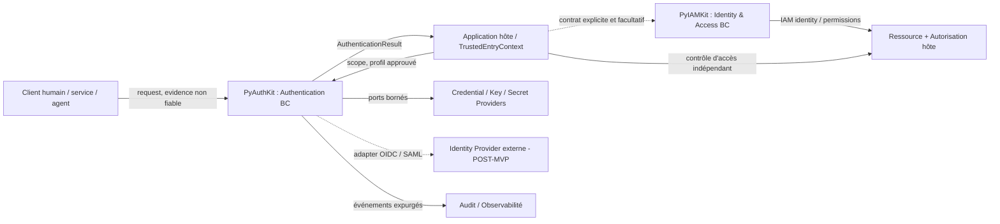

| Vérité / état | Autorité | PyAuthKit peut faire | PyAuthKit ne doit pas faire |
|---|---|---|---|
| Identité revendiquée | Appelant | Recevoir en entrée non fiable | La promouvoir en identité certaine |
| Approbation du profil et du scope | Hôte / administration approuvée | Valider l'usage / résoudre via port fiable | Laisser le JWT ou client décider du profil |
| Validation de la preuve | Vérificateur + critères approuvés | Produire `AuthenticatorOutcome` | Déduire l'autorisation d'un `sub` |
| Décision finale Authentication | PyAuthKit / AuthenticationPolicy | Publier résultat contrôlé | Attribuer des rôles IAM |
| Credential lifecycle | Hôte ou PyAuthKit selon contrat | Vérifier et, si possédé, muter les records | Modifier silencieusement un store externe |
| Identité IAM / organisations / rôles | PyIAMKit / application | Émettre un subject scope-aware | Créer des permission mappings implicites |
| Délégation et ressource autorisée | Autorité de délégation et AuthZ | Vérifier des assertions selon protocole | Transformer « agent vérifié » en mandat global |

### 3.1 Échange inter-contextes

Le contrat frontière est de forme conceptuelle `AuthenticatedSubjectReference(issuer, subject, trusted_scope, method, assurance?, provenance?)`. Le nom concret est **illustratif** et ne s'ajoute pas à l'inventaire canonique `DO-001..048`. Il ne transporte ni credential brut, ni session bearer, ni permission ou rôle présumé.

La résolution IAM peut retourner `FOUND`, `NOT_FOUND`, `AMBIGUOUS`, `UNAVAILABLE` selon le contrat de l'application ; elle ne modifie pas le résultat cryptographique de PyAuthKit. Une application peut refuser l'accès malgré `AUTHENTICATED`.

---

## 4. Carte de couverture des 48 `DO-*`

Cette matrice est une table de **participation au graphe**, non une liste de tables. Les identifiants et leurs noms reprennent `04`/`05` ; une portée ou une phase explicitement conditionnelle reste telle.

| DO | Objet de référence | Classification candidate (`05`) | Phase (`05`) | Rôle relationnel / avertissement |
|---|---|---|---|---|
| DO-001 | `Principal` | Domain Concept / possible value reference | MVP | Sujet situé en sortie, ou référence externe ; pas une root IAM |
| DO-002 | `PrincipalType` | Enum / VO catégoriel | MVP | Nature du sujet, distincte de son issuer/origine |
| DO-003 | `ClaimedIdentity` | Input VO / DTO | MVP | Valeur revendiquée par caller dans la Request |
| DO-004 | `AuthenticationRequest` | Application Command / DTO | MVP | Commande enveloppant inputs, contexte et corrélation |
| DO-005 | `PresentedEvidence` | Secret-bearing input / discriminated type | MVP | Preuve non fiable, discriminée par type |
| DO-006 | `AuthenticationContext` | Context DTO / VO | MVP | Hints et observations d’entrée, avec provenance |
| DO-007 | `TrustedEntryContext` | Trusted boundary context | MVP | Liaison sûre construite par hôte |
| DO-008 | `TrustedScope` | Value Object de portée approuvée | MVP | Partition de confiance approuvée |
| DO-009 | `TrustProfile` | Validated immutable configuration / VO snapshot | MVP | Profil de validation sélectionné via contexte sûr |
| DO-010 | `Authenticator` | Port / behavior, Strategy candidate | MVP | Comportement de vérification ; pas Entity |
| DO-011 | `AuthenticatorRegistry` | Application service / composition registry | MVP | Enregistrement de stratégies admises au bootstrap |
| DO-012 | `VerificationContext` | Trusted runtime context object | MVP | Paramètres approuvés pour une vérification |
| DO-013 | `AuthenticatorOutcome` | Internal Result Object | MVP | Verdict local du mécanisme, avant policy finale |
| DO-014 | `VerifiedSubject` | Security-significant VO candidate | MVP | Sujet vérifié situé par issuer/scope |
| DO-015 | `AuthenticatedPrincipal` | Public VO candidate / facade result | MVP | Projection publique après succès final |
| DO-016 | `AuthenticationPolicy` | Domain Policy / behavior & configuration | MVP | Conditions d’acceptation d’authentification |
| DO-017 | `AuthenticationResult` | Public Result Object | MVP | Issue publique discriminée, pas Aggregate |
| DO-018 | `AuthenticationAttempt` | Logical Entity **candidate** ; ID/events MVP | MVP | ID et corrélation d’une tentative |
| DO-019 | `AuthenticationFailure` | Safe Error VO | MVP | Erreur publique sûre/diagnostic contrôlé |
| DO-020 | `AuthenticationEvent` | Audit / domain-event contract candidate | MVP | Trace d’un fait d’authentification expurgé |
| DO-021 | `Credential` | Domain Concept umbrella | MVP | Catégorie de moyen d’authentification |
| DO-022 | `CredentialRecord` | Entity **si owned** ; external snapshot sinon | MVP | Record versionné, Entity si owned par PyAuthKit |
| DO-023 | `CredentialReference` | VO / lookup reference | MVP | Référence de lookup jamais preuve de possession |
| DO-024 | `PasswordEvidence` | Secret input | MVP | Secret soumis à PasswordAuthenticator |
| DO-025 | `PasswordVerifierRecord` | Trusted verifier record / DTO | MVP | Record approuvé utilisé pour vérifier password |
| DO-026 | `APIKeyEvidence` | Secret input | MVP | Secret soumis à ApiKeyAuthenticator |
| DO-027 | `APIKeyVerifierRecord` | Trusted verifier record / DTO | MVP | Record approuvé utilisé pour vérifier API key |
| DO-028 | `JWTBearerEvidence` | Untrusted token input | MVP | Token entrant non vérifié |
| DO-029 | `VerifiedTokenClaims` | Verified output VO | MVP | Claims dérivées après validation JWT complète |
| DO-030 | `VerificationKeyReference` | Trusted key reference VO | MVP | Référence à clé bornée par trust profile |
| DO-031 | `CredentialLifecycle` | Domain lifecycle / policy | POST-MVP | Règles d’état/rotation/révocation si owned |
| DO-032 | `AuthenticationFlow` | Process model ; Entity/Aggregate **conditionnel** | POST-MVP | Processus multistep, persisté si nécessaire |
| DO-033 | `AuthenticationFlowState` | Enum / VO | POST-MVP | État de processus et transitions autorisées |
| DO-034 | `AuthenticationChallenge` | Entity / Aggregate Root **candidate** | POST-MVP | Challenge one-time à identité durable candidate |
| DO-035 | `AuthenticationFactor` | VO de propriété vérifiée | POST-MVP | Facteur réellement démontré ; ne vaut pas canal |
| DO-036 | `FactorVerification` | VO / evidence-of-verification event | POST-MVP | Attestation dérivée de vérification de facteur |
| DO-037 | `AuthenticationAssurance` | VO + policy-derived decision | POST-MVP | Assurance calculée selon référentiel explicite |
| DO-038 | `StepUpRequirement` | VO / input policy | POST-MVP | Besoin de step-up demandé par hôte/policy |
| DO-039 | `AuthenticationSession` | Entity / Aggregate Root **candidate** | POST-MVP | Session identifiable et révocable candidate |
| DO-040 | `SessionReference` | VO **souvent secret** | POST-MVP | Handle souvent bearer secret, distinct de SessionId |
| DO-041 | `Token` | Concept / typed artifact value | POST-MVP issuance | Artefact émis ou validé selon purpose |
| DO-042 | `TokenGrant` | Application result / process object | POST-MVP | Résultat/processus d’émission, authority ouverte |
| DO-043 | `FederatedAssertion` | Untrusted protocol input | POST-MVP | Assertion brute d’IdP à valider |
| DO-044 | `FederatedIdentityReference` | Verified VO | POST-MVP | Référence de sujet fédéré après validation |
| DO-045 | `AuthenticationRiskAssessment` | Decision VO | POST-MVP | Évaluation de risque contextualisée et sourcée |
| DO-046 | `RiskSignal` | Observation VO, provenance obligatoire | POST-MVP | Observation de risque, jamais facteur MFA |
| DO-047 | `DelegationEvidence` | Untrusted / validated input distinct | POST-MVP | Assertion de délégation, jamais permission seule |
| DO-048 | `WorkloadBinding` | Verified binding VO / policy | POST-MVP | Binding service/workload au contexte d’exécution |

**Note :** les trois tableaux de `05 §5` restent la référence pour la classification détaillée ; le présent résumé les réutilise pour expliciter les relations.

---

## 5. Catalogue des relations `REL-001..REL-060`

Chaque relation exprime un **contrat conceptuel candidat**, et non une association ORM. Les cardinalités sont lues du côté **cible par occurrence source**. Les scénarios où une source n'existe pas ne sont pas couverts par une obligation `1`.

### 5.1 Demande, contexte fiable et vérification - MVP

| ID | Source → Cible | Type | Cardinalité cible | Conditions / propriétaire de vérité |
|---|---|---|---|---|
| REL-001 | `AuthenticationRequest` → `ClaimedIdentity` | CONTAINS | `0..1` | Certaines preuves portent leur propre subject ; aucune claim obligatoire universelle |
| REL-002 | `AuthenticationRequest` → `PresentedEvidence` | CONTAINS | `1..*` logique, souvent `1` au MVP | Secret et type non fiables ; support de plusieurs preuves à concevoir pour post-MVP |
| REL-003 | `AuthenticationRequest` → `AuthenticationContext` | CONTAINS | `0..1` | Hints annotés par provenance, jamais autorité automatique |
| REL-004 | `AuthenticationRequest` → `AuthenticationAttempt` | TRACKS | `1 per call` | Corrélation créée côté moteur, sans base obligatoire |
| REL-005 | `TrustedEntryContext` → `TrustedScope` | SELECTS | `1` | Sélection hôte approuvée ; échec si impossible ou ambigu |
| REL-006 | `TrustedScope` → `TrustProfile` | SELECTS | `1 applicable per verification` | Version / method / purpose sélectionnés hors claims non vérifiées |
| REL-007 | `TrustedEntryContext` → `AuthenticationRequest` | GOVERNS | `1` opération courante | Contexte de confiance fourni par intégration, séparé du contenu client |
| REL-008 | `TrustProfile` → `AuthenticationPolicy` | GOVERNS | `1..*` règles effectives, implémentation libre | Peut être un objet de configuration unique ; pas de repository imposé |
| REL-009 | `AuthenticatorRegistry` → `Authenticator` | SELECTS | `0..*` en bootstrap ; `1` pour une sélection non ambiguë | Méthodes admises uniquement ; une absence est un refus |
| REL-010 | `AuthenticationRequest` → `Authenticator` | VERIFIES | `1` par tentative MVP admise | Sélection sous profile et méthode, pas selon le fournisseur arbitraire |
| REL-011 | `VerificationContext` → `TrustProfile` | CONTAINS | `1` | Profil approuvé + éventuel snapshot versionné |
| REL-012 | `VerificationContext` → `TrustedScope` | CONTAINS | `1` | Scope immuable pour l'opération en cours |
| REL-013 | `Authenticator` → `AuthenticatorOutcome` | PRODUCES | `1 per invocation` | Outcome interne discriminé, succès non final |
| REL-014 | `AuthenticatorOutcome` → `VerifiedSubject` | PRODUCES | `0..1` | Seulement si les vérifications requises de ce mécanisme ont réussi |
| REL-015 | `AuthenticatorOutcome` → `AuthenticationFailure` | PRODUCES | `0..1` diagnostic sûr | Échec interne expurgé ; exception technique gérée séparément |
| REL-016 | `AuthenticationPolicy` → `AuthenticationResult` | GOVERNS | `1 per completed call` | Résultat issu de policy finale, pas d'un authenticator isolé |
| REL-017 | `AuthenticationResult` → `AuthenticatedPrincipal` | CONTAINS | `1` si `AUTHENTICATED`, `0` sinon | Invariant discriminant strict ; le type concret reste ouvert |
| REL-018 | `AuthenticatedPrincipal` → `VerifiedSubject` | DERIVES_FROM | `1` conceptuel | Projection publique du sujet vérifié et du contexte admis |
| REL-019 | `AuthenticationAttempt` → `AuthenticationResult` | TRACKS | `0..1` final en exécution réussie | Peut échouer avant normalisation ; audit de refus requis selon contrat |
| REL-020 | `AuthenticationAttempt` → `AuthenticationEvent` | AUDITS | `0..*` | Pas de payload secret ; livraison configurable et faillible explicitement |

### 5.2 Credentials et matériaux de vérification - MVP

| ID | Source → Cible | Type | Cardinalité cible | Conditions / autorité |
|---|---|---|---|---|
| REL-021 | `CredentialReference` → `CredentialRecord` | REFERS_TO | `0..1` dans un scope/version donné | Lookup potentiellement absent, jamais preuve de possession |
| REL-022 | `CredentialRecord` → `Principal` | REFERS_TO | `0..1` ou externe | Une identité IAM n'est pas requise dans PyAuthKit ; sujet externe admissible |
| REL-023 | `PasswordEvidence` → `PasswordVerifierRecord` | VERIFIES | `0..1` après lookup borné | Correspondance par vérification du secret, jamais par stockage brut |
| REL-024 | `APIKeyEvidence` → `APIKeyVerifierRecord` | VERIFIES | `0..1` après lookup borné | Préfixe/handle n'est pas la preuve ; secret vérifié |
| REL-025 | `PasswordVerifierRecord` → `CredentialReference` | REFERS_TO | `0..1` | Selon ownership du store ; version non nécessairement modifiable |
| REL-026 | `APIKeyVerifierRecord` → `CredentialReference` | REFERS_TO | `0..1` | Scope/key status/expiration à valider |
| REL-027 | `JWTBearerEvidence` → `VerifiedTokenClaims` | PRODUCES | `0..1` | Sortie seulement après profil, signature, issuer, audience, type et temps valides |
| REL-028 | `TrustProfile` → `VerificationKeyReference` | SELECTS | `0..*` dans key set approuvé | Résolution bornée ; `kid` non fiable ne décide pas de key set |
| REL-029 | `VerifiedTokenClaims` → `VerifiedSubject` | DERIVES_FROM | `1` si subject requis par profil | `issuer + subject + scope` de confiance, pas `sub` isolé |
| REL-030 | `CredentialRecord` → `CredentialLifecycle` | OWNS_STATE | `0..1` conceptuel | Uniquement quand lifecycle géré localement ; rotation/revocation contrôlées |

### 5.3 Flows, facteurs, challenges, sessions et tokens - POST-MVP

| ID | Source → Cible | Type | Cardinalité cible | Conditions / autorité |
|---|---|---|---|---|
| REL-031 | `AuthenticationFlow` → `AuthenticationFlowState` | CONTAINS | `1` état courant si stateful | État transitoire ou persistant selon décision |
| REL-032 | `AuthenticationFlow` → `AuthenticationChallenge` | REFERS_TO | `0..*` au cours d'un flow | Référence inter-agrégats, pas composition transactionnelle systématique |
| REL-033 | `AuthenticationChallenge` → `VerifiedSubject` | REFERS_TO | `0..1` | Sujet peut ne pas être encore vérifié ; liaison sûre éventuelle |
| REL-034 | `AuthenticationChallenge` → `AuthenticationFlow` | REFERS_TO | `1` si flow-based | Référence de flow fiable ; invariant contre cross-flow |
| REL-035 | `AuthenticationChallenge` → `FactorVerification` | PRODUCES | `0..1` validation positive par consommation | Single-use atomique selon port ; une observation d'échec ne consomme pas forcément |
| REL-036 | `FactorVerification` → `AuthenticationFactor` | CONTAINS | `1` | Type de facteur réellement démontré, pas canal utilisé |
| REL-037 | `AuthenticationFlow` → `FactorVerification` | TRACKS | `0..*` | De multiples étapes ; politique de combinabilité |
| REL-038 | `AuthenticationPolicy` → `AuthenticationAssurance` | GOVERNS | `0..1` décision finale de niveau | Référentiel explicite, aucune conversion « 2 facteurs => AAL2 » automatique |
| REL-039 | `StepUpRequirement` → `AuthenticationFlow` | GOVERNS | `0..1` nouveau ou prolongé | Freshness + sujet/scope + opération hôte ciblés |
| REL-040 | `AuthenticationResult` → `AuthenticationSession` | PRODUCES | `0..*` dans le temps, émission par use case séparé | Seulement après succès final et policy d'émission, aucune session universelle |
| REL-041 | `AuthenticationSession` → `SessionReference` | OWNS_STATE | `0..*` dans le temps | Rotation des handles ; un handle actif autorisé par génération |
| REL-042 | `AuthenticationSession` → `VerifiedSubject` | REFERS_TO | `1` | Scope et identité établis, référence et non objet IAM entier |
| REL-043 | `AuthenticationSession` → `TokenGrant` | REFERS_TO | `0..*` | Émission/refresh peut être une capacité distincte, pas obligatoire |
| REL-044 | `TokenGrant` → `Token` | ISSUES | `0..*` | Tokens typés selon usage, audience, durée, émetteur ; ownership ouvert |
| REL-045 | `Token` → `AuthenticationSession` | REFERS_TO | `0..1` | Pas tous les tokens n'ont une session ; M2M, JWT externes |
| REL-046 | `Token` → `VerifiedSubject` | REFERS_TO | `0..1` | `subject` de token éventuellement absent (ex. clients) selon profil |

### 5.4 Fédération, risque, workloads et intégrations - POST-MVP

| ID | Source → Cible | Type | Cardinalité cible | Conditions / autorité |
|---|---|---|---|---|
| REL-047 | `FederatedAssertion` → `FederatedIdentityReference` | FEDERATES | `0..1` | Vérification OIDC/SAML complète avant confiance ; aucun email-link automatique |
| REL-048 | `FederatedIdentityReference` → `VerifiedSubject` | DERIVES_FROM | `1` si authentification fédérée réussie | Issuer validé, subject et scope approuvés |
| REL-049 | `RiskSignal` → `AuthenticationRiskAssessment` | ASSESS | `0..*` signaux par assessment | Provenance/fraîcheur documentées ; aucune « propriété de facteur » |
| REL-050 | `AuthenticationRiskAssessment` → `AuthenticationPolicy` | GOVERNS | `0..1` input par décision | Peut imposer step-up ou refus ; ne confère pas permission |
| REL-051 | `AuthenticationRiskAssessment` → `StepUpRequirement` | PRODUCES | `0..1` | Conditionnel à la policy, à l'opération et aux seuils explicites |
| REL-052 | `DelegationEvidence` → `VerifiedSubject` | VERIFIES | `0..1` sujet agent | Mandat/autorisation encore hors du seul contrôle d'identité |
| REL-053 | `WorkloadBinding` → `VerifiedSubject` | DERIVES_FROM | `0..1` sujet workload | Attestation, audience et namespace vérifiés |
| REL-054 | `AuthenticatedPrincipal` → `PyIAMKit Identity` | BRIDGES | `0..1` résolution par contrat d'intégration | Identité IAM hors PyAuthKit ; `NOT_FOUND` acceptable pour Auth |
| REL-055 | `PyIAMKit Identity` → `AuthorizationDecision` | BRIDGES | `0..*` par ressource/action | **Entièrement hors** Authentication ; uniquement context map |
| REL-056 | `AuthenticationResult` → `AuthenticationEvent` | AUDITS | `0..*` selon politique d'audit | Événements sûrs, delivery non garanti par un simple diagramme |
| REL-057 | `TrustProfile` → `Authenticator` | GOVERNS | `1..*` mécanismes admis possibles | L'admission ne résulte pas de la présence d'un plugin |
| REL-058 | `TrustedScope` → `CredentialRecord` | GOVERNS | `0..*` owned ou external | Isolation logique ; aucune lecture inter-scope silencieuse |
| REL-059 | `AuthenticationContext` → `RiskSignal` | DERIVES_FROM | `0..*` | Extraction par source fiable / signal annoté ; IP client non automatiquement vraie |
| REL-060 | `AuthenticationAttempt` → `AuthenticationFlow` | TRACKS | `0..1` | Une tentative peut initier une cérémonie ; son identification reste distincte |

### 5.5 Relations volontairement **non définies**

| Association tentante | Pourquoi elle n'est pas un invariant |
|---|---|
| `Principal 1--N CredentialRecord` comme FK universelle | L'hôte ou un IdP peut posséder les credentials ; un verified subject peut exister sans utilisateur local |
| `ClaimedIdentity.is_verified = True` | La confiance relève d'une preuve située, pas d'un booléen sur un input |
| `AuthenticationEngine 1--N User` | Engine est un service, pas un Aggregate ni un annuaire |
| `Token 1--1 AuthenticationSession` | JWT externe et client-credentials n'exigent pas une session locale |
| `MFA 2--N AuthenticationFactor` = assurance forte | Nombre, indépendance et phishing resistance ne se déduisent pas d'une cardinalité |
| `FederatedIdentityReference == IAM Account` | Le linking exige politique d'identité / consentement et validation distincts |
| `Agent == User.delegate` | Délégation et permissions relèvent d'autorités séparées |
| `AuthenticationResult 1--1 IAM Permission` | AuthN et AuthZ sont deux décisions indépendantes |

---

## 6. Identité, sujet et contexte : le modèle de relation le plus critique

### 6.1 `Principal` n'est pas une table mère universelle

Un sujet peut être `HUMAN`, `SERVICE`, `APPLICATION`, `AGENT`, `DEVICE` ou `WORKLOAD` sans compte PyAuthKit. Une origine fédérée est **une provenance** ; elle n'ajoute pas un type `EXTERNAL` qui remplacerait la nature de l'acteur.

La relation logique recommandée est :

```text
Scoped Subject Identity (conceptual key)
 = namespace approuvé de l'issuer
 + subject_id vérifié
 + TrustedScope compatible
 + kind lorsque nécessaire pour lever une ambiguïté
```

Le triplet est une **proposition de schéma conceptuel**, pas un identifiant global définitif ni une chaîne composée prête pour une clé primaire SQL. L'unicité effective dépend des contrats issuer/subject/scope et du périmètre précis ; `EV-DEC-10` reste ouvert.

### 6.2 Claim / verified / authenticated

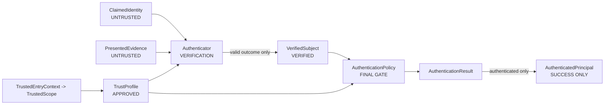

**Une transformation de type ne suffit pas à franchir une frontière de confiance.** Le modèle de données décrit **où** une valeur vérifiée peut apparaître ; le code et les tests doivent établir **qui** a le droit de la construire.

### 6.3 Exemples de collisions et d'ambiguïtés

| Cas | Apparence trompeuse | Décision sûre |
|---|---|---|
| `sub = 42`, issuer A vs issuer B | Même subject local | Sujets distincts tant que mapping explicite absent |
| `tenant_hint = T2`, contexte serveur T1 | Client demande T2 | Aucun basculement de scope implicite |
| Email `user@example.com` chez deux IdP | Même email | Aucune fusion d'identités par email seul |
| JWT `kid` identique entre deux key sets | Identifiant identique | Conserver le key set autorisé par profil |
| Service `name = payments-api` dans deux clusters | Nom identique | Workload binding / audience / namespace sous trust profile |
| Agent « for account X » | Claim de délégation | Vérifier mandat puis AuthZ séparée |

---

## 7. Modèle de confiance : relations *before trust* et *after trust*

### 7.1 Zones

| Zone | Informations | Peut définir quoi ? | Ne peut pas définir quoi ? |
|---|---|---|---|
| Z0 - Appelant | Evidence, headers, `tenant_hint`, callback params | Une revendication | Trust profile, tenant sûr, politique |
| Z1 - Entrée hôte | Route, client auth, mapping tenant/realm, configuration | `TrustedEntryContext` selon contrat | Validité de la preuve sans verifier |
| Z2 - Verifier | Signature/secret/certificat, contraintes d'usage | Outcome vérifié sous profil donné | Succès final sans policy |
| Z3 - Policy finale | Méthodes admises, facteurs, fraîcheur, risque | Succès/refus/challenge | Permissions IAM |
| Z4 - Consommateur | Result sûr, ID IAM optionnel | Demande d'accès à la ressource | Rendre valide une preuve invalide |

### 7.2 Séquence de décision

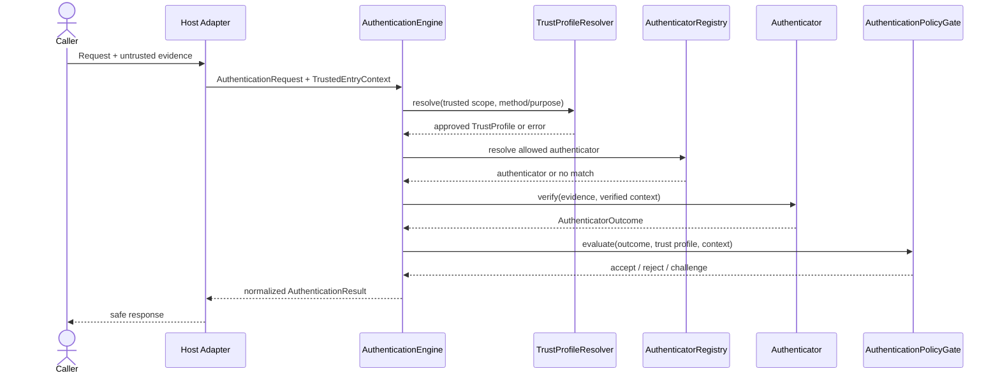

`No match`, `ambiguous`, `unavailable` et `invalid configuration` ne déclenchent aucune voie de vérification moins stricte. Le diagramme ne présume pas de la prise en charge effective des challenges en MVP.

### 7.3 Provenance nécessaire

Une relation de vérification devrait pouvoir référencer des éléments **non secrets** : `attempt_id`, `method`, `approved_scope_id`, `trust_profile_id/version`, `verification_time`, identifiant sûr du verifier et méthode. Ne jamais exposer secret, password, API key complète, JWT brut, assertion brute, signature, cookie ni handle bearer.

---

## 8. Credentials : ownership, lookup et versions

### 8.1 Deux modèles de possession compatibles

**Mode A - `EXTERNAL_CREDENTIAL_OWNER` (MVP parfaitement possible)**

```text
Host/IAM/Store owns CredentialRecord + lifecycle
         │
    Port de résolution scope-aware
         │
         ▼
  PasswordVerifierRecord / APIKeyVerifierRecord
         │
     Secret comparison
         │
         ▼
      AuthenticatorOutcome
```

PyAuthKit consomme un record validable au travers d'un adapter, **sans créer une table `credentials`**, ni revendiquer la possibilité de rotation/révocation globale dans le store externe.

**Mode B - `PYAUTHKIT_OWNED_CREDENTIALS` (conditionnel)**

```text
CredentialRecord [Entity / Aggregate candidate]
  + CredentialId + TrustedScope + SubjectReference
  + status + verifier metadata + version
  + lifecycle create / rotate / revoke / expire
         │
         ▼
CredentialRepository / specialized resolver
         │
         ▼
Authenticator
```

Ce mode demande un contrat d'ownership, une stratégie de stockage sûre, des transitions atomiques et des tests de concurrence. Il **n'est pas déduit** du seul besoin de vérifier un mot de passe.

### 8.2 Multiplicités contextualisées

- Un sujet peut disposer de `0..*` credentials, mais PyAuthKit ne possède pas nécessairement l'inventaire.
- Une credential reference devrait pointer vers **au plus un enregistrement effectif** dans le namespace/scope/version retenu. Zéro correspond à `NOT_FOUND` et plusieurs à `AMBIGUOUS` ou à une erreur de configuration, jamais à `first()` arbitraire.
- Un record logique peut avoir plusieurs **versions historiques** ; une résolution exige une version effective ou une règle explicite de validité temporelle.
- Un record `REVOKED` ou expiré ne devient pas acceptable par un mécanisme de fallback.

### 8.3 Password vs API Key vs JWT

| Mécanisme | Entrée | Relation de vérification | Matière de confiance | Erreur critique |
|---|---|---|---|---|
| Password | `PasswordEvidence` | Secret -> verifier record via subject/scope approuvé | Password verifier, credential status | User enumeration, mauvaise portée |
| API Key | `APIKeyEvidence` | Handle/prefix -> scoped key record ; comparaison sûre | Key verifier + statut + permissions d'usage non-AuthZ | Préfixe pris pour secret, key leakage |
| JWT validation | `JWTBearerEvidence` | TrustProfile -> key set autorisé -> signature/claims | Issuer, audience, type, algorithms, key set, time | Cross-issuer key confusion, alg confusion, SSRF |

**JWT validé** ne signifie pas que PyAuthKit a émis le token, possède la clé privée, détient une session correspondante ou accorde les permissions demandées dans les claims.

---

## 9. Authenticator, ports et services : dépendances ≠ relations de données

### 9.1 Diagramme des comportements

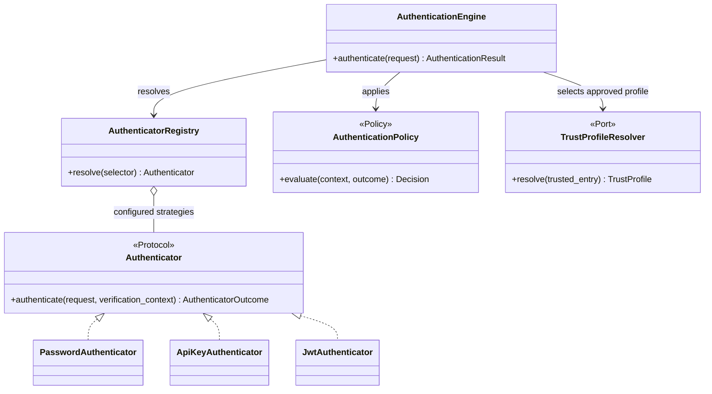

Le nom `Authenticator.authenticate(...)` et les signatures ci-dessus sont **illustratifs**, pas une API stabilisée. La présence de plusieurs implémentations sur ce dessin **ne prouve pas** leur code réel ni leur qualification cryptographique.

### 9.2 Design concepts

- **DIP / Hexagonal** : le cœur appelle des ports, pas PostgreSQL, Redis, JWT library ou Keycloak.
- **Strategy** : pertinente si les vérificateurs sont substituables derrière un contrat et choisis indépendamment de l'appelant.
- **Registry** : idiome de composition, pas Entity ni Repository DDD.
- **Adapter** : traduction du store/provider en types de domaine, sans fuite des DTO vendor.
- **Facade** : simplifie l'entrée mais ne doit pas devenir `God Security Service`.
- **KISS/YAGNI** : une structure de configuration stable peut suffire ; aucune hiérarchie de patterns n'est obligatoire.

---

## 10. Attempts, outcomes, résultats et événements

### 10.1 `AuthenticationAttempt` n'est pas une `AuthenticationSession`

```text
AuthenticationAttempt
  attempt_id + start_time + correlation
           │
           ├─ MAY produce AuthenticationEvent[0..*]
           ├─ MAY complete with one AuthenticationResult
           └─ MAY initiate future AuthenticationFlow

AuthenticationSession
  session_id + scoped subject + state/generation
           └─ MAY persist across many requests and attempts
```

Une tentative peut exister comme **corrélation + événements** (MVP), sans table ni root persistée. Si un stockage durable d'attempt est adopté, son TTL, sa cardinalité et sa confidentialité doivent être explicités ; le résultat publique ne doit pas stocker secrets ni stack traces.

### 10.2 Résultats discriminés

| Issue finale | Principal public | Challenge | Evidence brute | Remarque |
|---|---|---|---|---|
| `AUTHENTICATED` | `1` | `0` | `0` | Vérification + policy satisfaites |
| `REJECTED` | `0` | `0` | `0` | Refus contrôlé, diagnostic sûr |
| `ERROR` | `0` | `0` | `0` | Configuration/port/erreur technique selon contrat |
| `CHALLENGE_REQUIRED` | `0` | `1` référence sûre éventuelle | `0` | POST-MVP, authentification incomplète |

Ne pas utiliser `authenticated=True` avec un `status=REJECTED` ou un `principal` encore `ClaimedIdentity`. Le format (union discriminée vs dataclass unique) demeure ouvert (`EV-DEC-09`).

### 10.3 `AuthenticationEvent` sans persistance centrale imposée

Les événements peuvent être envoyés via `AuthenticationEventSink`. Un événement peut référencer `attempt_id`, `safe_code`, `scope_alias`, `method`, `occurred_at` et une provenance déclassifiée ; les événements ne doivent pas servir à reconstruire un password, un token ou une session bearer. L'événement d'authentification ne garantit pas par lui-même l'ordre, la durabilité ni l'atomicité avec une éventuelle mutation de session.

---

## 11. Politiques, scope et versions

### 11.1 Relation entre les trois contrôles

```text
TrustedEntryContext (host accepted)
   └── TrustedScope (approved partition)
           └── TrustProfile (approved issuer/keys/usage constraints)
                   └── AuthenticationPolicy (auth ceremony conditions)
                           └── AuthenticationResult
```

Cette hiérarchie est **logique** : une représentation Python concrète peut partager ou composer ces valeurs ; elle ne prescrit pas quatre relations SQL ni une classe abstraite par niveau.

### 11.2 Ambiguïté

Pour une opération de vérification donnée, le `TrustProfileResolver` doit sélectionner **exactement un profil effectif** ou refuser. Des variantes alternatives peuvent être configurées mais doivent être choisies par règles explicites (method, trusted scope, purpose, audience, version), jamais par ordre arbitraire d'une collection ou par champs JWT non vérifiés.

### 11.3 Version et historique

Une vérification doit utiliser un ensemble de contraintes suffisamment stable pendant son exécution ; une rotation de clés peut être prise en charge par un **key set approuvé et borné**. L'ERD n'exige pas d'historiser toutes les politiques dans PyAuthKit ; la stratégie de conservation (version ID, fingerprint, snapshot, audit) relève du document `25`.

---

## 12. Modèle conceptuel UML/DDD du MVP

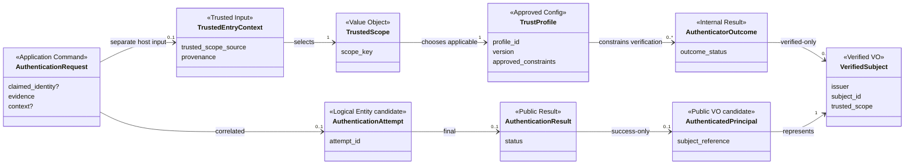

Les cardinalités UML s'interprètent **uniquement dans le contexte d'une cérémonie et de ses sorties**. Par exemple, `TrustedScope -> TrustProfile` signifie « un profil applicable pour cette vérification », et non un seul profil historique par tenant ; `AuthenticationRequest -> TrustedEntryContext` n'indique pas que le client peut le fournir.

---

## 13. Authentication Flow et challenges - POST-MVP

### 13.1 Flow comme process model

`AuthenticationFlow` est une **cérémonie** pouvant comporter plusieurs étapes et des pauses. Il peut être éphémère, persisté sous forme de process state, ou posséder une aggregate root si des invariants cross-step exigent une transaction locale. La décision reste `EV-DEC-05` / `REL-DEC-07`.

```text
AuthenticationFlow
   ├── flow_id? + trust scope + trusted subject binding?
   ├── state : STARTED / AWAITING_CHALLENGE / COMPLETED / FAILED / EXPIRED
   ├── 0..* FactorVerification
   ├── 0..* ChallengeReference
   └── final AuthenticationResult (au plus un logique)
```

**Les états sont illustratifs**, non l'énumération officielle de `AuthenticationFlowState`. Un flow peut recevoir un `ClaimedIdentity` initial sans subject vérifié. La liaison à un `VerifiedSubject` intervient seulement après un niveau de preuve adapté ; elle doit être cohérente avec toutes les étapes ultérieures.

### 13.2 Challenge comme Aggregate Root candidat

Pour un challenge one-time, l'invariant critique est : **une même référence de challenge ne peut pas valider deux consommations concurrentes**. Un enum `ACTIVE/CONSUMED/EXPIRED/CANCELLED` n'est utile que si l'opération `consume` réalise une transition atomique dans le store effectif.

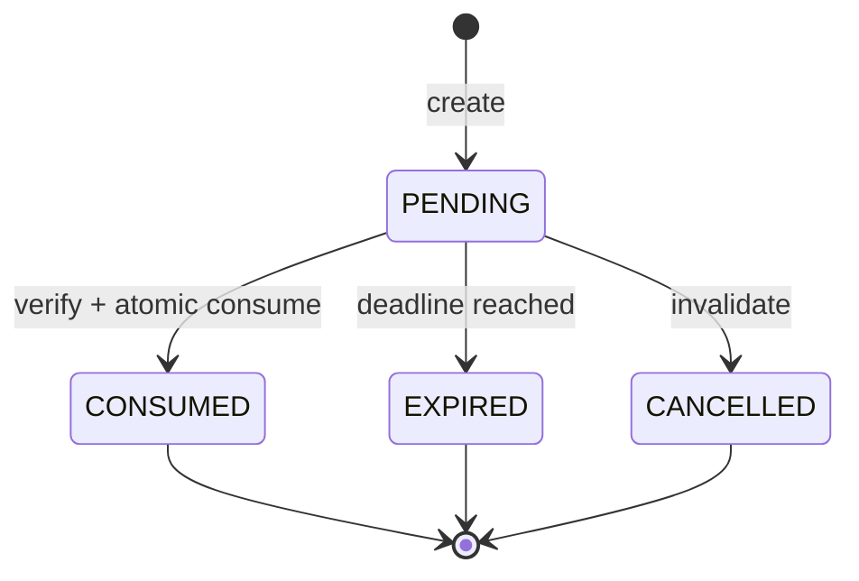

`EXPIRED` peut être calculé à partir de l'heure et d'un `expires_at`, puis matérialisé de façon optionnelle. La simple comparaison `status == PENDING` suivie d'un `save()` sans contrôle concurrent ne protège pas l'unicité d'usage.

### 13.3 Liaison obligatoire à l'intention du challenge

Un challenge doit être borné aux informations pertinentes : `flow_id`, `trusted_scope`, `subject binding` lorsque disponible, `purpose`, `method`, `audience/client`, expiration et **génération** ou version si nécessaires. Une preuve de challenge présentée dans un autre flow/realm/client ne doit pas être acceptée.

### 13.4 Facteur ≠ canal ≠ contexte

`Email`, `SMS` et `push` peuvent désigner des **canaux de livraison** ; ils ne démontrent pas universellement l'indépendance des facteurs. `RiskSignal` et une IP ne deviennent pas des facteurs par simple présence dans un flow. L'assurance dépend d'une politique et d'un référentiel explicites (`DO-037`).

---

## 14. Sessions et artefacts d'authentification - POST-MVP

### 14.1 Distinctions d'identité

| Objet | Identité | Secret ? | Cycle de vie |
|---|---|---|---|
| `AuthenticationSession` | `session_id` stable et scoped | Pas nécessairement | Création, activité, expiration, rotation, révocation |
| `SessionReference` | Handle opaque de présentation | **Souvent bearer secret** | Émission, rotation, invalidation |
| `Token` | Artefact selon usage / `jti` éventuel | Souvent sensible | Délivrance ou vérification, expiration, révocation selon mode |
| `TokenGrant` | Processus ou enregistrement d'émission | À délimiter | Issue sous policy, refresh/retry éventuels |
| `AuthenticationAttempt` | `attempt_id` de corrélation | Non secret mais sensible pour l'audit | Un appel, pas une session |

### 14.2 Règles de cohérence

- Une session n'est créée qu'après décision `AUTHENTICATED` et respect d'une policy d'émission ; un `AuthenticatorOutcome.VERIFIED` ne suffit pas.
- `SessionReference` et `SessionId` ne doivent pas être utilisés indifféremment. Une référence bearer sera traitée comme un secret dans l'API, le stockage et les logs.
- La rotation invalide l'ancienne génération selon une transition atomique ou une garantie équivalente documentée.
- Une session `REVOKED` ne redevient pas `ACTIVE`, même si un ancien handle est présenté.
- Un JWT valide reçu d'un IdP peut ne référencer **aucune session locale**, et une session opaque peut exister sans JWT.

### 14.3 State machine candidate

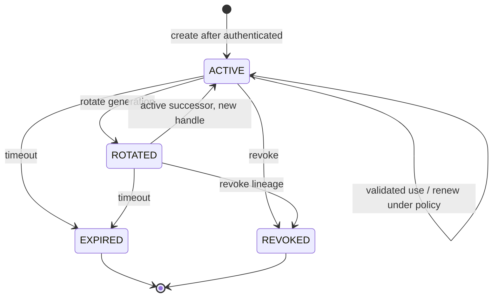

La représentation de `ROTATED` comme état ou comme **événement de version** est ouverte. En production, une ancienne génération ne doit **jamais** redevenir acceptable lors du passage vers le successeur : le diagramme est une illustration pédagogique, pas un automate validé.

### 14.4 `Token` vs `TokenGrant`

Émission et validation sont des responsabilités différentes. Dans le MVP, PyAuthKit valide des JWT ; cela n'implique pas de `TokenIssuer`, `TokenGrant`, refresh token store ni token revocation list. Si l'émission est introduite, distinguer les garanties du format (JWT/opaque), de l'usage (access/refresh/ID/challenge), de l'audience et de la possession du token.

---

## 15. Fédération et sujets externes - POST-MVP

### 15.1 Relation de fédération

```text
FederatedAssertion (untrusted bytes / protocol response)
     │  OIDC / SAML verification under host-approved TrustProfile
     ▼
FederatedIdentityReference (trusted issuer + external subject + scope)
     │  adapts / derives
     ▼
VerifiedSubject
     │  final authentication policy
     ▼
AuthenticationResult
     │  optional explicit identity linking
     ▼
PyIAMKit.Identity / Application identity
```

Aucune règle du domaine ne lie automatiquement un `email`, `preferred_username`, `name` ou un claim auto-déclaré à un IAM account existant. Le contrat de linking est à définir séparément dans `23`.

### 15.2 Liens à un fournisseur

Le profil d'un provider externe est **configuration de confiance** ; il n'est pas identique à une session SSO, un code d'autorisation ou un IdP account. `OAuth 2.0` demeure principalement un cadre d'autorisation déléguée ; `OpenID Connect` fournit le protocole d'authentification fédérée utilisateur au-dessus du cadre OAuth, conformément à l'intention de `00`.

### 15.3 Corrélation et anti-rejeu

Les flux fédérés futurs doivent garder les corrélations nécessaires (`state`, `nonce`, PKCE si requis, redirect allowlist, audience, issuer, temporalité), via une stratégie de stockage et de consommation adaptée. Une correlation en URL n'est pas une identité et ne doit pas suffire à accepter une assertion.

---

## 16. Adaptive auth, facteurs, assurance et step-up - POST-MVP

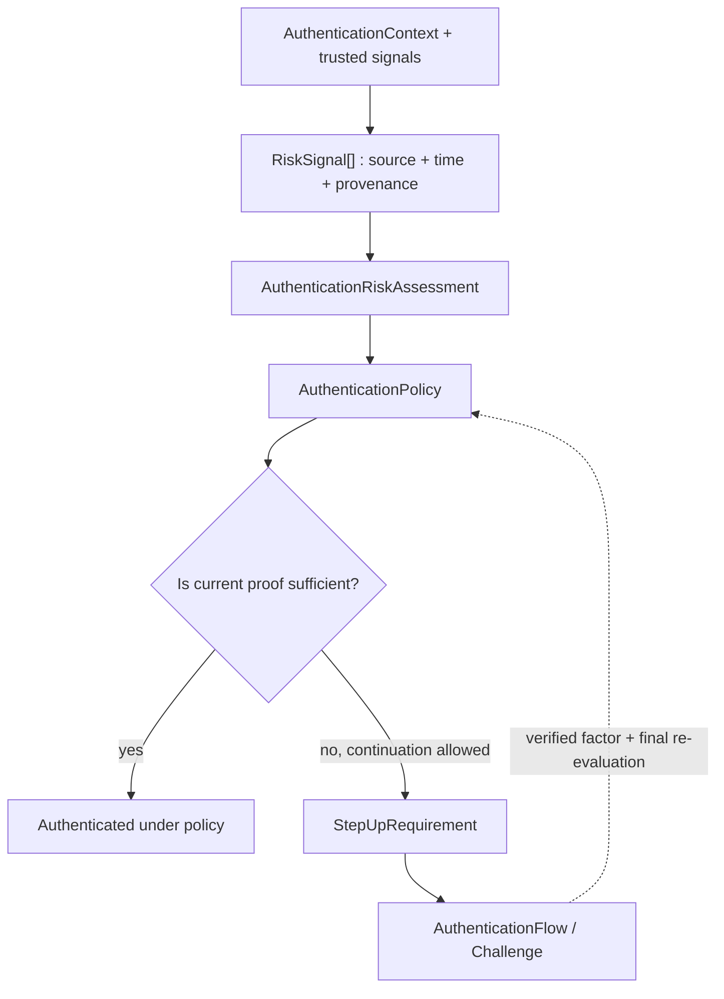

Un `AuthenticationRiskAssessment` n'est ni une permission ni une authentification. Pour une opération sensible, l'application peut demander une assurance/fraîcheur plus élevées. L'admission d'un second facteur et les protections contre replay doivent être démontrées, sans prétendre qu'un score numérique suffit à garantir un niveau normatif.

---

## 17. Agents, workloads et délégation - POST-MVP

| Scénario | Association de preuve | Propriété vérifiable | Réserve |
|---|---|---|---|
| Service-to-service | client credentials / mTLS / signed assertion | Sujet service + audience/usage | Pas de rôle IAM par défaut |
| Agent IA identifié | clé ou assertion d'agent | `VerifiedSubject(kind=AGENT)` | Aucune permission héritée d'humain |
| Agent délégué | preuve de mandat en plus d'agent auth | Déclaration de délégation vérifiée | Mandat courant et AuthZ restent explicites |
| Workload | token/attestation bindée au runtime | binding issuer/workload/audience/namespace | Le nom du pod/job n'est pas preuve |
| Device | certificats/passkeys/attestations selon cas | lien clé/appareil et utilisateur éventuel | Éviter l'assimilation device = user |

```text
AGENT (actor)                  OPERATOR / HUMAN (actor)
      │                                  │
      ▼                                  ▼
Authenticated agent                IAM identity (optional)
      │                                  │
      ├──── DelegationEvidence ──────────┤
      │                                  │
      ▼                                  ▼
Verified delegation claim   mandate policy / authorization
               \                 /
                \               /
                 ► Resource decision (OUTSIDE AuthN)
```

**Le graphe de délégation n'est pas une relation de possession (`Principal owns Principal`).** Il exige provenance, audience, portée, fraîcheur, chaînes de délégation autorisées et contrôle des permissions effectives par le composant compétent.

---

## 18. Frontières d'agrégats candidates

### 18.1 Règle de décision

Un Aggregate Root est justifié par **l'identité stable + un invariant de mutation atomique + un propriétaire d'écriture identifié**. Un regroupement visuel ou une relation `1..*` ne suffit jamais.

| Aggregate candidat | Root | Invariant qu'il pourrait protéger | Ownership | Phase / statut |
|---|---|---|---|---|
| Credential lifecycle | `CredentialRecord` | Statut, version, rotation/revocation | PyAuthKit **si owned** | Conditionnel, `OPEN` |
| Authentication flow state | `AuthenticationFlow` | Progression, finalisation unique | Moteur si persistant | POST-MVP, `OPEN` |
| Challenge one-time | `AuthenticationChallenge` | Une seule consommation valide ; scope/TTL | Moteur + store atomique | POST-MVP, candidat fort |
| Session state | `AuthenticationSession` | Rotation/revocation/expiration et générations | Moteur si session locale | POST-MVP, candidat fort |
| Authentication attempt | `AuthenticationAttempt` | Corrélation et histoire d'essai | Logique seulement au MVP | Entity/aggregate non imposé |
| Trust profile configuration admin | **hors noyau runtime** | Versions, approbation, activation | Hôte / config service | `OPEN`, futur |

### 18.2 Pourquoi `Principal` n'est pas Root

Plusieurs credentials, challenges et sessions peuvent désigner **un même sujet** sans partager une transaction ni un propriétaire. Lier leurs mutations à une root `Principal` obligerait à coupler la révocation de session au compte IAM, à l'IdP ou au store externe. Le modèle préfère des **identifiants situés** et des contrats de résolution.

### 18.3 Pourquoi `AuthenticationEngine` n'est pas Root

Un moteur orchestre ; il ne porte pas un état métier de cycle de vie identifié. Une façade injectable, des ports et des objets métiers plus petits suffisent. La coexistence d'`AuthenticationEngine` et d'`AuthenticationSession` ne crée pas une relation parent/enfant DDD.

### 18.4 Cross-aggregate consistency

Des opérations sur un flow, un challenge, une session et un audit sink peuvent traverser plusieurs backends. Un simple diagramme ne garantit pas ACID ou « exactly once ». Choisir explicitement : CAS/atomic compare-and-set, transactions locales, idempotency keys, outbox, retry sûr ou réconciliation selon la criticité. Les garanties dépendent du provider effectif.

### 18.5 Diagramme de frontières (logique)

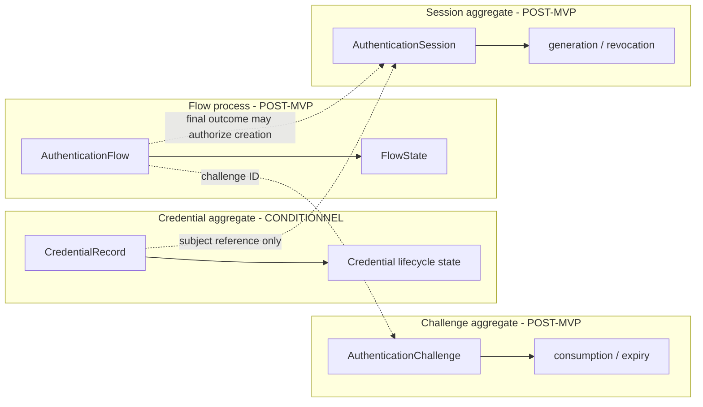

Les pointillés indiquent **des références, déclenchements ou contrats inter-agrégats**, non des objets contenus et modifiés dans la même transaction.

---

## 19. Sémantique des clés et cardinalités physiques

### 19.1 Classes d'identifiants

| Clé / référence | Sens | Portée recommandée | Piège |
|---|---|---|---|
| `attempt_id` | Corrélation d'un appel | Instance/session d'observabilité selon contrat | Le traiter comme session bearer |
| `credential_id` | Record owned/externe | Namespace + trusted scope | Clé globale sans namespace |
| `subject_key` | Référence du sujet vérifié | Issuer + subject + scope | Utiliser l'email seul |
| `trust_profile_id/version` | Config approuvée applicable | Application / realm / purpose | Laisser l'input choisir |
| `challenge_id` | Challenge one-time | Trusted scope + flow + purpose | Consommation par simple SELECT |
| `session_id` | Identité serveur de session | Trusted scope + subject | Le publier comme bearer token |
| `session_handle` | Secret/credential de présentation | Même partition + génération | L'imprimer dans l'audit |
| `token_id/jti` | Identifiant optionnel d'artefact | Issuer + audience + type | Supposer qu'il est présent ou unique partout |
| `flow_id` | Processus d'authentification | Trusted scope + client context | Interchanger challenges de flows |

### 19.2 Portée, clés composites et opérations

L'identité d'un enregistrement peut être portée par `(scope_id, record_id)` **ou** un ID opaque mondialement unique doublé d'un contrôle de scope. Ces formes sont des options d'implémentation, pas des invariants universels. Dans les deux cas : **le filtre de scope ne doit pas être une vérification applicative facultative après un lookup global**.

### 19.3 Unicité vs cardinalité

Une relation conceptuelle « un challenge appartient à un flow » implique une règle d'association, non une garantie que le stockage applique la bonne exclusivité. Celle-ci peut nécessiter clé composée, contrainte, write conditionnel ou store atomique selon backend. Un `UNIQUE(tenant_id, token_id)` ne protège pas si l'issuer ou le namespace manque du modèle de confiance.

---

## 20. ERD : trois niveaux à ne pas confondre

### 20.1 Niveau A - modèle de domaine

Représente les concepts, les statuts de confiance et les relations. Il comprend `Authenticator`, `TrustProfile`, `VerificationContext`, `AuthenticatedPrincipal` et peut exister entièrement sans SQL.

### 20.2 Niveau B - modèle logique de stockage conditionnel

Représente **seulement** les records dont l'état durable est effectivement possédé. Les vues suivantes sont des **profils hypothétiques** : elles ne sont ni des schémas adoptés ni des migrations prêtes à exécuter.

### 20.3 Niveau C - modèle physique

Types de colonnes, indexes, chiffrement, partitionnement, stores Redis/SQL, politiques de TTL, transactions et requêtes. Sa définition est reportée à `19_PYAUTHKIT_STORAGE_AND_PERSISTENCE_ARCHITECTURE.md` et aux ADR de qualification. Aucun `VARCHAR`, `UUID`, `JSONB` ou `FOREIGN KEY` du présent document ne garantit une implémentation sécurisée.

---

## 21. ERD logique candidat A - MVP sans tables AuthN obligatoires

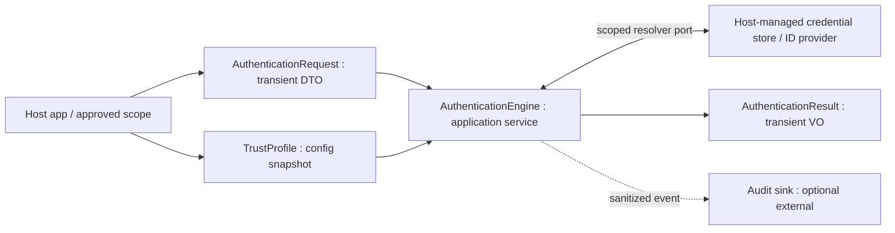

**Interprétation** : le MVP peut vérifier Password, API Key et JWT tout en laissant le stockage et le cycle de vie des credentials à l'application hôte. `AuthenticationAttempt` peut être un `attempt_id` et des événements ; aucune `auth_session` ou `auth_flow` n'est nécessaire à la seule validation d'un JWT.

### 21.1 Absence de FK ≠ absence de responsabilité

Même sans stockage PyAuthKit, les adapters doivent qualifier lookup scoping, credential status, key selection, protection des secrets, délais, échecs et interfaces. Le contrat de port est une frontière **fonctionnelle et de sécurité**, pas une simple facilité de mocking.

---

## 22. ERD logique candidat B - Credentials possédés par PyAuthKit

**Condition préalable :** `CredentialRecord` appartient à PyAuthKit, son cycle de vie est réellement géré par la librairie et le backend offre un mécanisme correct de persistance/versionning. Les formes suivantes sont des **vues** d'un modèle ; `VERIFIER_MATERIAL` peut être dans un coffre externe et représenté par une référence au lieu de données en base.

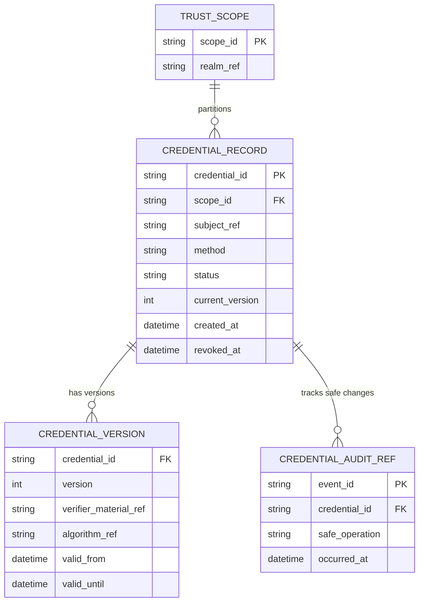

### 22.1 Interprétation et avertissements

- `TRUST_SCOPE` n'implique pas une administration de tenants de type IAM par PyAuthKit. Il peut être une **référence de configuration hôte**, non une table effective.
- `subject_ref` est une identité située ; il ne doit pas devenir un `user_id` ORM obligatoire.
- `CREDENTIAL_VERSION` est facultatif : rotation peut être représentée autrement. Ne pas laisser deux versions actives simultanément si la policy l'interdit.
- `verifier_material_ref` n'est jamais une API key brute, un password ou une clé privée stockés en clair.
- `CREDENTIAL_AUDIT_REF` représente une relation de traçabilité ; sa présence dépend des garanties de livraison retenues.

### 22.2 Contraintes conceptuelles

| Contrainte | Règle | Garantie à demander au backend |
|---|---|---|
| Scope | Aucun record lisible hors scope autorisé | Lookup toujours scoped ; vérification négative |
| Version | Rotation n'écrase pas silencieusement une version concurrente | CAS/version check/transaction |
| Revocation | Une révocation effective empêche tout nouvel usage selon contrat | Check d'état fiable + propagation bornée |
| Secrets | Pas d'exposition des données de validation | Secret-store policy, encryption, redaction |
| Temps | Validité `not_before / expires_at` explicite | Horloge cohérente, tests aux bornes |

---

## 23. ERD logique candidat C - Flows et challenges persistés

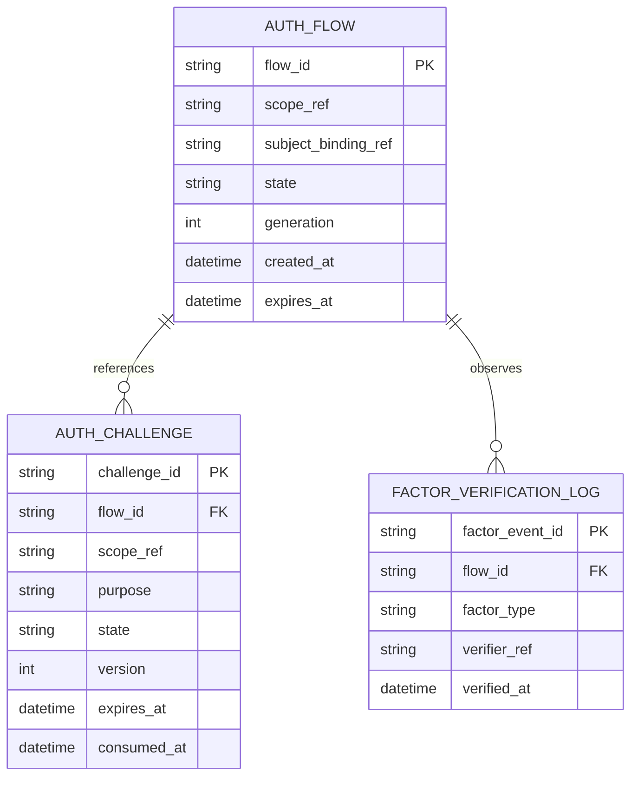

### 23.1 Limite de la notation ER

La multiplicité `AUTH_FLOW ||--o{ AUTH_CHALLENGE` correspond à un **profil flow-based** (un challenge est lié à un flow). D'autres types de challenge pourraient exister hors flow persistant ; ce diagramme n'est donc pas universel. `FACTOR_VERIFICATION_LOG` peut être un event sink/projection externe, et non une table physique.

### 23.2 Consommation atomique

Un challenge one-time doit accepter exactement un vainqueur concurrent :

```text
atomic_consume(challenge_id, expected_version, scope, now)
    │
    ├── CONSUMED_ONCE  -> one valid FactorVerification
    ├── ALREADY_USED    -> reject
    ├── EXPIRED         -> reject
    ├── OUT_OF_SCOPE    -> reject
    └── UNAVAILABLE     -> fail closed
```

Cette API est une **forme de contrat**, pas une fonction déjà écrite. Une transaction autour d'un simple `SELECT` sans verrou ou CAS approprié ne suffit pas à garantir cette propriété sous concurrence.

---

## 24. ERD logique candidat D - Sessions et rotations

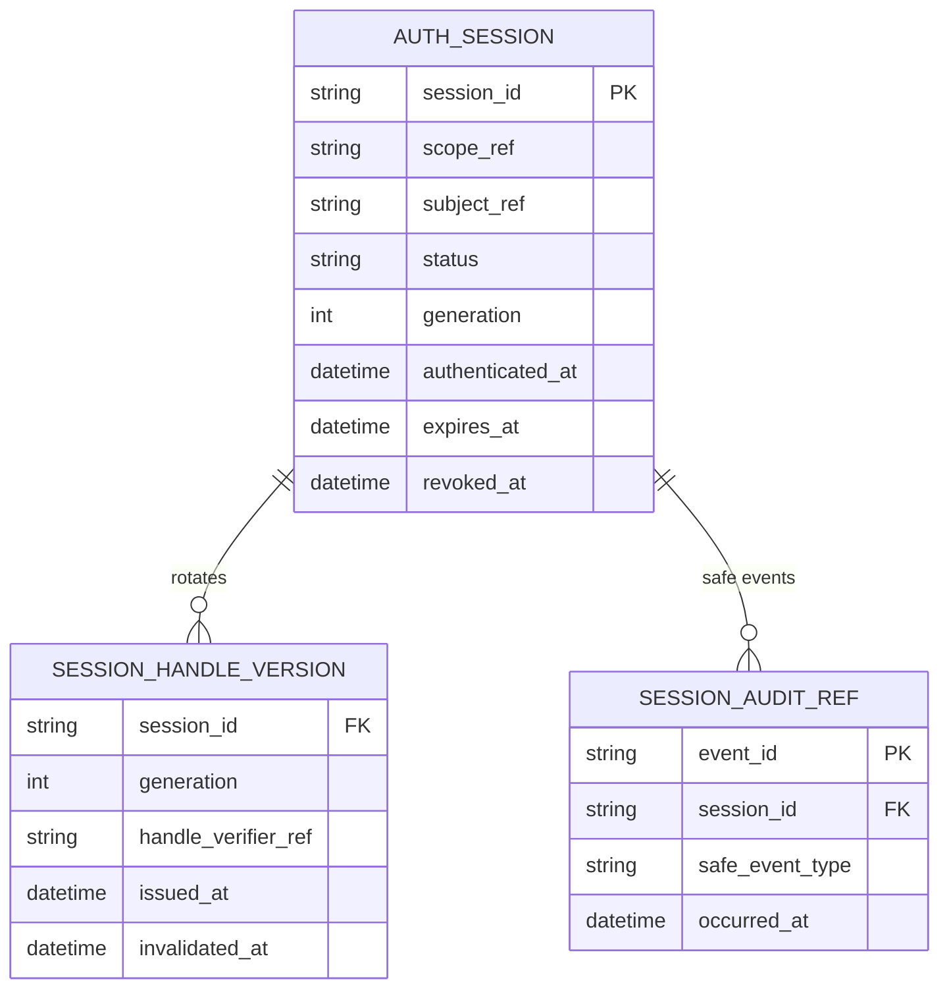

### 24.1 Ne jamais stocker une session bearer comme « ID public »

Le `session_id` interne et le cookie/handle présenté ne sont pas nécessairement identiques. Une valeur de session bearer est un secret ; si elle doit être vérifiée, stocker une représentation de validation appropriée (par exemple un dérivé sécurisé, selon menace et backend), et éviter de la journaliser.

### 24.2 Rotation et révocation

- `rotate` doit établir une **nouvelle génération** et invalider l'ancienne selon un contrat atomique.
- `revoke` interdit toute nouvelle validation selon la garantie de propagation retenue.
- Les cookies et réponses web sont construits par les **integrations transport** ; les politiques cookie (`Secure`, `HttpOnly`, `SameSite`, expiration, CSRF) ne sont pas inférées du seul ERD.
- Les sessions serveur et refresh tokens peuvent avoir des cycles différents ; ne pas les fusionner sans contrat.

---

## 25. Modèle de persistance : attributs minimaux et données exclues

### 25.1 Matrice « object -> physical record? »

| Objet `DO-*` | Record PyAuthKit obligatoire ? | Représentation MVP | Quand un record devient défendable |
|---|---|---|---|
| `Principal` (DO-001) | **Non** | Subject reference | Si un sous-domaine explicite owned le justifie, hors modèle de base |
| `AuthenticationRequest` (DO-004) | **Non** | DTO de transport | Pas de persistance brute recommandée |
| `PresentedEvidence` (DO-005) | **Non** | Entrée sensible en mémoire contrôlée | Pas de persistance brute |
| `TrustedScope` (DO-008) | **Non** | VO issu de l'hôte | Configuration hôte éventuelle |
| `TrustProfile` (DO-009) | **Non** | Configuration approuvée | Admin/version history si ownership validé |
| `Authenticator` (DO-010) | **Non** | Port/instance | Jamais une Entity DDD par défaut |
| `VerifiedSubject` (DO-014) | **Non** | VO dérivé | Traces minimisées éventuellement, pas « compte verified » universel |
| `AuthenticationResult` (DO-017) | **Non** | Résultat éphémère | Projection audit expurgée éventuelle |
| `AuthenticationAttempt` (DO-018) | **Non** | ID + événements | State/ledger d'audit si besoin mesuré |
| `CredentialRecord` (DO-022) | **Conditionnel** | Record fourni par port | PyAuthKit possède status/lifecycle |
| `AuthenticationFlow` (DO-032) | **Non MVP** | Aucun | Process persistant multi-étapes |
| `AuthenticationChallenge` (DO-034) | **Non MVP** | Aucun | TTL/single use/interprocess |
| `AuthenticationSession` (DO-039) | **Non MVP** | Aucun | Continuity et revocation locale |
| `Token` (DO-041) | **Non** | JWT entrant non fiable via DO-028 | Issuance/tracking si explicitement owned |
| `RiskSignal` (DO-046) | **Non** | Aucun | Évaluation post-MVP dérivée, audit sûr optionnel |

### 25.2 Champs dont l'absence est voulue

**Ne pas** modéliser par défaut : `password_plaintext`, `api_key_raw`, `jwt_compact`, `session_cookie`, `webauthn_assertion_raw`, `saml_raw_xml`, `authorization_code`, `otp_value` ni `private_key_pem` dans une table applicative ou un log. Les schémas conceptuels ne préjugent pas des besoins de rétention d'autres systèmes, mais PyAuthKit ne doit pas créer une archive de secrets.

### 25.3 Représentation et chiffrement

Une colonne `verifier_material_ref` est une référence à une capacité de vérification, pas la preuve que tout est externalisé ou chiffré. Les mécanismes réels (password hashing fort, HMAC ou dérivé pour API keys, signature verifier, key rotation, KMS/HSM) doivent être précisés et testés dans `10`, `19` et `20` ; aucun `hash()` Python natif ou chiffrement maison n'est proposé ici.

---

## 26. Cardinalités et hypothèses par parcours

| Parcours | Liens essentiels | Multiplicité métier | Précondition |
|---|---|---|---|
| Password | Request -> evidence -> verifier record -> outcome | Un authenticator sélectionné par vérification ; record candidat `0..1` | Scope + policy approuvés |
| API Key | Evidence -> scoped record -> subject | Au plus un record effectif non ambigu | Verifier and status valid |
| JWT | Token input -> trust profile -> key verifier -> claims | Un profile effectif ; `0..*` keys approuvées | Signature et claims contrôlés |
| MFA | Flow -> challenges -> factors | Zéro ou plusieurs challenges, facteurs selon policy | Non final avant tous requis |
| Session | Final AuthResult -> Session | Zéro ou plusieurs sessions créées au fil du temps | Policy session explicite |
| OIDC | Assertion -> federated ref -> verified subject | Au plus une référence de sujet par assertion valide | IdP et corrélations approuvés |
| Agent | Verified agent -> possible delegation | Zéro ou plusieurs mandats externes | Délégation/permissions vérifiées séparément |
| Workload | Assertion -> verified workload binding | Un binding admissible par preuve acceptée | Audience/issuer/runtime context |

**Remarque sur le terme « principal » :** un même subject logique peut apparaître dans plusieurs attempts, sessions et tokens, sans relation de propriété transitive. Cette multiplicité ne justifie ni base centrale des utilisateurs, ni cascade de suppression automatique.

---

## 27. Temporalité, concurrence et cohérence distribuée

### 27.1 Quatre classes temporelles

| Temps | Exemple | Interprétation |
|---|---|---|
| Observé | `observed_at` d'un RiskSignal | Instant de mesure, pas preuve de fraîcheur suffisante |
| Effectif | `valid_from/valid_until` d'une config/credential | Intervalle autorisé par policy |
| Événement | `occurred_at` d'un audit event | Date déclarée par système émetteur, avec degré de confiance |
| Transaction | `consumed_at`, `revoked_at`, génération | Ordre de mutation avec garantie de store |

### 27.2 Séparation des horloges

La vérification JWT, l'expiration d'un challenge et la durée d'une session consomment une notion d'heure explicite. Une `Clock` injectée rend les tests déterministes ; un déploiement doit définir fuseau, horloges de serveurs, tolérances et éventuels décalages permis. Aucune tolérance générique ne doit être inventée dans le domaine.

### 27.3 Écritures concurrentes

| Conflit | Invariant | Mécanisme candidate |
|---|---|---|
| Deux consommations du même challenge | Au plus une réussit | CAS / transaction atomique |
| Rotation concurrente de session | Une génération courante cohérente | Version compare-and-swap |
| Révocation pendant vérification | Décision conforme au contrat de cohérence choisi | Check au point de décision / propagation bornée |
| Credential rotation simultanée | Pas de régression silencieuse de version | `expected_version` + retry explicit |
| Plusieurs callbacks OIDC | Pas de réutilisation d'une corrélation consommée | State/nonce single use selon flow |

### 27.4 Limites de cohérence

Les garanties de révocation d'un token stateless déjà émis ne sont pas identiques à celles d'une session serveur. Les stores distribués, caches et IdP distants impliquent délais, disponibilité et risques de partition ; le contrat doit annoncer ses limites. « Session revoked » n'est pas une preuve de révocation instantanée de tous les JWT déjà acceptés par tous les services.

### 27.5 Retries et idempotence

La vérification d'une preuve peut être répétée si elle ne consomme aucune ressource à usage unique, mais un flow/challenge/token grant peut avoir des **effets**. Les retries doivent préciser la même intention, son identifiant, son résultat déjà consommé et la conduite en cas d'incertitude ; pas de « retry on everything » pour masquer les conflits de single-use.

---

## 28. Invariants relationnels proposés `REL-INV-001..040`

Ces règles sont des **candidates de conception**, non des exigences approuvées par une suite de tests exécutée. Le document `07` devra les formaliser avec préconditions, postconditions, échecs, exemples et IDs de tests. Les références `DOM-INV-*` et `EV-INV-*` dans `04/05` restent les sources initiales.

### 28.1 Trust, identité et décision

| ID | Invariant relationnel | Porteur de règle | Traçabilité |
|---|---|---|---|
| REL-INV-001 | Aucune `ClaimedIdentity` ne devient `VerifiedSubject` sans vérification sous profil approuvé | Verifier / application | EV-INV-001 |
| REL-INV-002 | La sélection du `TrustedScope` n'est pas dérivée d'un hint non fiable seul | TrustedEntryContext | EV-INV-008 |
| REL-INV-003 | Une vérification utilise un profil de confiance effectif et non ambigu | TrustProfileResolver | EV-INV-029 |
| REL-INV-004 | Le namespace du subject vérifié fait partie de son identité située | VerifiedSubject | EV-INV-002/007 |
| REL-INV-005 | Un `AuthenticatorOutcome.VERIFIED` n'est pas final sans gate de policy | AuthenticationPolicy | EV-INV-003/009 |
| REL-INV-006 | Seule l'issue finale AUTHENTICATED possède un principal final public | ResultNormalizer | EV-INV-004 |
| REL-INV-007 | Une tentative refusée n'inclut aucun secret ou sujet faussement authentifié | AuthenticationResult | EV-INV-004/014 |
| REL-INV-008 | Un principal authentifié ne porte pas de permissions IAM implicites | Context boundary | EV-INV-006 |
| REL-INV-009 | Un `sub`, email ou ID libre n'est pas globalement unique sans namespace | Subject relation | EV-INV-007 |
| REL-INV-010 | Une méthode non admise ne déclenche pas de fallback moins strict | Registry / gate | EV-INV-005 |

### 28.2 Credentials et clés

| ID | Invariant relationnel | Porteur | Traçabilité |
|---|---|---|---|
| REL-INV-011 | Une référence de credential ne démontre aucune possession | Resolver | EV-INV-010 |
| REL-INV-012 | Un record vérifié appartient au scope/namespace requis | Credential port | EV-INV-015 |
| REL-INV-013 | Un lookup absent ou ambigu refuse au lieu de choisir une valeur arbitraire | Resolver | EV-INV-029 |
| REL-INV-014 | Un record révoqué, expiré ou inactif n'est pas accepté selon contrat | Credential verifier | EV-INV-011 |
| REL-INV-015 | Une version concurrente ne peut écraser silencieusement une rotation | Owned record/store | EV-INV-016 |
| REL-INV-016 | La sélection de clés JWT reste bornée par profil approuvé | VerificationKeyResolver | EV-INV-012/013 |
| REL-INV-017 | Les claims JWT non vérifiées ne deviennent jamais attributs approuvés | SignedTokenVerifier | EV-INV-013 |
| REL-INV-018 | Les secrets présentés restent exclus des résultats, événements et erreurs | Secret boundary | EV-INV-014 |
| REL-INV-019 | L'ownership d'un credential est explicite avant toute mutation locale | Credential lifecycle contract | EV-DEC-04 |
| REL-INV-020 | Un JWT validé n'implique ni session locale, ni émission par PyAuthKit | Token distinction | DO-028/029/041 |

### 28.3 Flows, challenges, sessions

| ID | Invariant relationnel | Porteur | Traçabilité |
|---|---|---|---|
| REL-INV-021 | Une preuve partielle n'achève pas un flow nécessitant d'autres étapes | Flow/policy | EV-INV-017 |
| REL-INV-022 | Un challenge one-time ne peut être consommé avec succès deux fois | Challenge store | EV-INV-018 |
| REL-INV-023 | Un challenge reste lié à son flow, scope, usage et sujet applicables | Challenge aggregate | EV-INV-019 |
| REL-INV-024 | Un challenge expiré/annulé n'est jamais accepté | Challenge state | EV-INV-019 |
| REL-INV-025 | Une assurance est justifiée par le référentiel et la policy | Assurance policy | EV-INV-020 |
| REL-INV-026 | Une session ne naît que d'une décision finale AUTHENTICATED admise | Session use case | EV-INV-021 |
| REL-INV-027 | Une session révoquée ou expirée ne redevient pas active | Session aggregate | EV-INV-022 |
| REL-INV-028 | La rotation invalide l'ancienne génération selon un contrat atomique | Session store | EV-INV-023 |
| REL-INV-029 | Un handle bearer n'est pas exposé comme un identifiant public/audit | Session boundary | DO-040 |
| REL-INV-030 | Un token n'est accepté que dans son usage, issuer et audience approuvés | Token verifier | DO-041 |

### 28.4 Fédération, agents, risque et observabilité

| ID | Invariant relationnel | Porteur | Traçabilité |
|---|---|---|---|
| REL-INV-031 | Un email IdP ne crée aucun lien IAM automatique | Federation bridge | DO-044 |
| REL-INV-032 | L'identité d'agent authentifiée ne transmet pas les droits d'un opérateur | Delegation boundary | EV-INV-024 |
| REL-INV-033 | Une délégation exige preuve, scope, autorité et décision externe | Delegation integration | DO-047 |
| REL-INV-034 | Un workload binding exige issuer/audience/runtime validés | Workload verifier | EV-INV-025 |
| REL-INV-035 | Un signal de risque n'est pas un facteur MFA | Risk/Assurance | EV-INV-026 |
| REL-INV-036 | La politique de risque ne contourne pas les contrôles de preuves | AuthenticationPolicy | DO-045 |
| REL-INV-037 | Les événements d'authentification sont minimisés, sans secrets | EventSink | EV-INV-027 |
| REL-INV-038 | La propagation de révocation et sa latence sont explicitement contractualisées | Store/adapters | EV-DEC-12 |
| REL-INV-039 | L'application distingue authentication success et IAM resolution outcome | Integration bridge | EV-INV-006 |
| REL-INV-040 | Un schéma et une documentation ne constituent pas une preuve `IMPLEMENTED/QUALIFIED` | Gouvernance | EV-INV-031 |

### 28.5 Forme de spécification pour `07`

Pour chaque invariant : `ID`, `Problem`, `Scope`, `Owner`, `Preconditions`, `Normal behavior`, `Rejected states`, `Temporal window`, `Concurrency expectations`, `Error behavior`, `Tests` et `Evidence`. Les invariants relationnels qui exigent une opération atomique doivent préciser **quel** store et **quelle** garantie rendent la règle vraie.

---

## 29. Matrice de tests candidats `REL-TST-001..036`

Un test unitaire de représentation ne prouve pas la résistance cryptographique, une promesse de transaction ou l'isolation multi-tenant réelle. Les tests d'intégration doivent être exécutés contre des adapters concrets et inclure les chemins négatifs.

### 29.1 Noyau / identité / trust

| ID | Scénario | Résultat attendu | Niveau |
|---|---|---|---|
| REL-TST-001 | Request avec `ClaimedIdentity` crédible sans preuve | Aucun `AuthenticatedPrincipal` | Unit/security |
| REL-TST-002 | `tenant_hint=T2`, contexte hôte T1 | Scope reste T1 ou refus | Integration/security |
| REL-TST-003 | Deux profils applicables avec même priorité | `AMBIGUOUS`, aucun fallback | Resolver |
| REL-TST-004 | Méthode inconnue ou non admise | Refus sans sélection arbitraire | Unit/security |
| REL-TST-005 | Verifier retourne `VERIFIED`, policy exige MFA | Pas de succès final | Domain/application |
| REL-TST-006 | Deux issuers et `sub` identique | Sujets distincts | VO/contract |
| REL-TST-007 | `REJECTED`, `ERROR`, `CHALLENGE_REQUIRED` | Aucun principal final | Result contract |
| REL-TST-008 | Port credential indisponible | Erreur sûre et aucune authentication success | Integration |
| REL-TST-009 | Claims JWT `iss` inconnu | Rejet avant toute promotion de claims | Security |
| REL-TST-010 | `kid` correspond à clé d'un autre profil | Rejet malgré signature valide ailleurs | Security |
| REL-TST-011 | JWT de bonne signature mais mauvaise audience/type | Rejet | Security |
| REL-TST-012 | Email fédéré sans mapping IAM | Authentication distincte de IAM not found | Integration |

### 29.2 Credentials / ownership

| ID | Scénario | Résultat attendu | Niveau |
|---|---|---|---|
| REL-TST-013 | Même credential ID dans deux scopes | Un lookup T1 ne lit jamais T2 | Contract/integration |
| REL-TST-014 | Record API key révoqué | Refus malgré secret correct | Security |
| REL-TST-015 | Key prefix ou record ID seul | Refus, possession non prouvée | Security |
| REL-TST-016 | Rotation concurrente du même CredentialRecord owned | Pas de perte de version silencieuse | Concurrency |
| REL-TST-017 | Mot de passe invalide pour user présent vs absent | Réponse non révélatrice selon threat model | Security |
| REL-TST-018 | Log, exception ou métrique sur échec avec secret | Aucun secret ré-identifiable exposé | Security/privacy |

### 29.3 Flows / challenges / sessions

| ID | Scénario | Résultat attendu | Niveau |
|---|---|---|---|
| REL-TST-019 | Deux workers valident le même challenge simultanément | Au plus une consommation réussie | Concurrency/integration |
| REL-TST-020 | Challenge T1 présenté dans flow T2 | Rejet | Security |
| REL-TST-021 | Challenge au temps `expires_at` | Refus ou contrat explicite à borne | Temporal |
| REL-TST-022 | Premier facteur réussi, second absent | `CHALLENGE_REQUIRED`, pas `AUTHENTICATED` | Domain |
| REL-TST-023 | Session locale créée après `REJECTED` | Aucune session autorisée | Integration |
| REL-TST-024 | Rotation concurrente de session | Une génération effective cohérente | Concurrency |
| REL-TST-025 | Handle de génération ancienne présenté | Rejet | Security |
| REL-TST-026 | Session révoquée puis renouvellement demandé | Pas de réactivation | Domain/integration |
| REL-TST-027 | JWT externe valide sans session locale | Validation indépendante des sessions | Integration |
| REL-TST-028 | Audit sink en panne pendant mutation critique | Conduite conforme au contrat configuré | Failure/integration |

### 29.4 Agents / risques / architecture

| ID | Scénario | Résultat attendu | Niveau |
|---|---|---|---|
| REL-TST-029 | Agent authentifié demande permission d'opérateur | Aucun droit implicite | Security/integration |
| REL-TST-030 | Workload de mauvais namespace/audience | Binding rejeté | Security |
| REL-TST-031 | RiskSignal non fiable revendique « low risk » | Aucun bypass de policy | Domain/security |
| REL-TST-032 | Federation assertion valide cryptographiquement, `state` invalide | Rejet du flow | Protocol integration |
| REL-TST-033 | Package `domain` importe Django/SQLAlchemy/Redis | Echec du test architecture | Architecture |
| REL-TST-034 | Nouvelle stratégie remplace port fake en test | Contrats de comportement maintenus | Contract/substitutability |
| REL-TST-035 | Nouveau backend de challenge sans opération atomique | Qualification refuse garantie single-use | Contract/concurrency |
| REL-TST-036 | Relecture de l'audit / errors | Aucun credential/token brut présent | Privacy/security |

### 29.5 Property-based / model-based testing

Propriétés candidates, avec leurs **préconditions** :

```text
for any untrusted_claim:
    claim_without_valid_proof cannot yield authenticated subject

for any two trusted scopes S1 != S2:
    scoped_lookup(S1, reference_from_S2) cannot return cross-scope record

for any one-time challenge C:
    count(successful_consume(C)) <= 1

for any session R in REVOKED or EXPIRED:
    valid(R, now_after_terminal_transition) == false

for any final outcome O != AUTHENTICATED:
    public_principal(O) is absent

for any token T:
    acceptance(T, trust_profile) requires matching issuer/audience/type/keys/time
```

Ce pseudocode n'est **pas une implémentation Python**, et certaines propriétés dépendent de limites de cohérence et de temps à choisir explicitement.

---

## 30. Scénarios narratifs end-to-end

### 30.1 UC-01 - Login Password (MVP)

1. La requête transporte une claimed identity et un password secret non fiable.
2. L'hôte fournit la partition de confiance et son contexte approuvé.
3. Le resolver sélectionne un trust profile et le verifier record dans **cette partition**.
4. L'authenticator contrôle mot de passe, record et statut via ports adaptés.
5. Un `AuthenticatorOutcome` vérifié peut produire un `VerifiedSubject`.
6. La policy décide si la cérémonie est complète.
7. Le moteur renvoie un `AuthenticationResult`, sans accorder de permission IAM.

**Cas négatifs :** record inconnu, secret incorrect, hash/algorithm non pris en charge, store indisponible, méthode interdite, tenant différent, profil ambigu.

### 30.2 UC-02 - API Key M2M (MVP)

Une requête machine fournit une API key. Le lookup peut se servir d'un préfixe non secret pour chercher des records dans le scope approuvé ; la possession n'est validée **qu'après** comparaison sûre du secret présenté et vérification du statut, des dates et de l'usage de la clé. L'identité du service authentifié reste différente de son autorisation à appeler une ressource.

### 30.3 UC-03 - JWT reçu d'un tiers (MVP)

Un bearer JWT est reçu avec un header et des claims non fiables. Un profil de confiance sélectionné indépendamment détermine l'issuer attendu, le key set approuvé, l'usage et l'audience. Après validation complète, seules les claims admises deviennent un objet vérifié ; la politique finale peut encore refuser. Aucune session PyAuthKit n'est requise par ce scénario.

### 30.4 UC-04 - Password + MFA (POST-MVP)

Une première preuve valide conduit à un résultat **non final** tant qu'un facteur supplémentaire est requis. Le flow crée une référence de challenge liée au scope et à la cérémonie. Après validation et consommation atomique du challenge, la policy réévalue les facteurs et le niveau d'assurance. Aucun `AuthenticationResult.AUTHENTICATED` n'est émis avant satisfaction complète des conditions.

### 30.5 UC-05 - Session rotation (POST-MVP)

L'utilisateur présente un handle opaque. Le store résout la session sous le scope, en vérifie l'état et la génération. Une rotation émet un nouveau handle, invalide l'ancien et conserve les événements sûrs requis. Deux demandes concurrentes ne peuvent réactiver un handle obsolète.

### 30.6 UC-06 - Agent délégué (POST-MVP)

Un agent peut prouver son identité propre. Il peut aussi présenter une assertion de délégation dont la signature et le mandat sont soumis à d'autres conditions. La vérification de l'agent et la vérification de l'assertion **ne suffisent pas** à autoriser automatiquement un paiement, une lecture de données RH ou une modification de ressources ; l'application et PyIAMKit ou autre moteur d'AuthZ prennent la décision d'accès.

---

## 31. Design Learning Cards : du problème à la relation

### 31.1 `VerifiedSubject` - identité située plutôt que `User` universel

| Dimension | Réponse |
|---|---|
| Problème | Deux IdP ou tenants peuvent publier le même `sub` |
| Domain role | Verified Value Object / subject reference |
| Pression | Éviter les collisions et les liaisons IAM involontaires |
| Principes | Explicit Modeling, Separation of Concerns, fail-closed |
| GoF | Aucun requis |
| Python | `dataclass(frozen=True)` ou type minimal, construction contrôlée |
| Preuve | REL-TST-001, 002, 006, 012 |
| Alternative rejetée | `User(email=...)` créé par n'importe quelle claim |

### 31.2 `TrustProfileResolver` - résolution déterministe, pas arbitrage silencieux

| Dimension | Réponse |
|---|---|
| Problème | Plusieurs politiques de clés/issuers par tenant/app |
| Rôle | Port de résolution de configuration approuvée |
| Pression | Une entrée non fiable peut chercher à sélectionner des contraintes plus faibles |
| Principes | DIP, fail-closed, Information Hiding |
| Patterns | Port/Adapter ; Strategy non nécessaire pour toute recherche |
| Algorithmique | Filtrage sur trusted scope/purpose/version ; contrôle 0/1/N candidats |
| Tests | REL-TST-002, 003, 009, 010 |

### 31.3 `CredentialRecord` - Entity uniquement si lifecycle owned

Le modèle sépare l'information de validation de la responsabilité de gestion. Si l'application hôte détient création/rotation/révocation, un record de verifier suffit ; si PyAuthKit gère cette histoire, l'Entity et sa version deviennent utiles. Le **Repository Pattern** n'est pas un objectif pédagogique et ne doit pas être ajouté autour de toute `dataclass`.

### 31.4 `AuthenticationChallenge` - Aggregate Root et single use

Le problème n'est pas « avoir une table challenge » mais empêcher deux validations concurrentes. L'Aggregate Root est justifiée uniquement si le backend rend réellement la transition indivisible. **State Machine** décrit le cycle ; **GoF State** n'est pas requis pour un enum et quelques guards.

### 31.5 `AuthenticationSession` - Identity et génération

La session a une identité indépendante du handle présenté. Le sujet authentifié et le scope sont des références, non des enfants à muter. Rotation/révocation sont des transitions de state contrôlées ; la sérialisation doit distinguer `session_id` non bearer et secret de session.

### 31.6 `AuthenticationResult` - un Result Object, pas Entity

La sortie publique possède une valeur de statut et des champs autorisés. Une union discriminée permet de tester qu'aucun principal n'apparaît dans `REJECTED/ERROR/CHALLENGE_REQUIRED`. Aucun Repository n'est nécessaire pour rendre le résultat « officiel ».

### 31.7 `AuthenticatedPrincipal` et `PyIAMKit.Identity` - contrat de pont

Un résultat de preuve peut identifier un sujet externe sans compte hôte. Le bridge applique un mapping explicite avec diagnostics ; il ne transforme pas les claims d'un fournisseur en rôles. **Adapter / Anti-Corruption Layer** décrivent la responsabilité de traduction sans contamination du domaine.

### 31.8 `AuthenticationEvent` - fait sûr et sink optionnel

Un événement d'authentification n'est ni une permission ni nécessairement un Domain Event avec transaction locale. Le transport peut être log, message bus ou SIEM, mais il ne doit pas infiltrer le core. L'**Observer-like decoupling** est une technique possible, non une preuve de fiabilité de livraison.

---

## 32. Anti-patterns relationnels à refuser

| Anti-pattern | Symptôme | Conséquence | Correction candidate |
|---|---|---|---|
| *Universal User table* | `Principal` devient FK obligatoire de tout | Couplage IAM et AuthN | Scoped subject reference |
| *Everything is an Entity* | DTO, policy, engine, result deviennent tables | Complexité et migrations artificielles | DDD roles corrects |
| *Trust from request* | `tenant_id`/`issuer` client sélectionnent keys | Cross-tenant / key confusion | TrustedEntryContext / resolver |
| *Verified flag on claim* | `ClaimedIdentity.verified=True` | Perte de provenance | VerifiedSubject construit par verifier |
| *Token equals session* | JWT externe exige session ID local | Couplage/erreur M2M | Artefacts séparés |
| *Revocation equals DB update* | Caches/JWT déjà émis ignorés | Fausse garantie de révocation | Contrat de propagation |
| *Many-to-many IAM roles in AuthN DB* | `AuthCredentialRole` | AuthN et AuthZ confondus | Bridge vers IAM |
| *Latest matching issuer* | Premier trust profile compatible | Bypass fail-closed | Résolution unique et explicite |
| *All events are reliable* | EventEmitter appelé après save | Perte/duplication silencieuse | Delivery SLA, outbox si besoin |
| *Pattern cargo cult* | Chaque type suffixé `Strategy`, `Factory`, `Repository` | Mauvais vocabulaire | Noms naturels, patterns documentés |
| *Anemic session with free mutation* | `session.status = 'ACTIVE'` après revoke | État invalide | Transitions protégées |
| *Cross-aggregate transaction fantasy* | Une énorme root contrôle IdP/Redis/DB | Guarantees impossibles | Contrats séparés et cohérence explicite |

---

## 33. Décisions ouvertes `REL-DEC-01..18`

| ID | Question à trancher | Alternatives | Orientation candidate | Documents cibles |
|---|---|---|---|---|
| REL-DEC-01 | Identité exacte d'un subject scoped ? | issuer+sub+scope / opaque ID / type | Scoped tuple minimal, OPEN | `05`, `23` |
| REL-DEC-02 | Dimensions de `TrustedScope` ? | realm/tenant/client/audience | Contextual, OPEN | `25`, `23` |
| REL-DEC-03 | Où vivent les `TrustProfile` ? | configuration hôte / store owned / service | Config approuvée, OPEN | `25`, `19` |
| REL-DEC-04 | Ambiguïté de profils ? | explicit reject / tie-break policy | Fail-closed, à spécifier | `09`, `25` |
| REL-DEC-05 | Ownership `CredentialRecord` ? | host / PyAuthKit / hybrid | Adapter-first, OPEN | `10`, `19` |
| REL-DEC-06 | Les credentials ont-ils des versions persistées ? | snapshots / rows / external | Selon ownership, OPEN | `10`, `19` |
| REL-DEC-07 | `AuthenticationFlow` persiste-t-il ? | transient / process / aggregate | Différé, OPEN | `11` |
| REL-DEC-08 | Cohérence du one-time challenge ? | CAS / transaction / autre | Atomic consume obligatoire si single-use, OPEN | `11`, `19` |
| REL-DEC-09 | Session : qui possède le lifecycle ? | PyAuthKit / host / delegated IdP | Optionnelle, OPEN | `13`, `19` |
| REL-DEC-10 | Schéma session handle ? | opaque random / signed / autres | Séparer handle et ID, OPEN | `13`, `20` |
| REL-DEC-11 | Token issuance ? | native / port external | Pas MVP, OPEN | `13` |
| REL-DEC-12 | Audit delivery guarantees ? | best effort / durable / outbox | Définir par usage, OPEN | `21`, `19` |
| REL-DEC-13 | Granularité de l'AuthenticationResult ? | discriminated union / structured record | Cohérence des champs prioritaire | `09`, `24` |
| REL-DEC-14 | Linking IAM automatique ? | interdit par défaut / strict explicit mapping | Explicit only, OPEN | `23` |
| REL-DEC-15 | Factor/Assurance standard ? | policy custom / NIST/other profile | Référentiel explicite, OPEN | `12` |
| REL-DEC-16 | Révocation et cache ? | strong / bounded stale / stateless | Garanties contextualisées, OPEN | `13`, `20` |
| REL-DEC-17 | Corrélation / idempotence multi-étapes ? | flow ID / attempt ID / nonce | Distinct names, OPEN | `11`, `14` |
| REL-DEC-18 | Représentation physique ERD ? | aucun DB / Redis / SQL / hybrid | Après usage et tests, OPEN | `19` |

### 33.1 Format d'un ADR attendu

```markdown
# ADR-AUTH-XXX - <Natural Domain Relationship Decision>

## Status
PROPOSED | ACCEPTED | REJECTED | SUPERSEDED

## Problem and bounded context
## Authority and trust boundary
## Domain objects and relationships (`DO-*`, `REL-*`)
## Invariants and lifecycle
## Cardinalities, scope and temporal dimension
## Alternatives, including no persistence
## Decision and rationale
## Consequences / trade-offs
## Security and privacy failures
## Concurrency and consistency requirements
## Tests and evidence
## Related documents and migration
```

La validation d'un ADR ne vaut pas qualification d'une implémentation ; elle fige uniquement un choix de conception gouverné.

---

## 34. Traçabilité documentaire et architecture fitness

### 34.1 Matrice de descendance

| Domaine de relation | Concepts (`04/05`) | Architecture (`03`) | Spécification suivante |
|---|---|---|---|
| Sujet et confiance | DO-001..009, DO-014..015 | CMP-02/04, trust boundaries | `07`, `09`, `23`, `25` |
| Selection de stratégie | DO-010..013, DO-016..017 | CMP-03/05/08 | `09`, `10` |
| Credentials | DO-021..031 | CMP-09/10, PORT-OUT-01..07 | `10`, `19`, `20` |
| Audit et attempts | DO-018..020 | CMP-07, PORT-OUT-08 | `09`, `21` |
| Flows, MFA, assurance | DO-032..038 | CMP-12, PORT-FUT-01 | `11`, `12` |
| Sessions et tokens | DO-039..042 | CMP-11, PORT-FUT-02..03 | `13`, `19` |
| Fédération | DO-043..044 | CMP-12, PORT-FUT-04 | `14` |
| Risque, agents, workloads | DO-045..048 | PORT-FUT-05/07 | `16`, `17` |
| Intégration IAM | DO-014..015, DO-017 | PORT-FUT-08, §22 | `23` |

### 34.2 Architecture fitness functions proposées

```text
FIT-REL-01: domain/ cannot import fastapi, django, sqlalchemy,
            redis, kafka, vendor OAuth SDKs.
FIT-REL-02: application/ can depend on domain and abstract ports,
            not on a concrete storage or identity provider.
FIT-REL-03: authentication_result must have no principal in
            rejected/error/challenge_required branches.
FIT-REL-04: trusted_scope is never built solely from request hints.
FIT-REL-05: resolver returns reject on missing/ambiguous profile.
FIT-REL-06: challenge store contract proves single use under concurrency.
FIT-REL-07: session backend contract proves revocation and rotation.
FIT-REL-08: serialization/logging contract excludes sensitive evidence.
FIT-REL-09: IAM integration cannot write permissions from a JWT claim.
FIT-REL-10: extra providers can be absent from base package imports.
```

Pour des tests Python, privilégier `pytest` et une suite de *contract tests* commune aux adapters. Vérifier par outils d'architecture les imports interdits ; ne pas se contenter d'affirmer « Hexagonal Architecture » dans la documentation.

---

## 35. Conclusion, status et feuille de route documentaire

### 35.1 Décisions recommandées pour continuer

1. Conserver le **graphe conceptuel** du noyau sans inventer de `User` ni une base obligatoire.
2. Séparer explicitement **entrée revendiquée**, **contexte approuvé**, **subject vérifié** et **succès final**.
3. Décrire les relations par **références contextualisées** avant de définir une FK physique.
4. Introduire des agrégats **seulement** pour les états dont PyAuthKit possède le cycle de vie et doit protéger les transitions.
5. Considérer Challenge/Session comme des candidats forts **post-MVP**, sans prétendre que le MVP les stocke.
6. Faire dépendre la persistance des **garanties de concurrence, durée de vie, confidentialité et révocation**, non du nombre de boîtes sur un diagramme.
7. Garder la résolution IAM et l'autorisation à l'extérieur du moteur Authentication.

### 35.2 Checklist de clôture du design relationnel

- [x] Reprise des 48 concepts `DO-*` et de la classification de `05`.
- [x] Registre des relations typées avec cardinalités **contextualisées**.
- [x] Context map et vues conceptuelles Mermaid.
- [x] Frontières de confiance et d'autorité documentées.
- [x] Agrégats candidats et invariants de cohérence explicités.
- [x] ERD **conditionnels** séparés des concepts du noyau.
- [x] Modèle sans SQL obligatoire présenté comme option MVP.
- [x] Tests, ADR et traçabilité proposés.
- [ ] ADR de possession des credentials / session / challenges acceptés.
- [ ] API publique et types Python stabilisés.
- [ ] Garanties de backend démontrées par tests concurrents.
- [ ] Modèle physique SQL/Redis choisi et migrations produites.
- [ ] Menaces cryptographiques qualifiées sur code réel.

### 35.3 Prochaine étape

Le document suivant est **`07_PYAUTHKIT_DOMAIN_INVARIANTS_AND_BUSINESS_RULES.md`**. Il doit convertir les invariants de `04`, `05` et `06` en règles normatives candidates détaillées, sous des préconditions vérifiables, puis éclairer les contrats de `08`, `09`, `10`, `11`, `13` et le stockage de `19`.

> **Principe final : une relation ne mérite une FK que si son état, son propriétaire, sa portée et son invariant exigent réellement un stockage commun.**

---

# Annexe A - Inventaire des diagrammes

| Diagramme | Section | Nature |
|---|---|---|
| Contexte et autorités | §3 | Context map |
| Chaîne de confiance | §6 | Flow de vérification |
| Orchestration request-to-result | §7 | Sequence diagram |
| Authenticator, policy et ports | §9 | Class diagram illustratif |
| Domaine MVP | §12 | UML/DDD simplifié |
| Challenge one-time | §13 | State machine |
| Session et rotation | §14 | State machine |
| Risque et step-up | §16 | Flowchart |
| Frontières d'agrégats | §18 | Diagramme de références |
| MVP sans DB AuthN | §21 | Flux logique sans ERD SQL |
| Credentials owned (conditionnel) | §22 | ERD logique |
| Flow et challenges persistés | §23 | ERD logique |
| Sessions et générations | §24 | ERD logique |

**Important :** tous les diagrammes sont des propositions. La présence d'un `erDiagram` ne constitue pas une approbation de schéma physique.

---

# Annexe B - Contrats de relation en Python pur (illustratifs)

Les exemples suivants montrent comment **modéliser** des relations de valeur. Ils ne permettent pas d'authentifier des utilisateurs, vérifier un JWT, valider un mot de passe ou émettre des sessions sûres ; ces opérations exigent des verifiers, des stores et des politiques effectivement qualifiés.

```python
# DESIGN EXAMPLE ONLY - not an authentication implementation.
from dataclasses import dataclass
from enum import Enum
from typing import Protocol


@dataclass(frozen=True)
class TrustedScope:
    scope_id: str
    realm_id: str | None = None


@dataclass(frozen=True)
class ScopedSubjectReference:
    issuer: str
    subject_id: str
    scope: TrustedScope


class FinalAuthStatus(str, Enum):
    AUTHENTICATED = "authenticated"
    REJECTED = "rejected"
    ERROR = "error"
    CHALLENGE_REQUIRED = "challenge_required"


@dataclass(frozen=True)
class PublicAuthenticationResult:
    status: FinalAuthStatus
    subject: ScopedSubjectReference | None = None

    def __post_init__(self) -> None:
        has_final_subject = self.subject is not None
        is_success = self.status is FinalAuthStatus.AUTHENTICATED
        if has_final_subject != is_success:
            raise ValueError("Inconsistent final authentication result")


class ScopedCredentialResolver(Protocol):
    def find(self, reference: str, scope: TrustedScope) -> object | None:
        """Resolve a verifier record only within the approved scope."""
        ...
```

### B.1 Ce que l'exemple montre et ne montre pas

- `ScopedSubjectReference` est un nom pédagogique local, **pas un `DO-049`** ni une API canonique.
- `TrustedScope` ne devient pas automatiquement fiable parce qu'une `dataclass` est figée : il doit être construit par l'hôte ou une frontière approuvée.
- Le type `object | None` du port de démonstration **n'est pas suffisamment précis pour une API réelle** : il sera remplacé par un type de record sûr dans `10`.
- L'invariant `PublicAuthenticationResult` est un **contrôle de cohérence**, pas la preuve que le `subject` fourni a réellement été vérifié.
- Le code réel devrait empêcher des appels externes arbitraires aux constructeurs privilégiés et garantir les contrôles cryptographiques et politiques avant la publication du résultat.

---

# Annexe C - Exemple de revue d'une relation

**Exemple : `REL-042` - `AuthenticationSession` refers to `VerifiedSubject`.**

| Question | Réponse candidate |
|---|---|
| Business problem | Une session continue un sujet déjà authentifié sous un scope |
| Ubiquitous language | `session` ≠ `attempt` ≠ `JWT` ≠ `IAM account` |
| Identity | `session_id` propre ; subject sous `(issuer, subject, scope)` |
| Ownership | Session store PyAuthKit seulement si session locale |
| Multiplicité | Chaque session fait référence à un subject ; un subject peut avoir plusieurs sessions |
| Invariant | Une session expirée/révoquée ne devient pas utilisable |
| Concurrence | Rotation et révocation atomiques ou garantie contractuelle équivalente |
| Principle | Separation of Concerns, Information Hiding, Fail-closed |
| Pattern | DDD Aggregate Root conditionnel, non un GoF State imposé |
| Python | Ports + state/version + comportements contrôlés |
| Tests | REL-TST-023..027 |
| Alternative | Pas de session PyAuthKit au MVP ; validation stateless JWT indépendante |
| ADR | REL-DEC-09/10/16 |

---

# Annexe D - Glossaire relationnel

| Terme | Définition |
|---|---|
| **Cardinality** | Nombre d'occurrences admissibles par relation et contexte |
| **Association** | Lien sémantique entre concepts ; pas nécessairement champ direct |
| **Reference** | Identifiant/namespace reliant des frontières sans exiger une graph object reference |
| **Aggregate** | Frontière de cohérence transactionnelle sous une root |
| **Foreign Key** | Contrainte de stockage relationnel, jamais déduite automatiquement du DDD |
| **ERD** | Entity Relationship Diagram du modèle de données retenu |
| **Bounded Context** | Périmètre où vocabulaire et responsabilités d'un modèle sont cohérents |
| **Trust Boundary** | Passage entre données non fiables et autorité/vérification contrôlée |
| **Identity Namespace** | Espace dans lequel un identifiant de sujet est interprétable |
| **Credential Owner** | Composant autorisé à créer, modifier et révoquer un credential |
| **Single-use** | Garantie d'une consommation valide au plus, soumise à atomicité |
| **Session Handle** | Valeur présentée pour référencer une session, souvent bearer secret |
| **Assurance** | Niveau fondé sur un profil de sécurité explicite, non un simple nombre de facteurs |
| **Audit event** | Fait de sécurité observé, minimisé et sans credentials bruts |
| **Mapping IAM** | Résolution explicite d'un verified subject vers une identité d'un autre domaine |
| **Truth Ownership** | Autorité responsable de l'état ou fait considéré |
| **Projection** | Vue dérivée ne devenant pas autoritative par son seul stockage |
| **State machine** | États + transitions + guards, distincte du GoF State Pattern |

---

# Annexe E - Historique et prochaines décisions

| Version | Date | Nature |
|---|---|---|
| `0.1.0` | 2026-10-28 | Première proposition de modèle relationnel/ERD alignée sur `04` et `05`, avec relations `REL-*`, agrégats candidats, vues conditionnelles, invariants et tests |

### Documents à mettre en cohérence à la prochaine révision

- `07_PYAUTHKIT_DOMAIN_INVARIANTS_AND_BUSINESS_RULES.md` : formaliser `REL-INV-*`.
- `08_PYAUTHKIT_COMMANDS_QUERIES_AND_USE_CASES.md` : rendre explicites les use cases, leurs entrées et erreurs.
- `09_PYAUTHKIT_AUTHENTICATION_ENGINE_MODEL.md` : responsabilités de gate / outcome / result.
- `10_PYAUTHKIT_AUTHENTICATOR_AND_CREDENTIAL_MODEL.md` : credential ownership et records.
- `11_PYAUTHKIT_AUTHENTICATION_FLOW_AND_CHALLENGE_MODEL.md` : flow/challenge et atomic single-use.
- `13_PYAUTHKIT_SESSION_AND_TOKEN_MODEL.md` : cohérence session/token/generation.
- `19_PYAUTHKIT_STORAGE_AND_PERSISTENCE_ARCHITECTURE.md` : adaptateurs, garanties et éventuelles migrations.
- `20_PYAUTHKIT_SECURITY_THREAT_MODEL.md` : preuve de résistance aux erreurs de trust et de persistance.
- `23_PYAUTHKIT_PYIAMKIT_INTEGRATION_CONTRACT.md` : subject mapping explicite.
- `25_PYAUTHKIT_CONFIGURATION_MODEL.md` : profils approuvés, versions et trust scope.

**Aucune ligne de cette première version ne constitue une preuve d'implémentation effective ou de conformité d'un runtime.**
