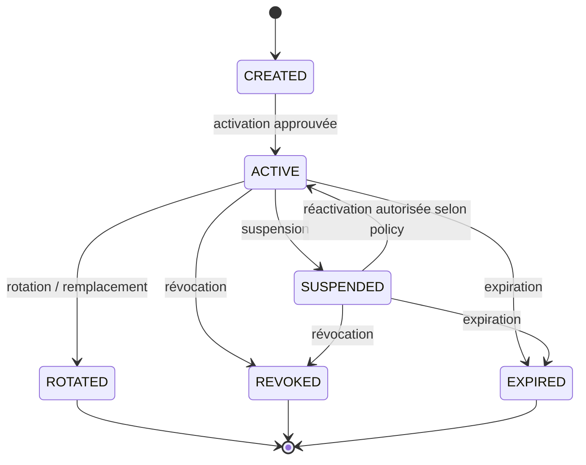
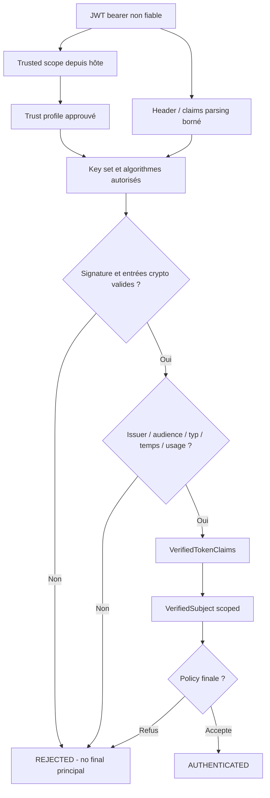
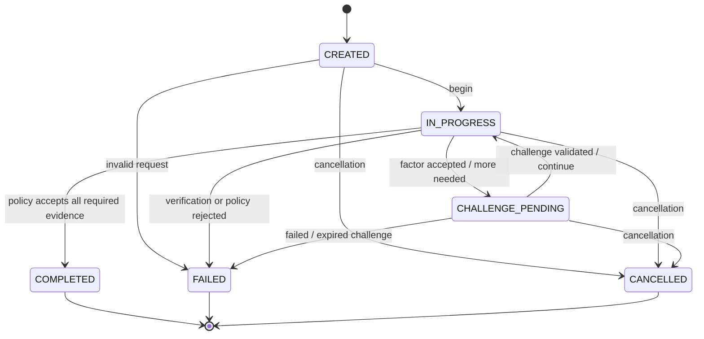
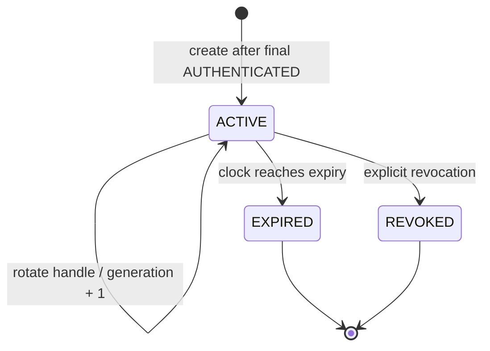

# 07_PYAUTHKIT_DOMAIN_INVARIANTS_AND_BUSINESS_RULES

# PyAuthKit - Domain Invariants and Business Rules

> **Document** : `07_PYAUTHKIT_DOMAIN_INVARIANTS_AND_BUSINESS_RULES.md`  
> **Projet** : PyAuthKit - Authentication Engine for the Modern Python Ecosystem  
> **Date de rédaction** : 28 octobre 2026  
> **Version documentaire** : `0.1.0`  
> **Statut** : `SPECIFIED - PROPOSED`; les arbitrages ouverts nécessitent des ADR et une revue explicite  
> **Langue** : français, identifiants et concepts logiciels en anglais  
> **Objet** : préconditions, invariants, règles de décision, postconditions, refus, temporalité, concurrence, tests et preuve de qualification  
> **Périmètre** : MVP Password / API Key / JWT puis extensions MFA, sessions, fédération, passkeys, workloads, agents et adaptive authentication  
> **Conventions** : *Problem First, Trust First, Invariant Before API, Proof Before Claims*

> **Avertissement de sécurité :** ce document est une **spécification de conception**, non une bibliothèque cryptographique, un audit de code, une certification NIST, une preuve de conformité réglementaire ou un constat d'implémentation. Les exemples de code sont des illustrations de contrats et doivent être complétés par des bibliothèques et revues de sécurité avant tout usage réel. Les mots `MUST` et `MUST NOT` expriment ici des contraintes **proposées pour PyAuthKit** et non une citation intégrale d'un standard externe.

---

## Guide de lecture

| Besoin | Parcours conseillé |
|---|---|
| Comprendre le modèle de règles | Sections 0-5 |
| Vérifier les invariants de confiance | Sections 6-7 et registre `AUTH-INV-001..012` |
| Implémenter Password / API Key / JWT | Sections 8-10 et `AUTH-INV-011..020`, `041..052` |
| Concevoir les flows, challenges, sessions | Sections 11-13 et `AUTH-INV-021..030` |
| Traiter fédération, agents et risque | Sections 14-16 et `AUTH-INV-031..039` |
| Qualifier l'architecture et la sécurité | Sections 17-26, matrices et annexes |

**Convention d'état** : `MVP` = candidat de première livraison ; `POST-MVP` = contrat cible conditionnel ; `CROSS-CUTTING` = règle transverse activée à hauteur des capacités réellement présentes. `PROPOSED` n'implique ni acceptation en ADR, ni implémentation, ni qualification.

---

## 0. Résumé exécutif

L'objet de PyAuthKit n'est pas de recevoir une chaîne de caractères et de déclarer un utilisateur connecté. Il est d'évaluer une **preuve d'authentification** à l'intérieur d'une **frontière de confiance préétablie**, sous une politique explicite, puis de produire une **décision de confiance traçable** et sûre. Un résultat d'authentification n'est ni un droit IAM, ni une session locale obligatoire, ni une preuve que le runtime est conforme à une norme.

Le présent document transforme les 40 invariants relationnels candidats de `06` en **40 invariants de domaine tracés**, complétés par **24 invariants transversaux** portant sur le transport, la cryptographie, la configuration, le temps et le runtime. Il introduit un registre distinct de **règles métier opérationnelles** et fournit les cas d'échec, oracles de test et questions d'architecture nécessaires à `08`-`28`.

**Chaîne de sûreté fondamentale :**

```text
Untrusted AuthenticationRequest + PresentedEvidence + ClaimedIdentity
                          │
                          ▼
TrustedEntryContext ─► TrustedScope ─► approved TrustProfile
                          │
                          ▼
                     Authenticator
                          │
                          ▼
               AuthenticatorOutcome
                          │
             VERIFIED ────┴──── REJECTED / ERROR
                │
                ▼
          VerifiedSubject (scoped)
                │
                ▼
     AuthenticationPolicy + safety gates
                │
                ▼
       AuthenticationResult (discriminated)
          │                      │
   AUTHENTICATED         REJECTED / ERROR /
          │               CHALLENGE_REQUIRED
          ▼                      │
 AuthenticatedPrincipal       no final principal
          │
          ▼
 Optional PyIAMKit resolution / AuthZ (distinct decision)
```

**Invariants centraux :** `authenticated ⇒ proof_verified ∧ trust_profile_approved ∧ policy_accepted`; `not_authenticated ⇒ no_final_authenticated_principal`; `unknown_or_ambiguous_trust ⇒ fail_closed`. Ces expressions sont **conceptuelles** : l'implémentation doit définir les prédicats et les frontières de confiance, et ne pas se contenter de booléens provenant de l'entrée utilisateur.

---

## 1. Sources, filiation documentaire et autorité

| Source | Apport à `07` | Autorité et limites |
|---|---|---|
| `00_PYAUTHKIT_EXPRESSION_DU_BESOIN.md` | objectifs, méthodes, acteurs, Authentication vs IAM | cadrage initial |
| `01_PYAUTHKIT_REQUIREMENTS_ANALYSIS.md` | registres `FR`, `NFR`, `SEC`, `ARC`, `INT`, `ACC`, `DEC` | exigences candidates, arbitrages ouverts |
| `02_PYAUTHKIT_PRODUCT_VISION_AND_ARCHITECTURE_PRINCIPLES.md` | principes, frontières, design patterns | architecture cible, pas preuve de code |
| `03_PYAUTHKIT_SYSTEM_ARCHITECTURE.md` | `INV-SYS-01..10`, pipeline, erreurs, ports, trust | composants et séquences conceptuelles |
| `04_PYAUTHKIT_DOMAIN_OBJECTS.md` | `DO-001..048`, `DOM-INV-*`, vocabulaire et ownership | objets conceptuels, pas tables SQL |
| `05_PYAUTHKIT_ENTITIES_AND_VALUE_OBJECTS.md` | `EV-INV-001..031`, candidats DDD, transitions | classifications conditionnelles |
| `06_PYAUTHKIT_DOMAIN_RELATIONSHIPS_AND_ERD.md` | `REL-INV-001..040`, relations, cardinalités, garanties de store | base de traçabilité principale |
| `PYAUTHKIT_SOFTWARE_DESIGN_LEARNING_CONVENTION.md` | démarche `problem → trust boundary → invariant → design → test` | convention pédagogique proposée |

**Règle de conservation de source :** `AUTH-INV-001` reprend le sujet de `REL-INV-001`, sans renommer ni invalider `REL-INV-001`, `EV-INV-*` ou `DOM-INV-*`. Toute incohérence réelle doit être arbitrée dans le document propriétaire ou par ADR. Les nouveaux champs *Owner*, *Preconditions* et *Failure* sont des **précisions proposées ici** et ne doivent pas être présentés comme décisions déjà approuvées.

### 1.1 Vérifications normatives externes (repères, pas preuve de conformité)

- NIST SP 800-63B-4, *Authentication and Authenticator Management* (publication finale de juillet 2025) : https://csrc.nist.gov/pubs/sp/800/63/b/4/final
- NIST SP 800-63-4, *Digital Identity Guidelines* : https://csrc.nist.gov/pubs/sp/800/63/4/final
- RFC 8725, *JSON Web Token Best Current Practices* : https://www.rfc-editor.org/rfc/rfc8725.html
- RFC 7519, *JSON Web Token (JWT)* : https://www.rfc-editor.org/rfc/rfc7519.html

La conformité à une exigence d'AAL, d'algorithme, de protocole ou de durée de vie dépend d'un **profil d'application** explicitement sélectionné et d'une qualification indépendante. NIST AAL ne s'obtient pas simplement en comptant des facteurs ; RFC 8725 ne rend pas sûre une application qui accepte des tokens sous des clés, algorithmes, issuers ou audiences choisis par l'attaquant.

---

## 2. Langage ubiquitaire et distinctions non négociables

| Concept | Sens dans PyAuthKit | Ne doit pas être confondu avec |
|---|---|---|
| `ClaimedIdentity` | identité ou identifiant revendiqué, non encore prouvé | `VerifiedSubject` |
| `PresentedEvidence` | preuve présentée, sensible et non fiable à l'entrée | credential vérifié |
| `TrustedEntryContext` | contexte attribué par l'hôte à partir de liaisons préapprouvées | champs client, simple annotation typée |
| `TrustedScope` | frontière de confiance effective pour une opération | `tenant_id` client non vérifié |
| `TrustProfile` | règles de confiance applicables (méthode/issuer/clés/audience...) | claims d'un JWT entrant |
| `Authenticator` | stratégie de vérification sous trust profile | moteur d'autorisation |
| `AuthenticatorOutcome` | issue interne d'une stratégie | succès public final |
| `VerifiedSubject` | sujet vérifié dans un issuer et scope fiables | utilisateur PyIAMKit |
| `AuthenticatedPrincipal` | représentation sûre du succès final après policies | `Principal` comme record utilisateur universel |
| `AuthenticationResult` | verdict final discriminé | session, token ou autorisation |
| `CredentialReference` | pointeur vers record de vérification | preuve de possession |
| `CredentialRecord` | état et matériel de vérification lorsque leur ownership est défini | mot de passe brut / clé brute |
| `AuthenticationAttempt` | corrélation d'une tentative | session / flow |
| `AuthenticationFlow` | processus potentiellement multi-étapes | agrégat nécessairement persistant |
| `AuthenticationChallenge` | défi limité en contexte et éventuellement à usage unique | second facteur déjà validé |
| `AuthenticationFactor` | catégorie/méthode de facteur prouvé | SMS/email comme facteur indépendant en soi |
| `AuthenticationSession` | continuité d'authentification avec lifecycle propre | preuve de possession de token / IAM identity |
| `AuthenticationAssurance` | évaluation justifiée par une policy et un référentiel | nombre brut de facteurs |
| `DelegationEvidence` | assertion de mandat à vérifier | permission déjà accordée |

Un `Principal` de type `AGENT` n'est pas une permission. `OAuth 2.0` n'est pas, seul, un protocole d'authentification de l'utilisateur. `JWT` décrit un format de token, pas la garantie d'origine ou d'usage attendu d'un token entrant.

---

## 3. Taxonomie des règles et conventions d'identifiants

### 3.1 Typologie

| Type | Question | Exemple | Où tester ? |
|---|---|---|---|
| **Invariant** | Qu'est-ce qui ne peut jamais devenir vrai dans un état admissible ? | `REJECTED` ne contient pas de principal final | modèle + application |
| **Précondition** | Quand une opération est-elle autorisée à commencer ? | profil de confiance résolu | use case |
| **Postcondition** | Qu'est-ce qui est garanti après succès ? | sujet prouvé et lié au scope | service / use case |
| **Business Rule / Policy** | Quelle décision varie selon usage, application, niveau de risque ? | MFA nécessaire pour une opération | policy explicite |
| **Contrainte temporelle** | Quand une preuve est-elle valide ? | `now < expires_at` selon contrat | clock + verifier |
| **Contrainte concurrente** | Que se passe-t-il si deux opérations rivalisent ? | une seule consommation du challenge | store atomique |
| **Contrat de dégradation** | Que faire en cas d'indisponibilité ? | aucun succès sur indisponibilité de clé | adapter / application |
| **Architecture fitness function** | Quelle dépendance / frontière est interdite ? | pas d'import SQLAlchemy dans `domain` | CI architecture |

### 3.2 Identifiants

- `AUTH-INV-001..040` : correspondances exactes avec `REL-INV-001..040`.
- `AUTH-INV-041..064` : compléments transversaux proposés par le présent document.
- `AUTH-BR-001..048` : règles de comportement métier, configurables ou contextualisées.
- `AUTH-TST-001..064` : test de référence par invariant, non tests déjà exécutés.
- `AUTH-SC-01..12` : scénarios de qualification end-to-end, proposés.
- `AUTH-DEC-01..18` : décisions de design non résolues, initialement mappées à `REL-DEC-01..18`.

Une règle ayant un identifiant stable doit pouvoir être retrouvée dans les specs, tickets, ADR, PR et tests. **Un identifiant ne prouve pas qu'une règle est implémentée.**

### 3.3 Gabarit canonique

```text
ID / TITLE / STATUS / PHASE
BUSINESS PROBLEM
TRUST BOUNDARY / BOUNDED CONTEXT
OWNER / ENFORCEMENT POINT
PRECONDITIONS
INVARIANT OR RULE
POSTCONDITION ON SUCCESS
FAILURE SEMANTICS
TIME / CONCURRENCY CONTRACT (if relevant)
POSITIVE / NEGATIVE / BOUNDARY TESTS
EVIDENCE (commit, CI, report) - initially NONE
TRACEABILITY TO 04/05/06 and requirements
```

---

## 4. Modèle de décision et états possibles

### 4.1 États finaux et non finaux

| État | Sens | Principal final présent ? | Mutation aval autorisée ? |
|---|---|---|---|
| `AUTHENTICATED` | preuve vérifiée, confiance et policies satisfaites | **Oui, exactement un** | **Seulement** selon autre contrat explicite (session/IAM/AuthZ) |
| `REJECTED` | preuve invalide ou policy non satisfaite | **Non** | aucune mutation qui suppose un succès AuthN |
| `ERROR` | erreur technique ou configuration empêchant de statuer positivement | **Non** | aucune mutation qui suppose un succès AuthN |
| `CHALLENGE_REQUIRED` | continuation AuthN obligatoire, post-MVP | **Non** | seul un état de flow partiel peut être conservé |
| `CANCELLED` | état d'exécution interne, éventuel | **Non** | cleanup conforme au lifecycle ; pas de succès implicite |

`CANCELLED` n'est pas une valeur publique obligatoire de l'API ; elle représente ici une condition de runtime. `ERROR` ou exception typée restent à arbitrer par `DEC-06` de `03`. L'existence d'une policy exigeante n'implique pas forcément la création d'une session.

### 4.2 Décision conceptuelle

```text
START
  │
  ▼
TrustedEntryContext established by host?
  ├── NO  → ERROR / secure refusal
  └── YES
        │
        ▼
    Unique permitted trust profile?
      ├── NO  → ERROR / refusal
      └── YES
            │
            ▼
       Registered method allowed?
         ├── NO  → REJECTED / unsupported
         └── YES
                │
                ▼
          Evidence verified?
            ├── NO  → REJECTED or ERROR
            └── YES
                  │
                  ▼
             Policy satisfied?
               ├── NO  → REJECTED or CHALLENGE_REQUIRED
               └── YES
                     │
                     ▼
               AUTHENTICATED
                     │
                     ▼
             OPTIONAL: session issuance,
             PyIAMKit identity resolution,
             authorization by host/IAM
```

Le chemin `REJECTED/ERROR/CHALLENGE_REQUIRED` doit être **incapable** de produire un `AuthenticatedPrincipal` final par construction ou par contrôles vérifiés. En présence d'une annulation, le caller reçoit la sémantique d'annulation de son runtime ; ce n'est pas un succès silencieux.

---

## 5. Modèle de confiance, ownership et points d'application

| Frontière | Entrée non fiable | Condition d'admission | Owner recommandé |
|---|---|---|---|
| Transport → trusted entry | HTTP headers, JSON, cookies, API parameters | binding établi par un hôte de confiance | integration/host |
| Scope → trust profile | tenant hint, issuer hint, `kid`, URL externe | resolution sur configuration approuvée | `TrustProfileResolver` |
| Proof → verified subject | password, API key, JWT, certificate, assertion | vérification complète par authenticator sous profile | verifier/authenticator |
| Verifier → policy | `AuthenticatorOutcome` | policies finales, risk/assurance si activés | use case / policy gate |
| Policy → result | réussite interne conditionnelle | normalisation discriminée des statuts | `ResultNormalizer` |
| AuthN → IAM | `AuthenticatedPrincipal` avec namespace/provenance | contrat d'intégration explicite | PyIAMKit / host |
| AuthN → session/token | verdict final, client, durée, contexte | émission séparée et policy d'usage | session/token use case |
| Domain → infrastructure | ports abstraits | implémentation injectée, erreurs traduites | adapters/composition root |

Le *trust* provient des sources autoritatives définies par l'application hôte, des preuves effectivement validées et des politiques retenues. Un type `TrustedEntryContext` créé avec des valeurs issues d'un champ client reste **non fiable malgré son nom**.

---

## 6. Registre consolidé des invariants - vue synthétique

Les 40 premiers invariants reprennent **sans en changer le sens** les `REL-INV-*` documentés en `06`; les 24 suivants complètent les contraintes **non relationnelles**. Les fiches de la section 7 contiennent préconditions, postconditions, refus et tests. Les garanties de stockage concurrent ne sont **applicables** que si le backend réalise effectivement les primitives demandées.

| AUTH-INV | Règle courte | Source | Phase |
|---|---|---|---|
| `AUTH-INV-001` | Aucune `ClaimedIdentity` ne devient `VerifiedSubject` sans vérification sous profil approuvé | `REL-INV-001` | MVP · trust |
| `AUTH-INV-002` | La sélection du `TrustedScope` n'est pas dérivée d'un hint non fiable seul | `REL-INV-002` | MVP · trust |
| `AUTH-INV-003` | Une vérification utilise un profil de confiance effectif et non ambigu | `REL-INV-003` | MVP · trust |
| `AUTH-INV-004` | Le namespace du subject vérifié fait partie de son identité située | `REL-INV-004` | MVP · identity |
| `AUTH-INV-005` | Un `AuthenticatorOutcome.VERIFIED` n'est pas final sans gate de policy | `REL-INV-005` | MVP · decision |
| `AUTH-INV-006` | Seule l'issue finale AUTHENTICATED possède un principal final public | `REL-INV-006` | MVP · result |
| `AUTH-INV-007` | Une tentative refusée n'inclut aucun secret ou sujet faussement authentifié | `REL-INV-007` | MVP · privacy |
| `AUTH-INV-008` | Un principal authentifié ne porte pas de permissions IAM implicites | `REL-INV-008` | MVP · IAM boundary |
| `AUTH-INV-009` | Un `sub`, email ou ID libre n'est pas globalement unique sans namespace | `REL-INV-009` | MVP · identity |
| `AUTH-INV-010` | Une méthode non admise ne déclenche pas de fallback moins strict | `REL-INV-010` | MVP · method |
| `AUTH-INV-011` | Une référence de credential ne démontre aucune possession | `REL-INV-011` | MVP · credential |
| `AUTH-INV-012` | Un record vérifié appartient au scope/namespace requis | `REL-INV-012` | MVP · credential scope |
| `AUTH-INV-013` | Un lookup absent ou ambigu refuse au lieu de choisir une valeur arbitraire | `REL-INV-013` | MVP · lookup |
| `AUTH-INV-014` | Un record révoqué, expiré ou inactif n'est pas accepté selon contrat | `REL-INV-014` | MVP · credential lifecycle |
| `AUTH-INV-015` | Une version concurrente ne peut écraser silencieusement une rotation | `REL-INV-015` | Conditional · owned credentials |
| `AUTH-INV-016` | La sélection de clés JWT reste bornée par profil approuvé | `REL-INV-016` | MVP · JWT |
| `AUTH-INV-017` | Les claims JWT non vérifiées ne deviennent jamais attributs approuvés | `REL-INV-017` | MVP · JWT |
| `AUTH-INV-018` | Les secrets présentés restent exclus des résultats, événements et erreurs | `REL-INV-018` | CROSS-CUTTING · secret safety |
| `AUTH-INV-019` | L'ownership d'un credential est explicite avant toute mutation locale | `REL-INV-019` | Conditional · ownership |
| `AUTH-INV-020` | Un JWT validé n'implique ni session locale, ni émission par PyAuthKit | `REL-INV-020` | MVP · JWT consumption |
| `AUTH-INV-021` | Une preuve partielle n'achève pas un flow nécessitant d'autres étapes | `REL-INV-021` | POST-MVP · flow |
| `AUTH-INV-022` | Un challenge one-time ne peut être consommé avec succès deux fois | `REL-INV-022` | POST-MVP · challenge |
| `AUTH-INV-023` | Un challenge reste lié à son flow, scope, usage et sujet applicables | `REL-INV-023` | POST-MVP · challenge |
| `AUTH-INV-024` | Un challenge expiré/annulé n'est jamais accepté | `REL-INV-024` | POST-MVP · challenge |
| `AUTH-INV-025` | Une assurance est justifiée par le référentiel et la policy | `REL-INV-025` | POST-MVP · assurance |
| `AUTH-INV-026` | Une session ne naît que d'une décision finale AUTHENTICATED admise | `REL-INV-026` | POST-MVP · session |
| `AUTH-INV-027` | Une session révoquée ou expirée ne redevient pas active | `REL-INV-027` | POST-MVP · session |
| `AUTH-INV-028` | La rotation invalide l'ancienne génération selon un contrat atomique | `REL-INV-028` | POST-MVP · session concurrency |
| `AUTH-INV-029` | Un handle bearer n'est pas exposé comme un identifiant public/audit | `REL-INV-029` | POST-MVP · bearer security |
| `AUTH-INV-030` | Un token n'est accepté que dans son usage, issuer et audience approuvés | `REL-INV-030` | MVP JWT / POST-MVP issuance |
| `AUTH-INV-031` | Un email IdP ne crée aucun lien IAM automatique | `REL-INV-031` | POST-MVP · federation IAM |
| `AUTH-INV-032` | L'identité d'agent authentifiée ne transmet pas les droits d'un opérateur | `REL-INV-032` | POST-MVP · agents |
| `AUTH-INV-033` | Une délégation exige preuve, scope, autorité et décision externe | `REL-INV-033` | POST-MVP · delegation |
| `AUTH-INV-034` | Un workload binding exige issuer/audience/runtime validés | `REL-INV-034` | POST-MVP · workload |
| `AUTH-INV-035` | Un signal de risque n'est pas un facteur MFA | `REL-INV-035` | POST-MVP · risk |
| `AUTH-INV-036` | La politique de risque ne contourne pas les contrôles de preuves | `REL-INV-036` | POST-MVP · adaptive |
| `AUTH-INV-037` | Les événements d'authentification sont minimisés, sans secrets | `REL-INV-037` | CROSS-CUTTING · events |
| `AUTH-INV-038` | La propagation de révocation et sa latence sont explicitement contractualisées | `REL-INV-038` | CROSS-CUTTING · revocation |
| `AUTH-INV-039` | L'application distingue authentication success et IAM resolution outcome | `REL-INV-039` | MVP · IAM bridge |
| `AUTH-INV-040` | Un schéma et une documentation ne constituent pas une preuve `IMPLEMENTED/QUALIFIED` | `REL-INV-040` | CROSS-CUTTING · governance |

### 6.2 Compléments transversaux (`041..064`)

| AUTH-INV | Règle | Source principale | Phase |
|---|---|---|---|
| `AUTH-INV-041` | Un appel `authenticate` est sans succès si une dépendance de confiance obligatoire est indisponible | `INV-SYS-08` | MVP · error |
| `AUTH-INV-042` | L'hôte et le core ne confondent pas information fournie par client et preuve de binding de transport | `INV-SYS-04/05` | MVP · boundary |
| `AUTH-INV-043` | Les comparaisons de secrets et verifiers utilisent des primitives reconnues adaptées au type de secret | `SEC-001 / INV-SYS-06` | MVP · secret |
| `AUTH-INV-044` | L'authentification par password ne révèle pas l'existence du compte via les messages publics | `03 §17` | MVP · password |
| `AUTH-INV-045` | La restriction des essais et les limites de ressources sont appliquées au périmètre configuré | `03 §17.5 / SEC` | MVP · abuse |
| `AUTH-INV-046` | Les valeurs publiques de résultat n'incluent aucun état de preuve partielle utilisable comme principal final | `INV-SYS-01/02` | MVP / POST-MVP · result |
| `AUTH-INV-047` | L'horloge utilisée pour expiration et freshness est injectée, cohérente et contrôlée | `EV-INV-030` | MVP / POST-MVP · time |
| `AUTH-INV-048` | Une demande annulée ne peut pas être transformée silencieusement en authentification réussie | `03 §17` | MVP · runtime |
| `AUTH-INV-049` | La validation JWT applique des algorithmes explicitement admis par l'application | `RFC 8725 §3.1` | MVP · JWT |
| `AUTH-INV-050` | La validation JWT applique claims obligatoires, typage et séparation des contextes d'usage | `RFC 8725 §3.11/3.12` | MVP · JWT |
| `AUTH-INV-051` | Les valeurs `kid`, `jku`, `x5u` et autres références non vérifiées ne déclenchent pas de résolution externe arbitraire | `RFC 8725 §3.10` | MVP · JWT keys |
| `AUTH-INV-052` | Aucun `Authenticator` ne partage l'état secret d'une tentative entre des invocations concurrentes | `INV-SYS-09` | MVP · concurrency |
| `AUTH-INV-053` | Une politique de sécurité obligatoire non évaluée n'est jamais implicitement satisfaite | `INV-SYS-08` | MVP / POST-MVP · policy |
| `AUTH-INV-054` | Chaque plugin et provider est admis par un registre et un scope explicites | `INV-SYS-10` | MVP · plugins |
| `AUTH-INV-055` | Le contrôle de sérialisation et les exceptions empêchent les fuites de secrets par représentation | `SEC-001 / INV-SYS-06` | MVP · privacy |
| `AUTH-INV-056` | L'origine, le type de principal et son namespace restent des dimensions indépendantes | `03 §9.5 / DEC-05` | MVP · identity |
| `AUTH-INV-057` | Un résultat authentifié ne vaut pas décision d'autorisation d'une ressource | `ARC-012/013` | MVP · AuthN/AuthZ |
| `AUTH-INV-058` | Les paramètres de configuration pertinents sont validés et bornés avant exposition du service | `03 §19` | MVP · bootstrap |
| `AUTH-INV-059` | Les identifiants de tentative, session, flow et token ont des sémantiques séparées | `EV-INV-028` | CROSS-CUTTING · identity |
| `AUTH-INV-060` | Les événements déclarés comme durables respectent la garantie de remise effectivement choisie | `03 §21 / REL-DEC-12` | CROSS-CUTTING · audit |
| `AUTH-INV-061` | Les réponses et diagnostics distinguent refus métier et panne technique sans oracle sensible | `03 §17` | MVP · failure |
| `AUTH-INV-062` | Le changement de policy/profil actif ne réécrit pas rétroactivement les décisions passées | `06 §11 / §27` | CROSS-CUTTING · provenance |
| `AUTH-INV-063` | Une authentification positive dépend d'une validation complète dans l'horizon temporel et le budget annoncés | `INV-SYS-01/08` | MVP · timeout |
| `AUTH-INV-064` | La qualité, la conformité et les capacités de release sont déclarées seulement avec preuves vérifiables | `Learning Convention § release` | CROSS-CUTTING · governance |

---

## 7. Fiches d'invariants : préconditions, postconditions et tests

> Chaque fiche est au statut **SPECIFIED/PROPOSED**. Les libellés « attendu » ci-dessous sont des **oracles de qualification**, non des résultats de tests déjà exécutés. Le test `AUTH-TST-xxx` devient une preuve seulement après liaison à une suite exécutée et référencée.

### 7.1 Frontière de confiance, identité et décision (`001..010`)

#### `AUTH-INV-001` - Aucune `ClaimedIdentity` ne devient `VerifiedSubject` sans vérification sous profil approuvé

- **Statut / phase :** `SPECIFIED - PROPOSED` ; MVP · trust.
- **Propriétaire du contrôle :** `Verifier / application` (point d'application candidat ; affiner par ADR si nécessaire).
- **Préconditions :** Une evidence non vérifiée et une claimed identity arrivent.
- **Invariant / comportement admis :** Aucune `ClaimedIdentity` ne devient `VerifiedSubject` sans vérification sous profil approuvé
- **Postcondition positive :** Le sujet est construit uniquement depuis une vérification admise, contextualisée et probante.
- **Comportement d'échec :** Parsing ou reconnaissance du login seuls ⇒ refus. Le refus ne crée jamais de principal final authentifié.
- **Test de référence `AUTH-TST-001` :** Une adresse revendiquée correcte sans secret valide ne donne jamais un sujet vérifié.
- **Traçabilité :** `REL-INV-001` / `EV-INV-001`. **Preuve d'exécution :** aucune à cette étape.

#### `AUTH-INV-002` - La sélection du `TrustedScope` n'est pas dérivée d'un hint non fiable seul

- **Statut / phase :** `SPECIFIED - PROPOSED` ; MVP · trust.
- **Propriétaire du contrôle :** `TrustedEntryContext` (point d'application candidat ; affiner par ADR si nécessaire).
- **Préconditions :** L'hôte dispose d'une route / application déjà liée à un scope fiable.
- **Invariant / comportement admis :** La sélection du `TrustedScope` n'est pas dérivée d'un hint non fiable seul
- **Postcondition positive :** Le scope retenu provient de ce binding et des règles approuvées.
- **Comportement d'échec :** Un champ tenant modifié par le client ne change pas l'autorité. Le refus ne crée jamais de principal final authentifié.
- **Test de référence `AUTH-TST-002` :** Injection de tenant_id dans la request ; aucun déplacement de scope.
- **Traçabilité :** `REL-INV-002` / `EV-INV-008`. **Preuve d'exécution :** aucune à cette étape.

#### `AUTH-INV-003` - Une vérification utilise un profil de confiance effectif et non ambigu

- **Statut / phase :** `SPECIFIED - PROPOSED` ; MVP · trust.
- **Propriétaire du contrôle :** `TrustProfileResolver` (point d'application candidat ; affiner par ADR si nécessaire).
- **Préconditions :** Une méthode et un contexte hôte sont définis.
- **Invariant / comportement admis :** Une vérification utilise un profil de confiance effectif et non ambigu
- **Postcondition positive :** Un seul TrustProfile applicable est choisi avant vérification.
- **Comportement d'échec :** Profil absent, multiple ou contradictoire ⇒ aucun choix arbitraire. Le refus ne crée jamais de principal final authentifié.
- **Test de référence `AUTH-TST-003` :** Deux profils de priorité équivalente ⇒ échec fermé et diagnostic sûr.
- **Traçabilité :** `REL-INV-003` / `EV-INV-029`. **Preuve d'exécution :** aucune à cette étape.

#### `AUTH-INV-004` - Le namespace du subject vérifié fait partie de son identité située

- **Statut / phase :** `SPECIFIED - PROPOSED` ; MVP · identity.
- **Propriétaire du contrôle :** `VerifiedSubject` (point d'application candidat ; affiner par ADR si nécessaire).
- **Préconditions :** Une stratégie a prouvé une assertion de sujet.
- **Invariant / comportement admis :** Le namespace du subject vérifié fait partie de son identité située
- **Postcondition positive :** Identité située par issuer, subject, trusted scope ; type de principal selon contrat.
- **Comportement d'échec :** Même sub dans deux issuers n'est pas fusionné. Le refus ne crée jamais de principal final authentifié.
- **Test de référence `AUTH-TST-004` :** Comparer (issuer A, sub X) et (issuer B, sub X).
- **Traçabilité :** `REL-INV-004` / `EV-INV-002/007`. **Preuve d'exécution :** aucune à cette étape.

#### `AUTH-INV-005` - Un `AuthenticatorOutcome.VERIFIED` n'est pas final sans gate de policy

- **Statut / phase :** `SPECIFIED - PROPOSED` ; MVP · decision.
- **Propriétaire du contrôle :** `AuthenticationPolicy` (point d'application candidat ; affiner par ADR si nécessaire).
- **Préconditions :** AuthenticatorOutcome indique VERIFIED.
- **Invariant / comportement admis :** Un `AuthenticatorOutcome.VERIFIED` n'est pas final sans gate de policy
- **Postcondition positive :** La policy effective contrôle la preuve avant résultat final.
- **Comportement d'échec :** Une policy qui refuse ou demande un step-up bloque le succès final. Le refus ne crée jamais de principal final authentifié.
- **Test de référence `AUTH-TST-005` :** Outcome verified + policy deny ⇒ REJECTED sans principal.
- **Traçabilité :** `REL-INV-005` / `EV-INV-003/009`. **Preuve d'exécution :** aucune à cette étape.

#### `AUTH-INV-006` - Seule l'issue finale AUTHENTICATED possède un principal final public

- **Statut / phase :** `SPECIFIED - PROPOSED` ; MVP · result.
- **Propriétaire du contrôle :** `ResultNormalizer` (point d'application candidat ; affiner par ADR si nécessaire).
- **Préconditions :** La normalisation du verdict est appelée.
- **Invariant / comportement admis :** Seule l'issue finale AUTHENTICATED possède un principal final public
- **Postcondition positive :** Exactement un principal final si et seulement si AUTHENTICATED.
- **Comportement d'échec :** REJECTED, ERROR ou CHALLENGE_REQUIRED ⇒ principal final absent. Le refus ne crée jamais de principal final authentifié.
- **Test de référence `AUTH-TST-006` :** Tests paramétrés sur chaque statut et payload.
- **Traçabilité :** `REL-INV-006` / `EV-INV-004`. **Preuve d'exécution :** aucune à cette étape.

#### `AUTH-INV-007` - Une tentative refusée n'inclut aucun secret ou sujet faussement authentifié

- **Statut / phase :** `SPECIFIED - PROPOSED` ; MVP · privacy.
- **Propriétaire du contrôle :** `AuthenticationResult` (point d'application candidat ; affiner par ADR si nécessaire).
- **Préconditions :** La tentative se termine par rejet ou erreur.
- **Invariant / comportement admis :** Une tentative refusée n'inclut aucun secret ou sujet faussement authentifié
- **Postcondition positive :** Le résultat public ne révèle pas de secret et ne présente pas un sujet comme authentifié.
- **Comportement d'échec :** Détails internes de lookup ou raison de secret incorrect non divulgués. Le refus ne crée jamais de principal final authentifié.
- **Test de référence `AUTH-TST-007` :** Inspecter dict/repr/JSON/log d'un échec contenant un secret sentinelle.
- **Traçabilité :** `REL-INV-007` / `EV-INV-004/014`. **Preuve d'exécution :** aucune à cette étape.

#### `AUTH-INV-008` - Un principal authentifié ne porte pas de permissions IAM implicites

- **Statut / phase :** `SPECIFIED - PROPOSED` ; MVP · IAM boundary.
- **Propriétaire du contrôle :** `Context boundary` (point d'application candidat ; affiner par ADR si nécessaire).
- **Préconditions :** Le sujet est prouvé sous policy d'authentification.
- **Invariant / comportement admis :** Un principal authentifié ne porte pas de permissions IAM implicites
- **Postcondition positive :** La réponse atteste AuthN seulement ; IAM décide ensuite des droits.
- **Comportement d'échec :** Scope/role arbitrairement demandés ne créent pas de permission. Le refus ne crée jamais de principal final authentifié.
- **Test de référence `AUTH-TST-008` :** Authentification valide, permission IAM absente ⇒ aucune permission accordée.
- **Traçabilité :** `REL-INV-008` / `EV-INV-006`. **Preuve d'exécution :** aucune à cette étape.

#### `AUTH-INV-009` - Un `sub`, email ou ID libre n'est pas globalement unique sans namespace

- **Statut / phase :** `SPECIFIED - PROPOSED` ; MVP · identity.
- **Propriétaire du contrôle :** `Subject relation` (point d'application candidat ; affiner par ADR si nécessaire).
- **Préconditions :** La méthode fournit un sub, username ou email.
- **Invariant / comportement admis :** Un `sub`, email ou ID libre n'est pas globalement unique sans namespace
- **Postcondition positive :** La valeur ne devient référence stable qu'avec namespace approuvé.
- **Comportement d'échec :** Une chaîne d'email partagée ne provoque pas de lien cross-provider. Le refus ne crée jamais de principal final authentifié.
- **Test de référence `AUTH-TST-009` :** Collision de sub dans deux profiles et même adresse email.
- **Traçabilité :** `REL-INV-009` / `EV-INV-007`. **Preuve d'exécution :** aucune à cette étape.

#### `AUTH-INV-010` - Une méthode non admise ne déclenche pas de fallback moins strict

- **Statut / phase :** `SPECIFIED - PROPOSED` ; MVP · method.
- **Propriétaire du contrôle :** `Registry / gate` (point d'application candidat ; affiner par ADR si nécessaire).
- **Préconditions :** Une méthode explicitement demandée ou sélectionnée est indisponible.
- **Invariant / comportement admis :** Une méthode non admise ne déclenche pas de fallback moins strict
- **Postcondition positive :** La tentative est rejetée ou échoue de manière sûre.
- **Comportement d'échec :** Pas de downgrade silencieux API key vers password, ou JWT vers un parsing laxiste. Le refus ne crée jamais de principal final authentifié.
- **Test de référence `AUTH-TST-010` :** Désactiver l'authenticator prévu et vérifier absence de fallback.
- **Traçabilité :** `REL-INV-010` / `EV-INV-005`. **Preuve d'exécution :** aucune à cette étape.

### 7.2 Credentials, secrets et JWT (`011..020`)

#### `AUTH-INV-011` - Une référence de credential ne démontre aucune possession

- **Statut / phase :** `SPECIFIED - PROPOSED` ; MVP · credential.
- **Propriétaire du contrôle :** `Resolver` (point d'application candidat ; affiner par ADR si nécessaire).
- **Préconditions :** Un handle de credential est présent.
- **Invariant / comportement admis :** Une référence de credential ne démontre aucune possession
- **Postcondition positive :** Le secret ou la preuve de possession doit être vérifié contre le record admis.
- **Comportement d'échec :** Préfixe reconnu, ID connu, record trouvé ≠ réussite. Le refus ne crée jamais de principal final authentifié.
- **Test de référence `AUTH-TST-011` :** API key avec préfixe réel et secret invalide ⇒ REJECTED.
- **Traçabilité :** `REL-INV-011` / `EV-INV-010`. **Preuve d'exécution :** aucune à cette étape.

#### `AUTH-INV-012` - Un record vérifié appartient au scope/namespace requis

- **Statut / phase :** `SPECIFIED - PROPOSED` ; MVP · credential scope.
- **Propriétaire du contrôle :** `Credential port` (point d'application candidat ; affiner par ADR si nécessaire).
- **Préconditions :** Un record est lu depuis un port de credential.
- **Invariant / comportement admis :** Un record vérifié appartient au scope/namespace requis
- **Postcondition positive :** Le record correspond au scope, à la méthode et à l'usage préapprouvés.
- **Comportement d'échec :** Record d'un autre tenant/realm ou namespace rejeté. Le refus ne crée jamais de principal final authentifié.
- **Test de référence `AUTH-TST-012` :** Même handle chez T1 et T2 : aucune lecture cross-tenant.
- **Traçabilité :** `REL-INV-012` / `EV-INV-015`. **Preuve d'exécution :** aucune à cette étape.

#### `AUTH-INV-013` - Un lookup absent ou ambigu refuse au lieu de choisir une valeur arbitraire

- **Statut / phase :** `SPECIFIED - PROPOSED` ; MVP · lookup.
- **Propriétaire du contrôle :** `Resolver` (point d'application candidat ; affiner par ADR si nécessaire).
- **Préconditions :** Le resolver consulte les records éligibles dans un scope.
- **Invariant / comportement admis :** Un lookup absent ou ambigu refuse au lieu de choisir une valeur arbitraire
- **Postcondition positive :** Résolution unique ou refus explicite ; aucun 'first()'.
- **Comportement d'échec :** Zero/multiple candidates ⇒ absent/ambiguous, jamais sélection implicite. Le refus ne crée jamais de principal final authentifié.
- **Test de référence `AUTH-TST-013` :** Tester 0, 1, 2 records admissibles et les diagnostics sûrs.
- **Traçabilité :** `REL-INV-013` / `EV-INV-029`. **Preuve d'exécution :** aucune à cette étape.

#### `AUTH-INV-014` - Un record révoqué, expiré ou inactif n'est pas accepté selon contrat

- **Statut / phase :** `SPECIFIED - PROPOSED` ; MVP · credential lifecycle.
- **Propriétaire du contrôle :** `Credential verifier` (point d'application candidat ; affiner par ADR si nécessaire).
- **Préconditions :** Record existant avec statut et fenêtre effective.
- **Invariant / comportement admis :** Un record révoqué, expiré ou inactif n'est pas accepté selon contrat
- **Postcondition positive :** Acceptation uniquement si statut, validité et preuve sont admis à la décision.
- **Comportement d'échec :** Révoqué / expiré / suspendu / désactivé ⇒ rejet. Le refus ne crée jamais de principal final authentifié.
- **Test de référence `AUTH-TST-014` :** Record actif puis révoqué, même secret : deuxième demande refusée.
- **Traçabilité :** `REL-INV-014` / `EV-INV-011`. **Preuve d'exécution :** aucune à cette étape.

#### `AUTH-INV-015` - Une version concurrente ne peut écraser silencieusement une rotation

- **Statut / phase :** `SPECIFIED - PROPOSED` ; Conditional · owned credentials.
- **Propriétaire du contrôle :** `Owned record/store` (point d'application candidat ; affiner par ADR si nécessaire).
- **Préconditions :** Deux opérations modifient une version de record owned.
- **Invariant / comportement admis :** Une version concurrente ne peut écraser silencieusement une rotation
- **Postcondition positive :** Mise à jour conforme au contrat optimistic-lock / CAS / transaction.
- **Comportement d'échec :** Une version périmée ne remplace pas silencieusement l'état courant. Le refus ne crée jamais de principal final authentifié.
- **Test de référence `AUTH-TST-015` :** Simuler deux rotations avec expected_version identique.
- **Traçabilité :** `REL-INV-015` / `EV-INV-016`. **Preuve d'exécution :** aucune à cette étape.

#### `AUTH-INV-016` - La sélection de clés JWT reste bornée par profil approuvé

- **Statut / phase :** `SPECIFIED - PROPOSED` ; MVP · JWT.
- **Propriétaire du contrôle :** `VerificationKeyResolver` (point d'application candidat ; affiner par ADR si nécessaire).
- **Préconditions :** Le profile JWT est déjà approuvé indépendamment du token.
- **Invariant / comportement admis :** La sélection de clés JWT reste bornée par profil approuvé
- **Postcondition positive :** Clé admissible résolue dans son key set, alg et usage compatibles.
- **Comportement d'échec :** Un kid ou jku externe ne peut ajouter une racine de confiance. Le refus ne crée jamais de principal final authentifié.
- **Test de référence `AUTH-TST-016` :** JWT avec jku vers domaine non approuvé : aucun réseau arbitraire ni succès.
- **Traçabilité :** `REL-INV-016` / `EV-INV-012/013`. **Preuve d'exécution :** aucune à cette étape.

#### `AUTH-INV-017` - Les claims JWT non vérifiées ne deviennent jamais attributs approuvés

- **Statut / phase :** `SPECIFIED - PROPOSED` ; MVP · JWT.
- **Propriétaire du contrôle :** `SignedTokenVerifier` (point d'application candidat ; affiner par ADR si nécessaire).
- **Préconditions :** Header et claims lus avant validation pour sélectionner des candidats bornés.
- **Invariant / comportement admis :** Les claims JWT non vérifiées ne deviennent jamais attributs approuvés
- **Postcondition positive :** Claims deviennent approuvées seulement après crypto ET contrôles sémantiques.
- **Comportement d'échec :** Signature valide mais wrong audience/issuer/typ ⇒ rejet. Le refus ne crée jamais de principal final authentifié.
- **Test de référence `AUTH-TST-017` :** Tester signature valide et aud incorrect, puis parsing seul.
- **Traçabilité :** `REL-INV-017` / `EV-INV-013`. **Preuve d'exécution :** aucune à cette étape.

#### `AUTH-INV-018` - Les secrets présentés restent exclus des résultats, événements et erreurs

- **Statut / phase :** `SPECIFIED - PROPOSED` ; CROSS-CUTTING · secret safety.
- **Propriétaire du contrôle :** `Secret boundary` (point d'application candidat ; affiner par ADR si nécessaire).
- **Préconditions :** Des evidences sensibles traversent ports et adapters.
- **Invariant / comportement admis :** Les secrets présentés restent exclus des résultats, événements et erreurs
- **Postcondition positive :** Logs, repr, exceptions, events et résultats n'exposent aucune evidence brute.
- **Comportement d'échec :** Le diagnostic doit être neutralisé plutôt que retourner le secret. Le refus ne crée jamais de principal final authentifié.
- **Test de référence `AUTH-TST-018` :** Sentinelles dans password/API key/JWT ; scan de toutes les sorties.
- **Traçabilité :** `REL-INV-018` / `EV-INV-014`. **Preuve d'exécution :** aucune à cette étape.

#### `AUTH-INV-019` - L'ownership d'un credential est explicite avant toute mutation locale

- **Statut / phase :** `SPECIFIED - PROPOSED` ; Conditional · ownership.
- **Propriétaire du contrôle :** `Credential lifecycle contract` (point d'application candidat ; affiner par ADR si nécessaire).
- **Préconditions :** Une commande veut créer, faire tourner ou révoquer un record.
- **Invariant / comportement admis :** L'ownership d'un credential est explicite avant toute mutation locale
- **Postcondition positive :** Le propriétaire autoritatif du lifecycle est explicite ; mutation via ce propriétaire.
- **Comportement d'échec :** Pas de mutation locale d'un record externe non possédé. Le refus ne crée jamais de principal final authentifié.
- **Test de référence `AUTH-TST-019` :** Fake store externe en read-only ; tentative revoke locale rejetée.
- **Traçabilité :** `REL-INV-019` / `EV-DEC-04`. **Preuve d'exécution :** aucune à cette étape.

#### `AUTH-INV-020` - Un JWT validé n'implique ni session locale, ni émission par PyAuthKit

- **Statut / phase :** `SPECIFIED - PROPOSED` ; MVP · JWT consumption.
- **Propriétaire du contrôle :** `Token distinction` (point d'application candidat ; affiner par ADR si nécessaire).
- **Préconditions :** Un JWT entrant est validé en tant qu'evidence.
- **Invariant / comportement admis :** Un JWT validé n'implique ni session locale, ni émission par PyAuthKit
- **Postcondition positive :** La validation rend un verdict, pas une session ou émission implicitement.
- **Comportement d'échec :** Un JWT valide n'entraîne pas d'écriture Token/Session automatique. Le refus ne crée jamais de principal final authentifié.
- **Test de référence `AUTH-TST-020` :** Authentifier JWT avec session port absent ; résultat possible si profil admis.
- **Traçabilité :** `REL-INV-020` / `DO-028/029/041`. **Preuve d'exécution :** aucune à cette étape.

### 7.3 Flows, challenges, sessions et tokens (`021..030`)

#### `AUTH-INV-021` - Une preuve partielle n'achève pas un flow nécessitant d'autres étapes

- **Statut / phase :** `SPECIFIED - PROPOSED` ; POST-MVP · flow.
- **Propriétaire du contrôle :** `Flow/policy` (point d'application candidat ; affiner par ADR si nécessaire).
- **Préconditions :** Policy exige plusieurs étapes / facteurs.
- **Invariant / comportement admis :** Une preuve partielle n'achève pas un flow nécessitant d'autres étapes
- **Postcondition positive :** Les preuves partielles sont conservées dans un flow non final.
- **Comportement d'échec :** Premier facteur seul ⇒ pas AUTHENTICATED. Le refus ne crée jamais de principal final authentifié.
- **Test de référence `AUTH-TST-021` :** Password accepté + TOTP manquant ⇒ CHALLENGE_REQUIRED.
- **Traçabilité :** `REL-INV-021` / `EV-INV-017`. **Preuve d'exécution :** aucune à cette étape.

#### `AUTH-INV-022` - Un challenge one-time ne peut être consommé avec succès deux fois

- **Statut / phase :** `SPECIFIED - PROPOSED` ; POST-MVP · challenge.
- **Propriétaire du contrôle :** `Challenge store` (point d'application candidat ; affiner par ADR si nécessaire).
- **Préconditions :** Un challenge single-use valide est présenté à deux workers.
- **Invariant / comportement admis :** Un challenge one-time ne peut être consommé avec succès deux fois
- **Postcondition positive :** L'opération de consommation produit au plus un succès global.
- **Comportement d'échec :** Read-then-delete non atomique ne satisfait pas le contrat. Le refus ne crée jamais de principal final authentifié.
- **Test de référence `AUTH-TST-022` :** Deux validateurs concurrents, un seul `consume` réussit.
- **Traçabilité :** `REL-INV-022` / `EV-INV-018`. **Preuve d'exécution :** aucune à cette étape.

#### `AUTH-INV-023` - Un challenge reste lié à son flow, scope, usage et sujet applicables

- **Statut / phase :** `SPECIFIED - PROPOSED` ; POST-MVP · challenge.
- **Propriétaire du contrôle :** `Challenge aggregate` (point d'application candidat ; affiner par ADR si nécessaire).
- **Préconditions :** Challenge créé sous flow/scope/purpose/sujet ou liaison anonyme explicitée.
- **Invariant / comportement admis :** Un challenge reste lié à son flow, scope, usage et sujet applicables
- **Postcondition positive :** La preuve reçue correspond exactement aux bindings retenus.
- **Comportement d'échec :** Challenge du flow A ne fonctionne pas pour flow B. Le refus ne crée jamais de principal final authentifié.
- **Test de référence `AUTH-TST-023` :** Challenge original rejoué contre autre flow, scope ou operation.
- **Traçabilité :** `REL-INV-023` / `EV-INV-019`. **Preuve d'exécution :** aucune à cette étape.

#### `AUTH-INV-024` - Un challenge expiré/annulé n'est jamais accepté

- **Statut / phase :** `SPECIFIED - PROPOSED` ; POST-MVP · challenge.
- **Propriétaire du contrôle :** `Challenge state` (point d'application candidat ; affiner par ADR si nécessaire).
- **Préconditions :** L'heure effective et l'état du challenge sont consultés.
- **Invariant / comportement admis :** Un challenge expiré/annulé n'est jamais accepté
- **Postcondition positive :** Seul état admissible et date dans fenêtre permettent la consommation.
- **Comportement d'échec :** Expired/cancelled/consumed ⇒ rejet, aucune revival. Le refus ne crée jamais de principal final authentifié.
- **Test de référence `AUTH-TST-024` :** Cas `now == expires_at` et transition `CANCELLED`.
- **Traçabilité :** `REL-INV-024` / `EV-INV-019`. **Preuve d'exécution :** aucune à cette étape.

#### `AUTH-INV-025` - Une assurance est justifiée par le référentiel et la policy

- **Statut / phase :** `SPECIFIED - PROPOSED` ; POST-MVP · assurance.
- **Propriétaire du contrôle :** `Assurance policy` (point d'application candidat ; affiner par ADR si nécessaire).
- **Préconditions :** Le policy/standard d'assurance est sélectionné.
- **Invariant / comportement admis :** Une assurance est justifiée par le référentiel et la policy
- **Postcondition positive :** L'évaluation est justifiée par méthodes, propriétés et provenance.
- **Comportement d'échec :** Deux facteurs arbitraires ≠ AAL2 de manière automatique. Le refus ne crée jamais de principal final authentifié.
- **Test de référence `AUTH-TST-025` :** Deux OTP de même famille ne déclenchent aucun label d'assurance abusif.
- **Traçabilité :** `REL-INV-025` / `EV-INV-020`. **Preuve d'exécution :** aucune à cette étape.

#### `AUTH-INV-026` - Une session ne naît que d'une décision finale AUTHENTICATED admise

- **Statut / phase :** `SPECIFIED - PROPOSED` ; POST-MVP · session.
- **Propriétaire du contrôle :** `Session use case` (point d'application candidat ; affiner par ADR si nécessaire).
- **Préconditions :** Un résultat final admis est fourni au use case de session.
- **Invariant / comportement admis :** Une session ne naît que d'une décision finale AUTHENTICATED admise
- **Postcondition positive :** La session n'est créée que sous policy de création explicite.
- **Comportement d'échec :** Result rejected/partial/error ⇒ pas de session. Le refus ne crée jamais de principal final authentifié.
- **Test de référence `AUTH-TST-026` :** Essayer de créer une session depuis CHALLENGE_REQUIRED.
- **Traçabilité :** `REL-INV-026` / `EV-INV-021`. **Preuve d'exécution :** aucune à cette étape.

#### `AUTH-INV-027` - Une session révoquée ou expirée ne redevient pas active

- **Statut / phase :** `SPECIFIED - PROPOSED` ; POST-MVP · session.
- **Propriétaire du contrôle :** `Session aggregate` (point d'application candidat ; affiner par ADR si nécessaire).
- **Préconditions :** Une session a atteint son état terminal.
- **Invariant / comportement admis :** Une session révoquée ou expirée ne redevient pas active
- **Postcondition positive :** Aucune transition vers ACTIVE après expiration/revocation.
- **Comportement d'échec :** Refresh ou renew sur session terminale ⇒ rejet. Le refus ne crée jamais de principal final authentifié.
- **Test de référence `AUTH-TST-027` :** Appeler renew() après revoke() et après expire().
- **Traçabilité :** `REL-INV-027` / `EV-INV-022`. **Preuve d'exécution :** aucune à cette étape.

#### `AUTH-INV-028` - La rotation invalide l'ancienne génération selon un contrat atomique

- **Statut / phase :** `SPECIFIED - PROPOSED` ; POST-MVP · session concurrency.
- **Propriétaire du contrôle :** `Session store` (point d'application candidat ; affiner par ADR si nécessaire).
- **Préconditions :** Rotation demandée sur génération courante avec store garantissant CAS.
- **Invariant / comportement admis :** La rotation invalide l'ancienne génération selon un contrat atomique
- **Postcondition positive :** Nouvelle génération unique et invalidation de l'ancienne selon cohérence annoncée.
- **Comportement d'échec :** Une génération périmée ou concurrente ne reste pas valide par erreur. Le refus ne crée jamais de principal final authentifié.
- **Test de référence `AUTH-TST-028` :** Deux refresh simultanés de la même génération, un seul accepté.
- **Traçabilité :** `REL-INV-028` / `EV-INV-023`. **Preuve d'exécution :** aucune à cette étape.

#### `AUTH-INV-029` - Un handle bearer n'est pas exposé comme un identifiant public/audit

- **Statut / phase :** `SPECIFIED - PROPOSED` ; POST-MVP · bearer security.
- **Propriétaire du contrôle :** `Session boundary` (point d'application candidat ; affiner par ADR si nécessaire).
- **Préconditions :** SessionReference peut être un bearer secret.
- **Invariant / comportement admis :** Un handle bearer n'est pas exposé comme un identifiant public/audit
- **Postcondition positive :** Identifiant public/corrélation distinct de son handle et serialization sûre.
- **Comportement d'échec :** Ne pas copier le handle dans audit, metrics labels ou URL non protégée. Le refus ne crée jamais de principal final authentifié.
- **Test de référence `AUTH-TST-029` :** Scanner événements et traces après rotation de session.
- **Traçabilité :** `REL-INV-029` / `DO-040`. **Preuve d'exécution :** aucune à cette étape.

#### `AUTH-INV-030` - Un token n'est accepté que dans son usage, issuer et audience approuvés

- **Statut / phase :** `SPECIFIED - PROPOSED` ; MVP JWT / POST-MVP issuance.
- **Propriétaire du contrôle :** `Token verifier` (point d'application candidat ; affiner par ADR si nécessaire).
- **Préconditions :** Token présenté avec purpose et profil approuvé.
- **Invariant / comportement admis :** Un token n'est accepté que dans son usage, issuer et audience approuvés
- **Postcondition positive :** Issuer, audience, type, temps et usage sont contrôlés pour ce contexte.
- **Comportement d'échec :** Access token n'est pas accepté comme ID token ; audience inadéquate refusée. Le refus ne crée jamais de principal final authentifié.
- **Test de référence `AUTH-TST-030` :** JWT signé correct, typ / aud incompatibles => REJECTED.
- **Traçabilité :** `REL-INV-030` / `DO-041`. **Preuve d'exécution :** aucune à cette étape.

### 7.4 Fédération, délégation, risque, observabilité (`031..040`)

#### `AUTH-INV-031` - Un email IdP ne crée aucun lien IAM automatique

- **Statut / phase :** `SPECIFIED - PROPOSED` ; POST-MVP · federation IAM.
- **Propriétaire du contrôle :** `Federation bridge` (point d'application candidat ; affiner par ADR si nécessaire).
- **Préconditions :** Assertion externe vérifiée et email présent.
- **Invariant / comportement admis :** Un email IdP ne crée aucun lien IAM automatique
- **Postcondition positive :** Une éventuelle association IAM exige un lien approuvé indépendant.
- **Comportement d'échec :** Ne pas fusionner comptes sur email seul. Le refus ne crée jamais de principal final authentifié.
- **Test de référence `AUTH-TST-031` :** Même email depuis IdP non lié ne résout pas un utilisateur existant.
- **Traçabilité :** `REL-INV-031` / `DO-044`. **Preuve d'exécution :** aucune à cette étape.

#### `AUTH-INV-032` - L'identité d'agent authentifiée ne transmet pas les droits d'un opérateur

- **Statut / phase :** `SPECIFIED - PROPOSED` ; POST-MVP · agents.
- **Propriétaire du contrôle :** `Delegation boundary` (point d'application candidat ; affiner par ADR si nécessaire).
- **Préconditions :** Un agent prouve son identité.
- **Invariant / comportement admis :** L'identité d'agent authentifiée ne transmet pas les droits d'un opérateur
- **Postcondition positive :** Authentication success ne porte que l'identité d'agent.
- **Comportement d'échec :** Permissions d'opérateur non héritées implicitement. Le refus ne crée jamais de principal final authentifié.
- **Test de référence `AUTH-TST-032` :** Agent avec acting_for non vérifié ne reçoit aucun privilège du user.
- **Traçabilité :** `REL-INV-032` / `EV-INV-024`. **Preuve d'exécution :** aucune à cette étape.

#### `AUTH-INV-033` - Une délégation exige preuve, scope, autorité et décision externe

- **Statut / phase :** `SPECIFIED - PROPOSED` ; POST-MVP · delegation.
- **Propriétaire du contrôle :** `Delegation integration` (point d'application candidat ; affiner par ADR si nécessaire).
- **Préconditions :** Un mandat est revendiqué par une assertion.
- **Invariant / comportement admis :** Une délégation exige preuve, scope, autorité et décision externe
- **Postcondition positive :** Preuve, scope, autorité, audience et policy d'autorisation sont vérifiés séparément.
- **Comportement d'échec :** Une delegated claim textuelle n'octroie pas un droit. Le refus ne crée jamais de principal final authentifié.
- **Test de référence `AUTH-TST-033` :** Assertion de délégation valide en signature mais non autorisée par IAM.
- **Traçabilité :** `REL-INV-033` / `DO-047`. **Preuve d'exécution :** aucune à cette étape.

#### `AUTH-INV-034` - Un workload binding exige issuer/audience/runtime validés

- **Statut / phase :** `SPECIFIED - PROPOSED` ; POST-MVP · workload.
- **Propriétaire du contrôle :** `Workload verifier` (point d'application candidat ; affiner par ADR si nécessaire).
- **Préconditions :** Assertion de workload ou attestation runtime fournie.
- **Invariant / comportement admis :** Un workload binding exige issuer/audience/runtime validés
- **Postcondition positive :** Binding accepté avec issuer, audience, namespace et runtime context fiables.
- **Comportement d'échec :** Nom de pod ou de service seul insuffisant. Le refus ne crée jamais de principal final authentifié.
- **Test de référence `AUTH-TST-034` :** Identité workload d'un namespace tiers pour la même audience.
- **Traçabilité :** `REL-INV-034` / `EV-INV-025`. **Preuve d'exécution :** aucune à cette étape.

#### `AUTH-INV-035` - Un signal de risque n'est pas un facteur MFA

- **Statut / phase :** `SPECIFIED - PROPOSED` ; POST-MVP · risk.
- **Propriétaire du contrôle :** `Risk/Assurance` (point d'application candidat ; affiner par ADR si nécessaire).
- **Préconditions :** Un RiskSignal est produit par des sources annotées.
- **Invariant / comportement admis :** Un signal de risque n'est pas un facteur MFA
- **Postcondition positive :** Le signal influe sur policy mais n'est pas compté comme facteur d'authentification.
- **Comportement d'échec :** Un score faible ne prouve pas une possession. Le refus ne crée jamais de principal final authentifié.
- **Test de référence `AUTH-TST-035` :** RiskScore=LOW + mauvaise evidence ⇒ toujours REJECTED.
- **Traçabilité :** `REL-INV-035` / `EV-INV-026`. **Preuve d'exécution :** aucune à cette étape.

#### `AUTH-INV-036` - La politique de risque ne contourne pas les contrôles de preuves

- **Statut / phase :** `SPECIFIED - PROPOSED` ; POST-MVP · adaptive.
- **Propriétaire du contrôle :** `AuthenticationPolicy` (point d'application candidat ; affiner par ADR si nécessaire).
- **Préconditions :** Policy combine vérification et risk assessment.
- **Invariant / comportement admis :** La politique de risque ne contourne pas les contrôles de preuves
- **Postcondition positive :** Le risque peut durcir ou refuser, pas contourner la preuve.
- **Comportement d'échec :** Aucun allow basé sur risk score si credential invalid. Le refus ne crée jamais de principal final authentifié.
- **Test de référence `AUTH-TST-036` :** Simuler risk evaluator 'low' et signature invalide.
- **Traçabilité :** `REL-INV-036` / `DO-045`. **Preuve d'exécution :** aucune à cette étape.

#### `AUTH-INV-037` - Les événements d'authentification sont minimisés, sans secrets

- **Statut / phase :** `SPECIFIED - PROPOSED` ; CROSS-CUTTING · events.
- **Propriétaire du contrôle :** `EventSink` (point d'application candidat ; affiner par ADR si nécessaire).
- **Préconditions :** Une tentative produit un événement utile.
- **Invariant / comportement admis :** Les événements d'authentification sont minimisés, sans secrets
- **Postcondition positive :** Payload minimisé, codes sûrs, IDs de corrélation et accès contrôlé.
- **Comportement d'échec :** Ne pas inclure tokens, OTP, passwords, session bearers. Le refus ne crée jamais de principal final authentifié.
- **Test de référence `AUTH-TST-037` :** Inspecter event serializer avec données sensibles sentinelles.
- **Traçabilité :** `REL-INV-037` / `EV-INV-027`. **Preuve d'exécution :** aucune à cette étape.

#### `AUTH-INV-038` - La propagation de révocation et sa latence sont explicitement contractualisées

- **Statut / phase :** `SPECIFIED - PROPOSED` ; CROSS-CUTTING · revocation.
- **Propriétaire du contrôle :** `Store/adapters` (point d'application candidat ; affiner par ADR si nécessaire).
- **Préconditions :** Session/credential/JWT peuvent être cachés ou distribués.
- **Invariant / comportement admis :** La propagation de révocation et sa latence sont explicitement contractualisées
- **Postcondition positive :** Le SLA/consistency de propagation est contractualisé selon mécanisme.
- **Comportement d'échec :** Ne pas promettre révocation globale immédiate d'un JWT stateless. Le refus ne crée jamais de principal final authentifié.
- **Test de référence `AUTH-TST-038` :** Vérifier stale-cache selon budget explicitement choisi.
- **Traçabilité :** `REL-INV-038` / `EV-DEC-12`. **Preuve d'exécution :** aucune à cette étape.

#### `AUTH-INV-039` - L'application distingue authentication success et IAM resolution outcome

- **Statut / phase :** `SPECIFIED - PROPOSED` ; MVP · IAM bridge.
- **Propriétaire du contrôle :** `Integration bridge` (point d'application candidat ; affiner par ADR si nécessaire).
- **Préconditions :** PyAuthKit a confirmé une identité de sujet.
- **Invariant / comportement admis :** L'application distingue authentication success et IAM resolution outcome
- **Postcondition positive :** IAM peut réussir, refuser ou ne pas trouver une correspondance indépendamment.
- **Comportement d'échec :** AuthN success ne transforme pas IAM NOT_FOUND en autorisation. Le refus ne crée jamais de principal final authentifié.
- **Test de référence `AUTH-TST-039` :** AuthN success + IAM NOT_FOUND et aucune permission implicite.
- **Traçabilité :** `REL-INV-039` / `EV-INV-006`. **Preuve d'exécution :** aucune à cette étape.

#### `AUTH-INV-040` - Un schéma et une documentation ne constituent pas une preuve `IMPLEMENTED/QUALIFIED`

- **Statut / phase :** `SPECIFIED - PROPOSED` ; CROSS-CUTTING · governance.
- **Propriétaire du contrôle :** `Gouvernance` (point d'application candidat ; affiner par ADR si nécessaire).
- **Préconditions :** Spec, diagramme ou test théorique existe.
- **Invariant / comportement admis :** Un schéma et une documentation ne constituent pas une preuve `IMPLEMENTED/QUALIFIED`
- **Postcondition positive :** Statut d'implémentation/qualification dépend de preuves exécutables précises.
- **Comportement d'échec :** Pas de statut QUALIFIED basé sur diagramme. Le refus ne crée jamais de principal final authentifié.
- **Test de référence `AUTH-TST-040` :** Rapport sans commit/CI/version ⇒ statut reste SPECIFIED.
- **Traçabilité :** `REL-INV-040` / `EV-INV-031`. **Preuve d'exécution :** aucune à cette étape.

### 7.5 Défenses runtime, crypto et configuration (`041..052`)

#### `AUTH-INV-041` - Un appel `authenticate` est sans succès si une dépendance de confiance obligatoire est indisponible

- **Statut / phase :** `SPECIFIED - PROPOSED` ; MVP · error.
- **Propriétaire du contrôle :** `TrustProfileResolver / verifier / application` (point d'application candidat ; affiner par ADR si nécessaire).
- **Préconditions :** Un service de clés ou record obligatoire subit timeout/down.
- **Invariant / comportement admis :** Un appel `authenticate` est sans succès si une dépendance de confiance obligatoire est indisponible
- **Postcondition positive :** Résultat erreur sûr ou exception typée conforme au contrat, jamais AUTHENTICATED.
- **Comportement d'échec :** `None` / last-good-cache non approuvé ne peuvent produire un succès. Le refus ne crée jamais de principal final authentifié.
- **Test de référence `AUTH-TST-041` :** Key store down pendant JWT validation => pas de principal final.
- **Traçabilité :** `INV-SYS-08` (complément proposé en `07`). **Preuve d'exécution :** aucune à cette étape.

#### `AUTH-INV-042` - L'hôte et le core ne confondent pas information fournie par client et preuve de binding de transport

- **Statut / phase :** `SPECIFIED - PROPOSED` ; MVP · boundary.
- **Propriétaire du contrôle :** `Host adapter / TrustedEntryContext` (point d'application candidat ; affiner par ADR si nécessaire).
- **Préconditions :** HTTP header `X-Tenant-ID` revendique T2.
- **Invariant / comportement admis :** L'hôte et le core ne confondent pas information fournie par client et preuve de binding de transport
- **Postcondition positive :** Le binding tenant provient de l'authentification/route/gateway approuvée, avec provenance.
- **Comportement d'échec :** Header forgé seul ne remplace pas le trusted scope. Le refus ne crée jamais de principal final authentifié.
- **Test de référence `AUTH-TST-042` :** Injecter X-Tenant-ID et forwarded headers non approuvés.
- **Traçabilité :** `INV-SYS-04/05` (complément proposé en `07`). **Preuve d'exécution :** aucune à cette étape.

#### `AUTH-INV-043` - Les comparaisons de secrets et verifiers utilisent des primitives reconnues adaptées au type de secret

- **Statut / phase :** `SPECIFIED - PROPOSED` ; MVP · secret.
- **Propriétaire du contrôle :** `Password/API key verifier adapters` (point d'application candidat ; affiner par ADR si nécessaire).
- **Préconditions :** Une evidence secrète doit être comparée à un record.
- **Invariant / comportement admis :** Les comparaisons de secrets et verifiers utilisent des primitives reconnues adaptées au type de secret
- **Postcondition positive :** Password : KDF approuvé et paramètres; API key haute entropie : vérification cryptographique adaptée; timing résistant selon threat model.
- **Comportement d'échec :** Aucun `hash()` natif Python, `==` naïf sur secrets, stockage de plaintext. Le refus ne crée jamais de principal final authentifié.
- **Test de référence `AUTH-TST-043` :** Verifier faux et vrai, inspecter API cryptographique; absence de comparaison naïve.
- **Traçabilité :** `SEC-001 / INV-SYS-06` (complément proposé en `07`). **Preuve d'exécution :** aucune à cette étape.

#### `AUTH-INV-044` - L'authentification par password ne révèle pas l'existence du compte via les messages publics

- **Statut / phase :** `SPECIFIED - PROPOSED` ; MVP · password.
- **Propriétaire du contrôle :** `PasswordAuthenticator / public error normalizer` (point d'application candidat ; affiner par ADR si nécessaire).
- **Préconditions :** Compte inconnu vs mot de passe incorrect.
- **Invariant / comportement admis :** L'authentification par password ne révèle pas l'existence du compte via les messages publics
- **Postcondition positive :** Une réponse générique conforme à la policy d'anti-enumeration est retournée.
- **Comportement d'échec :** Message 'compte inexistant' ou indication distincte sans justification produit. Le refus ne crée jamais de principal final authentifié.
- **Test de référence `AUTH-TST-044` :** Comparer public code, body et caractéristiques de timing pertinentes à la menace.
- **Traçabilité :** `03 §17` (complément proposé en `07`). **Preuve d'exécution :** aucune à cette étape.

#### `AUTH-INV-045` - La restriction des essais et les limites de ressources sont appliquées au périmètre configuré

- **Statut / phase :** `SPECIFIED - PROPOSED` ; MVP · abuse.
- **Propriétaire du contrôle :** `AttemptGuard / host rate-limit` (point d'application candidat ; affiner par ADR si nécessaire).
- **Préconditions :** Tentatives répétées, attaques de force brute et de coût CPU.
- **Invariant / comportement admis :** La restriction des essais et les limites de ressources sont appliquées au périmètre configuré
- **Postcondition positive :** Guard actif lorsque obligatoire; budgets et scope explicités.
- **Comportement d'échec :** Guard requis indisponible => pas de succès par bypass. Le refus ne crée jamais de principal final authentifié.
- **Test de référence `AUTH-TST-045` :** Désactiver guard requis et lancer rafale ; contrôler comportement.
- **Traçabilité :** `03 §17.5 / SEC` (complément proposé en `07`). **Preuve d'exécution :** aucune à cette étape.

#### `AUTH-INV-046` - Les valeurs publiques de résultat n'incluent aucun état de preuve partielle utilisable comme principal final

- **Statut / phase :** `SPECIFIED - PROPOSED` ; MVP / POST-MVP · result.
- **Propriétaire du contrôle :** `ResultNormalizer / type model` (point d'application candidat ; affiner par ADR si nécessaire).
- **Préconditions :** Flow avec facteur validé mais MFA requis.
- **Invariant / comportement admis :** Les valeurs publiques de résultat n'incluent aucun état de preuve partielle utilisable comme principal final
- **Postcondition positive :** Un état intermédiaire peut persister en interne avec liaison de contexte.
- **Comportement d'échec :** Exposer `partially_authenticated=True` comme autorisation générale est interdit. Le refus ne crée jamais de principal final authentifié.
- **Test de référence `AUTH-TST-046` :** Appel protected resource avec un challenge token partiel.
- **Traçabilité :** `INV-SYS-01/02` (complément proposé en `07`). **Preuve d'exécution :** aucune à cette étape.

#### `AUTH-INV-047` - L'horloge utilisée pour expiration et freshness est injectée, cohérente et contrôlée

- **Statut / phase :** `SPECIFIED - PROPOSED` ; MVP / POST-MVP · time.
- **Propriétaire du contrôle :** `Clock / time policy` (point d'application candidat ; affiner par ADR si nécessaire).
- **Préconditions :** Credential et JWT comportent des bornes temporelles.
- **Invariant / comportement admis :** L'horloge utilisée pour expiration et freshness est injectée, cohérente et contrôlée
- **Postcondition positive :** Les instants sont comparés selon policy explicite, avec tolérance bornée si admise.
- **Comportement d'échec :** Pas d'acceptation fondée sur timezone locale ambiguë / clock non fiable. Le refus ne crée jamais de principal final authentifié.
- **Test de référence `AUTH-TST-047` :** now avant, égal et après exp; tester skew spécifié.
- **Traçabilité :** `EV-INV-030` (complément proposé en `07`). **Preuve d'exécution :** aucune à cette étape.

#### `AUTH-INV-048` - Une demande annulée ne peut pas être transformée silencieusement en authentification réussie

- **Statut / phase :** `SPECIFIED - PROPOSED` ; MVP · runtime.
- **Propriétaire du contrôle :** `Application use case / async adapter` (point d'application candidat ; affiner par ADR si nécessaire).
- **Préconditions :** Caller annule un travail pendant I/O de trust.
- **Invariant / comportement admis :** Une demande annulée ne peut pas être transformée silencieusement en authentification réussie
- **Postcondition positive :** Annulation propagée ou traduite selon API, nettoyage sûr.
- **Comportement d'échec :** Pas de `except BaseException: return verified` ou succès post-timeout. Le refus ne crée jamais de principal final authentifié.
- **Test de référence `AUTH-TST-048` :** Cancel durant key resolution, contrôler absence d'événement de succès.
- **Traçabilité :** `03 §17` (complément proposé en `07`). **Preuve d'exécution :** aucune à cette étape.

#### `AUTH-INV-049` - La validation JWT applique des algorithmes explicitement admis par l'application

- **Statut / phase :** `SPECIFIED - PROPOSED` ; MVP · JWT.
- **Propriétaire du contrôle :** `JWTVerifier / TrustProfile` (point d'application candidat ; affiner par ADR si nécessaire).
- **Préconditions :** JWT signé avec alg variable, type éventuellement inattendu.
- **Invariant / comportement admis :** La validation JWT applique des algorithmes explicitement admis par l'application
- **Postcondition positive :** Signature, alg, type de clé et opération cryptographique cohérents avec allowlist.
- **Comportement d'échec :** Alg none, alg confusion, key mismatch ou alg inattendu ⇒ rejet. Le refus ne crée jamais de principal final authentifié.
- **Test de référence `AUTH-TST-049` :** Changer alg token de RS256 vers HS256 dans un profile RS256.
- **Traçabilité :** `RFC 8725 §3.1` (complément proposé en `07`). **Preuve d'exécution :** aucune à cette étape.

#### `AUTH-INV-050` - La validation JWT applique claims obligatoires, typage et séparation des contextes d'usage

- **Statut / phase :** `SPECIFIED - PROPOSED` ; MVP · JWT.
- **Propriétaire du contrôle :** `JWT verifier / token profile` (point d'application candidat ; affiner par ADR si nécessaire).
- **Préconditions :** JWT cryptographiquement valide mais destiné à autre app/usage.
- **Invariant / comportement admis :** La validation JWT applique claims obligatoires, typage et séparation des contextes d'usage
- **Postcondition positive :** Issuer, audience, temps et type/claims pertinents sont validés sous profile explicite.
- **Comportement d'échec :** Confusion ID token/access token ou token pour autre audience rejetée. Le refus ne crée jamais de principal final authentifié.
- **Test de référence `AUTH-TST-050` :** Aud différent, typ incorrect, exp manquant lorsque exigé.
- **Traçabilité :** `RFC 8725 §3.11/3.12` (complément proposé en `07`). **Preuve d'exécution :** aucune à cette étape.

#### `AUTH-INV-051` - Les valeurs `kid`, `jku`, `x5u` et autres références non vérifiées ne déclenchent pas de résolution externe arbitraire

- **Statut / phase :** `SPECIFIED - PROPOSED` ; MVP · JWT keys.
- **Propriétaire du contrôle :** `KeyResolver / network adapters` (point d'application candidat ; affiner par ADR si nécessaire).
- **Préconditions :** Header JWT contient URL ou référence de clé forgée.
- **Invariant / comportement admis :** Les valeurs `kid`, `jku`, `x5u` et autres références non vérifiées ne déclenchent pas de résolution externe arbitraire
- **Postcondition positive :** Key lookup borné au keyset préautorisé; chargement distant sûr et contrôlé.
- **Comportement d'échec :** Aucun SSRF ni récupération de JWKS arbitraire. Le refus ne crée jamais de principal final authentifié.
- **Test de référence `AUTH-TST-051` :** JWT jku=http://127.0.0.1 ... n'entraîne aucune requête non autorisée.
- **Traçabilité :** `RFC 8725 §3.10` (complément proposé en `07`). **Preuve d'exécution :** aucune à cette étape.

#### `AUTH-INV-052` - Aucun `Authenticator` ne partage l'état secret d'une tentative entre des invocations concurrentes

- **Statut / phase :** `SPECIFIED - PROPOSED` ; MVP · concurrency.
- **Propriétaire du contrôle :** `Authenticator instance / composition root` (point d'application candidat ; affiner par ADR si nécessaire).
- **Préconditions :** Singleton authenticator reçoit requêtes A et B en parallèle.
- **Invariant / comportement admis :** Aucun `Authenticator` ne partage l'état secret d'une tentative entre des invocations concurrentes
- **Postcondition positive :** State et outputs par invocation isolés, éventuellement contexte immuable.
- **Comportement d'échec :** Une evidence de A ne peut jamais fuiter dans résultat B. Le refus ne crée jamais de principal final authentifié.
- **Test de référence `AUTH-TST-052` :** Concurrent authenticate A/B avec secrets différents, sentinelles.
- **Traçabilité :** `INV-SYS-09` (complément proposé en `07`). **Preuve d'exécution :** aucune à cette étape.

### 7.6 Séparation des pouvoirs, audit et gouvernance (`053..064`)

#### `AUTH-INV-053` - Une politique de sécurité obligatoire non évaluée n'est jamais implicitement satisfaite

- **Statut / phase :** `SPECIFIED - PROPOSED` ; MVP / POST-MVP · policy.
- **Propriétaire du contrôle :** `AuthenticationPolicyGate` (point d'application candidat ; affiner par ADR si nécessaire).
- **Préconditions :** Risk evaluator / MFA gate requis est absent ou échoue.
- **Invariant / comportement admis :** Une politique de sécurité obligatoire non évaluée n'est jamais implicitement satisfaite
- **Postcondition positive :** Verdict refus ou indisponibilité explicite.
- **Comportement d'échec :** None/UNKNOWN ne devient pas ACCEPT. Le refus ne crée jamais de principal final authentifié.
- **Test de référence `AUTH-TST-053` :** Policy obligatoire retourne UNKNOWN : aucun succès final.
- **Traçabilité :** `INV-SYS-08` (complément proposé en `07`). **Preuve d'exécution :** aucune à cette étape.

#### `AUTH-INV-054` - Chaque plugin et provider est admis par un registre et un scope explicites

- **Statut / phase :** `SPECIFIED - PROPOSED` ; MVP · plugins.
- **Propriétaire du contrôle :** `CompositionRoot / AuthenticatorRegistry` (point d'application candidat ; affiner par ADR si nécessaire).
- **Préconditions :** Package étranger installé ou entry point découvert.
- **Invariant / comportement admis :** Chaque plugin et provider est admis par un registre et un scope explicites
- **Postcondition positive :** Pas d'activation et pas de privilège sans allowlist/config d'hôte.
- **Comportement d'échec :** Discovery automatique ≠ autorisation à authentifier. Le refus ne crée jamais de principal final authentifié.
- **Test de référence `AUTH-TST-054` :** Installer faux plugin non configuré : non sélectionnable.
- **Traçabilité :** `INV-SYS-10` (complément proposé en `07`). **Preuve d'exécution :** aucune à cette étape.

#### `AUTH-INV-055` - Le contrôle de sérialisation et les exceptions empêchent les fuites de secrets par représentation

- **Statut / phase :** `SPECIFIED - PROPOSED` ; MVP · privacy.
- **Propriétaire du contrôle :** `Evidence types / serialization` (point d'application candidat ; affiner par ADR si nécessaire).
- **Préconditions :** Objet de secret apparaît dans traceback / dataclass repr.
- **Invariant / comportement admis :** Le contrôle de sérialisation et les exceptions empêchent les fuites de secrets par représentation
- **Postcondition positive :** Repr redacted; explicit serializer allowlist; erreurs sans message d'entrée sensible.
- **Comportement d'échec :** `dataclasses.asdict` brut sur evidence ne doit pas être utilisé en log. Le refus ne crée jamais de principal final authentifié.
- **Test de référence `AUTH-TST-055` :** Sentinelle dans repr/exception/json/log et tests d'exclusion.
- **Traçabilité :** `SEC-001 / INV-SYS-06` (complément proposé en `07`). **Preuve d'exécution :** aucune à cette étape.

#### `AUTH-INV-056` - L'origine, le type de principal et son namespace restent des dimensions indépendantes

- **Statut / phase :** `SPECIFIED - PROPOSED` ; MVP · identity.
- **Propriétaire du contrôle :** `VerifiedSubject / PrincipalType` (point d'application candidat ; affiner par ADR si nécessaire).
- **Préconditions :** Utilisateur social, service OIDC ou workload externe.
- **Invariant / comportement admis :** L'origine, le type de principal et son namespace restent des dimensions indépendantes
- **Postcondition positive :** Principal type ne déduit pas les droits; provider externe ne change pas la nature du sujet.
- **Comportement d'échec :** `EXTERNAL` ne masque pas automatiquement HUMAN/AGENT/SERVICE. Le refus ne crée jamais de principal final authentifié.
- **Test de référence `AUTH-TST-056` :** Agent authentifié par OIDC demeure AGENT avec issuer scoped.
- **Traçabilité :** `03 §9.5 / DEC-05` (complément proposé en `07`). **Preuve d'exécution :** aucune à cette étape.

#### `AUTH-INV-057` - Un résultat authentifié ne vaut pas décision d'autorisation d'une ressource

- **Statut / phase :** `SPECIFIED - PROPOSED` ; MVP · AuthN/AuthZ.
- **Propriétaire du contrôle :** `Integration bridge / host` (point d'application candidat ; affiner par ADR si nécessaire).
- **Préconditions :** Sujet demande une action protégée.
- **Invariant / comportement admis :** Un résultat authentifié ne vaut pas décision d'autorisation d'une ressource
- **Postcondition positive :** AuthZ reçoit le contexte AuthN et statue indépendamment.
- **Comportement d'échec :** Aucun grant implicite sur `AUTHENTICATED`. Le refus ne crée jamais de principal final authentifié.
- **Test de référence `AUTH-TST-057` :** Authenticated subject + denied resource => accès refusé.
- **Traçabilité :** `ARC-012/013` (complément proposé en `07`). **Preuve d'exécution :** aucune à cette étape.

#### `AUTH-INV-058` - Les paramètres de configuration pertinents sont validés et bornés avant exposition du service

- **Statut / phase :** `SPECIFIED - PROPOSED` ; MVP · bootstrap.
- **Propriétaire du contrôle :** `CompositionRoot / config validator` (point d'application candidat ; affiner par ADR si nécessaire).
- **Préconditions :** Méthode active sans trust profile, clé ou policy requise.
- **Invariant / comportement admis :** Les paramètres de configuration pertinents sont validés et bornés avant exposition du service
- **Postcondition positive :** Bootstrap refuse le service non sûr ou désactive explicitement la capacité.
- **Comportement d'échec :** Config partielle ne crée pas une permissive default. Le refus ne crée jamais de principal final authentifié.
- **Test de référence `AUTH-TST-058` :** Init avec issuer sans clé/alg whitelist ⇒ échec.
- **Traçabilité :** `03 §19` (complément proposé en `07`). **Preuve d'exécution :** aucune à cette étape.

#### `AUTH-INV-059` - Les identifiants de tentative, session, flow et token ont des sémantiques séparées

- **Statut / phase :** `SPECIFIED - PROPOSED` ; CROSS-CUTTING · identity.
- **Propriétaire du contrôle :** `Domain ID model` (point d'application candidat ; affiner par ADR si nécessaire).
- **Préconditions :** Un utilisateur a plusieurs attempts et sessions.
- **Invariant / comportement admis :** Les identifiants de tentative, session, flow et token ont des sémantiques séparées
- **Postcondition positive :** Corrélation, reentrance et audit réfèrent le bon ID.
- **Comportement d'échec :** Un attempt ID n'est ni token bearer ni session handle. Le refus ne crée jamais de principal final authentifié.
- **Test de référence `AUTH-TST-059` :** Utiliser attempt_id comme cookie : rejet et absence de session.
- **Traçabilité :** `EV-INV-028` (complément proposé en `07`). **Preuve d'exécution :** aucune à cette étape.

#### `AUTH-INV-060` - Les événements déclarés comme durables respectent la garantie de remise effectivement choisie

- **Statut / phase :** `SPECIFIED - PROPOSED` ; CROSS-CUTTING · audit.
- **Propriétaire du contrôle :** `EventPublisher / outbox` (point d'application candidat ; affiner par ADR si nécessaire).
- **Préconditions :** Une mutation critique doit émettre un événement durable.
- **Invariant / comportement admis :** Les événements déclarés comme durables respectent la garantie de remise effectivement choisie
- **Postcondition positive :** Transaction/outbox/retry ou contrat d'échec aligné sur policy.
- **Comportement d'échec :** `publish()` best-effort seul ne prouve pas at-least-once. Le refus ne crée jamais de principal final authentifié.
- **Test de référence `AUTH-TST-060` :** Simuler crash entre commit et publication, vérifier stratégie choisie.
- **Traçabilité :** `03 §21 / REL-DEC-12` (complément proposé en `07`). **Preuve d'exécution :** aucune à cette étape.

#### `AUTH-INV-061` - Les réponses et diagnostics distinguent refus métier et panne technique sans oracle sensible

- **Statut / phase :** `SPECIFIED - PROPOSED` ; MVP · failure.
- **Propriétaire du contrôle :** `ResultNormalizer / adapters` (point d'application candidat ; affiner par ADR si nécessaire).
- **Préconditions :** Credential invalide ou trust dependency indisponible.
- **Invariant / comportement admis :** Les réponses et diagnostics distinguent refus métier et panne technique sans oracle sensible
- **Postcondition positive :** Codes publics stables et neutres, détails internes minimisés.
- **Comportement d'échec :** Ne pas confondre disponibilité technique avec preuve invalide pour un fallback. Le refus ne crée jamais de principal final authentifié.
- **Test de référence `AUTH-TST-061` :** Comparer invalid password, missing trust, key timeout.
- **Traçabilité :** `03 §17` (complément proposé en `07`). **Preuve d'exécution :** aucune à cette étape.

#### `AUTH-INV-062` - Le changement de policy/profil actif ne réécrit pas rétroactivement les décisions passées

- **Statut / phase :** `SPECIFIED - PROPOSED` ; CROSS-CUTTING · provenance.
- **Propriétaire du contrôle :** `Audit / versioned config` (point d'application candidat ; affiner par ADR si nécessaire).
- **Préconditions :** Une tentative est décidée avec profil v1, puis v2 activé.
- **Invariant / comportement admis :** Le changement de policy/profil actif ne réécrit pas rétroactivement les décisions passées
- **Postcondition positive :** Trace conservée par version/provenance, minimisée et non probante à elle seule.
- **Comportement d'échec :** Relabelliser historiquement un succès v1 en v2 est interdit. Le refus ne crée jamais de principal final authentifié.
- **Test de référence `AUTH-TST-062` :** Relire événement v1 après déploiement de v2.
- **Traçabilité :** `06 §11 / §27` (complément proposé en `07`). **Preuve d'exécution :** aucune à cette étape.

#### `AUTH-INV-063` - Une authentification positive dépend d'une validation complète dans l'horizon temporel et le budget annoncés

- **Statut / phase :** `SPECIFIED - PROPOSED` ; MVP · timeout.
- **Propriétaire du contrôle :** `Authentication use case / verifiers` (point d'application candidat ; affiner par ADR si nécessaire).
- **Préconditions :** Validation exige clé, credential et policy.
- **Invariant / comportement admis :** Une authentification positive dépend d'une validation complète dans l'horizon temporel et le budget annoncés
- **Postcondition positive :** Aucun verdict positif avant la fin de tous les contrôles requis.
- **Comportement d'échec :** Timeout au milieu de la chaîne ⇒ pas de principal final. Le refus ne crée jamais de principal final authentifié.
- **Test de référence `AUTH-TST-063` :** Forcer timeout juste avant policy gate, vérifier no success.
- **Traçabilité :** `INV-SYS-01/08` (complément proposé en `07`). **Preuve d'exécution :** aucune à cette étape.

#### `AUTH-INV-064` - La qualité, la conformité et les capacités de release sont déclarées seulement avec preuves vérifiables

- **Statut / phase :** `SPECIFIED - PROPOSED` ; CROSS-CUTTING · governance.
- **Propriétaire du contrôle :** `Repo/CI/release governance` (point d'application candidat ; affiner par ADR si nécessaire).
- **Préconditions :** Une fonctionnalité est documentée ou une CI ancienne est verte.
- **Invariant / comportement admis :** La qualité, la conformité et les capacités de release sont déclarées seulement avec preuves vérifiables
- **Postcondition positive :** Rapport indique version exacte, tests passés, environnement, limites.
- **Comportement d'échec :** Aucune mention 'production-ready/ISO/NIST compliant' sans preuve suffisante. Le refus ne crée jamais de principal final authentifié.
- **Test de référence `AUTH-TST-064` :** Revue de release avec version non identifiée => rejet qualification.
- **Traçabilité :** `Learning Convention § release` (complément proposé en `07`). **Preuve d'exécution :** aucune à cette étape.

---

## 8. Préconditions et postconditions des opérations cœur

### 8.1 `Authenticate(request)` - use case abstrait

**Préconditions candidates** : entrée et méthode correctement typées, `TrustedEntryContext` établi côté hôte, `TrustedScope` non ambigu, trust profile approuvé et stratégie autorisée. La validité de la preuve n'est **pas** une précondition : c'est précisément l'objet de l'opération.

**Postcondition positive** : `AUTHENTICATED` si une evidence a été vérifiée dans le scope et le profil retenus, que toutes les policies nécessaires ont été appliquées et qu'un `AuthenticatedPrincipal` situé a été construit. **Postcondition de rejet** : aucune identité finalisée ni secret publié. **Postcondition d'erreur** : jamais de succès implicite ; sémantique `ERROR` vs exception à arbitrer.

```text
PRE
  trusted_entry_context_from_host = true
  allowed_trust_profile_count = 1
  method_admitted = true
  dependencies_usable = true

VERIFY
  valid_evidence = authenticator.verify(evidence, approved_profile)

GATE
  policy_result = policy.evaluate(valid_evidence, trusted_context)

POST
  if valid_evidence and policy_result == ACCEPT:
      AUTHENTICATED + scoped principal
  else:
      REJECTED / ERROR / CHALLENGE_REQUIRED (no final principal)
```

### 8.2 `ResolveTrustProfile()`

- Reçoit un contexte déjà approuvé par l'hôte, les dimensions d'usage et la méthode admise.
- N'autorise jamais un header JWT ou un champ `issuer` libre à étendre le trust store.
- Doit distinguer `NOT_FOUND` et `AMBIGUOUS` dans les diagnostics internes sans fournir d'oracle public sensible.
- En cas de configuration contradictoire, échoue fermé ; la stratégie de priorité éventuelle exige un ADR.

### 8.3 `VerifyPassword()`

- Reçoit un record de vérification compatible avec scope/version/état et la preuve présentée.
- Utilise un mécanisme de hachage de mot de passe adapté et reconnu, sans conserver de plaintext.
- Le contrat de policy de mots de passe, réinitialisation, credential compromise et lockout est documenté selon le rôle du produit (host vs PyAuthKit).
- L'absence de record et l'échec de comparaison ne doivent pas divulguer l'existence d'un compte dans le résultat public.

### 8.4 `VerifyAPIKey()`

- Résout de façon bornée et non ambiguë le record applicable ; une clé ou un préfixe public ne prouvent rien.
- Valide le secret via un verifier cryptographique adapté, plus son scope, statut, expiration, type et usage.
- Un record révoqué ou hors scope refuse même si le matériau secret correspond.
- En cas de rotation ou de cache distribué, les garanties de visibilité sont celles du backend choisi, pas une hypothèse du domaine.

### 8.5 `VerifyJWT()`

- Le token entrant reste **evidence non fiable** jusqu'à la fin des vérifications.
- Le profile est préapprouvé ; les algorithmes, familles de clés, issuer, audience, types et claims exigées sont bornés par ce profile.
- Les opérations cryptographiques, claim validations et contrôles de temps sont complets avant de produire `VerifiedTokenClaims`.
- Une JWT signature valide avec audience ou type non admis n'est **pas** une authentification valide.
- La validation d'un JWT entrant ne crée pas intrinsèquement une session ni un nouveau token.

### 8.6 `EvaluateAuthenticationPolicy()`

- Prend un sujet prouvé et des métadonnées de vérification **sans secrets**.
- Distingue `ALLOW`, `DENY`, `CHALLENGE_REQUIRED` et `UNAVAILABLE/UNKNOWN` selon le contrat retenu.
- Les controles obligatoires manquants ne reviennent jamais à `ALLOW`.
- L'autorisation RBAC/ABAC d'une ressource est une étape distincte hors PyAuthKit.

### 8.7 `NormalizeAuthenticationResult()`

- Produit une issue publique cohérente, discriminée et non sensible.
- Assure `status == AUTHENTICATED ⇔ final principal present` **dans le contrat de retour d'un appel achevé**.
- Empêche le `VERIFIED` interne de contourner la policy finale.
- Ne publie pas les hashes, JWT compacts, certificats sensibles, fragments d'OTP, session bearer ou détails d'erreur révélateurs.

---

## 9. Password Authentication : règles spécifiques

### 9.1 Problème de domaine

Une personne peut connaître un identifiant sans posséder le bon secret. Le système doit distinguer **identification revendiquée**, **record de vérification admissible**, **vérification cryptographique du secret**, **protection contre l'abus** et **décision finale**. La présence d'un email dans un formulaire n'est jamais une preuve.

### 9.2 Machine à états conceptuelle d'un credential owned



**Attention :** transitions, noms et possibilité de réactivation sont **hypothèses de modélisation** et relèvent de `10`. `REVOKED`/`EXPIRED` ne deviennent pas `ACTIVE` sans un **nouveau credential** ou un cycle explicitement défini. Pour des credentials administrés par l'hôte, ce lifecycle n'est pas possédé par PyAuthKit.

### 9.3 Contraintes du mécanisme

- L'algorithme de hachage du mot de passe et ses paramètres sont pilotés par la politique retenue, audités et mis à jour sans tenter de fabriquer une primitive cryptographique maison.
- Les records contiennent des **verifiers**, non les secrets en clair. Les paramètres nécessaires à la vérification du hash peuvent faire partie d'un record sûr, avec accès contrôlé.
- Le format de login est une *claim* ; email, username et ID ne doivent pas être normalisés de façon susceptible de fusionner deux comptes sous des règles ambiguës.
- Une absence de compte et un secret invalide produisent une réponse publique empêchant l'énumération selon la menace et le niveau de protection sélectionnés.
- Les politiques de gestion d'essais et de limitation de ressources s'appliquent avant les traitements coûteux lorsque pertinent ; leur portée (IP, subject, credential, tenant) ne se déduit pas d'un seul header falsifiable.
- Un `PasswordAuthenticator` ne peut attribuer arbitrairement un niveau `AAL2` sans composition de facteurs et évaluation explicite.

### 9.4 Cas limites à qualifier

| Cas | Comportement attendu candidat |
|---|---|
| Record absent | rejet neutre, pas de compte révélé |
| Record d'un autre scope | rejet, aucun read cross-scope |
| Secret faux | rejet ; guard et compteurs selon policy |
| Secret bon, record révoqué | rejet |
| Secret bon, policy step-up | `CHALLENGE_REQUIRED` post-MVP, pas succès final |
| KDF/verifier lève une exception | erreur sans succès, pas fallback vers plaintext |
| Hash plus ancien mais encore admis | migration contrôlée, pas modification implicite non autorisée |
| Deux validations simultanées | pas d'état secret partagé ; guard cohérent selon contrat |

---

## 10. API Key et JWT : contraintes de confiance

### 10.1 API Key : deux parties distinctes

```text
Presented API Key
   ├── public lookup hint / prefix (not secret proof)
   └── high-entropy secret (sensitive)
        │
        ▼
Scoped record resolution (0 / 1 / ambiguous)
        │
        ▼
Status + version + expiry + permitted use
        │
        ▼
Cryptographic verifier comparison
        │
        ▼
Verified subject (scoped) / rejected
```

`APIKeyVerifierRecord` doit porter suffisamment de contexte de vérification pour éviter qu'un token valide pour un environnement de test soit accepté en production. Un index de lookup n'est **pas** un certificat d'authenticité ; le niveau de privilège et les scopes d'accès au **sens AuthZ** sont évalués par le composant approprié, et non inventés par le nom de l'API key.

### 10.2 JWT : modèle anti-confusion



**Contrainte d'ordre :** la lecture des claims en clair peut servir à des optimisations de **recherche bornée** mais **jamais** à définir une nouvelle racine de confiance, à ajouter un issuer, à étendre une liste d'algorithmes ou à accepter les claims comme vérifiées. La validation sémantique et cryptographique est complète avant `VerifiedTokenClaims`.

### 10.3 Matrice de négatifs JWT

| Entrée hostile ou incorrecte | Condition de rejet |
|---|---|
| `alg: none` non admis | `AUTH-INV-049` |
| JWT signé avec autre algorithme que l'allowlist | `AUTH-INV-049` |
| key confusion symétrique/asymétrique | `AUTH-INV-049` |
| mauvais `iss` | `AUTH-INV-017/050` |
| mauvais `aud` | `AUTH-INV-017/030/050` |
| `typ` incompatible avec purpose | `AUTH-INV-030/050` |
| `exp` passée / `nbf` future | `AUTH-INV-047/050` selon profile |
| `kid` absent, inconnu ou ambigu sans politique admise | `AUTH-INV-003/016` |
| `jku`/`x5u` vers localhost ou hôte non autorisé | `AUTH-INV-051` |
| signature valide d'un issuer non approuvé | `AUTH-INV-016/017` |
| token avec claims trop volumineuses | resource bounds, `AUTH-INV-045/063` |
| token valide pour service A présenté à B | `AUTH-INV-030/050` |

### 10.4 Token incoming vs token issuance

Le MVP vise la **validation des JWT entrants**, pas l'émission d'un JWT universel. Si une capacité `TokenGrant`/issuance est introduite plus tard, elle doit définir : usage, issuer, audience, token type, scope, durée, révocation/réemploi, clés d'émission, stockage et limites de cohérence. On ne peut pas déduire ces garanties de la simple présence d'une classe `JWTToken`.

---

## 11. Flows, facteurs, challenges et assurance (POST-MVP)

### 11.1 Factor verification et décision finale



Le diagramme illustre une **state machine candidate** : elle n'implique pas GoF State Pattern ni que chaque flow soit persistant. En particulier, `CHALLENGE_PENDING` ne peut pas être traité comme un succès utilisable pour une ressource protégée. Les transitions hors état terminal doivent être explicites et testées.

### 11.2 Single-use challenge et cohérence atomique

Pour une opération à usage unique, la règle est **au plus une consommation positive globale**, même en présence de requêtes simultanées.

```text
Candidate atomic operation (store contract):
consume_if_valid(
    challenge_id,
    expected_version,
    trusted_scope,
    flow_binding,
    purpose,
    time_now,
    verified_response
) -> CONSUMED | ALREADY_USED | EXPIRED | WRONG_SCOPE | CONFLICT | ERROR
```

L'API ci-dessus est **conceptuelle** : la vérification cryptographique des réponses et la mutation de consommation peuvent nécessiter une transaction, un CAS ou un protocole plus riche pour éviter les races *verify-then-consume*. Un store qui fournit `get()` et `delete()` séparément n'est pas automatiquement qualifié pour cette garantie. Si le backend ne peut pas assurer l'atomicité annoncée, le projet doit refuser de déclarer la capacité *single-use* qualifiée.

### 11.3 Facteurs, classes de preuves et assurance

Un SMS ou email est un **canal** qui peut transporter une preuve ; le fait qu'il existe deux écrans successifs ne démontre ni indépendance des facteurs ni niveau d'assurance. Un risk score n'est pas un facteur. Les niveaux d'assurance doivent référencer une policy et un profil de standard vérifiés ; les méthodes admises, propriétés des authenticators, résistance au phishing et contraintes de sessions comptent selon le référentiel retenu.

| Exemple | Conclusion défendable | Conclusion non autorisée |
|---|---|---|
| Password valide | une preuve de connaissance validée | AAL2 automatiquement |
| Password puis TOTP | deux mécanismes vérifiés | tous les critères AAL2 satisfaits sans analyse |
| Deux OTP sur même canal | deux événements de preuve | deux facteurs indépendants garantis |
| Passkey/WebAuthn | preuve cryptographique si vérifications complètes | niveau AAL3 universel |
| Risk score faible | signal pour adaptation de policy | preuve d'identité |

### 11.4 Step-up et fraîcheur

`StepUpRequirement` doit définir à minima l'opération hôte, la cible d'assurance, le scope et l'exigence de fraîcheur selon le contrat retenu. Une réussite antérieure trop ancienne ou produite pour une autre audience ne couvre pas automatiquement l'opération sensible. La création d'une demande *step-up* n'équivaut pas à la décision d'autoriser l'opération.

---

## 12. Sessions, rotation et révocation (POST-MVP)

### 12.1 Session ≠ token ≠ attempt

- **Attempt** : corrèle une invocation / cérémonie.
- **Flow** : relie plusieurs étapes d'une cérémonie.
- **Session** : maintient un état d'authentification entre interactions.
- **SessionReference / handle bearer** : peut être un secret permettant de présenter une session ; sa sérialisation doit être sûre.
- **Token** : artefact pour un usage et une audience précis ; peut ou non être lié à une session.

### 12.2 Lifecycle candidat



`ACTIVE → ACTIVE` n'est pas une simple réécriture du handle : la génération antérieure doit être invalidée selon la **garantie de cohérence déclarée** et la mutation atomique appropriée. Une session expirée ou révoquée ne redevient jamais active sous la même identité de session si la policy la considère terminale.

### 12.3 Revocation n'est pas universelle

| Mécanisme | Contrôle potentiellement possible | Limite à documenter |
|---|---|---|
| Session serveur avec store partagé | révocation au prochain lookup conforme au backend | caches, partitions, propagation, indisponibilité |
| Session handle opaque rotatif | invalider ancienne génération avec CAS | concurrence, clients en vol |
| JWT stateless déjà émis | expiration, denylist/introspection si adoptées | pas de révocation instantanée intrinsèque |
| JWT d'IdP externe | validation locale + mécanismes IdP/host | dépend du contrat du fournisseur |
| API Key en cache | refuser après refresh/invalidation de cache | fenêtre d'obsolescence à chiffrer et tester |

Toute promesse de révocation doit spécifier **ce qui est révoqué**, **où**, **quand**, **avec quel délai maximal** si une garantie existe, et **que faire pendant une partition**. Une simple propriété `is_revoked` dans une Entity ne garantit pas la sécurité de tous les consommateurs distribués.

---

## 13. Multi-tenant, realm, scope et authority

### 13.1 Idée centrale

Le scope de confiance n'est pas une clé de partition facultative. Il fait partie du contexte dans lequel les preuves deviennent valides. Deux records portant le même `credential_id` mais appartenant à des tenants différents ne sont pas interchangeables. De même un `sub` externe n'est pas globalement unique sans issuer et contexte.

### 13.2 Représentation conceptuelle d'identité située

```text
ScopedVerifiedSubject = (
    trusted_scope,
    issuer_namespace,
    subject_identifier,
    principal_type_if_applicable
)
```

Les dimensions exactes et leur représentation canonique restent **ouvertes** (`REL-DEC-01/02`). Ce tuple n'est pas un schéma relationnel déjà adopté. Le contrat de hashing/sérialisation doit être définissable sans exposer des identifiants sensibles dans les métriques.

### 13.3 Fail-closed sur configurations ambiguës

| Résolution | Verdict de trust | Remarque |
|---|---|---|
| 0 profil admissible | pas de vérification positive | fail-closed |
| 1 profil admissible | poursuivre | sous version/config approuvée |
| 2 profils également admissibles | pas de sélection arbitraire | politique de priorité éventuelle exige ADR |
| Profil issu d'une claim non vérifiée | non admissible | jamais source d'autorité |
| Profil approuvé mais expiré/inactif | non admissible selon contrat | réévaluation explicite |

---

## 14. Fédération et identité externe (POST-MVP)

### 14.1 OIDC / SAML

La fédération transforme une assertion externe non fiable en identité externe de confiance **seulement après** vérification cryptographique, sémantique, de protocole et de corrélation. Les règles précises sont propres au protocole et devront être spécifiées en `14` : state, nonce, redirect URI, audience, issuer, subject, validation temporelle, éventuel PKCE et protection de replay. Le présent document **n'affirme pas** qu'un seul jeu de contrôles s'applique identiquement à SAML, OIDC et OAuth client credentials.

### 14.2 Identity linking et IAM

`FederatedIdentityReference(issuer, subject, scope)` ne devient pas une `Identity` de PyIAMKit par un email matching implicite. La résolution/lien peut être absente ou demander une étape de validation métier ; ce choix appartient à l'intégration IAM et doit être audité lorsque nécessaire.

### 14.3 Différence OAuth 2.0 / Authentication

Un access token OAuth 2.0 peut représenter une autorisation d'accès et être validé selon son profil ; **ce n'est pas, par lui-même, une déclaration universelle sur l'identité humaine**. Pour une authentification fédérée utilisateur, OIDC apporte la sémantique d'authentification au-dessus d'OAuth 2.0. Aucune application ne doit traiter n'importe quel token OAuth reçu comme un ID token.

---

## 15. Agents IA, services, devices et workloads (POST-MVP)

### 15.1 Sujet machine et délégation

Une identité `AGENT` ou `WORKLOAD` valide prouve au mieux **quel acteur technique** présente une preuve admise dans un contexte. Elle ne prouve pas qu'un humain lui a délégué un droit, que l'agent peut agir sur une ressource ni que la demande respecte la policy d'autorisation.

```text
Agent/Workload evidence
         │
         ▼
Authenticate technical principal (PyAuthKit)
         │
         ▼
Optional delegation evidence verification
         │
         ▼
Delegation authorization / scope decision (host / IAM)
         │
         ▼
Protected operation decision (AuthZ)
```

### 15.2 Règles de contexte

- Un nom d'agent, un `service_name` ou un nom de pod ne constitue pas une preuve.
- Les assertions de workload doivent être liées à issuer, audience, identité runtime, namespace et contexte d'usage approuvés, selon le provider et le profile.
- Les *credentials délégués* ne doivent pas être loggés ni réemployés hors du mandat, de l'audience ou de la durée autorisés.
- Les scopes de permission ou les rôles d'opérateur proviennent de la politique d'autorisation, pas du simple fait qu'un agent a été authentifié.
- Un token machine-to-machine ne représente pas obligatoirement un utilisateur final.

---

## 16. Authentification adaptative et politiques de risque (POST-MVP)

Un `RiskSignal` peut être produit par un service spécialisé externe. Sa provenance, sa fraîcheur et son degré de confiance doivent être distingués d'une evidence cryptographique d'identité.

```text
Evidence verified? ── NO ──► REJECTED
        │ YES
        ▼
Policy requires risk decision? ── NO ──► regular policy gate
        │ YES
        ▼
Risk evaluator response?
        ├── LOW + rules satisfied ──► normal policy gate
        ├── HIGH ──► STEP-UP / REJECT according to approved policy
        └── UNAVAILABLE ──► declared failure policy; never bypass proof
```

La politique d'adaptation peut décider **d'exiger plus de preuve** ou de refuser. Elle ne peut pas transformer une preuve incorrecte en authentification positive. Une stratégie de traitement d'un évaluateur indisponible dépend de la criticité et doit être déclarée ; pas de `allow=true` implicite.

---

## 17. Règles de décision et politiques opérationnelles - trust / routing

Ces règles représentent des **décisions candidates à configurer ou déclencher**, et non des Entity supplémentaires. Les valeurs numériques (TTL, seuil de risque, attempts, retry budget) ne sont **pas inventées ici** et devront être fixées par profil et tests.

| ID | Politique / règle | Déclencheur | Décision attendue | Échec / exception | Phase |
|---|---|---|---|---|---|
| `AUTH-BR-001` | **Trusted request intake** | Au point d’entrée | Construire le trusted context depuis des bindings vérifiés et exclure les claims comme autorité | Sans binding fiable : erreur sûre | MVP |
| `AUTH-BR-002` | **Scope selection** | À la résolution | Ne garder que les scopes autorisés pour l’application et la route | 0 ou N scopes éligibles : fail-closed | MVP |
| `AUTH-BR-003` | **Method admission** | Avant authenticator | N’admettre que les méthodes configurées explicitement pour ce scope | Méthode inconnue : rejet/unsupported neutre | MVP |
| `AUTH-BR-004` | **Trust profile resolution** | Avant vérification | Sélectionner un unique profile effectif par méthode et purpose | Ambiguïté : erreur, sans fallback | MVP |
| `AUTH-BR-005` | **Authenticator registry selection** | Au dispatch | Sélectionner un authenticator compatible avec méthode et profile | Aucun ou plusieurs actifs : refus | MVP |
| `AUTH-BR-006` | **Plugin activation** | Au bootstrap | Activer uniquement les adapters explicitement allowlistés et validés | Un entrypoint installé seul n’est pas actif | MVP |
| `AUTH-BR-007` | **Credential lookup boundary** | À l’accès port | Inclure scope + type + usage dans la résolution | Cross-scope ou plusieurs matches : refus | MVP |
| `AUTH-BR-008` | **Policy final gate** | Après vérification | Appliquer toutes les policies obligatoires avant le résultat public | UNKNOWN/ERROR ne devient pas ALLOW | MVP |

**Design & Learning :** une `Domain Policy` encapsule une véritable règle variable seulement si la variation le justifie. `Strategy Pattern` peut émerger derrière un contrat stable, mais une fonction pure/une config immutable suffit lorsque le comportement est simple. Les règles restent portées par le composant le plus proche de l'invariant et ne doivent pas être disséminées dans les controllers Django/FastAPI.

## 18. Règles de décision et politiques opérationnelles - credentials

Ces règles représentent des **décisions candidates à configurer ou déclencher**, et non des Entity supplémentaires. Les valeurs numériques (TTL, seuil de risque, attempts, retry budget) ne sont **pas inventées ici** et devront être fixées par profil et tests.

| ID | Politique / règle | Déclencheur | Décision attendue | Échec / exception | Phase |
|---|---|---|---|---|---|
| `AUTH-BR-009` | **Password verifier selection** | Password evidence | Récupérer le verifier compatible avec la policy de hash et l’état du record | Format ou policy non admis : rejet ou migration explicite | MVP |
| `AUTH-BR-010` | **Password account enumeration defense** | Refus password | Ne pas révéler existence/absence de compte dans le contrat public | Code révélateur : non conforme | MVP |
| `AUTH-BR-011` | **Password attempt budget** | Essais répétés | Évaluer le guard obligatoire selon scope et menace | Guard indisponible : conduite fail-closed si requis | MVP |
| `AUTH-BR-012` | **API key verifier selection** | API key evidence | Vérifier secret et statut après lookup scoped sans croire un préfixe | Préfixe sans possession : rejet | MVP |
| `AUTH-BR-013` | **Credential status admission** | Avant comparaison positive | Accepter uniquement les statuts explicitement admissibles | Revoqué/expiré/inactif : rejet | MVP |
| `AUTH-BR-014` | **Credential rotation** | Quand PyAuthKit owns lifecycle | Créer une nouvelle version et invalider l’ancienne selon cohérence déclarée | Version conflictuelle : conflict/abort | CONDITIONAL |
| `AUTH-BR-015` | **Credential revocation** | Quand ownership local | Appliquer une transition autorisée sans réactivation silencieuse | Revocation tardive : limites propagées documentées | CONDITIONAL |
| `AUTH-BR-016` | **Secret material redaction** | Toutes sorties | Exposer seulement des diagnostics non sensibles | Secret dans result/event/repr : échec qualification | MVP |

**Design & Learning :** une `Domain Policy` encapsule une véritable règle variable seulement si la variation le justifie. `Strategy Pattern` peut émerger derrière un contrat stable, mais une fonction pure/une config immutable suffit lorsque le comportement est simple. Les règles restent portées par le composant le plus proche de l'invariant et ne doivent pas être disséminées dans les controllers Django/FastAPI.

## 19. Règles de décision et politiques opérationnelles - JWT

Ces règles représentent des **décisions candidates à configurer ou déclencher**, et non des Entity supplémentaires. Les valeurs numériques (TTL, seuil de risque, attempts, retry budget) ne sont **pas inventées ici** et devront être fixées par profil et tests.

| ID | Politique / règle | Déclencheur | Décision attendue | Échec / exception | Phase |
|---|---|---|---|---|---|
| `AUTH-BR-017` | **JWT trust root selection** | Réception JWT | Le trust profile vient du contexte hôte | Claims/header non vérifiés ne créent pas un issuer | MVP |
| `AUTH-BR-018` | **JWT allowed algorithms** | Vérification crypto | Autoriser exclusivement les alg et key families préconfigurés | Mismatch/none non autorisé : rejet | MVP |
| `AUTH-BR-019` | **JWT key resolution** | Key lookup | Borner kid et remote key source au profil approuvé | jku/x5u arbitraires : rejet sans SSRF | MVP |
| `AUTH-BR-020` | **JWT issuer and audience** | Après signature | Comparer issuer et audience aux valeurs requises par use case | Issuer ou audience autre : rejet | MVP |
| `AUTH-BR-021` | **JWT token typing** | Après signature | Distinguer token usages/types pour prévenir substitution | ID token ≠ access token | MVP |
| `AUTH-BR-022` | **JWT temporal validation** | Après signature | Contrôler exp/nbf/iat selon exigences du profile et clock sûre | Expiration/futur non admis : rejet | MVP |
| `AUTH-BR-023` | **JWT claim minimality** | Après vérification | Produire les VerifiedTokenClaims nécessaires seulement | Ne pas publier compact JWT ni claims non requises | MVP |
| `AUTH-BR-024` | **JWT external session separation** | Résultat positif | Ne pas fabriquer session locale ni émission de token par simple validation | Effets implicites : non admis | MVP |

**Design & Learning :** une `Domain Policy` encapsule une véritable règle variable seulement si la variation le justifie. `Strategy Pattern` peut émerger derrière un contrat stable, mais une fonction pure/une config immutable suffit lorsque le comportement est simple. Les règles restent portées par le composant le plus proche de l'invariant et ne doivent pas être disséminées dans les controllers Django/FastAPI.

## 20. Règles de décision et politiques opérationnelles - flow / assurance / session

Ces règles représentent des **décisions candidates à configurer ou déclencher**, et non des Entity supplémentaires. Les valeurs numériques (TTL, seuil de risque, attempts, retry budget) ne sont **pas inventées ici** et devront être fixées par profil et tests.

| ID | Politique / règle | Déclencheur | Décision attendue | Échec / exception | Phase |
|---|---|---|---|---|---|
| `AUTH-BR-025` | **Factor composition** | Flow MFA actif | Évaluer les facteurs exigés et leur indépendance selon policy | Facteurs incomplets : CHALLENGE_REQUIRED | POST-MVP |
| `AUTH-BR-026` | **Challenge binding** | Challenge émis | Associer flow, scope, purpose et éventuel subject | Cross-flow / cross-scope : rejet | POST-MVP |
| `AUTH-BR-027` | **Challenge consumption** | Challenge validé | Consommer avec opération atomique single-use | Deux succès concurrents : défaut critique | POST-MVP |
| `AUTH-BR-028` | **Challenge expiry** | À la validation | Valider deadline et état courant selon bornes précisées | Expired/cancelled : rejet | POST-MVP |
| `AUTH-BR-029` | **Assurance decision** | Après facteurs | Évaluer standard/profile et facteurs réellement prouvés | Jamais AAL auto par count | POST-MVP |
| `AUTH-BR-030` | **Session admission** | Après succès final | Créer session uniquement si host policy la demande | Rejet/flow partiel ne génère rien | POST-MVP |
| `AUTH-BR-031` | **Session rotation** | À l’élévation/refresh | Invalider ancienne génération selon contrat atomique | Deux générations concurrentes actives : défaut | POST-MVP |
| `AUTH-BR-032` | **Session revocation** | À revoke/expiration | Garantir terminaux et documenter propagation/cache | Ne pas promettre révocation instantanée des JWT | POST-MVP |

**Design & Learning :** une `Domain Policy` encapsule une véritable règle variable seulement si la variation le justifie. `Strategy Pattern` peut émerger derrière un contrat stable, mais une fonction pure/une config immutable suffit lorsque le comportement est simple. Les règles restent portées par le composant le plus proche de l'invariant et ne doivent pas être disséminées dans les controllers Django/FastAPI.

## 21. Règles de décision et politiques opérationnelles - federation / machine / risk

Ces règles représentent des **décisions candidates à configurer ou déclencher**, et non des Entity supplémentaires. Les valeurs numériques (TTL, seuil de risque, attempts, retry budget) ne sont **pas inventées ici** et devront être fixées par profil et tests.

| ID | Politique / règle | Déclencheur | Décision attendue | Échec / exception | Phase |
|---|---|---|---|---|---|
| `AUTH-BR-033` | **Federated assertion validation** | OIDC/SAML callback | Vérifier protocole, signatures, claims et corrélation selon profile | State/nonce incorrect : rejet | POST-MVP |
| `AUTH-BR-034` | **Federated identity linking** | Bridge IAM | Lier au compte IAM uniquement par mapping admis | Email-only auto-link : interdit par défaut | POST-MVP |
| `AUTH-BR-035` | **Workload binding** | Authentification machine | Vérifier issuer, audience, namespace et environnement runtime | Nom de service seul : rejet | POST-MVP |
| `AUTH-BR-036` | **Agent identity resolution** | Agent authentifié | Conserver principal AGENT et issuer/scope prouvés | Pas de promotion en utilisateur humain | POST-MVP |
| `AUTH-BR-037` | **Delegation claim handling** | Mandat présenté | Vérifier assertion puis délégation séparément | Claim alone n’accorde aucun droit | POST-MVP |
| `AUTH-BR-038` | **Risk signal ingestion** | Risk provider | Annoter source, heure, fiabilité et scope | Score non vérifié ne décide pas seul | POST-MVP |
| `AUTH-BR-039` | **Adaptive step-up** | Risk élevé | Exiger preuve supplémentaire ou rejet selon policy explicite | Jamais contourner invalid credential | POST-MVP |
| `AUTH-BR-040` | **Risk provider downtime** | Évaluateur indisponible | Appliquer la politique d’échec prévue pour ce contexte | Pas d’allow implicite | POST-MVP |

**Design & Learning :** une `Domain Policy` encapsule une véritable règle variable seulement si la variation le justifie. `Strategy Pattern` peut émerger derrière un contrat stable, mais une fonction pure/une config immutable suffit lorsque le comportement est simple. Les règles restent portées par le composant le plus proche de l'invariant et ne doivent pas être disséminées dans les controllers Django/FastAPI.

## 22. Règles de décision et politiques opérationnelles - erreurs / preuve / gouvernance

Ces règles représentent des **décisions candidates à configurer ou déclencher**, et non des Entity supplémentaires. Les valeurs numériques (TTL, seuil de risque, attempts, retry budget) ne sont **pas inventées ici** et devront être fixées par profil et tests.

| ID | Politique / règle | Déclencheur | Décision attendue | Échec / exception | Phase |
|---|---|---|---|---|---|
| `AUTH-BR-041` | **Public error normalization** | Échec de tentative | Utiliser code public neutre, corrélation non sensible | Oracle de compte, clé ou provider interdit | CROSS-CUTTING |
| `AUTH-BR-042` | **Timeout and cancellation** | Runtime interrompu | Terminer sans principal final ni demi-succès | Retrys aveugles interdits | CROSS-CUTTING |
| `AUTH-BR-043` | **Audit event minimization** | Événement émis | Conserver seulement champs autorisés/nécessaires | Secret brut dans event => défaut critique | CROSS-CUTTING |
| `AUTH-BR-044` | **Mandatory audit sink failure** | Sink requis indisponible | Appliquer la policy d’échec, potentiellement fail closed | Best effort ne satisfait pas une exigence durable | CROSS-CUTTING |
| `AUTH-BR-045` | **Time and provenance** | Audit/revocation | Distinguer temps observé/effectif/transaction et version utilisée | Horloge ambiguë => pas d’affirmation de fraîcheur | CROSS-CUTTING |
| `AUTH-BR-046` | **Revocation consistency** | Cache / distribution | Publier les garanties de propagation par type de mécanisme | Aucune garantie non testée | CROSS-CUTTING |
| `AUTH-BR-047` | **Architecture isolation** | Code review / CI | Domaine sans imports de fournisseurs, frameworks ou ORM | Import transitif non maîtrisé => revue | CROSS-CUTTING |
| `AUTH-BR-048` | **Qualification labeling** | Release | Déclarer implémenté/testé/qualifié seulement sur preuves vérifiables | Doc seul reste spécifié | CROSS-CUTTING |

**Design & Learning :** une `Domain Policy` encapsule une véritable règle variable seulement si la variation le justifie. `Strategy Pattern` peut émerger derrière un contrat stable, mais une fonction pure/une config immutable suffit lorsque le comportement est simple. Les règles restent portées par le composant le plus proche de l'invariant et ne doivent pas être disséminées dans les controllers Django/FastAPI.

## 23. Matrice de scénarios de qualification `AUTH-SC-*`

Ces scénarios sont des **spécifications de tests à créer**, pas des exécutions passées. Pour chaque scénario, les oracles exigent aussi une absence de fuite de données secrètes et une attribution correcte du `trusted_scope`.

| Scénario | Entrée / situation | Résultat attendu | Invariants principaux | Phase |
|---|---|---|---|---|
| `AUTH-SC-01` | Password valide, scope unique, policy accepte | `AUTHENTICATED` + subject situé, pas de permission IAM | 001,003,004,005,006,008 | MVP |
| `AUTH-SC-02` | Password faux pour identité existante et inexistante | `REJECTED` avec codes publics non révélateurs | 001,007,018,044 | MVP |
| `AUTH-SC-03` | API key secrète correcte mais record révoqué | `REJECTED` ; préfixe seul non probant | 011,012,014 | MVP |
| `AUTH-SC-04` | API key T2 sous trusted scope T1 | jamais record T2 ni succès | 002,012,013 | MVP |
| `AUTH-SC-05` | JWT signé valide mais mauvais audience/typ | `REJECTED`, aucun principal final | 016,017,030,049,050 | MVP |
| `AUTH-SC-06` | JWT header `jku` non autorisé + `kid` forgé | pas de réseau non autorisé, refus | 016,049,051 | MVP |
| `AUTH-SC-07` | TrustProfileResolver renvoie deux profils éligibles | fail-closed ; pas de fallback ni succès | 003,010,041 | MVP |
| `AUTH-SC-08` | Password réussi, MFA exigé mais absent | `CHALLENGE_REQUIRED`, pas de final principal | 005,006,021,046 | POST-MVP |
| `AUTH-SC-09` | Challenge single-use consommé simultanément | au plus un `CONSUMED` sous backend qualifié | 022,023,024 | POST-MVP |
| `AUTH-SC-10` | Session révoquée puis refresh concurrent | aucun renouvellement / revival | 026,027,028,029 | POST-MVP |
| `AUTH-SC-11` | Assertion agent valide mais délégation non autorisée | AuthN indépendante, pas de droits délégués | 008,032,033,039,057 | POST-MVP |
| `AUTH-SC-12` | Credential verifier down, audit obligatoire down selon policy | aucun AuthN success hors policy d'échec déclarée | 037,041,053,060,061,063 | MVP / POST-MVP |

### 23.1 Pour chaque scénario, archiver

1. **Inputs minimisées** : secret de test en fixture, jamais dans logs/artifacts publics.
2. **Trusted context** : provenance du scope et profil de confiance effectivement testés.
3. **Version / configuration** : policy et clé sous test, paramètres factices en environnement sûr.
4. **Expected status** et forme du `AuthenticationResult`.
5. **Events** : codes d'audit expurgés et effets autorisés.
6. **Negative tests** : erreur, timeout, expiration, divergence de scope et violation du protocole.
7. **Reproducibilité** : exact commit, suite, commande, environnement, CI et résultat.

---

## 24. Tests de propriété, modèles d'état et concurrence

### 24.1 Propriétés logiques candidates

```text
P1: for any request, not verified_evidence -> not final_authenticated
P2: for any result, status != AUTHENTICATED -> final_principal is absent
P3: for any result, status == AUTHENTICATED -> final_principal is present
P4: for any unapproved issuer/key/alg -> JWT verification does not authenticate
P5: for any trust scopes S1 != S2 -> scoped lookup cannot read other's records
P6: for any revoked credential -> accepted_for_new_auth == false
    (under explicit cache/revocation contract)
P7: for any single-use challenge -> successful_consume_count <= 1
    (only with compliant atomic store)
P8: for any terminal session -> no ACTIVE transition with same session identity
P9: for any invalid token type or audience -> rejected
P10: for any unavailable mandatory security gate -> never authenticated
P11: for any attempt with secrets -> serialized outputs contain no raw secret
P12: for any authenticated machine principal -> no implicit AuthZ grant
```

**Attention aux préconditions :** les quantificateurs ne suppriment pas les limites de cohérence distribuée. Par exemple `P6` suppose une lecture de statut cohérente avec la garantie contractuelle du store. Pour un token stateless déjà émis, la révocation peut rester conditionnée à une denylist, introspection ou expiration et ne doit pas être affirmée comme immédiate.

### 24.2 Exemple de test de frontière de confiance (illustration)

```python
# PSEUDOCODE de test (non exécutable sans implémentations réelles)

async def test_untrusted_tenant_hint_cannot_override_host_scope(engine):
    trusted = host_context(scope="tenant-A")
    request = password_request(
        login="alice@example.test",
        secret="WRONG_SECRET_FOR_DEMO",
        caller_hints={"tenant_id": "tenant-B"},
    )
    result = await engine.authenticate(request, trusted_entry_context=trusted)
    assert result.status != "AUTHENTICATED"
    assert result.principal is None
    assert not queried_credentials_in_scope("tenant-B")
```

Le code n'établit pas à lui seul qu'une séparation multi-tenant est correcte ; il rend **testable** une intention. Le framework de test, les fixtures de scopes et les `fakes` ne sont pas une API publique déclarée.

### 24.3 Exemple d'une propriété de résultat discriminé (Python pur, pédagogique)

```python
from dataclasses import dataclass
from enum import Enum
from typing import Union

class AuthStatus(str, Enum):
    AUTHENTICATED = "authenticated"
    REJECTED = "rejected"
    ERROR = "error"
    CHALLENGE_REQUIRED = "challenge_required"

@dataclass(frozen=True)
class AuthenticatedPrincipal:
    trusted_scope: str
    issuer: str
    subject: str

@dataclass(frozen=True)
class Authenticated:
    principal: AuthenticatedPrincipal
    status: AuthStatus = AuthStatus.AUTHENTICATED

@dataclass(frozen=True)
class Rejected:
    public_reason: str
    status: AuthStatus = AuthStatus.REJECTED

@dataclass(frozen=True)
class Unavailable:
    public_reason: str
    status: AuthStatus = AuthStatus.ERROR

@dataclass(frozen=True)
class ChallengeRequired:
    flow_reference: str  # a safe reference, NOT a bearer secret
    status: AuthStatus = AuthStatus.CHALLENGE_REQUIRED

AuthenticationResult = Union[
    Authenticated, Rejected, Unavailable, ChallengeRequired
]
```

**Design Learning Card :** `Result Object` / *discriminated union* exprime ici l'invariant « pas de principal final sur échec » avec moins d'états impossibles qu'un `status` + dix propriétés nullable. Ce design reste **candidat** ; la vraie implémentation peut employer `Literal`, `Enum`, `TaggedUnion` ou un objet unique validé. Aucun constructeur de `Authenticated` ne garantit à lui seul que la preuve cryptographique a été validée : **la production du type doit être contrôlée par le pipeline fiable**. Le nom `flow_reference` dans l'exemple désigne une référence non sensible et ne doit pas être confondu avec un handle permettant de reprendre un challenge sans preuve.

### 24.4 Concurrency contract pour challenge one-time

```text
Given
    challenge C is ACTIVE at version V, scope S, flow F, purpose P
When
    worker W1 and W2 call consume(C, V, S, F, P, ...) concurrently
Then
    at most one operation returns CONSUMED
And
    another returns ALREADY_USED / CONFLICT / FAILED
And
    no worker derives a second accepted FactorVerification from C
```

**Preuve attendue** : tests concurrents sur le backend **réel choisi** (SQL/Redis/other) sous conditions représentatives ; un fake in-memory ne valide pas l'atomicité d'un store distribué. Les garanties en cas de crash/retry sont à tester séparément.

### 24.5 Boundary cases à obligatoirement cataloguer

| Risque | Borne | Résultat à spécifier |
|---|---|---|
| JWT expiration | `now == exp` | normalement rejet si `exp` doit être futur ; skew uniquement si profil le permet |
| `nbf` | temps avant not-before | refus selon leeway contractuelle |
| Challenge | `now == expires_at` | borne explicite, recommandation intervalle `[created, expires)` |
| Credential record | `valid_until` atteint | statut inactif à la borne définie |
| Session | expiration vs rotation simultanées | pas de session prolongée hors fenêtre |
| API key | révocation vs validation en vol | garanties du point de décision précisées |
| OIDC callback | deuxième réception du même state | anti-rejeu selon contrat |
| Config | profile v1/v2 changent pendant tentative | version/snapshot effectifs décidés et traçables |
| Cancellation | juste avant gate final | aucune émission d'un principal final si décision non terminée |
| Distribution | cache invalide, partition réseau | politique explicite sur indisponibilité et stale data |

---

## 25. Mapping des invariants vers les couches d'architecture

| Couche / composant | Invariants principalement portés | Test de preuve |
|---|---|---|
| `integrations/host` | 002, 042, 057 | tests d'entrée host, forwarded headers, binding |
| `TrustProfileResolver` | 003, 016, 041, 051, 058 | contract et ambiguity tests |
| `AuthenticatorRegistry` | 010, 054 | no-fallback, plugin allowlist |
| `PasswordAuthenticator` | 001, 011-014, 043-045 | password security + timing/lookup |
| `APIKeyAuthenticator` | 011-015, 019, 043 | scoped key/revocation/concurrency |
| `JWTAuthenticator` + `KeyResolver` | 016,017,020,030,049-051 | RFC 8725 profile tests + fuzz |
| `AuthenticationEngine` + `PolicyGate` | 005,021,036,053,063 | flow/policy reject tests |
| `ResultNormalizer` | 006,007,046,061 | discriminated result + no-secret |
| `ChallengeStore` (futur) | 022-024,047 | single-use atomicity et boundary |
| `SessionStore` (futur) | 026-029,038 | terminal status + rotation + revocation |
| `IAM Integration Port` | 008,031-033,039,056-057 | cross-context contract tests |
| `AuditSink` / `EventPublisher` | 018,037,055,060,062 | secret scan, failure delivery |
| `CompositionRoot` | 042,052,054,058 | cold-start validation, no default trust |
| CI / ADR / release governance | 040,064 | preuves de version et qualificatifs |

Le tableau indique le **point d'application privilégié**, non un droit de modifier les autres bounded contexts. Lorsqu'un invariant franchit plusieurs couches, les tests de contrat doivent vérifier le comportement de bout en bout et le respect du sens des dépendances.

### 25.1 Architecture fitness functions

```text
core/domain MUST NOT import: fastapi, django, sqlalchemy, redis, requests,
                             vendor SDKs or PyIAMKit runtime modules

application MAY depend on domain + internal ports
adapters MUST implement only the ports they advertise
bootstrap MAY import adapters / integrations to compose them

VerifierOutcome VERIFIED MUST NOT be returned as public authenticated result
unless policy gate has been evaluated.
```

Les tests d'import doivent utiliser les **noms effectivement déclarés** par le packaging, et non une liste arbitraire qui provoquerait des faux positifs.

---

## 26. Catalogue de menaces et anti-patterns interdits

| Smell / anti-pattern | Menace | Réponse de conception |
|---|---|---|
| `if jwt.sub: success` | identité non prouvée | preuve crypto + claims + profile |
| `tenant_id = request.body.tenant_id` comme autorité | cross-tenant access | TrustedEntryContext host-bound |
| `alg = token.header.alg` comme allowlist | algorithm confusion | alg admissibles côté serveur |
| HTTP fetch automatique de `jku` | SSRF / key injection | keyset approuvé, URL allowlist et contraintes réseau |
| Lookup API key par prefix seulement | credential spoofing | comparaison du secret et status/scope |
| `if not MFA: allow` après erreur | bypass | policy fail-closed pour contrôles obligatoires |
| Deux `get/delete` pour one-time challenge | replay race | atomic compare-and-consume |
| Réactivation session après revoke | session fixation / revival | états terminaux et CAS |
| JWT valid = session active automatique | contamination des responsabilités | session issuance séparée |
| `verified=True` construit à partir du client | confused deputy | pipeline de confiance contrôlé |
| `email -> IAM user` automatique | account linking abusif | résolution IAM explicite |
| `agent.acting_for` libre donne droits humains | délégation fictive | delegation policy indépendante |
| `RiskScore=low` contourne signature | contournement d'authentification | risk comme facteur de durcissement, pas preuve |
| `except Exception: return success` | fail-open | erreur sécurisée et pas de principal final |
| Serializer générique de request et evidence | credential leakage | serializers allowlist, redaction |
| `auth` package importe FastAPI/Redis | couplage et tests impossibles | Ports & Adapters / DIP |
| `StatePattern` pour chaque statut | sur-conception | enum + transitions tant que suffisant |
| `Adapter` pour une fonction locale triviale | indirection injustifiée | KISS / YAGNI |
| Document marqué `QUALIFIED` sans CI | fausse assurance | preuves de tests et version exacte |

---

## 27. Décisions ouvertes et ADR à produire

Le document `07` **n'accepte pas à lui seul** les décisions laissées ouvertes par `03`, `05` ou `06`. La matrice reprend les 18 questions structurantes de `06` et précise le traitement nécessaire au moment où la capacité devient prioritaire.

| AUTH-DEC | Question de design existante | Position candidate | Document décisionnaire |
|---|---|---|---|
| `AUTH-DEC-01` | Identité exacte d'un subject scoped ? | Scoped tuple minimal, OPEN | `REL-DEC-01` puis `05`, `23` |
| `AUTH-DEC-02` | Dimensions de `TrustedScope` ? | Contextual, OPEN | `REL-DEC-02` puis `25`, `23` |
| `AUTH-DEC-03` | Où vivent les `TrustProfile` ? | Config approuvée, OPEN | `REL-DEC-03` puis `25`, `19` |
| `AUTH-DEC-04` | Ambiguïté de profils ? | Fail-closed, à spécifier | `REL-DEC-04` puis `09`, `25` |
| `AUTH-DEC-05` | Ownership `CredentialRecord` ? | Adapter-first, OPEN | `REL-DEC-05` puis `10`, `19` |
| `AUTH-DEC-06` | Les credentials ont-ils des versions persistées ? | Selon ownership, OPEN | `REL-DEC-06` puis `10`, `19` |
| `AUTH-DEC-07` | `AuthenticationFlow` persiste-t-il ? | Différé, OPEN | `REL-DEC-07` puis `11` |
| `AUTH-DEC-08` | Cohérence du one-time challenge ? | Atomic consume obligatoire si single-use, OPEN | `REL-DEC-08` puis `11`, `19` |
| `AUTH-DEC-09` | Session : qui possède le lifecycle ? | Optionnelle, OPEN | `REL-DEC-09` puis `13`, `19` |
| `AUTH-DEC-10` | Schéma session handle ? | Séparer handle et ID, OPEN | `REL-DEC-10` puis `13`, `20` |
| `AUTH-DEC-11` | Token issuance ? | Pas MVP, OPEN | `REL-DEC-11` puis `13` |
| `AUTH-DEC-12` | Audit delivery guarantees ? | Définir par usage, OPEN | `REL-DEC-12` puis `21`, `19` |
| `AUTH-DEC-13` | Granularité de l'AuthenticationResult ? | Cohérence des champs prioritaire | `REL-DEC-13` puis `09`, `24` |
| `AUTH-DEC-14` | Linking IAM automatique ? | Explicit only, OPEN | `REL-DEC-14` puis `23` |
| `AUTH-DEC-15` | Factor/Assurance standard ? | Référentiel explicite, OPEN | `REL-DEC-15` puis `12` |
| `AUTH-DEC-16` | Révocation et cache ? | Garanties contextualisées, OPEN | `REL-DEC-16` puis `13`, `20` |
| `AUTH-DEC-17` | Corrélation / idempotence multi-étapes ? | Distinct names, OPEN | `REL-DEC-17` puis `11`, `14` |
| `AUTH-DEC-18` | Représentation physique ERD ? | Après usage et tests, OPEN | `REL-DEC-18` puis `19` |

### 27.1 Nouveaux arbitrages explicités par `07`

| Sujet | Questions à formaliser | Sensibilités |
|---|---|---|
| Password KDF | algorithmes et paramètres, migration et policy de rehash | sécurité, CPU/memory DoS |
| API key verifier | format, entropie minimale, lookup hint, HMAC/hash et révocation | secrets, rotation |
| Error semantics | `ERROR` comme résultat ou exception typed ? | compatibilité API, fail closed |
| Timeout/cancellation | budget, annulation, cleanup, retry read-only | concurrence, audit |
| Multi-tenant proof | comment l'hôte établit le binding d'une route/application ? | confused deputy |
| Assurance | quel profil NIST/autre, quelles propriétés prouvées ? | revendications non justifiées |
| Audit & security gates | quels hooks obligatoires et quelle conduite lors d'une panne ? | disponibilité vs sécurité |
| Crypto/key pinning | politiques de JWKS cache, alg/key family, rotations | SSRF, substitution |

### 27.2 Gabarit d'ADR recommandé

```markdown
# ADR-AUTH-XXX - Natural domain decision

Status: Proposed | Accepted | Rejected | Superseded
Context and trust boundary:
Problem and risk:
Related AUTH-INV / AUTH-BR:
Alternatives (including simplest solution):
Decision and non-goals:
Owner and affected ports:
Temporal and concurrency guarantees:
Failure semantics and privacy:
Consequences and trade-offs:
Tests / qualification evidence:
Migration and rollout considerations:
Learning note (principle, DDD, pattern if actually used):
```

---

## 28. Design Learning Cards : de la menace au concept de conception

### 28.1 `TrustProfileResolver`

- **Problème réel :** une clé JWT ou un tenant hint peut tenter de sélectionner sa propre autorité.
- **Domaine :** `TrustedScope`, `TrustProfile`, configuration approuvée.
- **Invariant :** `AUTH-INV-002/003/016/051`.
- **Principe :** Information Hiding, DIP, fail-closed.
- **Pattern éventuel :** Resolver comme **rôle naturel** ; pas un GoF nécessaire. Adapter pour key source externe si port justifié.
- **Python :** `Protocol`, dataclasses immuables, types de résultats explicites.
- **Alternative :** configuration figée directe pour une seule application ; pas besoin d'un registry général si elle suffit.
- **Test :** profile ambigu/missing, issuer forgé, kid forgé.

### 28.2 `PasswordAuthenticator`

- **Problème :** vérifier une preuve sans exposer secret ni existence d'un compte.
- **Concept :** authenticator sous `TrustProfile` et verifier record.
- **Invariant :** `AUTH-INV-001/011/014/043/044`.
- **Principes :** SRP, SoC, security by design.
- **Pattern :** Strategy lorsque plusieurs authenticators interchangeables existent ; *pas* une hiérarchie de classes par fournisseur obligatoire.
- **Tests :** invalid record, timing/anti-enumeration selon menace, guard, no-secret.

### 28.3 `APIKeyVerifierRecord`

- **Problème :** un préfixe ou un record ID peut être deviné.
- **Modèle :** reference distincte du verifier secret ; Entity si lifecycle possédé.
- **Invariants :** `AUTH-INV-011..015`.
- **Pattern :** Repository seulement si PyAuthKit own des records persistés ; sinon port de lookup suffit.
- **Compromis :** index de lookup rapide vs divulgation du secret ; garanties cache.
- **Tests :** wrong secret, revoked, cross-tenant, rotation conflictuelle.

### 28.4 `JWTAuthenticator`

- **Problème :** signature correcte ne signifie pas que le token vise cette application.
- **Modèle :** `JWTBearerEvidence` → `VerifiedTokenClaims` sous profile.
- **Invariants :** `AUTH-INV-016/017/030/049..051`.
- **Pattern :** Strategy et Adapter seulement si variations véritables ; n'implémenter ni ASN.1 ni cryptographie maison.
- **Tests :** issuer/audience/typ, alg confusion, `jku` hostile, expiry.

### 28.5 `AuthenticationResult`

- **Problème :** statut et principal optionnel créent des combinaisons illégales.
- **Modèle :** Result Object, sum/discriminated types ; **pas Entity ni Aggregate**.
- **Invariant :** `AUTH-INV-006/007/046`.
- **Principes :** make invalid states unrepresentable, explicit modeling.
- **Compromis :** union de types claire mais API plus complexe vs record unique validé.
- **Test :** aucune issue non authentifiée ne porte de principal final.

### 28.6 `AuthenticationChallenge`

- **Problème :** deux workers peuvent accepter la même preuve one-time.
- **Modèle :** Entity / Aggregate Root **candidate**, uniquement si état réellement possédé.
- **Invariant :** `AUTH-INV-022/023/024`.
- **Patterns :** Aggregate DDD et CAS/transaction ; **state machine ≠ GoF State Pattern**.
- **Test :** concurrence sur backend réel et cross-flow replay.

### 28.7 `AuthenticationSession`

- **Problème :** une session révoquée ne doit pas revivre après refresh.
- **Modèle :** Aggregate Root **candidate** avec génération, TTL, handle secret distinct de l'ID public.
- **Invariant :** `AUTH-INV-026..029/038`.
- **Patterns :** Repository selon ownership, optimistic concurrency ; pas Event Sourcing obligatoire.
- **Test :** rotation concurrente, terminal state, cache/revocation SLA.

### 28.8 `PyIAMKitIntegration`

- **Problème :** identité authentifiée != utilisateur IAM != autorisation.
- **Modèle :** frontière de Bounded Context et contrat de mapping explicite.
- **Invariant :** `AUTH-INV-008/031/032/039/057`.
- **Concepts :** Anti-Corruption Layer, Ports & Adapters, Context Mapping.
- **Test :** AuthN success avec IAM NOT_FOUND et permission denied ; pas de création de compte implicite.

### 28.9 `AuthenticationPolicy`

- **Problème :** certaines applications requièrent un second facteur ou évaluateur de risque.
- **Modèle :** Domain Policy/Decision Object plutôt que God Engine.
- **Invariant :** `AUTH-INV-005/021/025/035/036/053`.
- **Pattern :** Strategy si des règles interchangeables sont nécessaires ; une fonction suffit sinon.
- **Test :** policy DENY/UNKNOWN et aucune sortie positive.

---

## 29. Matrice de traçabilité documentaire

| Document futur | Règles à détailler en priorité |
|---|---|
| `08_PYAUTHKIT_COMMANDS_QUERIES_AND_USE_CASES.md` | orchestration, pre/postconditions, `AUTH-BR-*`, usages et erreurs |
| `09_PYAUTHKIT_AUTHENTICATION_ENGINE_MODEL.md` | `AUTH-INV-001..010`, 041,046,048,052,053,061,063 |
| `10_PYAUTHKIT_AUTHENTICATOR_AND_CREDENTIAL_MODEL.md` | `AUTH-INV-011..020`, 043..045,049..051 |
| `11_PYAUTHKIT_AUTHENTICATION_FLOW_AND_CHALLENGE_MODEL.md` | `AUTH-INV-021..024`, 047,059 |
| `12_PYAUTHKIT_MFA_AND_ASSURANCE_MODEL.md` | `AUTH-INV-021/025/035/036/046/053` |
| `13_PYAUTHKIT_SESSION_AND_TOKEN_MODEL.md` | `AUTH-INV-026..030`, 038,047,059 |
| `14_PYAUTHKIT_FEDERATION_OIDC_OAUTH_SAML_MODEL.md` | `AUTH-INV-030/031/049..051` |
| `15_PYAUTHKIT_WEBAUTHN_PASSKEY_AND_PASSWORDLESS_MODEL.md` | single-use/assurance/anti-replay + profile standards |
| `16_PYAUTHKIT_MACHINE_WORKLOAD_AND_AGENT_AUTH_MODEL.md` | `AUTH-INV-032..034/056/057` |
| `17_PYAUTHKIT_ADAPTIVE_AUTH_AND_RISK_MODEL.md` | `AUTH-INV-035/036/053` |
| `18_PYAUTHKIT_PORTS_ADAPTERS_AND_PLUGIN_ARCHITECTURE.md` | `AUTH-INV-010/041/052/054/058` |
| `19_PYAUTHKIT_STORAGE_AND_PERSISTENCE_ARCHITECTURE.md` | `AUTH-INV-012..015/019/022/028/038/060` |
| `20_PYAUTHKIT_SECURITY_THREAT_MODEL.md` | tous les invariants de trust, secrets, concurrence et privacy |
| `21_PYAUTHKIT_AUDIT_EVENTS_AND_OBSERVABILITY.md` | `AUTH-INV-007/018/037/040/055/060/062` |
| `22_PYAUTHKIT_FRAMEWORK_INTEGRATIONS.md` | `AUTH-INV-002/042/052/055` |
| `23_PYAUTHKIT_PYIAMKIT_INTEGRATION_CONTRACT.md` | `AUTH-INV-008/031..033/039/057` |
| `24_PYAUTHKIT_PUBLIC_API_AND_SDK_DESIGN.md` | discriminated result, no-secret, error codes, `AUTH-INV-006/007/061` |
| `25_PYAUTHKIT_CONFIGURATION_MODEL.md` | `AUTH-INV-002/003/047/053/054/058/062` |
| `26_PYAUTHKIT_TESTING_AND_QUALIFICATION_STRATEGY.md` | `AUTH-TST-001..064`, `AUTH-SC-01..12`, property tests |
| `27_PYAUTHKIT_IMPLEMENTATION_ROADMAP.md` | phase MVP vs deferred capabilities + ADR gating |
| `28_PYAUTHKIT_IMPLEMENTATION_BOOTSTRAP_PLAN.md` | src layering, type contracts, test seams, CI proofs |

Les correspondances fournissent un **plan de travail**, pas une réécriture rétroactive des documents `04` à `06`.

---

## 30. Definition of Ready et Definition of Done pour chaque invariant

### 30.1 Definition of Ready (`AUTH-INV-*`)

- [ ] Problème et risque d'authentification identifiés.
- [ ] Frontière de confiance documentée.
- [ ] Owner de règle / port / use case identifié.
- [ ] Source de référence et version documentaire liées.
- [ ] Préconditions et scope sans ambiguïté.
- [ ] Résultat admis vs rejet vs erreur distingués.
- [ ] Dépendance éventuelle à un ADR explicitée.
- [ ] Limites de temps, concurrence et distribution documentées si nécessaires.
- [ ] Hypothèse de compliance clairement séparée de l'exigence produit.

### 30.2 Definition of Done - implémentation et qualification

- [ ] Test unitaire positif + négatif + borne appropriée.
- [ ] Test d'intégration vérifié lorsqu'un port ou provider intervient.
- [ ] Test de concurrence sur **backend réel** lorsque atomicité revendiquée.
- [ ] Inspection de sécurité / secrets, erreur publique et absence d'oracles sensibles.
- [ ] Isolation `TrustedScope` vérifiée lorsque pertinente.
- [ ] Résultat/exception typés et noms naturels.
- [ ] Aucun import d'infrastructure depuis `domain`.
- [ ] Échec de dépendance obligatoire validé (fail-closed).
- [ ] ADR adopté pour toute option encore ouverte qui modifie le contrat.
- [ ] Exact commit, commandes de test, résultat CI et environnement consignés.
- [ ] Trace `AUTH-INV → test → preuves` à jour.
- [ ] Aucun label `QUALIFIED` sans la totalité des preuves exigées par la qualification déclarée.

---

## 31. Gouvernance du modèle et status d'implémentation

| Statut | Signification | Preuve appropriée |
|---|---|---|
| `CONCEPTUAL` | notion ou scénario proposé | document de conception |
| `SPECIFIED - PROPOSED` | règle structurée mais non forcément acceptée | fichier présent + revue en attente |
| `ACCEPTED` | décision validée pour le produit | ADR/revue acceptée |
| `IMPLEMENTED` | code correspondant dans dépôt | commit identifiable |
| `TESTED` | tests exécutés et observés | run/CI + résultat |
| `QUALIFIED` | critères et menaces pertinents couverts avec preuves | qualification ciblée et limites connues |
| `RELEASED` | artefact effectivement livré | release, version, provenance |

**Statut actuel de cette livraison : `SPECIFIED - PROPOSED`.** Les états des dépôts GitHub/PyPI, des tests et des releases **n'ont pas été audités** dans cette session. Une spécification longue n'est pas une preuve de comportement runtime.

---

## 32. Conclusion et suite

PyAuthKit doit construire la confiance en franchissant des frontières explicites : **claim → evidence vérifiée → subject contextualisé → policies → résultat final**. La sécurité doit rester valable quand les credentials changent, quand un backend tombe, quand plusieurs requests s'exécutent simultanément et quand le système reçoit des identités de fournisseurs ou d'agents extérieurs.

La suite immédiate est :

```text
07_PYAUTHKIT_DOMAIN_INVARIANTS_AND_BUSINESS_RULES.md
           │
           ▼
08_PYAUTHKIT_COMMANDS_QUERIES_AND_USE_CASES.md
           │
           ▼
09_PYAUTHKIT_AUTHENTICATION_ENGINE_MODEL.md
```

> **Formule à retenir** : *A verified claim is not a final authenticated principal; a final authenticated principal is not an authorization; a documented invariant is not a qualified runtime guarantee.*

---

# Annexe A. Index complet et statut des invariants

- Les 40 `AUTH-INV-001..040` possèdent une correspondance `REL-INV-001..040` de `06`.
- Les 24 `AUTH-INV-041..064` complètent la couverture d'exécution, de sécurité et de gouvernance.
- Chaque `AUTH-TST-xxx` est un cas à réaliser et qualifier, **pas** une preuve existante.
- Les règles `AUTH-BR-001..048` sont regroupées par trust, credentials, JWT, flows, federation et governance.
- Les 18 décisions `AUTH-DEC-01..18` sont des reprises des `REL-DEC-01..18` et restent ouvertes tant qu'aucun ADR accepté ne les ferme.

# Annexe B. Noms naturels vs noms de patterns

| Nom de domaine / API candidat | Concept de design | À éviter |
|---|---|---|
| `AuthenticationPolicy` | Policy Object, Strategy si applicable | `AuthenticationStrategyPattern` |
| `TrustProfileResolver` | Resolver / fail-closed decision | `GenericTrustManager` |
| `Authenticator` | Port de vérification / Strategy candidate | `AbstractPatternFactory` |
| `AuthenticationChallenge` | Entity / Aggregate si owned | `StateMachinePattern` comme classe métier |
| `AuthenticationSession` | Aggregate si lifecycle owned | `SingletonSessionManager` |
| `CredentialVerifierPort` | Ports & Adapters / DIP | ORM importé dans domaine |
| `AuthenticationResult` | Result Object / sum type | `AuthResultRepository` par défaut |

# Annexe C. Matrice d'anti-régression minimale proposée pour le MVP

| Milestone conceptuel | Tests essentiels | Gate |
|---|---|---|
| Domain types | pas de final principal sur rejet, subject scoped | `AUTH-TST-004/006` |
| Engine + Registry | no fallback, trust profile unique, policy finale | `AUTH-TST-003/005/010` |
| Password | secret correct vs faux vs absent, no oracle, no-secret | `AUTH-TST-001/014/018/043/044` |
| API key | lookup scoped, secret + status, revoked | `AUTH-TST-011..015` |
| JWT | alg, issuer/audience/type, keys approuvées, timeout | `AUTH-TST-016/017/030/049..051` |
| Adapters/Bootstrap | no framework leak, fail closed, timeout | `AUTH-TST-041/052/054/058/063` |
| Privacy/Audit | no-secret, code public neutre | `AUTH-TST-007/018/037/055/061` |
| Release | preuves par commit/CI et docs synchrones | `AUTH-TST-040/064` |

# Annexe D. Références externes

1. NIST, *SP 800-63B-4: Authentication and Authenticator Management* (final 2025) - https://csrc.nist.gov/pubs/sp/800/63/b/4/final
2. NIST, *SP 800-63-4: Digital Identity Guidelines* (final 2025) - https://csrc.nist.gov/pubs/sp/800/63/4/final
3. IETF, *RFC 8725: JWT Best Current Practices* - https://www.rfc-editor.org/rfc/rfc8725.html
4. IETF, *RFC 7519: JSON Web Token (JWT)* - https://www.rfc-editor.org/rfc/rfc7519.html

Les URLs fournissent des **sources normatives à consulter**. La présente synthèse n'apporte aucune déclaration de conformité NIST, IETF ou OWASP. Les exigences de chaque standard doivent être interprétées en fonction du **profil d'usage réel** et vérifiées par les tests et revues appropriés.

# Annexe E. Journal des révisions

| Version | Date | Évolution | Niveau de validation |
|---|---|---|---|
| `0.1.0` | 2026-10-28 | Registre 64 invariants candidats, 48 business rules, 64 tests de référence, 12 scénarios de qualification, conceptions et ADR | spécification proposée, code non audité |

