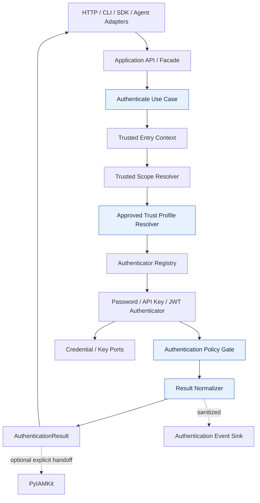
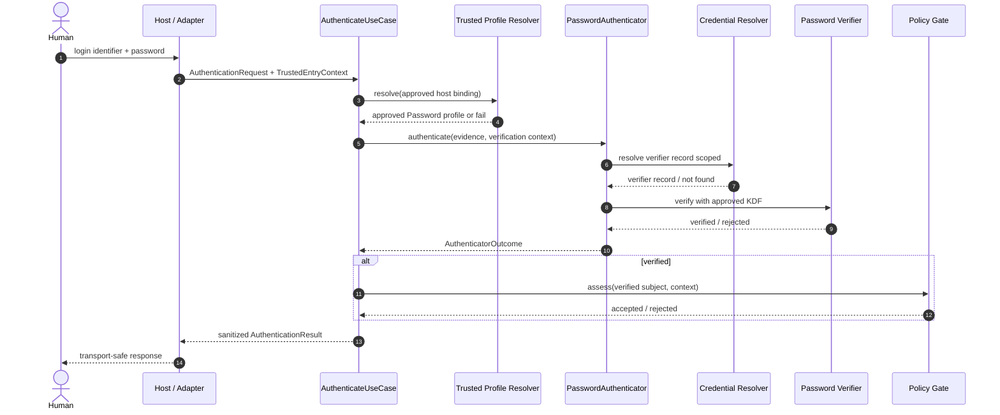
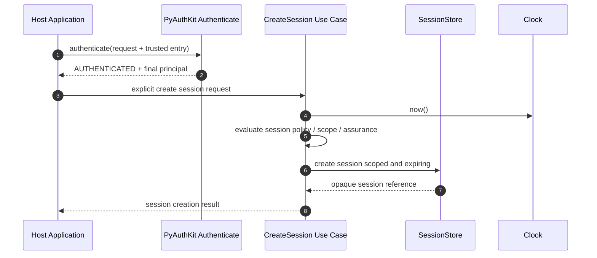
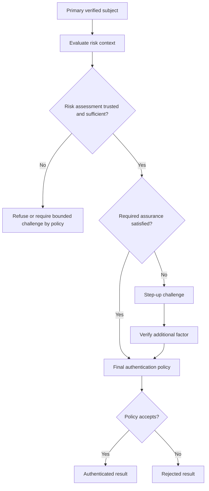

# 08_PYAUTHKIT_COMMANDS_QUERIES_AND_USE_CASES

# PyAuthKit — Commands, Queries and Use Cases

> **Document :** `08_PYAUTHKIT_COMMANDS_QUERIES_AND_USE_CASES.md`  
> **Projet :** PyAuthKit — Authentication Engine for the Modern Python Ecosystem  
> **Type :** spécification applicative et convention de conception / apprentissage  
> **Statut :** **PROPOSED / DESIGN**, non accepté comme contrat API stable  
> **Version documentaire :** 0.1.0  
> **Date de rédaction :** 2026-10-29  
> **Langue :** français, vocabulaire technique et noms de code en anglais  
> **Couverture :** application layer, commands, queries, use cases, ports, DTO, workflows, garanties et qualification  
> **Périmètre d'exécution :** MVP Password / API Key / JWT ; extensions explicitement marquées POST-MVP  
> **Prérequis :** `00` à `07` et `PYAUTHKIT_SOFTWARE_DESIGN_LEARNING_CONVENTION.md`  
> **Prochaine spécialisation :** `09_PYAUTHKIT_AUTHENTICATION_ENGINE_MODEL.md`

---

## Guide de lecture

| Objectif | Sections conseillées |
|---|---|
| Comprendre pourquoi modéliser des use cases | 0–5 |
| Identifier les commandes et requêtes | 6–10 |
| Comprendre les responsabilités et les contrats | 11–17 |
| Implémenter le MVP en sécurité | 18–23 |
| Préparer les extensions | 24–29 |
| Tester, gouverner et tracer les décisions | 30–39 |
| Réutiliser des templates | Annexes A–E |

**Important :** les classes, fonctions, paramètres et noms de ports ci-dessous sont des **propositions de modélisation**. Ils ne décrivent ni un dépôt inspecté ni un SDK déjà publié. Les diagrammes représentent des **responsabilités et flux logiques**, pas la preuve d'une implémentation. Les tests identifiés sont des **spécifications candidates**, jamais des résultats de CI.

**Convention de phase :** `MVP` = première livraison candidate ; `POST-MVP` = fonctionnalité cible différée ; `CROSS-CUTTING` = règle applicable seulement aux capacités réellement actives. Les garanties cryptographiques s'obtiennent par la vérification effective, des profils approuvés et des tests, **pas** par le nom d'une classe ou un type Python.

---

## 0. Résumé exécutif

PyAuthKit doit transformer une requête d'authentification entrante, **partiellement non fiable**, en décision de confiance explicitement située. La couche applicative orchestre les responsabilités déjà définies dans `03`–`07` : établir une frontière de confiance depuis l'hôte, sélectionner un profil approuvé, choisir un mécanisme permis, vérifier une preuve, appliquer une politique finale et exposer un résultat cohérent.

Elle n'a pas autorité pour : créer implicitement un compte IAM, attribuer des permissions, considérer un claim JWT comme une preuve, ou délivrer automatiquement une session et un token après chaque succès. L'intégration avec PyIAMKit et la décision d'autorisation restent **distinctes**.

Le parcours canonique est :

```text
UNTRUSTED INPUT                         TRUSTED APPLICATION BOUNDARY
    │                                               │
AuthenticationRequest + Evidence                     │
    │                                               ▼
    └──► Host-supplied TrustedEntryContext ──► Resolve TrustedScope
                                                     │
                                                     ▼
                                                TrustProfile
                                            approved + unambiguous
                                                     │
                                                     ▼
                                        Resolve permitted Authenticator
                                                     │
                                                     ▼
                                          Verify presented evidence
                                                     │
                               ┌─────────────────────┴────────────────────┐
                               ▼                                          ▼
                        VerifiedSubject                            Rejected / Error
                               │                                          │
                               ▼                                          │
                      AuthenticationPolicyGate                            │
                               │                                          │
                     ┌─────────┴──────────┐                               │
                     ▼                    ▼                               │
               AUTHENTICATED          REJECTED /                           │
               + final principal      CHALLENGE_REQUIRED*                 │
                     │                    │                               │
                     └────────────────────┴───────────────────────────────┘
                                          │
                                          ▼
                              Normalized AuthenticationResult
                                          │
                                          ▼
                               Redacted AuthenticationEvent

* CHALLENGE_REQUIRED : extension POST-MVP ; ne contient jamais de principal final.
```

**Trois règles cardinales :**

1. `AUTHENTICATED` n'est possible qu'après vérification effective sous un profil de confiance accepté **et** policy finale satisfaisante.
2. `REJECTED`, `ERROR` et `CHALLENGE_REQUIRED` ne portent **aucun** `AuthenticatedPrincipal` final.
3. Si la configuration, le profil ou la preuve est inconnu, ambigu, indisponible ou hors périmètre, la couche applicative **refuse un succès** (*fail-closed*).

Ce document propose un catalogue de commandes `APP-CMD-*`, de requêtes `APP-QRY-*`, de cas d'usage `APP-UC-*`, de contrats applicatifs `APP-CTR-*`, de tests `APP-TST-*` et de décisions ouvertes `APP-DEC-*`. Ces identifiants sont propres au document `08` et n'effacent jamais les registres existants `FR-*`, `DO-*`, `REL-*` et `AUTH-INV-*`.

---

## 1. Filiation, sources et règles de gouvernance

| Référence | Responsabilité canonique | Ce que `08` en dérive |
|---|---|---|
| `00_PYAUTHKIT_EXPRESSION_DU_BESOIN.md` | acteurs, portée et UC-01..11 | scénarios rédigés comme opérations applicatives |
| `01_PYAUTHKIT_REQUIREMENTS_ANALYSIS.md` | `FR-*`, `ARC-*`, `SEC-*`, `NFR-*`, `INT-*`, `ACC-*` | traçabilité et critères d'acceptation |
| `02_PYAUTHKIT_PRODUCT_VISION_AND_ARCHITECTURE_PRINCIPLES.md` | principes SOLID, DDD, hexagonal, sécurité | raisons des choix applicatifs |
| `03_PYAUTHKIT_SYSTEM_ARCHITECTURE.md` | architecture cible et `SEQ-01..03` | orchestration MVP et ports |
| `04_PYAUTHKIT_DOMAIN_OBJECTS.md` | `DO-001..048`, vocabulaire et ownership | objets utilisés par les use cases |
| `05_PYAUTHKIT_ENTITIES_AND_VALUE_OBJECTS.md` | classification DDD candidate | distinction entités/VO/DTO |
| `06_PYAUTHKIT_DOMAIN_RELATIONSHIPS_AND_ERD.md` | `REL-001..060`, `REL-INV-*` et ERD conditionnels | relations nécessaires aux workflows |
| `07_PYAUTHKIT_DOMAIN_INVARIANTS_AND_BUSINESS_RULES.md` | `AUTH-INV-001..064`, `AUTH-BR-001..048` | préconditions, postconditions et erreurs |
| `PYAUTHKIT_SOFTWARE_DESIGN_LEARNING_CONVENTION.md` | *Problem First, Trust First, Pattern Second* | fiches pédagogiques, tests, ADR |

**Priorité documentaire :** une définition de `Credential`, `TrustProfile`, `VerifiedSubject` ou d'un invariant doit rester dans le document qui en est propriétaire. `08` **orchestré** ces concepts ; il n'invente pas une seconde définition concurrente. Toute divergence doit devenir une question `APP-DEC-*` et, si durable, un `ADR-AUTH-*`.

### 1.1 Ce qui est établi vs proposé

**Établi dans les sources de conception :** séparation Authentication/IAM/AuthZ ; core framework-agnostic ; stratégies Password / API Key / JWT au MVP ; résultat normalisé ; gestion sûre des preuves ; approche fail-closed ; composition éventuelle de flows multi-facteurs en extension.

**Proposé ici :** noms des commandes et requêtes, découpage en handlers, liste des use cases, signatures de ports, choix de validations applicatives, niveaux de garantie et organisation du catalogue. **Aucune** de ces propositions ne vaut approbation d'API publique.

### 1.2 Statuts documentaires

`CONCEPTUAL → SPECIFIED → IMPLEMENTED → TESTED → QUALIFIED` décrit la progression possible d'un artefact. Dans ce fichier, les composants sont au maximum **SPECIFIED / PROPOSED** ; l'état du dépôt et les tests réels n'ont pas été audités.

---

## 2. Problème à résoudre : du mécanisme au cas d'usage

Sans couche applicative explicite, un framework risque de mélanger dans `AuthenticationEngine` : parsing HTTP, sélection de tenant, hashage Password, décodage JWT, notifications, émission de sessions, création de comptes et décisions de permissions.

Un tel objet serait difficile à qualifier. Le **besoin concret** est de donner à chaque opération un contrat clair :

- quelle intention exprime l'appelant ?
- quelles données proviennent de l'appelant et quelles valeurs sont établies par l'hôte ?
- quelles préconditions rendent l'opération admissible ?
- qui vérifie effectivement la preuve et qui prend la décision finale ?
- quels effets de bord sont autorisés, et à quel moment ?
- quelle erreur est retournée, et quelle information peut être révélée ?
- quelles traces et tests prouvent le comportement ?

La conception n'impose pas un handler par mot du vocabulaire. **KISS/YAGNI :** une méthode sur un service applicatif peut suffire pour le MVP, tant que l'intention et les invariants sont explicites.

---

## 3. Périmètre de la couche Application

| Relève de la couche Application | N'en relève pas |
|---|---|
| Coordonner un use case d'authentification | Décider de la validité cryptographique sans vérificateur |
| Recevoir et valider des DTO à une frontière précise | Faire confiance à `tenant_id`, `issuer` ou `alg` entrés par l'attaquant |
| Résoudre les profils de confiance via ports approuvés | Créer automatiquement une configuration de confiance depuis les claims |
| Résoudre un authenticator autorisé | Contenir toutes les implémentations Password/JWT/API Key |
| Appliquer les règles de décision définies par le domaine | Détenir le modèle complet de comptes, rôles et permissions IAM |
| Gérer erreurs, cancellation, time budget | Masquer une panne du store par un résultat positif |
| Émettre des événements expurgés via un port | Logger des mots de passe, API keys ou JWT bruts |
| Orchestrer éventuellement un challenge / une session | Créer une session dans chaque login sans contrat explicite |
| Exposer un résultat normalisé | Autoriser directement une ressource métier |

### 3.1 Noyau vs transports

`FastAPI`, `Django`, `Flask`, `CLI`, `SDK Python`, `Worker` et `Agent Runtime` sont des **adapters entrants**. Aucun n'a le droit de changer la sémantique du succès ou d'attribuer une nouvelle confiance par simple transformation de DTO.

### 3.2 Processus hôte vs PyAuthKit

Le **processus hôte** possède les informations hors de portée du client : routes, identifiant d'application approuvé, configuration du tenant, secrets d'infrastructure, mTLS réellement établi, allowlists et politique de déploiement. PyAuthKit reçoit ce contexte via une intégration approuvée, vérifie ses propriétés et s'interdit de le reconstituer depuis un champ arbitraire de la requête.

### 3.3 Frontière avec PyIAMKit

```text
PyAuthKit                         PyIAMKit / Authorization
---------                         ------------------------
Evidence                          Identity Registry
TrustProfile                      Account / Organization
Authentication Policy             Groups / Roles / Permissions
VerifiedSubject                   Access Policies
AuthenticatedPrincipal     ───►   Identity Resolution (explicit)
AuthenticationResult               Authorization Decision (separate)
```

Un `AuthenticatedPrincipal` authentifié ne signifie ni « compte local actif dans PyIAMKit » ni « permission accordée ». L'appelant gère explicitement l'étape IAM et la décision AuthZ lorsqu'elles sont nécessaires.

---

## 4. Langage ubiquitaire des opérations

| Terme | Sens précis | Confusion à éviter |
|---|---|---|
| **Use Case** | intention métier/applicative, résultat observable | composant technique générique |
| **Command** | demande de changement ou d'exécution d'une opération | GoF Command Pattern obligatoire |
| **Query** | demande d'information sans effet de bord métier volontaire | simple requête SQL / méthode HTTP GET |
| **Application Service** | orchestration transactionnelle et appels aux ports | Domain Service ou framework HTTP |
| **Command Handler** | point d'entrée optionnel d'une commande | nécessairement une classe par action |
| **DTO** | forme de transfert à la frontière | Entity / Value Object / preuve cryptographique |
| **AuthenticationRequest** | demande normalisée (`DO-004`) | `FastAPI.Request`, `Django.HttpRequest` |
| **PresentedEvidence** | matériau non fiable et possiblement secret | vérification déjà réussie |
| **TrustedEntryContext** | faits d'entrée établis et liés par l'hôte | contexte déclaré par le client |
| **TrustProfile** | contraintes de confiance approuvées | souhait de l'utilisateur dans un JWT |
| **AuthenticatorOutcome** | verdict spécialisé interne | résultat final publiable |
| **VerifiedSubject** | sujet situé après vérification sous profil | identité revendiquée |
| **AuthenticationResult** | décision finale normalisée | session, token ou autorisation |
| **Rejection** | preuve invalide ou policy non satisfaite | panne technique ou timeout |
| **Error** | défaillance empêchant un succès fiable | résultat d'authentification positif |
| **Challenge Required** | continuation post-MVP | authentification finale déjà réussie |

### 4.1 Deux usages du mot « Command »

Une `AuthenticateCommand` peut représenter l'intention **exécuter l'authentification**, même si aucune base de données n'est modifiée. Elle n'impose ni CQRS complet, ni message broker, ni `CommandBus`. Un **GoF Command Pattern** n'est présent que si la demande est réellement encapsulée pour décorréler son invocation, stockage ou exécution.

### 4.2 Query ≠ vérification d'authentification

`GetSessionStatus` est une Query de lecture **si elle ne renouvelle pas**, ne révoque pas et ne modifie pas la session. En revanche `ValidateSession` peut impliquer rotation, sliding expiration, last-used updates ou politique de révocation ; son contrat doit être explicite et elle ne peut pas être déclarée pure par habitude.

---

## 5. Carte des responsabilités applicatives



- Les **flèches** expriment un ordre logique, non des appels à des services déployés séparément.
- L'`EventSink` n'est pas autorisé à recevoir les preuves brutes.
- L'étape `PyIAMKit` est facultative et **après** la décision AuthN, pas à l'intérieur des authenticators.
- L'émission de session/token est volontairement absente de la chaîne MVP par défaut.

---

## 6. Taxonomie des Commands et Queries

### 6.1 Commands métier/applicatives

**COMMAND / ACTION** correspond à une intention de traitement. Sous-distinguer :

- `verification` : établir ou rejeter une preuve ;
- `lifecycle` : créer, révoquer, renouveler un état possédé ;
- `ceremony` : démarrer, continuer ou terminer un challenge/flow ;
- `configuration` : activer une policy ou config approuvée (gouvernance externe) ;
- `integration` : initier une opération vers un provider sous contrat explicitement autorisé.

**Exemple :** `Authenticate` est une action centrale, `RotateCredential` une action de lifecycle qui suppose ownership, `CompleteChallenge` une action atomique POST-MVP.

### 6.2 Queries

La Query est définie par sa **sémantique observable**, pas son nom. Elle doit documenter :

1. identité de l'appelant et autorité de lecture ;
2. portée tenant/realm ;
3. éventuel changement de statut au moment de la lecture (expiration dérivée vs persistée) ;
4. données exposées et règles de minimisation ;
5. frais de lecture, cache et cohérence ;
6. effets de bord techniques d'observabilité qui ne changent pas le métier.

### 6.3 CQRS : sélectif, pas imposé

La séparation Command/Query est utile comme vocabulaire et frontière de contrat ; une architecture CQRS avec buses distincts, deux modèles physiques ou projections répliquées n'est **pas** une exigence MVP. Toute séparation plus profonde demande une pression réelle mesurable.

---

## 7. Catalogue des Commands `APP-CMD-*`

**Statut : tous les noms sont PROPOSED.** `APP-CMD-001..004` sont les opérations MVP de traitement ; les actions de lifecycle qui supposent des enregistrements possédés par PyAuthKit sont conditionnelles. Les opérations de politiques d'accès ou de provisioning **n'appartiennent pas** au catalogue.

| ID | Command / intention | Phase | Entrée conceptuelle | Sortie / effet permis |
|---|---|---|---|---|
| `APP-CMD-001` | `Authenticate` | MVP | request + trusted entry | décision AuthN |
| `APP-CMD-002` | `AuthenticateWithPassword` | MVP (scénario) | password evidence | décision AuthN ; peut passer par 001 |
| `APP-CMD-003` | `AuthenticateWithAPIKey` | MVP (scénario) | API key evidence | décision AuthN ; peut passer par 001 |
| `APP-CMD-004` | `AuthenticateWithJWT` | MVP (scénario) | bearer JWT evidence | décision AuthN ; peut passer par 001 |
| `APP-CMD-005` | `RecordAuthenticationAttempt` | MVP interne | sanitized attempt facts | audit/telemetry selon politique |
| `APP-CMD-006` | `RegisterAuthenticator` | MVP bootstrap | approved implementation | registry figé avant trafic |
| `APP-CMD-007` | `StartAuthenticationFlow` | POST-MVP | ceremony input | flow handle |
| `APP-CMD-008` | `ContinueAuthenticationFlow` | POST-MVP | flow handle + evidence | nouvelle étape ou décision |
| `APP-CMD-009` | `CompleteAuthenticationChallenge` | POST-MVP | challenge response | consommation atomique |
| `APP-CMD-010` | `CancelAuthenticationFlow` | POST-MVP | flow reference | transition terminale |
| `APP-CMD-011` | `EnrollAuthenticationFactor` | POST-MVP | enrollment evidence | enrollment lié et vérifié |
| `APP-CMD-012` | `RemoveAuthenticationFactor` | POST-MVP | factor reference + policy | révocation du facteur |
| `APP-CMD-013` | `CreateCredential` | CONDITIONNEL | vetted credential material | nouvel enregistrement local |
| `APP-CMD-014` | `RotateCredential` | CONDITIONNEL | credential ref + proof | ancienne preuve invalidée selon contrat |
| `APP-CMD-015` | `RevokeCredential` | CONDITIONNEL | credential ref + authorized caller | état révoqué atomiquement |
| `APP-CMD-016` | `CreateAuthenticationSession` | POST-MVP | verified principal + policy | session authentifiée |
| `APP-CMD-017` | `RenewAuthenticationSession` | POST-MVP | session evidence + policy | session/handle renouvelé |
| `APP-CMD-018` | `RevokeAuthenticationSession` | POST-MVP | authenticated authorized request | session révoquée |
| `APP-CMD-019` | `RevokeAllAuthenticationSessions` | POST-MVP | principal scope + authority | sessions dans scope invalidées |
| `APP-CMD-020` | `IssueToken` | POST-MVP | approved grant and subject | token sous contrat précis |
| `APP-CMD-021` | `RotateRefreshToken` | POST-MVP | refresh grant evidence | ancienne valeur consommée |
| `APP-CMD-022` | `RevokeTokenGrant` | POST-MVP | grant reference + authority | invalidation de grant |
| `APP-CMD-023` | `InitiateFederatedAuthentication` | POST-MVP | trusted provider selection | state/nonce/redirect bound |
| `APP-CMD-024` | `CompleteFederatedAuthentication` | POST-MVP | callback/assertion evidence | subject externe vérifié |
| `APP-CMD-025` | `BeginWebAuthnAuthentication` | POST-MVP | approved relying party context | challenge borné |
| `APP-CMD-026` | `FinishWebAuthnAuthentication` | POST-MVP | signed authenticator response | preuve vérifiée puis décision |
| `APP-CMD-027` | `RequireStepUpAuthentication` | POST-MVP | current assurance + target | challenge ou policy result |
| `APP-CMD-028` | `EvaluateAdaptiveAuthentication` | POST-MVP | trusted signals and context | reject, continue, step-up |
| `APP-CMD-029` | `AuthenticateWorkload` | POST-MVP | workload binding/evidence | machine principal verified |
| `APP-CMD-030` | `ValidateDelegationEvidence` | POST-MVP | delegation claim + trusted policy | delegation evidence verdict |

**Points d'attention :**

- `APP-CMD-002..004` peuvent rester **trois exemples d'une même commande** `APP-CMD-001`. Ne pas construire trois handlers si la seule différence est un authenticator enregistré.
- `APP-CMD-005` ne doit pas être un succès requis **après coup** si une politique impose l'audit durable : choisir une sémantique d'échec explicite dans `21`.
- `APP-CMD-006` relève de la **composition root** et non d'un endpoint public libre d'enregistrer du code pendant les requêtes.
- `APP-CMD-013..015` ne sont possibles que si PyAuthKit possède les credentials concernés ; sinon l'application/provider reste propriétaire de leur lifecycle.
- `APP-CMD-020` est différent de `APP-CMD-004` : **émettre** un token n'est pas **valider** un JWT reçu.
- `APP-CMD-030` ne donne aucune permission : délégation et autorisation doivent être établies selon leurs propres contrats.

---

## 8. Catalogue des Queries `APP-QRY-*`

Toutes les requêtes sont **candidates** et leurs sorties ne contiennent aucun credential brut.

| ID | Query | Phase | Sortie sécurisée | Propriétaire / restriction |
|---|---|---|---|---|
| `APP-QRY-001` | `GetAvailableAuthenticationMethods` | MVP possible | capacités approuvées et exposables | trust scope + anti-enumeration |
| `APP-QRY-002` | `GetAuthenticationMechanismCapabilities` | MVP interne | capacités et compatibilité | configuration sûre, pas secrets |
| `APP-QRY-003` | `GetAuthenticationAttemptStatus` | MVP interne | état corrélé expurgé | pas de divulgation cross-tenant |
| `APP-QRY-004` | `GetTrustedAuthenticationProfileMetadata` | MVP administration | metadata approuvée uniquement | accès admin obligatoire |
| `APP-QRY-005` | `GetCredentialMetadata` | CONDITIONNEL | type, statut, date, référence | ownership et preuve d'autorité |
| `APP-QRY-006` | `GetCredentialRevocationStatus` | CONDITIONNEL | status borné | pas d'enumeration publique |
| `APP-QRY-007` | `GetAuthenticationFlowStatus` | POST-MVP | progression admissible | flow handle et scope liés |
| `APP-QRY-008` | `GetAuthenticationChallengeStatus` | POST-MVP | statut sans solution ni secret | anti-rejeu, lecture protégée |
| `APP-QRY-009` | `GetAuthenticationSessionMetadata` | POST-MVP | scope, assurance, expiration | autorisation d'inspection |
| `APP-QRY-010` | `GetActiveSessions` | POST-MVP | références expurgées | administration / self-service protégés |
| `APP-QRY-011` | `GetTokenGrantMetadata` | POST-MVP | statut, usage, expiration | jamais token brut |
| `APP-QRY-012` | `GetRegisteredAuthenticationFactors` | POST-MVP | facteurs sans secrets | accès légitime et anti-enumeration |
| `APP-QRY-013` | `GetProviderConfigurationMetadata` | POST-MVP admin | metadata publiques autorisées | endpoints/clés seulement si approuvés |
| `APP-QRY-014` | `GetAuthenticationAssuranceStatus` | POST-MVP | assurance contextualisée | non déduite d'un flag utilisateur |
| `APP-QRY-015` | `GetAuthenticationAuditSummary` | POST-MVP / admin | statistiques filtrées | sink/SIEM externe, minimisation |

**Recommandation de design :** `APP-QRY-001` n'est pas nécessairement anonyme ; afficher toutes les méthodes activées pour un compte inconnu pourrait faciliter l'énumération. Les capacités exposées doivent provenir du scope approuvé et d'une policy de disclosure, non du statut d'identité d'un utilisateur arbitraire.

---

## 9. Catalogue des Use Cases `APP-UC-*`

La correspondance `UC-01..11` ci-dessous réutilise les cas narratifs du document `00` ; elle n'altère pas cette numérotation.

| ID | Nom / acteur | Phase | Référence initiale | Opération principale |
|---|---|---|---|---|
| `APP-UC-001` | `AuthenticateHumanWithPassword` | MVP | `00/UC-01` | `APP-CMD-001` |
| `APP-UC-002` | `AuthenticateServiceWithAPIKey` | MVP | `00/UC-06` | `APP-CMD-001` |
| `APP-UC-003` | `AuthenticateBearerJWT` | MVP | nouveau parcours de `03/SEQ-03` | `APP-CMD-001` |
| `APP-UC-004` | `AddCustomAuthenticatorAtBootstrap` | MVP | `00/UC-11` | `APP-CMD-006` |
| `APP-UC-005` | `AuthenticateWithPasswordAndMFA` | POST-MVP | `00/UC-02` | flow/challenge |
| `APP-UC-006` | `AuthenticateViaSocialOIDC` | POST-MVP | `00/UC-03` | fédération |
| `APP-UC-007` | `AuthenticateViaEnterpriseSSO` | POST-MVP | `00/UC-04` | OIDC/SAML |
| `APP-UC-008` | `AuthenticateWithPasskey` | POST-MVP | `00/UC-05` | WebAuthn |
| `APP-UC-009` | `AuthenticateMachineClientCredentials` | POST-MVP | `00/UC-07` | M2M OAuth2 |
| `APP-UC-010` | `AuthenticateMutualTLSService` | POST-MVP | `00/UC-08` | mTLS peer evidence |
| `APP-UC-011` | `AuthenticateAgentOrWorkload` | POST-MVP élargi | `00/UC-09` | machine/delegation |
| `APP-UC-012` | `StepUpForSensitiveOperation` | POST-MVP | `00/UC-10` | assurance/flow |
| `APP-UC-013` | `RevokeCompromisedCredential` | CONDITIONAL | `00/§17` | revoke |
| `APP-UC-014` | `CreateAndRevokeAuthenticationSession` | POST-MVP | `00/§15` | session lifecycle |
| `APP-UC-015` | `RotateRefreshTokenSafely` | POST-MVP | `00/§16` | rotate/token grant |
| `APP-UC-016` | `RejectAmbiguousOrUnknownTrust` | MVP CROSS-CUTTING | `03`, `07` | refusal without fallback |
| `APP-UC-017` | `AuditAuthenticationWithoutLeakingSecrets` | MVP CROSS-CUTTING | `00/§27` | event sink |
| `APP-UC-018` | `ConsumeOneTimeChallengeAtomically` | POST-MVP | `06`, `07` | challenge lifecycle |
| `APP-UC-019` | `AuthenticateWithinTrustedTenantScope` | MVP CROSS-CUTTING | `00/§28`, `07` | trusted scope resolution |
| `APP-UC-020` | `HandoffVerifiedPrincipalToIAM` | OPTIONAL integration | `00/§30` | explicit PyIAMKit handoff |

### 9.1 Gestion des acteurs et variations

Un même parcours peut servir `HUMAN`, `SERVICE`, `APPLICATION`, `AGENT`, `WORKLOAD` ou `DEVICE`. La **catégorie de principal** ne détermine pas à elle seule un protocole ni une autorisation : un service peut utiliser un JWT, un humain une passkey et un agent un credential délégué sous politiques différentes.

### 9.2 Qu'est-ce qu'un use case « réalisé » ?

Un `APP-UC-*` ne devient `IMPLEMENTED` qu'après identification d'un chemin de code réel ; `TESTED` exige une suite exécutée et identifiée ; `QUALIFIED` exige critères, environnement et preuves de qualification. Aucune de ces conditions n'est satisfaite par la rédaction du présent document.

---

## 10. Mapping Command → Use Case → Domain / Ports

| Use case | Command | Domain / policy | Ports principaux | Résultat |
|---|---|---|---|---|
| Password | `Authenticate` | `TrustProfile`, Password policy | registry, credential lookup, password verifier | normalized decision |
| API Key | `Authenticate` | scope, key validity | key lookup, secure verifier | normalized decision |
| JWT | `Authenticate` | issuer/audience/alg/time policy | approved key resolver, JWT verifier, clock | normalized decision |
| Custom authenticator | `RegisterAuthenticator` (bootstrap) | capability and registration rules | plugin registry / configuration | configuration figée |
| MFA | `ContinueAuthenticationFlow` | factor/policy/assurance | challenge store, factor verifier | continuation or success |
| OIDC | `CompleteFederatedAuthentication` | federation trust | provider adapter, nonce/state store | verified external subject |
| Session | `CreateAuthenticationSession` | session lifecycle | session store, clock | session reference |
| Delegation | `ValidateDelegationEvidence` | grant/scope validity | trust resolver, verifier | explicit delegation evidence verdict |

**Précision :** un port externe ne peut pas déclarer à lui seul `AuthenticationResult.authenticated=True` ; il fournit des faits spécialisés qui doivent être validés et intégrés par les règles centrales.

---

## 11. Frontières de la couche Application et architecture hexagonale

```text
DRIVING SIDE                                              CORE
------------                                              ----
HTTP Router / CLI / SDK                                    Application Facade
  └── request mapping ────────────────────────────────────► Authenticate Use Case
                                                            │
                                                            ▼
                                                        Domain Policies
                                                            │
                                                            ▼
                                                      Ports (inward-owned)
                                                            │
                                                            ▼
DRIVEN SIDE                                             Adapters
------------                                             --------
Credential DB / Password KDF / JWT verifier / JWKS / Clock / Event Sink
```

**Dependency Rule :** les `domain` models ne doivent importer ni FastAPI/Django, ni SDK Google/Auth0, ni SQLAlchemy/Redis, ni un client de SIEM. Les adapters dépendent des contrats internes, pas l'inverse. Une interface ne crée pas automatiquement une bonne architecture : elle doit protéger une **variation ou frontière réelle**.

### 11.1 Rôles des composants candidats

| Composant | Layer | Responsabilité | Non-responsabilité |
|---|---|---|---|
| `AuthenticationEngine` | public facade / app | point d'entrée stable | crypto métier détaillée |
| `AuthenticateUseCase` | application | ordonner les étapes et leurs échecs | IAM / AuthZ |
| `TrustedScopeResolver` | app/domain + port | déduire le scope depuis contexte hôte | prendre la valeur du client comme autorité |
| `TrustProfileResolver` | app + config port | sélectionner un profil approuvé | télécharger n'importe quelle clé fournie par token |
| `AuthenticatorRegistry` | app/bootstrap | fournir mécanisme permis | autoriser un provider absent |
| `Authenticator` | domain port/strategy | verifier specific evidence | publier principal final sans gate |
| `AuthenticationPolicyGate` | domain/app boundary | évaluer conditions finales | octroyer permissions de ressources |
| `ResultNormalizer` | application | préserver l'invariant du résultat | émettre secret ou stack trace |
| `AuthenticationEventMapper` | application | minimiser l'événement | journaliser evidence raw |
| `AuthenticationEventSink` | outbound port | transporter un événement sûr | définir la vérité AuthN |

---

## 12. DTO, objets du domaine et frontières de sérialisation

### 12.1 Contrat d'entrée conceptuel

Un adapter entrant traduit sa requête native en **deux familles d'objets distinctes** :

1. `AuthenticationRequest` / `PresentedEvidence` / `ClaimedIdentity` — **non approuvés** ;
2. `TrustedEntryContext` — **établi par l'hôte** depuis des liaisons serveur configurées et contrôlées.

**Jamais** `TrustedEntryContext(**request.json())`. Même une `dataclass(frozen=True)` ne prouve pas l'origine des données.

### 12.2 Contrat de sortie conceptuel

```text
AuthenticationResult (discriminated)
  ├── AUTHENTICATED:
  │     authenticated_principal: exactly one
  │     proof provenance: approved and scoped
  │     status: authenticated
  │
  ├── REJECTED:
  │     authenticated_principal: none
  │     public reason: limited
  │
  ├── ERROR:
  │     authenticated_principal: none
  │     correlation reference: optionally exposed
  │
  └── CHALLENGE_REQUIRED:  [POST-MVP]
        authenticated_principal: none
        continuation handle: scoped, opaque, expiring
```

Les champs exacts du résultat sont à stabiliser dans `09` et `24`, notamment le choix `ERROR` result vs typed exception (`03/DEC-06`). Les principes d'invariants de `07` restent obligatoires dans tous les cas.

### 12.3 Exclusions catégoriques de toute sortie publique

- password, API key brute, JWT brut, bearer secret ;
- `Authorization` header et `Cookie` raw ;
- secret TOTP, OTP non consommé, verifier secret, private key ;
- key material, secret provider, connection string ;
- claims complets non approuvés ou informations d'infrastructure internes ;
- `vars(evidence)`, `asdict(evidence)`, exception `repr()` non contrôlée.

### 12.4 Séparer validation structurelle et validation de preuve

Un DTO peut vérifier qu'une valeur a le bon **type** et une longueur admissible. Il ne peut pas authentifier une identité. `JWT` correctement formé n'est pas `JWT` de confiance ; `Password` non vide n'est pas `Password` valide ; `APIKey` avec un préfixe connu n'est pas une clé autorisée.

---

## 13. Contrats applicatifs `APP-CTR-*`

| ID | Contrat | Précondition | Garantie / refus |
|---|---|---|---|
| `APP-CTR-001` | Entrée trusted | contexte établi côté hôte | absence → aucun succès |
| `APP-CTR-002` | Scope unique | rattachement à un scope unique et admis | ambiguïté → refus |
| `APP-CTR-003` | Trust profile | profil actif et approuvé pour scope/mécanisme | pas de fallback non approuvé |
| `APP-CTR-004` | Méthode permise | authenticator déclaré et activé | méthode inconnue/refusée → pas de vérification permissive |
| `APP-CTR-005` | Evidence boundary | evidence non fiable et confidentielle | aucune élévation de confiance par casting |
| `APP-CTR-006` | Vérification | verdict produit par port authenticator sûr | fail/error → pas de principal |
| `APP-CTR-007` | Policy gate | règles finales satisfaites | sinon reject/challenge sous contrat |
| `APP-CTR-008` | Result shape | `AUTHENTICATED ⇒ final principal` | tous autres états sans final principal |
| `APP-CTR-009` | Scope binding | vérification et subject sous scope actif | cross-scope → rejet |
| `APP-CTR-010` | Time | instant fiable de l'horloge / tolérance configurée | expiration → rejet |
| `APP-CTR-011` | Event privacy | schema expurgé minimal | aucun secret en sink/log |
| `APP-CTR-012` | No IAM side effect | AuthN ne crée pas de compte ni permission | handoff explicite uniquement |
| `APP-CTR-013` | Deadline/cancel | budget d'exécution borné | timeout ne produit pas succès |
| `APP-CTR-014` | No implicit token | émission séparée et policy explicite | pas de token par défaut |
| `APP-CTR-015` | Read isolation | query bornée et autorisée | pas d'enumeration / cross-tenant |
| `APP-CTR-016` | Replay protection | one-time step consommé atomiquement | second usage rejeté (POST-MVP) |
| `APP-CTR-017` | Session authority | session créé uniquement après succès final | challenge ≠ session authentifiée (POST-MVP) |
| `APP-CTR-018` | Delegation isolation | preuve AuthN ≠ mandat délégué | aucun accès induit (POST-MVP) |

### 13.1 Quand un port échoue

Une exception technique n'est pas nécessairement une **preuve incorrecte**. Le service applicatif doit distinguer : `invalid evidence`, `policy rejected`, `configuration missing`, `provider unavailable`, `timeout`, `cancelled`. Le contrat public pourra regrouper certaines causes par sécurité, tout en conservant le diagnostic interne expurgé approprié.

---

## 14. Opérations applicatives : validations et effets de bord

| Étape | Responsable proposé | Lecture | Écriture potentielle | Point de sûreté |
|---|---|---|---|---|
| Parse / map transport | driving adapter | request native | aucune | taille/format bornés |
| Establish trusted context | trusted host adapter | route/app binding | aucune | non contrôlé par requester |
| Resolve scope | application | trusted config | aucune | unique/valid |
| Resolve trust profile | application + resolver | config/key policy | aucune | approved only |
| Resolve authenticator | registry | frozen registration | aucune | method allowed |
| Verify proof | authenticator port | verifier records/keys | aucune par défaut | crypto & claims |
| Evaluate policies | domain policy | verified facts + context | aucune par défaut | final gate |
| Normalize result | application | outcome + policy decision | aucune | status discriminated |
| Audit | event publisher | sanitized facts | event sink | privacy, delivery contract |
| Create session | explicit POST-MVP use case | final principal | session store | never implied |

**Effets de bord utiles mais distincts :** compteurs anti-bruteforce, journalisation de tentative et gestion d'usage d'une API key peuvent nécessiter des écritures. Ces écritures exigent un ownership, une politique de concurrence, des règles de panne et des tests précis ; elles ne doivent pas être glissées clandestinement dans une Query dite pure.

---

## 15. Résultats, erreurs et sémantique de défaillance

### 15.1 Grille des décisions

| Condition | Décision conceptuelle | Information publique | Effet latéral permis |
|---|---|---|---|
| preuve vérifiée + scope/policy corrects | `AUTHENTICATED` | principal minimal / provenance | audit ; session séparée |
| mauvais password, API key révoquée | `REJECTED` | diagnostic limité | compteur, audit |
| signature JWT invalide | `REJECTED` | diagnostic limité | audit |
| issuer ou audience non approuvés | `REJECTED` | diagnostic limité | audit |
| scope / profil manquant ou ambigu | `ERROR` / refus sûr | cause non sensible | audit erreur |
| secret store ou key resolver en panne | `ERROR` / refus sûr | indisponibilité générique | audit si possible |
| authenticator absent ou désactivé | `REJECTED` / config error | méthode indisponible | aucun succès |
| MFA supplémentaire nécessaire | `CHALLENGE_REQUIRED` (POST-MVP) | handle opaque | flow challenge seulement |
| timeout / cancellation | erreur/cancel sans succès | erreur bornée | cleanup et audit selon contrat |

Le **statut exact** (`REJECTED` vs `ERROR`) est un arbitrage d'API ; l'invariant fondamental est **aucun principal final lors d'un non-succès**. Les adaptateurs HTTP ne doivent pas exposer des différences trop fines permettant l'énumération de comptes.

### 15.2 Erreurs internes candidates

```text
InvalidEvidence
UntrustedEntryContext
UnknownTrustedScope
AmbiguousTrustProfile
AuthenticationMethodNotPermitted
CredentialNotFoundOrInvalid
CredentialRevoked
TokenVerificationFailed
TokenExpired
PolicyRejected
ProviderUnavailable
AuthenticationDeadlineExceeded
AuthenticationCancelled
ChallengeExpired / ChallengeAlreadyConsumed  [POST-MVP]
SessionRevoked / SessionExpired             [POST-MVP]
```

Ces noms servent à la **catégorisation** ; aucun n'est une classe publique garantie. Le mapping vers HTTP, gRPC, CLI codes ou exceptions est la responsabilité des adapters et du futur document `24`.

---

## 16. Horloge, concurrence, cancellation et idempotence

- **Clock injecté** : nécessaire pour claims JWT, credential lifecycle, expiration/challenge et tests temporels ; pas de `datetime.now()` dispersé entre domaine, app et adapters.
- **Une tentative par invocation** : `attempt_id` sert à la corrélation, pas automatiquement de clé idempotente.
- **Timeout** : chaque adaptateur réseau ou store doit respecter un budget ; toute réponse arrivée après annulation doit éviter un succès publié hors contrat.
- **Cancellation** : les ressources sont libérées sans transformation en succès ni restitution d'une preuve cachée ; cleanup sûr.
- **Retry** : relancer une vérification Password/JWT ne doit pas contourner les contrôles anti-bruteforce, les refus, les expirations ou les politiques de délai.
- **Atomicité conditionnelle** : pour un challenge one-time, la transition `UNUSED → CONSUMED` doit être atomique sous la concurrence et intégrée au succès définitif selon la spec.
- **Version pinning** : une vérification doit opérer sur une configuration de confiance cohérente, pas alterner entre plusieurs versions au cours du même verdict.

`At-most-once`, `exactly-once` ou `linearizable` ne doivent être annoncés que si les stores et tests le prouvent. Dans le MVP sans challenges persistés, éviter d'introduire un gestionnaire transactionnel généraliste.

---

## 17. Principe de composition et contrôle des dépendances

Le module `application` coordonne des **ports étroits**. La composition root fournit leurs implémentations approuvées. Les exemples ci-dessous sont des **rôles**, non des exigences de créer systématiquement une classe distincte.

```text
AuthenticateUseCase
├── TrustedScopeResolver
├── TrustProfileResolver
├── AuthenticatorRegistry
├── AuthenticationPolicyGate
├── ResultNormalizer
├── Clock
└── AuthenticationEventSink

PasswordAuthenticator
├── CredentialResolver
└── PasswordVerifier

APIKeyAuthenticator
├── APIKeyRecordResolver
└── SecureAPIKeyVerifier

JWTAuthenticator
├── ApprovedVerificationKeyResolver
├── CryptographicJWTVerifier
└── Clock / TrustProfile
```

**Inversion des dépendances :** le port est défini près du consommateur qui possède le contrat. Ne pas imposer à un `CredentialStore` un gigantesque contrat CRUD pour répondre au seul besoin `resolve_for_verification(...)`.

---

## 18. Use Case MVP `APP-UC-001` — Password Authentication

### 18.1 Situation et intention

Un utilisateur humain présente un identifiant et un mot de passe à une application hôte. La demande est **non fiable** ; l'application rattache l'appel à un `TrustedEntryContext` puis PyAuthKit effectue une vérification selon un profil approuvé. Aucun compte local ne doit être créé par PyAuthKit durant l'opération.

**Acteurs :** utilisateur humain, application, `PasswordAuthenticator`, credential resolver, verifier sécurisé, event sink.

**Préconditions :**

1. tenant/realm et application hôte liés par une configuration digne de confiance ;
2. profil Password approuvé, activé et compatible avec la route ;
3. identifiant revendiqué traité comme non vérifié ;
4. limites de taille, rate-limit et politique anti-bruteforce opérationnelles selon environnement ;
5. port de credential lookup et vérification Password configuré.

### 18.2 Scénario nominal

| Étape | Opération | Garantie associée |
|---|---|---|
| 1 | l'adapter construit `AuthenticationRequest` | ne donne pas de trust à l'entrée |
| 2 | l'hôte injecte `TrustedEntryContext` | contexte distinct du payload utilisateur |
| 3 | le use case résout `TrustedScope` et `TrustProfile` | unique, approuvé, actuel |
| 4 | le registry résout le Password authenticator | mécanisme admis pour scope |
| 5 | le resolver recherche le verifier record | pas d'exposition du hash au client |
| 6 | le verifier évalue le mot de passe | KDF approuvé, comparaison sûre, politique de coût |
| 7 | l'authenticator publie un verdict spécialisé | `VerifiedSubject` seulement si preuve vérifiée |
| 8 | la policy finale vérifie le contexte | aucun droit IAM attribué |
| 9 | `ResultNormalizer` publie résultat cohérent | principal final si et seulement si succès |
| 10 | l'event mapper prépare un événement minimal | aucune evidence ni secret exposé |

**Postcondition nominale :** un seul `AuthenticatedPrincipal` situé dans le bon scope et lié à la preuve vérifiée. **Aucune** session ni token n'est émis automatiquement.

### 18.3 Alternatives et erreurs

| Scénario | Comportement obligatoire |
|---|---|
| mot de passe invalide | pas de succès ; message public anti-énumération |
| identité inconnue | pas de succès ; ne pas dévoiler l'existence du compte |
| credential désactivé/révoqué/expiré | pas de succès |
| méthode Password désactivée pour scope | pas de downgrade vers un autre mécanisme |
| store indisponible | erreur sûre, pas de connexion par défaut |
| scope incohérent | aucun accès à un credential d'autre tenant |
| verifier mal configuré | erreur configuration, pas de fallback vers hash faible |
| coût KDF abusif / requête volumineuse | limites de ressources et refus contrôlé |

### 18.4 Séquence candidate



### 18.5 Tests candidats

- `APP-TST-001` : credential valide + trusted profile → succès situé et unique.
- `APP-TST-002` : credential invalide → aucun principal final.
- `APP-TST-003` : identifiant inconnu vs mauvais secret → réponse publique non révélatrice selon policy.
- `APP-TST-004` : scope différent → record d'autre tenant inaccessible.
- `APP-TST-005` : store/KDF échoue → erreur sûre, jamais authentification.
- `APP-TST-006` : rotation/révocation (si possédées) interdit l'ancien credential.

**Conception :** Strategy via `Authenticator` **si** le même consommateur accepte plusieurs implémentations ; Adapter via credential store ; DIP via `PasswordVerifier`. Le vérificateur KDF doit utiliser une bibliothèque éprouvée, pas une implémentation cryptographique pédagogique.

---

## 19. Use Case MVP `APP-UC-002` — API Key Authentication

### 19.1 Situation

Un service ou client applicatif présente une API key pour être authentifié en machine-to-machine. La présence de la clé ou sa forme syntaxique ne prouve ni sa validité ni des permissions.

### 19.2 Scénario nominal

1. Le transport extrait la clé et produit une `APIKeyEvidence` sensible.
2. L'hôte établit l'application, le tenant, le realm et le public admissible.
3. Le use case sélectionne un profil API key approuvé et le mécanisme permis.
4. L'authenticator extrait au plus un identifiant/hint non secret, **sans en faire une preuve**.
5. Le lookup trouve le record dans le scope approuvé.
6. Le verifier compare le matériau de façon sûre selon le contrat (hash / HMAC / autre schéma accepté).
7. Expiration, révocation, statut, portée et éventuelles restrictions sont évalués.
8. Le subject authentifié est lié au scope et au credential effectivement vérifié.
9. La policy finale statue ; le résultat et l'événement sont normalisés.

### 19.3 Contraintes spécifiques

| Risque | Réponse applicative |
|---|---|
| leak via logs ou exception | secret redaction à toute frontière |
| API key d'un autre tenant | lookup scoped et policy restrictive |
| clé révoquée | refus même si matériau cryptographique correspond |
| préfixe connu, secret invalide | refus ; hint non équivalent à preuve |
| brute-force / key enumeration | quotas, format borné, messages limités |
| clé large avec scopes trop permissifs | les scopes éventuels ne valent pas une autorisation IAM |
| rotation simultanée | contrat versionné et cohérence de store |
| cache obsolète | règles d'expiration et révocation qualifiées |

### 19.4 Tests candidats

- `APP-TST-007` : clé valide et active → authenticated machine principal sous scope.
- `APP-TST-008` : clé inconnue, expirée ou révoquée → aucun succès.
- `APP-TST-009` : même hint mais mauvaise clé → refus.
- `APP-TST-010` : collision cross-tenant → aucun lookup non scellé au scope.
- `APP-TST-011` : logs/events/trace ne contiennent aucun secret ni fragment reconstructible.
- `APP-TST-012` : le token/API key n'est pas automatiquement converti en permission de ressource.

**Design Learning Note :** un `APIKeyRecordResolver` n'est pas un Repository DDD complet s'il ne fait qu'un lookup minimal. Le vocabulaire naturel prime sur le nom « Repository Pattern ».

---

## 20. Use Case MVP `APP-UC-003` — JWT Bearer Verification

### 20.1 Point de départ

Un service reçoit un JWT bearer. **La lecture du header et des claims est une inspection de données contrôlées par le demandeur, jamais une preuve.** Le profil de confiance doit être sélectionné indépendamment du contenu non vérifié ; les valeurs du JWT peuvent uniquement servir à rechercher parmi des configurations déjà bornées et autorisées.

### 20.2 Parcours d'application

```text
HTTP / RPC bearer token
          │
          ▼
AuthenticationRequest + TrustedEntryContext
          │
          ▼
Approved scope / trust profile for this host endpoint
          │
          ▼
JWT Authenticator selected from permitted registry
          │
          ▼
Bounded parse (untrusted header / claims are only hints)
          │
          ▼
Approved issuer / audience / algorithm and key family
          │
          ▼
Verification keys FROM approved resolver only
          │
          ▼
Cryptographic signature verification
          │
          ▼
Temporal and required claim validation
          │
          ▼
Scoped VerifiedSubject
          │
          ▼
AuthenticationPolicyGate
          │
          ▼
AuthenticationResult, sanitized event
```

### 20.3 Restrictions incontournables

- refuser un algorithme non approuvé, absent ou incohérent avec la famille de clés ;
- ne pas accepter une validation « signature optionnelle » ;
- ne pas télécharger aveuglément des clés depuis `jku`, `x5u` ou URL contrôlée par le token ;
- contrôler `iss`, `aud`, `exp`, `nbf` et autres claims **selon le profil** et la sémantique du token ;
- ne pas convertir `sub` non vérifié en `VerifiedSubject` ;
- ne pas attribuer automatiquement une permission à partir de `scope`, `roles`, `groups` sans contrat AuthZ explicite ;
- définir rotation, cache, résolution `kid`, collisions et clés absentes dans une policy approuvée ;
- borner taille, parsing et temps d'exécution ;
- tenir compte du format et du type du token (un ID Token n'est pas universellement un access token valide pour une API).

### 20.4 Échecs à qualifier

| Erreur | Verdict attendu |
|---|---|
| signature modifiée | reject |
| `alg` non approuvé | reject |
| `kid` inconnu | reject/error sûr, pas de fallback |
| `jku` vers hôte tiers | ne pas appeler ce réseau à partir du token |
| mauvais `iss` | reject |
| mauvaise `aud` | reject |
| expiré / pas encore valable | reject selon clock skew explicitement borné |
| profile impossible à résoudre | error/refusal, jamais accepter issuer du JWT |
| key resolver indisponible | error/refusal, jamais skip signature |
| conflit entre scopes | reject/refusal |

### 20.5 Tests candidats

- `APP-TST-013` : JWT signé avec clé approuvée, claims attendus → subject vérifié.
- `APP-TST-014` : JWT avec claims corrects mais signature invalide → refus.
- `APP-TST-015` : algorithme/key type non admis → refus.
- `APP-TST-016` : issuer/audience erronés → refus.
- `APP-TST-017` : token expiré et token `nbf` futur → refus avec clock contrôlée.
- `APP-TST-018` : `kid` non approuvé et header URL → pas de récupération de clé arbitraire.
- `APP-TST-019` : panne key resolver → erreur, pas de succès.
- `APP-TST-020` : substitution cross-tenant/provider → aucun subject du mauvais scope.

**Trace normative :** `07` donne les règles candidates. La configuration cryptographique et les profils JWT seront détaillés dans `10`, `20` et `25`. Aucun extrait de code dans ce document n'est un vérificateur JWT de production.

---

## 21. Use Case MVP `APP-UC-004` — Authenticator extensible au bootstrap

### 21.1 Problème

Une application souhaite ajouter un mécanisme compatible sans éditer une cascade `if/elif provider` dans le cœur. La variabilité réelle concerne l'implémentation de la vérification, mais les **règles de confiance** et la **décision finale** restent contrôlées par le core.

### 21.2 Contrat de registration candidat

1. Le développeur implémente un port `Authenticator` (ou callable typé, arbitrage à venir).
2. L'application compile ou charge l'implémentation depuis une source approuvée.
3. La composition root valide ses capabilities et sa configuration.
4. Le registry établit l'unicité des mécanismes et règles de priorité.
5. Le registry est figé avant de traiter les demandes.
6. Le use case n'autorise que les mécanismes déclarés dans le profil du scope.
7. Les contract tests doivent passer pour l'implémentation branchée.

### 21.3 Conditions de sécurité

Un plugin peut exécuter du code arbitraire dans le processus de l'hôte. **Le Registry ne fournit pas de sandbox**. Signature, distribution, provenance, supply chain, permissions d'exécution, déploiement et validation appartiennent à la politique de sécurité de l'application et aux futures specs `18`, `20`, `26`.

### 21.4 Tests candidats

- `APP-TST-021` : un authenticator remplaçable satisfait le port sans changer le core.
- `APP-TST-022` : mécanisme inconnu ou désactivé refuse proprement.
- `APP-TST-023` : doublon de registration ne produit pas de sélection ambiguë.
- `APP-TST-024` : registration impossible après gel du registry selon contrat.
- `APP-TST-025` : verdict interne d'un plugin ne contourne pas `AuthenticationPolicyGate` ni `ResultNormalizer`.

**Patterns :** Strategy, Registry/Factory et Adapter sont **des classifications à prouver**, non des obligations de créer trois couches abstraites si une collection immuable de fonctions typées suffit.

---

## 22. Use Cases CROSS-CUTTING — Scope, trust, erreurs et audit

### 22.1 `APP-UC-016` : refuser une confiance inconnue ou ambiguë

**Given** une requête structurellement valide ; **when** aucun profil approuvé ne correspond, ou plusieurs profils également admissibles sont trouvés ; **then** le moteur refuse un succès, n'infère pas un issuer depuis le token et produit un diagnostic interne minimal.

Exigence pédagogique : un resolver doit rendre explicites `RESOLVED`, `MISSING`, `AMBIGUOUS`, `DISABLED`, `OUT_OF_SCOPE` selon son contrat ; un `first()` ou `latest()` silencieux ne constitue pas une politique de confiance.

### 22.2 `APP-UC-017` : auditer sans exposer de secret

Événement potentiel :

```text
AuthenticationSucceeded / AuthenticationRejected / AuthenticationErrored
  - event_id
  - occurred_at
  - attempt_id
  - method_family
  - outcome_class
  - trusted_scope_ref (if permitted)
  - pseudonymized_subject_ref (if permitted)
  - coarse reason_code
  - verifier version / profile ref (safe representation)
```

**Exclure :** mot de passe, hash complet, token JWT, clés, OTP, cookies, headers sensibles, claims non nécessaires, stack traces et éventuels identifiants PII non minimisés.

La politique en cas de panne de l'audit sink n'est pas uniforme : une exigence réglementaire peut rendre certains événements obligatoires pour poursuivre, mais ce compromis doit être défini dans `21` plutôt qu'inventé dans l'authenticator.

### 22.3 `APP-UC-019` : authentifier dans un tenant approuvé

Le tenant sélectionné est un fait **lié par le processus hôte**. Le `tenant_id` figurant dans un objet fourni par le client est une revendication à contrôler, pas une autorité pour changer de partition. Tous les lookup credentials/keys et décisions de policy doivent être contraints au même contexte de confiance.

### 22.4 `APP-UC-020` : handoff facultatif vers PyIAMKit

```text
AuthenticationResult.AUTHENTICATED
                 │
                 ▼
       AuthenticatedPrincipal
                 │    explicit handoff
                 ▼
            PyIAMKit
   identity/account/group resolution
                 │
                 ▼
      Authorization Decision
                 │
                 ▼
          Protected Resource
```

Le contrat exact de résolution sera spécifié dans `23`. Un principal externe vérifié peut ne pas disposer d'un compte local ; il ne doit pas être automatiquement provisionné ni auto-lié à un compte homonyme.

---

## 23. API applicative et interfaces Python : illustration non exécutable

**ATTENTION :** les fragments ci-dessous montrent la **structure des responsabilités**, pas une implémentation sécurisée. Un type `TrustedEntryContext` construit par n'importe quel appelant n'est pas un justificatif ; une liaison d'hôte et une configuration réellement approuvées restent nécessaires. Les types entre guillemets sont des placeholders.

```python
# PSEUDOCODE / SKETCH — NOT A PRODUCTION AUTHENTICATION LIBRARY.
from dataclasses import dataclass, field
from typing import Protocol

@dataclass(frozen=True, repr=False)
class AuthenticateCommand:
    request: "AuthenticationRequest"          # UNTRUSTED
    trusted_entry: "TrustedEntryContext"      # host-established ONLY
    correlation_id: str

    # Do not auto-generate repr or log command objects containing evidence.

class TrustProfileResolver(Protocol):
    async def resolve(
        self,
        trusted_entry: "TrustedEntryContext",
        request: "AuthenticationRequest",
    ) -> "TrustResolution": ...

class Authenticator(Protocol):
    async def authenticate(
        self,
        evidence: "PresentedEvidence",
        context: "VerificationContext",
    ) -> "AuthenticatorOutcome": ...

class AuthenticationPolicyGate(Protocol):
    def decide(
        self,
        verified: "VerifiedSubject",
        context: "AuthenticationContext",
        profile: "TrustProfile",
    ) -> "PolicyDecision": ...

class AuthenticateUseCase(Protocol):
    async def execute(self, command: AuthenticateCommand) -> "AuthenticationResult": ...
```

### 23.1 Une façade unique, sans command bus obligatoire

```python
# PSEUDOCODE. The engine is composed with approved, tested dependencies.
result = await engine.authenticate(
    request=request,                    # untrusted evidence
    trusted_entry=host_trusted_context, # host-created, not a user JSON field
)

if result.status == "AUTHENTICATED":
    # AuthN result only; separate IAM/AuthZ checks before protected operations.
    principal = result.authenticated_principal
else:
    # Never interpret result.claimed_identity as a proven identity.
    ...
```

La forme du paramètre `trusted_entry` est **candidate** ; un adapter d'intégration peut le fournir par injection ou closure sécurisée. L'exemple ne doit pas faire croire que cette référence est infalsifiable par nature.

### 23.2 Séparer `Command` de la stratégie

Une `AuthenticateCommand` décrit **quoi faire**, tandis que `PasswordAuthenticator` ou `JWTAuthenticator` décrivent **comment vérifier une preuve particulière**. La première ne choisit ni la clé publique du JWT ni le hash algorithm à partir d'une chaîne utilisateur non approuvée.

### 23.3 Forme du résultat discriminé

```python
# CONCEPTUAL TYPE SHAPES — not importable SDK types.
from dataclasses import dataclass
from typing import Literal

@dataclass(frozen=True)
class Authenticated:
    status: Literal["AUTHENTICATED"]
    principal: "AuthenticatedPrincipal"

@dataclass(frozen=True)
class Rejected:
    status: Literal["REJECTED"]
    reason_code: str

@dataclass(frozen=True)
class AuthError:
    status: Literal["ERROR"]
    correlation_id: str

# Future: ChallengeRequired(status="CHALLENGE_REQUIRED", continuation=...)
# The public result must never permit a success-shaped principal on rejection.
```

Le `PolicyDecision` du domaine peut posséder une représentation différente du `AuthenticationResult` public. L'`Application Service` est l'endroit où la traduction contrôlée a lieu.

---

## 24. Extension POST-MVP — MFA, challenge et assurance

### 24.1 Intention et limites

Un premier facteur valide n'est pas un succès final si la policy exige un facteur supplémentaire. Le résultat devient `CHALLENGE_REQUIRED` avec un handle de continuation borné, **jamais** un `AuthenticatedPrincipal` publié prématurément.

### 24.2 Commandes et étapes

```text
StartAuthenticationFlow
        │
        ▼
VerifyPrimaryFactor
        │
        ▼
EvaluateFactor / Assurance Policy
        │
        ├── insufficient ──► CreateChallenge
        │                            │
        │                            ▼
        │                     ChallengeRequired
        │                            │
        │                   CompleteChallenge (later)
        │                            │
        │                   Atomic Consume + Verify
        │                            │
        │                            ▼
        │                  Re-evaluate Final Policy
        │                            │
        └────────────────────────────┴──► Final Decision
```

### 24.3 Préconditions et invariants

- le challenge est lié au flow, au scope, au sujet/provisional proof et au but autorisé ;
- handle opaque, deadline et nombre de tentatives définis ;
- réponse non consommable deux fois même avec deux workers ;
- un facteur n'est compté que si son assurance est établie selon une méthode vérifiable ;
- ne pas assimiler `number_of_factors == 2` à un AAL NIST garanti ;
- `CHALLENGE_REQUIRED` ne porte aucun principal final ;
- interruption de flow ne renouvelle pas une authentification antérieure par accident.

### 24.4 Tests candidats

- `APP-TST-026` : premier facteur validé + MFA exigé → challenge sans principal final.
- `APP-TST-027` : challenge correct et consommé atomiquement → succès sous politique admissible.
- `APP-TST-028` : replay, expiry, wrong scope ou challenge différent → refus.
- `APP-TST-029` : deux continuations concurrentes → maximum une consommation réussie.
- `APP-TST-030` : niveau d'assurance insuffisant → aucun accès via AuthN.

### 24.5 Patterns enseignés

`State Machine` = états et transitions. `GoF State Pattern` = encapsulation du comportement par états objets, **optionnelle**. Une simple Enum et des guards sont préférables au début si elles satisfont les invariants. `Chain of Responsibility` n'est pas automatiquement présent parce qu'un flow comporte plusieurs étapes.

---

## 25. Extension POST-MVP — Sessions et tokens

### 25.1 Intention distincte de l'authentification

`CreateAuthenticationSession` et `IssueToken` sont des opérations distinctes qui exigent une **preuve de succès final**, un scope, une assurance et une policy d'émission. Un résultat Password/JWT valide ne produit pas, par défaut, une session stateful ni un nouveau token.

### 25.2 Séquence candidate session



### 25.3 Règles candidates

- une session a un lifecycle et des transitions autorisées ;
- session ID interne ≠ bearer handle public, sauf décision documentée ;
- rotation/renewal requièrent politique, protection contre fixation et invalidation de l'ancien handle ;
- révocation doit avoir une sémantique de propagation définie, y compris cache ;
- token signé valide ≠ session active si le contrat requiert une vérification de révocation ;
- access token, refresh token, ID token, session token et challenge token sont des **usages distincts** ;
- le `TokenGrant` peut être une notion de runtime, une Entity persistée ou un service selon ownership ; pas d'Aggregate automatiquement.

### 25.4 Tests candidats

- `APP-TST-031` : aucune session automatique après `Authenticate`.
- `APP-TST-032` : session créée seulement depuis succès final vérifié.
- `APP-TST-033` : session expirée/revoquée refusée sous policy active.
- `APP-TST-034` : renewal/rotation invalidant l'ancien handle selon contrat.
- `APP-TST-035` : refresh token réutilisé → rejet et stratégie compromise handling.
- `APP-TST-036` : échec de persistence/session policy → pas de succès d'émission fictif.

### 25.5 Event vs transaction

La création de session et son événement doivent définir leurs garanties. Une notification envoyée après commit peut être perdue ; une outbox est envisageable si une exigence de fiabilité le justifie, mais **YAGNI** interdit de présupposer une infrastructure de messages dès le MVP.

---

## 26. Extension POST-MVP — Fédération OIDC / OAuth 2.0 / SAML

### 26.1 Responsabilité des use cases

`InitiateFederatedAuthentication` prépare une cérémonie sous un provider **déjà approuvé**. `CompleteFederatedAuthentication` valide la réponse, résout le `VerifiedSubject` externe situé et produit un résultat sans auto-provisioning IAM.

### 26.2 Flux conceptuel OIDC

```text
Host selects approved OIDC provider / client configuration
         │
         ▼
InitiateFederatedAuthentication
         │
         ├── create state + nonce + PKCE where applicable
         │
         ▼
Redirect / Authorization Code Flow
         │
         ▼
Callback with code + state (untrusted at ingress)
         │
         ▼
Validate state / redirect binding / code exchange / PKCE
         │
         ▼
Validate ID Token signature + issuer/audience/nonce/time
         │
         ▼
FederatedIdentityReference (issuer + subject + context)
         │
         ▼
AuthenticationPolicyGate
         │
         ▼
AuthenticationResult (no automatic local IAM account)
```

### 26.3 Points de contrôle

| Surface | Contrôle / refus |
|---|---|
| provider selection | liste approuvée, pas d'URL IdP arbitraire |
| redirect URI | registration et égalité/compatibilité contrôlée |
| CSRF / login CSRF | state lié à transaction, usage unique |
| token binding | nonce, audience, issuer, time, clés approuvées |
| code injection / replay | PKCE, code transaction et TTL lorsque requis |
| external subject | tuple issuer+subject stable, pas seul email |
| linking IAM | action explicite et contrôles séparés |
| SAML | audience, destination, signature, assertions, InResponseTo selon profil |

OAuth 2.0 sans OpenID Connect n'est pas en lui-même une preuve d'authentification utilisateur. `social login` est une catégorie d'intégration, non un concept structurant dans le domaine.

### 26.4 Tests candidats

- `APP-TST-037` : state/nonce/PKCE incorrects ou rejoués → refus.
- `APP-TST-038` : issuer/audience externe inadmissibles → refus.
- `APP-TST-039` : provider inconnu ou redirect non approuvé → aucun appel arbitraire.
- `APP-TST-040` : deux sujets externes même email mais issuer/sub différents → aucune fusion automatique.
- `APP-TST-041` : assertion SAML mal signée ou expirée → refus.

---

## 27. Extension POST-MVP — WebAuthn, passkeys et passwordless

### 27.1 Modèle applicatif

Le flow WebAuthn repose sur un challenge lié au relying party, au contexte de cérémonie et au credential. L'authenticator vérifie la signature et les propriétés de l'assertion selon les exigences du profil, plutôt que de considérer la réponse navigateur ou la présence d'une passkey comme une preuve suffisante.

### 27.2 Use case

```text
BeginWebAuthnAuthentication
      └── challenge + relying party binding
             │
             ▼
      Client / Authenticator
             │ signed assertion
             ▼
FinishWebAuthnAuthentication
      ├── verify challenge + origin + rpId + signature
      ├── enforce timeout / one-time use / counters as specified
      ├── resolve approved credential and scoped subject
      └── apply assurance & policy → AuthenticationResult
```

**Le credential WebAuthn n'est pas une permission.** La provenance et les propriétés attendues (user verification / presence, authenticator class, etc.) seront fixées dans `15` et `12`.

### 27.3 Magic links / email OTP

Un message délivré par email n'est pas forcément un facteur de possession fort. Le contrat doit définir le niveau de confiance, les protections contre le replay, la substitution de destinataire et le risque de détournement de boîte email.

### 27.4 Tests candidats

- `APP-TST-042` : challenge d'une autre origine/rpId → refus.
- `APP-TST-043` : signed assertion invalide/credential inconnu → refus.
- `APP-TST-044` : challenge expiré ou réutilisé → refus.
- `APP-TST-045` : cérémonie non liée au bon scope → aucun succès.

---

## 28. Extension POST-MVP — Agents, workloads et délégation

### 28.1 Machine authentication ≠ autorisation d'agent

Un agent IA peut présenter une API key ou un JWT ; PyAuthKit peut établir l'identité authentifiée d'un **principal machine/agent**. Cela ne prouve pas automatiquement qu'il agit **pour** un utilisateur, qu'une délégation existe ou qu'il peut effectuer une transaction sensible. Ces éléments relèvent de preuves de délégation, de policies et d'une décision AuthZ indépendante.

### 28.2 Parcours candidat

```text
Agent / Workload / CI Runner
    │ credential or signed assertion
    ▼
Host workload binding / runtime context
    │
    ▼
TrustedScope and permitted machine authenticator
    │
    ▼
Verified workload / agent subject
    │
    ▼
Authentication policy → AuthenticatedPrincipal
    │
    ├── optional delegation evidence validation
    │           │
    │           ▼
    │   explicit actor / delegation / beneficiary binding
    │
    ▼
PyIAMKit / Authorization (separate)
    │
    ▼
Allowed / Denied resource action
```

### 28.3 Exigences spécifiques

- un `agent_id` non signé provenant d'un prompt n'est pas une identité authentifiée ;
- un `tool_name` ou une metadata d'outil n'est pas une preuve de délégation ;
- le `workload identity` doit être liée à l'environnement et à une autorité approuvée ;
- preuves à durée de vie courte, auditable et révocables selon contrat ;
- audience, scope, context et permission ne sont pas interchangeables ;
- distinguer sujet authentifié (`sub`), acteur (`act` s'il existe), délégant et autorité de délégation.

### 28.4 Tests candidats

- `APP-TST-046` : JWT workload valide mais mauvais audience/tenant → refus.
- `APP-TST-047` : agent déclaré par texte sans evidence vérifiée → refus.
- `APP-TST-048` : délégation non prouvée → aucune délégation affirmée.
- `APP-TST-049` : AuthN positive mais AuthZ négative → action protégée refusée.

---

## 29. Extension POST-MVP — Authentication adaptative et step-up

### 29.1 La policy peut choisir une continuation

Après vérification d'une preuve primaire, une politique d'authentification adaptative peut exiger un facteur additionnel, refuser la tentative ou poursuivre. Les signaux de risque (nouvel appareil, contexte inhabituel, opération sensible) peuvent provenir d'évaluateurs externes, dont la provenance et les garanties doivent être explicites.

### 29.2 Modèle de décision



### 29.3 Données temporelles

Une évaluation de risque doit être associée à sa provenance, son instant, son scope et éventuellement une période de validité. Une évaluation ancienne ou inconnue ne peut être tacitement interprétée comme `LOW_RISK` ; une absence de données n'impose pas universellement le refus, mais la **policy** doit définir explicitement une conduite sûre.

### 29.4 Tests candidats

- `APP-TST-050` : risque élevé + policy step-up → challenge, sans principal final.
- `APP-TST-051` : signal non fiable ne peut réduire le niveau de risque requis.
- `APP-TST-052` : réutiliser un `VerifiedSubject` ancien hors fenêtre d'assurance → refus/step-up selon contrat.
- `APP-TST-053` : risque non disponible → application de la policy de dégradation, jamais succès permissif par défaut.

---

## 30. Matrice de tests applicatifs et de qualification `APP-TST-*`

Les 53 tests précédents sont **des spécifications identifiées**, pas des tests exécutés. Cette section ajoute les vérifications transversales utiles pour protéger la couche Application et éviter un faux sentiment de qualité lié aux seuls tests unitaires des authenticators.

### 30.1 Tests transversaux complémentaires

| ID | Test candidat | Oracle essentiel | Niveau |
|---|---|---|---|
| `APP-TST-054` | mauvaise provenance trusted context | aucun succès | Application/Integration |
| `APP-TST-055` | trust scope manquant | aucun succès | Domain/Application |
| `APP-TST-056` | plusieurs trust profiles équivalents | aucun choix silencieux | Domain |
| `APP-TST-057` | mécanisme non enregistré | refus sûr | Application |
| `APP-TST-058` | plugin retourne un sujet sans policy | gate refuse ou revalide selon contrat | Contract |
| `APP-TST-059` | échec policy après verification | aucun principal final | Unit/Property |
| `APP-TST-060` | échec système d'audit | respect strict de la politique de livraison | Integration |
| `APP-TST-061` | event mapper reçoit evidence sensitive | event sans secret | Property/Security |
| `APP-TST-062` | timeout de verifier | pas de succès tardif publié | Integration/Async |
| `APP-TST-063` | cancellation pendant await | aucune fuite / mutation finale non autorisée | Async |
| `APP-TST-064` | tentative inter-tenant via claimed tenant | isolation de scope | Security/Integration |
| `APP-TST-065` | API résultat construit avec mauvais principal | modèle discriminé interdit état incohérent | Domain/Type/Runtime |
| `APP-TST-066` | test par framework adapter | mêmes décisions pour mêmes faits | Contract |
| `APP-TST-067` | Query non autorisée | pas de metadata sensible | Application |
| `APP-TST-068` | énumération de comptes/méthodes | réponse de disclosure approuvée | Security |
| `APP-TST-069` | KDF resource exhaustion | coût et limites bornés selon threat model | Performance/Security |
| `APP-TST-070` | provider key source malicieuse | pas de requête réseau vers source arbitraire | Security |
| `APP-TST-071` | version config changée au milieu de la tentative | décision sous profil cohérent | Concurrency |
| `APP-TST-072` | retry after timeout | aucun bypass de rate-limit / one-time guard | Integration |
| `APP-TST-073` | succès AuthN suivi refus AuthZ | ressource non accessible | E2E integration |
| `APP-TST-074` | AuthenticatedPrincipal issu d'un claim non vérifié | construction/pipeline refuse | Security |
| `APP-TST-075` | test de dépendances du domaine | absence d'import framework/ORM/provider | Architecture |
| `APP-TST-076` | custom authenticator with fake verifier | policy et normalizer non contournables | Contract |
| `APP-TST-077` | test query session sans renewal | aucune mutation de session | Integration POST-MVP |
| `APP-TST-078` | challenge replay sous workers parallèles | consommation au plus une fois | Concurrency POST-MVP |
| `APP-TST-079` | OAuth callback forgé | state/nonce/issuer refusent | Protocol POST-MVP |
| `APP-TST-080` | delegated agent sans mandat | aucune délégation ni permission accordée | Security POST-MVP |

### 30.2 Familles de tests

| Catégorie | Ce qu'elle protège | Exemple |
|---|---|---|
| Unit / Domain Policy | logique de décision | une policy rejette un subject insuffisant |
| Contract | substituabilité des ports | chaque authenticator satisfait la même enveloppe de sortie |
| Integration | cohérence des vrais adapters | key lookup scoped et cancellation |
| Property-Based | invariants sur entrées diverses | aucun résultat non final ne contient un principal final |
| State Transition | transitions autorisées | `CHALLENGE_UNUSED → CONSUMED` une seule fois |
| Security Regression | absence de downgrade | alg, kid, issuer, tenant, replay |
| Architecture Fitness | dependency rule | `domain` n'importe pas `fastapi`, `sqlalchemy`, SDK IdP |
| Concurrency / Async | race, cache, deadline | double consume d'un challenge |
| Performance / Resource | surcharge et DoS | KDF coûts/quotas dans les limites |
| End-to-end | application complète | AuthN positive + AuthZ negative n'autorise pas |

### 30.3 Exemples de tests de propriétés

```python
# PSEUDOCODE - no implementation or CI evidence is asserted.

def test_non_authenticated_result_never_has_final_principal(result):
    if result.status != "AUTHENTICATED":
        assert result.authenticated_principal is None


def test_authenticated_result_requires_trusted_proof(result):
    if result.status == "AUTHENTICATED":
        assert result.authenticated_principal is not None
        assert result.proof_provenance.is_approved_for(result.trusted_scope)


def test_unknown_trust_never_resolves_to_success(fake_engine, request):
    fake_engine.configure_no_matching_trust_profile()
    result = fake_engine.authenticate_for_test(request)
    assert result.status != "AUTHENTICATED"
```

`proof_provenance.is_approved_for(...)` est un **oracle pédagogique abstrait** : il ne remplace pas une authentification réelle. Les futurs tests devront vérifier des faits de vérification cryptographique et des règles de configuration par une suite de fixtures indépendantes.

### 30.4 Tests négatifs avant tests positifs

Pour un module de sécurité, le seul cas « credential valide → success » est insuffisant. Chaque UC doit couvrir une entrée malveillante, une configuration ambiguë, un mécanisme absent, une panne du provider, une tentative inter-tenant, un secret exposé par erreur et une annulation au mauvais moment.

---

## 31. Scénarios de qualification bout-en-bout `APP-SC-*`

| ID | Scénario | Phase | Critère d'acceptation observable |
|---|---|---|---|
| `APP-SC-01` | Password succès sous scope approuvé | MVP | principal situé, aucun token implicite |
| `APP-SC-02` | Password invalide | MVP | rejet sans information d'énumération excessive |
| `APP-SC-03` | API Key machine valable | MVP | principal machine sans session web exigée |
| `APP-SC-04` | API Key révoquée | MVP | rejet sous politique de révocation |
| `APP-SC-05` | JWT valide sous profil | MVP | signature/claims vérifiés et scope correct |
| `APP-SC-06` | JWT forgé ou mauvais issuer | MVP | aucun succès et aucun clé arbitraire chargée |
| `APP-SC-07` | TrustedScope inconnu | MVP | refus sûr, aucun fallback |
| `APP-SC-08` | Plugin ajouté au bootstrap | MVP | port respecté et gate final maintenu |
| `APP-SC-09` | Credential brut dans logger | MVP | aucune fuite malgré succès/échec/exception |
| `APP-SC-10` | Panne verifier/store | MVP | erreur sûre, aucune session/token |
| `APP-SC-11` | MFA password+TOTP | POST-MVP | challenge, puis succès final seulement |
| `APP-SC-12` | Challenge rejoué sous concurrence | POST-MVP | une consommation maximale |
| `APP-SC-13` | Révocation session | POST-MVP | nouvelle validation refuse selon garanties |
| `APP-SC-14` | Login social OIDC | POST-MVP | identité externe vérifiée, pas d'auto-link IAM |
| `APP-SC-15` | Step-up sensible | POST-MVP | assurance requise ou challenge, pas accès prématuré |
| `APP-SC-16` | Agent sans delegation | POST-MVP | identité possible, aucun mandat ni permission induits |

### 31.1 Critères de preuve de qualification

- cas nominal + au moins un cas hostile par point de confiance ;
- commit exact et configuration d'essai ;
- versions de clés de test et paramètres non secrets ;
- suite `pytest`/rapport identifiés avec succès et échecs attendus ;
- résultat de tests concurrentiels si atomicité annoncée ;
- preuve qu'aucun secret ne figure dans les artefacts ;
- état public `IMPLEMENTED`, `TESTED` ou `QUALIFIED` motivé.

La présence d'une ligne dans `APP-SC-*` n'est **pas** une preuve d'exécution.

---

## 32. Design Learning Cards — use cases et patterns justifiés

La convention d'apprentissage exige de partir de la **pression réelle** ; elle n'exige pas de créer tous les GoF. Chaque carte distingue le nom naturel du rôle et sa classification de conception.

### 32.1 `AuthenticateUseCase` — orchestration, pas God Service

| Dimension | Analyse |
|---|---|
| Problem | plusieurs validations successives ont un ordre de confiance non négociable |
| Domain Role | coordination applicative ; la policy reste explicitement propriétaire de ses règles |
| Trust Boundary | request/evidence untrusted → scope + proof trusted |
| Principles | SRP, SoC, DIP, information hiding, fail-closed |
| Pattern éventuel | Facade pour API publique ; Pipeline si les étapes deviennent composables |
| Alternative simple | une fonction `authenticate` courte avec dépendances injectées |
| Coût du pattern | indirection, nombre de composants, erreurs de configuration |
| Test décisif | impossible de sauter trust resolution ou policy finale |

**Conclusion :** ne pas introduire un orchestrateur générique de workflow pour trois chemins Password/API Key/JWT avant un besoin concret.

### 32.2 `AuthenticateCommand` — CQRS sans dogmatisme

| Dimension | Analyse |
|---|---|
| Problem | représentation stable d'une intention indépendante du transport |
| Domain Role | DTO applicatif d'entrée, **pas** Entity |
| Principle | séparation transport/application, explicit dependencies |
| Pattern | Command au sens applicatif, pas nécessairement GoF Command |
| Alternative | méthode directe avec paramètres typés |
| Danger | exposer `trusted_entry` dans un JSON utilisateur |
| Test | un adapter HTTP et CLI construisent des entrées sémantiquement équivalentes |

### 32.3 `Authenticator` — Strategy

| Dimension | Analyse |
|---|---|
| Problem | Password, API Key et JWT changent la vérification, pas le pipeline de décision |
| Principle | OCP, DIP, ISP, LSP |
| Pattern | Strategy si implémentations interchangeables sous contrat stable |
| Python | `typing.Protocol` ou callable typé |
| Alternative | trois fonctions directes gérées par un mapping approuvé |
| Test | contract suite commune + cas négatifs spécifiques |

### 32.4 `TrustProfileResolver` — Resolver, pas forcément Factory

| Dimension | Analyse |
|---|---|
| Problem | une tentative doit utiliser un profil unique et approuvé |
| Domain Role | sélection de configuration située et cohérente |
| Pattern | Resolver role naturel ; aucun GoF nécessaire |
| Algorithmique | filtres, validation scope, détection `0/1/N` candidats |
| Anti-pattern | `first()`/`latest()` silencieux ou issuer tiré du JWT brut |
| Tests | missing/ambiguous/wrong realm fail-closed |

### 32.5 `AuthenticationPolicyGate` — Domain Policy

| Dimension | Analyse |
|---|---|
| Problem | un authenticator peut confirmer une preuve sans que le contexte soit acceptable |
| Domain Role | conditions de succès AuthN, distinctes des permissions |
| Principle | SRP, OCP, separation of authentication/authorization |
| Pattern | Policy Object ; Strategy uniquement pour réelle variation de policy |
| Alternative | une fonction pure `evaluate(context, verified)` |
| Test | auth outcome verified + policy rejected → no final principal |

### 32.6 `AuthenticationResult` — discriminated result object

| Dimension | Analyse |
|---|---|
| Problem | éviter des combinaisons incohérentes de booléens et principal |
| Domain Role | contrat de décision publié |
| Principle | invalid states unrepresentable, explicit modeling |
| Pattern | Result Object ; non-GoF obligatoire |
| Python | unions discriminées, dataclasses, enums |
| Alternative | enum + constructeur contrôlé |
| Test | `REJECTED` ne peut contenir `AuthenticatedPrincipal` final |

### 32.7 `AuthenticationChallenge` — State Machine vs GoF State

| Dimension | Analyse |
|---|---|
| Problem | une preuve one-time a un lifecycle et un risque de replay |
| DDD | Entity / Aggregate candidat si PyAuthKit possède la cohérence |
| Principle | encapsulation, concurrency safety |
| Pattern | state machine d'abord ; GoF State seulement si variation de comportement suffisante |
| Python | enum et méthodes/guards ; store CAS/transaction en adapter |
| Test | deux validations parallèles ne réussissent pas toutes deux |

### 32.8 `AuthenticationSession` — Entity conditionnelle

| Dimension | Analyse |
|---|---|
| Problem | maintenir la continuité et gérer révocation/rotation |
| DDD | Entity avec identité et lifecycle, Aggregate candidat |
| Pattern | Repository seulement si une frontière de persistance contrôlée existe |
| Principle | information hiding, atomicity, SoC |
| Alternative | session possédée par le framework hôte via adapter |
| Test | renewal/revocation cohérentes sous concurrence |

### 32.9 `AuthenticationEvent` — Domain Event vs Observer

| Dimension | Analyse |
|---|---|
| Problem | partager des faits de succès/échec sans fuite et sans couplage transport |
| Domain role | fait expurgé relatif à une tentative |
| Pattern | Domain Event / event publishing ; Observer seulement si une collaboration publisher/subscriber existe réellement |
| Alternative | callback local ou simple logger redacted |
| Test | traces sans secret et garanties de livraison explicites |

### 32.10 `PyIAMKit` handoff — Anti-Corruption Boundary

| Dimension | Analyse |
|---|---|
| Problem | identité AuthN et identité IAM ne sont pas nécessairement le même modèle |
| Architecture | published contract / ACL possible |
| Principle | SoC, explicit authority, DIP |
| Pattern | Adapter si mapping de modèle nécessaire |
| Alternative | handoff d'une référence de sujet avec provenance minimale |
| Test | succès AuthN sans compte IAM n'octroie rien ; collision email non liée |

---

## 33. Anti-patterns applicatifs à refuser

| Anti-pattern | Symptôme concret | Remède proportionné |
|---|---|---|
| `AuthenticationGodService` | parse HTTP, SQL, crypto, MFA, IAM dans une classe | extraire ports et responsabilités réellement distinctes |
| AuthN = AuthZ | succès de credential donne accès ressource | décision d'autorisation séparée |
| JWT claim as trust | `sub`, `iss`, `alg`, `jku` acceptés comme autorité | profil approuvé choisi avant vérification |
| `tenant_id` from client | données cross-tenant consultables | trusted host binding + scoped lookups |
| Check first, authorize later | principal final publié avant policy | gate obligatoire avant normalisation |
| Plugin bypass | plugin retourne directement `AuthenticationResult.success` | result normalization central et contract tests |
| Session on every success | token/session délivré implicitement | use case spécifique et policy d'émission |
| Fallback on error | DB/KMS indisponible → accept | fail-closed and typed internal diagnostics |
| Over-generalized CQRS | command bus, query bus et deux DB pour trois authenticators | façade ou fonctions idiomatiques d'abord |
| Handler per trivial distinction | 30 classes pour variations de paramètres | catalogue conceptuel ≠ nombre de classes |
| GoF-driven naming | `AuthenticationStrategyPatternImpl` | noms naturels `Authenticator`, `Policy`, `Resolver` |
| Error leakage | trace contient secret ou subject PII | sanitized, coarse error mapping |
| Mutable global attempt state | données de tentatives mélangées en concurrence | state per-call + immutable configuration |
| Misclassified Query | `GetSessionStatus` rafraîchit en douce | contrat d'effets de bord explicite |
| Auto-provision external subject | même email → compte IAM lié | linking explicit and verified |
| Cache grants forever | session révoquée reste acceptée | consistency/revocation contract test |
| Unverified plugin capability | plugin annonce « MFA secure » sans preuve | tests indépendants + approval policy |
| Observability as evidence | logs « authenticated » considérés preuves cryptographiques | séparer événement, preuve vérifiée, qualification |

Le catalogue est une liste de **risques de conception**, pas une interdiction universelle de tout modèle simple. Le refactoring doit répondre à un défaut démontrable.

---

## 34. Matrice de traçabilité exigences → use cases → tests

**Règle :** la table référence des exigences et invariants déjà existants. Elle ne prétend pas que tous les IDs d'une plage correspondent à une seule règle ni que leurs tests ont été exécutés. Les mappings détaillés seront affinés lors des specs des moteurs spécifiques.

| Exigences sources | Use cases `08` | Contrats / risques | Tests candidats |
|---|---|---|---|
| `FR-001..012` (core) | `APP-UC-001..004`, `016`, `019` | request, result, registry, scope | `APP-TST-001..025`, `054..058` |
| `FR-013..021` (credential lifecycle) | `APP-UC-002`, `013` | ownership/revocation | `APP-TST-006`, `008`, `032..036` |
| `FR-022..027` (MVP authenticators) | `APP-UC-001..004` | Password/API key/JWT contracts | `APP-TST-001..025` |
| `FR-028..037` (advanced MFA) | `APP-UC-005`, `008`, `012`, `018` | challenge/factors/assurance | `APP-TST-026..030`, `042..045`, `078` |
| `FR-038..044` (sessions/tokens) | `APP-UC-014..015` | explicit lifecycle | `APP-TST-031..036`, `077` |
| `FR-045..050` (federation) | `APP-UC-006..007` | provider trust / identity | `APP-TST-037..041`, `079` |
| `FR-051..056` (machine/agents) | `APP-UC-002`, `009..011` | workload/delegation | `APP-TST-046..049`, `080` |
| `FR-057..060` (adaptive auth) | `APP-UC-012` | assurance / decision | `APP-TST-050..053` |
| `FR-061..064` (audit) | `APP-UC-017` | event privacy/delivery | `APP-TST-011`, `060..061` |
| `ARC-001..018` (architecture) | tous | ports, adapters, separation | `APP-TST-066`, `075..076` |
| `AUTH-INV-001..040` (relationnels) | domaines concernés | identity/cardinality/scope/lifecycle | source `07/AUTH-TST-001..040` |
| `AUTH-INV-041..064` (transversaux) | domaines concernés | trust/crypto/runtime | source `07/AUTH-TST-041..064` |

### 34.1 Matrice spécifique « objet → opération »

| `DO-*` | Objets nommés | Dans les opérations |
|---|---|---|
| `DO-003..007` | claimed identity / request / evidence / contexts | entrées `Authenticate` |
| `DO-008..009` | scope et profile | trust resolution |
| `DO-010..013` | authenticator/registry/context/outcome | verification |
| `DO-014..017` | verified subject / final principal / policy / result | policy + normalize |
| `DO-018..020` | attempt/failure/event | diagnostics/audit |
| `DO-021..030` | credential records/evidence/claims/key ref | specific authenticators |
| `DO-031..038` | lifecycle/flow/challenge/factors/assurance | POST-MVP ceremony |
| `DO-039..042` | session/reference/token/grant | POST-MVP continuity |
| `DO-043..048` | federation/risk/delegation/workload | POST-MVP integration |

**Note :** `Principal` (`DO-001`) est le concept de sujet authentifiable. Le transfert d'`AuthenticatedPrincipal` est un fait produit sous preuve ; la création d'un compte IAM n'est pas une opération de l'AuthN core.

---

## 35. Architecture Fitness Functions (tests d'architecture)

Les contraintes de dependency rule et de sécurité peuvent être rendues exécutables par l'outillage de CI.

| ID | Fonction de qualité | Exemple d'assertion de build |
|---|---|---|
| `APP-FIT-01` | `domain` ne dépend pas du Web | import guard contre FastAPI/Django/Starlette |
| `APP-FIT-02` | `domain` ne dépend pas de l'ORM | import guard contre SQLAlchemy/DB adapters |
| `APP-FIT-03` | provider code ne fuit pas dans le domaine | imports SDK uniquement dans adapters |
| `APP-FIT-04` | `application` dépend des ports | pas d'import d'un adapter concret dans use case |
| `APP-FIT-05` | `PyIAMKit` n'est pas dépendance du core | contract integration séparé |
| `APP-FIT-06` | `Authenticate` reste testable en Python pur | tests avec fakes explicites |
| `APP-FIT-07` | pas de secrets en repr sérialisé | tests sur DTO/evidence/exception/event |
| `APP-FIT-08` | registry figé sous trafic | mutation runtime interdite selon contrat |
| `APP-FIT-09` | versionning des profils | références/config approuvées traçables |
| `APP-FIT-10` | aucune validation cryptographique maison | vérifier implémentation par bibliothèques approuvées |
| `APP-FIT-11` | résultats non finaux sans final principal | union/result constructor tests |
| `APP-FIT-12` | aucune autorisation dans la façade AuthN | tests de frontières AuthN/AuthZ |

**Fait vs preuve :** une règle écrite dans la documentation n'est pas une *fitness function* exécutée. Il faut une commande de test, un rapport et une CI identifiés.

---

## 36. ADR et arbitrages ouverts `APP-DEC-*`

| ID | Arbitrage | Proposition par défaut (non acceptée) | Document propriétaire |
|---|---|---|---|
| `APP-DEC-01` | API publique `authenticate(request)` vs trusted context explicite | host context via injection sûre ; UX à définir | `09`, `24` |
| `APP-DEC-02` | Command classes ou service methods ? | simple façade au MVP | `09` |
| `APP-DEC-03` | Result shape / union discriminée | status + principal final sous invariant | `09`, `24` |
| `APP-DEC-04` | erreurs résultats vs exceptions typées | interne détaillé, public contrôlé | `09`, `24` |
| `APP-DEC-05` | registry statique ou dynamique | figé après bootstrap | `09`, `18` |
| `APP-DEC-06` | trust profile resolver et version pinning | sélection déterministe et approuvée | `09`, `25` |
| `APP-DEC-07` | ownership credentials | adapter / application selon cas | `10`, `19` |
| `APP-DEC-08` | rate-limit / lockout et idempotence de tentative | policy/port, sans global mutable | `10`, `20` |
| `APP-DEC-09` | session issue après auth ? | use case explicite | `13`, `24` |
| `APP-DEC-10` | token issuance | pas de génération implicite au MVP | `13`, `24` |
| `APP-DEC-11` | flow durable ou mémoire | décider par garanties multi-workers | `11`, `19` |
| `APP-DEC-12` | audit obligatoire / best-effort | politique explicite par usage | `21` |
| `APP-DEC-13` | continuation handles et idempotency | distinguer attempt/flow/challenge refs | `11`, `13` |
| `APP-DEC-14` | async public / sync bridge | async first, sync explicit si besoin | `09`, `24` |
| `APP-DEC-15` | exposure de queries d'administration | non exposées par défaut | `24`, `25` |
| `APP-DEC-16` | sélection des providers fédérés | config allowlist, pas request-driven trust | `14`, `25` |
| `APP-DEC-17` | contrat agent / delegation | auth du sujet séparée du mandat | `16`, `23` |
| `APP-DEC-18` | policy assurance/risque | policies explicites, profils versionnés | `12`, `17` |
| `APP-DEC-19` | méthode de tests de performance | seuils mesurés et threat model | `20`, `26` |
| `APP-DEC-20` | compatibilité des DTO et use cases | versions dépréciées de façon traçable | `24`, `26` |

Les décisions ouvertes de `07` (`AUTH-DEC-01..18`) et les `APP-DEC-*` ne sont pas les mêmes registres : `AUTH-DEC-*` gouverne les invariants et ownership du domaine, `APP-DEC-*` gouverne l'orchestration et le contrat applicatif. Ils doivent être rapprochés dans les ADR, non fusionnés artificiellement.

---

## 37. Méthode de conception à appliquer aux prochains handlers

Pour chaque nouvelle commande ou query :

1. **Problem** : identifier l'usage réel et l'acteur.
2. **Authority** : trouver le bounded context et son propriétaire de vérité.
3. **Trust boundary** : séparer données non fiables et faits établis.
4. **Invariant** : reprendre un `AUTH-INV-*` existant ou ouvrir une proposition.
5. **Command/Query** : décrire intention, effets et cohérence attendue.
6. **Minimal design** : rechercher une fonction/service simple avant un pattern.
7. **Ports** : introduire des interfaces uniquement pour des dépendances concrètes.
8. **Failure** : définir les erreurs et la conduite fail-closed.
9. **Concurrency/time** : préciser les impacts si la durée de vie ou la race le requiert.
10. **Tests** : positive, negative, boundary, failure, property, concurrency.
11. **Documentation** : nom naturel, concept/pattern effectivement utilisé, trade-offs.
12. **Evidence** : ne promouvoir l'état qu'avec preuves réelles.

### 37.1 Template d'un use case

````markdown
### APP-UC-XXX — <Natural Use Case Name>

**Phase:** MVP | POST-MVP | CONDITIONAL
**Status:** PROPOSED | SPECIFIED | IMPLEMENTED | TESTED | QUALIFIED
**Business / Security Problem:**
**Actor(s):**
**Authority / Bounded Context:**
**Trust Boundary:**
**Related Domain Objects:** DO-...
**Related Invariants:** AUTH-INV-...
**Related Command / Query:** APP-CMD-... / APP-QRY-...

**Preconditions:**
**Nominal Flow:**
**Alternative Flows:**
**Postconditions:**
**Failure Semantics:**
**Temporal / Concurrency Contract:**
**Side Effects and Ownership:**
**Input / Output Contract:**
**Port Dependencies:**
**Security and Privacy Controls:**
**Tests and Evidence:**
**Design Concepts and Alternatives:**
**Related ADRs / Follow-up Docs:**
````

### 37.2 Template d'une Command

````markdown
### APP-CMD-XXX — <Intent>

- Owner / Actor:
- Scope / Authority:
- Input DTO:
- Trusted vs untrusted fields:
- Expected side effects:
- Preconditions:
- Postcondition:
- Failure mapping:
- Idempotency / concurrency:
- Security controls:
- Tests:
- Status and evidence:
````

### 37.3 Template d'une Query

````markdown
### APP-QRY-XXX — <Read Intent>

- Who may read and within which tenant scope?
- Source of truth / read model:
- Filtering and disclosure policy:
- Is this read free of domain state mutation?
- Staleness and consistency model:
- Data minimization:
- Failure and ambiguity semantics:
- Tests / evidence:
````

---

## 38. Definition of Ready / Definition of Done

### 38.1 Definition of Ready : nouvelle opération

- [ ] Un acteur et un problème explicites.
- [ ] Le `bounded context` et le propriétaire de l'état sont identifiés.
- [ ] Le rôle AuthN/AuthZ/IAM est clarifié.
- [ ] Les champs untrusted vs trusted sont séparés.
- [ ] Au moins un `AUTH-INV-*` ou une nouvelle règle proposée liée.
- [ ] Le parcours nominal, les refus et les erreurs techniques sont documentés.
- [ ] Les ports externes sont minimaux et justifiés.
- [ ] Le temps, la concurrence et le retry sont examinés.
- [ ] L'alternative la plus simple est évaluée.
- [ ] Les scénarios de tests négatifs sont définis.

### 38.2 Definition of Done : nouvelle opération

- [ ] Le use case respecte le contrat d'entrée et les frontières de confiance.
- [ ] Le modèle de résultat interdit les succès incohérents.
- [ ] Les policies sont appliquées après preuve vérifiée.
- [ ] Les implémentations provider sont isolées derrière ports justifiés.
- [ ] Les erreurs ne divulguent pas secrets/PII sensibles.
- [ ] Toute écriture possède un owner et une garantie de cohérence.
- [ ] Les tests unitaires, de contrat, de sécurité et d'intégration pertinents passent.
- [ ] Les tests d'architecture protègent les dépendances.
- [ ] Documentation et ADR sont à jour si décision durable.
- [ ] L'état réel est soutenu par commit/CI/rapport, pas une infographie.

### 38.3 Definition of Done : port / adapter

- [ ] Une pression de conception concrète justifie le port.
- [ ] Le port peut être testé indépendamment de l'adapter.
- [ ] Les types externes ne contaminent pas le domaine.
- [ ] L'adapter traduit les erreurs externes sans masquer la cause interne diagnostiquable.
- [ ] Timeout/cancellation/cleanup sont documentés.
- [ ] Les contraintes de scope et de secrets ont des tests.
- [ ] La composition root n'installe que des implémentations approuvées.

### 38.4 Definition of Done : use case sensible

- [ ] L'API sépare clairement `request` et `trusted host context`.
- [ ] Les tentatives de downgrade et d'entrée ambiguë sont couvertes.
- [ ] Le résultat final n'est délivré qu'après vérification et policy.
- [ ] La version des profils et des clés est cohérente.
- [ ] Les événements sont minimisés.
- [ ] Les tests de panne/timeout/concurrence pertinents ont été exécutés.
- [ ] Une revue sécurité indépendante est demandée selon le risque de la capacité.

---

## 39. Roadmap documentaire, synthèse et décisions de clôture

### 39.1 Position dans la série

```text
00 Expression du besoin
01 Analyse des exigences
02 Vision et principes
03 Architecture système
04 Domain Objects
05 Entities & Value Objects
06 Relationships & ERD
07 Domain Invariants & Business Rules
08 Commands, Queries & Use Cases       ◄── CE DOCUMENT
09 Authentication Engine Model         ◄── PROCHAIN
10 Authenticator & Credential Model
11 Flow & Challenge Model
12 MFA & Assurance Model
13 Sessions & Tokens Model
14 Federation & Protocols
15 WebAuthn & Passwordless
16 Machine / Workload / Agent Auth
17 Adaptive Auth & Risk
18 Ports, Adapters & Plugins
19 Storage & Persistence
20 Security Threat Model
21 Audit & Observability
22 Framework Integrations
23 PyIAMKit Integration Contract
24 Public API & SDK
25 Configuration Model
26 Testing & Qualification
27 Implementation Roadmap
28 Implementation Bootstrap
```

### 39.2 Ce que `09` doit décider

1. la façade minimale `AuthenticationEngine` et ses dépendances réelles ;
2. le rôle exact du `AuthenticateUseCase` ;
3. le contrat de résolution trust/scope/profile ;
4. les statuts et types exacts d'`AuthenticationResult` ;
5. l'interface standard `Authenticator` / `AuthenticatorOutcome` ;
6. la politique de mapping des erreurs, de cancellation et d'observabilité ;
7. les hooks indispensables et la frontière de compatibilité du SDK ;
8. le premier jeu de tests d'architecture et de sécurité de bout en bout.

### 39.3 Décisions à ne pas anticiper

- usage obligatoire d'un framework Web ;
- command bus, query bus, event bus ou moteur CQRS complet ;
- répertoire SQL pour chaque classe ou object du domaine ;
- session/token émis par défaut ;
- DDD Aggregate pour chaque `Command`/`Query` ;
- approche full-microservices ou workflow engine universel ;
- admission de n'importe quel provider ou plugin ;
- conformité NIST/OIDC/SAML sans profil, tests et vérifications ;
- identité IAM ou autorisation déduite du résultat AuthN.

### 39.4 Conclusion

Le rôle de la couche Application est de **protéger l'ordre de la confiance** tout en rendant les parcours d'authentification interchangeables et testables. Le cœur du MVP peut rester très simple : une façade, un use case de vérification, une résolution de confiance fiable, un registre approuvé, trois authenticators, une politique finale, un normaliseur et un port d'événements expurgés.

Le catalogue étendu n'est pas une obligation d'implémenter immédiatement 30 commandes et 15 queries : il constitue une **carte des intentions et frontières futures**. À chaque évolution, la règle reste :

> **Problem first. Trust boundary first. Simplest correct orchestration. Patterns only when justified. Tests before qualification claims.**

---

# Annexe A — Index synthétique des registres `08`

| Registre | Identifiants couverts | Nombre | Rôle |
|---|---|---:|---|
| Commands | `APP-CMD-001..030` | 30 | intentions applicatives, pas classes imposées |
| Queries | `APP-QRY-001..015` | 15 | lectures protégées |
| Use Cases | `APP-UC-001..020` | 20 | scénarios utilisateurs/systèmes |
| Application Contracts | `APP-CTR-001..018` | 18 | garanties à la frontière |
| Tests | `APP-TST-001..080` | 80 | spécifications candidates de test |
| Scenarios | `APP-SC-01..16` | 16 | qualification bout-en-bout |
| Architecture Fitness | `APP-FIT-01..12` | 12 | règles d'architecture vérifiables |
| Decisions | `APP-DEC-01..20` | 20 | arbitrages ouverts |

**Statut :** ces totaux représentent des **entrées documentées proposées**, pas des comportements livrés ni des tests exécutés.

---

# Annexe B — Contrat des ports : exemple de fake et d'adapter

```python
# CONCEPTUAL EDUCATIONAL SKETCH - not a valid authentication service.
from dataclasses import dataclass
from typing import Protocol

@dataclass(frozen=True)
class TrustResolution:
    state: str  # RESOLVED | MISSING | AMBIGUOUS | DISABLED | OUT_OF_SCOPE
    profile: "TrustProfile | None" = None

class TrustResolver(Protocol):
    async def resolve(self, host_context: "TrustedEntryContext") -> TrustResolution:
        ...

class Clock(Protocol):
    def now(self) -> "datetime": ...

class AuthenticationEventSink(Protocol):
    async def publish(self, event: "SanitizedAuthenticationEvent") -> None:
        ...

# Important:
# - fakes cannot prove cryptographic validity;
# - a returned TrustProfile must still come from an approved host configuration;
# - these snippets intentionally omit all JWT/password cryptography;
# - 'trusted' is not a property granted by an object's class name.
```

### Usage pour un test de contrat

Un fake vérifie l'**orchestration** : ordre des appels, non-publication de success après erreur, limites des événements et absence de dépendance Web. Une vraie qualification vérifie les **adapters concrets**, leurs effets et leurs garanties cryptographiques. Ces deux niveaux ne sont pas interchangeables.

---

# Annexe C — Matrice `simple solution` vs `pattern justified`

| Problème observé | Solution simple | Pattern après preuve de pression |
|---|---|---|
| 3 authenticators | mapping approuvé de fonctions | Strategy/Registry si contract stable et extensibilité |
| une seule policy | fonction pure | Policy Object / Strategy si règles réellement variables |
| profil unique statique | dictionnaire/config validée | Resolver quand sélection contextuelle et ambiguïtés |
| une source de credentials | fonction de lookup | Port/Repository quand besoin d'indépendance |
| un callback audit | fonction redacted | Event publisher / Observer si consommateurs variés |
| MFA deux étapes | Enum + guards | State Pattern si comportements d'états complexes |
| création d'un objet | constructeur | Factory/Builder si invariants et complexité le justifient |
| une application Python | service embarqué | service distant uniquement si exigences opérationnelles |
| quelques queries | fonctions directes | CQRS séparé si charge/read model distincts |

---

# Annexe D — Glossaire des distinctions irréductibles

```text
claimed identity                 ≠ verified subject
verified subject                ≠ authorized actor
authenticated principal         ≠ IAM user/account
AuthenticationResult            ≠ session or token
JWT payload                     ≠ verified token claims
OAuth 2.0                       ≠ user authentication protocol by itself
API key prefix                  ≠ credential proof
framework request               ≠ domain request
client-provided tenant          ≠ trusted tenant binding
Command (application)           ≠ GoF Command Pattern
Query                           ≠ guaranteed side-effect-free external call
Flow / state machine            ≠ GoF State Pattern
Domain Event                    ≠ Observer Pattern
Repository (DDD)                ≠ generic CRUD helper
Domain Policy                   ≠ authorization policy
AuthenticationEngine            ≠ cryptographic verifier
AuthenticatorOutcome            ≠ AuthenticationResult
verification succeeded          ≠ authorization granted
configuration approved          ≠ arbitrary JWT-supplied URI
specification                  ≠ implementation
unit test passing              ≠ security qualification
```

---

# Annexe E — Historique documentaire et suivi

| Version | Date | Statut | Évolution |
|---|---|---|---|
| `0.1.0` | 2026-10-29 | `PROPOSED` | première spécification complète des Commands, Queries, Use Cases, contrats, scénarios, tests et ADR |

**Documents à mettre à jour si une décision change :** `03` pour l'architecture, `04`–`06` pour la taxonomie/relations, `07` pour les invariants, `09` pour les contrats du moteur et `24` pour la compatibilité publique.

**Prochain document :** `09_PYAUTHKIT_AUTHENTICATION_ENGINE_MODEL.md`.
