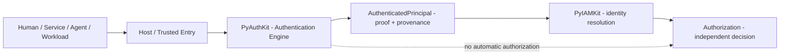
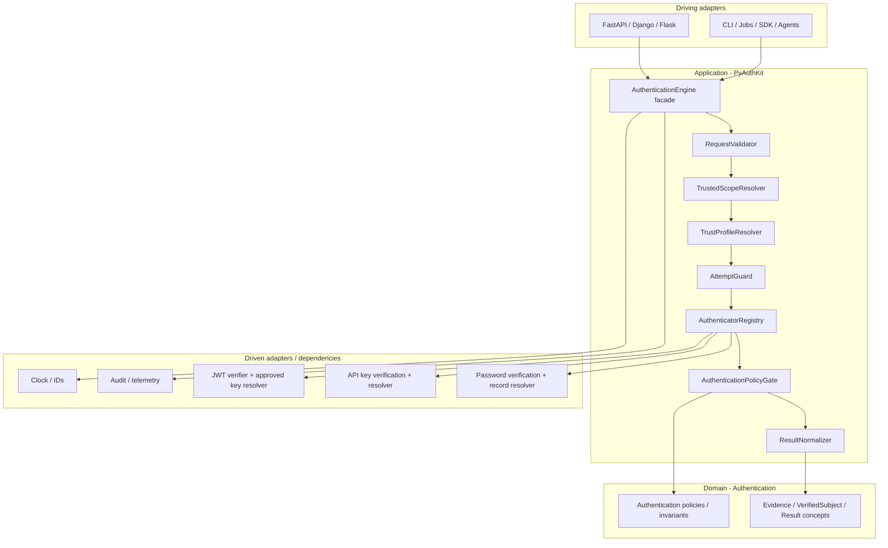
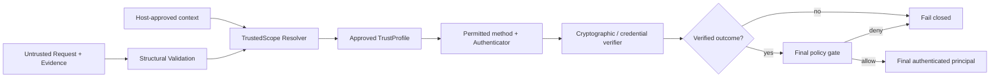
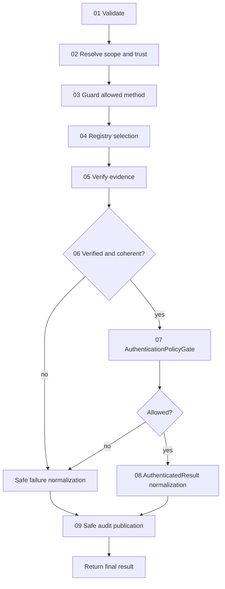
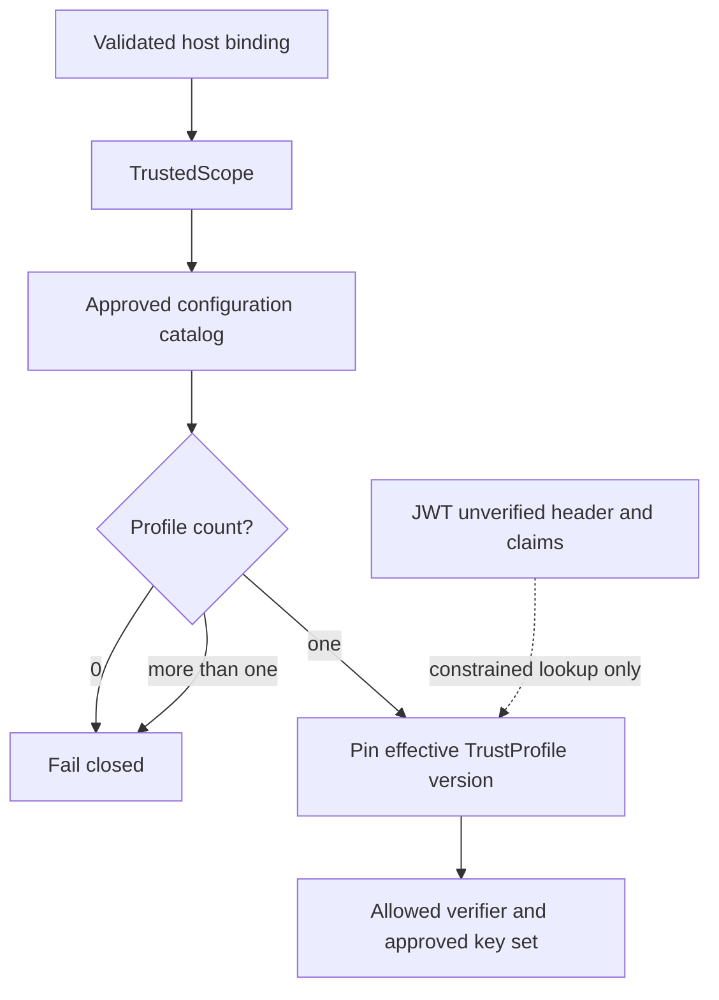
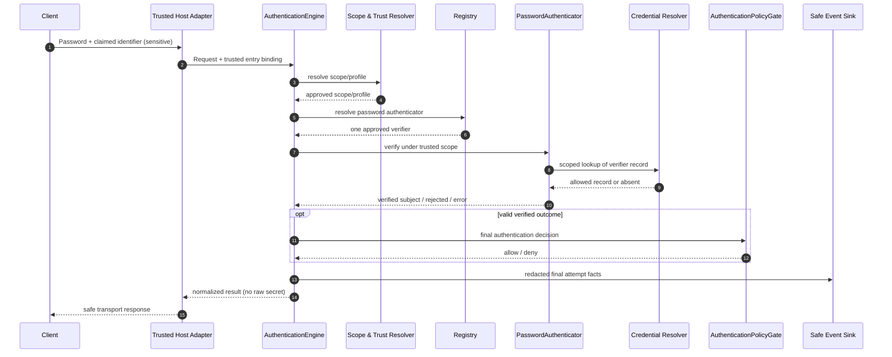
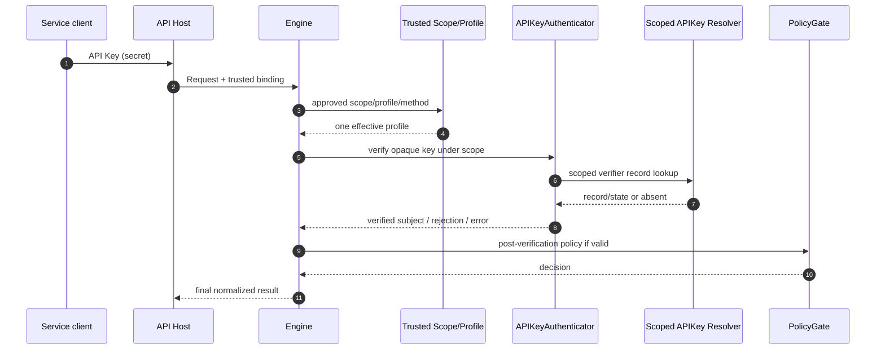
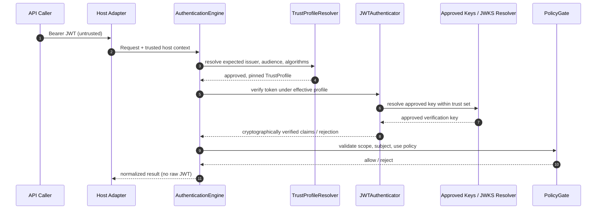

# 09_PYAUTHKIT_AUTHENTICATION_ENGINE_MODEL

# PyAuthKit — Authentication Engine Model

> **Document :** `09_PYAUTHKIT_AUTHENTICATION_ENGINE_MODEL.md`  
> **Produit :** PyAuthKit — Authentication Engine for the Modern Python Ecosystem  
> **Type :** spécification du noyau d'exécution, architecture applicative et convention de conception  
> **Statut :** **PROPOSED / DESIGN** — ni contrat API stable ni preuve d'implémentation  
> **Version documentaire :** 0.1.0  
> **Date :** 2026-10-29  
> **Langue :** français ; noms de concepts, contrats et code en anglais  
> **Sources internes :** `00` à `08` et `PYAUTHKIT_SOFTWARE_DESIGN_LEARNING_CONVENTION.md`  
> **Périmètre MVP :** Password, API Key, vérification de JWT bearer, registry extensible, trust et policy  
> **Suite :** `10_PYAUTHKIT_AUTHENTICATOR_AND_CREDENTIAL_MODEL.md`

---

## Guide de lecture

| Parcours | Sections |
|---|---|
| Vision et responsabilités | 0–7 |
| Confiance et pipeline | 8–16 |
| Temps, concurrence, configuration, extensions | 17–23 |
| Contrats Python et cas d'exécution | 24–28 |
| Tests, risques, ADR et gouvernance | 29–37 |
| Supports pédagogiques et références | Annexes A–E |

**Précaution :** les contrats du présent document sont des **propositions de design**. Ils ne certifient ni une bibliothèque opérationnelle, ni une intégration réelle, ni le passage d'une suite de tests. Le code est annoté « illustrative » ou « pseudocode » ; les vérifications cryptographiques doivent être confiées à des implémentations spécifiquement qualifiées. Les termes *approved*, *trusted* et *verified* décrivent des obligations de vérification réelle, **pas** une propriété conférée automatiquement par un nom de classe.

---

## 0. Résumé exécutif

`AuthenticationEngine` est le **point d'orchestration** du cas d'usage `Authenticate`. Il reçoit une demande contenant des preuves non fiables, exige un contexte d'entrée établi par l'hôte, résout un périmètre et un profil de confiance approuvés, sélectionne exactement un mécanisme autorisé, demande la vérification de la preuve, applique une décision finale de politique et produit un résultat normalisé.

```text
APPLICATION / SDK / API / CLI
            │
            ▼
 Host-approved TrustedEntryContext  +  Untrusted AuthenticationRequest
            │
            ▼
     AuthenticationEngine
            │
            ├── Validate request and limits
            ├── Resolve TrustedScope + TrustProfile
            ├── Guard attempt / allowed method
            ├── Resolve one Authenticator
            ├── Verify evidence under trusted profile
            ├── Validate verification outcome
            ├── Apply final AuthenticationPolicyGate
            ├── Normalize AuthenticationResult
            └── Emit sanitized audit facts
            │
            ▼
 AUTHENTICATED | REJECTED | ERROR
             (+ CHALLENGE_REQUIRED, POST-MVP)
```

**Règles cardinales :**

1. `AUTHENTICATED` exige une preuve effectivement vérifiée sous un profil autorisé et une policy finale satisfaite.
2. Tous les états autres que `AUTHENTICATED` excluent un `AuthenticatedPrincipal` final.
3. Scope, issuer, audience, méthodes et clés de confiance ne sont jamais accordés par une assertion non vérifiée du demandeur.
4. Une erreur, un profil manquant ou ambigu, un timeout et une dépendance indisponible ne deviennent jamais un succès par repli.
5. Le succès d'authentification ne crée automatiquement ni identité PyIAMKit, ni permission, ni session, ni token, ni mandat d'agent.

Le moteur est un **composite applicatif sécurisé**, non un « service universel » qui doit implémenter lui-même le hashage Password, une bibliothèque JWT, l'autorisation IAM ou tous les protocoles possibles.

### 0.1 Résultat documentaire attendu

Ce document fixe le **contrat de comportement candidat** du moteur et ses points d'extension. Il laisse au document `10` les mécanismes Password/API Key/JWT, au `11` les flows/challenges, au `12` l'assurance/MFA, au `13` les sessions/tokens, au `18` le design complet des plugins, au `20` le modèle de menaces, au `21` l'audit et au `24` les signatures publiques finales.

---

## 1. Filiation documentaire et autorité de conception

| Document | Autorité principale | Apport et limite pour `09` |
|---|---|---|
| `00_PYAUTHKIT_EXPRESSION_DU_BESOIN.md` | expression du besoin | moteur agnostique, acteurs et méthodes |
| `01_PYAUTHKIT_REQUIREMENTS_ANALYSIS.md` | exigences candidates `FR/NFR/SEC/ARC/INT/ACC` | objectifs testables ; pas conformité démontrée |
| `02_PYAUTHKIT_PRODUCT_VISION_AND_ARCHITECTURE_PRINCIPLES.md` | doctrine architecturale | SOLID, DDD, Hexagonal, trust-first |
| `03_PYAUTHKIT_SYSTEM_ARCHITECTURE.md` | composants, flux `SEQ-01..03` | pipeline, ports, frontières et déploiement logique |
| `04_PYAUTHKIT_DOMAIN_OBJECTS.md` | vocabulaire `DO-001..048` | sémantique des objets et ownership |
| `05_PYAUTHKIT_ENTITIES_AND_VALUE_OBJECTS.md` | classification DDD candidate | Entities, VO, statuts et immutabilité |
| `06_PYAUTHKIT_DOMAIN_RELATIONSHIPS_AND_ERD.md` | relations `REL-001..060` | cardinalités, agrégats, ERD conditionnels |
| `07_PYAUTHKIT_DOMAIN_INVARIANTS_AND_BUSINESS_RULES.md` | `AUTH-INV-*`, `AUTH-BR-*` | **source normative interne** des invariants métier candidats |
| `08_PYAUTHKIT_COMMANDS_QUERIES_AND_USE_CASES.md` | `APP-CMD-*`, `APP-UC-*`, `APP-CTR-*` | **source normative interne** du contrat applicatif candidat |
| Convention *Software Design & Learning* | raisonnement et traçabilité | Problem First → Trust First → Pattern if needed → Tests |

Un écart avec `07` ou `08` doit être **identifié et arbitré**, jamais silencieusement présenté comme une correction des documents sources. `09` introduit les IDs `ENG-*` pour spécialiser les responsabilités du moteur sans remplacer les IDs existants.

### 1.1 Statuts d'une proposition

- `SOURCE-CONSTRAINT` : règle explicitement posée par les documents précédents.
- `ENGINE-PROPOSAL` : découpage et signature proposés dans `09`.
- `OPEN` : décision encore à acter par ADR ou spécification spécialisée.
- `POST-MVP` : modèle d'extension, sans promesse d'implémentation au MVP.

**État initial de tous les composants décrits : `SPECIFIED / PROPOSED` au maximum.** Aucun `IMPLEMENTED`, `TESTED`, `QUALIFIED`, `PRODUCTION-READY` n'est déclaré sans preuves externes à ce document.

---

## 2. Problem Statement — quel problème le moteur résout-il ?

Un service Python reçoit un mot de passe, une API Key ou un JWT. Il ne peut pas déterminer correctement *qui* agit en lisant un `username`, une chaîne de clé ou un `sub`. Il doit disposer d'une preuve vérifiée et de règles fiables expliquant dans quel environnement cette preuve vaut.

**Pressions de conception réelles :**

- Les mécanismes diffèrent : hash + état de credential, clé opaque, signature + claims JWT.
- Les applications et tenants n'acceptent pas nécessairement les mêmes méthodes, issuers, audiences ou clés.
- Les fournisseurs et stores doivent être remplaçables sans fuite dans le modèle métier.
- Les pannes techniques ne doivent pas devenir indistinguables d'une vérification positive.
- Plusieurs appels concurrents ne doivent pas partager un état de tentative mutable.
- L'API publique doit rester homogène malgré les différences entre mécanismes.
- Un plugin ne peut pas transformer seul une preuve reconnue en succès final en contournant les politiques.

La réponse est un **pipeline de décision explicitement borné**, plutôt qu'une méthode géante qui contient plusieurs `if provider == ...`, du SQL, du HTTP, de la crypto et de l'IAM.

### 2.1 Ce que signifie « moteur »

`AuthenticationEngine` coordonne la **validation de l'authenticité** et la **décision d'authentification finale**. Il ne possède pas nécessairement les données d'identité, les credentials ni une base de données. Le moteur peut être embarqué dans une application, un worker, un agent ou un service sans infrastructure déployée séparément.

### 2.2 North Star

> **Aucune identité ne devient authentifiée sans preuve vérifiée, contexte de confiance approuvé, décision finale favorable et résultat non ambigu.**

---

## 3. Bounded Context, ownership et frontières avec PyIAMKit

| Sujet | PyAuthKit | PyIAMKit / autre propriétaire |
|---|---|---|
| Preuve d'authentification | vérification et provenance | peut consommer le verdict |
| Authenticator / profile de confiance | résolution, évaluation, contrats | peut fournir bindings et autorités approuvées |
| `VerifiedSubject` | sujet externe/local **situé** (issuer + scope + subject) | résolution vers une identité gérée |
| Groupes, rôles, permissions | **pas** propriétaire | PyIAMKit / moteur d'autorisation |
| Création et provisioning de comptes | **pas automatique** | PyIAMKit / application |
| Sessions et tokens | use cases **distincts**, post-MVP | la politique de sécurité applicative peut les autoriser |
| Agent / workload | preuve d'identité du principal | mandat, délégation et permissions ailleurs |



**Vigilance DDD :** un `Principal` n'est pas obligatoirement un compte utilisateur local persistant. Un `VerifiedSubject` avec `issuer=external` ne prouve pas qu'un mapping IAM a été accompli. Un `AuthenticatedPrincipal(type=AGENT)` ne donne pas de permission d'utiliser un outil.

---

## 4. Architecture logique et ownership des composants



**Note sur le dessin :** la flèche `Registry → Gate` représente l'ordre de coordination, **pas** que la registry exécute le `PolicyGate`. Les objets `Authenticator` restent des comportements injectés et appelés par le use case. La direction des imports concrets suit la règle de dépendance : l'infrastructure dépend des ports, jamais l'inverse.

### 4.1 Rôles fonctionnels candidats

| Composant | Propriétaire | Responsabilité | Ne doit pas faire |
|---|---|---|---|
| `AuthenticationEngine` | application/façade | exécuter `Authenticate`, exposer une entrée stable | hash, SQL, provisioning, AuthZ |
| `AuthenticateUseCase` | application (option) | implémenter l'orchestration si façade distincte | dupliquer la logique de l'engine |
| `RequestValidator` | frontière application | bornes et forme des données | déclarer une preuve valide |
| `TrustedScopeResolver` | application + port | établir une portée serveur | croire un `tenant_id` libre |
| `TrustProfileResolver` | application + port | produire un profil actif, unique, approuvé | apprendre ses règles du JWT |
| `AttemptGuard` | policy/port | méthode et limitation d'essais selon configuration | transformer throttling indisponible en succès |
| `AuthenticatorRegistry` | composant de composition | résoudre **une** stratégie autorisée | auto-installer un provider arbitraire |
| `Authenticator` | port comportemental | vérifier sous contexte autoritatif | créer `AuthenticationResult.success` final |
| `AuthenticationPolicyGate` | domain policy / application | appliquer les dernières exigences AuthN | attribuer des rôles IAM |
| `ResultNormalizer` | application | garantir la forme finale discriminée | accepter un outcome contradictoire |
| `AuthenticationEventSink` | port | publication expurgée sous contrat de delivery | journaliser credentials ou JWT bruts |
| `Clock` / `IdGenerator` | ports | temps cohérent et corrélation | dériver le temps depuis des champs client |

### 4.2 Façade et use case : éviter la duplication

Deux formes sont acceptables dans le **design candidat**, pas simultanément obligatoires :

```text
Option A (MVP simple)              Option B (si pression d'API)
AuthenticationEngine               AuthenticationEngine facade
  └── authenticate()                 └── AuthenticateUseCase.execute()
```

**Critère de choix :** préférer A tant que les API, le câblage et les tests ne justifient pas un objet `UseCase` séparé. Dans B, la façade ne répète pas la séquence, elle délègue. Un *Command Bus* n'est pas requis pour trois authenticators.

---

## 5. Contrat public provisoire de `AuthenticationEngine`

### 5.1 Intention

```python
result = await engine.authenticate(request)
```

Ce contrat, issu de `00`, est une **intention ergonomique**, pas une API finale. Le moyen de transmettre un `TrustedEntryContext` doit être décidé : argument dérivé côté hôte, contexte de dépendance injecté ou enveloppe sécurisée construite par un driving adapter. Il ne doit **jamais** résulter d'un simple désérialiseur client.

### 5.2 Préconditions

1. moteur composé à partir de dépendances approuvées ;
2. méthodes et registry explicitement activées ;
3. contexte d'entrée établi hors du contrôle de la preuve ;
4. paramètres de temps, tailles limites et profils de confiance définis ;
5. ports critiques vérifiés à l'initialisation ou au moment de leur utilisation ;
6. contrat de publication d'audit connu.

### 5.3 Postconditions

- succès : exactement un principal final, avec sujet vérifié et origine située ;
- échec : aucun principal final ; code public borné ;
- absence d'effet IAM/AuthZ implicite ;
- tentative corrélable par une référence non sensible ;
- aucune fuite de credentials/secret dans sortie, exception ou événement ;
- annulation/timeout correctement propagés ou convertis selon contrat explicite, sans succès.

---

## 6. Principaux objets traversant le moteur

| Concept | Entrée / production | Confiance | Responsabilité |
|---|---|---|---|
| `AuthenticationRequest` | reçu de l'appelant / adaptateur | mélange de valeurs non fiables | intention et evidence présentée |
| `ClaimedIdentity` | données fournies | non fiable | clé de recherche éventuelle, non identité prouvée |
| `PresentedEvidence` | secret/token/assertion entrant | non fiable + sensible | preuve à faire vérifier |
| `TrustedEntryContext` | hôte, mapping sécurisé | confiance **établie**, non supposée par le type | rattachement application/route |
| `TrustedScope` | resolver depuis bindings sûrs | portée déterminée | tenant/realm/namespace autorisé |
| `TrustProfile` | configuration approuvée | règles vérifiées et versionnées | clé/issuer/audience/méthode attendus |
| `VerificationContext` | moteur à partir de trust + clock | contexte de vérification borné | paramètres effectivement permis |
| `AuthenticatorOutcome` | authenticator | verdict interne à contrôler | verified/rejected/error + provenance |
| `VerifiedSubject` | verifier après contrôle complet | preuve validée pour l'usage prévu | subject scoped et origin |
| `PolicyDecision` | PolicyGate | décision conforme à policy active | allow / deny / challenge futur |
| `AuthenticatedPrincipal` | normalizer après gate | AuthN final seulement | représentation publique du sujet prouvé |
| `AuthenticationResult` | engine | verdict final discriminé | API canonique, sans credentials |
| `AuthenticationEvent` | telemetry/audit | fait expurgé, pas preuve crypto | corrélation et exploitation |

**Invariants de vocabulaire :** `ClaimedIdentity != VerifiedSubject != AuthenticatedPrincipal` ; `Token format != Token trust` ; `CredentialReference != evidence of possession` ; `AuthenticatorOutcome != AuthenticationResult` ; `AuthenticationResult != AuthorizationDecision`.

---

## 7. Conventions de conception : Principles, DDD, Patterns

| Pression observée | Principe / role | Pattern éventuellement adapté | Choix simple à envisager |
|---|---|---|---|
| mécanismes interchangeables | OCP, DIP ; Authenticator contract | Strategy | mapping de callables typés |
| providers/protocoles externes | SoC, ACL | Adapter | fonction traductrice pure |
| vérification puis policy | SRP, explicit boundaries | Pipeline / Chain of Responsibility si justifié | séquence explicite de fonctions |
| providers enregistrés au bootstrap | stable composition | Registry | mapping immuable |
| échec distinct de succès | explicit modeling | Result Object | union discriminée |
| ports externes interchangeables | DIP | Hexagonal / Ports & Adapters | protocoles Python étroits |
| variation de règles | Domain Policy | Strategy si variante interchangeable | fonction/policy simple |
| audit externe | loose coupling | Event Publishing ; Observer non automatique | port sink simple |
| création de composants à config complexe | controlled construction | Factory si nécessaire | fonction de bootstrap |

La **registry n'est pas un pattern GoF obligatoire** et un `AuthenticationEvent` n'implique pas le pattern Observer. Le nom du code doit parler Authentication, pas « StrategyPatternImpl ». La distinction DDD *domain service* vs *application service* est fondée sur la responsabilité réellement portée, pas sur la syllabe « Engine ».

---

## 8. Frontières de confiance (`ENG-TB-*`)

| ID | Frontière | Source non fiable | Autorité attendue | Risque si franchie illégalement |
|---|---|---|---|---|
| `ENG-TB-01` | transport → request | JSON, headers, cookies, CLI input | adaptateur + validation bornée | injection, DoS, fuite |
| `ENG-TB-02` | client → host binding | tenant, route, application claimés | routage/tenant binding validé côté hôte | cross-tenant |
| `ENG-TB-03` | request → trust profile | `iss`, `aud`, `kid`, `alg` prétendus | profil préapprouvé | key/issuer confusion |
| `ENG-TB-04` | evidence → verification | password, API key, JWT | verifier qualifié sous profil | authentification fictive |
| `ENG-TB-05` | outcome → final gate | boolean `verified`, claims | outcome cohérent + policy | bypass de restrictions |
| `ENG-TB-06` | final result → IAM/AuthZ | AuthenticatedPrincipal | contrat d'intégration explicite | permissions implicites |
| `ENG-TB-07` | engine → log/event | toute donnée de tentative | projection expurgée | exfiltration de secrets |
| `ENG-TB-08` | library → plugin | paquet Python externe | allowlist et approbation au bootstrap | exécution de code non approuvé |
| `ENG-TB-09` | runtime → cache/store | valeur ancienne / panne | cohérence et faillibilité explicites | acceptation révoquée |
| `ENG-TB-10` | trusted config → reconfiguration | changement concurrent | version cohérente par tentative | mélange de politiques/clefs |



---

## 9. Moteur comme machine de décision, pas machine à états générale

### 9.1 États de décision MVP

```text
STARTED
  → INPUT_VALIDATED
  → TRUST_RESOLVED
  → METHOD_ALLOWED
  → AUTHENTICATOR_RESOLVED
  → EVIDENCE_VERIFIED
  → POLICY_ACCEPTED
  → AUTHENTICATED
```

Tout jalon peut produire `REJECTED` ou `ERROR` **sans** principal final. Ces étapes forment des **états d'observation du pipeline**, pas nécessairement un aggregate persistant ou des classes GoF State.

### 9.2 Sorties métier et runtime

| Sortie | Cause principale | Principal final |
|---|---|---|
| `AUTHENTICATED` | preuve + trust + policy satisfaits | un seul |
| `REJECTED` | preuve non valide, refus de policy ou méthode interdite | aucun |
| `ERROR` | config incomplète/ambiguë, store/crypto indisponible, échec technique | aucun |
| `CHALLENGE_REQUIRED` | suite d'un flow autorisé | **aucun** ; POST-MVP |
| `CANCELLED` | arrêt ou timeout selon contrat runtime | aucun ; statut public OPEN |

`REJECTED` et `ERROR` sont deux catégories conceptuelles. Leur mapping externe (`AuthenticationResult`, exception typée, codes HTTP/gRPC) reste **OPEN** et sera tranché pour l'API publique dans `24`.

### 9.3 Pas de succès partiel public

Un premier facteur Password réussi suivi d'un MFA requis produit un **état de flow** et un challenge (POST-MVP), pas un `AuthenticatedPrincipal` complet présenté à une ressource protégée.

---

## 10. Pipeline canonique MVP (`ENG-STEP-*`)

| Étape | ID | Owner | Action | Garantie / échec |
|---|---|---|---|---|
| 01 | `ENG-STEP-01` | validation | limites, shape, méthode, evidence type | entrée bornée, pas de preuve établie |
| 02 | `ENG-STEP-02` | trust resolver | portée serveur puis profil approuvé | 0/N choix ⇒ refus sécurisé |
| 03 | `ENG-STEP-03` | guard | méthode permise, préconditions, throttling | jamais de bypass par indisponibilité |
| 04 | `ENG-STEP-04` | registry | exactement un authenticator applicable | aucun fallback implicite |
| 05 | `ENG-STEP-05` | verifier | preuve sous contexte de vérification verrouillé | verdict spécialisé |
| 06 | `ENG-STEP-06` | engine | cohérence de l'outcome et du sujet | malformed outcome ⇒ ERROR |
| 07 | `ENG-STEP-07` | policy | décision finale AuthN | deny ⇒ aucun succès |
| 08 | `ENG-STEP-08` | normalizer | résultat discriminé ; principal scoped | résultat compatible avec status |
| 09 | `ENG-STEP-09` | event sink | audit et métriques expurgés | politique de delivery appliquée |



### 10.1 Ordre et étapes facultatives

L'**ordre logique de confiance** est obligatoire. Des optimisations peuvent exécuter une validation structurelle ou un contrôle de limite plus tôt, mais elles ne peuvent pas publier un succès avant que les conditions de confiance soient satisfaites. Une policy *pré-vérification* n'est pas équivalente à la policy *post-vérification* : chacune a des informations différentes et un contrat de fuite de données à protéger.

### 10.2 Le moteur ne transforme pas un JWT en session

`JWTAuthenticator.verify(...)` valide le JWT pour l'application et l'usage attendus. `IssueToken`, `CreateAuthenticationSession` et `RotateRefreshToken` sont **d'autres use cases**, sans déclenchement automatique.

---

## 11. Validation structurelle et limites d'entrée

Un `RequestValidator` vérifie des **propriétés syntaxiques et quantitatives** :

- méthode non vide, normalisée de manière définie, connue dans la surface autorisée ;
- type de preuve attendu par la méthode ;
- bornes de taille configurées par type de preuve et par transport ;
- longueur et profondeur maximales des données structurées ;
- absence de valeurs conflictuelles dans les champs structurants ;
- timestamps/identifiants fournis traités comme données revendiquées, jamais comme autorité ;
- absence de sérialisation accidentelle de secrets dans les erreurs de validation.

**Interdit :** considérer une signature JWT valide parce que le token a trois segments, une API key valide parce qu'elle a le bon préfixe ou un Password valide parce qu'il respecte un regex.

### 11.1 Invariants de validation

`shape_valid != proof_verified`, `method_declared != method_allowed`, `claims_parsed != claims_trusted`.

### 11.2 Politique de limites

Les limites numériques exactes sont **OPEN** : elles relèvent du déploiement, de la méthode et de profils de menace testés. Ne pas inventer un plafond universel de taille JWT, Password ou de durée de vérification.

---

## 12. Résolution du `TrustedScope`

### 12.1 Autorité

Le `TrustedScope` doit être dérivé de liaisons acceptées par l'hôte (application, route, domaine/realm authentifié, tenant binding serveur). Un `tenant_id` dans le body, un hostname non validé, un `iss` de JWT ou un header arbitraire ne suffit pas.

### 12.2 Contrat de résolution

```text
Input:  TrustedEntryContext + approved host bindings
Output: Resolved(TrustedScope, provenance) OR Missing/Ambiguous/Invalid
```

| Cardinalité du résultat | Action |
|---|---|
| 0 scope admissible | aucun succès ; configuration/refus |
| 1 scope admissible | continuer |
| N scopes également applicables | aucun choix `first()` ; erreur d'ambiguïté |
| scope contrôlé seulement par le requester | refus de la source |

### 12.3 Multi-tenant

Un scope doit accompagner toute recherche de record de vérification : une clé ou un utilisateur existant dans le tenant A ne doit pas être récupérable et accepté dans le tenant B. Le namespace du `VerifiedSubject` inclut sa provenance pertinente ; `sub='123'` ne doit pas être traité comme identité globale.

### 12.4 Domaine et implémentation

Le **concept** de scope relève du domaine Authentication ; la **résolution** des bindings concrets relève de l'application et de ports configurés. Un resolver ne doit pas transformer le modèle ORM de PyIAMKit en dépendance directe du cœur.

---

## 13. `TrustProfileResolver` et provenance d'autorité

### 13.1 Problème

Le même jeton, la même clé ou le même identifiant peut être acceptable dans un contexte et inacceptable dans un autre. L'engine doit savoir **pour qui**, **au moyen de quelle méthode**, **par quelle autorité**, **avec quels paramètres** une preuve peut être reconnue.

### 13.2 Entrées légitimes

- `TrustedScope` déterminé ;
- application ou API d'entrée validée ;
- méthode autorisée et type d'usage attendu ;
- politique effective et version approuvées ;
- binding à un provider ou issuer attendu **préconfiguré**.

### 13.3 Valeurs non autoritatives

- `iss`, `sub`, `aud`, `alg`, `kid`, `jku`, `x5u` provenant d'un JWT non vérifié ;
- email ou tenant fourni par le demandeur ;
- « provider » sélectionné seulement par un paramètre client ;
- paramètres acceptés depuis un callback OAuth non lié à son état serveur ;
- classes Python arbitraires enregistrées par auto-découverte non approuvée.

Une valeur non fiable peut servir de **sélecteur contraint** *à l'intérieur* d'un ensemble déjà approuvé (par exemple `kid` dans un JWKS autorisé), jamais élargir cet ensemble.

### 13.4 Contrat proposé

```text
resolve(trusted_scope, use_case, requested_method)
  → TrustProfile(version, allowed_methods, issuer/audience/key rules, policies)
  OR MissingTrustProfile / AmbiguousTrustProfile / UnsupportedUse
```

`TrustProfile` doit être suffisamment stable pendant une tentative pour éviter de combiner les clés d'une version avec la policy d'une autre. Les règles de rotation, chevauchements de clés et invalidation des caches seront détaillées dans `10`, `19`, `20` et `25`.



---

## 14. `AuthenticatorRegistry` — résolution sans magie

### 14.1 Intent

La registry conserve des **enregistrements contrôlés** d'authenticators capables de vérifier une méthode d'evidence donnée, dans un contexte approuvé. Elle n'est pas un serveur de plugins dynamique accessible par un endpoint public.

### 14.2 Clé logique de résolution

Un design simple peut utiliser `(method)` avec une validation préalable de scope. Si un même mécanisme possède plusieurs implémentations effectivement nécessaires, la clé peut devenir `(method, capability, binding)` **seulement si la pression existe et si l'ambiguïté est définie**. Le code central ne doit pas contenir de cascade `if google / github / microsoft`.

### 14.3 Options de composition

```text
BOOTSTRAP
  register('password', PasswordAuthenticator(...))
  register('api_key', APIKeyAuthenticator(...))
  register('jwt', JWTAuthenticator(...))
  validate duplicate keys + capabilities + dependencies
  freeze / publish immutable snapshot  [candidate]
  serve requests
```

`freeze()` est **proposé**, pas une interface définitivement acceptée. Il empêche les mutations concurrentes de la table de résolution au milieu du trafic.

### 14.4 Garanties souhaitées

- enregistrement explicite / opt-in ;
- collision rejetée ou arbitrée *explicitement* ;
- pas de repli automatique vers un autre mécanisme à la suite d'une erreur ;
- absence d'influence d'un input non vérifié sur l'autorisation de charger un plugin ;
- même type de contrat et tests partagés pour les implémentations ;
- stratégie isolée de la policy finale ;
- pas de confiance accordée automatiquement à un entry point installé.

### 14.5 Sorties de `resolve`

| Situation | Résultat |
|---|---|
| exactement un authenticator autorisé | instance conforme au contrat |
| aucun mécanisme reconnu | unsupported/rejected ; aucun succès |
| méthode enregistrée mais interdite dans profil | policy rejected ; aucun appel au verifier |
| plusieurs stratégies ambiguës | configuration error / fail-closed |
| plugin indisponible au bootstrap | erreur de composition ; ne pas servir comme si présent |

---

## 15. Contrat de vérification : `AuthenticatorOutcome`

Un authenticator vérifie une **evidence spécialisée** sous un `VerificationContext` autoritatif.

### 15.1 Responsabilités

- vérifier le bon format de preuve et les préconditions propres à la méthode ;
- consulter les seuls records/keys explicitement autorisés ;
- effectuer la vérification cryptographique ou la comparaison sûre ;
- vérifier état, usage, scope, expiration et révocation selon le mécanisme ;
- produire un outcome vérifié ou refusé avec provenance minimale ;
- ne jamais s'arroger le droit de créer le résultat final `AUTHENTICATED`.

### 15.2 Invariants de l'outcome

```text
VERIFIED     → VerifiedSubject present + scoped + provenance checked
REJECTED     → no verified subject
ERROR        → no verified subject
UNAVAILABLE  → no verified subject
```

`verified: bool` seul est insuffisant pour représenter toutes les décisions et ambiguïtés. Une **union discriminée** est recommandée, mais la forme finale reste à préciser entre `09`, `10` et `24`.

### 15.3 Evidence externe et « verified »

Un objet de type `VerifiedSubject` construit directement à partir d'un JSON ou par un plugin malveillant n'est pas une preuve valable. La chaîne de vérification, la qualification du plugin, la policy et le trust profile doivent être vérifiés **par conception et tests**, indépendamment du système de types.

### 15.4 Autorité des providers

La notion de `issuer_id` désigne l'origine vérifiée dans un namespace donné. Elle ne dit rien, à elle seule, du lien avec un compte PyIAMKit. Le moteur doit conserver un sujet capable de représenter humain, application, service, agent, device ou workload sans confondre type de principal et origine externe.

---

## 16. `AuthenticationPolicyGate` — la décision avant le succès

### 16.1 Préconditions d'appel

Le gate opère **seulement sur un outcome de vérification cohérent**, sur le scope établi et le profil de confiance effectivement sélectionné. Il peut également utiliser des signaux de contexte explicitement classés (trusted/untrusted) et une stratégie de risque externe en extension.

### 16.2 Responsabilités

- appliquer les règles globales d'authentification applicables à cette tentative ;
- vérifier cohérence de la méthode, du subject type, de la provenance et du périmètre ;
- imposer une condition d'assurance si définie et prouvable ;
- décider allow / reject ; POST-MVP, demander une continuation `CHALLENGE_REQUIRED` ;
- conserver une raison interne structurée, sans information sensible en sortie publique.

### 16.3 Ne pas confondre AuthN et AuthZ

`AuthenticationPolicy` décide si la **preuve et le contexte sont suffisants pour une authentification**. Elle ne décide pas si le principal peut lire un dossier client ou créer un virement. Ces décisions sont des politiques d'accès, détenues par PyIAMKit/AuthZ/application.

### 16.4 AAL et claims de confiance

Ni la présence de deux facteurs, ni une chaîne « MFA=true », ni un attribut `acr`/`amr` non vérifié ne garantit automatiquement un niveau NIST AAL donné. L'assurance exige un modèle et une vérification explicites, différés au document `12`.

### 16.5 Échec et pannes

Une policy manquante, en erreur ou indéterminée ne doit pas être traitée comme un `ALLOW` par défaut. S'il existe une policy facultative, son absence doit être **déclarée facultative par le contrat configuré**, non devinée à l'exécution.

---

## 17. `ResultNormalizer` et contrat discriminé

### 17.1 Pourquoi une normalisation centrale ?

Les authenticators parlent des langages différents : password mismatch, revoked key, invalid issuer, expired token, unavailable verifier. L'application doit produire un **résultat cohérent indépendant du mécanisme**, sans divulguer de cause exploitable pour énumérer des comptes ou deviner la configuration.

### 17.2 Proposition de structure

```text
AuthenticationResult
  ├── Authenticated(result, authenticated_principal, attempt_id, provenance)
  ├── Rejected(result, public_error_code, attempt_id)
  ├── Error(result, public_error_code, attempt_id)
  └── ChallengeRequired(opaque_continuation, attempt_id) [POST-MVP]
```

L'union discriminée exprime mieux les invariants qu'un unique `AuthenticationResult(authenticated: bool, principal: Optional, error: Optional)`. Ce design reste **proposé** et devra être consolidé dans `24`.

### 17.3 Invariants obligatoires

| Condition | Exigence |
|---|---|
| succès | 1 principal final, subject authentifié dans scope permis |
| échec de preuve | 0 principal final |
| erreur de policy/verifier | 0 principal final |
| continuation MFA | 0 principal final, continuation opaque bornée |
| aucun statut | jamais succès implicite |
| outcome contradictoire | refuser et enregistrer invariant violation expurgée |
| erreur publique | diagnostic limité et stable, pas d'exception brute |

### 17.4 Provenance minimale

Une sortie réussie peut porter des références non sensibles à la méthode et à l'autorité de vérification. Des claims arbitraires, le token brut, des détails internes de key selection, un dump du `TrustProfile` ou l'ensemble des preuves intermédiaires ne sont pas des sorties publiques par défaut.

---

## 18. Taxonomie des erreurs et absence de fallback permissif

### 18.1 Trois familles

| Famille | Exemples | Sortie candidate | Action |
|---|---|---|---|
| preuve/refus métier | password invalide, API key inactive, JWT non valide, policy deny | `REJECTED` | pas de principal |
| indisponibilité/configuration | store/KMS/issuer keys non disponibles, profil absent, registre ambigu | `ERROR` | pas de principal |
| contrôle d'exécution | timeout, cancellation, overload | `ERROR` ou signal runtime selon contrat | cleanup ; jamais succès |

### 18.2 Principes de mapping

- Ne jamais faire `except Exception: return success`.
- Ne pas transformer une panne de JWT verifier en essai API Key ou Password.
- Ne pas révéler si un email existe simplement par un message de login.
- Ne pas mélanger « verification failed » et « verifier failed » dans le diagnostic **interne** ; le mapping public peut être volontairement plus grossier.
- Laisser les adaptateurs HTTP/gRPC/CLI mapper ces états en codes de transport ; le domaine ne connaît pas `HTTPException`.
- Une cancellation Python doit être propagée ou traitée explicitement, pas avalée par un `except BaseException` général.

### 18.3 Exemple de table de mapping

| Événement interne | Public | Consigne |
|---|---|---|
| `InvalidEvidence` / `PasswordMismatch` | `AUTHENTICATION_REJECTED` | message uniforme |
| `CredentialRevoked` / `CredentialExpired` | `AUTHENTICATION_REJECTED` | détails internes non exposés |
| `JWTInvalidSignature` / `JWTInvalidAudience` | `AUTHENTICATION_REJECTED` | clés/audience non divulguées |
| `UnknownTrustedScope` | `AUTHENTICATION_UNAVAILABLE` / refus neutre | ne pas révéler l'inventaire tenants |
| `AmbiguousTrustProfile` | `AUTHENTICATION_UNAVAILABLE` | alerte configuration expurgée |
| `VerifierUnavailable` | `AUTHENTICATION_UNAVAILABLE` | circuit breaker éventuel, sans accept |
| `DeadlineExceeded` | `AUTHENTICATION_UNAVAILABLE` | propager délai adapté au transport |
| `InvariantViolation` | `AUTHENTICATION_UNAVAILABLE` | alerte interne sécurisée |

Les codes publics ci-dessus sont **candidats** ; le document `24` choisira le contrat final.

---

## 19. Clock, deadlines, cancellation et runtime

### 19.1 Horloge explicite

Une horloge injectée est utilisée pour l'expiration de preuve, les contraintes temporelles, les audits et les tests. Éviter de multiplier les `datetime.now()` au milieu de verifiers, policy et normalizer.

### 19.2 Budget d'exécution

Le moteur peut transmettre un **deadline absolu** ou un budget résiduel aux ports externes. Une dépendance lente n'a pas le droit de produire un succès **après** l'expiration de la tentative si le contrat de deadline a été dépassé.

### 19.3 Annulation

Le nettoyage libère connexions/locks temporaires. Il n'émet pas de résultat de succès fabriqué et ne persiste pas un secret d'entrée comme « debugging context ». Les hooks de cleanup/audit doivent avoir une stratégie bornée, sans empêcher indéfiniment la cancellation.

### 19.4 Concurrence

- immutable config/snapshots par moteur ou version ;
- données de tentative stockées **par invocation**, jamais dans `engine.current_user` ;
- aucun état de session mutable partagé entre tenants ;
- registry gelée ou remplacée atomiquement selon design approuvé ;
- locks et opérations atomiques réservés aux stores possédant des états critiques ;
- retrys et backoff bornés, sans contournement d'une révocation ou d'un rate limit.

### 19.5 Idempotence : ne pas inventer une garantie globale

Une vérification JWT ou Password peut être répétée, mais le résultat dépend de l'expiration, de la révocation et des politiques évolutives. Le même `attempt_id` n'est pas automatiquement une clé d'idempotence. La consommation exactement-une-fois d'un challenge relève d'un contrat POST-MVP et de preuves sur le store approprié.

---

## 20. Configuration, bootstrap et Composition Root

### 20.1 Bootstrap avant trafic

```text
Configuration approved by host
      │
      ├── allowed methods and trusted scopes
      ├── trust profiles and issuer/audience/key rules
      ├── password / API key / JWT verifier dependencies
      ├── registry entries and plugin approval
      ├── time/deadline and privacy policies
      └── audit failure semantics
      │
      ▼
  Validate full wiring + incompatible combinations
      │
      ▼
  Build immutable engine configuration / registry snapshot
      │
      ▼
  Serve requests
```

### 20.2 Vérifications de composition

- unique registration par clé logique ;
- méthodes déclarées compatibles avec les profils configurés ;
- ports requis fournis et testables ;
- configuration cryptographique valide pour les algorithmes effectivement admis ;
- absence de secrets dans les dumps de configuration ;
- choix de policy et version clairement établis ;
- aucune auto-installation implicite de plugin ;
- échec précoce pour configuration invalide, ou configuration inactive explicitement indisponible.

### 20.3 Configuration multi-tenant

Une installation peut posséder plusieurs profils, **mais une tentative ne peut être évaluée que sous un profil effectif non ambigu**. Les caches doivent être partitionnés et invalidés selon le scope/version ; l'absence de cache ne donne pas le droit d'élargir le trust set.

### 20.4 Rechargement de configuration

La reconfiguration à chaud n'est **pas requise au MVP**. Si elle apparaît, privilégier la publication atomique d'un snapshot validé plutôt que des mutations champ par champ en plein trafic. Définir alors l'effet sur les tentatives déjà commencées et les anciennes clés en rotation.

---

## 21. Observabilité et audit : sans fuite d'evidence

### 21.1 Événements candidats

```text
AuthenticationStarted
AuthenticationRejected
AuthenticationSucceeded
AuthenticationErrored
AuthenticatorResolved [internal diagnostic]
PolicyRejected
TrustProfileResolutionFailed
```

Les noms et schémas seront précisés dans `21`. Un événement doit exprimer un **fait suffisamment justifié** : `AuthenticationSucceeded` ne peut être émis qu'après la décision finale, pas après le parsing de claims.

### 21.2 Données admissibles (sous politique de minimisation)

`attempt_id`, identifiant de méthode, référence de scope non sensible, statut final, code de cause expurgé, durée agrégée, identifiant pseudonymisé/tenant-scope si autorisé, version de policy ou profil non sensible et horodatage.

### 21.3 Données interdites dans les logs

Password brut, hash sensible, API Key brute, JWT brut, refresh token, secret TOTP, OTP, clé privée, entête `Authorization` complet, cookie brut, dumps d'evidence, claims non filtrées, `repr(exception)` contenant une valeur d'entrée ou configuration secrète.

### 21.4 Échec d'audit

Un audit « best effort » et un audit durable obligatoire ne sont **pas** équivalents. Il faut décider, par type d'événement et contexte :

- publication *best effort* : résultat primaire maintenu, éventuel signal de livraison perdue ;
- publication obligatoire : finaliser ou exposer un succès seulement lorsque la garantie attendue est satisfaite ;
- audit asynchrone/outbox : distinguer émission logique et livraison physique.

**OPEN :** la politique exacte du MVP sera fixée avec `21`. L'architecture de `09` ne prétend pas qu'un simple `finally: emit()` fournit une garantie de durabilité.

### 21.5 Métriques

Compteurs par famille de statut/méthode, latence agrégée, délai des dépendances, taux d'erreurs de configuration, timeouts ; éviter les labels avec email, tokens, subject IDs ou identifiants à très haute cardinalité.

---

## 22. Points d'extension POST-MVP

| Domaine différé | Évolution du moteur | Décision de sûreté |
|---|---|---|
| MFA / facteurs | `PolicyGate` peut demander une continuation | pas de principal final avant facteur requis |
| Challenge / Flow | flow state/handle scoped + expiration | consommation atomique, pas de replay |
| Sessions | use case spécifique après succès | jamais implicitement créées par verify |
| Tokens | issue/refresh/revoke explicites | token format et grants séparés |
| OIDC / social | redirect+callback protocol adapters | `state`, `nonce`, issuer, audience, PKCE selon profil |
| SAML | validation d'assertion et de contexte RP | pas de confiance au XML non vérifié |
| WebAuthn/passkeys | ceremony challenge et verifier | RP ID/origin/challenge liés au scope |
| Machine/workload | mTLS, client credential, signed workload assertion | identité du workload ≠ autorisation |
| Agent delegation | vérifier evidence de mandat | AuthN du mandataire ≠ droits délégués |
| Adaptive risk / step-up | policy/context evaluator externe | signal de risque n'est pas preuve d'identité |
| Storage / distributed | records et opérations atomiques | invariants de révocation et isolation |

**Règle :** étendre les ports seulement lorsqu'un besoin réel les rend nécessaires. Ne pas construire au MVP un *universal flow orchestrator*, une infrastructure SAGA ou un service d'authentification distribué uniquement pour anticiper ces scénarios.

---

## 23. Menaces et réponses au niveau du moteur

| Menace | Point d'entrée | Défense de conception | Qualification attendue |
|---|---|---|---|
| confused deputy / tenant spoofing | `tenant` client | trusted binding + scoped resolution | cross-tenant negative tests |
| key confusion / `alg=none` | JWT header | algoritmes et clés approuvés | adversarial JWT tests |
| SSRF via `jku` / `x5u` | JWT header | pas de fetch d'URL issue d'un token non fiable | outbound-call assertions |
| JWT algorithm confusion | verifier | key type/alg/issuer binding | mismatched key/alg tests |
| brute-force | password evidence | limiter, backoff, monitoring selon profil | rate limit integration tests |
| API Key replay after revoke | credential store | state/version checks + cohérence de cache | revocation consistency tests |
| account enumeration | error surface | neutral public errors | differential error tests |
| plugin bypass | provider outcome | final policy gate + approval | malicious/faulty plugin tests |
| trace exfiltration | exceptions/log | safe projection + redaction | canary secrets tests |
| timeout downgrade | dependency unavailable | fail closed | timeout/fallback tests |
| config split-brain | hot reload/caches | version pinning | concurrent configuration tests |
| replay one-time challenge | flow store | atomic consume, POST-MVP | two concurrent consumers |

**Cadre normatif à consulter lors de la qualification**, déjà mentionné dans `07` : RFC 7519 (JWT), RFC 8725 (JWT BCP), NIST SP 800-63-4 / SP 800-63B-4. Ces documents **ne** constituent **pas** une attestation automatique de conformité de PyAuthKit.

---
## 24. Contrats Python : formes candidates, pas un SDK livré

### 24.1 Principes de modélisation

1. Types immuables pour identifiants, scopes et objets de résultat.
2. Evidence confidentielle avec `repr=False` ou enveloppe spécialisée — ceci ne remplace pas la protection mémoire et la gestion des secrets.
3. `Protocol` étroit pour un comportement interchangeable, sans imposer une hiérarchie abstraite lourde.
4. Dépendances explicites dans le constructeur, assemblées par Composition Root.
5. `async` si les ports peuvent faire des I/O, sans `await` artificiel au cœur d'une fonction pure.
6. Pas d'usage de `Any` pour des preuves libres dans la future API si une union contrôlée est possible.
7. Types de résultats discriminés pour empêcher un échec contenant un succès.
8. On ne « sécurise » pas une valeur en la castant en `TrustedScope`.

### 24.2 Une forme de résultats discriminés

```python
# DESIGN SKETCH: deliberately omits all authentication mechanisms.
# No actual cryptographic verification or trust attestation is performed.
from dataclasses import dataclass, field
from enum import Enum
from typing import Literal, Mapping, TypeAlias


class PrincipalType(str, Enum):
    HUMAN = "human"
    SERVICE = "service"
    APPLICATION = "application"
    AGENT = "agent"
    DEVICE = "device"
    WORKLOAD = "workload"


@dataclass(frozen=True, slots=True)
class VerifiedSubject:
    subject_id: str
    principal_type: PrincipalType
    issuer_id: str
    scope_id: str


@dataclass(frozen=True, slots=True)
class AuthenticatedPrincipal:
    subject: VerifiedSubject
    method: str
    verified_at: str  # illustrative; use a timezone-aware datetime in a real model


@dataclass(frozen=True, slots=True)
class Authenticated:
    principal: AuthenticatedPrincipal
    attempt_id: str
    status: Literal["authenticated"] = "authenticated"


@dataclass(frozen=True, slots=True)
class Rejected:
    attempt_id: str
    public_code: str
    status: Literal["rejected"] = "rejected"


@dataclass(frozen=True, slots=True)
class AuthenticationError:
    attempt_id: str
    public_code: str
    status: Literal["error"] = "error"


AuthenticationResult: TypeAlias = Authenticated | Rejected | AuthenticationError
```

L'**absence** de champ `principal` dans `Rejected` et `AuthenticationError` rend l'invariant de résultat plus facile à protéger que des combinaisons d'optionnels. Les champs temporels, provenance et exceptions seront spécialisés dans `05/09/24`. Le typage ci-dessus ne valide **aucune** preuve.

### 24.3 Contrats pour un authenticator et une policy

```python
# EDUCATIONAL PROTOCOLS — not a working password/JWT/API-key system.
from dataclasses import dataclass, field
from typing import Protocol, TypeAlias


@dataclass(frozen=True, slots=True)
class VerificationContext:
    trusted_scope_id: str
    approved_trust_profile_id: str
    approved_trust_profile_version: str


@dataclass(frozen=True, slots=True)
class VerificationRejected:
    internal_reason: str


@dataclass(frozen=True, slots=True)
class VerificationAccepted:
    subject: VerifiedSubject
    evidence_method: str


AuthenticatorOutcome: TypeAlias = VerificationRejected | VerificationAccepted


class Authenticator(Protocol):
    @property
    def method(self) -> str: ...

    async def verify(
        self,
        evidence: object,  # specialized/typed evidence in the final API
        context: VerificationContext,
    ) -> AuthenticatorOutcome: ...


class AuthenticationPolicyGate(Protocol):
    async def permits(
        self,
        subject: VerifiedSubject,
        context: VerificationContext,
    ) -> bool: ...
```

**Limites volontaires :** `object` est un placeholder de conception ; le `bool` de policy est insuffisant pour les raisons, conditions de challenge ou audit d'une version finale. `VerifiedSubject` doit provenir d'une implémentation de vérification qualifiée et d'une preuve de provenance, non d'un simple constructeur accessible au client. Le contrat des types d'evidence relève de `10`.

### 24.4 Un câblage minimal

```python
# PSEUDOCODE OF COMPOSITION, not executable without the actual components.
registry = AuthenticatorRegistry()
registry.register("password", configured_password_authenticator)
registry.register("api_key", configured_api_key_authenticator)
registry.register("jwt", configured_jwt_authenticator)
registry.freeze()  # candidate design, to be ratified

engine = AuthenticationEngine(
    validator=request_validator,
    scope_resolver=trusted_scope_resolver,
    trust_profiles=approved_trust_profile_resolver,
    guard=attempt_guard,
    authenticators=registry,
    policy=authentication_policy_gate,
    results=result_normalizer,
    events=sanitized_authentication_event_sink,
    clock=trusted_clock,
)
```

La composition root s'exécute dans le code de l'application/hôte. Elle ne fait jamais appel à un `load_every_installed_authenticator()` non approuvé.

---

## 25. Algorithme d'orchestration conceptuel

### 25.1 Pseudocode normatif de l'ordre, non production-ready

```python
# PSEUDOCODE — illustrates trust ordering; not complete Python SDK code.
async def authenticate(request, trusted_host_entry):
    attempt = new_per_call_attempt_context()

    try:
        safe_request = validate_structure_and_limits(request)
        scope = resolve_unique_trusted_scope(trusted_host_entry)
        profile = resolve_unique_approved_profile(scope, safe_request.method)
        verify_allowed_method_and_attempt_guard(safe_request, profile)
        verifier = registry.resolve_unique(safe_request.method, profile)

        # The verifier is a specifically qualified trusted implementation.
        outcome = await verifier.verify(
            safe_request.evidence,
            make_verification_context(scope, profile, attempt),
        )

        if not is_coherent_verified_outcome(outcome, scope, profile):
            return normalize_rejected_or_error(outcome, attempt)

        policy_decision = await policy_gate.evaluate(
            scope, profile, outcome, safe_request.context
        )
        if not policy_decision.allowed:
            return normalize_denial(policy_decision, attempt)

        return normalize_authenticated(outcome, profile, attempt)

    except KnownAuthenticationRejection:
        return rejected_without_principal(attempt)
    except KnownDependencyOrConfigurationError:
        return error_without_principal(attempt)
    # Cancellation and fatal errors require explicit handling; no broad swallowing.
    finally:
        schedule_or_publish_redacted_audit_under_defined_delivery_policy(attempt)
```

**Points volontairement non définis :** la forme réelle des exceptions, le stockage d'une tentative, le budget d'annulation, la projection d'événements et la garantie de publication. Ce code ne prouve aucune sécurité ; il matérialise **l'ordre des responsabilités**. Il serait dangereux de le copier comme implémentation cryptographique ou production.

### 25.2 Pourquoi le gate après vérification ?

La policy finale peut exiger un type de principal, un issuer ou une assurance établis par la **vérification**. Avant cette vérification, le moteur peut effectuer seulement les guards qui ne supposent pas l'identité vérifiée, comme une méthode permise et une limitation sur un canal. Le résultat ne peut être publié comme final avant les deux phases.

### 25.3 L'invariant « no partial success »

Le moteur n'expose pas `subject=...` en cas de preuve validée mais policy refusée. Un éventuel flow MFA conserve séparément un contexte partiel protégé, non réutilisable comme principal final.

---

## 26. Séquence MVP A — Password (`APP-UC-001`, `SEQ-01`)

### 26.1 Scénario métier

Un humain présente un identifiant et un secret. L'hôte a validé l'application d'entrée et son scope. Le Password authenticator doit consulter un verifier de credentials dans le **scope autorisé**, vérifier l'état admissible du credential, réaliser une comparaison cryptographique sûre et renvoyer une provenance vérifiée.



### 26.2 Préconditions et invariants

- `ClaimedIdentity` n'est qu'un **lookup hint** ; ne devient jamais l'identité prouvée.
- Le credential et son état doivent appartenir au scope établi.
- L'algorithme de hash et la politique de migration restent du ressort du verifier et de la politique de credential, jamais d'une branche `if` du moteur.
- Les réponses aux comptes inexistants et passwords incorrects doivent être conçues pour minimiser les fuites de présence d'un compte.
- La disponibilité du store et la politique de limitation font partie du profil de sécurité ; une panne ne peut pas produire `AUTHENTICATED`.
- Le mot de passe n'apparaît ni dans l'audit ni dans les exceptions.

### 26.3 Cas négatifs

Mauvais secret ; identifiant absent ; compte/scope incorrect ; record révoqué ou expiré ; hash non pris en charge ; store en panne ; throttling exigé indisponible ; policy finale deny ; plugin renvoyant un outcome contradictoire ; erreur d'horloge ou cancellation.

### 26.4 Design Learning Card miniature

**Problème :** des applications veulent authentifier sans connaître Argon2, un ORM ou un framework Web. **Conception :** `PasswordAuthenticator` + port de résolution + password verifier. **Principes :** SRP, DIP, SoC. **Pattern :** Adapter et éventuellement Strategy pour les méthodes interchangeables. **Preuve :** contract tests, negative tests et absence de fuite. **Pattern refusé :** factory abstraite de hashage si une fonction sûre configurée suffit.

---

## 27. Séquence MVP B — API Key (`APP-UC-002`, `SEQ-02`)

### 27.1 Scénario métier

Un service présente une clé opaque dans le canal prévu. L'authenticator sélectionne un record sous le scope approuvé, compare la preuve avec un verifier sûr et contrôle les états, la validité temporelle et les éventuelles restrictions d'usage.



### 27.2 Distinctions

- API Key **présentée** ≠ API Key **record** ≠ référence de key ≠ permissions.
- `scope` du credential n'est pas une permission IAM implicite ; il peut participer à une décision d'usage explicitement configurée.
- Une révocation ne doit pas être contournée par un cache encore valide selon le contrat de cohérence exigé.
- Les champs `last_used_at` et compteurs sont des effets de bord conditionnels qui requièrent un owner et une politique de concurrence ; ils ne sont pas nécessaires pour prouver la possession de la clé.
- Si PyAuthKit n'est pas propriétaire de la lifecycle des clés, ne pas supposer qu'il expose `RevokeCredential`.

### 27.3 Cas négatifs

Key malformée, inexistante, révoquée, expirée, liée à un autre tenant, d'usage interdit, collision d'identifiant, store indisponible, cache obsolète, mauvaise policy, tentative de réutiliser une key d'un environnement adjacent.

---

## 28. Séquence MVP C — JWT bearer (`APP-UC-003`, `SEQ-03`)

### 28.1 Scénario métier

Un appelant présente un JWT. Le service **n'interprète pas les claims non vérifiés comme une authentification**. À partir d'un profil préapprouvé, un verifier décide des algorithmes, clés et claims acceptables pour l'usage précis de l'application.



### 28.2 Points de contrôle obligatoires

1. Sélectionner le `TrustProfile` **avant** d'accorder quelque confiance que ce soit à l'issuer/algorithme présentés.
2. Si un `kid` aide à la recherche, ne chercher que dans **l'ensemble de clés déjà approuvé**.
3. Ne pas accepter `alg=none` ou un algorithme non permis par ce profil ; résister aux confusions algorithme/type de clé.
4. Contrôler signature, issuer, audience, `exp`, `nbf` et claims requises selon le profil et l'usage.
5. Refuser le mauvais type de token : un ID Token n'est pas automatiquement un Access Token accepté par une API.
6. Ne pas permettre à un `jku`, `x5u` ou URL non fiable de déclencher librement une récupération de clés.
7. Appliquer la policy finale **après** validation de la preuve.
8. Ne pas fabriquer une session, un compte IAM ou un refresh token simplement parce que le JWT est valide.

### 28.3 Rotation et versioning

Le profil fixe un ensemble de clés et de règles cohérent pour la tentative. La rotation peut autoriser plusieurs clés valides selon la politique de déploiement, mais **pas** un repli arbitraire sur des clés ou issuers inconnus. Les détails de cache et de JWKS appartiennent aux adapters `10/19/20`.

### 28.4 Cas négatifs adversariaux

Signature invalide, token altéré, issuer inconnu, audience mauvaise, algorithme interdit, `kid` absent ou ambigu selon profil, mauvais usage ID/access token, token expiré/prématuré, JWKS indisponible, clé d'un autre tenant, injection d'URL de clé, policy deny, clock skew non autorisé, claims critiques manquantes.

---

## 29. Registre des contrats du moteur (`ENG-CTR-*`)

Les contrats `ENG-CTR-*` spécialisent `APP-CTR-001..018` du document `08` et les invariants `AUTH-INV-*` du document `07`. Les IDs sont des **candidats**, non des classes réellement implémentées.

| ID | Contrat | Phase | Garantie observée / refus |
|---|---|---|---|
| `ENG-CTR-001` | Trusted entry | MVP | host binding validé, sinon pas de succès |
| `ENG-CTR-002` | Trusted scope | MVP | un scope autoritatif sans arbitraire |
| `ENG-CTR-003` | Approved trust profile | MVP | unique et effectif pour ce scope |
| `ENG-CTR-004` | Allowed method | MVP | mécanisme permis avant exécution |
| `ENG-CTR-005` | Bound evidence | MVP | type/format bornés, jamais vérifié par parsing |
| `ENG-CTR-006` | Registry uniqueness | MVP | exactement un authenticator approuvé |
| `ENG-CTR-007` | Trusted verifier | MVP | vérification réelle spécialisée |
| `ENG-CTR-008` | Outcome consistency | MVP | verified cohérent avec sujet/provenance |
| `ENG-CTR-009` | Final policy | MVP | aucun succès avant gate |
| `ENG-CTR-010` | Normalized result | MVP | succès ↔ un principal final |
| `ENG-CTR-011` | Scope binding | MVP | subject et record appartiennent au scope |
| `ENG-CTR-012` | No IAM authorization | MVP | résultat AuthN n'attribue aucun droit |
| `ENG-CTR-013` | No implicit issuance | MVP | aucune création implicite de token/session |
| `ENG-CTR-014` | Fail-closed | MVP | inconnue, ambiguïté ou panne ≠ allow |
| `ENG-CTR-015` | Error separation | MVP | reject vs technical error interne explicite |
| `ENG-CTR-016` | Non-leaking output | MVP | secrets absents des résultats |
| `ENG-CTR-017` | Redacted audit | MVP | schéma expurgé, contrat de delivery explicite |
| `ENG-CTR-018` | Per-invocation state | MVP | aucune fuite concurrente cross-request |
| `ENG-CTR-019` | Effective clock | MVP | même référence temporelle cohérente |
| `ENG-CTR-020` | Deadline | MVP | aucun succès après abandon contractuel |
| `ENG-CTR-021` | No downgrade | MVP | aucune stratégie de secours moins stricte |
| `ENG-CTR-022` | JWT approved keys | MVP | clé/alg/issuer/audience bornés |
| `ENG-CTR-023` | Credential lifecycle checks | MVP | révocation/expiration/état selon profil |
| `ENG-CTR-024` | Version pinning | MVP | cohérence du profil durant l'évaluation |
| `ENG-CTR-025` | Composition root | MVP | dépendances approuvées et explicites |
| `ENG-CTR-026` | Plugin approval | MVP | opt-in + tests de contrats |
| `ENG-CTR-027` | Framework independence | MVP | core sans FastAPI/Django/SQLAlchemy |
| `ENG-CTR-028` | Storage independence | MVP | ports plutôt que moteur lié à un ORM |
| `ENG-CTR-029` | Challenge pending | POST-MVP | aucun final principal dans continuation |
| `ENG-CTR-030` | One-time consume | POST-MVP | consommation atomique anti-rejeu |
| `ENG-CTR-031` | Session ownership | POST-MVP | lifecycle explicite et séparé |
| `ENG-CTR-032` | Delegation boundary | POST-MVP | authentification ≠ autorisation déléguée |
| `ENG-CTR-033` | Risk evaluator authority | POST-MVP | signaux risqués ≠ preuves d'identité |
| `ENG-CTR-034` | Federated binding | POST-MVP | state, nonce, issuer, RP context vérifiés |
| `ENG-CTR-035` | WebAuthn ceremony | POST-MVP | RP ID/origin/challenge cohérents |
| `ENG-CTR-036` | Audit guarantee | OPEN | choisir best-effort/durable par contexte |

---

## 30. Architecture Fitness Functions (`ENG-FIT-*`)

| ID | Propriété à protéger | Mode de vérification candidat |
|---|---|---|
| `ENG-FIT-01` | `domain` n'importe pas FastAPI/Django/SQLAlchemy | import-linter / AST |
| `ENG-FIT-02` | `application` n'importe pas les providers concrets | import-linter |
| `ENG-FIT-03` | les adapters dépendent de ports internes, pas l'inverse | dependency graph |
| `ENG-FIT-04` | aucun secret brut dans `repr`/logging des modèles | code review + secret canary |
| `ENG-FIT-05` | les outputs non-success ne portent aucun principal final | model/property tests |
| `ENG-FIT-06` | les authenticators ne créent pas de permissions IAM | static import/contract tests |
| `ENG-FIT-07` | pas de fallback après panne du verifier | integration fault tests |
| `ENG-FIT-08` | aucune méthode chargée implicitement depuis plugins installés | bootstrap tests |
| `ENG-FIT-09` | registry non mutable pendant une tentative | concurrency/immutability tests |
| `ENG-FIT-10` | temps et IDs injectés (pas de time global dans domain) | static + unit tests |
| `ENG-FIT-11` | JWT verifier n'utilise que des clés approuvées | adversarial fixture tests |
| `ENG-FIT-12` | scoped lookups sur credentials et trust | contract tests multi-tenant |
| `ENG-FIT-13` | `AuthenticationEngine` n'implémente pas directement Password/JWT crypto | dependency review |
| `ENG-FIT-14` | `Authenticate` ne crée ni session ni token | service/port spy tests |
| `ENG-FIT-15` | les événements sont construits à partir de faits sûrs | canary/log integration tests |
| `ENG-FIT-16` | annulation non absorbée par les handlers | async cancellation tests |
| `ENG-FIT-17` | profiling de policy versionnée par tentative | config rotation tests |
| `ENG-FIT-18` | public API n'expose pas des erreurs d'infrastructure brutes | adapter contract tests |

**Attention :** ces fonctions sont des intentions de test CI, **pas** des tests écrits ou exécutés. La sélection des outils (`pytest`, `hypothesis`, type checker, import-linter) reste à l'implémentation ; le nom d'un outil ne remplace pas une preuve de comportement.

---

## 31. Qualité et stratégie de tests

### 31.1 Pyramide de qualification

| Niveau | Cible | Exemple |
|---|---|---|
| tests d'invariants | résultats et confiance | `REJECTED` sans principal |
| tests unitaires/domain | policy, validator, scope resolver | refus d'une méthode inconnue |
| contract tests | tous les `Authenticator` | outcome incohérent rejeté |
| tests d'intégration | store/crypto/verifier | API Key révoquée et non acceptée |
| tests de sécurité | JWT/token/SSRF/side channels | `kid` hors trust set refusé |
| tests concurrents | registry/session/credential | aucune contamination entre tentatives |
| tests de panne | timeout, KMS/store/audit | aucun succès sans preuve |
| tests d'architecture | couches/ports | pas d'import d'ORM dans le core |
| tests end-to-end | application hôte → engine → résultat | trois scénarios MVP |
| tests de compatibilité | SDK et plugins | stabilité des contrats versionnés |

### 31.2 Oracles de tests

Un test qui mocke `verify()` pour retourner `verified=True` démontre au mieux que le moteur respecte **le contrat d'orchestration**, pas que la vérification cryptographique est sûre. La sécurité Password/API Key/JWT exige des **tests du vérificateur réel**, des entrées adversariales et la vérification de la configuration de confiance.

### 31.3 Propriétés transverses

```text
For every final result:
  status == AUTHENTICATED  ⇔  one authenticated principal is present
  status != AUTHENTICATED  ⇒  no final principal
  ambiguous trust         ⇒  never authenticated
  verifier unavailable    ⇒  never authenticated
  policy denied           ⇒  never authenticated
  untrusted token claims  ⇒  never select new trust authority
  audit payload           ⇒  no raw secret / token
```

La biconditionnelle exprime **la forme d'un résultat valide**, pas une façon de calculer sa vérité : il faut aussi prouver la vérification des preuves et l'autorité des profils.

### 31.4 Hypothesis / property-based

Générer des scopes, méthodologies, statuts, dates et `AuthenticatorOutcome` contradictoires pour découvrir des combinaisons invalides. Les générateurs doivent distinguer les inputs adversariaux, les profils approuvés et les preuves cryptographiques construites par fixtures valides ; une chaîne JWT aléatoire n'est pas suffisante pour tester la validation cryptographique complète.

### 31.5 Tests de mutation

Exemples de mutations à détecter : retirer le `PolicyGate`, ignorer le scope, renvoyer `AUTHENTICATED` quand le verifier échoue, lever la limite de méthode, journaliser `repr(request)`, substituer la clé choisie par le client. Ces mutations doivent faire échouer la suite de sécurité et de tests d'architecture.

---

### 31.6 Catalogue de 80 tests de référence (`ENG-TST-*`)

Les tests suivants sont **des scénarios à implémenter**, non des résultats de CI. Chaque test devra préciser sa fixture, son environnement, le port réel ou double utilisé et l'identifiant d'invariant associé. Les tests crypto ne peuvent pas se limiter à des mocks d'outcome ; les tests de l'engine peuvent, eux, utiliser des doubles pour démontrer l'orchestration.

| ID | Zone | Cas de test | Oracle / comportement attendu | Phase |
|---|---|---|---|---|
| `ENG-TST-001` | Entrées et validation | Evidence absente | REJECTED sans principal | MVP |
| `ENG-TST-002` | Entrées et validation | Method vide / inconnue | Refus avant appel verifier | MVP |
| `ENG-TST-003` | Entrées et validation | Method non permise pour scope | Refus avant resolver de credential | MVP |
| `ENG-TST-004` | Entrées et validation | Evidence du mauvais type | Refus structurel | MVP |
| `ENG-TST-005` | Entrées et validation | Evidence au-delà des limites configurées | Refus borné, sans dump | MVP |
| `ENG-TST-006` | Entrées et validation | Objet de contexte hostile injecté via JSON | Aucune autorité trusted accordée | MVP |
| `ENG-TST-007` | Entrées et validation | Requête avec champs structurants conflictuels | Refus sans choix arbitraire | MVP |
| `ENG-TST-008` | Entrées et validation | Header Authorization brut dans exception | Aucune valeur secrète exposée | MVP |
| `ENG-TST-009` | Entrées et validation | Preuve correctement formée mais invalide | Jamais AUTHENTICATED | MVP |
| `ENG-TST-010` | Entrées et validation | Même input sous plusieurs transports | Contrat AuthN cohérent | MVP |
| `ENG-TST-011` | Scope et profils de confiance | Binding serveur inexistant | Pas de TrustedScope | MVP |
| `ENG-TST-012` | Scope et profils de confiance | Tenant prétendu par le body client | Non retenu comme autorité | MVP |
| `ENG-TST-013` | Scope et profils de confiance | Profil absent | ERROR/Refus sûr | MVP |
| `ENG-TST-014` | Scope et profils de confiance | Deux profils équivalents | Ambiguous / aucun choix first() | MVP |
| `ENG-TST-015` | Scope et profils de confiance | Profil non actif | Refus | MVP |
| `ENG-TST-016` | Scope et profils de confiance | Lookup credential hors scope | Accès refusé | MVP |
| `ENG-TST-017` | Scope et profils de confiance | Même sub sous deux issuers | Identités non fusionnées | MVP |
| `ENG-TST-018` | Scope et profils de confiance | Modification de issuer non vérifié | Profil approuvé inchangé | MVP |
| `ENG-TST-019` | Scope et profils de confiance | Version de config change pendant tentative | Même profil effectif utilisé | MVP |
| `ENG-TST-020` | Scope et profils de confiance | Clé issuer A utilisable sous issuer B | Rejet de trust crossing | MVP |
| `ENG-TST-021` | Registry et bootstrap | Registration d une méthode attendue | Un seul authenticator résolu | MVP |
| `ENG-TST-022` | Registry et bootstrap | Méthode en double | Bootstrap échoue ou arbitrage explicite | MVP |
| `ENG-TST-023` | Registry et bootstrap | Unknown method | Refus sans fallback | MVP |
| `ENG-TST-024` | Registry et bootstrap | Method désactivée | Verifier jamais appelé | MVP |
| `ENG-TST-025` | Registry et bootstrap | Registry après freeze mutée | Mutation refusée | MVP |
| `ENG-TST-026` | Registry et bootstrap | Plugin installé mais non approuvé | Non chargé | MVP |
| `ENG-TST-027` | Registry et bootstrap | Plugin manque une capacité requise | Bootstrap échoue | MVP |
| `ENG-TST-028` | Registry et bootstrap | Panne plugin JWT | Pas de fallback API Key | MVP |
| `ENG-TST-029` | Registry et bootstrap | Validation du contrat d un custom plugin | Outcome normalisé et gate exécuté | MVP |
| `ENG-TST-030` | Registry et bootstrap | Résolution concurrente de méthodes | Pas de mélange d implémentations | MVP |
| `ENG-TST-031` | Password et API Key | Mot de passe correct, record actif | Succès si policy satisfaite | MVP |
| `ENG-TST-032` | Password et API Key | Mot de passe incorrect | REJECTED, pas de principal | MVP |
| `ENG-TST-033` | Password et API Key | Record Password inexistant | Réponse sans enumération sensible | MVP |
| `ENG-TST-034` | Password et API Key | Record Password d un autre tenant | Refus | MVP |
| `ENG-TST-035` | Password et API Key | Hasher non supporté selon profil | Erreur/refus, jamais accept | MVP |
| `ENG-TST-036` | Password et API Key | Credential store en panne | ERROR sans principal | MVP |
| `ENG-TST-037` | Password et API Key | API Key valide, record actif | Succès si policy satisfaite | MVP |
| `ENG-TST-038` | Password et API Key | API Key révoquée | Refus | MVP |
| `ENG-TST-039` | Password et API Key | API Key expirée | Refus | MVP |
| `ENG-TST-040` | Password et API Key | API Key connue mais d usage interdit | Refus | MVP |
| `ENG-TST-041` | JWT et vérification cryptographique | JWT signé et paramètres approuvés | Succès seulement avec gate allow | MVP |
| `ENG-TST-042` | JWT et vérification cryptographique | Signature invalide | REJECTED | MVP |
| `ENG-TST-043` | JWT et vérification cryptographique | alg none / alg non approuvé | REJECTED | MVP |
| `ENG-TST-044` | JWT et vérification cryptographique | Audience différente de celle attendue | REJECTED | MVP |
| `ENG-TST-045` | JWT et vérification cryptographique | Issuer inconnu | REJECTED | MVP |
| `ENG-TST-046` | JWT et vérification cryptographique | Token expiré | REJECTED | MVP |
| `ENG-TST-047` | JWT et vérification cryptographique | nbf au-delà du temps permis | REJECTED | MVP |
| `ENG-TST-048` | JWT et vérification cryptographique | kid vers clé hors trust set | Aucune clé non approuvée sélectionnée | MVP |
| `ENG-TST-049` | JWT et vérification cryptographique | jku/x5u contrôlé par utilisateur | Aucun fetch arbitraire | MVP |
| `ENG-TST-050` | JWT et vérification cryptographique | ID Token présenté comme Access Token | Rejet selon usage attendu | MVP |
| `ENG-TST-051` | Policy, outcome et résultats | Verified outcome sans subject | ERROR, pas de principal | MVP |
| `ENG-TST-052` | Policy, outcome et résultats | Rejected outcome avec subject | Violation refusée | MVP |
| `ENG-TST-053` | Policy, outcome et résultats | Sujet vérifié hors scope courant | Refus | MVP |
| `ENG-TST-054` | Policy, outcome et résultats | Outcome valide + policy allow | AUTHENTICATED avec un principal | MVP |
| `ENG-TST-055` | Policy, outcome et résultats | Outcome valide + policy deny | REJECTED sans principal | MVP |
| `ENG-TST-056` | Policy, outcome et résultats | Policy indisponible et obligatoire | ERROR sans principal | MVP |
| `ENG-TST-057` | Policy, outcome et résultats | Policy non déterministe sans source autoritative | Pas de succès | MVP |
| `ENG-TST-058` | Policy, outcome et résultats | Auth result rejected portant principal | Construction impossible ou rejetée | MVP |
| `ENG-TST-059` | Policy, outcome et résultats | Échec public contient détail de compte | Diagnostic neutralisé | MVP |
| `ENG-TST-060` | Policy, outcome et résultats | AuthN réussie sans provisionnement IAM | Aucune permission/compte créé | MVP |
| `ENG-TST-061` | Runtime, concurrence et configuration | Deux tentatives en parallèle | États attempts isolés | MVP |
| `ENG-TST-062` | Runtime, concurrence et configuration | Deux tenants simultanés | Aucun résultat croisé | MVP |
| `ENG-TST-063` | Runtime, concurrence et configuration | Store dépasse le deadline | Aucun succès | MVP |
| `ENG-TST-064` | Runtime, concurrence et configuration | Cancellation pendant lookup | Cleanup sans succès | MVP |
| `ENG-TST-065` | Runtime, concurrence et configuration | Erreur fatale dans port | Pas de succès ou swallow silencieux | MVP |
| `ENG-TST-066` | Runtime, concurrence et configuration | Snapshot registry change sous charge | Pas de config hybride | MVP |
| `ENG-TST-067` | Runtime, concurrence et configuration | Rotation de profile pendant vérification | Version pinning vérifié | MVP |
| `ENG-TST-068` | Runtime, concurrence et configuration | Clock injecté et boundary exp | Expiration déterministe | MVP |
| `ENG-TST-069` | Runtime, concurrence et configuration | Credential révoqué sous cache obsolète | Cohérence conforme à contrat | MVP |
| `ENG-TST-070` | Runtime, concurrence et configuration | Retry après erreur | Pas de downgrade ni bypass guard | MVP |
| `ENG-TST-071` | Audit, intégration et extensions | Password canary dans audit | Absent du payload | MVP |
| `ENG-TST-072` | Audit, intégration et extensions | JWT canary dans exceptions | Absent de la sortie et des logs | MVP |
| `ENG-TST-073` | Audit, intégration et extensions | API Key dans metric label | Absent du label | MVP |
| `ENG-TST-074` | Audit, intégration et extensions | Événement succès émis avant policy | Test détecte et bloque | MVP |
| `ENG-TST-075` | Audit, intégration et extensions | Échec sink sous mode best effort | Comportement documenté sans fausse durabilité | MVP |
| `ENG-TST-076` | Audit, intégration et extensions | Échec sink sous mode durable requis | Pas de succès non conforme | OPEN |
| `ENG-TST-077` | Audit, intégration et extensions | MFA partiellement validée | CHALLENGE_REQUIRED sans principal | POST-MVP |
| `ENG-TST-078` | Audit, intégration et extensions | Challenge one-time consommé simultanément | Une seule consommation admise | POST-MVP |
| `ENG-TST-079` | Audit, intégration et extensions | Session après REJECTED | Aucune session authentifiée créée | POST-MVP |
| `ENG-TST-080` | Audit, intégration et extensions | Agent authentifié sans délégation | Aucune permission déduite | POST-MVP |

**Traçabilité candidate :** `ENG-TST-001..020` → `ENG-CTR-001..005`, `011`, `024`; `021..030` → `ENG-CTR-006`, `025..026`; `031..050` → `ENG-CTR-007`, `022..023`; `051..060` → `ENG-CTR-008..015`; `061..070` → `ENG-CTR-018..021`, `024`; `071..080` → `ENG-CTR-016..017`, `029..032`, `036`. Ces plages indiquent une orientation et ne remplacent pas une table de liens ligne-à-ligne lors de l'implémentation.

---

## 32. Matrice de scénarios bout-en-bout (`ENG-SC-*`)

| ID | Scénario | Résultat attendu |
|---|---|---|
| `ENG-SC-01` | Password correct sous trusted scope + policy allow | `AUTHENTICATED` ; principal scoped |
| `ENG-SC-02` | Password erroné | `REJECTED` sans principal |
| `ENG-SC-03` | record Password tenant B dans tenant A | refus sans lookup permissif |
| `ENG-SC-04` | API Key valide et active | `AUTHENTICATED` si policy allow |
| `ENG-SC-05` | API Key révoquée | refus immédiat selon contrat de cohérence |
| `ENG-SC-06` | JWT signé par clé approuvée, usage correct | succès si policy allow |
| `ENG-SC-07` | JWT `iss`/`aud` erronés | refus, même si signature valide |
| `ENG-SC-08` | JWT `jku` contrôlé par l'attaquant | aucune récupération de clé non approuvée |
| `ENG-SC-09` | TrustProfile absent ou multiple | erreur/refus sans fallback |
| `ENG-SC-10` | Method non permise dans ce scope | refus avant verifier |
| `ENG-SC-11` | Authenticator retourne outcome incohérent | ERROR, aucun principal |
| `ENG-SC-12` | Policy refuse après preuve valide | rejet, aucun principal |
| `ENG-SC-13` | Store indisponible / timeout | ERROR, aucun principal |
| `ENG-SC-14` | Deux tenants simultanés | aucun état/caching croisé |
| `ENG-SC-15` | Audit sink révèle un secret dans un champ optionnel | événement rejeté/expurgé selon contrat |
| `ENG-SC-16` | Custom authenticator approuvé au bootstrap | vérifié via contrat et policy finale |
| `ENG-SC-17` | Cancellation en cours de lookup | pas de succès, cleanup correct |
| `ENG-SC-18` | Reload profile/version pendant tentative | profil cohérent maintenu |
| `ENG-SC-19` | Succès de Password puis MFA obligatoire | `CHALLENGE_REQUIRED` sans principal (POST-MVP) |
| `ENG-SC-20` | Challenge consommé deux fois en concurrence | second refusé (POST-MVP) |

---

## 33. Matrice de traçabilité `09 → 07/08/03`

| Sujet | Invariants / exigences sources | Use cases et contrats | Spécialisation `09` |
|---|---|---|---|
| trusted entry, scope | `AUTH-INV-001..004`, `AUTH-INV-009`, `APP-CTR-001..003` | `APP-UC-016`, `019` | `ENG-TB-01..03`, `ENG-CTR-001..003` |
| authenticators et allowed methods | `AUTH-INV-010`, `AUTH-INV-013` | `APP-UC-004`, `APP-CTR-004..006` | `ENG-CTR-004..008`, registry |
| résultat final | `AUTH-INV-005..007` | `APP-CTR-007..008` | `ENG-CTR-009..010`, normalizer |
| identité et IAM | `AUTH-INV-008..009` | `APP-UC-020`, `APP-CTR-012` | `ENG-CTR-012` |
| credentials / scope | `AUTH-INV-011..015` | `APP-UC-001..002` | `ENG-CTR-011`, `023` |
| JWT trust | `AUTH-INV-016..017`, `020` | `APP-UC-003` | `ENG-CTR-022`, `ENG-SC-06..08` |
| secret privacy | `AUTH-INV-018` | `APP-UC-017`, `APP-CTR-011` | `ENG-CTR-016..017` |
| session/token distinction | `AUTH-INV-020` | `APP-CTR-014`, `APP-UC-014..015` | `ENG-CTR-013`, `031` |
| guards/time/cancel | règles transversales de `07` | `APP-CTR-010`, `013` | `ENG-CTR-019..021` |
| plugin et framework | `03/§10`, `02/§8–9` | `APP-CMD-006`, `APP-UC-004` | `ENG-CTR-025..028` |
| MFA, challenge | invariants conditionnels de `07` | `APP-UC-005`, `018` | `ENG-CTR-029..030` |
| machine/délégation | frontières de `04/05/07` | `APP-UC-009..012` | `ENG-CTR-032..033` |

**Limite de cette matrice :** les plages `AUTH-INV-*` identifient des ensembles de règles, pas des synonymes. Les correspondances exactes et les exceptions seront affinées lorsque `10`–`13`, `20` et `24` formaliseront les comportements spécialisés.

---

## 34. Design Learning Cards — application de la convention

### 34.1 `AuthenticationEngine` — Application Service / Façade

- **Problem :** uniformiser l'authentification sans transformer chaque application en framework de sécurité.
- **Trust boundary :** request non fiable → vérification → principal final.
- **Domain role :** orchestrateur applicatif, pas `Aggregate Root` ni Password verifier.
- **Principles :** SRP, SoC, DIP, KISS.
- **Pattern :** Façade **si** une interface simplifiée délègue réellement ; Pipeline comme style d'orchestration, pas nécessairement GoF CoR.
- **Alternative simple :** une fonction `authenticate()` recevant des ports explicites.
- **Tests :** ordre des guards, erreurs, outcome incohérent, scope, cancellation.

### 34.2 `Authenticator` — stratégie vérificatrice

- **Problem :** mots de passe, clés et JWT ne sont pas vérifiés de la même façon.
- **Role :** comportement interchangeable sous contrat stable.
- **Principles :** OCP et DIP.
- **Pattern :** Strategy s'il existe réellement plusieurs comportements substituables.
- **Python :** `Protocol` async ou callable typé ; composition, pas héritage imposé.
- **Tests :** un même contrat d'outcome, tests crypto particuliers dans chaque adapter.

### 34.3 `TrustProfileResolver` — résolution d'autorité

- **Problem :** un token prétend lui-même qui doit le vérifier.
- **Trust boundary :** claims non fiables ≠ configuration d'autorité.
- **Role :** Resolver, pas `Strategy` par le nom.
- **Design :** sélection déterministe, refus de l'ambiguïté, version pinning.
- **Tests :** 0/1/N profils, issuer spoofing, scope crossing, rotation.

### 34.4 `AuthenticatorRegistry` — composition explicite

- **Problem :** ajouter des méthodes sans branches centrales et sans auto-installation dangereuse.
- **Role :** cataloguer les implémentations approuvées.
- **Pattern :** Registry idiom ; Factory seulement si construction effectivement complexe.
- **KISS :** dictionnaire immutable de callables suffisant pour le premier MVP.
- **Tests :** duplicates, unsupported, disabled, freeze, concurrency.

### 34.5 `AuthenticationPolicyGate` — politique finale

- **Problem :** une preuve valide n'est pas nécessairement admissible dans un contexte.
- **Role :** Domain Policy + orchestration applicative de la décision.
- **Design :** Policy Object ; Strategy **si** de vraies politiques interchangeables émergent.
- **Anti-pattern :** permissions IAM directement dans le gate.
- **Tests :** proof valid + policy deny ⇒ no principal final.

### 34.6 `ResultNormalizer` — Result Object discriminé

- **Problem :** laisser des plugins exposer `success=True, principal=None` ou un principal sur `REJECTED`.
- **Role :** produire la seule forme admissible en sortie.
- **Design :** explicit types et invalid-state prevention ; aucun GoF nécessaire.
- **Tests :** combinaisons de statuts, informations sensibles, erreurs.

### 34.7 `AuthenticationEventSink` — observabilité bornée

- **Problem :** le debug d'authentification tend à révéler des secrets.
- **Role :** port d'audit sur faits expurgés.
- **Design :** événement comme fait, pas preuve d'un pattern Observer.
- **Trade-off :** delivery best-effort vs obligatoire ; coût de durabilité.
- **Tests :** canary secret, panne du sink, événements du bon statut.

### 34.8 `VerificationContext` — paramètre de confiance effectif

- **Problem :** un verifier pourrait aller chercher des règles fluctuantes pendant le même appel.
- **Role :** contexte d'exécution situé et, idéalement, immuable.
- **Design :** Context Object limité, non `ServiceLocator` universel.
- **Tests :** version cohérente, aucune key d'un autre scope, aucune mutation.

### 34.9 `AuthenticationAttempt` — corrélation sans aggregate forcé

- **Problem :** observer les tentatives et relier leurs événements sans persister toute evidence.
- **Role :** référence et état de traitement par invocation.
- **Design :** value/correlation id ou Entity logique selon lifecycle réellement possédé.
- **KISS :** ID généré + metadata sûre avant repository de tentatives.
- **Tests :** unicité, pas de secret, pas d'état mutable global, aucune session implicite.

### 34.10 `JWTAuthenticator` — preuve, issuer et usage

- **Problem :** un format signé peut être accepté pour une mauvaise audience ou sous une clé mal choisie.
- **Role :** adaptateur/mécanisme de vérification JWT sous trust profile.
- **Principles :** fail-closed, cryptographic agility contrôlée, DIP.
- **Pattern :** Adapter si une librairie JWT est encapsulée ; pas GoF imposé pour parser un token.
- **Tests :** algorithms, kid, jku/x5u, iss/aud, token type, expiry, key rotation.

---

## 35. Anti-patterns de moteur à refuser

| Anti-pattern / smell | Risque | Réponse de conception |
|---|---|---|
| `AuthenticationGodEngine` | SQL + crypto + audit + IAM dans un seul objet | ownership, ports, orchestration mince |
| `if provider == google/github/...` partout | couplage fournisseurs | adapters + registry bornée |
| JWT parsed → `AuthenticatedPrincipal` | confiance non prouvée | verifier + gate + trust profile |
| `tenant_id` client → store lookup | cross-tenant | trusted host binding |
| `except: authenticate_as_guest()` | downgrade silencieux | fail-closed |
| `policy.allowed` par défaut si service down | bypass | explicit error/refusal |
| `AuthenticationResult` avec combinaisons invalides | succès incohérent | union discriminée |
| `AuthenticatedPrincipal` fourni par le client | usurpation | résultat construit à frontière contrôlée |
| `Engine.current_principal` mutable | fuite concurrente | per-call context |
| config mutable pendant une tentative | split-brain de confiance | version pinning |
| auto-loading de plugins de n'importe quel package | exécution non approuvée | opt-in et qualification |
| appels secrets dans logs de debug | exfiltration | projection expurgée |
| échec d'audit systématiquement ignoré | conformité fictive | policy de delivery explicite |
| `StatePatternImpl` pour 3 statuts | complexité artificielle | union/enum simple |
| `Singleton` global mutable | tests et isolation difficiles | composition root explicite |
| Session et token émis à chaque verification | effets de bord cachés | use cases séparés |
| IAM roles dans résultat AuthN | frontière AuthN/AuthZ franchie | contrat de handoff |
| `datetime.now()` partout | tests temporels incohérents | Clock injecté |
| `repr(evidence)` dans les exceptions | fuite de secret | types et erreurs neutres |
| tests uniquement avec mocks `verified=True` | faux sentiment de sécurité | verifier real fixtures + adversarial cases |

---

## 36. Arbitrages ouverts et ADR candidats (`ENG-DEC-*`)

| ID | Décision à instruire | Options / forces | Propriétaire cible |
|---|---|---|---|
| `ENG-DEC-01` | engine = use case ou façade dédiée ? | simplicité MVP vs séparation API | `09/24` |
| `ENG-DEC-02` | passage du TrustedEntryContext ? | paramètre explicite / host-bound envelope | `09/22/24` |
| `ENG-DEC-03` | résultat `ERROR` ou exception typée ? | contrat transport neutre et diagnostics | `09/24` |
| `ENG-DEC-04` | result discriminated final shape ? | union dataclass / tagged DTO | `05/09/24` |
| `ENG-DEC-05` | type d'outcome internal ? | union / enum + invariant | `09/10` |
| `ENG-DEC-06` | registry frozen vs snapshots dynamiques ? | sécurité bootstrap / reload | `09/18/25` |
| `ENG-DEC-07` | clé d'index du registry ? | method seule / method+capabilities | `09/10/18` |
| `ENG-DEC-08` | trusted scope source et binding ? | host app / route / realm | `09/23/25` |
| `ENG-DEC-09` | policy gate async/sync ? | I/O external evaluator vs domaine pur | `09/17` |
| `ENG-DEC-10` | erreurs publiques uniformisées ? | sécurité vs diagnostics | `09/24` |
| `ENG-DEC-11` | garantie d'audit ? | best effort / durable / outbox | `09/21` |
| `ENG-DEC-12` | représentation de l'instant de vérification ? | timestamp/clock/timezone/precision | `05/09` |
| `ENG-DEC-13` | configuration versionnée par tentative ? | snapshot/immutable config | `09/25` |
| `ENG-DEC-14` | type d'evidence public ? | discriminated union / specialized requests | `10/24` |
| `ENG-DEC-15` | timeouts et cancellation ? | deadline absolute / per-adapter budget | `09/20/24` |
| `ENG-DEC-16` | erreurs anti-bruteforce en panne ? | obligatoire par profil / external enforcement | `09/10/20` |
| `ENG-DEC-17` | credential lookup ownership ? | PyAuthKit / host / external IdP | `10/19/23` |
| `ENG-DEC-18` | strategy sync vs async ? | unification async / sync pure | `09/10/24` |
| `ENG-DEC-19` | comment signaler challenge futur ? | result variant / flow contract | `11/12/24` |
| `ENG-DEC-20` | rôle du `AuthenticationAttempt` ? | correlation only / persisted record | `05/09/21` |

### 36.1 Modèle ADR proposé

```text
Context / Security Problem
Trust boundary / source of authority
Constraints and relevant invariants
Alternatives, including simplest one
Decision and reasoning
Domain concept / pattern only if justified
Python mechanism and package impact
Failure, time, concurrency, privacy implications
Tests and source of evidence
Migration/compatibility consequences
Status: Proposed / Accepted / Superseded
```

Une convention n'approuve pas par elle-même les 20 arbitrages. Les décisions durables doivent être référencées par un ADR daté et revu.

---

## 37. Definition of Ready / Definition of Done

### 37.1 Definition of Ready — développement du moteur

- [ ] source des exigences et invariants identifiée (`07` et `08`) ;
- [ ] frontières d'autorité entre host, client, provider et PyIAMKit décrites ;
- [ ] type d'evidence et mécanisme de vérification clairement bornés ;
- [ ] configuration et ports approuvés spécifiés ;
- [ ] erreurs et impacts de pannes documentés ;
- [ ] dépendances sans cycle, sans framework obligatoire ;
- [ ] tests positifs, négatifs et de concurrence identifiés ;
- [ ] signatures ouvertes explicitement marquées proposées ;
- [ ] scope du MVP distinct des extensions.

### 37.2 Definition of Done — qualification candidate

- [ ] composition root validée ;
- [ ] tests de contrats pour les trois mécanismes MVP ;
- [ ] preuve de vérification réelle pour Password, API Key, JWT ;
- [ ] tests de wrong scope, wrong issuer, wrong audience, wrong key ;
- [ ] tests de politique deny après preuve valide ;
- [ ] tests de résultat discriminé et d'invariants ;
- [ ] secrets absents des traces/erreurs/événements ;
- [ ] tests de panne de store/key resolver et deadlines ;
- [ ] tests d'isolation concurrente, absence de state global ;
- [ ] import rules prouvées par CI ;
- [ ] benchmarks/slo documentés uniquement si réellement exécutés ;
- [ ] ADR des choix structurants acceptés ;
- [ ] documentation API et exemples réalistes révisés ;
- [ ] commit, versions, tests et environnement exacts conservés comme preuves.

La checklist **ne** signifie **pas** que les cases sont cochées à ce stade : il s'agit d'un contrat de qualification futur.

---

## 38. Synthèse et passage vers `10`

Le modèle de moteur proposé fournit :

1. une façade applicative potentiellement unique, sans sur-décomposition ;
2. un pipeline logique stable de neuf étapes ;
3. des frontières de confiance explicites ;
4. une registry de comportements approuvés ;
5. une vérification spécialisée indépendante du mécanisme ;
6. une policy finale obligatoire avant le succès ;
7. un résultat discriminé et non ambigu ;
8. une gestion d'erreur fail-closed, un temps injecté et une stratégie de concurrence ;
9. des ports d'audit, sans secrets dans les événements ;
10. une extension évolutive qui ne pousse pas prématurément sessions, MFA ou IAM dans le core MVP.

**Le document suivant `10_PYAUTHKIT_AUTHENTICATOR_AND_CREDENTIAL_MODEL.md`** devra spécifier la sémantique exacte de `Authenticator`, `Credential`, `CredentialRecord`, les preuves présentées, les capacités, les types de vérification Password/API Key/JWT, les ports de stockage et les tests cryptographiques. Il **ne** devra pas modifier silencieusement les garanties de trust/result définies par `07`, `08` et le présent document.

---

# Annexe A — Glossaire ciblé moteur

| Terme | Sens |
|---|---|
| `AuthenticationEngine` | entrée logique d'orchestration d'une décision AuthN |
| `AuthenticateUseCase` | opération applicative derrière la façade, éventuellement fusionnée MVP |
| `DrivingAdapter` | traducteur de transport et de contexte d'entrée |
| `TrustedEntryContext` | binding de l'hôte établi selon source acceptée |
| `TrustedScope` | tenant/realm/namespace de confiance effectif |
| `TrustProfile` | paramètres de vérification et politiques approuvés |
| `AuthenticatorRegistry` | catalogue d'implémentations explicitement activées |
| `Authenticator` | contrat d'une vérification spécialisée |
| `VerificationContext` | scope/profile/clock effectifs transmis à la vérification |
| `AuthenticatorOutcome` | verdict d'une vérification, non décision finale |
| `PolicyGate` | évaluation des conditions d'acceptation AuthN |
| `ResultNormalizer` | conversion contrôlée vers le résultat final |
| `AuthenticationAttempt` | référence de corrélation, sans session implicite |
| `AuthenticationEvent` | fait d'audit expurgé, pas preuve crypto |
| `Fail-closed` | aucune condition inconnue/ambiguë/panne n'autorise un succès |
| `Version pinning` | même jeu de règles effectif pendant une tentative |
| `Trust boundary` | point où l'information change de statut de confiance après validation |
| `Composition Root` | lieu où les dépendances concrètes approuvées sont assemblées |

---

# Annexe B — Architecture packages candidate

```text
src/pyauthkit/
├── __init__.py
├── domain/
│   ├── evidence.py               # concepts / types (non transport)
│   ├── principals.py             # VerifiedSubject, AuthenticatedPrincipal
│   ├── trust.py                  # TrustedScope, TrustProfile concepts
│   ├── results.py                # result discriminated model
│   └── policies.py               # domain policies and invariant contracts
├── application/
│   ├── engine.py                 # AuthenticationEngine / orchestration
│   ├── validation.py             # request validation
│   ├── resolution.py             # trusted scope/profile resolution ports
│   ├── guards.py                 # attempt / method guards
│   └── normalization.py          # result construction
├── ports/
│   ├── authenticator.py          # trusted verification contract
│   ├── credentials.py            # scoped resolver contracts
│   ├── cryptography.py           # verification ports (when warranted)
│   ├── clock.py                  # injectable trusted time
│   └── events.py                 # redacted event sink
├── adapters/
│   ├── password/                 # optional implementations
│   ├── api_key/
│   ├── jwt/
│   └── storage/
├── integrations/
│   ├── fastapi/
│   └── django/
└── bootstrap.py                   # composition root (candidate)
```

**Il ne s'agit pas de l'arborescence d'un dépôt inspecté.** Elle indique des frontières candidates, et non l'obligation de créer chaque module dès le premier commit. Les locations exactes des ports peuvent être rapprochées de leurs consommateurs selon DIP (une structure `application/ports/` est tout aussi possible si justifiée). Les dependencies optionnelles doivent rester hors du core importable.

---

# Annexe C — Index et règles de nommage

| Famille | Origine | Objectif |
|---|---|---|
| `DO-*` | document `04` | objets conceptuels |
| `EV-INV-*` | document `05` | invariants de classification |
| `REL-*` / `REL-INV-*` | document `06` | relations et cohérence |
| `AUTH-INV-*` / `AUTH-BR-*` | document `07` | invariants et règles métier |
| `APP-CMD-*` / `APP-UC-*` / `APP-CTR-*` | document `08` | intentions, use cases, contrats |
| `ENG-TB-*` | `09` | frontières de confiance du moteur |
| `ENG-STEP-*` | `09` | étapes du pipeline |
| `ENG-CTR-*` | `09` | garanties du moteur |
| `ENG-FIT-*` | `09` | fitness functions |
| `ENG-SC-*` | `09` | scénarios end-to-end |
| `ENG-TST-*` | `09` | tests de référence proposés |
| `ENG-DEC-*` | `09` | arbitrages en attente |

Conserver la sémantique et l'owner de chaque famille. Ne pas fusionner artificiellement des numéros homonymes entre deux documents.

---

# Annexe D — Références documentaires de sécurité et limites

**Références à consulter lors de la phase de qualification :**

- JWT : RFC 7519, https://www.rfc-editor.org/rfc/rfc7519.html
- JWT Best Current Practices : RFC 8725, https://www.rfc-editor.org/rfc/rfc8725.html
- NIST SP 800-63B-4, https://csrc.nist.gov/pubs/sp/800/63/b/4/final
- NIST SP 800-63-4, https://csrc.nist.gov/pubs/sp/800/63/4/final

**Important :** ces liens sont déjà cités comme repères dans le document `07` ; ce document ne documente ni une revue exhaustive de ces textes ni un audit de conformité. Les profils d'algorithmes, facteurs, niveaux d'assurance et usages JWT devront être spécifiés, implémentés et testés séparément.

---

# Annexe E — Historique documentaire

| Version | Date | Description | Statut |
|---|---|---|---|
| 0.1.0 | 2026-10-29 | Modèle de moteur, trust boundaries, pipeline MVP, contrats, séquences, tests et ADR | PROPOSED / DESIGN |

**Condition de changement :** toute modification qui affaiblirait `AUTH-INV-*`, `APP-CTR-*`, les trust boundaries ou la séparation AuthN/IAM doit être explicitement discutée et documentée par ADR avant d'être intégrée au contrat de référence.
