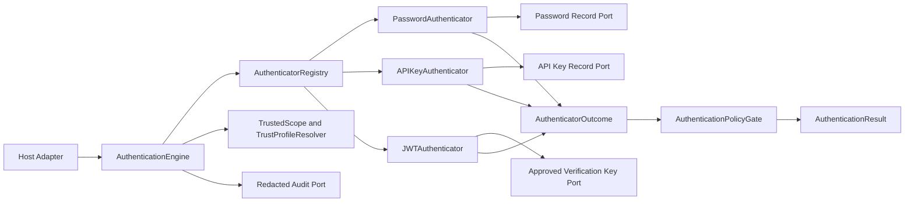
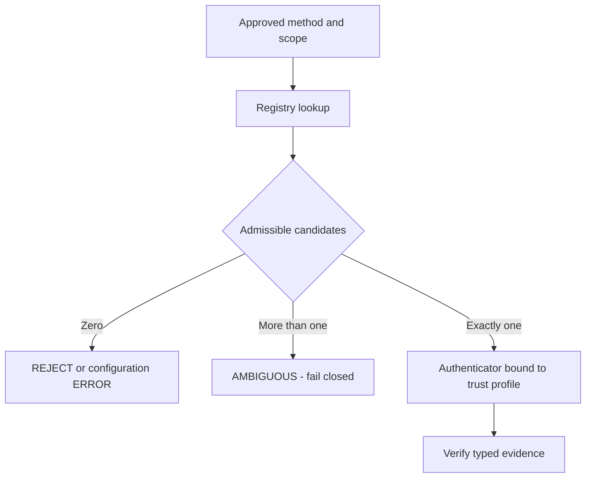
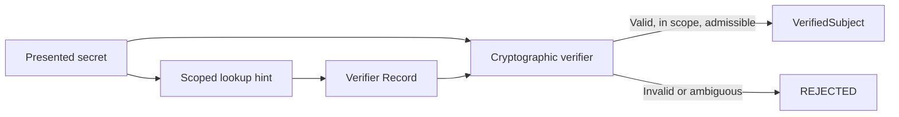
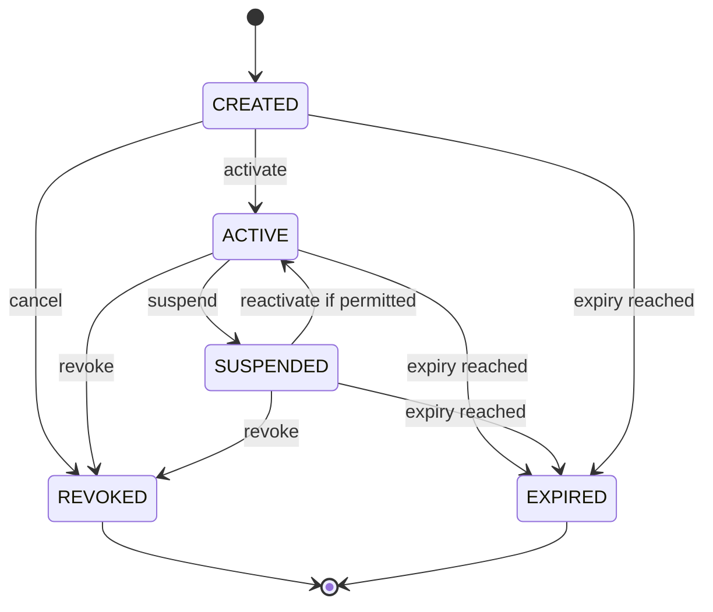
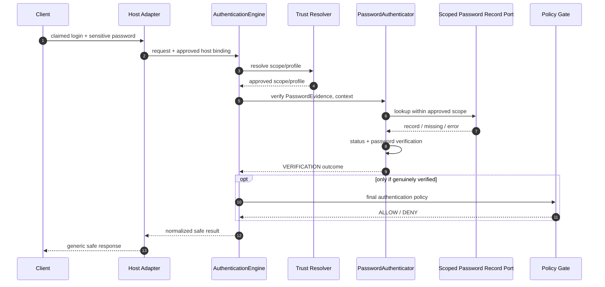
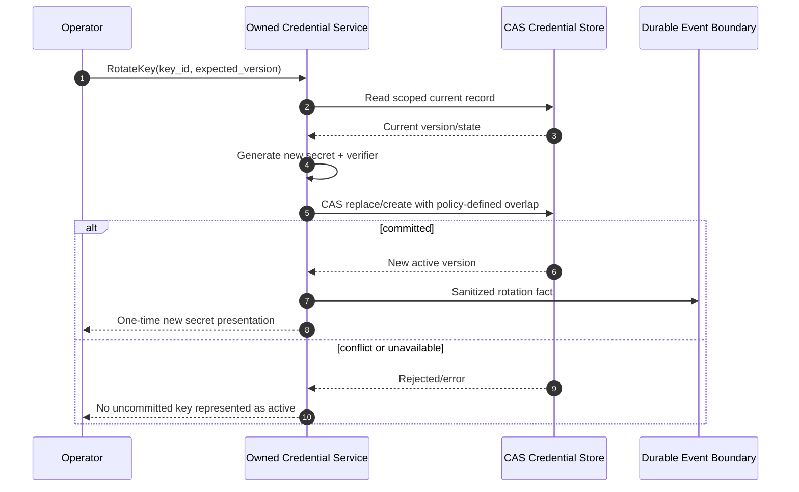
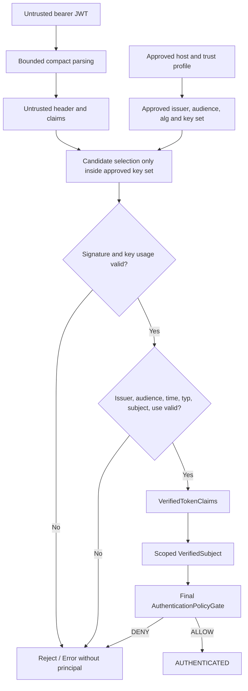
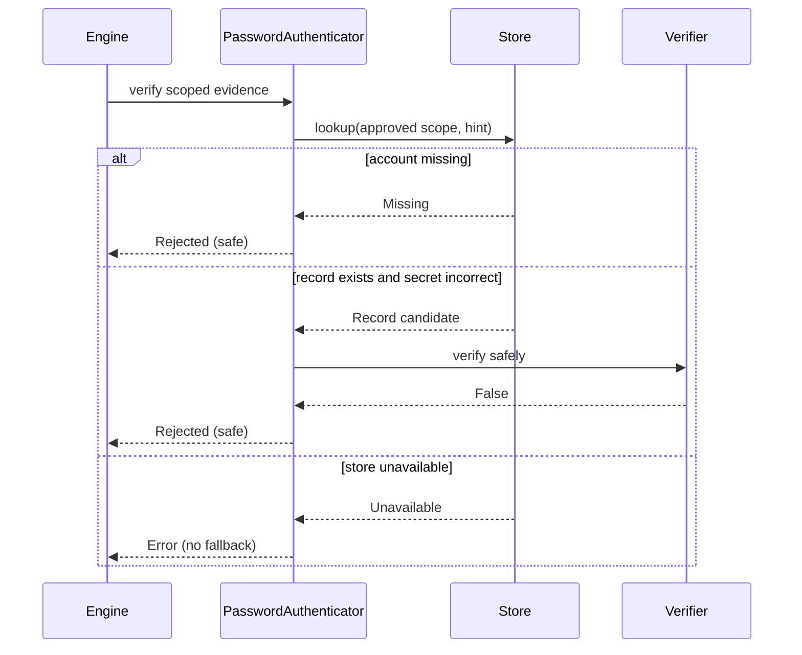
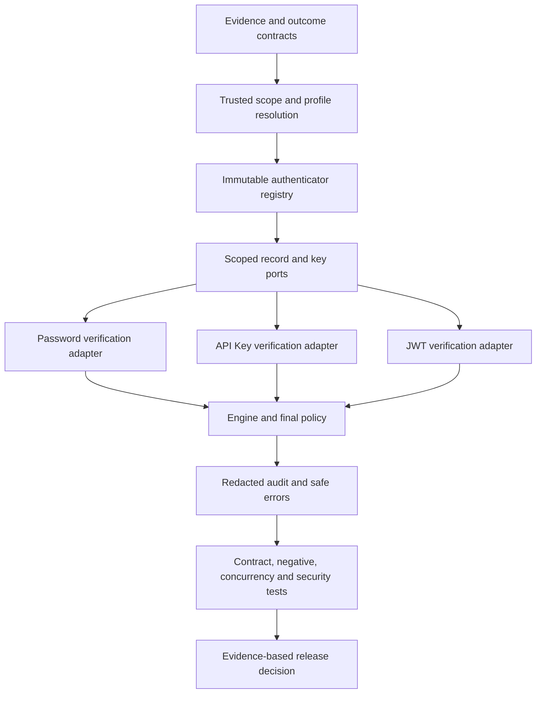

# 10_PYAUTHKIT_AUTHENTICATOR_AND_CREDENTIAL_MODEL

# PyAuthKit — Authenticator and Credential Model

> **Document :** `10_PYAUTHKIT_AUTHENTICATOR_AND_CREDENTIAL_MODEL.md`  
> **Produit :** PyAuthKit — Authentication Engine for the Modern Python Ecosystem  
> **Type :** spécification de domaine, mécanismes de vérification et contrats de sécurité  
> **Statut :** **PROPOSED / DESIGN** — aucune implémentation ni qualification présumée  
> **Version documentaire :** 0.1.0  
> **Date :** 2026-10-29  
> **Langue :** français, termes et API Python en anglais  
> **Sources internes :** documents `00`–`09` et `PYAUTHKIT_SOFTWARE_DESIGN_LEARNING_CONVENTION.md`  
> **Périmètre MVP :** authentification par Password, API Key, validation de JWT bearer ; authenticator contract, evidence, record resolver et vérification scoped  
> **Périmètre conditionnel :** ownership local des credentials, rotation, révocation et mutation des records  
> **Extensions post-MVP :** TOTP/MFA, WebAuthn/passkeys, OIDC/SAML, mTLS, machine/workload, passwordless  
> **Prochain document :** `11_PYAUTHKIT_AUTHENTICATION_FLOW_AND_CHALLENGE_MODEL.md`

---

## Guide de lecture

| Parcours | Sections | Intention |
|---|---|---|
| Fondations et langage du domaine | 0–7 | Séparer preuve présentée, mécanisme et identité authentifiée |
| Contrats et données | 8–16 | Décrire `Authenticator`, outcomes, records, ownership, lifecycle |
| Mécanismes MVP | 17–25 | Password, API Key et JWT sous profil de confiance |
| Sécurité et exécution | 26–32 | Policies, multi-tenant, erreurs, temps, stockage, audit |
| Exemples et qualification | 33–40 | Python, Mermaid, tests, anti-patterns, ADR et roadmap |
| Annexes | A–E | Glossaire, matrices et templates de revue |

**Règle de lecture :** les termes *verified*, *trusted*, *approved* et *secure* expriment des obligations à satisfaire par l'implémentation ; ils ne deviennent pas vrais parce qu'une classe, un attribut ou une documentation les porte. Les modèles Python ci-dessous sont pédagogiques et ne constituent **pas** un authenticator cryptographique prêt à l'emploi.

---

## 0. Résumé exécutif

Un **authenticator** est un comportement spécialisé capable d'évaluer une *evidence* d'authentification avec des dépendances autorisées. Un **credential** peut désigner un secret, une clé, un facteur de possession ou un artefact cryptographique ; son **record** est éventuellement une donnée persistée dont le cycle de vie appartient explicitement à un système.

Le besoin réel n'est pas de « supporter trois formats de login ». Il est de rendre les validations **interchangeables** sans permettre à une entrée non fiable de choisir sa racine de confiance, sans faire sortir les secrets des frontières prévues et sans attribuer des permissions à la suite d'une preuve simplement bien formée.

```text
UNTRUSTED BOUNDARY                   APPROVED AUTHENTICATION BOUNDARY

AuthenticationRequest                 TrustedEntryContext (host)
 ├── ClaimedIdentity (hint)                  │
 └── PresentedEvidence (secret/token)        ▼
            │                        TrustedScope + TrustProfile
            │                                 │
            └──────────────────┬──────────────┘
                               ▼
                        AuthenticatorRegistry
                               │
                               ▼
                      selected Authenticator
                               │
                     scoped records / keys
                               │
                               ▼
                     AuthenticatorOutcome
                        (internal verdict)
                               │
                    AuthenticationPolicyGate
                               │
                               ▼
                      AuthenticationResult

    REJECTED or ERROR => NO final AuthenticatedPrincipal
    AUTHENTICATED     => verified subject + final policy satisfied
```

### 0.1 Décisions de référence déjà établies dans `00`–`09`

1. Le moteur reste **framework-agnostic**, **provider-agnostic** et **storage-agnostic**.
2. `AuthenticationEngine` orchestre ; il **ne réalise pas** lui-même chaque calcul cryptographique.
3. `ClaimedIdentity` ne constitue pas une preuve ; `VerifiedSubject` est **situé dans une portée approuvée**.
4. L'authenticator retourne un `AuthenticatorOutcome` **interne**, jamais un succès final directement public.
5. `TrustProfile` et `TrustedScope` sont dérivés d'une autorité approuvée indépendamment de l'evidence entrante.
6. Un JWT reçu doit être **vérifié** ; le vérifier n'oblige ni à créer une session ni à émettre un autre token.
7. Créer, renouveler ou révoquer un credential suppose de connaître **son owner**.
8. L'authentification, la gestion d'identité (`PyIAMKit`) et l'autorisation restent des responsabilités distinctes.

### 0.2 Nouveautés propres au document `10`

Ce document spécialise les interfaces des authenticators et des stores, les formats de vérification Password/API Key/JWT, les politiques de sélection et d'évolution cryptographique, les comportements d'échec, les effets de bord permis et les preuves de tests requises. Les signatures proposées ici ne remplacent ni l'API publique provisoire de `09` ni les invariants `AUTH-INV-*` de `07`.

### 0.3 Ce document ne démontre pas

- qu'un algorithme de password hashing a été sélectionné et qualifié dans le code ;
- qu'un fournisseur de JWT ou un JWKS distant est sécurisé, disponible ou autorisé ;
- que les révocations sont instantanées sur tous les processus, caches et régions ;
- que les plugins ne peuvent jamais contourner la politique sans sandboxing et tests ;
- qu'un niveau NIST AAL ou une conformité OWASP, FIPS, RGPD ou SOC 2 est acquis ;
- que la présence d'un type `VerifiedSubject` suffit à empêcher sa construction abusive.

---

## 1. Filiation documentaire, statut et source de vérité

| Référence | Autorité documentaire retenue | Usage dans `10` |
|---|---|---|
| `00` — Expression du besoin | acteurs, mécanismes, vision | périmètre Password/API Key/JWT et évolutivité |
| `01` — Requirements Analysis | exigences `FR/NFR/SEC/ARC/INT/ACC` | qualifications et contraintes attendues |
| `02` — Vision & Principles | séparation des domaines, KISS/DIP/SoC | justification des ports et strategies |
| `03` — System Architecture | composants et entrées/sorties | rattachement au pipeline du moteur |
| `04` — Domain Objects | `DO-001..048` | vocabulaire des objets de domaine |
| `05` — Entities & Value Objects | classification DDD | `CredentialRecord` entity seulement sous ownership |
| `06` — Relationships & ERD | `REL-001..060` | liens, scope, cardinalités, cohérence |
| `07` — Invariants & Business Rules | `AUTH-INV-001..064`, `AUTH-BR-*` | **règles métier candidates de référence** |
| `08` — Commands, Queries & Use Cases | `APP-UC-*`, `APP-CTR-*` | opérations et scénarios applicatifs |
| `09` — Authentication Engine Model | `ENG-*`, pipeline de décision | signatures internes compatibles |
| Convention de conception | Problem First; Trust First; Pattern if needed | fiches pédagogiques et traçabilité |

**Politique de conflit :** si `10` affine un terme précédemment ambigu, cette évolution est signalée comme `TEN-PROPOSAL` et devra être arbitrée ; elle ne modifie pas rétroactivement `07`, `08` ou `09`.

| Marqueur | Sens |
|---|---|
| `SOURCE-CONSTRAINT` | exigence documentaire déjà posée |
| `TEN-PROPOSAL` | spécialisation proposée dans le présent document |
| `OPEN / ADR` | décision non figée |
| `POST-MVP` | extension conceptuelle non promise pour la première version |
| `CONDITIONAL` | actif seulement si un owner/contrat de persistance l'autorise |

---

## 2. Problème métier : prouver une identité sans confondre les preuves

Trois applications peuvent accepter des credentials totalement différents : un humain saisit un password, un service fournit une API Key opaque et une API reçoit un JWT signé. Le **même moteur** doit renvoyer une décision uniforme, mais les contrôles cryptographiques, la durée de vie, les stores et les modèles de menace diffèrent.

**Pressions de conception :**

- Variabilité : chaque méthode possède son protocole de preuve et ses contraintes propres.
- Autorité : l'issuer, le tenant, le namespace, l'audience, le KDF ou les clés doivent être contrôlés par configuration approuvée.
- Confidentialité : passwords, keys et JWT peuvent contenir des secrets, attributs personnels et données de session.
- Disponibilité : lookup, CPU coûteux d'un KDF, rotation des clés, caches et JWKS ne doivent pas transformer une panne en succès.
- Correctness : une preuve valide peut rester insuffisante pour la politique d'authentification finale.
- Adaptabilité : ajouter un authenticator doit préserver les garanties de domaine et les contrats de tests existants.

**Solution simple valide :** une fonction Python typée pourrait suffire à une application unique. Un contrat `Authenticator` devient utile à PyAuthKit parce que **plusieurs familles de vérification interchangeables** sont un besoin explicite et immédiat.

---

## 3. Bounded Context et répartition des responsabilités

| Domaine | Responsabilité | Ne possède pas automatiquement |
|---|---|---|
| PyAuthKit — Authentication | preuve, vérification, niveau de confiance, tentative, éventuels credentials owned | comptes métier, groupes, autorisation |
| PyIAMKit — Identity & Access | identité organisationnelle, rattachements, groupes, rôles, permissions | vérification cryptographique native de tous les mécanismes |
| Host Application / Gateway | routes, transport, identité de l'application, binding du tenant, réponses HTTP/CLI | vérité cryptographique d'un token non vérifié |
| Credential System externe | lifecycle / données d'authentification dont il est owner | pouvoir implicite de décider l'AuthZ locale |
| External IdP | assertions et authentification selon son protocole | confiance automatique avant validation locale |

### 3.1 Trois notions à ne pas fusionner

```text
ClaimedIdentity       = qui le client PRÉTEND être ?
VerifiedSubject       = quelle identité a été PROUVÉE, avec quelle autorité ?
AuthenticatedPrincipal= quelle identité le moteur ACCEPTÉE après policy ?
```

Une identité peut être vérifiée sans correspondre à un `User` local. L'origine (`local`, `federated`, `machine`...), la nature du sujet (`human`, `service`, `agent`...) et son namespace restent **orthogonaux**.

### 3.2 Source de confiance de premier rang

`TrustedEntryContext` est établi côté hôte ; `TrustedScope` est résolu depuis une information approuvée ; `TrustProfile` contient les politiques de preuve autorisées. Le request body, les headers non authentifiés et les claims JWT décodés ne peuvent **pas** redéfinir ces objets.

---

## 4. Ubiquitous Language et distinctions essentielles

| Terme | Définition dans PyAuthKit | Confusion interdite |
|---|---|---|
| `Credential` | moyen de prouver une identité ou matérialiser une preuve | ≠ record possédé, ≠ identifiant |
| `PresentedEvidence` | donnée reçue et non fiable | ≠ preuve validée |
| `CredentialReference` | handle ou hint de lookup | ≠ connaissance du secret |
| `CredentialRecord` | représentation administrée d'un verifier et de son état | ≠ password en clair |
| `PasswordVerifierRecord` | hash salé et métadonnées de vérification | ≠ password d'origine |
| `APIKeyVerifierRecord` | sélecteur/empreinte, état et scope d'une clé | ≠ API key complète |
| `JWT` | format de token signé ou chiffré selon profil | ≠ preuve automatiquement approuvée |
| `VerificationKey` | matériel permettant une validation cryptographique | ≠ racine de confiance choisie par le token |
| `Authenticator` | vérificateur sous contrat d'exécution | ≠ Identity Provider, ≠ Authorization Policy |
| `AuthenticatorRegistry` | composition/résolution des mécanismes autorisés | ≠ base d'utilisateurs |
| `VerificationContext` | contexte approuvé de vérification, déterminé par moteur | ≠ request context déclaré |
| `AuthenticatorOutcome` | résultat interne du mécanisme | ≠ décision finale du moteur |
| `AuthenticationPolicy` | règle de décision finale d'AuthN | ≠ permissions RBAC/ABAC |
| `AuthenticationResult` | verdict final du moteur | ≠ émission de token |
| `CredentialOwner` | autorité responsable du cycle de vie | ≠ sujet qui présente le credential |
| `Revocation` | changement de statut / invalidation sous garantie explicite | ≠ suppression de tout token déjà émis |
| `Rotation` | remplacement contrôlé de matériel/verifier | ≠ simple duplication de key active |

---

## 5. Taxonomie conceptuelle des Credentials

| Famille | Evidence présentée | Verifier ou trust data | Classement MVP | Ownership possible |
|---|---|---|---|---|
| Password | secret mémorisé fourni | salted password-hash record | **MVP** | local ou externe |
| API Key opaque | secret aléatoire fourni | selector + hash/MAC + record | **MVP** | local ou externe |
| JWT bearer | compact JWT | trust profile, issuer keys, claims policy | **MVP (validation)** | issuer externe / app |
| TOTP | code limité dans le temps | secret TOTP et policy | POST-MVP | local ou provider |
| Recovery code | code à usage unique | verifier de code et statut | POST-MVP | local ou provider |
| WebAuthn / Passkey | assertion liée à challenge | public key, RP/origin, counter policy | POST-MVP | RP / provider |
| OIDC ID token | assertion fédérée | provider metadata, keys, nonce, state | POST-MVP | IdP externe |
| SAML assertion | assertion XML signée | trust anchor, audience, recipient, validity | POST-MVP | IdP externe |
| mTLS / certificate | preuve TLS et certificat | anchors + validation PKI | POST-MVP | PKI / workload |
| Signed workload assertion | assertion signée bornée | service identity trust/claims | POST-MVP | issuer machine |

**Anti-pattern :** introduire `class Credential(str)` dont tous les sous-types affichent leurs valeurs et s'auto-déclarent « valid ». Le modèle distingue le **support** de preuve, les **données présentées**, les **verifiers** et l'**autorité de vérification**.

### 5.1 Trois catégories de credentials

1. **Secret partagé** : password, clé API opaque — la vérification confronte une donnée secrète présentée à une représentation protégée.
2. **Possession cryptographique** : signature, certificat ou clé publique — la vérification contrôle une preuve liée à une clé, un contexte et une autorité.
3. **Assertion fédérée** : un tiers atteste un sujet selon un protocole — la validation locale doit établir que cet émetteur est approuvé pour cet usage.

La distinction est conceptuelle et non exhaustive : certains flux composent plusieurs catégories. Un JWT bearer compromis reste rejouable dans les conditions de son contrat ; une signature cryptographique valide ne suffit pas à établir qu'un token a été émis pour **notre** application.

---

## 6. Carte des composants et de leur ownership



### 6.1 Composition du moteur

L'Engine **possède l'ordre de décision** et résout les dépendances. Un authenticator **possède sa vérification spécialisée** et communique uniquement les données nécessaires à une politique finale. Un store **possède l'accès à ses records**, sans choisir la confiance d'un client. Le Composition Root configure les providers et impose les profils acceptables.

### 6.2 Rôles à garder séparés

| Composant | Travail explicite | Travail interdit |
|---|---|---|
| `Authenticator` | vérifier une evidence sous profil | émettre `AuthenticationResult.AUTHENTICATED` directement |
| `CredentialResolver` | retrouver record dans scope approuvé | prendre le tenant depuis un champ arbitraire |
| `CredentialVerifier` | comparer / vérifier secret ou signature | définir permissions IAM |
| `TrustProfileResolver` | choisir une configuration approuvée | suivre `jku` librement |
| `AuthenticatorRegistry` | résoudre un seul vérificateur admissible | fallback silencieux à un autre provider |
| `AuthenticationPolicyGate` | décision AuthN finale | déléguer un mandat ou provisionner un compte |
| `CredentialLifecycleService` | muter records owned selon contrats | révoquer directement un système externe sans API autorisée |
| `AuthenticationEngine` | orchestrer, limiter, normaliser | porter toutes les primitives crypto et persistence |

---

## 7. Pipeline spécialisé `Authenticator` — de la preuve au verdict interne

```text
1. Parse evidence structure under resource limits
2. Resolve approved trust + method + scope (Engine)
3. Resolve one configured authenticator (Engine/Registry)
4. Map input to typed evidence for that method
5. Resolve scoped verifier material (record/key)
6. Assert admissible status/version/use/time
7. Perform method-specific cryptographic verification
8. Validate semantic constraints tied to approved profile
9. Build bounded internal outcome + provenance
10. Return to Engine for FINAL authentication policy
```

L'ordre 5–8 peut être adapté selon le mécanisme mais jamais de manière à autoriser une preuve parce qu'un nom, un `kid`, un prefix, un `sub` ou une classe ont été reconnus. La validation de structure peut précéder la résolution de profil si elle ne déclenche ni réseau non approuvé ni confiance implicite.

### 7.1 États de vérification proposés

| État interne | Sens | Issue finale possible |
|---|---|---|
| `VERIFIED` | preuve vérifiée entièrement **dans son scope** | soumise au policy gate, pas succès direct |
| `REJECTED` | preuve non admise ou invalidité attendue | rejet sans principal final |
| `ERROR` | infrastructure, configuration, librairie ou délai | erreur sûre, sans principal final |

`CHALLENGE_REQUIRED` relève de la future **décision de flow**, pas d'une variante qui transforme magiquement une preuve primaire en authentification complète.

---

## 8. Contrat d'un `Authenticator`

### 8.1 Interface candidat `Authenticator[T]`

```python
class Authenticator(Protocol[EvidenceT]):
    @property
    def method(self) -> str: ...

    async def verify(
        self,
        evidence: EvidenceT,
        context: VerificationContext,
    ) -> AuthenticatorOutcome: ...
```

Cette signature n'est qu'une **forme candidate**. Les exigences imposées sont la séparation des preuves par type, un contexte reçu du moteur, des résultats discriminés et l'absence d'état mutable secret partagé entre tentatives.

### 8.2 Préconditions (`TEN-CTR-001..006`)

- `TEN-CTR-001` : le moteur a sélectionné une méthode unique et autorisée par le profil.
- `TEN-CTR-002` : la forme de l'evidence est admissible et bornée pour le mécanisme.
- `TEN-CTR-003` : `VerificationContext` est constitué à partir de sources approuvées.
- `TEN-CTR-004` : le verifier ne reçoit que des capacités de ports nécessaires à sa vérification.
- `TEN-CTR-005` : les éventuelles dépendances réseau sont restreintes par politique et budgets.
- `TEN-CTR-006` : la deadline/cancellation du caller s'applique selon un contrat explicite.

### 8.3 Postconditions (`TEN-CTR-007..014`)

- `TEN-CTR-007` : un verdict `VERIFIED` est associé à un `VerifiedSubject` **scope-bound** et à la méthode.
- `TEN-CTR-008` : `REJECTED` et `ERROR` ne portent aucun `AuthenticatedPrincipal`.
- `TEN-CTR-009` : l'outcome est indépendant de la représentation HTTP/CLI/framework.
- `TEN-CTR-010` : les secrets n'apparaissent ni dans le résultat, ni dans les exceptions, ni dans la télémétrie.
- `TEN-CTR-011` : l'authenticator ne décide pas d'une autorisation d'accès ou d'un rôle IAM.
- `TEN-CTR-012` : une preuve partielle reste interne à un flow POST-MVP et ne constitue jamais une réussite finale.
- `TEN-CTR-013` : un résultat de validation porte provenance et version du profil vérifié si requis.
- `TEN-CTR-014` : erreur ou annulation ne déclenche pas de voie de vérification moins stricte.

### 8.4 Choix d'API ouverts

Les types concrets de `EvidenceT`, la nature asynchrone des fonctions CPU-bound, les politiques de fallback du registry et les modalités de provenance restent des décisions à documenter avant de figer le SDK.

---

## 9. `AuthenticatorRegistry` et résolution des stratégies

**Problème :** comment choisir une implémentation autorisée sans condition géante `if provider == ...` ni sélection à partir d'une chaîne hostile ?



### 9.1 Clé de sélection candidate

`(method, accepted_evidence_family, provider_or_profile_binding, realm_or_scope)` ou une clé plus petite si les invariants sont garantis par le Composition Root. La clef exacte reste `OPEN`; **method** seul n'est pas forcément suffisant dès qu'un mécanisme dessert plusieurs issuers ou tenants.

### 9.2 Règles de bootstrap

1. Enregistrer les mécanismes **avant** l'exposition du service.
2. Refuser les doublons ambigus et les méthodes inconnues.
3. Vérifier la compatibilité méthode ↔ famille d'evidence ↔ profil.
4. Déclarer les capabilities et les dépendances nécessaires.
5. Geler la registry par défaut pendant le traitement des requêtes ; reconfiguration atomique si hot reload retenu.
6. Ne pas déclencher de discovery réseau depuis un token non vérifié.
7. Tester la substituabilité avec un contrat de référence identique pour tous les authenticators d'une famille.

**Patterns :** Strategy pour les comportements interchangeables ; Registry comme mécanisme de composition ; Factory uniquement si la création exige réellement une logique.

---

## 10. `PresentedEvidence` : frontières et typage sensible

```text
Input
 ├── PasswordEvidence(claimed_login, secret)
 ├── APIKeyEvidence(opaque_key)
 └── JWTBearerEvidence(compact_token)

All above = UNTRUSTED, SENSITIVE, BOUNDED
```

### 10.1 Extraction vs vérification

Un adaptateur de transport peut extraire `Authorization: Bearer ...`, une API Key ou un champ de password et normaliser la **forme**. Il ne doit pas décider qu'un JWT est valable après `decode()` ou qu'un prefix valide suffit à une API Key.

### 10.2 Règles sur les données sensibles

- Ne jamais inclure le secret dans `repr`, `str`, logs, traces, métriques, messages d'exception ou événements.
- Exclure les secrets des DTO publics de résultat et des sérialisations génériques (`dataclasses.asdict`, JSON dump, debug HTTP).
- Limiter taille, encodage, nombre de segments JWT et profondeur des objets avant toute opération coûteuse.
- Éviter de créer des copies inutiles dans la pile applicative ; admettre que les `str` Python ne fournissent pas de garantie universelle de zeroization.
- Isoler les éléments de diagnostic et les données d'evidence, même lorsqu'un framework facilite le debug.
- Traiter les JWT bearer complets comme sensibles ; un JWT « signé » n'est pas nécessairement chiffré.
- Préciser le comportement en cas d'evidence absente, de type incorrect ou de payload malformé.

### 10.3 Identité revendiquée

Les formats email, username, alias, client ID ou key prefix peuvent guider un lookup **dans le scope déjà fixé**. Une normalisation d'email/username qui fusionne des comptes est un risque métier ; elle doit suivre le contrat du système propriétaire de l'identifiant.

---

## 11. `CredentialReference` ≠ `CredentialRecord` ≠ secret



| Objet | Peut circuler dans logs ? | Prouve une possession ? | Peut avoir un ID stable ? |
|---|---|---|---|
| Secret présenté | **Non** | seulement après vérification | sans nécessité de l'exposer |
| Key prefix / public selector | sous minimisation + risques de corrélation | **Non** | oui |
| Credential record ID | généralement interne ; ne pas journaliser sans besoin | **Non** | oui |
| Password hash / API key verifier | **Non** | non pris seul | oui |
| Trust profile ID/version | oui sous restrictions | **Non** | oui |
| VerifiedSubject | claims filtrées, jamais secret | représente le verdict d'un verifier qualifié | sujet scoped |

---

## 12. `CredentialRecord` : modèle Entity **conditionnel**

Le fait qu'une application vérifie un password ou une API Key ne signifie pas que PyAuthKit administre l'existence, l'ownership ou la révocation de ce credential. Deux architectures restent valables : **resolver read-only externe** ou **record owned localement**.

### 12.1 Option A — vérification via store externe (MVP possible)

- PyAuthKit lit un verifier de credential depuis un port scoped ;
- le système externe décide de l'enrôlement, de la rotation et de la révocation ;
- PyAuthKit respecte le statut retourné et n'expose aucune mutation locale fictive ;
- les conventions d'identité et de normalisation de ce store sont documentées.

### 12.2 Option B — credential owned (conditionnel)

| Attribut conceptuel | Sens | Contraintes |
|---|---|---|
| `credential_id` | ID stable | non dérivé du secret en clair |
| `owner_subject_ref` | sujet local/foreign autorisé | ne devient pas automatiquement identité IAM |
| `trusted_scope` | tenant, realm, namespace | isolation de toutes les opérations |
| `credential_kind` | password, api_key, etc. | famille immuable ou migration explicite |
| `verifier_ref` | référence à hash/MAC protégés | jamais secret en clair |
| `status` | état lifecycle | transitions contrôlées |
| `created_at`, `activated_at` | horodatage | horloge fiable |
| `expires_at`, `revoked_at` | bornes/événements | sémantique de date définie |
| `version` | contrôle de concurrence | CAS/optimistic lock si mutation concurrente |
| `policy_version` | provenance normative | version effectivement utilisée |
| `metadata` | informations non secrètes bornées | données sensibles minimisées |

### 12.3 Agrégat conditionnel

`CredentialRecord` peut être un **Aggregate Root** si PyAuthKit possède le lifecycle et protège des invariants sur le statut, la version et les mutations atomiques. Si la vérité se trouve ailleurs, ce serait une erreur de créer un aggregate local qui prétend décider de la révocation du provider.

### 12.4 Cycle de vie proposé (sous ownership)



L'expiration peut être une **propriété calculée de validité temporelle**, et non une mutation persistée : la machine à états illustre les possibilités, pas une obligation d'écriture d'état `EXPIRED`.

---

## 13. Invariants de cycle de vie et concurrence (`TEN-LIFE-*`)

| ID | Invariant proposé | Owner | Rejet / garantie |
|---|---|---|---|
| `TEN-LIFE-001` | un record est identifié dans un scope unique | store/owner | aucun lookup cross-scope |
| `TEN-LIFE-002` | un credential révoqué ne peut redevenir actif implicitement | lifecycle owner | terminalité selon policy |
| `TEN-LIFE-003` | un credential expiré ne devient pas valable parce que le cache est ancien | verification boundary | cache/freshness contract |
| `TEN-LIFE-004` | la rotation ne réactive pas un ancien secret | lifecycle + verifier | transition vérifiée |
| `TEN-LIFE-005` | une mise à jour concurrente périmée échoue | owned repository | CAS / optimistic version |
| `TEN-LIFE-006` | un identifiant n'est pas une preuve | verifier | vérification complète obligatoire |
| `TEN-LIFE-007` | une mutation locale n'est permise que pour des credentials owned | application service | read-only externe |
| `TEN-LIFE-008` | un usage refusé n'expose ni secret ni existence du compte | API/audit | diagnostic neutre |
| `TEN-LIFE-009` | les dates et la politique évaluées sont cohérentes | clock/policy | fail-closed selon décision |
| `TEN-LIFE-010` | une rotation est durable selon le contrat de persistance retenu | owner/UoW | pas de succès fictif |
| `TEN-LIFE-011` | l'état de révocation observé a la fraîcheur requise | cache/store | refus ou erreur si garantie indisponible |
| `TEN-LIFE-012` | les compteurs `last_used` sont accessoires à la preuve | telemetry owner | pas de faux négatif/succès hors contrat |

### 13.1 Transaction et audit

Une commande `RevokeCredential` peut nécessiter une transaction sur le record et un événement durable. Le choix **transaction locale / outbox / garanties de remise** appartient aux documents `19` et `21`; un audit déclaré durable ne l'est pas simplement parce qu'un callback a été invoqué.

### 13.2 Révocation et caches

Ne pas revendiquer de révocation **immédiate globale** sans connaître le TTL, la stratégie d'invalidation, le chemin de vérification en mode dégradé et les instances géographiques. Une politique stricte peut refuser lorsque la fraîcheur de statut ne peut être garantie.

---

## 14. Port de résolution et de vérification des records

### 14.1 Lookup scoped

Le lookup doit être déterminé par un contexte approuvé, par exemple :

```text
(approved_scope, method, normalized_lookup_hint, usage)
      │
      ▼
ZERO     -> missing / generic rejection
ONE      -> record candidate, still unverified
MANY     -> ambiguity / fail closed
UNAVAIL. -> error, not wrong-password oracle
```

Les mécanismes d'optimisation par prefix ou key ID doivent préserver ces règles. Un `record` trouvé n'est jamais une identité authentifiée ; il doit être **admissible** avant de participer à une preuve.

### 14.2 Contrat candidat `CredentialRecordResolver`

- Entrées : scope approuvé, clé de lookup bornée, méthode et usage.
- Sorties : `Found`, `Missing`, `Ambiguous`, `Unavailable` ou erreurs typées cohérentes.
- Invariants : absence de reads cross-tenant, absence de fallback `first()`, métriques sans secret.
- Adapter : Memory/SQL/Redis/externe derrière un port, **sans type ORM** dans Domain/Application.

### 14.3 Interfaces séparées

Un port de lecture de hash Password, un port API Key et un port de validation de signature JWT n'ont pas besoin d'être la même interface générique. **ISP** et **minimisation des capacités** sont préférables à un `UniversalCredentialRepository` géant.

---

## 15. Politiques cryptographiques : vérification, versions et migrations

Le core ne définit **pas un algorithme propriétaire**. Il expose des décisions de configuration et des ports permettant de choisir des primitives issues de bibliothèques maintenues et correctement configurées.

| Risque | Règle candidate |
|---|---|
| format obsolète | détecter version et plan de migration admis |
| downgrade | algorithmes autorisés par profil seulement |
| mauvaise clé | key usage/issuer/audience/scoping vérifiés |
| fuite de secret | stockage protégé, logging redaction et accès minimal |
| disponibilité | budgets KDF/réseau, quotas, circuit breakers selon contexte |
| dépendance compromise | mises à jour et qualification des bibliothèques |
| erreurs crypto | refus ou erreur sans fallback permissif |
| changement de profil | versionner les décisions, éviter les effets rétroactifs fictifs |

**Note normative :** les recommandations OWASP/NIST/RFC citées dans les références externes sont des **guides à examiner** et non une certification. Une configuration doit être testée avec les bibliothèques, les versions, l'environnement de calcul et les usages réels.

---
## 16. Password Authentication — modèle de preuve

### 16.1 Cas d'usage métier (`APP-UC-001`)

Un humain présente un identifiant déclaré et un secret mémorisé. L'application veut obtenir **un sujet vérifié sous son scope**, et non récupérer le mot de passe ou simplement constater la présence d'un compte.



### 16.2 Responsabilités du PasswordAuthenticator

1. Recevoir une `PasswordEvidence` bornée.
2. Demander un record de verifier dans le scope approuvé ; jamais dans un tenant choisi librement par le caller.
3. Vérifier admissibilité temporelle, statut et usage du credential selon policy.
4. Utiliser un password verifier cryptographique **éprouvé** et correctement paramétré.
5. Distinguer secret faux, record absent, condition inapplicable et indisponibilité en interne.
6. Retourner une issue interne stable, sans fournir la preuve brute ni signaler publiquement la présence d'un compte.
7. Ne pas générer de session ou de second facteur par effet de bord implicite.

### 16.3 Modèle de PasswordVerifierRecord

| Propriété | Rôle | Sensibilité |
|---|---|---|
| `record_id` | référence au verifier | interne |
| `scope_ref` | tenant/realm approuvé | sensible au contexte |
| `owner_subject_ref` | sujet lié selon source | personnel ou interne |
| `encoded_hash` | verifier salé/paramétré | **sensible**, ne pas exposer |
| `algorithm` / `parameters` | format et coût KDF | configuration de sécurité |
| `status` | ACTIVE/SUSPENDED/REVOKED… | interne |
| `created_at`, `updated_at` | dates de provenance | interne |
| `expires_at`, `version` | lifecycle/concurrence | interne |
| `recovery_flags` | état de sécurité éventuel | strictement restreint |

Le hash n'est pas secret au sens d'un mot de passe en clair, mais il permet une **attaque hors ligne** en cas de fuite : il exige une protection d'accès et ne doit pas être divulgué.

### 16.4 Password en entrée vs politique d'enrôlement

Les règles sur la **création** d'un password (longueur, blocklist, notification, reset) et les règles sur sa **vérification** sont deux cas d'usage différents. PyAuthKit peut vérifier via un store externe même s'il ne fournit pas de formulaire de changement de mot de passe.

---

## 17. Password Hashing, stockage sûr et migration

### 17.1 Exigence cryptographique

Les mots de passe doivent être vérifiés à partir d'un **hash salé avec fonction adaptée à la résistance aux attaques hors ligne**, sans stockage en clair ni SHA-256 rapide utilisé seul comme password KDF. OWASP recommande Argon2id pour les nouveaux systèmes lorsqu'il convient à l'environnement ; des options historiques ou de conformité peuvent imposer d'autres choix. Les paramètres de mémoire/temps sont à sélectionner et benchmarker, **non codés en dur dans le domaine**.

Repères externes consultés :

- OWASP Password Storage Cheat Sheet : https://cheatsheetseries.owasp.org/cheatsheets/Password_Storage_Cheat_Sheet.html
- NIST SP 800-63B-4 : https://pages.nist.gov/800-63-4/sp800-63b.html
- RFC 9106 Argon2 : https://www.rfc-editor.org/rfc/rfc9106

### 17.2 Responsabilité d'un `PasswordHasher` ou `PasswordVerifier`

| Opération | Exécution | Restriction |
|---|---|---|
| `verify(presented, encoded_hash)` | bibliothèque auditée | ne pas construire d'algorithme maison |
| `needs_rehash(encoded_hash, policy)` | si migration retenue | décision bornée par politique |
| `hash(new_secret, policy)` | commande d'enrôlement/rotation owned | ne pas l'appeler depuis une lecture non autorisée |
| `verify_dummy(...)` | mitigation éventuelle d'énumération | coût/DoS à mesurer, pas garantie parfaite |

### 17.3 Rehash-on-login : choix **conditionnel**

```text
Password verified under legacy admissible hash
                    │
                    ├── no ownership -> read-only, no local mutation
                    │
                    └── owned + migration policy
                              │
                              ▼
                        new verifier hash
                              │
                              ▼
                    CAS write / atomic upgrade
```

La migration doit éviter la perte d'un changement concurrent, ne pas rejouer le secret dans un événement et respecter l'ownership. Un `needs_rehash` ne signifie pas qu'une mutation automatique est toujours légitime.

### 17.4 Politiques de password (enrôlement)

Le projet ne doit pas imposer une règle arbitraire « majuscule + chiffre + symbole » sans justification. Les recommandations NIST 800-63B-4 prévoient notamment, dans leur domaine d'application, une longueur minimale accrue pour les passwords à facteur unique, la vérification contre des blocklists et l'abandon des rotations périodiques sans raison. Ces prescriptions concernent **l'enrôlement** et doivent être distinguées du verifier MVP. Une future policy portera le contexte normatif et l'application cible.

### 17.5 Problèmes de performances et de sécurité

- Le coût KDF doit être suffisamment élevé contre les attaques hors ligne **et** borné face au DoS en ligne.
- Les ressources nécessaires aux opérations coûteuses ne doivent pas être un service illimité accessible avant les guards.
- Les réglages doivent être mesurés sur le matériel de déploiement réel.
- Une inconnue sur l'algorithme ou ses paramètres donne un rejet/erreur, **pas** un retour au mot de passe en clair.
- Un échec de la dependency de rate limiting obligatoire produit un échec sûr, selon la policy de disponibilité explicite.

---

## 18. Password : anti-bruteforce, énumération et prise de contrôle

| Menace | Contre-mesure / contrat à qualifier | Réserve |
|---|---|---|
| Credential stuffing | rate limiting multi-signal, détection, MFA futur | IP seule insuffisante |
| Password guessing | limites par compte/scope et source, défense graduée | ne pas faciliter le lockout abusif |
| User enumeration | réponses publiques uniformes et temporisation mesurée | les canaux annexes restent à auditer |
| Timing attack | comparaison par primitive adaptée ; observation statistique | « constant-time » ne couvre pas l'ensemble du système |
| Expensive hashing DoS | limites concurrentes et budgets CPU/mémoire | ne pas dégrader la protection hors ligne sans analyse |
| Reset abuse | preuve de récupération, usage unique, expiration | document spécialisé post-MVP |
| Insider access | permissions d'accès au verifier et secret-management | la DB leak doit rester un scénario étudié |
| Password reuse | blocklist, avertissements et protections applicatives | relève principalement de l'enrôlement |

### 18.1 Sémantique d'erreur

Le caller public reçoit un **refus générique**, sans différence exploitable entre login inconnu, mauvais secret et credential désactivé lorsque cela serait un oracle. À l'intérieur, des codes structurés peuvent distinguer une panne de base de données d'un mauvais mot de passe, mais restent confidentiels.

### 18.2 Anti-bruteforce et responsabilité de l'hôte

Un guard applicatif ne peut pas nécessairement distinguer des utilisateurs derrière un proxy si l'adaptateur transmet naïvement `X-Forwarded-For`. Il faut un modèle explicite de confiance pour l'origine réseau et des limites adaptées aux comptes et aux scopes.

---

## 19. API Key Authentication — modèle de preuve

### 19.1 Cas d'usage métier (`APP-UC-002`)

Un client logiciel ou service fournit une clé opaque longue, aléatoire, liée à un environnement et à un sujet. PyAuthKit doit vérifier **le secret complet** et les limites d'usage du record, sans assimiler une API Key à un utilisateur ni à une permission.

### 19.2 Partition candidate d'une clé

```text
API Key presented to host (sensitive whole)
  ├── selector / key ID / optional public prefix
  │       -> lookup hint ONLY
  └── random high-entropy secret
          -> compared to securely stored verifier
```

Le selector peut être public mais reste une donnée corrélable, à minimiser. Le format exact (prefix, separator, checksum de saisie) relève d'une proposition et ne doit pas être confondu avec un contrôle cryptographique.

### 19.3 Contrat `APIKeyVerifierRecord`

| Attribut | Pourquoi | Obligation |
|---|---|---|
| `key_id` | stabilité de l'identifiant | non secret, scope unique |
| `scope` / `environment` | empêcher dev→prod et cross-tenant | préapprouvé |
| `owner_subject` | acteur prouvé par la clé | non nécessairement Human |
| `verifier_digest` | preuve stockée non réversible | protégé |
| `verifier_algorithm` / `pepper_ref` | version et secret-management | rotation contrôlée |
| `status` | suspension/révocation | pris en compte à chaque vérification selon freshness |
| `not_before` / `expires_at` | durée de validité | horloge autoritative |
| `usage_restrictions` | API/environnement autorisé pour l'AuthN | AuthZ séparée |
| `version` | mutation concurrente | CAS/transaction selon owner |

### 19.4 Algorithme conceptuel

```text
1. Check input shape and maximum size
2. Resolve approved host scope / environment
3. Parse selector (if format supports it)
4. Scoped lookup -> zero / one / ambiguous / unavailable
5. Verify state, validity and permitted usage
6. Compare presented secret against protected verifier
7. Build scope-bound VerifiedSubject + method provenance
8. Return internal verification outcome
9. Let Engine evaluate final authentication policy
```

### 19.5 Sur le hachage des API Keys

Une API Key générée à partir d'un **aléa cryptographique de forte entropie** n'est pas équivalente à un password choisi par un humain. Un digest cryptographique ou un MAC avec secret serveur peut être approprié selon le format et le modèle de menace. La proposition de référence privilégie un **verifier borné par scope et avec clé de protection gérée** lorsque les risques de fuite de base le justifient ; le mécanisme précis est un ADR. Il serait erroné de prescrire sans analyse un KDF password coûteux pour toute API Key aléatoire.

---

## 20. API Key : création, rotation et révocation (OWNED seulement)

### 20.1 Création

Une clé créée localement doit utiliser un générateur cryptographiquement sûr, avoir une entropie suffisante pour son exposition et être **présentée intégralement une seule fois** lors de l'enrôlement. Le record persisté stocke un verifier et non la clé en clair.

### 20.2 Rotation contrôlée



### 20.3 Stratégie d'overlap (option)

- `NO_OVERLAP` : ancienne clé invalidée selon garantie de commit ; risques de coupure client.
- `BOUNDED_OVERLAP` : deux clés peuvent coexister pour une durée configurée ; surveillance accrue.
- `STAGED_ACTIVATION` : nouvelle clé distribuée avant activation contrôlée ; complexité supérieure.

L'overlap n'est **pas** une exigence universelle du MVP. La décision doit considérer sécurité, disponibilité, clients et cohérence distribuée.

### 20.4 Révocation

Un record owned passe à `REVOKED` selon le contrat défini. La persistance, l'invalidation des caches et les garanties aux autres processus doivent être testées ; l'émission d'un événement « revoked » ne suffit pas à prouver la propagation effective.

### 20.5 Last-used et quotas

`last_used_at`, compteurs et quotas peuvent être traités de façon asynchrone si leur fraîcheur n'est pas requise pour une policy obligatoire. Si un quota constitue une **barrière de sécurité**, la décision ne doit pas reposer sur un indicateur éventuellement retardé sans garantie.

---

## 21. JWT Bearer Authentication — périmètre exact

### 21.1 Consommer un JWT ≠ l'émettre

Le MVP vérifie des JWT bearer entrants **sous un profil d'émetteur et d'usage préapprouvé**. Il n'affirme pas être un OAuth Authorization Server, un OIDC Provider ou un `TokenIssuer` complet.

### 21.2 Pipeline de vérification



**Point crucial :** le contenu lisible du JWT est disponible avant vérification, mais sa lecture ne transforme pas `iss`, `sub`, `aud`, `kid`, `jku`, `x5u` ou `alg` en instructions dignes de confiance.

### 21.3 `JWTVerifierProfile` candidat

| Propriété approuvée | Fonction |
|---|---|
| `trusted_scope` | isolement tenant/realm/application |
| `issuer_identity` | source de confiance approuvée |
| `accepted_audiences` | destinataires autorisés |
| `allowed_algorithms` | liste explicite, jamais extension via header |
| `verification_key_source` | clés locales / JWKS allowlist et bindings |
| `token_kind` / `expected_typ` | éviter la confusion de token |
| `required_claims` | contrat sémantique explicite |
| `clock_skew_policy` | tolérance bornée, sans désactiver le temps |
| `subject_namespace` | identité scope-bound (issuer + sub, etc.) |
| `maximum_token_size` | limitation de parsing et ressources |
| `profile_version` | provenance de décision |

### 21.4 Algorithmes et type de token

- Rejeter les algorithmes non acceptés, notamment une option non signée si un JWS signé est requis.
- Ne pas permettre la confusion symétrique/asymétrique ou l'utilisation d'une clé sous un algorithme incompatible.
- Exiger le type de token approprié au contexte (`typ`, claims spécifiques, ou règles équivalentes), quand la prévention de substitution le requiert.
- Les règles d'acceptation d'un **access token** ne sont pas identiques à celles d'un **ID token OIDC** ; leurs profils doivent être séparés.
- Un JWT valide pour une API A, un environnement test ou un autre issuer ne doit pas être accepté par B par opportunisme.

Référence de sécurité principale : **RFC 8725 — JSON Web Token Best Current Practices** : https://www.rfc-editor.org/rfc/rfc8725

---

## 22. JWT : sémantique de claims et frontières d'identité

### 22.1 Champs à qualifier selon profil

| Champ / information | Contrôle | Échec ciblé |
|---|---|---|
| `iss` | issuer approuvé | substitution de fournisseur |
| `aud` | audience attendue | token émis pour autre API |
| `sub` | identité de sujet valide pour issuer+scope | collision entre tenants |
| `exp` | expiration avec horloge cohérente | token expiré |
| `nbf` | pas d'utilisation avant date admise | token prématuré |
| `iat` | politique de fraîcheur/âge si pertinente | token trop ancien ou incohérent |
| `typ` | type attendu selon profil | ID token comme access token |
| `jti` | référence d'unicité / replay si politique l'exige | aucun anti-rejeu automatique |
| `azp`, `client_id` | binding client si profil l'exige | client non autorisé |
| custom claims | filtrage / schéma attendu | privilege injection via claim |

**Important :** des claims peuvent être facultatives selon le type de token. Les contraintes obligatoires ne sont pas universelles : elles doivent être définies dans le profil **avant** vérification.

### 22.2 Verified claims ≠ authorization

Un claim `role: "admin"` peut être cryptographiquement bien signé et pourtant **ne pas** créer un rôle IAM local. L'adaptateur vers PyIAMKit traduit des données de provenance qualifiée, puis le système d'accès prend sa propre décision.

### 22.3 Subject namespace

La paire `(issuer, subject)` et le scope de réception peuvent être nécessaires pour obtenir une référence d'identité non ambiguë. Ne pas assimiler deux `sub == "123"` issus de providers distincts.

### 22.4 Bearer replay

Un JWT bearer est réutilisable par quiconque le détient dans son contexte d'acceptation, sauf mécanismes supplémentaires (proof-of-possession, mTLS binding, DPoP, jti replay-store, etc.). PyAuthKit ne doit pas promettre une protection anti-rejeu globale sans implémentation du mécanisme correspondant.

---

## 23. JWT : clés, JWKS, rotation et indisponibilité

### 23.1 Key binding

Le key resolver reçoit un **profil déjà approuvé**, non un domaine arbitrairement fourni par le token. `kid` peut filtrer **les clés de ce key set** ; il ne peut pas créer une nouvelle relation de confiance.

### 23.2 JWKS distant (option)

Un JWKS distant n'est admissible que si son origine est définie dans la configuration et sous garde réseau : allowlist, TLS, redirections, quotas, timeouts, taille maximale, parsing contraint, contrôle de cache et surveillance. Le token ne choisit **jamais** une URL réseau générale via `jku`/`x5u`.

### 23.3 Rotation

Les anciennes et nouvelles clés peuvent coexister sous des fenêtres documentées ; la stratégie doit tenir compte de la durée des tokens et de la fraîcheur des caches. Une `kid` absente ou inconnue déclenche une résolution bornée ou un refus/erreur conforme à la policy, pas une recherche illimitée sur Internet.

### 23.4 Modèle de défaillance

| Condition | Comportement possible conforme |
|---|---|
| JWKS non joignable, cache approuvé frais | vérification selon contrat de fraîcheur |
| JWKS non joignable, aucun matériel admissible | `ERROR` sans principal |
| `kid` inconnu et pas de clé candidate unique | `REJECTED` ou `ERROR` selon contrat, jamais succès |
| ambiguïté entre clés compatibles | fail-closed, pas `first()` |
| key revoked / compromised | invalidation conforme au canal de révocation connu |
| algorithme non autorisé | refus immédiat |
| `jku` fourni par token | ignoré ou refusé, ne constitue jamais une autorité |

### 23.5 JWT malformé et limites

Limiter taille du JWT, taille des segments, profondeur JSON, nombre de clés/claims, encodage, duplication de noms de claims, algorithmes admis et conditions d'accès réseau. Les erreurs de parsing ne doivent ni révéler la configuration des clés ni provoquer de trace incluant le bearer complet.

---

## 24. Scénarios de vérification MVP : matrice croisée

| Mécanisme | Connaissance d'identité | Secret / preuve | Profil | Vérification | Outcome |
|---|---|---|---|---|---|
| Password | login déclaré | password | scoped policy/KDF | secret vs verifier owned/externe | internal `VERIFIED/REJECTED/ERROR` |
| API Key | selector/handle | clé opaque | scope, env, usage | record state + digest/MAC | internal `VERIFIED/REJECTED/ERROR` |
| JWT bearer | issuer/subject non fiables avant preuve | signature du token | issuer, aud, alg, typ, keys | crypto + claims sémantiques | internal `VERIFIED/REJECTED/ERROR` |

**Règle :** aucun de ces mécanismes n'émet directement un `AuthenticatedPrincipal`; seul le moteur, après `AuthenticationPolicyGate`, publie l'issue finale.

---

## 25. Extensions : mécanismes à ne pas surconcevoir au MVP

### 25.1 TOTP / MFA

Un code TOTP dépend d'un secret enrolé, d'une fenêtre temporelle, d'une vérification de non-réutilisation lorsque nécessaire et d'une composition de facteurs. Le MFA est **une orchestration de facteurs**, pas un simple `Authenticator` magique qui remplace le flow.

### 25.2 WebAuthn / Passkey

La vérification doit lier RP ID, origin, challenge, type d'opération, authenticator data, signature et credential public key. Le simple nom `PasskeyCredential` ne fournit aucune garantie de résistance au phishing.

### 25.3 OIDC / Social Login

Authorization Code + PKCE, state, nonce, callback, issuer discovery approuvée et validation d'ID token appartiennent au modèle de flow/fédération. Un « login Google » n'est pas une simple vérification d'email dans un JSON.

### 25.4 SAML

Audience, destination, destinataire, validation de signature, conditions temporelles et prévention du XML signature wrapping demandent des adapters spécifiquement qualifiés.

### 25.5 Service / workload / agent

L'identité machine peut être prouvée par client credentials, mTLS, signed workload assertions ou jetons à durée limitée. Prouver un agent **n'autorise pas** à exercer les droits de son utilisateur humain ; la délégation et l'AuthZ restent explicites.

---

## 26. `AuthenticationPolicyGate` : position finale

La décision finale dépend de preuves déjà vérifiées et du contexte approuvé. Un authenticator ne peut pas court-circuiter le gate en indiquant seulement `verified=True`.

```text
VerifiedSubject(scope, issuer, method, proof provenance)
                    +
Approved AuthenticationPolicy(version, required constraints)
                    │
                    ▼
          ALLOW | DENY | CHALLENGE (future)
                    │
                    ▼
       AuthenticatedPrincipal only on ALLOW
```

### 26.1 Propriétés de la policy

- version identifiable ;
- règles d'authentification observables et testables ;
- distinction entre méthode, contexte, fraîcheur, assurance ;
- fail-closed en cas de règle obligatoire indisponible ;
- aucune attribution implicite de RBAC/ABAC ;
- identité finale résultant d'un gate favorable, non d'une simple API call crypto.

### 26.2 `AAL` et facteurs

Une vérification Password seule ne doit pas être auto-déclarée AAL2. Un `amr` ou `acr` fourni dans un token ne devient pas automatiquement un niveau local ; il faut une politique de mapping, une source fiable et un contrat de fraîcheur. L'analyse détaillée relèvera de `12`.

---

## 27. Multi-tenant, realm, environment et namespaces

### 27.1 Problème

Une même clé de lookup, un même email ou un même `sub` peut apparaître dans plusieurs tenants ou realms. La sélection des credentials et des profils doit donc être **située** et fondée sur un binding approuvé.

### 27.2 Contrat de scope

```text
TrustedScope = (tenant/realm?, application, environment, namespace, use)
```

La forme réelle peut être réduite/étendue et n'impose pas un modèle complet d'organisation. La comparaison du scope doit se faire avec une forme canonique et un owner clairement identifié.

### 27.3 Tests indispensables

- A et B possèdent un handle identique, mais B ne peut lire A.
- Un token de l'environnement de test ne passe pas en prod.
- Une key d'un realm ne peut authentifier un autre realm par défaut.
- Un issuer approuvé pour un client ne devient pas automatiquement approuvé pour tous.
- Une configuration avec deux profils également applicables échoue explicitement.
- Un provider change son mapping sans altérer les résultats historiques déjà décidés.

### 27.4 Identity linking

Associer un sujet externe à un compte interne est un **cas d'usage distinct**. Un match d'adresse email, même vérifiée par un IdP, n'est pas un algorithme universel d'account linking sans consentement et policy de confiance.

---

## 28. Error Model et absence de fallback permissif

### 28.1 Trois familles de résultats

| Famille | Exemple interne | Surface publique |
|---|---|---|
| Rejet de preuve | password faux, signature invalide, clé expirée | `REJECTED`, réponse neutre |
| Erreur de configuration | trust profile ambigu, algorithme non admis, aucune clé autorisée | `ERROR` ou `REJECTED` selon contrat public |
| Erreur runtime | store inaccessible, KDF indisponible, timeout | `ERROR`, pas de principal |

### 28.2 Erreurs internes candidates

`EvidenceMalformed`, `CredentialNotFound`, `CredentialAmbiguous`, `CredentialInactive`, `CredentialExpired`, `CredentialRevoked`, `EvidenceMismatch`, `VerificationKeyUnavailable`, `AlgorithmNotAllowed`, `IssuerMismatch`, `AudienceMismatch`, `TokenExpired`, `TokenNotYetValid`, `VerificationDependencyUnavailable`, `PolicyRejected`, `ScopeUnavailable`, `DeadlineExceeded`.

### 28.3 Exception mapping

L'erreur interne **ne doit pas** être affichée telle quelle au caller. Le mapping public évite les oracles d'identité, d'issuer, de key ID et de présence du record. Les logs expurgés peuvent conserver une classification sans jamais inclure la preuve.

### 28.4 Retry

Une tentative d'authentification n'est pas implicitement idempotente. Les effets de bord (attempt counters, one-time key, audit, rehash) rendent les retries susceptibles de produire un état distinct. La politique de retry appartient au use case et au runtime, non à une exception générique.

### 28.5 Cancellation et deadlines

Le traitement annulé ne peut pas devenir `VERIFIED` ou produire un résultat final positif. Pour un travail CPU KDF lancé en thread/process, l'annulation logique ne signifie pas toujours que le calcul sous-jacent s'arrête : les quotas et budgets doivent couvrir le comportement effectif.

---

## 29. Temporalité, caches et concurrence

### 29.1 Horloges

Les vérifications d'expiration, `not_before`, limitation d'âge et fraîcheur doivent utiliser une source d'horloge adaptée à leur contrat. Le temps wall-clock des claims et les délais monotones du runtime répondent à des questions différentes.

### 29.2 Concurrence d'authentification

Les authenticators doivent être safe pour plusieurs appels simultanés : pas de champs `self.current_password`, `self.current_subject`, `self.current_token`, ou état mutable de vérification commun entre tentatives.

### 29.3 Cohérence de lecture des records

Un record lu avant une révocation puis vérifié après peut poser un problème de race. La garantie de cohérence est une décision explicite : lecture versionnée, CAS, revocation check finale ou fenêtres acceptées. Elle ne peut être déduite d'un booléen `is_active` lu une fois.

### 29.4 Délai et dépendances réseau

Un JWKS remote ou un store externe suit une policy de timeout, backoff, circuit-breaker et budget global. Aucune panne ne déclenche de keyset arbitraire ou de vérification par signature ignorée.

### 29.5 Snapshots de configuration

Le profil effectif peut être représenté par un **snapshot immuable de la policy utilisée** avec ID/version ; ce snapshot n'est ni un secret ni la preuve cryptographique par lui-même. L'historique de décisions exige de conserver suffisamment de provenance pour expliquer ce qui fut vérifié à l'époque.

---

## 30. Storage agnosticism et ports de sécurité

| Port proposé | Permission minimale | Adaptateurs possibles | Phase |
|---|---|---|---|
| `PasswordRecordResolver` | lookup scoped read-only | InMemory/SQL/remote | MVP |
| `PasswordVerifier` | KDF verify | bibliothèque sûre | MVP |
| `APIKeyRecordResolver` | lookup scoped read-only | SQL/Redis/remote | MVP |
| `APIKeySecretVerifier` | hash/MAC comparison | crypto library/KMS-backed | MVP |
| `JWTVerificationKeyResolver` | keys admissibles du profil | static/JWKS approved | MVP |
| `SignedTokenVerifier` | JWS/JWT verify | bibliothèque sûre | MVP |
| `CredentialRecordRepository` | mutation de records owned | SQL/other atomic store | CONDITIONNEL |
| `CredentialLifecycleUnitOfWork` | atomicité/version de mutation | SQL transactions/CAS | CONDITIONNEL |
| `RevocationStatusResolver` | freshness/validity | authoritative DB/cache | CONDITIONNEL |
| `AuditEventSink` | écritures expurgées | logs/outbox/SIEM | MVP selon politique |
| `SecretProvider` | obtenir pepper/keys pour opérations | KMS/Vault/HSM | selon mode |

### 30.1 `Repository` n'est pas un port obligatoire universel

Lorsque la seule opération requise est `resolve(scoped_hint)` ou `verify(...)`, un protocole étroit est préférable. Le Repository Pattern DDD se justifie si PyAuthKit possède un aggregate dont il faut gérer le lifecycle et la cohérence.

### 30.2 KMS et secret-management

Utiliser KMS/Vault/HSM ne suffit pas à établir la sécurité : les permissions, la rotation, le caching, les pannes, l'observabilité, la séparation dev/prod et le modèle de menace doivent être qualifiés. L'adapter ne doit pas exposer directement le matériel secret via une API publique.

---

## 31. Observabilité, audit et confidentialité

### 31.1 Événements conceptuels

`AuthenticationStarted`, `AuthenticatorResolved`, `CredentialRejected`, `CredentialVerified`, `AuthenticationPolicyDenied`, `AuthenticationSucceeded`, `AuthenticationFailed`, `CredentialActivated`, `CredentialRotated`, `CredentialRevoked` (ces trois derniers seulement si owner et mutation effectivement admise).

### 31.2 Payload minimal candidat

| Champ | Exemple conceptuel | Précaution |
|---|---|---|
| `attempt_id` | opaque correlation ID | pas égal au secret ou token |
| `method` | password/api_key/jwt | pas de valeur brute |
| `scope_ref` | ID de contexte autorisé | restriction d'accès |
| `profile_version` | version appliquée | trace de provenance |
| `result_class` | success/rejected/error | ne pas publier un oracle public |
| `safe_reason_class` | invalid proof/unavailable | détails non sensibles |
| `duration_bucket` | métrique | granularité adaptée |
| `timestamp` | observé | source de temps |

### 31.3 Données proscrites

Password brut, API Key complète, JWT bearer brut, secret TOTP, private key, password hash/verifier, headers d'Authorization non expurgés, claims personnelles sans minimisation, pepper et tokens de continuation.

### 31.4 Déclaration de durabilité

Un event sink best-effort ne prouve pas une journalisation durable. Si la politique exige un événement garanti avant un succès, l'architecture doit formaliser les conditions de commit/ack et le comportement sur panne. Les ADR doivent distinguer un événement de domaine, une trace d'observabilité et un journal d'audit durable.

---

## 32. Menaces spécifiques et réponses de conception

| ID | Menace | Exemple | Réponse attendue |
|---|---|---|---|
| `TEN-TH-01` | Credential theft | password/API Key fuitée | stockage protégé, rotation, monitoring |
| `TEN-TH-02` | User enumeration | login inexistant révèle timing | réponses neutres, tests statistiques |
| `TEN-TH-03` | KDF DoS | milliers de hash coûteux | guards, quotas, budgets |
| `TEN-TH-04` | Cross-tenant replay | key T1 utilisée en T2 | lookup scoped et environnements liés |
| `TEN-TH-05` | Key prefix confusion | suffixe faux avec préfixe vrai | vérifier secret complet |
| `TEN-TH-06` | Revocation race | cache accepte record révoqué | freshness policy, CAS/validation |
| `TEN-TH-07` | JWT alg confusion | `alg` imposé par token | allowlist/usage crypto lié à profil |
| `TEN-TH-08` | Key injection / SSRF | `jku` domaine attaquant | JWKS approuvé, aucune URL libre |
| `TEN-TH-09` | JWT cross-audience | token API A sur API B | aud/typ/use validation |
| `TEN-TH-10` | Issuer substitution | `iss` non autorisé | resolver approuvé indépendant |
| `TEN-TH-11` | Claim privilege injection | `role: admin` | ne pas transférer comme permission |
| `TEN-TH-12` | Log exfiltration | JWT dans exception | redaction / output scanning |
| `TEN-TH-13` | Plugin bypass | plugin renvoie `verified=True` arbitraire | trusted plugin policy, contract tests, composition gate |
| `TEN-TH-14` | Trust config ambiguity | 2 profils applicables | fail-closed |
| `TEN-TH-15` | Provider outage | store/JWKS indisponible | `ERROR`, pas de fallback permissif |
| `TEN-TH-16` | Stale profile | anciennes clés admises trop longtemps | version pinning, refresh bounded |
| `TEN-TH-17` | Concurrent rotation | lost update | optimistic CAS/transaction |
| `TEN-TH-18` | Replay bearer | JWT volé | durée/contraintes adaptées, PoP optionnel |
| `TEN-TH-19` | Overprivileged verifier | port expose toutes les clés | least privilege / ISP |
| `TEN-TH-20` | False compliance claim | tests mock seulement | preuves vérifiables et qualification réelle |

---
## 33. Modèles Python pédagogiques — types, Protocol et résultats

### 33.1 Intentions du modèle

Ce code est conçu pour **illustrer la direction des dépendances**, la séparation de données sensibles et l'expressivité du typage. Il ne réalise **aucune** vérification Password, API Key ou JWT, et n'attribue aucune confiance par simple instanciation.

```python
# EDUCATIONAL TYPES ONLY — NOT A WORKING AUTHENTICATION SYSTEM.
from __future__ import annotations

from dataclasses import dataclass, field
from enum import Enum
from typing import Generic, Literal, Protocol, TypeVar, TypeAlias


class EvidenceKind(str, Enum):
    PASSWORD = "password"
    API_KEY = "api_key"
    JWT_BEARER = "jwt_bearer"


@dataclass(frozen=True, slots=True, repr=False)
class PasswordEvidence:
    claimed_login: str
    secret: str

    def __repr__(self) -> str:
        return "PasswordEvidence(<redacted>)"


@dataclass(frozen=True, slots=True, repr=False)
class APIKeyEvidence:
    opaque_key: str

    def __repr__(self) -> str:
        return "APIKeyEvidence(<redacted>)"


@dataclass(frozen=True, slots=True, repr=False)
class JWTBearerEvidence:
    compact_token: str

    def __repr__(self) -> str:
        return "JWTBearerEvidence(<redacted>)"


@dataclass(frozen=True, slots=True)
class VerificationContext:
    trusted_scope_id: str
    approved_profile_id: str
    approved_profile_version: str
    attempt_id: str


@dataclass(frozen=True, slots=True)
class VerifiedSubject:
    # This is a DESIGN contract, not a proof-carrying capability.
    subject_ref: str
    scope_id: str
    authority_ref: str


@dataclass(frozen=True, slots=True)
class VerificationAccepted:
    subject: VerifiedSubject
    method: EvidenceKind
    profile_version: str
    status: Literal["verified"] = "verified"


@dataclass(frozen=True, slots=True)
class VerificationRejected:
    safe_reason_class: str
    status: Literal["rejected"] = "rejected"


@dataclass(frozen=True, slots=True)
class VerificationError:
    safe_failure_class: str
    status: Literal["error"] = "error"


AuthenticatorOutcome: TypeAlias = (
    VerificationAccepted | VerificationRejected | VerificationError
)

EvidenceT = TypeVar("EvidenceT", contravariant=True)


class Authenticator(Protocol[EvidenceT]):
    async def verify(
        self,
        evidence: EvidenceT,
        context: VerificationContext,
    ) -> AuthenticatorOutcome:
        ...
```

**Limites de sûreté explicites :** la valeur `secret` vit toujours en mémoire Python ; `repr=False` et une méthode `__repr__` expurgée ne bloquent ni `vars`, ni `dataclasses.asdict`, ni une sérialisation mal configurée, ni une inspection mémoire. Les objets `VerifiedSubject` doivent être créés seulement par le parcours qualifié et soumis aux contrôles de provenance du moteur.

### 33.2 Port Password — lecture scoped

```python
# CONTRACT SKETCH — no real password verification is performed.
from __future__ import annotations
from dataclasses import dataclass
from typing import Protocol, TypeAlias


@dataclass(frozen=True, slots=True, repr=False)
class PasswordVerifierRecord:
    record_id: str
    owner_subject_ref: str
    scope_id: str
    encoded_hash: str
    algorithm_ref: str
    active: bool
    version: int

    def __repr__(self) -> str:
        return f"PasswordVerifierRecord(record_id={self.record_id!r}, <redacted>)"


@dataclass(frozen=True, slots=True)
class RecordFound:
    record: PasswordVerifierRecord


@dataclass(frozen=True, slots=True)
class RecordMissing:
    pass


@dataclass(frozen=True, slots=True)
class RecordAmbiguous:
    pass


@dataclass(frozen=True, slots=True)
class RecordUnavailable:
    pass


PasswordRecordLookup: TypeAlias = (
    RecordFound | RecordMissing | RecordAmbiguous | RecordUnavailable
)


class PasswordRecordResolver(Protocol):
    async def resolve(
        self, *, approved_scope_id: str, claimed_login: str
    ) -> PasswordRecordLookup:
        ...


class PasswordHashVerifier(Protocol):
    def verify(self, presented_secret: str, encoded_hash: str) -> bool:
        ...
```

Dans une implémentation réelle, on ajoutera les formats de secret, la politique KDF, les limites, le tenant-binding, la provenance du record et le mapping d'erreur. Le booléen `active` dans le sketch ne remplace **pas** les conditions de révocation/expiration ni les checks de fraîcheur.

### 33.3 Ébauche JWT — profil hors du contrôle du token

```python
# CONTRACT SKETCH — never implement JWT validation from this alone.
from __future__ import annotations
from dataclasses import dataclass
from typing import Protocol


@dataclass(frozen=True, slots=True)
class ApprovedJWTProfile:
    profile_id: str
    version: str
    issuer: str
    audiences: frozenset[str]
    allowed_algorithms: frozenset[str]
    verification_keyset_ref: str
    expected_token_kind: str


class ApprovedJWTProfileResolver(Protocol):
    async def resolve_from_trusted_host_binding(
        self, *, host_binding_id: str, approved_scope_id: str
    ) -> ApprovedJWTProfile:
        ...


class BoundedJWTVerifier(Protocol):
    async def verify_compact_token(
        self, *, compact_token: str, approved_profile: ApprovedJWTProfile
    ) -> "VerificationAccepted | VerificationRejected | VerificationError":
        ...
```

Le profil est obtenu **avant** toute confiance envers `iss`, `aud` ou `kid`. `verify_compact_token` représente une dépendance vers une bibliothèque/procédure qualifiée ; le type ne garantit pas qu'elle vérifie réellement la signature.

### 33.4 Exemple de Composition Root (pseudocode)

```python
# PSEUDOCODE — no importable PyAuthKit package is asserted.
password = PasswordAuthenticator(
    resolver=approved_password_record_port,
    verifier=approved_password_hash_verifier,
)
api_key = APIKeyAuthenticator(
    resolver=approved_api_key_record_port,
    verifier=approved_api_key_secret_verifier,
)
jwt = JWTAuthenticator(
    profile_resolver=trusted_profile_resolver,
    verifier=approved_jwt_library_adapter,
)
engine = AuthenticationEngine(
    registry=FrozenAuthenticatorRegistry([password, api_key, jwt]),
    scope_resolver=trusted_scope_resolver,
    policy_gate=authentication_policy_gate,
    audit=redacted_audit_sink,
)
```

Ce code est une **illustration de câblage** et non un exemple exécutable de package installé. Il évite volontairement de coder une vérification factice renvoyant toujours `True`.

---

## 34. Scénarios de séquence et négatifs transversaux

### 34.1 Password — faux secret, compte inexistant et panne



### 34.2 API Key — record connu, secret faux

Un key selector valide mène à un record connu. La vérification du secret complet échoue : `REJECTED`, aucun `VerifiedSubject`. **Un lookup réussi n'est jamais une authentification.**

### 34.3 JWT — signature valide, audience incorrecte

La signature passe sous une clé reconnue par le profil, mais le champ `aud` est destiné à un autre consommateur. La validation sémantique rejette le token et ne produit pas de principal final. La présence d'une signature valable n'autorise **aucun** contournement d'audience.

### 34.4 JWT — `jku` hostile

Un token inclut un header pointant vers un endpoint sous contrôle d'un attaquant. Le resolver ne contacte pas cet endpoint, car seul le **JWKS autorisé par profil** peut fournir les clés. Le test doit vérifier l'absence de toute tentative réseau arbitraire.

### 34.5 Preuve vérifiée, policy finale refusée

Un Password, une API Key ou un JWT est vérifié, mais la politique exige un facteur ou une fraîcheur supplémentaire. Au MVP, si le flow nécessaire n'existe pas, aucun succès final n'est émis. POST-MVP : un challenge peut être lancé dans un flow protégé, sans produire prématurément un `AuthenticatedPrincipal`.

---

## 35. Matrice d'exigences spécialisées (`TEN-REQ-*`)

| ID | Exigence candidate | Portée | Preuve minimale |
|---|---|---|---|
| `TEN-REQ-001` | authenticators substituables par contrat stable | MVP | tests communs des ports |
| `TEN-REQ-002` | evidence bornée et non loguée | MVP | sentinelles/negative tests |
| `TEN-REQ-003` | scope approuvé indépendant du caller | MVP | cross-tenant tests |
| `TEN-REQ-004` | registry fail-closed si inconnu/ambigu | MVP | 0/1/N candidates |
| `TEN-REQ-005` | outcome interne discriminé sans principal final | MVP | type/contract tests |
| `TEN-REQ-006` | verifier Password moderne et versionné | MVP | test KDF réel + config |
| `TEN-REQ-007` | anti-énumération sous modèle de menace | MVP | API/timing tests |
| `TEN-REQ-008` | API Key: selector ≠ secret proof | MVP | suffixe invalide |
| `TEN-REQ-009` | secret API Key aléatoire fort (si génération owned) | CONDITIONAL | test generate/store |
| `TEN-REQ-010` | JWT profil précède confiance en claims | MVP | issuer injection tests |
| `TEN-REQ-011` | JWT alg/aud/iss/typ contrôlés | MVP | bad token suite |
| `TEN-REQ-012` | JWKS network allowlist et limits | MVP if remote JWKS | fake hostile host |
| `TEN-REQ-013` | révocation stale selon contrat explicite | CONDITIONAL | cache/clock tests |
| `TEN-REQ-014` | mutation de credential seulement si ownership | CONDITIONAL | owner read-only test |
| `TEN-REQ-015` | migration de hash sans lost update | CONDITIONAL | CAS race test |
| `TEN-REQ-016` | aucun effet de session/token implicite | MVP | no side effect test |
| `TEN-REQ-017` | erreurs sûres, sans downgrade | MVP | outages/timeouts |
| `TEN-REQ-018` | multi-tenant, environment, namespace isolés | MVP | matrix of scopes |
| `TEN-REQ-019` | audit sans evidence sensible | MVP | payload redaction test |
| `TEN-REQ-020` | pas d'AuthZ ou délégation implicite | MVP | negative handoff test |
| `TEN-REQ-021` | version du profil traçable | MVP | provenance verification |
| `TEN-REQ-022` | concurrence sans état secret partagé | MVP | parallel stress test |
| `TEN-REQ-023` | performance sous budget et KDF protégé | MVP | load/DoS controls |
| `TEN-REQ-024` | preuves avant toute claim de qualification | CROSS-CUTTING | CI/build/artifact logs |

---

## 36. Catalogue de tests de qualification `TEN-TST-*`

La liste qui suit décrit des **tests candidats non exécutés**. Chaque test doit définir ses fixtures, le profil approuvé, la version du code, les dépendances de confiance, l'assertion et la preuve conservée. Un test mock « always valid » ne qualifie jamais la sécurité cryptographique.

### 36.1 Principes de qualification

1. Tester les outcomes **internes** et les `AuthenticationResult` **finaux** sans les confondre.
2. Tester les succès uniquement avec des fixtures cryptographiques légitimes et un issuer/record contrôlé.
3. Tester les erreurs de stockage, de réseau et de policy, pas seulement les mots de passe incorrects.
4. Vérifier la **non-divulgation** des secrets dans toutes les surfaces de sortie, y compris `repr`, JSON et trace.
5. Mesurer les propriétés temporelles et le coût KDF sur un environnement représentatif.
6. Tester les frontières multi-tenant avec des collisions de handles et sujets entre scopes.
7. Ajouter des suites de concurrence et, si du state est owned, des tests de transitions et de CAS.
8. Ne qualifier ni une bibliothèque JWT, ni un password verifier à partir de stubs.

### 36.2 Catalogue

<!-- TEN-TEST-MATRIX-START -->

#### Famille CORE — 15 tests
| Test ID | Scénario | Attendu |
|---|---|---|
| `TEN-TST-001` | Input trop volumineux | Refus borné, aucune allocation excessive |
| `TEN-TST-002` | Evidence vide | REJECTED ou erreur de format, jamais succès |
| `TEN-TST-003` | Méthode inconnue | Registry fail-closed |
| `TEN-TST-004` | Méthode désactivée pour scope | Aucun authenticator appelé |
| `TEN-TST-005` | Deux authenticators admissibles | Ambiguous et fail-closed |
| `TEN-TST-006` | Un seul authenticator admissible | Résolution déterministe |
| `TEN-TST-007` | Tentative sans host binding approuvé | Refus avant preuve |
| `TEN-TST-008` | Profile manquant | Erreur sûre sans principal |
| `TEN-TST-009` | Deux profils trust correspondants | Refus, aucun first() |
| `TEN-TST-010` | VerifiedSubject cross-scope | Outcome rejeté par Engine |
| `TEN-TST-011` | Outcome contradictoire success+error | Résultat final non authentifié |
| `TEN-TST-012` | Proof valid puis final policy deny | REJECTED sans principal final |
| `TEN-TST-013` | Anomalie du plugin vérificateur | Aucun bypass du policy gate |
| `TEN-TST-014` | Cancellation pendant verify | Pas de succès après annulation |
| `TEN-TST-015` | 100 appels concurrents distincts | Absence de fuite d’état entre tentatives |

#### Famille PASSWORD — 15 tests
| Test ID | Scénario | Attendu |
|---|---|---|
| `TEN-TST-016` | Password incorrect | REJECTED et réponse neutre |
| `TEN-TST-017` | Login inexistant | Pas d’oracle public d’existence |
| `TEN-TST-018` | Password valide et record actif | Outcome interne vérifié sous scope |
| `TEN-TST-019` | Record suspendu | REJECTED même si secret correct |
| `TEN-TST-020` | Record révoqué | REJECTED même si secret correct |
| `TEN-TST-021` | Record expiré | REJECTED selon horloge et policy |
| `TEN-TST-022` | Hash non reconnu | ERROR/REJECTED, jamais plaintext fallback |
| `TEN-TST-023` | KDF backend indisponible | ERROR sans succès |
| `TEN-TST-024` | Hash params sous minimum approuvé | Mise à jour/refus suivant policy versionnée |
| `TEN-TST-025` | Secret log sentinelle | Absence dans repr/trace/JSON/log |
| `TEN-TST-026` | Incohérence normalisation login | Pas de fusion d’identités par approximation |
| `TEN-TST-027` | Limiter attaques par essais | Throttling déclenché sur budget défini |
| `TEN-TST-028` | Limiteur obligatoire indisponible | Fail-closed selon contrat |
| `TEN-TST-029` | Legacy hash + no ownership | Aucune mutation locale implicite |
| `TEN-TST-030` | Owned rehash avec version obsolète | CAS refuse lost update |

#### Famille APIKEY — 15 tests
| Test ID | Scénario | Attendu |
|---|---|---|
| `TEN-TST-031` | Selector existant + mauvais secret | REJECTED |
| `TEN-TST-032` | Secret valide et scope incorrect | REJECTED |
| `TEN-TST-033` | Clé test présentée en production | REJECTED |
| `TEN-TST-034` | Key expirée | REJECTED |
| `TEN-TST-035` | Key révoquée | REJECTED |
| `TEN-TST-036` | Key absente | Réponse neutre |
| `TEN-TST-037` | Collision de selector cross-tenant | Aucune lecture ni succès inter-tenant |
| `TEN-TST-038` | Selector ambigu dans même scope | Refus, pas first() |
| `TEN-TST-039` | Secret key écrit dans logs | Redaction test |
| `TEN-TST-040` | Verifier MAC avec mauvais pepper | REJECTED/ERROR sans fallback |
| `TEN-TST-041` | Création owned de key | Secret fort et dévoilement unique |
| `TEN-TST-042` | Rotation avec expected_version obsolète | Conflit transactionnel |
| `TEN-TST-043` | Rotation avec overlap interdit | Ancienne key inutilisable |
| `TEN-TST-044` | Cache de révocation trop ancien | Refus/erreur selon fraîcheur |
| `TEN-TST-045` | last_used asynchrone en panne | Décision conforme au contrat de sécurité |

#### Famille JWT — 20 tests
| Test ID | Scénario | Attendu |
|---|---|---|
| `TEN-TST-046` | JWT correctement signé et claims admissibles | Verified token sous profil |
| `TEN-TST-047` | JWT malformé | Rejet borné |
| `TEN-TST-048` | Header alg=none sur profil signé | Rejet |
| `TEN-TST-049` | Algorithm confusion HS/RS | Rejet par key+alg binding |
| `TEN-TST-050` | Header kid inconnu | Pas de trust externe ajoutée |
| `TEN-TST-051` | Header jku domaine attaquant | Aucun fetch externe arbitraire |
| `TEN-TST-052` | Header x5u domaine attaquant | Aucun fetch externe arbitraire |
| `TEN-TST-053` | Signature incorrecte | REJECTED |
| `TEN-TST-054` | Signature valide, mauvais issuer | REJECTED |
| `TEN-TST-055` | Signature valide, mauvaise audience | REJECTED |
| `TEN-TST-056` | Signature valide, typ incorrect | REJECTED |
| `TEN-TST-057` | Token expiré | REJECTED |
| `TEN-TST-058` | Token not-before futur | REJECTED |
| `TEN-TST-059` | Timestamp claim type invalide | REJECTED |
| `TEN-TST-060` | Claim subject absent si requis | REJECTED |
| `TEN-TST-061` | Même sub, issuers différents | Identités scoped distinctes |
| `TEN-TST-062` | JWT test env et profil prod | REJECTED |
| `TEN-TST-063` | JWKS indisponible sans cache admis | ERROR et aucun principal |
| `TEN-TST-064` | JWKS hostile redirect/oversize | Rejet réseau/ressources |
| `TEN-TST-065` | JWT valide mais policy deny | Aucun AuthenticatedPrincipal |

#### Famille LIFECYCLE — 8 tests
| Test ID | Scénario | Attendu |
|---|---|---|
| `TEN-TST-066` | Revoked -> Active sans action permise | Transition refusée |
| `TEN-TST-067` | Deux rotations concurrentes | CAS/atomicité déterministes |
| `TEN-TST-068` | Credential external read-only | Mutation locale refusée |
| `TEN-TST-069` | Expiration à borne exacte | Comparaison temporelle conforme |
| `TEN-TST-070` | Overlap rotation hors fenêtre | Ancienne key refusée |
| `TEN-TST-071` | Revocation event sink en panne | Respect de la garantie déclarée |
| `TEN-TST-072` | Rehash-on-login sous concurrence | Pas de lost update |
| `TEN-TST-073` | Credential owned secret redaction | Aucun dump du verifier |

#### Famille OBS — 7 tests
| Test ID | Scénario | Attendu |
|---|---|---|
| `TEN-TST-074` | Password marker sentinelle dans exception | Aucune fuite |
| `TEN-TST-075` | JWT bearer marker dans event | Aucune fuite |
| `TEN-TST-076` | API Key marker dans metrics | Aucune fuite |
| `TEN-TST-077` | Authentification ne crée pas session | Pas d’écriture de Session |
| `TEN-TST-078` | JWT consumer ne crée pas token | Pas d’écriture Token |
| `TEN-TST-079` | AuthN final ne crée pas permission | Aucune mutation PyIAMKit |
| `TEN-TST-080` | Profile version visible dans audit sûr | Traçabilité sans secret |

<!-- TEN-TEST-MATRIX-END -->
---

## 37. Critères d'acceptation et fitness functions

| ID | Critère observable | Qualification attendue |
|---|---|---|
| `TEN-ACC-01` | Password/API Key/JWT fonctionnent sans framework Web au cœur | Python pur, test d'intégration |
| `TEN-ACC-02` | Toute preuve est typée et bornée | tests de formats/tailles |
| `TEN-ACC-03` | Scope et profil proviennent d'une autorité approuvée | tests cross-tenant, claims hostiles |
| `TEN-ACC-04` | Le registry refuse inconnu/ambigu | tests 0/1/N |
| `TEN-ACC-05` | Les outcomes discriminent vérification/refus/panne | tests contrats et types |
| `TEN-ACC-06` | Password utilise un KDF admissible et versionné | bibliothèque qualifiée et fixtures réelles |
| `TEN-ACC-07` | API Key vérifie le secret complet, pas son ID | prefix correct + secret faux |
| `TEN-ACC-08` | JWT valide signature et claims sous profil approuvé | vecteurs de test crypto + audience/issuer/typ |
| `TEN-ACC-09` | Aucune erreur ne produit d'AuthenticatedPrincipal | tests de propriétés |
| `TEN-ACC-10` | Aucun mécanisme ne crée session/token/permission par défaut | spy ports, tests négatifs |
| `TEN-ACC-11` | Secret jamais exposé par logs/repr/événements | sentinelles, output scanning |
| `TEN-ACC-12` | Erreurs KDF/JWKS/store échouent sans fallback permissif | fault injection |
| `TEN-ACC-13` | Appels concurrents ne mélangent pas les preuves | tests de concurrence |
| `TEN-ACC-14` | Contracts des ports restent indépendants du stockage | tests de substituabilité |
| `TEN-ACC-15` | Authenticator respecte décision de policy finale | verifier accepted / policy denied |
| `TEN-ACC-16` | Statut QUALIFIED n'est déclaré qu'avec preuve de code et de tests | commit, CI et artefacts |

### 37.1 Architecture Fitness Functions (`AF-TEN-*`)

```text
AF-TEN-01  domain does not import FastAPI/Django/SQLAlchemy.
AF-TEN-02  application depends on credential ports, not concrete stores.
AF-TEN-03  no raw credential in public DTO, exceptions, events, logs.
AF-TEN-04  JWT verifier cannot fetch URLs supplied by token headers.
AF-TEN-05  registry cannot introduce trust roots using request data.
AF-TEN-06  no Authenticator returns final AuthenticatedPrincipal directly.
AF-TEN-07  policy gate cannot be bypassed by a verified outcome.
AF-TEN-08  missing or ambiguous trusted profiles fail closed.
AF-TEN-09  credential mutations require explicit ownership.
AF-TEN-10  JWT validation does not issue a new access token automatically.
AF-TEN-11  multi-tenant verification requires approved scope.
AF-TEN-12  configuration and cryptographic versions are traceable.
AF-TEN-13  no local credential persistence is mandated for the MVP.
AF-TEN-14  evidence of implementation is distinct from specifications.
```

Les fitness functions deviendront des **tests d'architecture exécutables** lors du bootstrap. Leur formulation documentaire n'est pas une preuve qu'elles passent déjà.

---

## 38. Design Learning Cards — du problème au pattern

### 38.1 `Authenticator` — comportements substituables

- **Problème :** trois familles de preuves exigent trois vérifications différentes.
- **DDD / rôle :** port de comportement, pas Entity DDD.
- **Principes :** OCP, DIP, SRP, SoC.
- **Pattern justifié :** Strategy, à travers un contrat stable et plusieurs implémentations.
- **Python :** `Protocol`, types discriminés et injection de dépendance.
- **Alternative :** mapping de callables typés si plus simple.
- **Preuves :** tests de contrat et règles de non-divulgation.

### 38.2 `PasswordAuthenticator` — store indépendant

- **Problème :** même logique de password avec plusieurs storages ou applications.
- **Design :** ports de résolution et de KDF, adapter de persistance.
- **Principes :** DIP, least privilege, information hiding.
- **Alternative :** un port simple plutôt qu'un repository générique complet.
- **Tests :** vrai password, faux password, panne, mauvais tenant, hash legacy.

### 38.3 `APIKeyVerifierRecord` — Entity sous ownership

- **Problème :** besoin éventuel de rotation et révocation avec version.
- **DDD :** Entity/Aggregate Root uniquement si PyAuthKit possède son cycle de vie.
- **Principe :** invariants protégés par le owner ; pas deux sources de vérité.
- **Python :** Value Objects pour IDs/scope, transitions et expected_version.
- **Tests :** CAS, révoqué, expiré, overlap borné.

### 38.4 `JWTAuthenticator` — autorité avant claims

- **Problème :** un token peut signer des claims pour une audience non autorisée.
- **Design :** profil de confiance préapprouvé + adapter d'une bibliothèque JWT qualifiée.
- **Principes :** Trust First, fail-closed, defense in depth.
- **Pattern :** Adapter / anti-corruption des représentations externes.
- **Tests :** signature, issuer, audience, token type, keyset, SSRF.

### 38.5 `TrustProfileResolver` — resolver explicite

- **Problème :** issuer, alg et keys ne doivent pas venir du request.
- **Design :** résolution unique depuis binding hôte approuvé.
- **Pattern :** aucun GoF obligatoire ; rôle de Resolver naturel.
- **Alternative :** mapping immuable pour petit périmètre.
- **Tests :** 0/1/N profils, claims hostiles et tenants séparés.

### 38.6 `CredentialRecordResolver` — 0, 1 ou plusieurs

- **Problème :** un handle peut être absent ou ambigu.
- **Design :** port scoped, résultat typé, failure semantics.
- **Principes :** ISP, DIP, fail-closed.
- **Pattern :** Adapter pour le stockage, pas nécessairement Repository.
- **Tests :** absent, ambigu, indisponible, cross-tenant.

### 38.7 `AuthenticatorOutcome` — pas un booléen

- **Problème :** `True` ne représente ni sujet vérifié ni provenance.
- **Rôle :** Result Object interne ; pas Entity persistée.
- **Python :** union discriminée, frozen dataclass.
- **Tests :** erreur et refus sans principal final, provenance obligatoire sur succès.

### 38.8 `AuthenticationPolicyGate` — preuve ≠ succès

- **Problème :** un secret peut être correct alors que le niveau d'authentification requis manque.
- **DDD :** Domain Policy / service de décision selon son implémentation.
- **Principe :** separation of concerns, fail-closed.
- **Pattern :** Strategy seulement si variation réelle de policy.
- **Tests :** `VerificationAccepted` + `PolicyDenied` => pas d'AuthenticatedPrincipal.

### 38.9 `CredentialLifecycleService` — mutations sous autorité

- **Problème :** un consommateur de records externes ne peut pas les révoquer localement.
- **DDD :** truth ownership avant Aggregate ou Repository.
- **Pattern :** Unit of Work/CAS si mutation atomique owned.
- **Alternative :** rester read-only au MVP.
- **Tests :** mutation non permise, concurrence, revocation et audit.

### 38.10 `APIKeyRotation` — machine à états, pas automatiquement GoF State

- **Problème :** éviter double activation, downtime et acceptation stale.
- **Règle :** séparer états, transitions, dates, versions et garanties de cache.
- **Python :** `Enum`, méthodes d'entité ou use case.
- **Pattern :** State Machine conceptuelle ; GoF State seulement si comportements polymorphes le justifient.
- **Tests :** double rotation, stale cache et overlap.

---

## 39. ADR candidats et arbitrages ouverts

| ID | Décision à instruire | Alternatives principales |
|---|---|---|
| `TEN-DEC-01` | type public de `PresentedEvidence` | union / objets typés séparés |
| `TEN-DEC-02` | exécution des authenticators | async-only / mix sync/async |
| `TEN-DEC-03` | registry et bootstrap | immutable / hot reload atomique |
| `TEN-DEC-04` | clé de résolution du registry | méthode / scope+profil+méthode |
| `TEN-DEC-05` | ownership de Password | read-only externe / local owned |
| `TEN-DEC-06` | ownership de API Key | read-only externe / local owned |
| `TEN-DEC-07` | politique KDF | Argon2id / profil de conformité différent |
| `TEN-DEC-08` | rehash-on-login | désactivé / transaction owned |
| `TEN-DEC-09` | rate limiting | hôte / engine port / combinaison |
| `TEN-DEC-10` | record port | resolver spécialisé / repository owned |
| `TEN-DEC-11` | format de clé API | opaque / selector+secret |
| `TEN-DEC-12` | verifier de clé API | digest / MAC avec clé secrète |
| `TEN-DEC-13` | révélation de clé créée | reveal once / provider externe |
| `TEN-DEC-14` | overlap de rotation | aucun / borné / staged |
| `TEN-DEC-15` | garantie de révocation | lecture authoritative / TTL contractuel |
| `TEN-DEC-16` | binding profil JWT | host explicite / resolver unique |
| `TEN-DEC-17` | key source JWT | static / approved JWKS / mixte |
| `TEN-DEC-18` | exceptions de JWT | diagnostics internes / surface neutre |
| `TEN-DEC-19` | règles de claims | profils par token type |
| `TEN-DEC-20` | provenance du sujet | minimale / référentiel détaillé |
| `TEN-DEC-21` | audit du succès | best-effort / durable selon policy |
| `TEN-DEC-22` | event publication | callback / port / outbox |
| `TEN-DEC-23` | clock et timeout | injection / host policy |
| `TEN-DEC-24` | versionnement configuration | snapshot immutable / refresh transactionnel |

### 39.1 Gabarit de décision

```text
ADR-TEN-XXX — Natural domain decision
Status: PROPOSED / ACCEPTED / REJECTED
Problem and threat model:
Trust boundary and owner:
Relevant AUTH-INV / TEN-LIFE:
Options including simplest valid alternative:
Decision and rationale:
Patterns (only if justified):
Security, time and failure semantics:
Consequences and migration:
Tests and evidence:
```

---

## 40. Traçabilité et séquence d'implémentation

| Sujet | Sources amont | Spécifications aval |
|---|---|---|
| Authenticator et registry | `04`, `05`, `08`, `09 §14–16` | `18`, `24` |
| Password | `07 §9`, `08 §18`, `09 §26` | `19`, `20`, `26` |
| API Key | `07 §10.1`, `08 §19`, `09 §27` | `19`, `20`, `26` |
| JWT | `AUTH-INV-016/017/049..051`, `08 §20`, `09 §28` | `14`, `20`, `26` |
| CredentialRecord lifecycle | `05 §11`, `06`, `07 §7.2` | `19` |
| TrustProfile | `05 §9`, `07 §13`, `09 §13` | `18`, `25` |
| AuthenticationPolicyGate | `07 §8`, `08`, `09 §16` | `11`, `12` |
| Audit | `07 §22`, `09 §21` | `21` |
| MFA/WebAuthn | `04`, `07 §11`, `08 §24` | `11`, `12`, `15` |
| Agents / workloads | `00`, `07 §15` | `16`, `23` |

### 40.1 Bootstrap séquentiel conseillé



### 40.2 Definition of Ready

- [ ] L'owner du verifier est explicite.
- [ ] Le trust profile est résolu hors des assertions non vérifiées.
- [ ] Le mécanisme, ses entrées et ses sorties sont définis.
- [ ] Les invariants et erreurs 0/1/N sont documentés.
- [ ] Les limites de ressources et le modèle de menace sont connus.
- [ ] Les tests négatifs et les décisions ouvertes bloquantes sont identifiés.

### 40.3 Definition of Done avant `QUALIFIED`

- [ ] Implémentation et commit exacts identifiables.
- [ ] Cryptographic library et paramètres testés réellement.
- [ ] Contracts, négatifs, fail-closed et multi-tenant testés.
- [ ] Concurrence, caches et révocation qualifiés si applicables.
- [ ] Absence de secrets vérifiée dans toutes les surfaces de sortie.
- [ ] Aucun effet IAM/AuthZ/session/token implicite.
- [ ] Preuves CI et versions des artefacts conservées.
- [ ] Documentation et ADR à jour ; limites résiduelles explicites.

### 40.4 Conclusion

Un `Authenticator` transforme une **preuve non fiable et sensible** en **verdict interne contextualisé**, à condition que les algorithmes, clés, records, ports et profils nécessaires soient effectivement contrôlés. Le moteur applique ensuite une policy distincte et ne publie un `AuthenticatedPrincipal` qu'après authentification complète. Un record reconnu, un token lisible ou une signature cryptographique valide ne constituent jamais à eux seuls une permission ou une décision de login finale.

> **Problem First. Trust First. Verified Evidence Before Identity. Ownership Before Lifecycle. Policy Before Success. Tests Before Claims.**

---

# Annex A — Glossaire des confusions à éviter

| Confusion | Bonne distinction |
|---|---|
| Password vs PasswordVerifierRecord | secret vs hash protégé, version et status |
| API Key selector vs secret | lookup hint vs preuve de possession |
| JWT `iss` déclaré vs trusted issuer | claim non vérifié vs profile approuvé |
| JWT signature vs JWT accepté | crypto + validation d'usage et de claims |
| CredentialRecord Entity vs DTO | lifecycle owned vs représentation de port |
| AuthenticatorOutcome vs AuthenticationResult | mécanisme vs policy finale |
| State Machine vs GoF State | transitions vs objets à comportements polymorphes |
| Repository DDD vs read-only resolver | aggregate owner vs lecture scoped |
| Password KDF vs API Key digest | secret humain faible entropie vs aléa fort |
| Authenticator plugin vs trusted capability | code installé vs autorité de sécurité |

---

# Annex B — Arborescence candidate (non implémentée)

```text
pyauthkit/
  domain/             # Evidence, VerifiedSubject, outcomes, trust values
  application/        # Authentication orchestration, policy, registry
  ports/              # Authenticator, scoped records, keys, audit
  adapters/
    password/         # Verifier and storage adapters
    api_key/          # Opaque key verifier and record adapter
    jwt/              # Trusted JWS/JWT verifier and key provider
  integrations/       # Optional FastAPI, Django, CLI
  tests/
    domain/
    contract/
    security/
    architecture/
```

Cette structure est une **suggestion de packaging**, pas une injonction à créer un module par objet, ni une affirmation sur un dépôt existant.

---

# Annex C — Références de sécurité externes

- NIST SP 800-63B-4 — https://pages.nist.gov/800-63-4/sp800-63b.html
- OWASP Password Storage Cheat Sheet — https://cheatsheetseries.owasp.org/cheatsheets/Password_Storage_Cheat_Sheet.html
- RFC 8725 (JWT Best Current Practices) — https://www.rfc-editor.org/rfc/rfc8725
- RFC 9106 (Argon2) — https://www.rfc-editor.org/rfc/rfc9106

Ces références servent de **guides** à vérifier au moment de la qualification. La conformité n'est jamais déduite du simple choix d'un algorithme ou de la présence de ce document.

---

# Annex D — Template d'un nouvel authenticator

```text
Name / method / evidence family:
Business scenario and claimed principal:
Approved trusted scope, profile and authority:
Credential owner and verifier material:
Cryptographic library and version:
Parsing, limits and concurrency contract:
Verification semantics and error mapping:
Domain invariants and failure cases:
Ports, adapters, design patterns and simpler alternatives:
Positive, negative, multi-tenant, fault, redaction tests:
Evidence of implementation and qualification:
```

---

# Annex E — Journal de révision

| Version | Date | Objet | Statut |
|---|---|---|---|
| `0.1.0` | `2026-10-29` | Première spécification spécialisée Authenticator, Credentials, Password, API Key, JWT, tests et ADR | PROPOSED / DESIGN |

**Document suivant :** `11_PYAUTHKIT_AUTHENTICATION_FLOW_AND_CHALLENGE_MODEL.md` — modélisation des flows, transitions, continuation sécurisée, challenges à usage unique et orchestration multi-facteurs sans succès partiel public.
