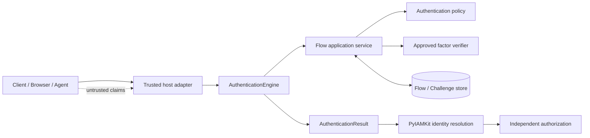
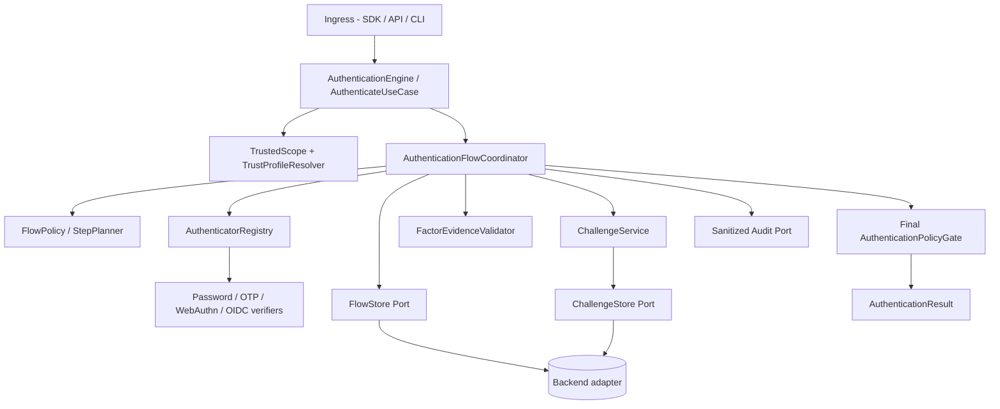
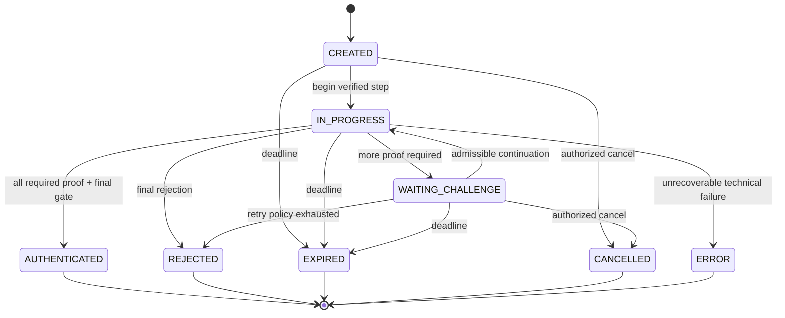
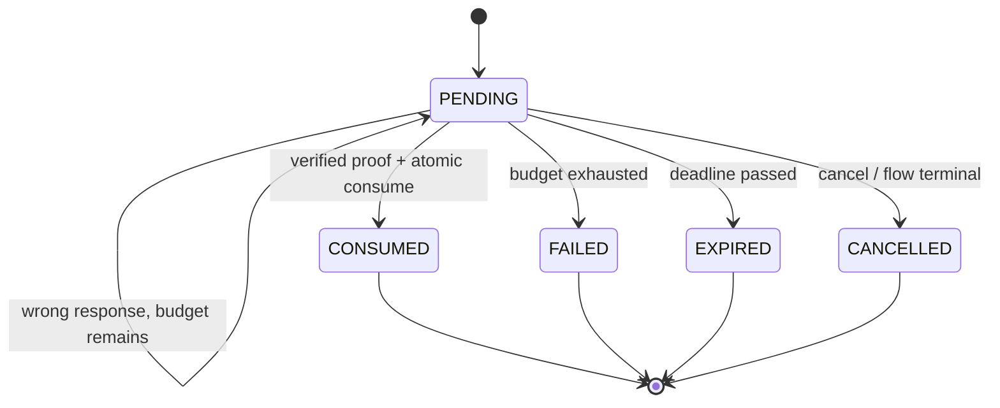
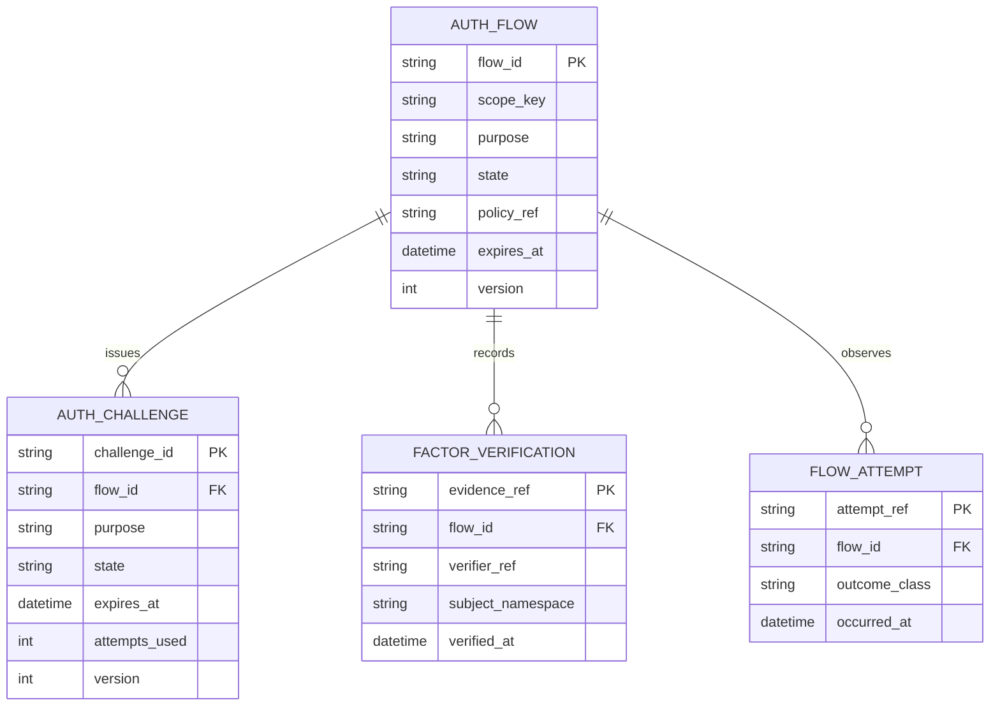
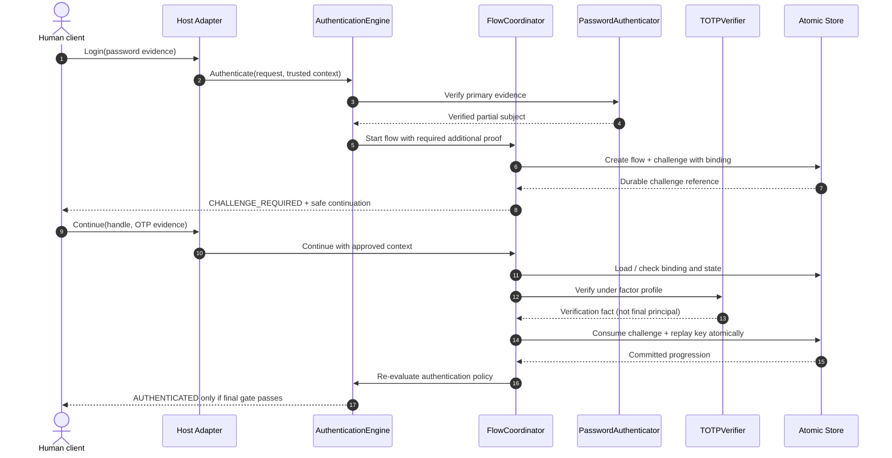
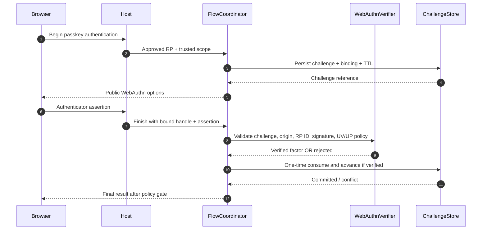
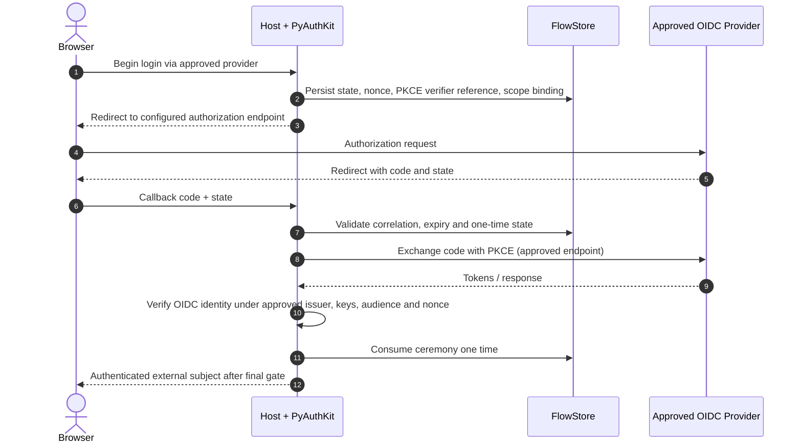

# 11_PYAUTHKIT_AUTHENTICATION_FLOW_AND_CHALLENGE_MODEL

# PyAuthKit — Authentication Flow and Challenge Model

> **Document :** `11_PYAUTHKIT_AUTHENTICATION_FLOW_AND_CHALLENGE_MODEL.md`  
> **Produit :** PyAuthKit — Authentication Engine for the Modern Python Ecosystem  
> **Type :** spécification fonctionnelle, DDD tactique, architecture applicative, sécurité et convention pédagogique  
> **Statut :** **PROPOSED / DESIGN** — modèle cible, aucune preuve d'implémentation ou de qualification  
> **Version documentaire :** 0.1.0  
> **Date :** 2026-10-29  
> **Langue :** français ; vocabulaire métier et types Python en anglais  
> **Sources internes :** documents `00` à `10` et `PYAUTHKIT_SOFTWARE_DESIGN_LEARNING_CONVENTION.md`  
> **Phase :** **POST-MVP** ; le MVP défini en `09`/`10` conserve Password, API Key et JWT sans obligation d'un `FlowStore`  
> **Document suivant :** `12_PYAUTHKIT_MFA_AND_ASSURANCE_MODEL.md`

---

## Guide de lecture

| Sujet | Sections |
|---|---|
| Responsabilités, frontière AuthN/IAM, vocabulaire | 0–6 |
| Objets, états, relations et invariants | 7–14 |
| Continuation, consommation unique et transactions | 15–22 |
| Cas d'usage et séquences | 23–29 |
| Contrats Python, ports, erreurs, observabilité | 30–35 |
| Sécurité, tests, ADR, pédagogie et gouvernance | 36–45 |
| Références et modèles réutilisables | Annexes A–E |

**Règle de lecture :** les mots *verified*, *trusted*, *consumed*, *bound*, *atomic* et *assured* décrivent des garanties à obtenir et tester. Ils ne sont pas établis par un nom de classe, une annotation de type, un simple `Enum` ou un diagramme. Les solutions techniques présentées sont des **candidates** et doivent faire l'objet de preuves sur des stores, bibliothèques et déploiements réels.

---

## 0. Résumé exécutif

Une authentification moderne est parfois une **cérémonie à plusieurs interactions**. Une première preuve correcte peut déclencher un second facteur, une preuve WebAuthn, une redirection fédérée ou une réauthentification renforcée. **Une preuve partielle ne confère jamais une identité finale authentifiée.**

PyAuthKit distingue les responsabilités suivantes :

1. `AuthenticationEngine` : orchestre le cas `Authenticate` et décide finalement, selon le profil de confiance et la politique ;
2. `AuthenticationFlow` : représente la progression **d'une cérémonie** située dans un scope et une policy effectifs ;
3. `AuthenticationChallenge` : représente une **épreuve particulière**, bornée et consommable selon sa sémantique ;
4. `FactorVerification` : conserve le fait et la provenance d'une vérification de facteur, sans devenir une permission ;
5. `ContinuationHandle` : permet de **retrouver et poursuivre** un flow admissible, sans prouver à lui seul une identité ni autoriser une ressource ;
6. `FlowStore` / `ChallengeStore` : préservent les invariants de progression, d'usage unique et de concurrence quand une capacité est persistée ;
7. `AuthenticationResult` : retourne un verdict public normalisé, **avec `AuthenticatedPrincipal` uniquement si l'authentification est finale et acceptée**.

```text
UNTRUSTED REQUEST + APPROVED HOST CONTEXT
                    │
                    ▼
         AuthenticationEngine
                    │
                    ▼
      Authenticate / Start Flow
                    │
                    ▼
        Verify primary evidence
                    │
               ┌────┴───────┐
               │            │
         Invalid/error   Verified partial evidence
               │            │
               ▼            ▼
          No success   Evaluate authentication policy
                            │
                    ┌───────┴─────────┐
                    │                 │
              More proof needed   Requirements satisfied
                    │                 │
                    ▼                 ▼
          Challenge + flow      Final policy gate
          WAITING_CHALLENGE           │
                    │            AUTHENTICATED
        Continue with bound evidence  + final principal
                    │
                    ▼
        Verify + consume atomically
                    │
                    └──────► Re-evaluate policy
```

**Décisions directrices :**

- Le modèle de flow est **optionnel au MVP**, mais son contrat doit pouvoir composer des authenticators sans les réécrire.
- Le `Challenge` est **une étape**, non une session authentifiée, un access token ou un droit IAM.
- Un handle de reprise n'est **pas** un deuxième facteur ; il est protégé comme un bearer sensible s'il donne accès à une continuation.
- L'utilisation unique doit être garantie par une **primitive concurrente fiable**, pas par `if not used: used=True` en mémoire locale.
- Le cas TOTP exige une protection anti-rejeu au niveau **facteur + période/valeur acceptée**, au-delà de l'unicité du challenge.
- Les policies peuvent imposer une étape supplémentaire ; aucune policy manquante ou indisponible ne peut être considérée « satisfaite ».
- Sessions, émission de tokens, établissement de comptes et autorisation demeurent des **use cases distincts**.

### 0.1 Résultat attendu de ce document

Définir : le catalogue d'objets, les machines à états, les contrats de reprise, les frontières transactionnelles, les erreurs, les diagrammes, les exigences de sécurité, les scénarios de tests et les arbitrages ADR des flows/challenges. Les modèles de facteurs et niveaux d'assurance seront approfondis en `12` ; les sessions et tokens en `13`.

### 0.2 Contrainte majeure de maturité

`11` est une **spécification post-MVP**. Les exemples sont éducatifs et ne constituent **ni un protocole cryptographique complet, ni du code de production**. La syntaxe des exemples Python peut être contrôlée ; elle ne démontre ni protection cryptographique, ni atomicité d'un store, ni sécurité de déploiement.

---

## 1. Filiation documentaire et source d'autorité

| Document | Autorité établie dans la série | Application ici |
|---|---|---|
| `00` — Expression du besoin | Flows MFA, passkeys, social, step-up ; domaine AuthN | besoin d'une cérémonie composable |
| `01` — Requirements Analysis | exigences FR/NFR/SEC/ARC et critères | exigences candidates à qualifier |
| `02` — Product Vision & Principles | SOLID, Hexagonal, DDD, security-first | frontières, dépendances, anti-sur-ingénierie |
| `03` — System Architecture | orchestration et ports, séquences d'authentification | continuité avec le moteur |
| `04` — Domain Objects | `DO-032..038`, vocabulaire du flow/challenge/factor | sémantique canonique des objets |
| `05` — Entities & Value Objects | classifications DDD **conditionnelles** | flow process model, challenge Entity candidate |
| `06` — Relationships & ERD | `REL-*`, `REL-INV-021..029`, stores conditionnels | cardinalités et transactions, pas tables obligatoires |
| `07` — Invariants & Rules | `AUTH-INV-021..030`, `046..048`, `059..064` | **source interne principale des invariants** |
| `08` — Commands, Queries & Use Cases | `APP-CMD-007..010`, `025..028`; `APP-UC-005,008,012,018` | orchestration applicative |
| `09` — Authentication Engine | moteur, trust, registry, final gate | un flow ne contourne pas le moteur |
| `10` — Authenticator & Credential | mécanismes/verdicts et ownership de preuves | composition sans réécrire la vérification |
| `PYAUTHKIT_SOFTWARE_DESIGN_LEARNING_CONVENTION.md` | *Problem First, Trust First, Pattern Second* | justification de chaque abstraction |

**Politique de traçabilité :** les identifiants `FLOW-REQ-*`, `FLOW-INV-*`, `FLOW-CTR-*`, `FLOW-TST-*` et `FLOW-DEC-*` sont **nouveaux** et spécifiques à `11`. Ils spécialisent les sources précédentes, **sans renommer** `AUTH-INV-*`, `APP-CMD-*` ou `REL-INV-*`.

### 1.1 Résolutions non autorisées

Ce document ne décide pas silencieusement si `AuthenticationFlow` est un aggregate root, quelle table SQL doit exister, si un serveur dédié doit être déployé, ni si les sessions doivent être délivrées après chaque succès. Ces questions restent à arbitrer par ADR ou par les spécifications `12`, `13`, `19`, `20`, `24`.

### 1.2 Références externes, sans revendication de conformité

Les repères utilisés comprennent NIST SP 800-63B-4 (2025), RFC 4226 et 6238 pour HOTP/TOTP, OWASP Authentication Cheat Sheet et WebAuthn Level 3 du W3C. **Les exigences normatives applicables à un cas précis doivent être revérifiées dans leur contexte et leurs textes originaux** ; ce document n'est pas une certification NIST/FIDO/W3C.

---

## 2. Problème métier et pressions de conception

**Problème :** l'identité d'un utilisateur ne peut pas être considérée prouvée alors qu'une étape de vérification requise reste en attente. Dans un parcours distribué sur plusieurs requêtes HTTP, processus ou devices, il faut conserver suffisamment d'état **fiable**, reprendre au bon endroit et empêcher le rejeu ou le détournement du parcours.

| Pression observée | Risque sans modèle dédié | Réponse candidate |
|---|---|---|
| Plusieurs facteurs | succès prématuré après le password | `Flow` + policy de complétude |
| Plusieurs requêtes | disparition ou falsification de progression | store de continuation contrôlé |
| Challenge à durée limitée | acceptation tardive | expiration côté serveur |
| Requêtes concurrentes | double consommation | CAS / transaction / unicité |
| Cross-tenant | continuation dans un autre scope | binding immuable scope + RP/client |
| Reprises et retries | émission répétée de résultat / effet de bord | transition idempotente définie |
| Redirections fédérées | substitution de réponse / CSRF | state/nonce/PKCE et vérification du callback |
| WebAuthn | rejeu et confusion d'origine | challenge + RP ID/origin + crypto |
| Factor enrollment / recovery | contournement du MFA | use cases séparés à assurance adaptée |
| Interruptions / pannes | succès implicite ou état fantôme | fail-closed + récupération contrôlée |

La **complexité réelle** justifie un modèle de process ; elle ne justifie pas automatiquement un orchestrateur distribué, un event store, des microservices ni une hiérarchie GoF `State`.

---

## 3. Périmètre et non-périmètre

### 3.1 Dans le périmètre de `11`

- Définition des étapes et exigences de continuation ;
- cycle de vie du flow et des challenges ;
- liaisons à une tentative, un scope, un profil et un sujet **vérifié partiellement** ;
- création, vérification et consommation bornées ;
- orchestration des mécanismes existants ;
- prévention du replay ;
- concurrence, expiration, annulation, retry et timeouts ;
- interfaces et garanties de stockage optionnelles ;
- événements et tests de sécurité ;
- points d'extension MFA, WebAuthn, OIDC, step-up.

### 3.2 Hors périmètre ou propriété d'un autre document

| Sujet | Document / propriétaire |
|---|---|
| Formules cryptographiques TOTP/HOTP, exigences de facteurs et AAL | `12` / vérificateurs spécialisés |
| Gestion durable des sessions, refresh tokens, rotation de grants | `13` |
| Protocoles OIDC, OAuth2 et SAML détaillés | `14` |
| Vérification WebAuthn complète | `15` |
| Délégation d'agent et workload binding | `16` |
| Scoring de risque, signaux, adaptation | `17` |
| Ports/adapters/plugins exhaustifs | `18` |
| Schémas, transactions et storage topology | `19` |
| Threat model complet / mitigations | `20` |
| Audit/event delivery garanties | `21` |
| IAM provisioning, rôles, permissions, délégation | PyIAMKit / applications / autorisation |

---

## 4. Ubiquitous Language — distinctions structurantes

| Terme | Signification précise | Ne signifie pas |
|---|---|---|
| `AuthenticationAttempt` | occurrence d'essai observable | cérémonie durable entière |
| `AuthenticationFlow` | progression d'une cérémonie d'authentification | session utilisateur |
| `AuthenticationFlowState` | état de progression du flow | GoF State Pattern |
| `AuthenticationChallenge` | épreuve émise pour une étape et un usage | facteur déjà vérifié |
| `ChallengeResponse` | preuve présentée à vérifier | réponse correcte par construction |
| `FactorVerification` | fait de vérification établi sous profil et contexte | droit d'accès ou assurance automatique |
| `VerifiedSubject` | sujet prouvé dans un namespace/scope déterminé | compte IAM local / permission |
| `AuthenticatedPrincipal` | représentation **finale** après policy gate | résultat partiel |
| `ContinuationHandle` | référence sensible permettant la reprise contrôlée | droit d'authentifier ou d'autoriser |
| `FlowPolicySnapshot` | référence/empreinte des exigences effectives retenues | objet Python vivant / preuve historique complète |
| `TrustProfile` | ensemble approuvé de paramètres de validation | configuration lue depuis un claim non vérifié |
| `ChallengeVerifier` | port ou service effectuant une vérification réelle | simple comparaison de chaînes générique |
| `ChallengeConsumption` | fait atomique d'acceptation one-time | création d'une session |
| `ReplayDetection` | refus d'une preuve déjà admise dans son domaine d'unicité | prévention de tous les rejouements réseau |
| `StepUpRequirement` | assurance additionnelle requise par policy | permission sur l'opération sensible |
| `AuthenticationResult` | résultat public de la tentative/continuation | état interne librement exporté |

### 4.1 Les distinctions les plus importantes

```text
AuthenticationAttempt != AuthenticationFlow
AuthenticationFlow != AuthenticationSession
AuthenticationChallenge != AuthenticationFactor
ChallengeResponse != FactorVerification
Partial Verification != Final Authentication
ContinuationHandle != AuthenticatedPrincipal
AuthenticatedPrincipal != IAM Permission
Authentication Policy != Authorization Policy
FlowState enum != GoF State Pattern
Domain Event != Observer Pattern
```

**Raison DDD :** ces concepts ont des identités, durées de vie, invariants et propriétaires de vérité différents. Les fusionner masque la sécurité et crée des états impossibles.

---

## 5. Bounded Context, responsabilités et frontières de confiance

### 5.1 PyAuthKit : Authentication Context

PyAuthKit possède la **décision de preuve d'identité** dans un contexte établi. Il peut, si le produit active la fonctionnalité, posséder la progression des flows et des challenges. Il ne devient pas propriétaire de l'organisation, des groupes, rôles ou politiques d'accès.

### 5.2 Autorités distinctes

1. **L'hôte** établit route, RP/client, application, scope, politique de transport et contexte de confiance admissible.
2. **Le moteur** choisit un profil approuvé et applique les vérifications/policies.
3. **Le vérificateur spécialisé** établit effectivement la validité d'une preuve de facteur.
4. **Le store** préserve des invariants d'unicité et de concurrence (si choisi).
5. **PyIAMKit ou l'application** associe le résultat à une identité et décide séparément de l'accès.

### 5.3 Diagramme de contexte



### 5.4 Risques de confiance

- `tenant_id` fourni dans un formulaire ne crée pas un `TrustedScope`.
- `principal_id` attaché à un handle ne remplace pas une preuve.
- `issuer`, `audience`, `rp_id` ou `redirect_uri` ne sont pas choisis librement par le demandeur.
- Une vérification faite dans `tenant A` ne peut pas satisfaire la policy de `tenant B`.
- Un flow ancien ne doit pas adopter silencieusement une policy plus permissive après changement de configuration.

---

## 6. Architecture de référence — composants et dépendances



### 6.1 Règle de dépendance

```text
ENTRY / TRANSPORT ADAPTERS
         ↓
APPLICATION USE CASES / FLOW COORDINATOR
         ↓
DOMAIN TYPES, INVARIANTS, PORT CONTRACTS
         ↑
INFRASTRUCTURE ADAPTERS implement PORTS
```

Le domaine ne doit importer ni `FastAPI`, ni `Django`, ni `redis`, ni un SDK OIDC, ni une base SQL.

### 6.2 Minimalisme du noyau

La composition `AuthenticationFlowCoordinator` + `ChallengeService` est une **proposition**, pas l'obligation de créer ces deux classes. Si une fonction applicative suffit, conserver une fonction. Les ports sont justifiés par les garanties d'une infrastructure interchangeable et par la possibilité de les tester.

### 6.3 Ownership décisionnel

Le coordinateur **ne vérifie pas lui-même** une signature WebAuthn, un secret TOTP ou une assertion OIDC. Il consomme un `FactorVerification` émis par un composant approuvé, lie le résultat à la cérémonie et applique les invariants du domaine.

---

## 7. Catalogue des objets (`FLOW-OBJ-*`)

| ID | Objet | Rôle / propriété de vérité | Classification DDD candidate |
|---|---|---|---|
| `FLOW-OBJ-001` | `AuthenticationFlow` | progression et versions d'un processus | Process Entity / Aggregate candidat |
| `FLOW-OBJ-002` | `AuthenticationFlowState` | état de progression | Enum / Value Object |
| `FLOW-OBJ-003` | `AuthenticationChallenge` | épreuve à consommation contrôlée | Entity candidate |
| `FLOW-OBJ-004` | `ChallengeState` | état de l'épreuve | Enum / VO |
| `FLOW-OBJ-005` | `FlowId` | identité opaque du processus | Identifier VO |
| `FLOW-OBJ-006` | `ChallengeId` | identité opaque du défi | Identifier VO |
| `FLOW-OBJ-007` | `ContinuationHandle` | autorisation limitée de reprise, sensible | Secret handle / VO d'entrée |
| `FLOW-OBJ-008` | `FlowBinding` | scope, client, issuer/realm, contexte lié | Immutable VO |
| `FLOW-OBJ-009` | `FlowPolicySnapshot` | versions/provenance des règles effectives | Reference VO candidat |
| `FLOW-OBJ-010` | `ChallengePurpose` | usage autorisé d'une épreuve | Enum / VO |
| `FLOW-OBJ-011` | `ChallengeDescriptor` | description publique non secrète d'une étape | DTO immutable |
| `FLOW-OBJ-012` | `ChallengeResponse` | evidence non fiable reçue | Sensitive input DTO |
| `FLOW-OBJ-013` | `FactorVerification` | fait de vérification prouvé et situé | Immutable VO / event fact |
| `FLOW-OBJ-014` | `FactorVerificationRef` | lien à une preuve sans exposer secrets | VO |
| `FLOW-OBJ-015` | `FlowStep` | condition ou étape requise | VO / plan item |
| `FLOW-OBJ-016` | `FlowPlan` | ordre et composition des étapes | Immutable VO candidat |
| `FLOW-OBJ-017` | `StepUpRequirement` | demande de vérification supplémentaire | VO (voir `12`) |
| `FLOW-OBJ-018` | `FlowOutcome` | résultat interne de progression | Discriminated result |
| `FLOW-OBJ-019` | `ChallengeConsumption` | résultat de CAS/claim/consumption | Transaction result |
| `FLOW-OBJ-020` | `FlowAuditFact` | fait expurgé d'audit | Event contract |
| `FLOW-OBJ-021` | `FlowDeadline` | date limite effective et contexte horloge | VO |
| `FLOW-OBJ-022` | `RetryBudget` | limites d'essais et de réémission | Policy/VO |
| `FLOW-OBJ-023` | `FlowStore` | chargement et transitions versionnées | Port |
| `FLOW-OBJ-024` | `ChallengeStore` | épreuves et consommation atomique | Port |
| `FLOW-OBJ-025` | `ChallengeVerifier` | validation réelle de la preuve | Port / service |
| `FLOW-OBJ-026` | `FlowCoordinator` | orchestration des use cases | Application Service |

**Relation avec `04` :** `AuthenticationFlow` ≈ `DO-032`, `AuthenticationFlowState` ≈ `DO-033`, `AuthenticationChallenge` ≈ `DO-034`, `AuthenticationFactor` ≈ `DO-035`, `FactorVerification` ≈ `DO-036`, `AuthenticationAssurance` ≈ `DO-037`, `StepUpRequirement` ≈ `DO-038`. Les objets supplémentaires sont des **propositions propres à `11`**, pas une modification rétrospective du catalogue `DO-001..048`.

---

## 8. `AuthenticationFlow` — contrat du processus

### 8.1 Identité et durée de vie

Une cérémonie possède un `FlowId` stable et localisable dans son scope. `FlowId` n'est **pas** un secret d'authentification et n'a pas vocation à servir seul de handle de reprise. Il peut survivre à plusieurs `AuthenticationAttempt` et à plusieurs challenges.

### 8.2 Attributs conceptuels

| Attribut | Sémantique | Restriction |
|---|---|---|
| `flow_id` | identité du flow | pas de bearer privilege |
| `binding` | tenant/scope/client/RP/sujet admissible | stable, issu de l'hôte |
| `purpose` | login / step-up / recovery distinct | pas de confusion d'usage |
| `state` | état de progression | machine à états formalisée |
| `required_steps` | plan de vérification | lié à policy approuvée |
| `factor_verifications` | preuves réussies avec provenance | ne contient jamais secrets |
| `policy_reference` | versions et empreintes pertinentes | pas de policy moins stricte silencieuse |
| `created_at`, `expires_at` | fenêtre d'utilisation | horloge serveur injectée |
| `version` | concurrence optimiste | CAS ou transaction stricte |
| `attempt_count` | essais selon politique | ne se réinitialise pas par simple challenge |
| `last_transition` | fait de domaine, expurgé | pas de données confidentielles |

### 8.3 Invariants internes

- Le `binding` ne change pas d'autorité entre deux requêtes.
- Le flow ne peut pas devenir `AUTHENTICATED` avant toutes les preuves obligatoires et la policy finale.
- Un état terminal ne reprend jamais vers un état actif.
- Les preuves de facteurs enregistrées correspondent au sujet et au scope du flow.
- Une preuve de vérification conservée porte l'identité du vérificateur et sa fraîcheur pertinentes, ou bien n'est pas réutilisée.
- Le résultat final provient du moteur après validation des preuves et des politiques.

### 8.4 Flow et agrégat : décision conditionnelle

Un flow peut être un **Aggregate Root** si sa progression et ses relations aux challenges doivent être validées comme une unique unité de cohérence. Si les challenges ont un store et une transaction indépendants, des références explicites et un protocole de coordination sécurisé sont nécessaires. **L'existence d'une machine à états ne suffit pas à imposer un aggregate.**

---

## 9. `AuthenticationChallenge` — contrat d'une épreuve

### 9.1 Définition

Une épreuve est une **demande contextualisée de preuve**, associée à un flow et à un but : par exemple entrer un code TOTP, répondre à une assertion WebAuthn, confirmer une interaction OIDC ou prouver une étape supplémentaire de risque.

### 9.2 Champs candidats

| Champ | Signification | Règle |
|---|---|---|
| `challenge_id` | référence stable non bearer | générée côté serveur |
| `flow_id` | rattachement à la cérémonie | immuable |
| `purpose` | facteur / step-up / fédération | fixé à création |
| `method` | vérificateur/protocole attendu | admis par policy |
| `binding_digest` | empreinte structurée du contexte lié | aucune clé brute |
| `challenge_material_ref` | référence à nonce/secrets/état de protocole | accès restreint |
| `issued_at`, `expires_at` | fenêtre de vie | durée bornée |
| `attempts_used`, `attempts_max` | budget contrôlé | résistants aux races |
| `state` | état du défi | transitions contrôlées |
| `version` | concurrence optimiste | CAS transactionnel |
| `consumed_at` | consommation définitive | une seule acceptation |
| `factor_reference` | preuve de facteur acceptée | jamais un secret brut |

### 9.3 Ne pas confondre challenge et authenticator

`TOTPAuthenticator` **vérifie** une réponse TOTP. `AuthenticationChallenge` décrit **dans quelle cérémonie et sous quelles limites** la réponse doit être acceptée. Plusieurs challenges peuvent réutiliser le même authenticator, et un flow peut nécessiter plusieurs méthodes.

### 9.4 Agrégat et stockage

`AuthenticationChallenge` devient un Aggregate Root candidat lorsque son `consume()` protège localement le budget d'essais, la transition à usage unique et l'expiration. Un challenge purement stateless n'est acceptable que si les garanties d'usage unique et de binding peuvent être obtenues autrement, **avec preuve**. Signer un token stateless n'offre **pas** en soi une interdiction de rejeu.

---

## 10. Identity, factor et assurance — source de vérité

### 10.1 Facteur ≠ méthode ≠ preuve

- Un **facteur** représente une catégorie d'authentification et les propriétés de l'authenticator.
- Une **méthode** est une interaction/protocole concret.
- Une **preuve** est la donnée ou action réellement vérifiée.
- Une **assurance** est une propriété d'une authentification correctement qualifiée selon un référentiel/policy.

Le fait d'exécuter deux étapes ne démontre pas nécessairement **deux facteurs indépendants**. Une combinaison qui réutilise la même possession ou le même secret ne doit pas être promue en MFA par le seul compteur d'étapes.

### 10.2 `FactorVerification`

Une vérification reconnue devrait inclure conceptuellement : `subject_namespace`, `factor_kind`, `authenticator_ref`, `verified_at`, `trusted_scope`, `verification_profile_ref`, `flow_id`, les propriétés d'authenticator effectivement vérifiées et les limites de réutilisation. Elle **ne contient ni OTP, ni password, ni signature brute ni access token**.

### 10.3 Trust de la première preuve

Un sujet peut être identifié après password mais pas encore authentifié **finalement** si MFA est requis. Il faut un type interne explicitement non final pour lier les étapes sans exposer une identité authentifiée au monde extérieur.

### 10.4 Assurance et step-up

Le document `12` fixe la politique d'accumulation ou de qualification des facteurs et la représentation d'un niveau d'assurance. Le document `11` exige simplement que le flow **ne prétende pas satisfaire** un niveau ou une combinaison non démontrés.

---

## 11. Machine à états du flow

### 11.1 États candidats

| État | Signification | Terminal ? |
|---|---|---|
| `CREATED` | demande initiale validée / pas encore de preuve | non |
| `IN_PROGRESS` | une étape de vérification s'exécute | non |
| `WAITING_CHALLENGE` | épreuve demandée et non résolue | non |
| `AUTHENTICATED` | décision finale positive après gate | **oui** |
| `REJECTED` | refus final lié à la preuve/policy | **oui** |
| `EXPIRED` | expiration du flow | **oui** |
| `CANCELLED` | annulation autorisée | **oui** |
| `ERROR` | échec technique terminal selon contrat | **oui** |

`IN_PROGRESS` peut être un état **éphémère**, non persisté, si le mécanisme durable retient une étape déterministe et un verrou versionné. Le choix exact doit être arbitré.

### 11.2 Diagramme



### 11.3 Transitions interdites

- `EXPIRED → AUTHENTICATED` ;
- `CANCELLED → WAITING_CHALLENGE` ;
- `REJECTED → AUTHENTICATED` ;
- `AUTHENTICATED → IN_PROGRESS` ;
- `WAITING_CHALLENGE → AUTHENTICATED` sans vérification requise **et gate finale** ;
- toute transition sans version/autorité compatible lorsque la concurrence est pertinente.

**KISS :** `Enum` + table de transitions + guards suffisent avant d'introduire un GoF `State` Pattern.

---

## 12. Machine à états du challenge

### 12.1 États proposés

| État | Sens | Acceptation ultérieure ? |
|---|---|---|
| `PENDING` | épreuve émise, encore candidate | oui si conditions remplies |
| `CONSUMED` | réponse valide acceptée et usage consommé | **non** |
| `FAILED` | épuisement du budget ou échec terminal explicite | **non** |
| `EXPIRED` | date limite atteinte | **non** |
| `CANCELLED` | annulation par propriétaire autorisé ou flow terminal | **non** |

Une tentative invalide individuelle **n'exige pas** de créer l'état terminal `FAILED` tant qu'un budget reste disponible. Il faut conserver l'échec comme fait d'essai et incrémenter le compteur de manière concurrente.

### 12.2 Diagramme



### 12.3 Observations importantes

- `VERIFIED` n'est pas ici un état persistant séparé : la vérification et la consommation peuvent traverser une transaction sûre menant à `CONSUMED`.
- Si le travail cryptographique est long, il peut se faire hors transaction, mais le commit doit **recontrôler** expiration, state, binding, version et conditions de réutilisation.
- Une vérification positive concurrente **perdante** ne se transforme pas en succès par la seule validité mathématique de la preuve.

---

## 13. Relations et cardinalités conceptuelles

| Source | Relation | Destination | Cardinalité proposée | Condition |
|---|---|---|---|---|
| `AuthenticationFlow` | possède | `AuthenticationChallenge` | 1 → 0..N | uniquement si flow multi-étapes |
| `AuthenticationFlow` | requiert | `FlowStep` | 1 → 1..N | plan effectif connu |
| `AuthenticationFlow` | référence | `FlowPolicySnapshot` | 1 → 1 | si snapshot retenu |
| `AuthenticationChallenge` | vérifie par | `ChallengeVerifier` | N → 1 logique | méthode approuvée |
| `AuthenticationChallenge` | produit | `FactorVerification` | 1 → 0..1 | après acceptation |
| `AuthenticationFlow` | consolide | `FactorVerification` | 1 → 0..N | provenance/admissibilité |
| `AuthenticationFlow` | produit | `AuthenticationResult` | 1 → 0..N décisions de progression | final au plus une fois |
| `AuthenticationFlow` | reçoit | `AuthenticationAttempt` | 1 → 0..N | journalisation selon policy |
| `AuthenticationFlow` | se situe dans | `TrustedScope` | N → 1 | **immuable** |
| `AuthenticationChallenge` | référence | `FlowId` | N → 1 | jamais cross-flow |

### 13.1 ERD logique conditionnel



**Attention :** cet ERD est **un exemple de projection de persistence**, non un schéma SQL imposé. Il ne contient pas les secrets, les handles bearer, ni la preuve cryptographique brute. Une implémentation peut utiliser Redis, SQL, un moteur atomique dédié ou une autre combinaison ; le choix est gouverné par les invariants.

### 13.2 Frontières d'agrégats à arbitrer

- **Option A :** flow agrégat unique contenant les challenges en état interne ; CAS sur une ligne ou document.
- **Option B :** flow et challenges agrégats distincts ; transaction qui couvre les modifications critiques ou protocole de réservation/finalisation sûr.
- **Option C :** aucun store local de flow pour cas simples ; seulement si la cérémonie ne nécessite pas de reprise stateful ni de garantie non autrement démontrée.

La meilleure solution est celle qui **prouve** les invariants avec la moindre complexité, pas celle qui maximise le nombre d'agrégats.

---

## 14. Séparation des vues métier, runtime et persistance

| Vue | Représente | Risque de confusion |
|---|---|---|
| Conceptuelle DDD | flow, challenge, facteur, décision | prendre chaque VO pour une table |
| Runtime | tentatives actives, tasks async, clocks, timeouts | conserver une tâche Python comme vérité durable |
| Persistance | états/version/expirations utiles à l'atomicité | exposer une colonne DB comme contrat métier |
| Audit | faits passés, expurgés, corrélés | stocker la preuve brute ou traiter log = vérité |
| Public API | handle de continuation, étapes admissibles, résultat | exposer les états internes et les secrets |

Un `Flow` peut durer plusieurs requêtes sans devenir une session de navigation ; sa durée est bornée par un **objectif d'authentification**, non par la durée de connexion d'un utilisateur.

---
## 15. Création et émission d'un challenge

### 15.1 Préconditions

Une épreuve ne peut être créée que si :

1. le `TrustedScope` et le `TrustProfile` sont approuvés et non ambigus ;
2. la demande correspond à un flow non terminal, non expiré et correctement lié ;
3. la policy exige ou permet **cette** méthode, pour **ce** sujet et **cet** usage ;
4. le budget de créations, tentatives, notifications et ressources est disponible ;
5. le matériel aléatoire et les paramètres cryptographiques sont générés par un fournisseur qualifié ;
6. le flow et l'épreuve sont persistés de manière cohérente avant exposition d'un handle ou d'un challenge utilisable.

### 15.2 Entropie, confidentialité et surface publique

Pour les nonces WebAuthn, valeurs `state`/`nonce`, handles et secrets temporaires, utiliser une source aléatoire cryptographiquement sûre et des longueurs adaptées au protocole et au modèle de menace. **Aucune valeur universelle n'est imposée ici** en dehors des exigences spécifiques des standards concernés et de la configuration qualifiée.

- Un identifiant devinable (`challenge_id=42`) n'est pas un bearer handle admissible.
- Un *nonce* public WebAuthn peut être envoyé au navigateur, mais son association à la cérémonie doit demeurer inviolable et sa réutilisation contrôlée.
- Un code OTP envoyé par email/SMS n'est jamais exposé via les logs ou un DTO de statut.
- Une référence `challenge_material_ref` ne doit pas permettre à l'appelant de lire le secret.
- Une signature ou un MAC ne suffit pas à garantir usage unique si aucun état de consommation n'existe.

### 15.3 Réémission / resend

Réémettre un code ou un challenge est un **use case distinct** soumis à limites ; il faut définir si l'ancienne épreuve est invalidée, si le même flow continue, et comment les compteurs d'échecs résistent à un spam de renvois. Un nouveau challenge ne doit pas remettre les compteurs anti-bruteforce à zéro par défaut.

---

## 16. Continuation sécurisée : `ContinuationHandle`

### 16.1 Fonction

Le handle permet de retrouver un flow et **de demander** sa continuation. Il ne démontre pas, par sa seule possession, qu'un facteur supplémentaire a été vérifié. Pour des opérations sensibles, la reprise doit aussi valider le binding, le contexte hôte et les contrôles CSRF/transport applicables.

### 16.2 Contrat candidat

```text
ContinuationHandle
  • cryptographically unpredictable
  • bounded to flow and usage
  • short-lived (policy-defined)
  • scoped to approved application / tenant / RP
  • never logged or returned in exception text
  • rotation semantics explicit, if needed
  • storage representation may be verifier/digest instead of plaintext
```

**Condition :** le digest d'un handle doit être calculé selon une stratégie adaptée à son entropie et à sa sensibilité. Il ne doit pas être confondu avec le hash lent d'un mot de passe humain ; les détails cryptographiques appartiennent à la spec spécialisée.

### 16.3 Contexte de reprise

`ContinueAuthenticationFlow` reçoit **séparément** :

- `TrustedEntryContext` établi côté hôte ;
- `ContinuationHandle` non fiable ;
- `ChallengeResponse` non fiable et potentiellement secrète ;
- un identifiant de requête uniquement pour corrélation / idempotence limitée ;
- une deadline ;
- éventuellement les métadonnées de transport validées par l'hôte.

L'orchestrateur vérifie le handle et les bindings **avant** d'accepter la preuve. Une application ne peut pas désactiver l'isolation tenant en passant un `scope` fourni par le client.

### 16.4 Cookie, URL et clients natifs

- Éviter les handles sensibles dans les query strings et l'historique navigateur ; un cookie protégé ou un mécanisme équivalent peut être adapté selon le transport.
- Définir `Secure`, `HttpOnly`, `SameSite`, les protections CSRF pertinentes et la politique de domaines/origines côté adapter ; ne pas supposer que les flags suffisent seuls.
- Pour CLI, device ou applications natives, choisir un transport et un binding spécifique ; pas de copie mécanique des mécanismes navigateur.
- Les liens magiques et les callbacks de fédération nécessitent une analyse de fixation, de fuite d'URL et de confusion de redirect URI.

### 16.5 Renouvellement du handle

La rotation d'un handle peut réduire l'exposition. Il faut toutefois un contrat explicite pour les requêtes concurrentes et les retries : une rotation ne peut pas laisser simultanément deux générations valables si l'invariant d'usage unique l'interdit.

---

## 17. Binding : contexte, subject, tenant et purpose

### 17.1 Dimensions recommandées

| Dimension | Origine de confiance | Vérification à chaque reprise |
|---|---|---|
| `tenant / scope` | host/adapters approuvés | identité de scope exacte |
| `client / relying party` | configuration applicative | correspondance du client |
| `purpose` | policy initiale | pas de réaffectation login → recovery |
| `subject namespace` | preuve initiale réellement validée | concordance de sujet |
| `required method` | policy approuvée | pas de downgrade |
| `challenge_id` | allocation du store | appartient au flow |
| `policy_ref` | version/empreinte retenue | version admissible |
| `origin / RP ID` | config WebAuthn hôte | vérification spécialisée complète |
| `issuer / redirect URI` | config OIDC hôte | vérification spécialisée complète |
| `device/connection` | politique d'authentification | option conditionnelle ; éviter le fingerprint fragile |

Le binding à une IP publique est généralement insuffisant comme preuve forte de continuité, et peut nuire à la disponibilité en environnement mobile/NAT. Si retenu comme signal, son rôle exact doit être documenté (indice de risque vs contrainte stricte).

### 17.2 Changement de contexte

Lorsqu'un changement de configuration survient au milieu d'un flow, l'application doit choisir **explicitement** entre : conserver les exigences initiales si encore admissibles, appliquer une policy **plus stricte**, ou invalider/recommencer la cérémonie. Une policy devenue interdite ou compromise n'est pas conservée par simple inertie d'un snapshot.

### 17.3 Subject switching

Une réponse valide pour un **autre** `VerifiedSubject` ou un autre namespace ne peut pas compléter le flow. Le rapprochement de deux sujets venant d'IdP différents appartient à une politique de linking IAM spécifique, pas au coordinateur de flow.

---

## 18. Verification pipeline et policy gate

### 18.1 Chaîne candidate

```text
Continue request
  ↓
Validate size / syntax / budget (no secret in logs)
  ↓
Resolve trusted entry context
  ↓
Verify continuation handle + flow scope
  ↓
Load flow/challenge state + deadlines
  ↓
Check challenge method, purpose, budget
  ↓
Delegate cryptographic/factor verification
  ↓
Validate verifier provenance + subject + freshness
  ↓
Commit one-time consumption + flow transition atomically
  ↓
Re-evaluate effective authentication requirements
  ↓
CHALLENGE_REQUIRED | AUTHENTICATED | REJECTED | ERROR
  ↓
Sanitized audit facts
```

### 18.2 Résultat interne vs externe

`ChallengeVerifier` peut émettre un `FactorVerification` interne *valid*, mais celui-ci ne devient pas `AuthenticationResult.AUTHENTICATED`. La policy doit encore confirmer toutes les exigences et le moteur doit construire le principal final.

### 18.3 Policies à séparer

- `FlowAdmissionPolicy` : la cérémonie peut-elle commencer ?
- `ChallengePolicy` : cette étape peut-elle être émise, répétée et acceptée ?
- `FactorRequirementPolicy` : quelles vérifications sont nécessaires ?
- `FinalAuthenticationPolicy` : toutes les exigences sont-elles satisfaites ?

Ces rôles ne requièrent **pas nécessairement quatre objets**. Une petite policy composite ou des fonctions pures sont possibles selon la complexité observée. Le choix **d'appeler ces mécanismes Strategy** exige une variation réelle et une substituabilité démontrée.

---

## 19. One-time consumption et replay resistance

### 19.1 Unicité du challenge

Pour une épreuve one-time, les deux demandes concurrentes suivantes :

```text
Request A: valid response for challenge C
Request B: valid response for challenge C
```

ne peuvent pas produire **deux transitions acceptées**. Un store doit imposer une transition atomique `PENDING → CONSUMED` sous versions, scope, deadline et facteurs attendus.

### 19.2 Unicité du facteur OTP

Un TOTP peut être accepté dans une fenêtre de pas temporels. **Même si le flow A consomme son challenge**, le même code ne doit pas réussir dans un flow B pour le même authenticator/time-step (selon le contrat d'acceptation). Il faut un registre anti-rejeu pertinent au niveau du facteur et de sa fenêtre, ou une autre garantie démontrée.

### 19.3 Unicité WebAuthn

La réponse WebAuthn doit vérifier le challenge lié à la cérémonie, RP ID, origin, user presence / user verification exigées, et la signature avec les paramètres convenus. Un compteur de signature n'est pas une protection universelle contre tous les rejouements (certains authenticators utilisent d'autres sémantiques) ; **la liaison au challenge unique est primordiale**.

### 19.4 Unicité OIDC

`state` protège la corrélation et certains risques CSRF, `nonce` lie les ID tokens aux demandes qui le requièrent, et PKCE lie le code au client. Les règles varient selon le flow/profil OIDC. Ces valeurs ne se substituent pas à la validation complète de l'issuer, audience, token et redirect/callback.

### 19.5 Lien avec le store

`ReplayRegister` n'a pas à devenir une interface autonome si `ChallengeStore`/`FactorStore` peut fournir le contrat requis. Le bon design part du **domaine d'unicité** (`factor_ref`, time step, scope, flow, usage) et de la sémantique de commit, non d'un nom de pattern.

---

## 20. Concurrence, atomicité, idempotence et cohérence

### 20.1 Pourquoi un simple verrou Python ne suffit pas

Dans un déploiement multi-workers ou multi-instances, un `asyncio.Lock`, un verrou de thread ou une variable `used=True` en mémoire locale ne garantit pas l'unicité globale. La décision doit s'appuyer sur un backend qui fournit une opération atomique ou une transaction reconnue.

### 20.2 Contrat de consommation

**Préconditions de commit** :

- challenge et flow présents, dans le scope approuvé ;
- état admissible + deadline encore valide ;
- preuve effectivement vérifiée et liée ;
- version attendue inchangée ou transaction sérialisable ;
- anti-replay du facteur non contourné ;
- policy et sujet encore admissibles.

**Postconditions** :

- au plus une consommation positive de l'épreuve ;
- la progression du flow est cohérente ;
- aucun consommateur perdant ne reçoit un succès final ;
- les invariants de factor replay sont durablement protégés ;
- les événements déclarés durables suivent la garantie de livraison choisie.

### 20.3 Algorithme conceptuel de commit

```text
1. verifier.validate(response) under approved context
2. begin backend atomic boundary
3. load authoritative challenge+flow (and replay key)
4. recheck scope, versions, states, deadlines, binding
5. reserve/consume anti-replay factor identity if applicable
6. transition challenge to CONSUMED
7. attach sanitized factor verification / advance flow
8. commit atomically
9. final gate evaluates committed facts (with correct consistency)
10. publish sanitized result; issue no session/token implicitly
```

**Remarque :** l'étape 9 doit être intégrée à une frontière transactionnelle appropriée si la finalisation exige la cohérence forte avec la transition précédente. Cette séquence est **conceptuelle** ; aucune API ORM, commande Redis ou transaction distribuée n'est présumée adéquate sans preuve.

### 20.4 Optimistic locking

`version` + compare-and-swap est un choix simple quand le store le supporte et que la cohérence est localisable. Une transaction SQL peut aussi l'assurer. Une réservation de challenge `CLAIMED` introduirait de nouveaux cas d'expiration et reprise ; **ne pas l'ajouter sans besoin réel**.

### 20.5 Retry idempotent

Un retry après perte de réponse n'autorise jamais une **seconde consommation**, une seconde authentification indépendante ni une seconde émission de token. Le serveur peut retourner le statut déjà committé à un appelant correctement lié, mais il ne doit pas réexposer un secret ou un token précédent en l'absence d'un contrat d'idempotence sûr.

### 20.6 Outbox et audit

Si l'audit est déclaré obligatoire et durable, la transition et la publication d'un événement ne peuvent pas reposer sur une séquence « commit DB, puis fire-and-forget ». Une outbox transactionnelle ou garantie équivalente peut être nécessaire. Le document `21` doit décider le niveau de livraison et le comportement en panne.

---

## 21. Temps, expiration, cancellation et deadlines

### 21.1 Temps comme donnée de sécurité

`created_at`, `issued_at`, `expires_at`, `verified_at` et `consumed_at` ont des sémantiques différentes. Une horloge fiable (injectée en test, contrôlée en production) décide l'admissibilité **au moment du commit**, pas seulement lors de l'ouverture du flow.

### 21.2 Politiques de deadline

- `flow.expires_at` : durée totale de cérémonie ;
- `challenge.expires_at` : durée limitée d'une épreuve ;
- `factor.freshness` : âge maximum d'une preuve déjà validée ;
- `call.deadline` : budget d'exécution de la requête.

Une valeur de `call.deadline` dépassée **interdit de déclarer un succès non committé**. Si le commit a réussi mais que la réponse a été perdue, le protocole de retry doit préserver l'unicité sans inventer une annulation rétroactive.

### 21.3 Panne de l'horloge et skew

Le tolérancement des horloges appartient aux vérificateurs/protocoles (ex. fenêtre TOTP et règles WebAuthn/OIDC). Une durée de vie ne doit pas devenir infinie sous prétexte que l'horloge est indisponible.

### 21.4 Cancellation

`CancelAuthenticationFlow` exige une autorité vérifiée et le bon scope. L'annulation d'une requête Python ne remplace pas la transaction métier : un effet déjà committé doit rester traçable et ne doit pas être « annulé par exception » sans compensation spécifiée.

### 21.5 Réconciliation et nettoyage

Le nettoyage de TTL est un processus de maintenance. **L'expiration logique doit être vérifiée en lecture et en commit**, même si le nettoyage physique de la donnée est en retard.

---

## 22. Planification des étapes — composition sans DSL prématuré

### 22.1 Plan minimal

Un `FlowPlan` pourrait définir une suite de `FlowStep` ayant : `step_id`, `allowed_authenticators`, `required_evidence_properties`, `dependency`, `max_age`, et une règle de réussite. Une simple liste est suffisante tant que les exigences sont séquentielles et sans branches significatives.

### 22.2 Stratégies de composition envisageables

| Forme | Exemple | Complexité ajoutée |
|---|---|---|
| Séquence | password puis TOTP | faible |
| Alternative admise | passkey **ou** password+TOTP | besoin de branches explicites |
| Step-up | session existante puis preuve additionnelle | liée à assurance/freshness |
| Contextuelle | facteurs selon une policy de risque | source de risque externe, `17` |
| Fédération | redirect puis callback vérifié | frontières et protocoles spécifiques |
| Recovery | preuve de récupération puis changement de facteur | **bounded use case séparé** |

### 22.3 Ne pas généraliser trop tôt

Éviter au MVP un moteur de règles universel, un graphe d'exécution arbitraire, un workflow BPMN ou une dépendance obligatoire à `PyRuntimeKit`. Ces outils pourraient apparaître après des besoins prouvés ; le problème de sécurité d'un flow court peut souvent être résolu par une machine à états explicite et des ports de stockage.

### 22.4 Absence de downgrade

Une branche alternative doit avoir été approuvée **avant** la vérification. Une erreur WebAuthn ne doit pas déclencher « password seul » si cette méthode ne satisfait pas les exigences initiales.

---

## 23. Use Case — Password + TOTP MFA (`APP-UC-005`)

### 23.1 Besoin

Un humain présente un password. Le vérificateur confirme une preuve primaire, puis la policy exige un facteur de possession accepté. Le client doit répondre au challenge sans obtenir de principal final avant la fin.

### 23.2 Séquence proposée



### 23.3 Refus obligatoires

- Password invalide → pas de challenge exploitable, aucune preuve partielle publique ;
- OTP invalide → limite des essais, pas d'escalade de confiance ;
- OTP déjà utilisé pour le facteur/fenêtre → refus même sur un nouveau challenge ;
- handle expiré, inconnu ou associé à un autre tenant → refus ;
- second appel concurrent → au plus une transition acceptée ;
- politique MFA non résolue → aucun succès final.

### 23.4 Assurance

Une combinaison password+TOTP ne doit pas être étiquetée `AAL2` par la seule présence de deux étapes ; l'admissibilité des facteurs, les propriétés du protocole et les contrôles sont définis et qualifiés par `12`.

---

## 24. Use Case — Passkey / WebAuthn (`APP-UC-008`)

### 24.1 Besoin

L'application crée un challenge cryptographique lié à un RP approuvé. Le navigateur/l'authenticator produit une assertion que le serveur vérifie. La réussite exige la vérification des paramètres WebAuthn applicables, **pas** une valeur `success=true` venue du navigateur.

### 24.2 Séquence logique



### 24.3 Frontières d'autorité

`WebAuthnVerifier` possède la sémantique de la validation WebAuthn ; `FlowCoordinator` possède la progression de la cérémonie. Le modèle de clés et credentials WebAuthn relève de `15` et du store approuvé.

### 24.4 Cas de sécurité

- origin ou RP ID non approuvé ;
- challenge non reconnu / expiré / réutilisé ;
- signature ou binding credential incorrect ;
- propriétés UP/UV insuffisantes selon policy ;
- preuve associée à un autre utilisateur / tenant ;
- credential révoqué ou indisponible selon contrat ;
- races de finalisation.

---

## 25. Use Case — OIDC Social Login / Enterprise SSO (`APP-UC-006/007`)

### 25.1 Cadre

Une fédération OIDC peut nécessiter redirection, état de corrélation, PKCE, nonce et échange backend. C'est un flow d'authentification **fédérée**, non une permission IAM implicite et non OAuth2 utilisé seul comme preuve de login.

### 25.2 Cérémonie candidate



### 25.3 Refus et frontières

- `provider` ou redirect URI librement sélectionné par un claim non fiable ;
- `state` manquant ou déjà consommé ;
- issuer, audience, nonce ou signature incorrects ;
- substitution de session entre tenants / clients ;
- callback relancé après succès ;
- compte IAM créé automatiquement en se fondant sur une simple adresse email.

**Limite de portée :** les exigences protocolaires détaillées sont documentées dans `14`. Ce scénario indique les obligations de *flow correlation*, non une implémentation complète d'un client OIDC.

---

## 26. Use Case — Step-up pour opération sensible (`APP-UC-012`)

### 26.1 Exemple

Un utilisateur dispose d'une session valide pour consulter un tableau de bord, mais une opération sensible exige une preuve plus forte ou plus récente. PyAuthKit peut piloter une cérémonie de **step-up** et fournir une assurance supplémentaire qualifiée.

### 26.2 Frontières

- L'application/autorisation décide qu'une opération nécessite une assurance donnée.
- PyAuthKit vérifie si l'authentification actuelle satisfait ces exigences, ou orchestre une preuve additionnelle.
- PyIAMKit / moteur d'autorisation décide **indépendamment** si l'opération elle-même est permise.
- L'issue du step-up n'octroie pas un nouveau rôle, ne contourne pas l'autorisation et ne modifie pas rétroactivement la session sans contrat explicite.

### 26.3 Binding critique

L'objectif du step-up doit être limité à un sujet, une session/contexte, une audience et un niveau d'assurance requis. Une preuve collectée pour une opération ne peut pas être réutilisée arbitrairement pour une autre opération avec un scope plus large.

---

## 27. Use Case — Annulation, expiration et reprise après panne

### 27.1 Annulation

`APP-CMD-010 CancelAuthenticationFlow` exige un handle admissible ou une autorité indépendante ; la simple connaissance d'un `FlowId` dans un log n'est pas suffisante. Les challenges non consommés deviennent inutilisables sous une transition cohérente.

### 27.2 Expiration

Une requête arrivée avant expiration, mais committée après, est **refusée**, sauf contrat explicitement différent, sécurisé et testé. Le nettoyage asynchrone ne remplace jamais cette vérification.

### 27.3 Échec réseau après commit

Si le serveur a committé une consommation mais que le client n'a pas reçu la réponse, un retry ne réutilise pas le challenge. Le client peut obtenir un **statut de continuation sûr** sous binding vérifié ; aucune deuxième consommation ou émission de secret n'est autorisée.

### 27.4 Indisponibilité du store

Si l'atomicité/unicité est indispensable et que la garantie n'est pas disponible, le système **n'accorde pas de résultat positif**. Un cache local permissif de secours ne constitue pas une réponse sûre.

---

## 28. Intégration avec les agents, workloads et clients non humains

### 28.1 Applications et agents

Un agent peut devoir accomplir une cérémonie d'identité machine, mais les flows interactifs de challenge navigateur ne doivent pas lui être imposés par défaut. L'architecture permet des adapters adaptés, sans affirmer que tous les mécanismes humain/MFA se transposent aux workloads.

### 28.2 Délégation

Un `AuthenticatedPrincipal(type=AGENT)` ne prouve pas qu'un humain a délégué ses droits. Une délégation exige source d'autorité, preuve, scope, durée de validité et décision externe ; le détail relève de `16` et de l'autorisation.

### 28.3 Device binding

Un device authentifié ou une preuve mTLS peut participer au contexte ; il ne faut pas confondre identité de machine, identité d'agent, identité d'utilisateur final et mandat de délégation.

---

## 29. Sessions, tokens et événements : opérations distinctes

Le succès final d'un flow est un **fait AuthN**. Le coordinateur ne doit pas automatiquement :

- enregistrer un compte ou lui attribuer un rôle ;
- créer une session sans policy explicite ;
- émettre un access token ou refresh token par défaut ;
- ouvrir un canal d'accès pour un agent ;
- réutiliser un handle de continuation comme cookie de session ;
- déclarer l'assurance plus forte que ce qui a été vérifié.

**Relation possible et conditionnelle :** après `AUTHENTICATED`, un use case explicite peut utiliser `AuthenticatedPrincipal` et le contexte d'assurance pour créer `AuthenticationSession`, émettre des tokens ou transmettre au moteur IAM. Le modèle d'autorisation et l'audience du token sont définis **ailleurs**.

---

## 30. Contrats applicatifs et ports (`FLOW-CTR-*`)

Un contrat décrit une **propriété exigée** et son test potentiel. Les noms des ports sont des propositions ; leur présence documentaire ne prouve pas leur implémentation.

| ID | Contrat | Garantie attendue |
|---|---|---|
| `FLOW-CTR-001` | `StartFlow` | refuse scope/profil/méthode ambiguë ou non admise |
| `FLOW-CTR-002` | `FlowBinding` | lie le flow à une autorité de confiance non client |
| `FLOW-CTR-003` | `FlowId` | identifiant distinct d'un handle bearer |
| `FLOW-CTR-004` | `ContinuationHandle` | imprévisible, protégé et borné |
| `FLOW-CTR-005` | `ContinueFlow` | revalide contexte, state, TTL et purpose |
| `FLOW-CTR-006` | `IssueChallenge` | émet seulement une méthode admissible |
| `FLOW-CTR-007` | `ChallengeStore` | garanties de consommation one-time atomiques |
| `FLOW-CTR-008` | `FlowStore` | transitions versionnées, pas de retour terminal→actif |
| `FLOW-CTR-009` | `FactorVerifier` | vérification réelle sous profil approuvé |
| `FLOW-CTR-010` | `FactorBinding` | sujet et scope cohérents avec le flow |
| `FLOW-CTR-011` | `ReplayRegistry` | unicité au bon niveau de facteur et période |
| `FLOW-CTR-012` | `PolicyGate` | aucun principal final avant complétude |
| `FLOW-CTR-013` | `FailureModel` | refus, panne et annulation distingués sans fuite |
| `FLOW-CTR-014` | `Clock` | expiration et freshness au commit |
| `FLOW-CTR-015` | `RateLimiter` | budgets par sujet/scope/méthode, sans reset abusif |
| `FLOW-CTR-016` | `EventPort` | traces expurgées, avec durabilité spécifiée |
| `FLOW-CTR-017` | `StatusQuery` | statut visible limité à un appelant autorisé |
| `FLOW-CTR-018` | `CancelFlow` | annulation authentifiée et idempotence sûre |
| `FLOW-CTR-019` | `Retry` | aucun double succès/effet de bord |
| `FLOW-CTR-020` | `Recovery` | reprise après commit perdu sans secret réexposé |
| `FLOW-CTR-021` | `IssuerBinding` | OIDC issuer/redirect/state/nonce approuvés |
| `FLOW-CTR-022` | `WebAuthnBinding` | challenge/RP ID/origin/UV-UP selon profil |
| `FLOW-CTR-023` | `StepUp` | assurance et fraîcheur validées, sans AuthZ implicite |
| `FLOW-CTR-024` | `MultiTenant` | aucune fuite d'un scope à un autre |
| `FLOW-CTR-025` | `StoreFailure` | aucune admission si garantie critique indisponible |
| `FLOW-CTR-026` | `ResultShape` | `AUTHENTICATED ⇒ principal final`, sinon absent |
| `FLOW-CTR-027` | `Configuration` | paramètres validés avant trafic |
| `FLOW-CTR-028` | `Qualification` | aucun statut implémenté/qualifié sans preuve |

### 30.1 API applicative candidate

```python
# Pseudocode de contrats, et non API publique stable.
flow = await start_authentication_flow(command, trusted_entry)
progress = await continue_authentication_flow(
    handle=continuation,
    response=untrusted_response,
    trusted_entry=trusted_entry,
)
status = await get_authentication_flow_status(bound_query, trusted_entry)
await cancel_authentication_flow(bound_command, trusted_entry)
```

### 30.2 Ports candidats

| Port | Méthode sémantique candidate | Garanties documentées |
|---|---|---|
| `FlowStore` | `create_if_absent`, `load_bound`, `compare_and_transition` | unicité, version, TTL |
| `ChallengeStore` | `issue`, `load_bound`, `consume_once` | one-time atomique |
| `FactorReplayStore` | `accept_once(factor, window)` | anti-rejeu inter-flows |
| `ChallengeVerifier` | `verify(candidate, approved_context)` | signature/OTP/protocole réel |
| `Clock` | `now()` | instant cohérent |
| `HandleService` | `issue`, `resolve`, `rotate` | imprévisibilité, scope, limites |
| `FlowEventPublisher` | `record(event)` | expurgation et delivery contract |

**Note DIP/ISP :** ne pas créer systématiquement tous ces ports dès le premier test. La séparation est justifiée par une responsabilité indépendante et une garantie substituable. Les méthodes de persistance sont **des contrats sémantiques**, pas nécessairement des signatures définitives.

---

## 31. Exemple Python — modèles de transition **sans** cryptographie

L'extrait illustre uniquement : identité de flow, `Enum`, immutabilité et transitions légales. Il **n'authentifie personne** ; `complete_after_verified_policy()` ne reçoit qu'un **fait déjà établi par un composant de confiance**, dont la création et l'autorité ne sont pas implémentées dans cet exemple.

```python
from __future__ import annotations

from dataclasses import dataclass, replace
from datetime import datetime, timezone
from enum import Enum
from typing import Final


class FlowState(str, Enum):
    CREATED = "created"
    IN_PROGRESS = "in_progress"
    WAITING_CHALLENGE = "waiting_challenge"
    AUTHENTICATED = "authenticated"
    REJECTED = "rejected"
    EXPIRED = "expired"
    CANCELLED = "cancelled"
    ERROR = "error"


TERMINAL: Final[frozenset[FlowState]] = frozenset({
    FlowState.AUTHENTICATED,
    FlowState.REJECTED,
    FlowState.EXPIRED,
    FlowState.CANCELLED,
    FlowState.ERROR,
})

ALLOWED: Final[dict[FlowState, frozenset[FlowState]]] = {
    FlowState.CREATED: frozenset({
        FlowState.IN_PROGRESS, FlowState.CANCELLED, FlowState.EXPIRED,
    }),
    FlowState.IN_PROGRESS: frozenset({
        FlowState.WAITING_CHALLENGE, FlowState.AUTHENTICATED,
        FlowState.REJECTED, FlowState.EXPIRED, FlowState.ERROR,
    }),
    FlowState.WAITING_CHALLENGE: frozenset({
        FlowState.IN_PROGRESS, FlowState.REJECTED,
        FlowState.EXPIRED, FlowState.CANCELLED,
    }),
    **{state: frozenset() for state in TERMINAL},
}


class IllegalFlowTransition(ValueError):
    pass


@dataclass(frozen=True, slots=True)
class FlowSnapshot:
    flow_id: str
    scope_key: str
    state: FlowState
    version: int
    expires_at: datetime

    def transition(self, target: FlowState, now: datetime) -> FlowSnapshot:
        if now.tzinfo is None or self.expires_at.tzinfo is None:
            raise ValueError("Timezone-aware datetimes required")
        if target not in ALLOWED[self.state]:
            raise IllegalFlowTransition(f"{self.state.value} -> {target.value}")
        if now >= self.expires_at and target is not FlowState.EXPIRED:
            raise IllegalFlowTransition("Flow expired")
        return replace(self, state=target, version=self.version + 1)


# Utilisation illustrative : une transition LOCALE n'est PAS un commit.
now = datetime.now(timezone.utc)
# Le code réel devrait également vérifier les préconditions du store,
# le binding, la preuve et la policy finale AVANT AUTHENTICATED.
```

### 31.1 Ce que ce code protège — et ne protège pas

- Il montre **l'absence de transitions sortantes** des états terminaux.
- Il modélise une version locale ; **il n'assure aucune atomicité inter-processus**.
- Il n'inclut ni HSM, ni hashing de handles, ni vérificateur TOTP, ni WebAuthn, ni IAM.
- `replace(...)` n'est **pas** un `Repository.save()` sécurisé et ne remplace pas une transaction.
- L'enregistrement des événements et la gestion des timeouts doivent être traités par l'application réelle.

---

## 32. Erreurs, résultats et confidentialité

### 32.1 Résultats publics candidats

| Résultat | Signification | Principal final ? |
|---|---|---|
| `CHALLENGE_REQUIRED` | progression valide, preuve additionnelle attendue | **non** |
| `AUTHENTICATED` | toutes les preuves/policies satisfaites | **oui** |
| `REJECTED` | refus final ou condition de sécurité échouée | **non** |
| `ERROR` | panne technique / configuration critique | **non** |

`CANCELLED` et `EXPIRED` peuvent être des **états internes** avec résultats publics `REJECTED` ou codes typés associés. Ce mapping est encore **OPEN** : ne pas présumer la stabilité de l'API.

### 32.2 Catégories d'échec

| Catégorie | Cause interne possible | Réponse publique |
|---|---|---|
| `INVALID_EVIDENCE` | mauvaise preuve | refus générique, sans oracle sensible |
| `CHALLENGE_EXPIRED` | TTL dépassé | échec sans acceptation |
| `CHALLENGE_ALREADY_USED` | consommation antérieure | échec, sans exposer auteur ou secret |
| `FLOW_BINDING_MISMATCH` | autre tenant/client/sujet | refus sans détail sensible |
| `METHOD_NOT_ALLOWED` | mécanisme/policy non permis | refus |
| `TOO_MANY_ATTEMPTS` | budget épuisé | refus/rate limit maîtrisé |
| `POLICY_UNAVAILABLE` | dépendance critique impossible | échec technique fail-closed |
| `STORE_CONFLICT` | CAS perdant | réponse sûre, aucun succès nouveau |
| `STORE_UNAVAILABLE` | garantie atomique indisponible | échec technique fail-closed |
| `VERIFIER_UNAVAILABLE` | factor provider indisponible | aucun succès |
| `CANCELLED` | annulation de demande | aucune acceptation tardive |

### 32.3 Interdiction de fuite

Ne jamais sérialiser dans le résultat ou les logs : password, OTP, secret TOTP, handle bearer, raw `state`/`nonce` sensible, assertion OIDC brute, token, clé privée ou challenge material secret. Les messages publics ne doivent pas devenir un oracle de présence de compte, d'état du facteur ou de l'identité IAM.

---

## 33. Observabilité, audit et provenance

### 33.1 Faits d'audit candidates

```text
AuthenticationFlowStarted
AuthenticationFlowContinued
AuthenticationChallengeIssued
AuthenticationChallengeAttemptRejected
AuthenticationChallengeConsumed
AuthenticationChallengeExpired
AuthenticationFlowRejected
AuthenticationFlowCancelled
AuthenticationFlowExpired
AuthenticationFlowAuthenticated
AuthenticationFlowErrored
```

**Conventions :** les événements sont au passé, donnent des faits déjà survenus et transportent une corrélation/portée non secrète. Aucun événement ne signifie *Observer Pattern* automatiquement.

### 33.2 Payload minimal

| Champ | Règle |
|---|---|
| `event_id` | identifiant de fait |
| `occurred_at` | horloge serveur |
| `flow_ref` | référence interne expurgée, pas handle |
| `challenge_ref` | référence non sensible si nécessaire |
| `scope_ref` | autorité située |
| `event_type` | nom stable et versionné |
| `verifier_type` | catégorie non secrète |
| `outcome_class` | généralisation sûre |
| `policy_ref` | provenance/version si admissible |

### 33.3 Durabilité, redaction et erreurs

Le sink d'audit peut être un port vers logs structurés, SIEM ou outbox. Les exigences de conservation, le droit d'accès, la minimisation et la règle en cas d'indisponibilité doivent être décidés dans `21`. Une image d'architecture n'établit **aucune** garantie de livraison de l'événement.

### 33.4 Observabilité des races

Mesurer **sans secrets** : nombre de conflits CAS, expirations au commit, tentatives rejetées, échecs d'IdP, latence des vérifications et erreurs de store. Ces signaux permettent de détecter une régression de la garantie d'usage unique.

---

## 34. Performance et disponibilité

Le flow multi-étapes doit satisfaire les contraintes de latence et de charge sans réduire la sécurité. L'optimisation vient **après mesure**, particulièrement sur la contention du store et les opérations cryptographiques.

- Préférer des clés de stockage localisées par flow/tenant et des transactions courtes.
- Ne pas conserver de verrou DB pendant un appel réseau lent à l'IdP.
- Limiter le nombre de challenges actifs et de réponses invalides par scope.
- Fixer des deadlines explicites, y compris pour les appels externes.
- Si l'algorithme de signature/OTP est coûteux, prévoir des limites de capacité pour empêcher les attaques de saturation.
- En cas de partition réseau, ne pas remplacer un store autoritatif par un cache non cohérent quand l'usage unique est requis.
- Tester les pertes de réponse **avant et après** commit.

### 34.1 Cohérence et latence

Le succès public nécessite les preuves et le gate final ; une projection analytique éventuellement retardée peut être tolérée si elle n'est **pas** autoritative pour cette décision. Ne pas accorder de confiance à un `read model` asynchrone en retard.

---

## 35. Sécurité by Design — surface de menace spécialisée

| Menace | Conséquence | Contrôle requis / proposé |
|---|---|---|
| Rejeu d'un challenge | multiple acceptations | CAS + consommation unique |
| TOTP accepté sur deux flows | MFA contournable par replay | replay registry facteur/période |
| Vol de handle de continuation | hijack de cérémonie | entropie, TTL, binding, anti-CSRF |
| Flow fixation | flow imposé à une victime | liaison forte au contexte hôte |
| Cross-tenant | subject/flows réutilisés | scope verrouillé, tests isolation |
| Subject swap | autre utilisateur authentifié | namespace + subject binding |
| Downgrade de policy | MFA contourné | policy approuvée, no fallback permissif |
| Timeout à la frontière | acceptation après expiration | recheck TTL au commit |
| Race de consommation | double succès | transaction/CAS/contrainte unique |
| Cache incohérent | usage unique non respecté | store autoritatif |
| IdP substitution | code/token d'un autre issuer | issuer/client/state/nonce/PKCE vérifiés |
| WebAuthn origin confusion | login mal lié | challenge, RP ID, origin, signature, UV |
| Brute-force OTP | découverte en ligne | rate limiting par facteur/scope |
| Resend spam | nuisance/débordement | budgets de réémission |
| Event leakage | exposition de secrets | schéma expurgé, tests serialization |
| Callback replay | fédération multiple | state one-time et corrélation |
| Audit loss | traçabilité incomplète | delivery contract/outbox éventuelle |
| DoS via flows illimités | saturation ressources | quotas/TTL/cleanup |
| Session/token confusion | privilège prématuré | sessions/tokens distincts et explicites |
| Agent delegation confusion | privilège non autorisé | AuthN séparée d'AuthZ/délégation |

**Ce tableau est un inventaire de menaces initial**, pas un audit exhaustif. Le modèle de menaces complet est prévu en `20`.

---
## 36. Registre des exigences de flow (`FLOW-REQ-*`)

Les exigences suivantes spécialisent les sources `07` et `08`. La colonne « Source » est une **filiation documentaire**, non une certification d'exécution.

| ID | Exigence proposée | Catégorie | Source interne |
|---|---|---|---|
| `FLOW-REQ-001` | Le flow est créé sous un TrustedScope et une policy approuvés. | ADMISSION | `AUTH-INV-001..003` |
| `FLOW-REQ-002` | Un flow exige une finalité unique et ne peut être converti implicitement en recovery. | BINDING | `AUTH-INV-023` |
| `FLOW-REQ-003` | Une preuve partielle ne produit pas un AuthenticatedPrincipal final. | TRUST | `AUTH-INV-021,046` |
| `FLOW-REQ-004` | L’identifiant de flow ne sert pas de token bearer de continuation. | SECRETS | `AUTH-INV-029,059` |
| `FLOW-REQ-005` | Toute continuation revalide l’autorité, le binding et le TTL. | CONTINUATION | `AUTH-INV-023,024,047` |
| `FLOW-REQ-006` | Un challenge ne peut être émis sans méthode, purpose et politique admissibles. | ISSUANCE | `AUTH-INV-023` |
| `FLOW-REQ-007` | Un challenge expiré, annulé ou consommé n’est pas réutilisable. | LIFECYCLE | `AUTH-INV-022..024` |
| `FLOW-REQ-008` | Le succès d’un challenge one-time est consommé une seule fois sous concurrence. | ATOMICITY | `AUTH-INV-022` |
| `FLOW-REQ-009` | Une preuve OTP déjà acceptée pour un facteur/fenêtre ne devient pas valide via un autre flow. | REPLAY | `AUTH-INV-022,025` |
| `FLOW-REQ-010` | Le verifier de facteur est approuvé et fournit provenance, sujet, temps et profil. | EVIDENCE | `AUTH-INV-001,025` |
| `FLOW-REQ-011` | Une combinaison d’étapes ne déclare pas un MFA/AAL sans qualification. | ASSURANCE | `AUTH-INV-025,035` |
| `FLOW-REQ-012` | Le passage AUTHENTICATED requiert le gate final et toutes les preuves. | FINAL | `AUTH-INV-005,006,021` |
| `FLOW-REQ-013` | Les états terminaux sont irréversibles et ne reprennent aucune étape active. | STATE | `AUTH-INV-024,027` |
| `FLOW-REQ-014` | Le timeout, le cancel et le conflit CAS ne produisent aucun nouveau succès. | RUNTIME | `AUTH-INV-048,063` |
| `FLOW-REQ-015` | Les budgets d’essais et de réémission ne se réinitialisent pas à chaque challenge. | ABUSE | `AUTH-INV-045` |
| `FLOW-REQ-016` | Le store prouve une sémantique d’unicité avec plusieurs workers. | STORE | `AUTH-INV-022,038` |
| `FLOW-REQ-017` | La finalisation et la consommation sont cohérentes dans la frontière transactionnelle choisie. | CONSISTENCY | `AUTH-INV-022,053` |
| `FLOW-REQ-018` | Les retries après commit perdu ne créent pas de second effet positif. | RETRY | `AUTH-INV-022,028` |
| `FLOW-REQ-019` | Les valeurs nécessaires au flow ne transitent jamais comme secrets dans les logs. | PRIVACY | `AUTH-INV-018,037,055` |
| `FLOW-REQ-020` | Le callback fédéré est lié à state/nonce/client/issuer approuvés selon le protocole. | OIDC | `AUTH-INV-003,030` |
| `FLOW-REQ-021` | Le challenge WebAuthn est lié à RP ID/origin et paramètres de preuve exigés. | WEBAUTHN | `AUTH-INV-023,025` |
| `FLOW-REQ-022` | Le step-up n’accorde pas de droit d’accès ni de délégation implicites. | AUTHZ | `AUTH-INV-008,033,057` |
| `FLOW-REQ-023` | Le changement de policy ne réduit jamais silencieusement les exigences requises. | POLICY | `AUTH-INV-053,062` |
| `FLOW-REQ-024` | Une panne de store/horloge/profil critique mène à un échec fermé. | FAIL-CLOSED | `AUTH-INV-041,047,053` |
| `FLOW-REQ-025` | Le nettoyage physique tardif ne rend pas un challenge expiré admissible. | TIME | `AUTH-INV-024,047` |
| `FLOW-REQ-026` | La gestion de l’état ne dépend pas d’un ORM ou framework transport dans le domaine. | ARCH | `ARC/APP-CTR` |
| `FLOW-REQ-027` | La finalisation de flow ne crée ni session ni token par défaut. | BOUNDARY | `AUTH-INV-020,026` |
| `FLOW-REQ-028` | La fiabilité d’audit revendiquée est prouvée par un mécanisme de livraison choisi. | AUDIT | `AUTH-INV-060,064` |

### 36.1 Statut

Toutes ces exigences sont **PROPOSED / SPECIFIED**. Pour établir `IMPLEMENTED`, `TESTED` ou `QUALIFIED`, relier les identifiants au code, au commit, à la suite d'exécution et aux résultats exacts.

---

## 37. Registre d'invariants spécialisés (`FLOW-INV-*`)

| ID | Invariant | Contrôle requis | Test associé |
|---|---|---|---|
| `FLOW-INV-001` | No premature final subject | Toute preuve partielle reste interne au flow | `FLOW-TST-057` |
| `FLOW-INV-002` | Approved flow binding | Binding issu du contexte hôte | `FLOW-TST-009` |
| `FLOW-INV-003` | No cross-scope continuation | Scope exact vérifié à chaque reprise | `FLOW-TST-009` |
| `FLOW-INV-004` | Terminal states irreversible | États terminaux sans sortie | `FLOW-TST-093` |
| `FLOW-INV-005` | One-time challenge | CAS/concurrence à consommation unique | `FLOW-TST-033` |
| `FLOW-INV-006` | Factor-level anti-replay | Unicité du replay selon facteur/fenêtre | `FLOW-TST-027` |
| `FLOW-INV-007` | Expired means invalid | TTL vérifié au commit | `FLOW-TST-041` |
| `FLOW-INV-008` | Cancellation finality | Annulation sans acceptation tardive | `FLOW-TST-045` |
| `FLOW-INV-009` | Approved method only | Méthode issue de la policy autorisée | `FLOW-TST-003` |
| `FLOW-INV-010` | No policy downgrade | Policy manquante, ambiguë ou plus permissive non admise | `FLOW-TST-016` |
| `FLOW-INV-011` | No implicit sessions | Session créée par use case distinct | `FLOW-TST-096` |
| `FLOW-INV-012` | No implicit authorization | Aucune permission via flow | `FLOW-TST-091` |
| `FLOW-INV-013` | Sensitive handle hygiene | Aucun bearer handle dans les diagnostics | `FLOW-TST-083` |
| `FLOW-INV-014` | Verifier provenance | Preuve issue d’un vérificateur reconnu | `FLOW-TST-003` |
| `FLOW-INV-015` | No double success under retry | Rejeu après commit sans second effet | `FLOW-TST-037` |
| `FLOW-INV-016` | No fail-open on dependency loss | Store et policy indisponibles ne donnent aucun succès | `FLOW-TST-039` |
| `FLOW-INV-017` | Correct OIDC correlation | State/nonce/PKCE et issuer liés | `FLOW-TST-065` |
| `FLOW-INV-018` | Correct WebAuthn challenge binding | Origin/RP ID/challenge vérifiés | `FLOW-TST-073` |
| `FLOW-INV-019` | Consistent clock | Date du store et du contrat vérifiée | `FLOW-TST-041` |
| `FLOW-INV-020` | Public result discriminated | Principal uniquement si final AUTHENTICATED | `FLOW-TST-057` |
| `FLOW-INV-021` | No secret persistence in audit | Faits minimisés et redactés | `FLOW-TST-081..083` |
| `FLOW-INV-022` | No secret in public representations | Sérialisation de valeurs sensibles expurgée | `FLOW-TST-088` |

Ces invariants **n'invalident pas** les `AUTH-INV-021..030` de `07`. Ils en explicitent l'application au processus de continuation. Leur statut reste *proposé* tant qu'ils ne sont pas arbitrés et testés.

---

## 38. Matrice de qualification — 96 tests candidats (`FLOW-TST-*`)

**Règle de preuve :** chaque ligne ci-dessous est un *test à écrire*, pas un test réussi. Les scénarios portant sur WebAuthn/OIDC nécessiteront des fixtures et vérificateurs qualifiés pour le protocole concerné.

| ID | Famille | Scénario | Oracle / comportement attendu | Phase |
|---|---|---|---|---|
| `FLOW-TST-001` | Admission et trust | Scope absent à la création | Refus sans flow créé | MVP-trust / POST-MVP-flow |
| `FLOW-TST-002` | Admission et trust | Deux trust profiles également valides | Refus ambigu | MVP-trust / POST-MVP-flow |
| `FLOW-TST-003` | Admission et trust | Méthode non permise | Aucun verifier invoqué | MVP-trust / POST-MVP-flow |
| `FLOW-TST-004` | Admission et trust | Request trop volumineuse | Refus avant allocation | MVP-trust / POST-MVP-flow |
| `FLOW-TST-005` | Admission et trust | Scope injecté depuis un champ client | Aucune autorité accordée | MVP-trust / POST-MVP-flow |
| `FLOW-TST-006` | Admission et trust | Provider inconnu | Pas de fallback permissif | MVP-trust / POST-MVP-flow |
| `FLOW-TST-007` | Admission et trust | Policy indisponible | Erreur fail-closed | MVP-trust / POST-MVP-flow |
| `FLOW-TST-008` | Admission et trust | Flow créé avec policy approuvée | Binding et référence persistés | MVP-trust / POST-MVP-flow |
| `FLOW-TST-009` | Binding et isolation | Continue depuis tenant B pour flow A | Refus cross-tenant | POST-MVP |
| `FLOW-TST-010` | Binding et isolation | Sujet vérifié différent de celui du flow | Refus subject swap | POST-MVP |
| `FLOW-TST-011` | Binding et isolation | Client/RP incohérent | Refus | POST-MVP |
| `FLOW-TST-012` | Binding et isolation | Purpose LOGIN utilisé pour RECOVERY | Refus | POST-MVP |
| `FLOW-TST-013` | Binding et isolation | Challenge d’un autre flow | Refus | POST-MVP |
| `FLOW-TST-014` | Binding et isolation | Issuer OIDC différent du profil | Refus | POST-MVP |
| `FLOW-TST-015` | Binding et isolation | Changement d’IP seul si simple risk signal | Aucune élévation de confiance | POST-MVP |
| `FLOW-TST-016` | Binding et isolation | Flow ancien policy devenue interdite | Invalidation ou exigence renforcée, jamais downgrade | POST-MVP |
| `FLOW-TST-017` | Challenge lifecycle | Challenge PENDING + réponse valide | Une consommation | POST-MVP |
| `FLOW-TST-018` | Challenge lifecycle | Challenge déjà CONSUMED | Aucune consommation supplémentaire | POST-MVP |
| `FLOW-TST-019` | Challenge lifecycle | Challenge EXPIRED | Refus | POST-MVP |
| `FLOW-TST-020` | Challenge lifecycle | Challenge CANCELLED | Refus | POST-MVP |
| `FLOW-TST-021` | Challenge lifecycle | Challenge FAILED budget épuisé | Refus | POST-MVP |
| `FLOW-TST-022` | Challenge lifecycle | Erreur de vérificateur | Aucune acceptation | POST-MVP |
| `FLOW-TST-023` | Challenge lifecycle | Réponse invalide budget restant | État toujours admissible avec compteur augmenté | POST-MVP |
| `FLOW-TST-024` | Challenge lifecycle | Réponse invalide budget épuisé | FAILED terminal | POST-MVP |
| `FLOW-TST-025` | OTP et facteur | TOTP correct première utilisation | Acceptation si autres contrôles OK | POST-MVP |
| `FLOW-TST-026` | OTP et facteur | Même TOTP rejoué même flow | Refus | POST-MVP |
| `FLOW-TST-027` | OTP et facteur | Même TOTP réutilisé autre flow même facteur/fenêtre | Refus | POST-MVP |
| `FLOW-TST-028` | OTP et facteur | Deux flows concurrents même code | Au plus une acceptation selon domaine d’unicité | POST-MVP |
| `FLOW-TST-029` | OTP et facteur | TOTP hors fenêtre admise | Refus | POST-MVP |
| `FLOW-TST-030` | OTP et facteur | Facteur lié à autre subject | Refus | POST-MVP |
| `FLOW-TST-031` | OTP et facteur | Pas de limitation d’essais configurée alors qu’obligatoire | Bootstrap refuse configuration | POST-MVP |
| `FLOW-TST-032` | OTP et facteur | Deux étapes du même facteur | MFA/AAL non auto-promu | POST-MVP |
| `FLOW-TST-033` | Concurrence et commit | Deux workers consomment même challenge | Un commit au plus | POST-MVP |
| `FLOW-TST-034` | Concurrence et commit | CAS perdant après vérification crypto positive | Refus de nouveau succès | POST-MVP |
| `FLOW-TST-035` | Concurrence et commit | Commit après TTL dépassé | Refus | POST-MVP |
| `FLOW-TST-036` | Concurrence et commit | Crash après verify avant commit | Aucune consommation positive implicite | POST-MVP |
| `FLOW-TST-037` | Concurrence et commit | Crash après commit avant réponse | Retry sans seconde consommation | POST-MVP |
| `FLOW-TST-038` | Concurrence et commit | Version obsolète | Conflict explicite | POST-MVP |
| `FLOW-TST-039` | Concurrence et commit | Store indisponible | Refus success/fail-closed | POST-MVP |
| `FLOW-TST-040` | Concurrence et commit | Audit durable exigé mais outbox absente | Qualification impossible | POST-MVP |
| `FLOW-TST-041` | Temps et annulation | Instant égal à expires_at | Challenge non admissible | POST-MVP |
| `FLOW-TST-042` | Temps et annulation | Flow TTL dépassé mais donnée non nettoyée | Refus | POST-MVP |
| `FLOW-TST-043` | Temps et annulation | Clock naïve en contrat aware | Refus ou validation explicite | POST-MVP |
| `FLOW-TST-044` | Temps et annulation | Cancel avant première preuve | Flow terminal | POST-MVP |
| `FLOW-TST-045` | Temps et annulation | Cancel pendant attente | Challenges invalidés | POST-MVP |
| `FLOW-TST-046` | Temps et annulation | Cancel non autorisé | Refus | POST-MVP |
| `FLOW-TST-047` | Temps et annulation | Cancellation d’appel pendant commit | Aucun faux état de réussite | POST-MVP |
| `FLOW-TST-048` | Temps et annulation | Call deadline dépassée | Aucun succès non committé | POST-MVP |
| `FLOW-TST-049` | Continuation et handles | Handle inconnu | Refus sans oracle | POST-MVP |
| `FLOW-TST-050` | Continuation et handles | Handle expiré | Refus | POST-MVP |
| `FLOW-TST-051` | Continuation et handles | Handle d’autre client | Refus | POST-MVP |
| `FLOW-TST-052` | Continuation et handles | Handle dans logs sérialisés | Test de redaction échoue si présent | POST-MVP |
| `FLOW-TST-053` | Continuation et handles | FlowId utilisé comme secret | Validation échoue | POST-MVP |
| `FLOW-TST-054` | Continuation et handles | Handle ancien après rotation exclusive | Refus | POST-MVP |
| `FLOW-TST-055` | Continuation et handles | Handle validé puis binding changé | Commit refuse | POST-MVP |
| `FLOW-TST-056` | Continuation et handles | Statut consulté sans autorité | Aucune révélation de progression | POST-MVP |
| `FLOW-TST-057` | Final policy et résultats | Password valid mais MFA nécessaire | CHALLENGE_REQUIRED sans principal | POST-MVP |
| `FLOW-TST-058` | Final policy et résultats | Deux facteurs valides + policy passe | AUTHENTICATED avec final principal | POST-MVP |
| `FLOW-TST-059` | Final policy et résultats | Facteur manquant | Jamais AUTHENTICATED | POST-MVP |
| `FLOW-TST-060` | Final policy et résultats | Risque exige step-up | Challenge ou refus selon contrat | POST-MVP |
| `FLOW-TST-061` | Final policy et résultats | Policy non évaluée | Pas de succès | POST-MVP |
| `FLOW-TST-062` | Final policy et résultats | Échec technique après vérification primaire | ERROR sans final principal | POST-MVP |
| `FLOW-TST-063` | Final policy et résultats | Flow REJECTED puis continué | Refus terminal | POST-MVP |
| `FLOW-TST-064` | Final policy et résultats | Flow AUTHENTICATED puis réutilisé | Pas de second succès/side effect | POST-MVP |
| `FLOW-TST-065` | OIDC et fédération | Callback state absent | Refus | POST-MVP |
| `FLOW-TST-066` | OIDC et fédération | State réutilisé | Refus | POST-MVP |
| `FLOW-TST-067` | OIDC et fédération | Code lié à autre PKCE verifier | Refus | POST-MVP |
| `FLOW-TST-068` | OIDC et fédération | ID token mauvaise audience | Refus | POST-MVP |
| `FLOW-TST-069` | OIDC et fédération | ID token mauvais issuer | Refus | POST-MVP |
| `FLOW-TST-070` | OIDC et fédération | OIDC nonce incorrect selon profil | Refus | POST-MVP |
| `FLOW-TST-071` | OIDC et fédération | Redirection vers URI non approuvée | Refus | POST-MVP |
| `FLOW-TST-072` | OIDC et fédération | Email identique chez deux IdPs | Aucun linking IAM automatique | POST-MVP |
| `FLOW-TST-073` | WebAuthn / passkeys | Assertion RP ID erroné | Refus | POST-MVP |
| `FLOW-TST-074` | WebAuthn / passkeys | Origin non admise | Refus | POST-MVP |
| `FLOW-TST-075` | WebAuthn / passkeys | Challenge différent | Refus | POST-MVP |
| `FLOW-TST-076` | WebAuthn / passkeys | Challenge déjà consommé | Refus | POST-MVP |
| `FLOW-TST-077` | WebAuthn / passkeys | Signature invalide | Refus | POST-MVP |
| `FLOW-TST-078` | WebAuthn / passkeys | UV requis mais absent | Refus | POST-MVP |
| `FLOW-TST-079` | WebAuthn / passkeys | Credential lié à autre compte/scope | Refus | POST-MVP |
| `FLOW-TST-080` | WebAuthn / passkeys | Deux assertions concurrentes | Au plus une finalisation admise | POST-MVP |
| `FLOW-TST-081` | Audit, privacy et dépendances | Password brut dans résultat | Violation détectée | POST-MVP |
| `FLOW-TST-082` | Audit, privacy et dépendances | OTP dans exception | Violation détectée | POST-MVP |
| `FLOW-TST-083` | Audit, privacy et dépendances | Handle bearer dans logs | Violation détectée | POST-MVP |
| `FLOW-TST-084` | Audit, privacy et dépendances | Event sans scope/corrélation requise | Qualification refusée | POST-MVP |
| `FLOW-TST-085` | Audit, privacy et dépendances | Event durabilité non démontrée | Statut non qualifié | POST-MVP |
| `FLOW-TST-086` | Audit, privacy et dépendances | Verifier indisponible | Aucun succès | POST-MVP |
| `FLOW-TST-087` | Audit, privacy et dépendances | Retry sur erreur store | Pas de fail-open | POST-MVP |
| `FLOW-TST-088` | Audit, privacy et dépendances | Secret présent dans repr dataclass | Violation détectée | POST-MVP |
| `FLOW-TST-089` | Architecture et invariants | Core importe FastAPI | Fitness function échoue | MVP-trust / POST-MVP-flow |
| `FLOW-TST-090` | Architecture et invariants | Core importe Redis concret | Fitness function échoue | MVP-trust / POST-MVP-flow |
| `FLOW-TST-091` | Architecture et invariants | Flow crée rôle IAM | Boundary test échoue | MVP-trust / POST-MVP-flow |
| `FLOW-TST-092` | Architecture et invariants | Flow émet token automatiquement | Boundary test échoue | MVP-trust / POST-MVP-flow |
| `FLOW-TST-093` | Architecture et invariants | State machine retourne depuis terminal | Invariant test échoue | MVP-trust / POST-MVP-flow |
| `FLOW-TST-094` | Architecture et invariants | Policy version change rétroactivement | Provenance/test échoue | MVP-trust / POST-MVP-flow |
| `FLOW-TST-095` | Architecture et invariants | Nouvel authenticator remplace existant sans toucher core | Contract test passe | MVP-trust / POST-MVP-flow |
| `FLOW-TST-096` | Architecture et invariants | Flow crée une session implicitement | Boundary test échoue | MVP-trust / POST-MVP-flow |

### 38.1 Classes de tests

- **Domain unit :** validité des transitions, invariants de type et règles de complétude.
- **Property-based :** aucune séquence d'actions légales n'atteint `AUTHENTICATED` si une preuve obligatoire manque ; aucun état terminal ne redevient actif.
- **Contract :** tous les adapters `FlowStore` et `ChallengeStore` satisfont le même contrat d'unicité et d'expiration.
- **Integration :** vrais backends, deux processus/instances, pannes réseau, commit avant/après réponse.
- **Security :** vol de handle, cross-tenant, replay OTP, CSRF, origin, confusion IdP.
- **Architecture fitness :** imports interdits, absence de dépendance à un framework dans le core.
- **Protocol conformance :** OIDC, WebAuthn, HOTP/TOTP et MFA suivant référentiels choisis.

### 38.2 Harness de concurrence

Le test d'usage unique est incomplet s'il n'exécute que deux `asyncio` tasks contre un store en mémoire locale. La qualification doit inclure **plusieurs workers/connexions**, un backend réel et des points de synchronisation contrôlés :

```text
worker A                 store                   worker B
  read pending             |                       read pending
  verify valid             |                       verify valid
  compare-and-consume ---->|<---- compare-and-consume
  1 committed              |                       1 conflict
  final decision only A    |                       no new success B
```

### 38.3 Tests de pannes à isoler

1. panne pendant l'émission de challenge ;
2. panne après écriture du challenge mais avant retour du handle ;
3. timeout du verifier externe ;
4. panne après vérification cryptographique avant commit ;
5. panne pendant transaction ;
6. panne après commit avant réponse ;
7. publication audit indisponible ;
8. changement de policy et révocation de facteur au milieu du flow.

Chaque panne doit avoir une réponse **explicite** et une justification de la reprise possible, sans admission implicite.

---

## 39. Architecture Fitness Functions et seuils de qualification

| ID | Propriété testable | Échec détecté si... |
|---|---|---|
| `FLOW-AFF-001` | Domain import purity | le domaine importe FastAPI, Django, Redis ou ORM |
| `FLOW-AFF-002` | Result integrity | un résultat non AUTHENTICATED expose un principal final |
| `FLOW-AFF-003` | Terminal immutability | un flow terminal effectue une transition active |
| `FLOW-AFF-004` | Challenge uniqueness | deux commits réussissent pour une épreuve one-time |
| `FLOW-AFF-005` | Factor replay | un OTP déjà accepté est repris dans la fenêtre interdite |
| `FLOW-AFF-006` | Tenant isolation | le même handle fonctionne dans deux scopes |
| `FLOW-AFF-007` | Trust profile provenance | une entrée client contrôle le profil crypto |
| `FLOW-AFF-008` | Store contract substitution | un adapter échoue aux contract tests partagés |
| `FLOW-AFF-009` | Policy completeness | le gate final admet un facteur manquant |
| `FLOW-AFF-010` | Time semantics | l'expiration est vérifiée uniquement au cleanup |
| `FLOW-AFF-011` | No implicit IAM | une continuation attribue rôle/permission |
| `FLOW-AFF-012` | No implicit token | une continuation émet un token sans use case dédié |
| `FLOW-AFF-013` | Privacy | un handle/OTP/password apparaît dans logs/exception |
| `FLOW-AFF-014` | OIDC / WebAuthn binding | un callback/assertion hors contexte est accepté |
| `FLOW-AFF-015` | Audit guarantee | la livraison déclarée ne résiste pas à panne/commit |
| `FLOW-AFF-016` | Release evidence | une capability est notée QUALIFIED sans artefacts de preuve |

**Ne pas confondre « architecture test passed » et « sécurité formellement prouvée ».** Une implémentation de flow nécessite en plus revues, fuzzing/negative tests, vérification de bibliothèques cryptographiques, tests d'intégration et évaluation de menace.

---

## 40. ADR — décisions à arbitrer (`FLOW-DEC-*`)

| ID | Décision candidate | Question concrète | Statut |
|---|---|---|---|
| `FLOW-DEC-001` | Flow agrégat ou Process Entity | Frontière de cohérence Flow / Challenge | OPEN |
| `FLOW-DEC-002` | Challenge agrégat indépendant | Transaction multi-agrégats ou store unique | OPEN |
| `FLOW-DEC-003` | Persisted vs ephemeral IN_PROGRESS | Comportement de recovery et locking | OPEN |
| `FLOW-DEC-004` | Stateless vs stateful continuation | Anti-rejeu et sécurité cross-instance | OPEN |
| `FLOW-DEC-005` | FlowId vs secret handle | Design du transport et TTL | OPEN |
| `FLOW-DEC-006` | Hash/MAC/lookup des continuation handles | Confidentialité et stockage | OPEN |
| `FLOW-DEC-007` | Rotation des handles | Retries et plusieurs tabs | OPEN |
| `FLOW-DEC-008` | Binding transport/browser/CLI | Propriétés réellement démontrées | OPEN |
| `FLOW-DEC-009` | Politique versionnée au milieu du flow | Renforcement, invalidation, provenance | OPEN |
| `FLOW-DEC-010` | Critères de factor freshness | Âge de la preuve et niveau requis | OPEN |
| `FLOW-DEC-011` | TOTP replay register | Unicité cross-flow/cross-node | OPEN |
| `FLOW-DEC-012` | Granularité de transaction challenge/flow | Atomicité au commit | OPEN |
| `FLOW-DEC-013` | Outbox et durabilité des événements | Audit obligatoire vs best effort | OPEN |
| `FLOW-DEC-014` | Time source et drift | Expirations et fenêtres d’acceptation | OPEN |
| `FLOW-DEC-015` | Timeout vs commit réussi | Sémantique de réponses perdues | OPEN |
| `FLOW-DEC-016` | Error codes publics | Oracles, interopérabilité et privacy | OPEN |
| `FLOW-DEC-017` | Modèle de resend de challenge | Budgets et invalidation | OPEN |
| `FLOW-DEC-018` | Retries et idempotence terminale | Aucune deuxième émission | OPEN |
| `FLOW-DEC-019` | Session issuance après AuthN | Use case séparé | OPEN |
| `FLOW-DEC-020` | Step-up binding | Sujet, cible, fraîcheur et AuthZ | OPEN |
| `FLOW-DEC-021` | Gestion des callbacks OIDC | State/nonce/PKCE one-time | OPEN |
| `FLOW-DEC-022` | Trust origin RP WebAuthn | RP ID/origin et flags requis | OPEN |
| `FLOW-DEC-023` | Choix de store SQL/Redis/custom | Garanties multi-workers | OPEN |
| `FLOW-DEC-024` | Organisation des ports Flow/Challenge | DIP/ISP et simplicité | OPEN |

### 40.1 Priorités avant implémentation

**Bloquantes de sécurité** : `FLOW-DEC-001`, `002`, `004`, `005`, `010`, `011`, `012`, `014`, `015`, `023`. Les décisions restantes peuvent être cadrées par tests de contrat ou repoussées, dès lors qu'aucun scénario déclaré supporté ne dépend d'un comportement non défini.

### 40.2 Template ADR

```markdown
# ADR-AUTH-XXX — Authentication flow decision

## Status
Proposed | Accepted | Rejected | Superseded

## Problem / threat / trusted scope

## Invariants / source requirements

## Alternatives (including simplest valid option)

## Decision / assumptions / versioning

## Atomicity / failure / replay behavior

## Security and privacy implications

## Python and infrastructure mapping

## Tests, evidence and rollback plan

## Design learning notes / trade-offs
```

---

## 41. Software Design Learning Cards — dix cas de conception

**Méthode :** partir de la pression de sécurité réelle et seulement ensuite identifier DDD, principes, patterns et mécanismes Python.

### Card 01 — `AuthenticationFlow`

- **Business / security problem :** Plusieurs vérifications doivent former une cérémonie sans succès prématuré.
- **DDD role / ownership :** Process Model / Aggregate conditionnel.
- **Principles :** SRP, Encapsulation, explicit state transitions.
- **Pattern possible :** State machine, GoF State non requis.
- **Python mechanism :** Enum + dataclass + guards.
- **Test / preuve attendue :** Une preuve primaire seule n’accorde aucun résultat final.
- **Anti-pattern à éviter :** déclarer « sûr » par le nom d'une classe, masquer une variation réelle ou introduire une hiérarchie inutile.
- **Trade-off :** une abstraction supplémentaire vaut son coût seulement si elle clarifie le contrat ou protège une propriété vérifiable.

### Card 02 — `AuthenticationChallenge`

- **Business / security problem :** Épreuve valable pour un flow et une fenêtre seulement.
- **DDD role / ownership :** Entity ou Aggregate conditionnel.
- **Principles :** Information Hiding, fail-closed.
- **Pattern possible :** State transition / lifecycle.
- **Python mechanism :** VO IDs + CAS contract.
- **Test / preuve attendue :** Deux réponses concurrentes ne consomment qu’une fois.
- **Anti-pattern à éviter :** déclarer « sûr » par le nom d'une classe, masquer une variation réelle ou introduire une hiérarchie inutile.
- **Trade-off :** une abstraction supplémentaire vaut son coût seulement si elle clarifie le contrat ou protège une propriété vérifiable.

### Card 03 — `ContinuationHandle`

- **Business / security problem :** Permettre plusieurs requêtes sans transformer un ID en preuve.
- **DDD role / ownership :** Sensitive Value/Reference.
- **Principles :** Least Privilege, explicit trust.
- **Pattern possible :** Opaque token idiom, pas un Session.
- **Python mechanism :** secret-safe repr / typed wrapper.
- **Test / preuve attendue :** Un flowId visible ne donne pas droit de reprendre.
- **Anti-pattern à éviter :** déclarer « sûr » par le nom d'une classe, masquer une variation réelle ou introduire une hiérarchie inutile.
- **Trade-off :** une abstraction supplémentaire vaut son coût seulement si elle clarifie le contrat ou protège une propriété vérifiable.

### Card 04 — `ChallengeVerifier`

- **Business / security problem :** Changer de TOTP à WebAuthn sans polluer la coordination.
- **DDD role / ownership :** Domain Port / Specialized Verifier.
- **Principles :** OCP, DIP, SRP.
- **Pattern possible :** Strategy/Adapter si interchangeabilité réelle.
- **Python mechanism :** typing.Protocol.
- **Test / preuve attendue :** Un faux verifier ne satisfait pas la qualification crypto.
- **Anti-pattern à éviter :** déclarer « sûr » par le nom d'une classe, masquer une variation réelle ou introduire une hiérarchie inutile.
- **Trade-off :** une abstraction supplémentaire vaut son coût seulement si elle clarifie le contrat ou protège une propriété vérifiable.

### Card 05 — `FlowStore`

- **Business / security problem :** Unicité globale malgré deux instances Python.
- **DDD role / ownership :** Repository/transactional port.
- **Principles :** DIP, consistency boundary.
- **Pattern possible :** Repository (conditionnel), optimistic concurrency.
- **Python mechanism :** Protocol + CAS.
- **Test / preuve attendue :** Deux workers ne valident pas le même usage.
- **Anti-pattern à éviter :** déclarer « sûr » par le nom d'une classe, masquer une variation réelle ou introduire une hiérarchie inutile.
- **Trade-off :** une abstraction supplémentaire vaut son coût seulement si elle clarifie le contrat ou protège une propriété vérifiable.

### Card 06 — `FactorReplayStore`

- **Business / security problem :** Le même TOTP peut revenir dans un autre flow.
- **DDD role / ownership :** Security policy + persistence port.
- **Principles :** Explicit invariants, fail-closed.
- **Pattern possible :** Replay prevention idiom.
- **Python mechanism :** typed replay key.
- **Test / preuve attendue :** Même facteur/même fenêtre refusé après usage.
- **Anti-pattern à éviter :** déclarer « sûr » par le nom d'une classe, masquer une variation réelle ou introduire une hiérarchie inutile.
- **Trade-off :** une abstraction supplémentaire vaut son coût seulement si elle clarifie le contrat ou protège une propriété vérifiable.

### Card 07 — `FlowPolicySnapshot`

- **Business / security problem :** Politique change pendant une cérémonie.
- **DDD role / ownership :** Immutable reference/value.
- **Principles :** Determinism, provenance, safety.
- **Pattern possible :** Snapshot idiom si justifié.
- **Python mechanism :** frozen dataclass / version ref.
- **Test / preuve attendue :** La nouvelle policy n’autorise pas un downgrade silencieux.
- **Anti-pattern à éviter :** déclarer « sûr » par le nom d'une classe, masquer une variation réelle ou introduire une hiérarchie inutile.
- **Trade-off :** une abstraction supplémentaire vaut son coût seulement si elle clarifie le contrat ou protège une propriété vérifiable.

### Card 08 — `FlowCoordinator`

- **Business / security problem :** Orchestrer sans intégrer crypto ou ORM.
- **DDD role / ownership :** Application Service.
- **Principles :** SRP, SoC, DIP.
- **Pattern possible :** Facade / pipeline si justifié.
- **Python mechanism :** async application method.
- **Test / preuve attendue :** Seules les bonnes dépendances sont appelées.
- **Anti-pattern à éviter :** déclarer « sûr » par le nom d'une classe, masquer une variation réelle ou introduire une hiérarchie inutile.
- **Trade-off :** une abstraction supplémentaire vaut son coût seulement si elle clarifie le contrat ou protège une propriété vérifiable.

### Card 09 — `FlowAuditFact`

- **Business / security problem :** Tracer sans exposer la preuve.
- **DDD role / ownership :** Domain / integration event contract.
- **Principles :** Privacy by Design, explicit delivery.
- **Pattern possible :** Domain Event ≠ Observer.
- **Python mechanism :** immutable event DTO.
- **Test / preuve attendue :** Aucun secret dans repr/json/log.
- **Anti-pattern à éviter :** déclarer « sûr » par le nom d'une classe, masquer une variation réelle ou introduire une hiérarchie inutile.
- **Trade-off :** une abstraction supplémentaire vaut son coût seulement si elle clarifie le contrat ou protège une propriété vérifiable.

### Card 10 — `StepUpRequirement`

- **Business / security problem :** Exiger une preuve plus fraîche sans décider de permissions.
- **DDD role / ownership :** Policy input VO.
- **Principles :** AuthN/AuthZ separation.
- **Pattern possible :** Policy Object si variation réelle.
- **Python mechanism :** Enum + explicit target.
- **Test / preuve attendue :** Step-up réussi n’accorde pas un rôle IAM.
- **Anti-pattern à éviter :** déclarer « sûr » par le nom d'une classe, masquer une variation réelle ou introduire une hiérarchie inutile.
- **Trade-off :** une abstraction supplémentaire vaut son coût seulement si elle clarifie le contrat ou protège une propriété vérifiable.

---

## 42. Matrice de traçabilité documentaire

| Source | Sujet | Spécialisation `11` | Preuve attendue |
|---|---|---|---|
| `00 §10–14` | Authentication Pipeline, Flows, MFA, Step-Up | §§18, 22–26 | parcours de continuation qualifiés |
| `04 DO-032..038` | Flow, Challenge, Factor, Assurance | §§7–13 | cohérence des objets et états |
| `05` | Entities/VO/aggrégats candidats | §§8–14 | tests d'invariants, ownership |
| `06 REL-INV-021..029` | relations, usage unique, sessions | §§13, 19–20 | CAS + cross-scope |
| `07 AUTH-INV-021` | partial ≠ final | §§10, 18, 23 | `FLOW-TST-057` |
| `07 AUTH-INV-022` | challenge one-time | §§12, 19–20 | `FLOW-TST-033` |
| `07 AUTH-INV-023` | flow/scope/purpose binding | §§16–17 | `FLOW-TST-009..016` |
| `07 AUTH-INV-024` | expiré/annulé jamais accepté | §§11–12, 21 | `FLOW-TST-041..048` |
| `07 AUTH-INV-025` | assurance justifiée | §§10, 22–26 | `FLOW-TST-059..064` |
| `07 AUTH-INV-046,059` | résultat et handles distincts | §§4, 16, 32 | type/serialisation tests |
| `07 AUTH-INV-060..064` | audit/provenance/qualif | §§33, 38–39 | qualification documentée |
| `08 APP-CMD-007..010` | start/continue/complete/cancel | §§16, 23–27, 30 | application contract tests |
| `08 APP-UC-005` | Password + MFA | §23 | parcours complet + negative tests |
| `08 APP-UC-008` | Passkey | §24 | WebAuthn verifier suite |
| `08 APP-UC-012` | Step-up | §26 | no implicit authorization |
| `08 APP-UC-018` | one-time challenge | §§19–20 | multi-worker concurrency tests |
| `09` | Engine/Registry/Trust/Policy | §§5–6, 18 | pipeline engine integration |
| `10` | Verifier/Credential semantics | §§9–10, 18–19 | factor verifier contract tests |
| `12` (futur) | Factor classes / AAL | §§10, 22, 26 | assurance qualification |
| `13` (futur) | Session/Token lifecycle | §29 | no side-effect without use case |
| `14/15` (futurs) | OIDC/WebAuthn protocol | §§24–25 | protocol conformance tests |
| `19/20/21` (futurs) | persistence / threats / audit | §§19–21,33,35 | infra, security, delivery tests |

### 42.1 Interprétation

Cette matrice indique des **dépendances de conception**. Elle n'atteste pas que les documents futurs ou les tests existent déjà ; elle indique où documenter et vérifier la propriété concernée.

---

## 43. Proposition de milestones d'implémentation

| Étape logique | Capacité | Condition d'entrée | Exit criteria (à exécuter) |
|---|---|---|---|
| `FLOW-M0` | Contrats et invariants | documents `07–11` cohérents | ADR bloquants décidés, tests de domaine |
| `FLOW-M1` | Stateful flow minimal | AuthEngine utilisable pour MVP | transition et result non final cohérents |
| `FLOW-M2` | Challenge one-time & store | backend atomique choisi | multi-worker CAS/replay/expiry tests |
| `FLOW-M3` | Password + TOTP | verifier OTP et enrolment approuvés | tests anti-bruteforce + replay cross-flow |
| `FLOW-M4` | WebAuthn | design `15` et lib fiable | suite protocole + origin/RP tests |
| `FLOW-M5` | OIDC stateful callback | design `14` et provider fiable | state/PKCE/nonce/issuer tests |
| `FLOW-M6` | Step-up, risk, assurance | designs `12/17` | qualification assurance et policy |
| `FLOW-M7` | Operational hardening | stores/observabilité définis | SLO, threat review, release evidence |

Les noms `FLOW-M*` sont une **décomposition technique candidate**, pas des versions PyPI ni des milestones déjà livrés. La roadmap de release canonique est le futur document `27`.

---

## 44. Definition of Ready / Definition of Done

### 44.1 Ready pour une nouvelle méthode de challenge

- [ ] Problème d'authentification, acteur et namespace identifiés.
- [ ] Flow et `ChallengePurpose` explicités.
- [ ] Provenance du `TrustedScope` et profil approuvé spécifiés.
- [ ] Verifier cryptographique/protocole retenu et référentiel pertinent.
- [ ] Exigences de binding, freshness, replay et durée de vie définies.
- [ ] Sémantique de retry, cancel et pannes documentée.
- [ ] Invariants et tests négatifs identifiés.
- [ ] ADR sur la frontière atomique validé si nécessaire.

### 44.2 Done pour une capacité annoncée `TESTED`

- [ ] API et contrat d'erreur cohérents avec `09` et `10`.
- [ ] Aucune acceptation avant policy gate.
- [ ] Usage unique et anti-replay prouvés sur backend pertinent.
- [ ] Concurrence multi-workers, timeout, crash et retry testés.
- [ ] Isolation tenant/sujet/client et absence de downgrade démontrées.
- [ ] Aucun secret dans résultats, logs et repr.
- [ ] Contract tests des adapters exécutés.
- [ ] Code de crypto/protocole délégué à des bibliothèques approuvées et vérifiées.
- [ ] ADR, architecture, docs et tests liés par références.

### 44.3 Done pour une capacité annoncée `QUALIFIED`

En plus du niveau `TESTED` : preuve d'exécution reproductible (SHA commit, versions de dépendances, environnement, date, logs de tests, rapport de revue sécurité, comportement en panne et conditions de performance). **Un taux de couverture ou un diagramme ne suffit pas.**

---

## 45. Conclusion et North Star

PyAuthKit doit pouvoir gérer une cérémonie d'authentification sur plusieurs interactions sans jamais confondre **étape de vérification**, **identité partiellement prouvée**, **challenge**, **continuation**, **session**, **token** et **autorisation**. La conception doit prioriser l'usage unique et la cohérence du contexte, protéger les données sensibles et prouver les comportements observables — avant de généraliser un workflow ou nommer un pattern.

> **Un flow ne devient final que lorsque toutes les preuves requises ont été effectivement vérifiées, consommées selon leurs règles, liées au bon contexte et acceptées par la policy de confiance ; jamais par simple passage d'état.**

**Suite documentaire recommandée :** `12_PYAUTHKIT_MFA_AND_ASSURANCE_MODEL.md`, puis `13_PYAUTHKIT_SESSION_AND_TOKEN_MODEL.md`.

---

## Annexe A — Sources techniques de référence

Les références ci-dessous documentent des obligations ou recommandations externes. Le document ne prétend pas qu'une implémentation particulière est conforme.

1. **NIST SP 800-63B-4** — Digital Identity Guidelines: Authentication and Authenticator Management (2025), notamment OTP, résistance au replay, throttling et niveaux d'assurance : <https://pages.nist.gov/800-63-4/sp800-63b.html> ; page de publication : <https://csrc.nist.gov/pubs/sp/800/63/B/4/final>.
2. **RFC 4226** — HOTP: An HMAC-Based One-Time Password Algorithm : <https://www.rfc-editor.org/rfc/rfc4226>.
3. **RFC 6238** — TOTP: Time-Based One-Time Password Algorithm : <https://www.rfc-editor.org/rfc/rfc6238>.
4. **W3C WebAuthn Level 3**, Recommendation du 25 août 2026 : <https://www.w3.org/TR/webauthn-3/>.
5. **OWASP Authentication Cheat Sheet** : <https://cheatsheetseries.owasp.org/cheatsheets/Authentication_Cheat_Sheet.html>.
6. **OpenID Connect Core** : <https://openid.net/specs/openid-connect-core-1_0.html>.
7. **OAuth 2.0 Security BCP (RFC 9700)** : <https://www.rfc-editor.org/rfc/rfc9700>.

**Vérification normative :** toute assertion de conformité est conditionnelle à la version normative retenue, au contexte exact, aux tests et à l'évaluation de la bibliothèque cryptographique utilisée.

---

## Annexe B — Exemple de journal de transition (sans secrets)

```text
FlowRef: internal-ref-example
TrustedScope: tenant-A / app-X
Purpose: LOGIN
PolicyRef: auth-policy-v7

10:00:00 FlowStarted          CREATED
10:00:01 PrimaryVerified      IN_PROGRESS (internal partial proof)
10:00:01 ChallengeIssued      WAITING_CHALLENGE
10:00:09 ChallengeConsumed    one-time verified factor
10:00:09 FinalPolicyAccepted  AUTHENTICATED

All values above are illustrative; timestamps are not evidence
and no real credential, token, OTP, handle, subject ID or trace is shown.
```

---

## Annexe C — Anti-patterns et ambiguïtés de vocabulaire

| Anti-pattern | Risque | Remédiation |
|---|---|---|
| `AuthenticatedPrincipal` dès password valid | succès prématuré | internal partial subject + final gate |
| `Session == Flow` | mauvaise durée de vie | types et owners distincts |
| `Challenge == Factor` | faux MFA | vérifier facteur avec preuve réelle |
| `FlowId` utilisé comme bearer secret | reprise devinable | handle opaque séparé |
| `used = True` en mémoire | double consommation multi-workers | CAS/transaction |
| `TOTP challenge consumed` donc code jamais rejoué | faux anti-rejeu cross-flow | registre au niveau facteur/période |
| `state`/`nonce` OIDC contrôlés par callback seul | confusion de session | store approuvé + correlation |
| `origin` WebAuthn ignorée | confiance mal attribuée | vérifier RP ID/origin et policy |
| `PolicyError => allow` | fail-open | refus et incident |
| `latestPolicy()` silencieux en continuation | downgrade / incohérence | référence/snapshot + réévaluation explicite |
| `FlowService` géant | fort couplage | séparer validation spécialisée et coordination |
| CQRS obligatoire pour chaque champ | complexité sans bénéfice | opérations simples d'abord |
| `State` GoF imposé pour quatre états | sur-ingénierie | enum + guards |
| Domain Event = Observer/Kafka | confusion des niveaux | distinguer fait, pattern et transport |
| `Qualif = tests compilent` | faux sentiment de sécurité | evidence d'intégration / sécurité |

---

## Annexe D — Gabarit de Design Learning Card

```markdown
### <Natural Domain Name>

**Problem / trust boundary:** ...
**Bounded Context / owner:** ...
**Invariant ID(s):** ...
**Design pressure:** ...
**Simplest valid solution:** ...
**DDD role:** ...
**Principle(s):** ...
**Pattern if justified:** ...
**Python mechanism:** ...
**Atomicity / replay / failure:** ...
**Alternatives and trade-offs:** ...
**Positive, negative and concurrent tests:** ...
**Implementation status / evidence:** ...
```

---

## Annexe E — Gouvernance des statuts et prochaine étape

| Statut | Signification | Ce document peut-il l'affirmer ? |
|---|---|---|
| `CONCEPTUAL` | objet/contrat discuté | **oui** |
| `SPECIFIED` | règles, tests et critères proposés | **oui**, sous réserve de validation de design |
| `IMPLEMENTED` | code réel intégré | **non** sans inspection du dépôt |
| `TESTED` | tests réellement exécutés | **non** sans preuves d'exécution |
| `QUALIFIED` | critères de sécurité, concurrence et exploitation démontrés | **non** sans dossier de qualification |
| `PRODUCTION-READY` | autorisation de mise en production après gates | **non** sans gouvernance opérationnelle |

Le document `12_PYAUTHKIT_MFA_AND_ASSURANCE_MODEL.md` devra prendre en charge l'évaluation **du nombre, de l'indépendance, des propriétés et de la fraîcheur des facteurs**, ainsi que les conditions des niveaux d'assurance, sans reprendre l'ownership des flows et challenges décrit ici.
