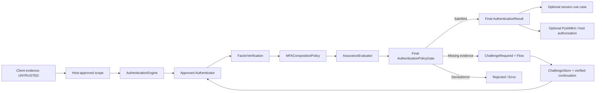
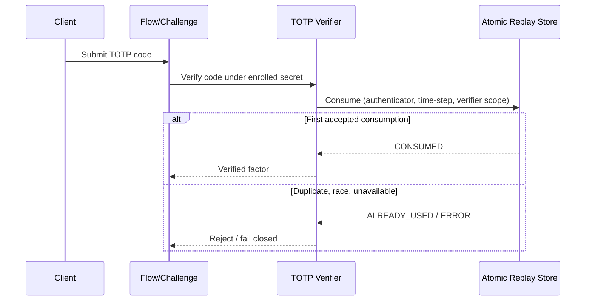
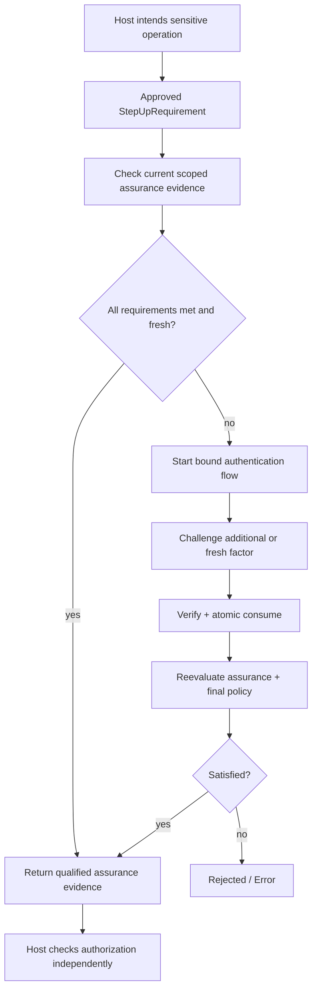
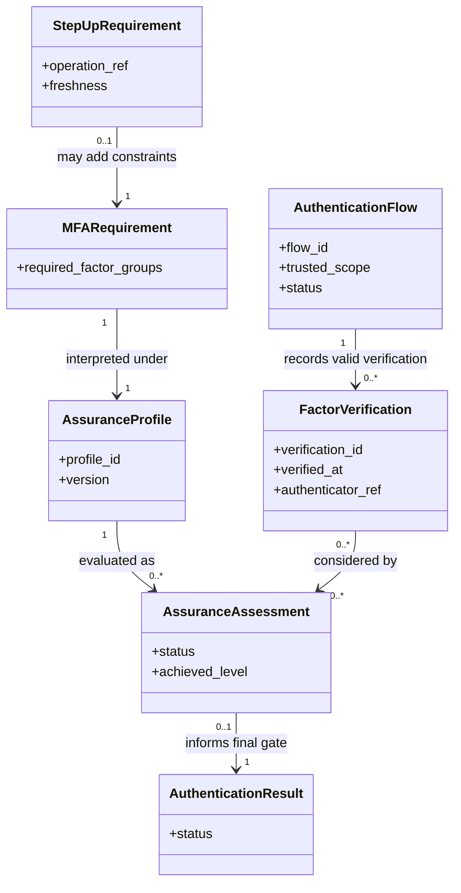
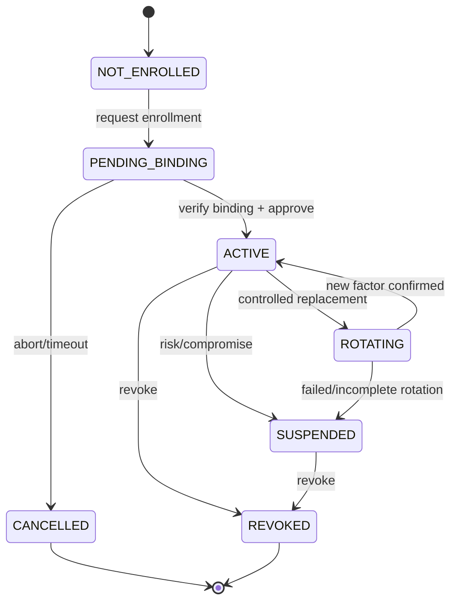
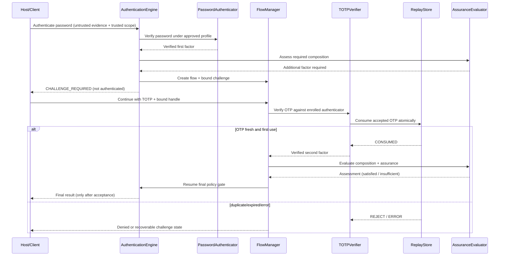
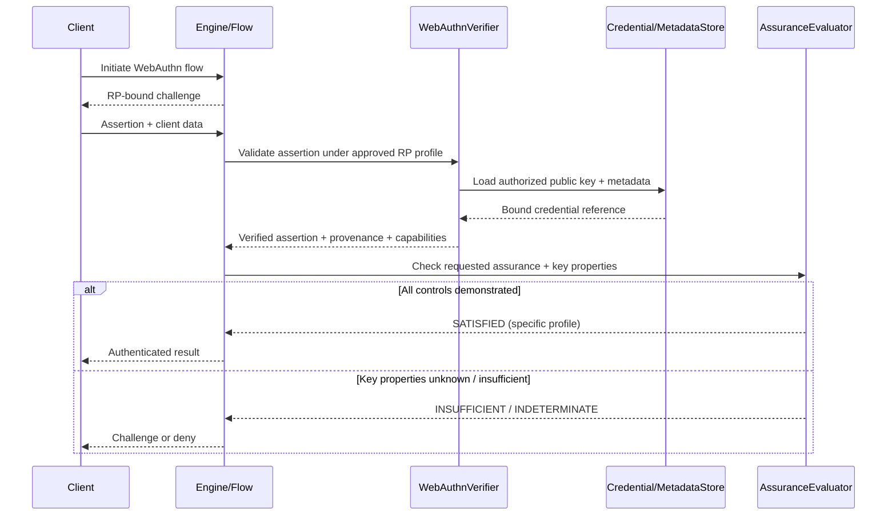
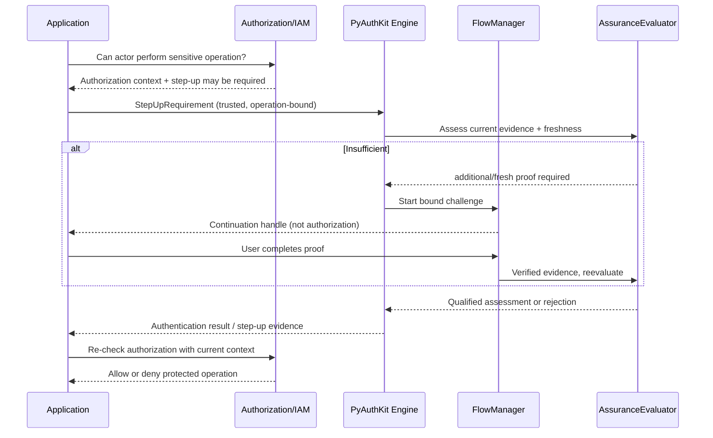

# 12_PYAUTHKIT_MFA_AND_ASSURANCE_MODEL

# PyAuthKit — Multi-Factor Authentication and Assurance Model

> **Document :** `12_PYAUTHKIT_MFA_AND_ASSURANCE_MODEL.md`  
> **Produit :** PyAuthKit — Authentication Engine for the Modern Python Ecosystem  
> **Type :** spécification DDD, sécurité, architecture, assurance et convention pédagogique  
> **Statut :** **PROPOSED / DESIGN** — aucune preuve d'implémentation, de certification ni de qualification live  
> **Version documentaire :** 0.1.0  
> **Date :** 2026-10-29  
> **Langue :** français, types métier et APIs en anglais  
> **Filiation :** documents `00` à `11` et `PYAUTHKIT_SOFTWARE_DESIGN_LEARNING_CONVENTION.md`  
> **Phase :** **POST-MVP** — le MVP de `09`–`10` se limite à Password, API Key et vérification de JWT entrants  
> **Document suivant :** `13_PYAUTHKIT_SESSION_AND_TOKEN_MODEL.md`

---

## Guide de lecture

| Parcours | Sections |
|---|---|
| Objectifs, périmètre, vocabulaire, frontières | 0–7 |
| Facteurs, propriété des authenticators et méthode | 8–13 |
| Assurance, évaluation, step-up, risque, fédération | 14–23 |
| Modèle DDD, séquences, contrats et exemples Python | 24–32 |
| Exigences, invariants, tests, menaces, décisions | 33–43 |
| Conception pédagogique, traçabilité et gouvernance | 44–49 |
| Références et modèles de travail | Annexes A–E |

**Règle d'interprétation.** Un `FactorVerification` ne confère pas à lui seul un niveau d'assurance ; deux écrans, deux OTP, deux secrets ou deux vérifications ne prouvent pas nécessairement deux facteurs indépendants. Un nom tel que `AAL2Result` n'est pas une preuve NIST. Toute affirmation d'assurance doit être **conditionnée par une politique versionnée, un contexte de confiance approuvé et les propriétés effectivement démontrées**.

---

## 0. Résumé exécutif

PyAuthKit doit permettre de composer plusieurs preuves d'authentification pour répondre à des risques et exigences différents sans confondre **méthode**, **facteur**, **authenticator**, **preuve vérifiée**, **assurance**, **fraîcheur**, **authentification** et **autorisation**.

Le modèle cible s'articule autour de cinq décisions séparées :

1. **Validation cryptographique ou protocolaire** : la preuve présentée est-elle admissible et réellement vérifiée sous le profil de confiance effectif ?
2. **Classification des facteurs** : quel facteur ou combinaison d'authentification le protocole et l'authenticator démontrent-ils réellement ?
3. **Composition MFA** : les preuves vérifiées constituent-elles des facteurs distincts et admissibles pour la politique demandée ?
4. **Évaluation de l'assurance** : à quel niveau et selon **quel référentiel/profil** l'événement satisfait-il les exigences, compte tenu de la résistance au phishing, du rejeu, des propriétés de clé, de l'intention, des contraintes de cérémonie et des éventuelles exigences d'exploitation ?
5. **Décision finale** : la politique d'authentification et de fraîcheur autorise-t-elle la publication d'un `AuthenticatedPrincipal` ? Une éventuelle opération hôte sensible sera ensuite **autorisée séparément** par l'application/PyIAMKit.

```text
TRUSTED ENTRY CONTEXT + UNTRUSTED EVIDENCE
                  │
                  ▼
           AuthenticationEngine
                  │
                  ▼
           Flow / Authenticator
                  │
                  ▼
        Verified Factor Evidence(s)
                  │
                  ▼
        Factor Composition Evaluator
          │ independence + binding
          ▼
       Assurance Policy / Profile
          │ standard + version
          │ capabilities + constraints
          │ freshness + scope
          ▼
         AuthenticationPolicyGate
           ├── REJECTED / ERROR
           ├── CHALLENGE_REQUIRED (non final)
           └── AUTHENTICATED (final only)
                           │
                           ▼
                   Assurance Evidence
                           │
                           ├── optional Session use case (13)
                           └── optional IAM / host authorization
```

**Invariants directeurs :**

- `AUTHENTICATED` est impossible si une preuve ou une exigence obligatoire reste manquante, insuffisante ou non vérifiée.
- Les catégories *knowledge*, *possession*, *inherence* ne s'infèrent pas uniquement d'une étiquette fournie par le client.
- Le contexte géographique, l'adresse IP, un score de risque, un cookie de session ou un `ContinuationHandle` **ne constituent pas** des facteurs autonomes.
- Un facteur biométrique n'est pas automatiquement un authenticator distant ; son usage avec un authenticator cryptographique doit être qualifié.
- Les méthodes peuvent remplir un niveau d'assurance **uniquement si toutes les conditions du profil normatif et d'exploitation retenu sont respectées**.
- L'assurance est **située et temporelle** : principal, scope, client, policy, opération, date, contexte, provenance et niveau accordé doivent pouvoir être reliés.
- Le *step-up* est une authentification supplémentaire, **pas** une décision d'autorisation et pas nécessairement la création d'une nouvelle session.
- La qualification d'un niveau NIST, d'une conformité FIDO ou d'un module cryptographique ne peut pas être proclamée à partir d'un exemple Python ou d'une simple suite de tests unitaires.

### 0.1 Ce que ce document décide

Il définit une **proposition de modèle** pour les notions `AuthenticationFactor`, `FactorVerification`, `FactorComposition`, `AssuranceRequirement`, `AssuranceAssessment`, `AssuranceProfile`, `StepUpRequirement`, `FreshnessRequirement` et `MFAEnrollment`, les politiques et les tests associés. Les noms et signatures restent susceptibles d'ADR dans `24`.

### 0.2 Ce que ce document ne décide pas

Il ne rend pas MFA obligatoire dans le MVP, ne crée pas un serveur IAM, n'introduit pas d'authenticator matériel, ne garantit pas la sécurité d'un authenticator tiers, ne définit pas tous les détails de recovery, ne fixe pas d'interface UX et ne certifie aucune solution conforme à NIST/FIDO/WebAuthn.

---

## 1. Sources internes, priorités et traçabilité

| Source | Autorité de conception | Limite dans `12` |
|---|---|---|
| `00_PYAUTHKIT_EXPRESSION_DU_BESOIN.md` | MFA comme composition, step-up, principal human/machine | besoin, pas API finale |
| `01_PYAUTHKIT_REQUIREMENTS_ANALYSIS.md` | exigences FR/NFR/SEC/ARC/INT | candidats de qualification |
| `02_PYAUTHKIT_PRODUCT_VISION_AND_ARCHITECTURE_PRINCIPLES.md` | DDD, DIP, KISS/YAGNI, sécurité | pas certification |
| `03_PYAUTHKIT_SYSTEM_ARCHITECTURE.md` | engine, policy, ports, adapters | architecture de référence |
| `04_PYAUTHKIT_DOMAIN_OBJECTS.md` | vocabulaire des facteurs/assurance | concepts non figés |
| `05_PYAUTHKIT_ENTITIES_AND_VALUE_OBJECTS.md` | classification DDD conditionnelle | ne force pas des agrégats |
| `06_PYAUTHKIT_DOMAIN_RELATIONSHIPS_AND_ERD.md` | relations/ownership et ERD conditionnels | ne force pas des tables |
| `07_PYAUTHKIT_DOMAIN_INVARIANTS_AND_BUSINESS_RULES.md` | `AUTH-INV-*`, règles de confiance | **source interne majeure** |
| `08_PYAUTHKIT_COMMANDS_QUERIES_AND_USE_CASES.md` | `APP-CMD-*`, `APP-UC-*` | orchestration applicative |
| `09_PYAUTHKIT_AUTHENTICATION_ENGINE_MODEL.md` | verdict final et trust policy gate | aucune promotion anticipée |
| `10_PYAUTHKIT_AUTHENTICATOR_AND_CREDENTIAL_MODEL.md` | vérification de credentials | verdict technique ≠ assurance |
| `11_PYAUTHKIT_AUTHENTICATION_FLOW_AND_CHALLENGE_MODEL.md` | flow, challenge, continuation, usage unique | la state machine reste source des transitions |
| `PYAUTHKIT_SOFTWARE_DESIGN_LEARNING_CONVENTION.md` | problème → contrainte → principe → pattern si utile → preuve | modèle pédagogique |

**Traçabilité.** `MFA-REQ-*`, `MFA-INV-*`, `MFA-CTR-*`, `MFA-TST-*`, `MFA-THR-*` et `MFA-DEC-*` sont des identifiants **propres au document 12**. Ils spécialisent sans écraser `AUTH-INV-*`, `FLOW-*` ou `APP-*`.

### 1.1 Gouvernance des divergences

Lorsque la documentation précédente mentionne simplement `assurance_level="AAL2"` ou une paire de mécanismes, considérer cela comme **exemple conceptuel**, non preuve de satisfaction de NIST SP 800-63B-4. Toute formalisation plus précise apportée ici doit être proposée comme **clarification à reprendre en ADR**, non comme correction silencieuse des sources.

---

## 2. Référentiels externes et règle de conformité

Les références vérifiées pour cette édition sont :

1. **NIST SP 800-63B-4**, *Authentication and Authenticator Management*, publication finale de juillet 2025 : https://pages.nist.gov/800-63-4/sp800-63b/aal/ et https://pages.nist.gov/800-63-4/sp800-63b/authenticators/ ; page officielle https://csrc.nist.gov/pubs/sp/800/63/B/4/final.
2. **NIST SP 800-63C-4**, *Federation and Assertions*, notamment la séparation FAL/AAL : https://pages.nist.gov/800-63-4/sp800-63c/fal/.
3. **OWASP Multi-Factor Authentication Cheat Sheet** : https://cheatsheetseries.owasp.org/cheatsheets/Multifactor_Authentication_Cheat_Sheet.html.
4. **RFC 6238**, TOTP : https://www.rfc-editor.org/rfc/rfc6238 ; **RFC 4226**, HOTP : https://www.rfc-editor.org/rfc/rfc4226.
5. **W3C Web Authentication, Level 3** : https://www.w3.org/TR/webauthn-3/ (version et statut normatif à revérifier lors de l'implémentation).

Ces sources ne rendent pas une library « NIST compliant » ou « WebAuthn certified ». Le niveau est revendicable seulement pour un **processus déployé**, avec les types d'authenticators, la gestion des clés, les protocoles, les responsabilités de verifier/CSP/IdP, les sessions, la supervision et la politique effectifs vérifiés.

### 2.1 Statut des tableaux normatifs

- **NIST** déclare les exigences de son référentiel ; nous pouvons les résumer sans les modifier.
- **PyAuthKit** propose une manière de collecter les preuves et de tester des exigences **sans promettre leur satisfaction**.
- **Profil local** : `HIGH`, `SENSITIVE`, `STRONG` sont des valeurs *organization-specific*, **jamais** des synonymes implicites d'AAL2/AAL3.

---

## 3. Problème et pressions de conception

**Exemple A.** Une application accepte un mot de passe valide et un code TOTP valide. Elle ne peut pas ignorer que les deux preuves peuvent être rejouées ou liées à un autre tenant, que le TOTP a peut-être déjà été consommé et que le second facteur peut ne pas être enregistré par le bon compte.

**Exemple B.** Une passkey avec vérification utilisateur activée peut prouver une possession cryptographique et une activation locale, mais ne démontre pas à elle seule un niveau AAL3, notamment si la clé est synchronisable/exportable ou si la validation et les caractéristiques de l'authenticator sont inconnues.

**Exemple C.** Une session valide depuis plusieurs heures peut être insuffisante pour modifier une méthode MFA ou effectuer une opération sensible. Il faut produire une nouvelle preuve **liée à l'opération** et mesurer sa fraîcheur.

**Forces de conception :** variété des protocoles ; distinction preuves vs résultats ; exigences légales/normatives variables ; multi-tenant ; compatibilité framework ; zéro dépendance Web dans le domaine ; runtime asynchrone ; modes de session ; récupération ; expérience utilisateur ; révocation ; repli sûr ; audit et tests reproductibles.

La réponse ne doit pas être un booléen global `mfa_enabled` ni un tableau de méthodes agrégées par nombre.

---

## 4. Bounded Context et truth ownership

| Responsabilité | Autorité canonique proposée | Exclusions |
|---|---|---|
| Vérification des preuves | Authenticators + trust profiles PyAuthKit | autorisation des ressources |
| Composition et assurance | `AssuranceEvaluator` / `MFACompositionPolicy` PyAuthKit | identité organisationnelle et rôles |
| Progression d'une cérémonie | `AuthenticationFlow`, `AuthenticationChallenge` (`11`) | session permanente |
| Enrollment/rotation des factors | sous-domaine AuthN **si owned** ; sinon backend CSP/IdP | annuaire IAM universel |
| Résolution de l'identité et rôles | PyIAMKit / hôte | preuves MFA brutes |
| Réaction à un acte sensible | hôte / autorisation IAM | supposition que step-up autorise l'acte |
| Sessions / tokens | sous-domaine dédié `13` ou hôte | attribution automatique de pouvoirs |
| Signaux et décisions de risque | évaluateur externe ou policy AuthN | facteur d'authentification |

**Contrainte principale :** un `PrincipalRef` authentifié n'est pas nécessairement un `User` dans une organisation. Les assertions d'un IdP ne permettent pas à elles seules de créer une identité locale autorisée ou d'autoriser un mandat d'agent.

---

## 5. Ubiquitous Language

| Concept | Définition opérationnelle | Non-équivalence |
|---|---|---|
| `Authenticator` | mécanisme/instance qui démontre le contrôle d'une preuve | facteur |
| `AuthenticationFactor` | catégorie d'élément démontré, selon une politique de classification | étape ou canal |
| `AuthenticationMethod` | procédure (Password, TOTP, WebAuthn, etc.) | niveau d'assurance |
| `FactorVerification` | résultat vérifié avec provenance, temps, binding et garanties | permission |
| `FactorComposition` | ensemble admissible de faits de vérification liés | nombre de réponses |
| `MFARequirement` | contrainte exigeant un ensemble de facteurs compatibles | AAL2 par défaut |
| `AssuranceProfile` | référentiel, version, exigences normatives/locales | étiquette marketing |
| `AssuranceAssessment` | décision justifiée à partir de preuves réelles | assertion client |
| `AuthenticationAssurance` | qualité de l'événement AuthN située sous un profil | niveau d'identification civile |
| `FreshnessRequirement` | condition de réauthentification dans une fenêtre | session TTL brut |
| `StepUpRequirement` | demande d'amélioration/fraîcheur d'AuthN | autorisation |
| `PhishingResistance` | propriété démontrée d'un protocole/authenticator | simple présence de MFA |
| `ReplayResistance` | capacité du processus à rejeter une preuve réutilisée | nonce non contrôlé |
| `AuthenticationIntent` | preuve d'intention de l'utilisateur dans la cérémonie (sens NIST) | commande applicative `Authenticate` |
| `AAL` | Authentication Assurance Level selon NIST | `IAL`, `FAL`, score de risque |
| `IAL` | Identity Assurance Level (identity proofing) | authentification |
| `FAL` | Federation Assurance Level | assurance de facteurs locale |
| `RiskSignal` | indice de risque contextuel | facteur |
| `Recovery` | procédure de restauration d'accès | MFA automatiquement satisfait |

---

## 6. Classification de facteurs : connaissance, possession, inhérence

| Catégorie | Exemples | Observation de sécurité |
|---|---|---|
| `KNOWLEDGE` | mot de passe, PIN **centralement vérifié** | deux secrets de connaissance ≠ deux facteurs |
| `POSSESSION` | clé matérielle, authenticator TOTP lié, appareil cryptographique | il faut prouver le contrôle et le binding de l'authenticator |
| `INHERENCE` | biométrie locale utilisée comme facteur d'activation | une biométrie n'est pas un authenticator réseau autonome selon le modèle NIST |

**Attention :** une *activation* biométrique/PIN locale d'un authenticator multifactoriel n'est pas la même chose qu'un mot de passe ou PIN envoyé au serveur. La vérification utilisateur WebAuthn (`UV`) est un signal protocolaire portant sur l'authenticator ; elle ne dévoile pas nécessairement le type exact d'activation.

### 6.1 Ce qui n'est pas une catégorie de facteur

`FEDERATED`, `SOCIAL`, `CONTEXTUAL`, `TRUSTED_DEVICE`, `RISK_SCORE`, `GEOLOCATION`, `IP_ADDRESS`, `SESSION_COOKIE` ou `API_KEY` ne constituent pas **en eux-mêmes** de nouvelles catégories indépendantes dans cette classification. Une méthode externe peut **porter une assurance attestée et vérifiée** sans révéler tous les détails des facteurs internes. Une API key prouve surtout le contrôle d'un secret/application ; elle ne représente pas sans autre preuve la MFA d'un humain.

### 6.2 Indépendance réelle des facteurs

Deux preuves ne sont pas admissibles comme MFA si elles ne satisfont pas les conditions de distinction de facteurs et de liaison au même sujet/événement. Exemple : Password + PIN centralement vérifié = deux facteurs de connaissance, pas deux catégories. Deux OTP du même dispositif peuvent n'être qu'une seule possession. Les détails d'un authenticator multifactoriel doivent s'appuyer sur des propriétés vérifiées, pas sur le nombre de champs d'entrée.

---

## 7. Carte conceptuelle et frontières de confiance



Les ports ne confèrent pas une confiance à l'objet qu'ils reçoivent. Seules des vérifications effectives sous une configuration de confiance approuvée peuvent produire une observation admissible pour l'évaluation.

---

## 8. `Authenticator` et `FactorVerification` : production de preuve

L'authenticator possède les responsabilités décrites en `10` : reconnaître une méthode supportée, vérifier les credentials/preuves sous un `TrustProfile`, livrer une issue technique et une identité/sujet vérifié **lorsque possible**. `FactorVerification` est un **fait de sécurité vérifié et situé**, construit par un composant de confiance après vérification.

Attributs candidats :

```text
FactorVerification
├── verification_id
├── flow_id / attempt_id
├── subject_binding (trusted namespace / subject reference)
├── tenant / realm / relying_party / purpose
├── authenticator_id (trusted enrollment reference)
├── method + factor evidence classification
├── verified_at (trusted clock)
├── verifier / trust profile / policy versions
├── anti_replay_reference (non-secret)
├── cryptographic_capabilities_evidence
├── phishing_resistant / verifier_name_bound / channel_bound
├── user_verification (if supported and validated)
├── auth_intent_evidence (when applicable)
└── provenance and diagnostics (sanitized)
```

**Aucun champ booléen ou typage Python ne prouve la réalité d'une propriété.** Chaque propriété sensible doit provenir d'un adaptateur autorisé, de vérifications complètes et, si nécessaire, de métadonnées d'authenticator/attestation fiables.

---

## 9. `MFACompositionPolicy` : vérifier la combinaison, non compter

Le composant reçoit des `FactorVerification` admissibles et un contexte effectif approuvé. Il doit vérifier : même sujet prouvé, même scope et audience, binding à une cérémonie compatible, dates/fraîcheur pertinentes, vérification réussie, authenticator admissible et facteurs indépendants ou authenticator multifactoriel qualifié.

```text
Input: VerifiedFactorEvidence[] + Requirement + TrustedScope
       ↓
Reject untrusted/incomplete/expired/misbound evidence
       ↓
Classify verified authenticators and factor types
       ↓
Check same subject + tenant + relying party + flow
       ↓
Check genuine distinct factors or qualifying MF authenticator
       ↓
Check replay / phishing / intent and other requested constraints
       ↓
CompositionAssessment
  SATISFIED | ADDITIONAL_FACTOR_REQUIRED | REJECTED | UNDETERMINED
```

### 9.1 Règle anti-double comptage

Le même événement de possession ou le même authenticator ne peut pas être compté deux fois pour satisfaire artificiellement deux preuves distinctes. Un authenticator multifactoriel est évalué **selon son fonctionnement et les propriétés démontrées**, pas par injection artificielle de deux `FactorVerification` identiques.

### 9.2 Contradictions et ambiguïtés

- facteur inconnu → `UNDETERMINED`, jamais `SATISFIED` ;
- tenant différent → rejet ;
- sujet prouvé différent → rejet ;
- fenêtre de fraîcheur dépassée → nouvel acte requis ;
- facteur révoqué après vérification, lorsqu'une politique exige sa validité courante → réévaluer ou rejeter ;
- profil absent ou incohérent → erreur de configuration à effet fail-closed.

---

## 10. Authenticator enrollment, binding, rotation et recovery

`MFAEnrollment` n'est une Entity que si PyAuthKit possède réellement l'enrôlement. Sinon, l'autorité appartient au CSP/IdP/tenant et PyAuthKit utilise un port de vérification explicite. L'enrôlement doit assurer la liaison d'un nouvel authenticator à **un sujet et scope autorisés**, avec preuve de possession et conditions de risque/step-up définies.

Règles proposées :

1. Une méthode MFA nouvelle ne devient pas utilisable avant validation de son binding et activation effective.
2. Un facteur de récupération ne peut pas être ajouté à partir d'une seule session susceptible d'être compromise sans contrôles adaptés.
3. La désactivation/remplacement de MFA est une opération **à haut risque** ; exiger réauthentification ou procédure de récupération qualifiée.
4. L'ajout et la suppression de facteurs doivent être audités et notifiés selon une politique de confidentialité et de canal fiable.
5. Un facteur compromis/revoqué ne doit plus justifier une assurance nouvelle.
6. Les tokens/sessions déjà existants nécessitent une politique d'invalidation distincte (`13`).
7. La suppression du dernier facteur fort doit déclencher un garde-fou, mais la règle exacte dépend de la politique du tenant et de ses mécanismes de récupération.

---

## 11. TOTP : MFA, secret partagé et replay

TOTP est une méthode OTP fondée sur un secret partagé et le temps (RFC 6238). Une application d'authentification classique peut fournir une preuve de possession sous une politique de binding appropriée ; le fait de fournir un code TOTP après un mot de passe **ne qualifie pas automatiquement toute l'implémentation** à AAL2.

Contrôles à définir : secret suffisamment robuste et protégé, provisionnement/changement de secret, transport protégé, taille et fenêtre de validité, dérive d'horloge, nombre d'essais, throttling, anti-rejeu effectif, stockage des états de consommation au bon scope, rotation et révocation.

### 11.1 Exemple de menace : double usage du même code



La clé exacte de replay et la tolérance d'horloge sont à spécifier et qualifier ; le stockage doit garantir une consommation conforme au périmètre défini, malgré les requêtes concurrentes et les retries. **Usage unique du challenge ≠ usage unique de l'OTP.**

---

## 12. OTP par SMS, email et push : limites et politiques

- **SMS/PSTN** : peut être utilisé dans certaines configurations comme canal *out-of-band*, mais est **restreint** dans NIST 800-63B-4 ; les risques de SIM swap, redirection et interception demandent une évaluation spécifique.
- **Email OTP / magic link** : ne doit **pas** être présumé facteur *out-of-band* acceptable au titre de NIST 800-63B-4 ; c'est un canal/application ayant un usage local possible sous une politique explicite, pas une garantie de MFA NIST.
- **Push approval** : nécessite la sécurité du device, le binding, une protection contre le *push fatigue*, une validation d'intention et idéalement une authentification résistante au phishing selon le niveau exigé.
- **Voice call** : mêmes risques de canal et restrictions potentielles que PSTN.

Ces méthodes sont **post-MVP et facultatives**. L'hôte doit pouvoir désactiver une méthode selon sa politique de conformité et son risque sans modifier le domaine.

---

## 13. WebAuthn / Passkeys : preuve cryptographique, UV et caractéristiques

WebAuthn repose sur des credentials asymétriques associés à une relying party et une cérémonie challenge/réponse. Un résultat admissible dépend de la validation de la signature, du challenge, de l'origin, du RP ID, des flags et des autres contrôles requis par la cérémonie et la politique. Le *user verification flag* est une indication de vérification locale, pas une preuve universelle de type biométrique.

**Points déterminants :**

- `UP` et `UV` doivent être évalués selon la cérémonie et la politique ;
- une passkey peut être **synchronisable** et ne doit pas être assimilée automatiquement à une clé matérielle non exportable ;
- l'attestation/metadata d'un authenticator peut être absente, variable ou non fiable pour une propriété requise ;
- les passkeys peuvent contribuer à une MFA cryptographique selon les facteurs démontrés, mais **AAL3 exige notamment une clé privée non exportable** dans le modèle NIST et ne tolère pas les authenticators synchronisables à ce niveau ;
- le domaine doit pouvoir représenter « propriété indéterminée » sans l'inférer de l'UX ou du nom de fournisseur.

### 13.1 Le cas des passkeys synchronisées

Le caractère synchronisé/exportable des clés affecte la qualification à un niveau d'assurance donné. Une présentation « WebAuthn + UV = AAL3 » est **incorrecte**. L'évaluation tient compte du niveau demandé, des caractéristiques du matériel et des contrôles de cycle de vie.

---

## 14. `AssuranceProfile` : référentiel, version et contraintes

L'`AssuranceProfile` représente la **source approuvée des critères** permettant d'évaluer un niveau. Un profil peut être `NIST_SP_800_63B_4`, `LOCAL_ENTERPRISE_V1` ou un autre référentiel autorisé. Les règles doivent être versionnées et sélectionnées par le `TrustedScope`/configuration **côté hôte**, jamais par une valeur libre présentée par le client.

```text
AssuranceProfile
  profile_id / profile_version
  authority (NIST | LOCAL | ...)
  required_factors / permitted_authenticator_combinations
  verifier_cryptographic_requirements
  phishing_resistance_required
  replay_resistance_required
  authentication_intent_required
  authenticator_key_protection_rules
  session_and_reauthentication_constraints
  allowed_methods / restricted_methods
  unknown_property_policy (fail closed)
  evaluation_notes / source_version
```

La représentation canonique et le référentiel normatif effectif sont **des décisions ADR** ; cette liste est un catalogue, pas une spec finale de schéma SQL ou un moteur de règles à construire immédiatement.

---

## 15. Modèle NIST : AAL1, AAL2 et AAL3

Le tableau ci-dessous est une **synthèse informative**, non une substitution au texte normatif complet. La section 2 du NIST 800-63B-4 reste l'autorité pour les exigences exactes et leurs exceptions.

| Niveau | Sens | Critères structurants (résumé) |
|---|---|---|
| `AAL1` | confiance de base dans le contrôle d'un authenticator lié | authentification SF ou MF admissible ; canal protégé et exigences du verifier |
| `AAL2` | forte confiance et deux facteurs distincts | combinaison de facteurs admissible ou authenticator MF ; exigences crypto, rejeu, option phishing-resistant disponible, sessions selon le profil |
| `AAL3` | très forte confiance | protocole à clé publique et authenticator cryptographique avec clé privée non exportable, résistance au phishing et exigences complémentaires strictes |

### 15.1 Précautions normatives

- `AAL1` n'est pas « aucune sécurité » ; des contraintes crypto et de canal s'appliquent.
- `AAL2` requiert deux facteurs distincts ; une authentification MFA peut correspondre, mais il faut **prouver toutes les autres contraintes**.
- `AAL3` exige notamment un authenticator cryptographique phishing-resistant à clé non exportable ; une passkey synchronisable ne satisfait pas cette exigence.
- Les sessions et délais de réauthentification appartiennent également à l'évaluation du processus déployé (`13`).
- Des modalités d'application particulières existent pour les organisations fédérales américaines ; ne pas étendre leurs obligations à tous les projets sans analyse de périmètre.

### 15.2 Assurance ≠ arithmétique

L'assurance ne se calcule pas comme `min(3, number_of_steps)` ni `password + TOTP = AAL2` par construction. Le profil sélectionne les **règles de qualification**, pas une somme de scores. Une fonction `assurance=min(proofs)` est également insuffisante sans sémantique formelle de composition.

---

## 16. AAL, IAL, FAL et autorisation : quatre axes distincts

```text
IDENTITY PROOFING / IAL
  Who was verified during enrollment?

AUTHENTICATION / AAL
  How well was the current subject authenticated?

FEDERATION / FAL
  How robustly is the assertion conveyed and protected?

AUTHORIZATION / IAM
  What may this authenticated subject do now?
```

Un niveau AAL revendiqué par un IdP est une **assertion à évaluer** selon une relation de confiance vérifiée, les signatures, l'issuer, l'audience, la fraîcheur, les contrats de fédération et le mapping explicite vers le profil local. Le RP ne doit pas lui attribuer arbitrairement un AAL plus élevé. Le FAL de la fédération ne se déduit pas du seul JWT signé, ni l'IAL d'un login correct.

---

## 17. `AssuranceAssessment` : décision explicable

Le composant d'évaluation n'émet pas un `AAL` positif sans preuves suffisantes. Il conserve un statut discriminé et des raisons **non sensibles**.

```text
AssuranceAssessment
├── status: SATISFIED | INSUFFICIENT | REJECTED | INDETERMINATE
├── requested_profile: id + immutable version
├── evaluated_at: trusted clock
├── scope/subject/audience/flow binding
├── achieved_level: optional qualified enum/value
├── satisfied_constraints: reason codes
├── unmet_constraints: reason codes
├── authenticator_evidence_refs: sanitized references
├── provenance: verifiers and trust profile versions
└── expiry/freshness constraints (if applicable)
```

**Exemple :** `INSUFFICIENT(required=AAL2, missing=PHISHING_RESISTANT_OPTION_SETUP)` ne doit jamais être sérialisé comme `achieved_level=AAL2`. La politique de production doit définir quels diagnostics peuvent être exposés au client ; les détails des signaux de risque, authenticators enregistrés ou comptes ne doivent pas devenir un oracle d'énumération.

---

## 18. Fraîcheur de l'authentification : `FreshnessRequirement`

La fraîcheur désigne le temps écoulé depuis une **preuve pertinente vérifiée** ; elle ne doit pas être calculée à partir du seul `updated_at` de session, de la dernière requête HTTP ou d'un cookie renouvelé. Le modèle cible distingue :

- `authenticated_at` : date de l'événement d'authentification initial ;
- `last_reauthenticated_at` : dernière réauthentification qualifiée ;
- `factor_verified_at` : horodatage de chaque preuve admissible ;
- `assurance_valid_from` / `assurance_valid_until` : bornes déduites de la policy, pas garanties universelles ;
- `operation_bound_at` : instant où une preuve est liée à une opération si le mécanisme le permet.

Un profil peut demander `max_age`, `required_authentication_time`, `required_assurance`, `required_method`, `auth_intent` et des règles relatives au niveau de session.

### 18.1 Exemples de fenêtres (illustratives)

| Opération hôte | Besoin possible | Décision PyAuthKit |
|---|---|---|
| Consulter une page ordinaire | session courante sous policy locale | produire `AssuranceAssessment` ou échec |
| Modifier le mot de passe | réauthentification fraîche | `CHALLENGE_REQUIRED` si insuffisant |
| Remplacer un facteur MFA | contrôle renforcé et anti-account-takeover | nouvelle cérémonie située et auditable |
| Effectuer un paiement sensible | niveau et fraîcheur propres à l'opération | authentifier ; l'hôte autorise ensuite |
| Accéder à des secrets d'un service | preuve M2M et autorisation spécifiques | MFA humain potentiellement inapplicable |

**Aucune durée universelle de cinq minutes n'est fixée ici.** Toute fenêtre doit provenir d'une politique versionnée et du référentiel retenu. Pour un profil NIST, consulter également ses contraintes de session et de réauthentification.

### 18.2 Edge cases de temps

- `now` vient d'une horloge approuvée ;
- un timestamp futur ou manifestement invalide provoque un refus contrôlé ;
- une révocation ou rotation intervenant entre preuve et décision nécessite une politique de cohérence explicite ;
- une durée `max_age=0` doit avoir une sémantique définie ;
- une preuve plus ancienne ne peut pas être rendue fraîche par reformatage d'un token ;
- un timeout ne devient pas `CHALLENGE_REQUIRED` réussi.

---

## 19. `StepUpRequirement` : demande d'authentification plus forte

Le *step-up* apparaît lorsqu'une opération impose une force ou fraîcheur non prouvée par le contexte AuthN courant. **Ce n'est pas une permission** et le résultat du step-up doit être revalidé par la politique d'accès de l'hôte.



### 19.1 Binding de l'opération

Un `StepUpRequirement` valide porte au minimum des identifiants approuvés `operation_kind`, `subject`, `tenant`, `client/audience`, une politique/assurance requise et des contraintes de fraîcheur. Selon le cas, un binding à une **intention transactionnelle déterminée** (hash d'opération, montant/destinataire pour un paiement, identifiant de ressource) peut être requis. Sans ce binding, il ne faut pas prétendre qu'un step-up couvre automatiquement un autre acte sensible.

### 19.2 Empêcher la transposition et le downgrade

- `step_up_for(tenant_A)` ne couvre pas `tenant_B` ;
- une preuve liée à `change_mfa_factor` ne couvre pas `transfer_funds` sans policy explicite ;
- la continuation ne devient pas un token d'autorisation ;
- une authentification partielle ne modifie pas la session en niveau supérieur ;
- une méthode plus faible ne peut pas satisfaire silencieusement une exigence plus élevée ;
- si le step-up échoue, le contexte précédent n'est pas élevé.

---

## 20. Réauthentification et continuité de session

La session est traitée dans `13`, mais `12` définit le contrat d'assurance qu'une session peut porter. Une session pourra référencer un `AssuranceEvidenceRef` émis à la suite d'une décision positive. `AssuranceEvidenceRef` est **une référence à une preuve d'authentification qualifiée**, pas un secret universel ni un droit d'accès.

```text
Existing Session (optional) + Active Assurance Evidence
                              │
                Sensitive operation requested
                              │
                         Step-up flow
                              │
             NEW verified factor(s) + evaluation
                              │
                 Positive final AuthN decision
                              │
                    Session update / rotation
                     (separate use case in 13)
```

Le contrat de mise à niveau de session doit préciser l'atomicité, les cookies, la rotation de session ID, l'invalidation des anciens tokens et l'effet d'éventuels multi-devices. Il ne suffit pas de définir `session.aal = 2` sur un objet en mémoire.

---

## 21. Authentification adaptative : risque et assurance

L'authentification adaptative peut **augmenter** les exigences lorsqu'un signal de risque est suspect, sans transformer les signaux en preuve. Le `RiskEvaluator` peut être externe ; PyAuthKit conserve un `RiskAssessment` opaque ou structuré, avec provenance et politique explicite.

```text
Low-risk evidence + policy -> baseline requirement
High-risk evidence + policy -> additional factor / phishing resistance
Unknown risk provider      -> fail closed or documented safe degradation
                               (never grant weaker effective assurance)
```

**Distinction à préserver :** *step-up* = cérémonie de preuve supplémentaire ; *risk-based* = moteur de décision sur les exigences ; *MFA* = composition de facteurs ; *AAL* = qualification normative d'un processus sous un profil spécifique.

### 21.1 Risques d'un scoring opaque

- biais géographiques ou matériels ;
- dépendance à une géolocalisation erronée ;
- contournement de rules par un signal manipulable ;
- incohérences multi-tenant ;
- perte d'explicabilité ;
- *fail-open* sur indisponibilité du service de risque.

Le document `17_PYAUTHKIT_ADAPTIVE_AUTH_AND_RISK_MODEL.md` spécialisera ces préoccupations sans modifier les frontières de facteurs définies ici.

---

## 22. Assurance fédérée : IdP, OIDC, `acr`, `amr`, `auth_time`

Une application fédérée peut recevoir des affirmations d'authentification et des indications de méthodes ou de fraîcheur. Ces affirmations sont **des données non fiables tant que la fédération, l'assertion et ses conditions d'acceptation ne sont pas vérifiées**.

| Élément | Information possible | Limite de confiance |
|---|---|---|
| `issuer`, `audience`, `subject` | provenance/sujet | ne pas choisir le `TrustProfile` via des claims non vérifiés |
| OIDC `acr` | classe de référence d'authentification | sémantique dépend d'un contrat IdP/RP |
| OIDC `amr` | méthodes rapportées | pas une preuve automatique des contrôles requis |
| OIDC `auth_time` | instant rapporté de l'authentification | à vérifier sous protocole et relation de confiance |
| NIST AAL/FAL assertions | niveaux déclarés selon politique | contrat de fédération, validation et mapping explicites |

**Interdiction :** traduire automatiquement `amr=["pwd", "otp"]` en `AAL2`, ou `acr="mfa"` en un niveau normatif universel. Un claim peut exprimer une assurance locale reconnue **uniquement sous un mapping validé, versionné et autorisé**.

### 22.1 Contrat de mapping IdP/RP

Le `FederatedAssuranceMapper` candidat accepte : identité vérifiée de l'IdP, configuration approuvée, sémantique versionnée des valeurs `acr/amr`, horodatages fiables, propriétés du token et exigences locales. Il retourne un `AssuranceAssessment` ou `UNDETERMINED`. Il ne peut jamais renforcer un niveau sans preuves approuvées.

---

## 23. Agents, services et workloads : assurance non humaine

Une API key, un certificat mTLS, une assertion JWT de workload ou un jeton OAuth Client Credentials peuvent établir une **authentification de machine**. La taxonomie des facteurs humains (`know/have/are`) et les AAL NIST ne s'appliquent pas mécaniquement à toutes ces identités.

Pour les `SERVICE`, `WORKLOAD` et `AGENT`, envisager un **profil d'assurance machine distinct** : identité workload, attestation d'environnement si pertinente, provenance des clés, preuve de possession, protection contre la substitution de service, audience, durée de vie, révocation et chaîne de délégation.

| Exemple | Résultat raisonnable | Déduction interdite |
|---|---|---|
| mTLS mutuel vérifié | preuve de contrôle d'une clé et identité de certificat situées | MFA humain automatique |
| API Key d'un service | possession d'un secret sous portée établie | AAL2 d'un utilisateur |
| Workload JWT signé | assertion validée sous profil approuvé | autorisation générale de l'agent |
| Agent avec mandat délégué | identité + mandat à évaluer séparément | droits du mandant sans vérification IAM |

**Règle :** `MachineAssurance` et `HumanAuthenticationAAL` doivent être des concepts distincts même si une façade API peut présenter des résultats homogènes.

---

## 24. Modèle DDD tactique et classification d'objets

| Objet candidat | Catégorie | Justification | Ownership |
|---|---|---|---|
| `AuthenticationFactor` | type conceptuel / Enum | catégorie sans identité persistante | domaine |
| `FactorVerification` | immutable evidence record/VO candidat | fait situé vérifié et référencé | AuthN/flow ou journal de preuves |
| `FactorComposition` | Value Object candidat | résultat de combinaison | domaine |
| `MFARequirement` | Value Object | exigences de facteurs | configuration policy |
| `AssuranceProfile` | configuration immutable versionnée | critères de référence | policy/configuration |
| `AssuranceAssessment` | Value Object/result object | verdict reproductible sous contexte figé | evaluation |
| `StepUpRequirement` | Value Object | intention et contraintes | application/host |
| `FreshnessRequirement` | Value Object | règles temporelles | policy |
| `MFAEnrollment` | Entity conditionnelle | cycle de vie sous ownership local | CSP/AuthN owned ou IdP externe |
| `AuthenticatorBinding` | Entity conditionnelle ou ref | lien principal/authenticator | owner de credential |
| `RecoveryOperation` | process/Entity conditionnelle | contrôles de restauration | owned ou externe |
| `AssuranceEvaluator` | Domain Service candidat | qualification sans persistance | domaine/application selon dépendances |
| `MFACompositionPolicy` | Domain Policy candidate | contraintes de combinaison | domaine |
| `FederatedAssuranceMapper` | Adapter/port spécialisé | traduction de claims IdP | infrastructure et contrats |
| `AssuranceEvidenceRef` | Value Object | référence opaque au résultat qualifié | session/applicatif |
| `RiskAssessment` | VO externe contrôlé | signal, pas facteur | risque/policy |

### 24.1 Agrégats : ne pas en inventer

Une composition MFA stateless ne devient **pas** un aggregate root parce qu'elle est importante. Un `MFAEnrollment` peut devenir une entité/agrégat uniquement si PyAuthKit détient la transaction d'inscription, la révocation et les invariants d'un ensemble de facteurs. Le `Flow` et le `Challenge` gardent leurs responsabilités décrites en `11`. Le `Session` et les tokens relèvent de `13`.

### 24.2 Contrainte d'unicité de propriétaire

La représentation d'un facteur référencé doit toujours être située dans `TrustedScope + principal namespace + authenticator binding` ; un ID arbitraire global ne peut pas contourner le multi-tenant. La propriété d'un facteur et la possibilité de lui attribuer un principal appartiennent à la source d'identité/credential autoritative.

---

## 25. Relations et cardinalités conceptuelles



Les cardinalités restent **conceptuelles** et conditionnelles au choix de persistance ; elles ne prescrivent pas des clés étrangères SQL. Une évaluation peut être pure, sans enregistrement autonome. Une référence de session peut être un identifiant opaque vers une preuve conservée ou une représentation signée/sécurisée selon un contrat propre.

---

## 26. Cycle de vie MFA : enrollment et step-up



Ces états sont candidats **si PyAuthKit est propriétaire du facteur**. L'authentification d'un facteur local ne doit pas accepter un credential `PENDING_BINDING`, `SUSPENDED`, `REVOKED` ou hors scope. La transition `ROTATING` nécessite une politique sur l'ancien et le nouveau facteur, notamment pour éviter l'interruption totale ou l'acceptation simultanée incontrôlée.

---

## 27. Séquence Password + TOTP MFA



**Points non négociables :** aucune session active ni token d'accès n'est nécessairement délivré lors du premier succès ; une tentative OTP ne dévoile pas les authenticators enregistrés ; le challenge est consommé selon `11` ; le TOTP est protégé contre les rejeux **indépendamment du challenge** ; la dernière décision appartient au moteur, pas au composant TOTP.

---

## 28. Séquence WebAuthn/passkey et assurance



Ce schéma illustre l'ordre logique ; il ne remplace ni le protocole WebAuthn ni les bibliothèques de vérification. Il faut notamment distinguer un authenticator *syncable* d'un authenticator à clé non exportable lorsqu'un niveau élevé l'exige.

---

## 29. Séquence de step-up pour opération sensible



Ne pas afficher « autorisé » à la suite de `ASSURANCE_SATISFIED` sans la décision IAM finale et des éventuelles contraintes transactionnelles de l'hôte.

---

## 30. Pipeline applicatif détaillé

| Étape | Responsable | Entrée de confiance | Sortie candidate | Refus typique |
|---|---|---|---|---|
| 1. Resolve | `AuthenticationEngine` | `TrustedEntryContext` | scope et trust profile | tenant inconnu |
| 2. Verify | `Authenticator` | méthode autorisée, secret/proof | `AuthenticatorOutcome` | mauvais secret |
| 3. Bind | Flow verifier | flow ID, authenticator/subject, purpose | `FactorVerification` | mismatch de sujet |
| 4. Compose | `MFACompositionPolicy` | preuves admissibles | `CompositionAssessment` | facteurs non distincts |
| 5. Assess | `AssuranceEvaluator` | profil effectif versionné | `AssuranceAssessment` | propriété inconnue |
| 6. Decide | `AuthenticationPolicyGate` | résultat de l'évaluation + policy | verdict final | politique non satisfaite |
| 7. Publish | Result normalizer | décision finale | `AuthenticationResult` | tentative de succès partiel |
| 8. Audit | Event publisher | données minimisées | événements corrélés | fuite de secrets |
| 9. Option | Session/token use case | résultat final authentifié | session/token si demandé | échec rotation/issuance |

Les étapes sont **logiques** et peuvent être fusionnées dans une implémentation Python simple ; elles ne nécessitent ni une classe par ligne, ni un bus de messages. Les contrôles de sécurité restent néanmoins isolables et testables.

---

## 31. Ports & Adapters et responsabilités runtime

| Port candidat | Rôle | Adapter possible | Risque maîtrisé |
|---|---|---|---|
| `AuthenticatorPort` | vérifier une méthode autorisée | Password/TOTP/WebAuthn | couplage protocolaire |
| `AuthenticatorBindingResolver` | charger binding authenticator/sujet | DB, IdP, service externe | substitution inter-tenant |
| `AssuranceProfileResolver` | choisir profil approuvé/version | config locale, tenant config | attacker-controlled AAL |
| `FactorReplayGuard` | unicité vérification OTP | Redis atomic, SQL conditional | replay/concurrence |
| `FlowStatePort` | progression de cérémonie | DB, Redis, in-memory dev | double transition |
| `ClockPort` | date de sécurité | horloge maîtrisée | fraîcheur fictive |
| `AuditSink` | événements minimisés | logs/SIEM | manque de traçabilité |
| `RiskSignalProvider` | observations de risque | moteur externe | repli non gouverné |
| `FederatedAssurancePort` | claims/trust IdP | OIDC/SAML adapter | auto-attribution de niveau |
| `PolicyStore` (si needed) | règles versionnées | memory/SQL | divergence de policies |

Le domaine ne doit pas importer `fastapi`, `django`, `redis`, `sqlalchemy`, des SDK IdP ou des bibliothèques WebAuthn concrètes. Si un port n'est pas nécessaire à la première livraison, son contrat peut rester documentaire.

---

## 32. Contrats Python illustratifs (non sécurisés et non exécutables seuls)

Les fragments suivants servent à enseigner la **séparation des preuves, des exigences, des décisions et des responsabilités**. Aucun d'eux ne vérifie un mot de passe, un TOTP, une signature ou un authenticator matériel. Les factories sécurisées et les types d'instanciation contrôlée seront spécifiés dans `24`.

### 32.1 Types métier immuables et résultats discriminés

```python
from dataclasses import dataclass
from datetime import datetime, timedelta
from enum import Enum
from typing import Literal, Protocol


class FactorKind(str, Enum):
    KNOWLEDGE = "knowledge"
    POSSESSION = "possession"
    INHERENCE = "inherence"


@dataclass(frozen=True, slots=True)
class AssuranceProfileRef:
    profile_id: str
    version: str


@dataclass(frozen=True, slots=True)
class VerifiedFactorReference:
    # Produced only by a trusted verification boundary in real code.
    evidence_id: str
    subject_ref: str
    authenticator_ref: str
    trusted_scope_ref: str
    verified_at: datetime
    factor_kind: FactorKind


@dataclass(frozen=True, slots=True)
class AssuranceRequirement:
    profile: AssuranceProfileRef
    requested_level: str
    max_age: timedelta | None
    require_phishing_resistance: bool = False


@dataclass(frozen=True, slots=True)
class AssuranceSatisfied:
    status: Literal["satisfied"]
    profile: AssuranceProfileRef
    achieved_level: str
    evaluated_at: datetime
    evidence_refs: tuple[str, ...]


@dataclass(frozen=True, slots=True)
class AssuranceInsufficient:
    status: Literal["insufficient"]
    profile: AssuranceProfileRef
    reason_codes: tuple[str, ...]


@dataclass(frozen=True, slots=True)
class AssuranceIndeterminate:
    status: Literal["indeterminate"]
    profile: AssuranceProfileRef
    reason_codes: tuple[str, ...]


AssuranceAssessment = (
    AssuranceSatisfied | AssuranceInsufficient | AssuranceIndeterminate
)
```

Ces types n'empêchent **pas** un appelant hostile d'instancier `AssuranceSatisfied`. Un moteur réel exige des **factories internes**, des contrôles d'origine/provenance et des frontières de trust non contournables. Il ne doit pas accepter un tel objet depuis JSON, un client ou un plugin non approuvé pour l'exécution du verdict final.

### 32.2 Ports de politique et contraintes

```python
from typing import Protocol


class AssuranceEvaluator(Protocol):
    async def assess(
        self,
        *,
        evidence: tuple[VerifiedFactorReference, ...],
        requirement: AssuranceRequirement,
        trusted_scope_ref: str,
    ) -> AssuranceAssessment:
        """Evaluate authorized evidence under an approved, versioned profile.

        Design concepts:
            - Domain Policy / Application boundary (placement TBD)
            - Dependency Inversion
            - Strategy only if multiple evaluation policies exist

        Security note:
            The signature does not establish provenance or compliance.
        """
        ...
```

### 32.3 Example of the *wrong* design

```python
# INSECURE PSEUDOCODE — DO NOT IMPLEMENT
# if len(factors) >= 2:
#     return AuthenticatedPrincipal(aal="AAL2")
# if request.risk_score < 0.2:
#     return AuthenticatedPrincipal(aal="AAL3")
# if webauthn_result.user_verified:
#     return AuthenticatedPrincipal(aal="AAL3")
```

Chacun de ces raccourcis omet des exigences indépendantes : source de confiance, provenance, propriétés crypto, facteurs indépendants, anti-rejeu, profil normatif et/ou statut de session.

### 32.4 Tests pédagogiques sur les types (pas sur la sécurité réelle)

```python
from datetime import datetime, timezone


def test_assurance_ref_is_versioned() -> None:
    ref = AssuranceProfileRef("nist-sp800-63b", "2025-07")
    assert ref.profile_id == "nist-sp800-63b"
    assert ref.version == "2025-07"


def test_factor_type_not_same_as_verifier_result() -> None:
    factor = FactorKind.POSSESSION
    assert factor.value == "possession"
    # This is deliberately NOT proof that an authenticator was verified.
```

Le contrôle syntaxique de ces fragments ne constitue **aucune** démonstration d'assurance ou de sûreté cryptographique.

---

## 33. Registre des exigences spécialisées `MFA-REQ-*`

Les exigences suivantes sont **candidates** et s'appliquent aux capacités post-MVP. `MUST` signifie obligation proposée dans le contrat PyAuthKit lorsqu'une fonction est activée ; il ne constitue pas une citation des mots normatifs exacts de NIST.

| ID | Obligation candidate | Priorité | Preuve attendue |
|---|---|---|---|
| MFA-REQ-001 | Accepter seulement des `FactorVerification` issus d'une frontière de vérification approuvée | MUST | provenance positive/négative |
| MFA-REQ-002 | Conserver subject, tenant et audience sur chaque preuve pertinente | MUST | mauvais scope rejeté |
| MFA-REQ-003 | Distinguer méthode, facteur et nombre d'étapes | MUST | Password+PIN non MFA |
| MFA-REQ-004 | Détecter le double comptage d'un même authenticator ou facteur | MUST | doublons rejetés |
| MFA-REQ-005 | Supporter un authenticator multifactoriel qualifié sans fabriquer de faux facteurs | MUST | preuves MF vérifiées |
| MFA-REQ-006 | Produire un état `INSUFFICIENT` ou `INDETERMINATE` lorsque les propriétés exigées manquent | MUST | absence de succès |
| MFA-REQ-007 | Sélectionner l'`AssuranceProfile` uniquement depuis un scope approuvé | MUST | injection client refusée |
| MFA-REQ-008 | Versionner et référencer les profils d'assurance utilisés | MUST | journal de version |
| MFA-REQ-009 | Conserver la séparation `AAL`, `IAL`, `FAL` et authorization | MUST | mapping contrôlé |
| MFA-REQ-010 | Évaluer la résistance au rejeu indépendamment de la consommation du challenge | MUST | replay TOTP concurrent |
| MFA-REQ-011 | Vérifier la résistance au phishing lorsque la policy l'exige | MUST | mode non admissible refusé |
| MFA-REQ-012 | Refuser de déclarer AAL3 lorsque la clé requise est exportable/synchronisable | MUST | passkey syncable rejetée pour AAL3 |
| MFA-REQ-013 | Respecter les exigences d'intention d'authentification pertinentes | MUST | absence d'intention rejetée si requise |
| MFA-REQ-014 | Séparer preuves de facteurs et signaux de risque | MUST | score faible non facteur |
| MFA-REQ-015 | Rendre MFA composable avec le flow/challenge de `11` | MUST | second facteur non final |
| MFA-REQ-016 | Exiger la validité et le binding du facteur enregistré | MUST | facteur révoqué refusé |
| MFA-REQ-017 | Supporter une politique de fraîcheur temporelle et de réauthentification | MUST | ancien timestamp rejeté |
| MFA-REQ-018 | Lier le step-up à scope, sujet, audience et opération selon policy | MUST | cross-purpose refusé |
| MFA-REQ-019 | Ne pas promouvoir l'assurance d'une session sur simple changement de champ local | MUST | gate/session protégés |
| MFA-REQ-020 | Refuser tout bypass de la politique finale du moteur | MUST | succès partiel interdit |
| MFA-REQ-021 | Supporter un `MFAEnrollment` owned ou externalisé sans forcer un store | SHOULD | adapters interchangeables |
| MFA-REQ-022 | Sécuriser remplacement et récupération des factors sous un parcours renforcé | MUST | takeover scenario refusé |
| MFA-REQ-023 | Minimiser logs et événements ; exclure codes et secrets | MUST | redaction tests |
| MFA-REQ-024 | Fournir des codes de raisons structurés et non sensibles | SHOULD | reason mapping stable |
| MFA-REQ-025 | Refuser le mapping non approuvé de claims fédérés vers un AAL local | MUST | `amr` spoofed refusé |
| MFA-REQ-026 | Prévoir un profil distinct d'assurance machine/workload | SHOULD | pas d'AAL humain implicite |
| MFA-REQ-027 | Rendre les réglages tenant/realm explicitement isolés | MUST | tenant mismatch refusé |
| MFA-REQ-028 | Préserver le comportement fail-closed sur profil/risk provider indisponible | MUST | erreur ≠ succès |
| MFA-REQ-029 | Définir retry, cancellation, expiration et rejouabilité pour tous les flows MFA | MUST | race tests |
| MFA-REQ-030 | Fournir des tests de contrat pour tout nouvel authenticator/adaptateur | MUST | substituabilité |
| MFA-REQ-031 | Exposer l'assurance finale sans exposer les secrets de preuve | MUST | DTO minimisé |
| MFA-REQ-032 | Consigner la provenance, les versions et la portée des décisions d'assurance | SHOULD | audit versionné |
| MFA-REQ-033 | Permettre d'interdire une méthode localement sans réécriture du core | SHOULD | config/provider test |
| MFA-REQ-034 | Documenter les exigences de sessions/reauth propre à chaque profil | MUST | cohérence avec `13` |
| MFA-REQ-035 | Préserver la possibilité d'une réponse `CHALLENGE_REQUIRED` sans principal final | MUST | résultat discriminé |
| MFA-REQ-036 | Permettre un profil local sans lui attribuer faussement la dénomination NIST | MUST | namespace standard/local |

### 33.1 Non-exigences explicites

`NOT-REQ-01` : implémenter tous les protocoles MFA à v0.1 ; `NOT-REQ-02` : posséder tous les credentials ; `NOT-REQ-03` : créer un moteur IAM ; `NOT-REQ-04` : transformer chaque requirement en classe/Strategy ; `NOT-REQ-05` : attribuer un AAL uniquement depuis le nom de la méthode ; `NOT-REQ-06` : inventer un *compliance badge* depuis une suite de tests unitaires.

---

## 34. Invariants du domaine `MFA-INV-*`

Ces invariants reprennent la doctrine `AUTH-INV-*` de `07` et `FLOW-INV-*` de `11` sans les renommer. Ils sont propres à l'évaluation MFA/assurance.

| ID | Invariant proposé | Portée |
|---|---|---|
| MFA-INV-001 | Un résultat non final ne transporte aucun `AuthenticatedPrincipal` final | `AuthenticationResult` |
| MFA-INV-002 | Toute preuve acceptée provient d'une vérification réellement approuvée | `FactorVerification` |
| MFA-INV-003 | Les preuves combinées couvrent le même sujet prouvé, selon une règle de liaison explicite | composition |
| MFA-INV-004 | Le tenant et la relying party concordent avec le `TrustedScope` | multi-tenant |
| MFA-INV-005 | Deux facteurs distincts ne se déduisent pas de deux étapes | composition |
| MFA-INV-006 | Le même authenticator n'est pas doublement compté comme des facteurs indépendants sans preuve appropriée | composition |
| MFA-INV-007 | Le contexte ou le risque ne remplace jamais un facteur requis | policy |
| MFA-INV-008 | Une évaluation sans profil valide et versionné est indéterminée/non satisfaite | assurance |
| MFA-INV-009 | Un niveau NIST n'est affirmé que sous le référentiel/version correspondants | assurance |
| MFA-INV-010 | Les propriétés d'authenticator inconnues ne sont pas supposées vraies | assurance |
| MFA-INV-011 | La qualification AAL3 refuse une clé exportable/synchronisable lorsque le profil NIST est retenu | high assurance |
| MFA-INV-012 | Une vérification WebAuthn `UV` seule ne prouve pas un niveau AAL3 | WebAuthn |
| MFA-INV-013 | Un OTP TOTP accepté ne peut pas être réaccepté dans sa fenêtre admissible selon le contrat anti-rejeu | replay |
| MFA-INV-014 | Les gardes de consommation résistent à la concurrence inter-processus | runtime |
| MFA-INV-015 | Un binding révoqué ne permet pas une nouvelle vérification admissible | enrollment |
| MFA-INV-016 | Un facteur non confirmé/en cours d'enrôlement ne satisfait pas MFA | enrollment |
| MFA-INV-017 | La fraîcheur est mesurée sur une preuve réelle, pas un renouvellement du cookie | reauth |
| MFA-INV-018 | Un step-up reste lié au sujet, tenant, client, opération et exigences effectives | step-up |
| MFA-INV-019 | Une continuation de flow ne vaut ni preuve MFA ni droit d'accès | flow |
| MFA-INV-020 | Un échec de step-up ne rehausse pas l'assurance existante | session |
| MFA-INV-021 | Une session n'est pas automatiquement créée par un succès de composition | session |
| MFA-INV-022 | Une réussite de MFA n'accorde aucune permission IAM implicite | IAM |
| MFA-INV-023 | Les claims IdP ne sont évalués que sous relation de confiance et mapping explicite | fédération |
| MFA-INV-024 | Un `amr`/`acr` libre ou non vérifié n'est pas une preuve d'AAL local | fédération |
| MFA-INV-025 | Un facteur biométrique isolé n'est pas automatiquement un authenticator réseau | biométrie |
| MFA-INV-026 | Une authentification de machine n'est pas assimilée à une AAL humaine | machine |
| MFA-INV-027 | Les secrets, OTP, recovery codes et clés privées sont exclus des logs et exceptions | audit |
| MFA-INV-028 | Une dépendance indisponible n'est pas remplacée par un succès plus faible | fail-closed |
| MFA-INV-029 | L'identifiant de profil d'assurance fourni par le client n'a aucune autorité | trust |
| MFA-INV-030 | Un profil plus ancien ne peut pas être substitué sans décision versionnée explicite | configuration |
| MFA-INV-031 | La révocation et la rotation du facteur sont cohérentes avec la fenêtre de vérification | lifecycle |
| MFA-INV-032 | Un test exécuté n'est pas une certification ou preuve universelle de conformité | gouvernance |

### 34.1 Invariants prioritaires pour la première tranche post-MVP

`MFA-INV-001..010`, `013..020`, `022`, `027..029` constituent la base de sûreté recommandée avant toute revendication de support MFA. Les exigences relatives aux AAL et aux caractéristiques matérielles sont activées seulement quand le produit expose réellement les niveaux concernés, mais **aucune claim de niveau ne peut les contourner**.

### 34.2 Où placer chaque invariant ?

Les invariants de `FactorVerification` sont protégés à la **frontière de vérification** ; les invariants de composition dans la **policy de composition** ; ceux de frais/assurance dans l'**évaluateur** ; ceux de décision finale dans le **policy gate** ; ceux d'atomicité dans les **stores/ports** ; ceux d'autorisation dans l'**hôte/PyIAMKit**. Éviter de dupliquer la règle dans le contrôleur FastAPI et le SDK.

---

## 35. Contrats de service `MFA-CTR-*`

| Contrat | Précondition | Postcondition ou échec garanti |
|---|---|---|
| MFA-CTR-001 `verify_factor` | scope, authenticator, méthode approuvés | evidence vérifiée ou refus, jamais fake success |
| MFA-CTR-002 `evaluate_composition` | ensemble de preuves admissibles | `SATISFIED/INSUFFICIENT/INDETERMINATE` |
| MFA-CTR-003 `assess_assurance` | profil officiel/local versionné | niveau sous profil ou diagnostic non satisfaisant |
| MFA-CTR-004 `start_mfa_flow` | résultat primaire partiel vérifié + requirement | état non final et continuation bornée |
| MFA-CTR-005 `complete_challenge` | réponse/handle situés + store disponible | consommation et progression atomiques selon `11` |
| MFA-CTR-006 `request_step_up` | opération approuvée + subject + audience | demande sécurisée ou refus |
| MFA-CTR-007 `evaluate_freshness` | horloge approuvée + preuves temporelles | verdict temporel, sans réécriture de `verified_at` |
| MFA-CTR-008 `replace_factor` | propriétaire/permission de l'opération établis | nouveau binding autorisé ou rollback/refus |
| MFA-CTR-009 `map_federated_assurance` | assertion IdP validée + contrat connu | niveau mappé ou indéterminé |
| MFA-CTR-010 `publish_assurance_result` | final gate satisfait | DTO minimisé sans secret ni droit |
| MFA-CTR-011 `promote_session_assurance` | résultat final + session policy `13` | rotation/update sûr ou aucun effet |
| MFA-CTR-012 `record_mfa_audit` | événement canonique et filtré | traçabilité sans credential brut |

### 35.1 États de décision

`SATISFIED` : toutes les conditions pertinentes ont été évaluées positivement. `INSUFFICIENT` : il manque une preuve ou une propriété requise et une nouvelle étape peut parfois les fournir. `REJECTED` : une preuve est invalide ou un invariant violé. `INDETERMINATE` : évaluation impossible sans supposition. `ERROR` : panne ou défaillance de dépendance/contrat. Ces états peuvent être normalisés différemment dans l'API finale, mais **seul un résultat final accepté** produit un principal authentifié.

---

## 36. Menaces, abus et contre-mesures `MFA-THR-*`

| ID | Menace | Contre-mesure architecturale | Test de référence |
|---|---|---|---|
| MFA-THR-001 | MFA bypass par deux knowledge factors | classification indépendante des écrans | MFA-TST-004 |
| MFA-THR-002 | OTP TOTP rejoué | consommation OTP scoped atomique | MFA-TST-017 |
| MFA-THR-003 | double consumption concurrente | CAS/transaction + unique guard | MFA-TST-018 |
| MFA-THR-004 | MFA fatigue / push bombing | limiter sollicitations, anti-phishing, intention | MFA-TST-022 |
| MFA-THR-005 | SIM swap | restrictions PSTN, risk policy, alternative forte | MFA-TST-025 |
| MFA-THR-006 | détournement de reset MFA | step-up/recovery qualifié, notifications | MFA-TST-029 |
| MFA-THR-007 | account enumeration via errors | diagnostics externes non révélateurs | MFA-TST-031 |
| MFA-THR-008 | AAL inflation via `amr` non fiable | mapping IdP approuvé uniquement | MFA-TST-041 |
| MFA-THR-009 | WebAuthn UV abusivement assimilé à AAL3 | vérifier key exportability et profil | MFA-TST-048 |
| MFA-THR-010 | clone/syncable credential promu AAL3 | propriétés de clé reconnues | MFA-TST-049 |
| MFA-THR-011 | cross-tenant credential substitution | scope/subject binding | MFA-TST-055 |
| MFA-THR-012 | step-up transposé à autre action | operation binding | MFA-TST-064 |
| MFA-THR-013 | freshness fabriquée par cookie refresh | trusted event time | MFA-TST-066 |
| MFA-THR-014 | downgrade quand risk service tombe | fail-closed configuration | MFA-TST-075 |
| MFA-THR-015 | session promue sans final gate | résultat discriminé + session contract | MFA-TST-079 |
| MFA-THR-016 | secrets/OTP dans les traces | redaction/audit schemas | MFA-TST-083 |
| MFA-THR-017 | timing / oracle des méthodes inscrites | normalisation et limitation des messages | MFA-TST-087 |
| MFA-THR-018 | confusion human/machine assurance | profils typés distincts | MFA-TST-091 |
| MFA-THR-019 | replays après failover de store | durability/integrity tests | MFA-TST-094 |
| MFA-THR-020 | claims de conformité sans preuve | evidence-based status registry | MFA-TST-096 |

---

## 37. Sécurité opérationnelle et gestion des erreurs

### 37.1 Fail-closed

Un profil absent, un moteur de preuves indisponible, un facteur révoqué, un store anti-rejeu non opérationnel, un résultat de policy indéterminé ou un mapper IdP sans contrat ne peuvent pas être interprétés comme « MFA satisfait ». Un mode de *degradation* ne peut être proposé que si la policy le prévoit explicitement, pour une **ressource de moindre privilège**, sans prétendre avoir atteint le niveau supérieur.

### 37.2 Protection des secrets

Les secrets de facteur, codes OTP, backups/recovery, données biométriques brutes, private keys, session secrets et continuation bearer handles doivent respecter une politique de minimisation stricte. Ne pas écrire un `repr(request)` contenant une preuve. Aucun secret ne doit être embarqué dans un domain event ou un audit DTO. L'observabilité doit privilégier des identifiants de corrélation et des catégories d'événements non réidentifiantes au-delà des besoins légitimes.

### 37.3 Rate limits et budgets d'essais

Les tentatives MFA et de recovery doivent avoir des limites liées au sujet, au compte (si l'autorité est disponible), au tenant, au device/risque et au type de preuve. Les limites tiennent compte des réseaux distribués et du stockage durable. Éviter de donner à un attaquant un oracle permettant de savoir si l'utilisateur possède TOTP ou WebAuthn.

### 37.4 Rollback, cancellation et atomicité

Si l'évaluation finale échoue après une consommation de challenge, ne jamais « déconsommer » naïvement l'OTP ou réutiliser un événement de preuve pour fournir une seconde chance non prévue. Les retries idempotents, points de commit et diagnostics doivent être explicités comme en `11`.

### 37.5 Horloge et précision

`verified_at`, `evaluated_at`, `valid_until` et l'horodatage d'expiration sont des faits distincts. Une synchronisation de temps défaillante peut provoquer une erreur contrôlée, mais pas une extension silencieuse de la validité d'une preuve. Les marges TOTP sont fixées par le contrat du verifier et les bornes de sécurité approuvées.

---

## 38. Observabilité, audit et événements

| Événement candidat | Données autorisées (sous politique) | Données interdites |
|---|---|---|
| `FactorVerificationSucceeded` | scope, méthode, authenticator ref opaque, timestamp, correlation | OTP, secrets, biométrie |
| `FactorVerificationFailed` | code générique, facteur catégorie, tentative | credential brut, compte détaillé au public |
| `MFAChallengeRequested` | challenge ID opaque, policy, expiry | réponse attendue |
| `MFAChallengeConsumed` | ID, opération de consommation, état | payload secret |
| `AssuranceEvaluated` | profile/version, decision/status, reasons non sensibles | politiques internes sensibles |
| `StepUpRequired` | purpose ref opaque, policy ID, time | données personnelles excessives |
| `StepUpSatisfied` | evidence ref, scope, fresh timestamp | mandat IAM ou secret |
| `FactorEnrolled` / `FactorRevoked` | binding ID opaque, actor, time | raw seed / recovery codes |
| `MFARecoveryStarted` | correlation, statut, controles déclenchés | informations d'identification exploitées |

Le modèle du journal d'audit, la sûreté de sa livraison et les sinks réels seront spécialisés dans `21_PYAUTHKIT_AUDIT_EVENTS_AND_OBSERVABILITY.md`. Le fait de mentionner un événement ici ne signifie pas qu'un broker, une table d'audit ou un outbox existent.

---

## 39. Architecture Fitness Functions

| Fitness ID | Propriété vérifiable |
|---|---|
| MFA-FIT-001 | `domain` n'importe pas `fastapi`, `django`, `sqlalchemy`, SDK IdP ou Redis |
| MFA-FIT-002 | aucune dépendance de `MFACompositionPolicy` sur une implémentation concrète TOTP/WebAuthn |
| MFA-FIT-003 | l'API publique ne laisse pas injecter un résultat `AssuranceSatisfied` comme argument de confiance |
| MFA-FIT-004 | chaque adapter respecte le contrat des erreurs typées |
| MFA-FIT-005 | les politiques tenant sont sélectionnées dans un scope hôte approuvé |
| MFA-FIT-006 | aucun résultat non final ne contient un `AuthenticatedPrincipal` |
| MFA-FIT-007 | les tests anti-rejeu sont exécutés contre le store **réel** sélectionné |
| MFA-FIT-008 | le modèle des sessions ne renforce pas l'assurance sans résultat final |
| MFA-FIT-009 | le mapper de fédération ne dépend pas de claims non vérifiés |
| MFA-FIT-010 | la documentation sépare AAL/IAL/FAL et autorisation |
| MFA-FIT-011 | l'option de MFA locale ne crée pas de table/agrégat obligatoire dans le core |
| MFA-FIT-012 | aucun type de factor ne se déduit d'une IP, d'un score ou d'un cookie |
| MFA-FIT-013 | aucun `verify` API ne logge un secret ou code candidat |
| MFA-FIT-014 | les constantes de temps et horloges sont injectables pour tests |
| MFA-FIT-015 | tout claim de conformité est lié à des preuves identifiables |
| MFA-FIT-016 | tests négatifs sur la non-exportabilité d'une clé lorsqu'AAL3 est activé |

---

## 40. Matrice de critères d'acceptation

| Critère | Vérification requise | Niveau cible |
|---|---|---|
| ACC-MFA-01 | Password+PIN ne satisfait pas une policy exigeant 2 facteurs distincts | post-MVP initial |
| ACC-MFA-02 | Password+TOTP réussit avec preuves indépendantes, binding et anti-rejeu réels | post-MVP initial |
| ACC-MFA-03 | un code OTP consommé ne peut pas donner deux succès concurrents | post-MVP initial |
| ACC-MFA-04 | une preuve issue d'un autre tenant est rejetée | post-MVP initial |
| ACC-MFA-05 | un profil d'assurance indisponible refuse toute élévation | post-MVP initial |
| ACC-MFA-06 | aucun `AuthenticatedPrincipal` n'est livré sur challenge en attente | post-MVP initial |
| ACC-MFA-07 | une session n'est pas implicitement mise à niveau | post-MVP initial |
| ACC-MFA-08 | un step-up doit être frais et lié à l'opération autorisée | post-MVP évolué |
| ACC-MFA-09 | l'IdP n'attribue pas silencieusement son propre AAL à l'hôte | fédération |
| ACC-MFA-10 | une passkey syncable ne satisfait pas une politique NIST AAL3 | high assurance |
| ACC-MFA-11 | recovery/replace MFA est traité comme une opération sensible | post-MVP évolué |
| ACC-MFA-12 | tous les tests affichent état et artefacts sans fausse revendication de certification | release gate |

---

## 41. Plan de tests de qualification `MFA-TST-*`

Les **96 cas candidats** ci-dessous sont des spécifications, pas des tests exécutés. Chaque ligne définit une condition de qualification minimale ; un test réel doit fournir fixtures, versions, environnement, résultat effectif, commit et, si utile, logs expurgés.

| ID | Scénario | Attendu / assertion | Type |
|---|---|---|---|
| MFA-TST-001 | Password seul valide | ne remplit pas une exigence de deux facteurs distincts | Unit/contract |
| MFA-TST-002 | PIN central seul valide | reste facteur de connaissance | Unit/contract |
| MFA-TST-003 | Password + même password sous deux formes | ne compte pas comme deux facteurs | Unit/contract |
| MFA-TST-004 | Password + PIN central | ne compte pas comme MFA | Unit/contract |
| MFA-TST-005 | Deux OTP du même authenticator | ne sont pas automatiquement deux facteurs indépendants | Unit/contract |
| MFA-TST-006 | IP + password | IP ne devient pas facteur | Unit/contract |
| MFA-TST-007 | RiskScore + password | score ne devient pas facteur | Unit/contract |
| MFA-TST-008 | Biométrie distante sans authenticator physique qualifié | ne déclare pas une assurance multifactorielle NIST | Unit/contract |
| MFA-TST-009 | Deux preuves correctement indépendantes et vérifiées | composition admissible sous profil adapté | Unit/contract |
| MFA-TST-010 | FactorVerification instancié par un client | ne passe pas la frontière de confiance | Unit/contract |
| MFA-TST-011 | FactorVerification sans verifier reconnu | devient indéterminée/refusée | Unit/contract |
| MFA-TST-012 | Deux facteurs sur des sujets différents | rejet sur subject binding | Unit/contract |
| MFA-TST-013 | Deux facteurs provenant de tenants différents | rejet sur scope mismatch | Unit/contract |
| MFA-TST-014 | Preuve expirée dans la composition | ne peut pas satisfaire requirement de fraîcheur | Unit/contract |
| MFA-TST-015 | Duplicata de verification_id | ne renforce pas la composition | Unit/contract |
| MFA-TST-016 | Composition sans policy d assurance | aucun niveau d assurance déclaré | Unit/contract |
| MFA-TST-017 | Même OTP valide envoyé deux fois | second usage rejeté | Integration/concurrency |
| MFA-TST-018 | Deux validations simultanées du même OTP | au plus un succès dans le store réel | Integration/concurrency |
| MFA-TST-019 | OTP expiré | rejet sans élévation | Integration/concurrency |
| MFA-TST-020 | OTP futur hors tolérance | rejet | Integration/concurrency |
| MFA-TST-021 | Challenge consommé puis réponse resoumise | réponse rejetée | Integration/concurrency |
| MFA-TST-022 | Push approval répété sans intention contrôlée | limitation et refus des escalades non approuvées | Integration/concurrency |
| MFA-TST-023 | Challenge MFA lié à un autre flow | rejet | Integration/concurrency |
| MFA-TST-024 | Replay store indisponible | aucun facteur déclaré vérifié | Integration/concurrency |
| MFA-TST-025 | SMS comme preuve forte sans analyse de canal | restriction appliquée par profil | Lifecycle/integration |
| MFA-TST-026 | OTP email décrit comme MFA NIST out-of-band | qualification NIST refusée | Lifecycle/integration |
| MFA-TST-027 | Factor enrollment en attente | ne permet aucune vérification finale | Lifecycle/integration |
| MFA-TST-028 | Factor révocation avant login | preuve rejetée | Lifecycle/integration |
| MFA-TST-029 | Remplacement MFA par session seule | refus ou step-up/recovery qualifiée exigée | Lifecycle/integration |
| MFA-TST-030 | Enregistrement MFA sous principal erroné | refus de binding | Lifecycle/integration |
| MFA-TST-031 | Tentative d enumération de facteur via endpoint recovery | résultats externes non révélateurs | Lifecycle/integration |
| MFA-TST-032 | Recovery code déjà consommé | refus d une nouvelle utilisation | Lifecycle/integration |
| MFA-TST-033 | AssuranceProfile résolu côté hôte | profil versionné utilisé | Policy/property |
| MFA-TST-034 | Client envoie requested AAL3 sans accord hôte | aucun rehaussement automatique | Policy/property |
| MFA-TST-035 | Profil inexistant | fail closed | Policy/property |
| MFA-TST-036 | Profil ambigu | fail closed | Policy/property |
| MFA-TST-037 | Version de policy modifiée entre étapes sans règle | aucun bypass ni downgrade silencieux | Policy/property |
| MFA-TST-038 | Method interdite par tenant | authenticator refusé | Policy/property |
| MFA-TST-039 | Profil local HIGH étiqueté AAL2 sans mapping approuvé | aucune revendication NIST | Policy/property |
| MFA-TST-040 | Source de propriétés authenticator inconnue | INDETERMINATE au lieu de SATISFIED | Policy/property |
| MFA-TST-041 | amr IdP indique pwd+otp sans mapping signé | aucun AAL local accordé | Federation/WebAuthn |
| MFA-TST-042 | acr provenant d un issuer inconnu | aucun mapping d assurance | Federation/WebAuthn |
| MFA-TST-043 | auth_time futur dans assertion IdP | fraîcheur refusée | Federation/WebAuthn |
| MFA-TST-044 | IdP avec contrat versionné connu | mapping seulement si exigences satisfaites | Federation/WebAuthn |
| MFA-TST-045 | Assertion avec audience différente | refus | Federation/WebAuthn |
| MFA-TST-046 | WebAuthn origin incorrect | preuve rejetée | Federation/WebAuthn |
| MFA-TST-047 | WebAuthn UV absent alors que requis | niveau insuffisant | Federation/WebAuthn |
| MFA-TST-048 | WebAuthn UV présent sans preuve non-exportability | AAL3 non déclaré | Federation/WebAuthn |
| MFA-TST-049 | Passkey synchronisable présentée pour AAL3 | refus AAL3 | Federation/WebAuthn |
| MFA-TST-050 | Clé dont exportability est inconnue | aucune assertion non-exportable | Federation/WebAuthn |
| MFA-TST-051 | Assertion avec RP ID incorrect | refus | Federation/WebAuthn |
| MFA-TST-052 | Challenge WebAuthn ancien | refus | Federation/WebAuthn |
| MFA-TST-053 | Signature WebAuthn incorrecte | refus | Federation/WebAuthn |
| MFA-TST-054 | Auth metadata manipulées par client | non fiables | Federation/WebAuthn |
| MFA-TST-055 | Credential WebAuthn d autre tenant | refus par binding | Federation/WebAuthn |
| MFA-TST-056 | Authenticator hardware attesté mais intent non démontrée si requise | niveau insuffisant | Federation/WebAuthn |
| MFA-TST-057 | Step-up correctement lié à une opération | évaluation positive si toutes exigences remplies | E2E/security |
| MFA-TST-058 | Step-up pour autre sujet | refus | E2E/security |
| MFA-TST-059 | Step-up pour autre tenant | refus | E2E/security |
| MFA-TST-060 | Step-up pour autre audience | refus | E2E/security |
| MFA-TST-061 | Step-up pour autre ressource sensible | refus | E2E/security |
| MFA-TST-062 | Continuation handle seul | n est pas une preuve MFA | E2E/security |
| MFA-TST-063 | Step-up requis avec ancienne preuve | challenge frais exigé | E2E/security |
| MFA-TST-064 | Step-up pour autre opération malgré assurance suffisante | refus par operation binding | E2E/security |
| MFA-TST-065 | Preuve récente et dans la fenêtre de fraîcheur | peut satisfaire sous policy | E2E/security |
| MFA-TST-066 | Cookie refresh sans nouvelle preuve | ne rajeunit pas authentication_time | E2E/security |
| MFA-TST-067 | Session renouvelée sans réauthentification | assurance temporelle inchangée | E2E/security |
| MFA-TST-068 | Horodatage d événement futur | refus ou indéterminé | E2E/security |
| MFA-TST-069 | Horloge indisponible ou incohérente | fail closed | E2E/security |
| MFA-TST-070 | Fenêtre max_age dépassée | step-up demandé | E2E/security |
| MFA-TST-071 | Session issue d AAL1 avec action exigeant AAL2 | aucune élévation sans nouvelle preuve | E2E/security |
| MFA-TST-072 | Révocation d authenticator après preuve, recheck exigé | réévaluation ou refus selon contrat | E2E/security |
| MFA-TST-073 | RiskEvaluator renvoie high risk | policy peut augmenter la preuve nécessaire | E2E/security |
| MFA-TST-074 | RiskEvaluator renvoie low risk | ne remplace pas un facteur | E2E/security |
| MFA-TST-075 | RiskEvaluator ne répond pas | pas de downgrade vers un succès | E2E/security |
| MFA-TST-076 | Profil MFA indisponible | pas de succès | E2E/security |
| MFA-TST-077 | Policy evaluation raises exception | ERREUR et non AUTHENTICATED | E2E/security |
| MFA-TST-078 | Flow en CHALLENGE_REQUIRED | pas de principal final | E2E/security |
| MFA-TST-079 | Challenge échoué et ancien résultat actif | pas de promotion de session | E2E/security |
| MFA-TST-080 | MFA complete mais final policy gate refuse | result REJECTED | E2E/security |
| MFA-TST-081 | Auditer MFA succès | provenance minimale enregistrée | Security/architecture |
| MFA-TST-082 | Auditer MFA échec | pas d enumeration ni de secret | Security/architecture |
| MFA-TST-083 | Logs contenant OTP/code/seed/private key | test de fuite échoue | Security/architecture |
| MFA-TST-084 | API expose AssuranceAssessment | DTO sans evidence secret | Security/architecture |
| MFA-TST-085 | Réponse error de facteur inconnu | message extérieur normalisé | Security/architecture |
| MFA-TST-086 | Authenticators interchangeables | tests de contrat réussis | Security/architecture |
| MFA-TST-087 | Information sur enrollment via timing | pas d oracle exploitable dans budget retenu | Security/architecture |
| MFA-TST-088 | SDK accepte niveau AAL de client comme autorité | contrat rejeté | Security/architecture |
| MFA-TST-089 | Service mTLS sans facteur humain | pas d AAL humain inventé | Security/architecture |
| MFA-TST-090 | API key d agent sans délégation | pas de mandat IAM implicite | Security/architecture |
| MFA-TST-091 | Workload JWT d audience incorrecte | refus | Security/architecture |
| MFA-TST-092 | Replay store failover avec opération en course | un seul succès garanti ou refus sûr | Security/architecture |
| MFA-TST-093 | Deux transactions de factor rotation concurrentes | invariant owned préservé | Security/architecture |
| MFA-TST-094 | Policy version replay sur preuve archivée | relecture explique version et limitations | Security/architecture |
| MFA-TST-095 | Test de séparation DOMAIN/adapter | imports d infrastructure absents du core | Security/architecture |
| MFA-TST-096 | Release prétend NIST certified avec unit tests seulement | revendication de conformité refusée | Security/architecture |

### 41.1 Ordre recommandé de qualification

1. **Domain/unit tests** : classification, invariants purs, décisions sans IO.
2. **Contract tests** : authenticators, `AssuranceProfileResolver`, clock, replay guard.
3. **Property tests** : aucun résultat partiel authentifié ; aucune combinaison hors scope acceptée.
4. **Integration tests** : store anti-rejeu réel, multi-tenant, concurrent accesses, rotation et pannes.
5. **Security protocol tests** : test vectors RFC, WebAuthn, OIDC, sessions, validations de clés et contraintes normatives pertinentes.
6. **End-to-end tests** : Password+TOTP, passkey, step-up, federation, recovery, error cases.
7. **Architecture fitness** : absence de couplage core/framework et cohérence du package.
8. **Release qualification** : commit, environnement, version des dépendances, régression, limites connues et preuves traçables.

### 41.2 Property-based assertions

```text
For every request/context/profile:
  status != AUTHENTICATED => authenticated_principal is None

For every pair of accepted factor verifications:
  scope mismatch => composition not SATISFIED

For every OTP accepted in its validity window:
  repeated acceptance under same replay scope => never twice

For every profile/version with missing required evidence:
  assessment is never SATISFIED

For every step-up result:
  operation mismatch => never eligible for that operation
```

**Concurrence :** une simulation monocœur avec une liste Python n'établit pas une garantie globale. Les tests concurrents doivent viser le backend réel et sa configuration de déploiement (plusieurs workers/processus, crash/retry, partitions et reprises lorsque pertinent).

---

## 42. Décisions ouvertes et ADR candidats `MFA-DEC-*`

Les décisions ci-dessous **ne sont pas validées** par l'écriture du présent document. Une décision durable doit comporter contexte, risques, options, conséquences, tests et statut `PROPOSED | ACCEPTED | REJECTED | SUPERSEDED`.

| ID | Question à arbitrer | Options pertinentes | ADR recommandé |
|---|---|---|---|
| MFA-DEC-001 | Où réside l'évaluation de composition ? | domain service pur / app service | ADR-AUTH-MFA-001 |
| MFA-DEC-002 | Quelle est l'interface `FactorVerification` ? | preuve opaque / VO interne contrôlé | ADR-AUTH-MFA-002 |
| MFA-DEC-003 | Quel modèle factor type ? | enum minimale / caractéristiques typées | ADR-AUTH-MFA-003 |
| MFA-DEC-004 | Comment représenter un MF authenticator ? | capability description / evidence bundle | ADR-AUTH-MFA-004 |
| MFA-DEC-005 | Comment référencer les profils d'assurance ? | static versioned config / external policy port | ADR-AUTH-MFA-005 |
| MFA-DEC-006 | Quelle convention de versions de standard ? | IDs explicites / registry documenté | ADR-AUTH-MFA-006 |
| MFA-DEC-007 | L'AAL calculé est-il persisté ? | ref immutable / event projection | ADR-AUTH-MFA-007 |
| MFA-DEC-008 | Quels détails retourner à l'hôte ? | reason codes minimisés / typed diagnostics | ADR-AUTH-MFA-008 |
| MFA-DEC-009 | Où placer le replay TOTP ? | challenge store dédié / factor replay store | ADR-AUTH-MFA-009 |
| MFA-DEC-010 | Quelle sémantique de changement de facteurs ? | owned enrollment / external CSP | ADR-AUTH-MFA-010 |
| MFA-DEC-011 | Quel protocole de recovery ? | qualifié par hôte / module futur | ADR-AUTH-MFA-011 |
| MFA-DEC-012 | Quelle politique SMS/email ? | unsupported / restricted / local-only | ADR-AUTH-MFA-012 |
| MFA-DEC-013 | Comment valider les propriétés de passkey ? | metadata + attestations / non-attested fallback | ADR-AUTH-MFA-013 |
| MFA-DEC-014 | Comment garantir `non-exportable` si requis ? | hardware-bound metadata / refuser indéterminé | ADR-AUTH-MFA-014 |
| MFA-DEC-015 | Comment établir la fraîcheur ? | événement vérifié / stored assurance evidence | ADR-AUTH-MFA-015 |
| MFA-DEC-016 | Quelle liaison transactionnelle du step-up ? | operation ID / digest transactionnel signé | ADR-AUTH-MFA-016 |
| MFA-DEC-017 | Réévaluer à chaque action sensible ? | per-operation / short-lived scoped reference | ADR-AUTH-MFA-017 |
| MFA-DEC-018 | Comment mettre à niveau une session ? | rotate / re-bind / issue new session | ADR-AUTH-MFA-018 |
| MFA-DEC-019 | Quels mappings OIDC `acr/amr` sont admis ? | contrat explicite par IdP | ADR-AUTH-MFA-019 |
| MFA-DEC-020 | Où posséder le risk model ? | provider externe / simple policy locale | ADR-AUTH-MFA-020 |
| MFA-DEC-021 | Quelles sémantiques d'assurance machine ? | profil M2M séparé / machine trust claims | ADR-AUTH-MFA-021 |
| MFA-DEC-022 | Quel format public de l'assurance ? | assessment ref / small claims DTO | ADR-AUTH-MFA-022 |
| MFA-DEC-023 | À quel moment intégrer audit et transaction ? | synchronous gate / outbox si requis | ADR-AUTH-MFA-023 |
| MFA-DEC-024 | Quels contrôles peuvent être certifiés ? | self-assessed tests / évaluation externe ciblée | ADR-AUTH-MFA-024 |

### 42.1 Ordre d'arbitrage recommandé

Le **contrat des preuves (002)**, la **sélection du profil (005)**, les **garanties de rejeu (009)**, la **frontière du flow/challenge (001,010)** et la **sémantique de résultat (007,008,022)** précèdent les discussions de performance, plugins, UI ou empaquetage. Aucun ADR ne devra promettre la conformité par défaut à un standard dont le périmètre opérationnel n'a pas été établi.

---

## 43. Critères de qualité, qualification et statut

### 43.1 Cinq états à ne pas confondre

| Statut | Ce qu'il signifie | Preuve minimale |
|---|---|---|
| `CONCEPTUAL` | vocabulaire et problème identifiés | spec versionnée |
| `SPECIFIED` | préconditions, invariants, ports, erreurs et tests écrits | revue des contrats |
| `IMPLEMENTED` | code présent sur commit identifié | dépôt + SHA |
| `TESTED` | scénarios exécutés sur environnement décrit | logs/CI, fixtures, résultats |
| `QUALIFIED` | critères de qualification définis et satisfaits dans scope annoncé | dossier de qualification et limites |

`QUALIFIED` n'est **pas** synonyme de `NIST CERTIFIED`, `FIDO CERTIFIED`, `SOC 2 COMPLIANT` ou `FIPS VALIDATED`. Ces qualifications ont des périmètres, procédures et autorités distincts.

### 43.2 Definition of Ready — un nouveau mécanisme MFA

- [ ] Cas d'usage, principal, audience et tenant définis.
- [ ] Type de facteur réel et origine de la preuve explicités.
- [ ] Référentiel local/normatif, version et conditions documentés.
- [ ] Trust boundary, enrollment owner et lifecycle identifiés.
- [ ] Attaques de rejeu, phishing, récupération et substitution analysées.
- [ ] Séquence de flow/challenge compatible avec `11`.
- [ ] Erreurs et fallback en échec fermé précisés.
- [ ] Contrats/ports nécessaires justifiés par une vraie variation.
- [ ] Tests négatifs, inter-tenant et concurrents prévus.

### 43.3 Definition of Done — une implémentation MFA

- [ ] Preuves réelles validées par bibliothèques/protocoles adéquats.
- [ ] `AuthenticatedPrincipal` inaccessible sans final gate.
- [ ] Propriétés d'authenticator vérifiées selon profil versionné.
- [ ] Consommation anti-rejeu qualifiée sur le backend réel.
- [ ] Invariants et cas d'erreur couverts par tests pertinents.
- [ ] Sémantique step-up, recovery et fraîcheur vérifiée si activée.
- [ ] Aucune fuite de secret en sorties, traces ou exceptions.
- [ ] Revue architecture et sécurité réalisée.
- [ ] Docs et ADR reflètent le code effectivement livré.
- [ ] État du release prouvé par commit, artefacts et CI.
- [ ] Toute déclaration AAL/FAL est justifiée par le périmètre et les contrôles réels.

---

## 44. Design Learning Cards — problème avant pattern

### 44.1 `MFACompositionPolicy` — variation de règle, pas comptage

**Problem.** Deux méthodes peuvent partager le même facteur ; les catégories exigées changent selon la policy. **Domain role.** Domain Policy / composition de preuves. **Design pressures.** éviter une simple somme et permettre des exigences interchangeables. **Principles.** SRP, explicit modeling, fail-closed, DIP si plusieurs implémentations. **Pattern éventuel.** Strategy seulement lorsque des policies réellement distinctes sont substituables. **Alternative simple.** une fonction pure `evaluate_composition()` testée. **Python.** `Enum`, `tuple`, `dataclass(frozen=True)` ; `Protocol` conditionnel. **Preuves.** `MFA-TST-001..016`.

### 44.2 `FactorVerification` — frontière de confiance

**Problem.** Un client peut présenter une assertion « j'ai validé TOTP ». **Domain role.** Evidence record/Value Object candidat, construit sous trust. **Pressure.** séparer preuve *présentée* et preuve *vérifiée*. **Principles.** information hiding, design by contract, fail-closed. **Pattern.** Aucun GoF obligatoire. **Alternative rejetée.** `dict({"verified": True})` accepté directement depuis l'API. **Python.** factory interne, nominal types si utile, champs immuables. **Preuves.** tests de provenance, validation des claims et faux objets, `MFA-TST-010..012`.

### 44.3 `AssuranceProfile` — règles versionnées et dépendances

**Problem.** Une organisation utilise une policy locale ; une autre doit évaluer une AAL sous un standard donné. **Domain role.** configuration versionnée sous autorité approuvée. **Pressure.** les règles peuvent évoluer sans requalifier rétroactivement une preuve sous la config courante. **Principles.** SoC, DIP, KISS, explicabilité. **Pattern.** Config Object ; Repository si la persistance des profils appartient au domaine. **Python.** immutabilité, dictionnaires/config chargée sous composition root. **Preuves.** tests de versions, unknown profile et fail-closed, `MFA-TST-033..040`.

### 44.4 `AssuranceEvaluator` — qualifier, ne pas promettre

**Problem.** Une preuve peut être valide tout en échouant aux critères AAL demandés. **Domain role.** Domain Service candidat ou Application Service selon ses dépendances. **Pressure.** tester séparément les critères et ne pas créer un God Object. **Principles.** SRP, testability, domain language, explicit failure. **Pattern.** Policy Object ; Strategy éventuelle si plusieurs normes exigent des évaluations substituables. **Alternative.** une fonction de validation directe avec une policy stable. **Python.** discriminated union `Satisfied | Insufficient | Indeterminate`. **Preuves.** matrices profils/méthodes et tests AAL3.

### 44.5 `TOTPReplayGuard` — l'atomicité est runtime

**Problem.** Deux workers acceptent simultanément le même code. **Domain role.** port de sûreté du facteur. **Pressure.** cohérence inter-processus. **Principles.** atomicity, consistency boundary, DIP, fail-closed. **Pattern.** Ports & Adapters ; pas de State Pattern nécessaire. **Alternative rejetée.** `if code not in used_codes: used_codes.add(code)` en mémoire par worker. **Python.** `Protocol` async, adapter SQL conditional/Redis atomic. **Preuves.** tests parallèles, failover, latence et erreurs, `MFA-TST-017..024`.

### 44.6 `WebAuthnAssuranceEvidence` — la cryptographie n'est pas un niveau par défaut

**Problem.** Une passkey synchronisable est traitée comme une clé non exportable AAL3. **Domain role.** propriétés d'authenticator vérifiées, sans mélange avec l'identité métier. **Pressure.** présence/absence de metadata et profils normatifs variables. **Principles.** information hiding, security by design, avoid false certainty. **Pattern.** Adapter pour WebAuthn ; aucun pattern GoF imposé pour le VO de preuve. **Python.** types explicites pour `UNKNOWN`, `PROVEN`, `NOT_PROVEN`. **Preuves.** `MFA-TST-045..056`.

### 44.7 `StepUpRequirement` — authentifier pour un acte, pas donner une permission

**Problem.** Une session ancienne est réutilisée pour modifier un facteur ou une transaction. **Domain role.** Value Object d'intention, liant sujet, opération, scope et fraîcheur. **Pressure.** empêcher la transposition d'une preuve. **Principles.** least privilege, explicit scope, SoC. **Pattern.** pas d'obligation de Command GoF ; un use-case applicatif suffit. **Python.** `dataclass(frozen=True)`, `datetime`, `timedelta`. **Preuves.** `MFA-TST-057..072`.

### 44.8 `FederatedAssuranceMapper` — Anti-Corruption Layer

**Problem.** `acr` et `amr` n'ont pas de sens universel entre IdP et RP. **Domain role.** traduction contrôlée entre référentiel IdP approuvé et assurance locale. **Pressure.** éviter la fuite de termes fournisseurs dans le cœur. **Principles.** DIP, SoC, explicit contracts. **Pattern.** Adapter / Anti-Corruption Layer. **Alternative rejetée.** table hard-coded `amr=[pwd,otp] → AAL2` sans contrat. **Python.** `Protocol` et mapping versionné quand utile. **Preuves.** `MFA-TST-041..044`.

### 44.9 `MFAEnrollment` — un agrégat seulement si owned

**Problem.** L'ajout d'un facteur invalide ou non confirmé peut provoquer une prise de contrôle. **Domain role.** Entity/Aggregate Root **conditionnel**. **Pressure.** protéger la transition `PENDING → ACTIVE` et la révocation. **Principles.** encapsulation, consistency, bounded context ownership. **Pattern.** Aggregate DDD ; pas de GoF State tant qu'Enum + guards suffit. **Alternative.** déléguer l'enrôlement à un IdP/CSP reconnu. **Preuves.** tests lifecycle, recovery et races, `MFA-TST-025..032`.

### 44.10 `AuthenticationPolicyGate` — résultat final comme frontière de sécurité

**Problem.** Un authenticator livre un succès partiel avant MFA ; un endpoint le transforme en principal utilisable. **Domain role.** final authorization of *authentication* decision (not resource authorization). **Pressure.** centraliser le refus des succès partiels. **Principles.** fail-closed, SRP, one authoritative decision. **Pattern.** Facade/Policy Gate conceptuel ; ne pas inventer un framework de règles. **Alternative rejetée.** chaque adapter décide `authenticated=True`. **Python.** union de résultats discriminés, branche contrôlée. **Preuves.** `MFA-TST-073..080` et `MFA-FIT-006`.

---

## 45. Catalogue des principes et patterns réellement pertinents

| Pression observée | Principe | Pattern/approche possible | Pas requis |
|---|---|---|---|
| Plusieurs méthodes de preuve interchangeables | OCP / DIP | Strategy sous `Authenticator` | une classe par écran |
| IdP externalisé et claims spécifiques | SoC / DIP | Adapter / Anti-Corruption Layer | abstraction de chaque chaîne |
| Contraintes de facteurs composées | explicit modeling | Domain Policy / fonction pure | Strategy dès le premier cas |
| Persisted factor enrollment avec états | consistency / encapsulation | Entity/Aggregate conditionnel | GoF State automatique |
| TOTP replay store indépendant | DIP | Port + Adapter | base de données imposée |
| Assurance déterminée par standard/tenant | versioning / information hiding | policy versionnée | rule engine universel |
| Step-up propre à une opération | least privilege | use case + immutable requirement | bus CQRS obligatoire |
| Audit après événement significatif | auditability | domain event puis adapter | Kafka/Observer automatique |
| Sessions AuthN élevées | atomicity | session use case de `13` | achat d'une infrastructure IAM |

**Précision GoF :** `State Machine ≠ State Pattern`; `Domain Event ≠ Observer`; `Application Command ≠ Command Pattern`; `Policy Object ≠ Strategy obligatoire`; `MFA factor ≠ étape`; `AuthenticationIntent (NIST) ≠ commande Authenticate`.

---

## 46. Matrice de traçabilité vers les documents futurs

| Référence cible | Ce que `12` fixe | Ce qui reste à développer |
|---|---|---|
| `13_PYAUTHKIT_SESSION_AND_TOKEN_MODEL.md` | evidence refs, assurance de session, fraîcheur, step-up | sessions, TTL, rotation, reauth, révocation |
| `14_PYAUTHKIT_FEDERATION_OIDC_OAUTH_SAML_MODEL.md` | confiance et mapping assurance IdP/RP | protocoles, assertions, claims, trust agreements |
| `15_PYAUTHKIT_WEBAUTHN_PASSKEY_AND_PASSWORDLESS_MODEL.md` | limites UV/syncable/AAL3 | cérémonie WebAuthn, attestations, passkeys |
| `16_PYAUTHKIT_MACHINE_WORKLOAD_AND_AGENT_AUTH_MODEL.md` | M2M ≠ AAL humain | workloads, clé de service, délégation |
| `17_PYAUTHKIT_ADAPTIVE_AUTH_AND_RISK_MODEL.md` | risque ≠ facteur, step-up conditionnel | signaux de risque, politiques et biais |
| `18_PYAUTHKIT_PORTS_ADAPTERS_AND_PLUGIN_ARCHITECTURE.md` | interfaces/provenance des vérificateurs | discovery, registration, contrats plugin |
| `19_PYAUTHKIT_STORAGE_AND_PERSISTENCE_ARCHITECTURE.md` | replay atomic, enrollment owned conditionnel | backends, transactions, cohérence |
| `20_PYAUTHKIT_SECURITY_THREAT_MODEL.md` | menaces MFA-THR et surfaces | STRIDE, scénarios de sécurité globaux |
| `21_PYAUTHKIT_AUDIT_EVENTS_AND_OBSERVABILITY.md` | événements MFA candidats | schemas canoniques, sinks, observabilité |
| `23_PYAUTHKIT_PYIAMKIT_INTEGRATION_CONTRACT.md` | AuthN assurance ≠ autorisation | contrats d'identité/permissions et step-up |
| `24_PYAUTHKIT_PUBLIC_API_AND_SDK_DESIGN.md` | types/ports pédagogiques | API stable, composition root et packages |
| `26_PYAUTHKIT_TESTING_AND_QUALIFICATION_STRATEGY.md` | 96 tests candidats + evidence rules | matrices globales, execution CI, qualification |
| `27/28` — roadmap/bootstrap | POST-MVP et priorités | milestones réels/implémentation qualifiée |

### 46.1 Traçabilité vers les invariants antérieurs

- `AUTH-INV-021..030` (`07`) ↔ `MFA-INV-001`, `013..020`, `028` : flows/challenges et finalité.
- `AUTH-INV-031..040` (`07`) ↔ `MFA-INV-022..026` : fédération, délégation et confiance.
- `AUTH-INV-046..048` (`07`) ↔ `MFA-INV-013..014` : replay et concurrence.
- `APP-UC-005`, `APP-UC-008`, `APP-UC-012` (`08`, `11`) ↔ use cases MFA/step-up.
- `FLOW-INV-*` (`11`) ↔ `MFA-CTR-004..005` : continuation et consumption.

Ce mapping est un **rattachement thématique**, à confirmer précisément ID par ID en revue documentaire ; aucune identité de sémantique n'est présumée.

---

## 47. Revue de PR — checklist pédagogique et sécurité

Toute PR majeure MFA devrait répondre à ces questions :

1. Quel problème d'authentification concret est résolu ?
2. Quelle source prouve l'identité et quel est le scope approuvé ?
3. Le type de facteur est-il réellement démontré ?
4. Un authenticator multifactoriel est-il traité selon ses propriétés, pas ses écrans ?
5. L'enrollment est-il owned par PyAuthKit ou délégué à un IdP ?
6. Quels invariants doivent tenir sous concurrence ?
7. Que se passe-t-il si replay store/risk provider/IdP est indisponible ?
8. Quelle est la relation entre assurance locale, NIST AAL, IAL, FAL et authorization ?
9. Un step-up est-il frais et lié à l'opération prévue ?
10. Une preuve partielle ou un client malicieux peut-il atteindre `AuthenticatedPrincipal` ?
11. La solution minimale suffit-elle sans nouveau pattern ou port ?
12. Quels tests démontrent les frontières, y compris sur backend réel ?
13. Les secrets et claims sensibles sont-ils absents des logs et erreurs ?
14. Les ADR et specs canoniques sont-ils mis à jour ?
15. Le statut `TESTED/QUALIFIED` est-il soutenu par des preuves traçables ?

---

## 48. Feuille de route pédagogique — progression incrémentale

| Phase candidate | Fonctionnalité | Concept enseigné | Critère de passage |
|---|---|---|---|
| F0 | `FactorVerification` et assurance sans IO | trusted boundary, VO, discriminated union | modèle d'échec sans succès partiel |
| F1 | Password + TOTP avec store fiable | factor composition, one-time replay | double usage OTP impossible dans le backend qualifié |
| F2 | `MFAEnrollment` si owned | Entity, Aggregate, lifecycle | active/revoked/replace sûrs |
| F3 | Step-up + reauth | temporal modeling, operation binding | ancienne preuve hors scope refusée |
| F4 | Passkey/WebAuthn | crypto proof, capability evidence | niveaux non surestimés |
| F5 | Federation assurance | ACL, trust mapping | acr/amr sans contrat refusés |
| F6 | Risk adaptive MFA | policy composition, fail closed | risk ≠ factor et panne sûre |
| F7 | NIST assessment evidence dossier | qualification, trade-offs, gouvernance | claims d'assurance limités au scope démontré |

Aucun jalon du présent tableau n'est déclaré implémenté. La roadmap officielle `27` fera autorité pour les releases et le bootstrap `28` pour les tâches exécutable.

---

## 49. Conclusion — North Star du modèle MFA & Assurance

> **PyAuthKit ne doit pas seulement demander « combien d'étapes ont réussi ? », mais « quelles preuves d'authentification fiables, indépendantes, fraîches, liées au bon sujet et au bon contexte satisfont les conditions exactes de l'assurance demandée ? ».**

La confiance ne naît ni d'un nom de méthode ni d'une étiquette AAL. Elle dépend de la vérification réelle, de la provenance, des propriétés de l'authenticator, des exigences du profil versionné, de la protection contre le rejeu et des décisions du moteur. Pour une opération sensible, **l'authentification renforcée précède une décision d'autorisation distincte**.

```
PROBLEM FIRST.
TRUST BOUNDARY BEFORE ASSURANCE.
FACTOR EVIDENCE BEFORE COMPOSITION.
POLICY BEFORE AAL CLAIM.
FRESHNESS BEFORE STEP-UP ACCEPTANCE.
TESTS AND DEPLOYMENT EVIDENCE BEFORE COMPLIANCE CLAIMS.
```

---

# Annexes

## Annexe A — Glossaire bilingue des ambiguïtés récurrentes

| Expression | Sens exact dans PyAuthKit |
|---|---|
| Authentication method | mécanisme de vérification (password, OTP, WebAuthn, etc.) |
| Authentication factor | catégorie de preuve (know/have/are), validée selon modèle |
| Factor verification | constat qu'une preuve pertinente a été correctement vérifiée |
| Multi-factor authenticator | authenticator dont la cérémonie implique plusieurs facteurs |
| MFA | composition admissible de facteurs distincts ou authenticator MF qualifié |
| Authentication assurance | force établie pour un événement situé sous politique |
| AAL | niveau NIST d'authentification, non niveau local universel |
| IAL | niveau de vérification initiale d'identité |
| FAL | assurance du processus fédéré |
| Authentication intent | propriété de démonstration d'intention dans le protocole |
| Step-up | preuve authentificatrice nouvelle ou plus forte pour un contexte |
| Reauthentication | nouvel acte d'authentification ; pas un cookie refresh |
| Enrollment | liaison d'un authenticator à une identité/compte autoritatif |
| Recovery | restauration d'accès via procédure qualifiée |
| Authenticator attestation | preuve/métadonnées sur un authenticator, à valider selon confiance |
| User verification (WebAuthn) | signal de vérification locale, pas preuve du détail biométrique |
| Syncable passkey | credential dont la clé peut être exportable/synchronisée |
| Phishing-resistant authentication | propriété de protocole/authenticator, pas simple MFA |
| Risk signal | contexte d'aide à la politique, pas facteur |
| Authorization decision | droit d'accès décidé par IAM/application, pas AuthN |

## Annexe B — Template de Design Learning Card

```markdown
### <Natural security/domain concept>

**Business/Security Problem**
Quel échec ou risque réel cherchons-nous à empêcher ?

**Trust Boundary and Owner**
Quelle source est autoritative et qui la contrôle ?

**Domain Role and Invariants**
Entity / VO / Policy / Service / Port ? Pourquoi ?

**Threat, Preconditions and Failure Semantics**
Quelles preuves sont insuffisantes ? Comment échoue-t-on ?

**Design Pressure**
Pourquoi la solution simple n'est-elle pas suffisante ?

**Principles / Pattern (only if justified)**
SOLID, DIP, Hexagonal, Strategy ou aucun.

**Natural Python Model**
Dataclass, Protocol, enum, composition et contrats.

**Alternatives and Trade-offs**
Simplicité, coûts, limites, propriétés non prouvées.

**Tests and Evidence**
Cas normaux, négatifs, concurrents, preuve de déploiement.

**Implementation Status**
CONCEPTUAL | SPECIFIED | IMPLEMENTED | TESTED | QUALIFIED.
```

## Annexe C — Template d'ADR de sécurité et assurance

```markdown
# ADR-AUTH-MFA-XXX — <Natural domain decision>

## Status
PROPOSED | ACCEPTED | REJECTED | SUPERSEDED

## Security and business problem
## Trust boundary / authoritative owner
## Requirements and applicable normative scope
## Domain invariants and temporal dimensions
## Threats and alternatives
## Decision and rationale
## Architecture / Python contract
## Safe failure and downgrade semantics
## Security testing, reproducibility and evidence
## Cost, migration and backwards compatibility
## Related specs and release qualification
## Learning notes
```

## Annexe D — Références documentaires et standards

### Sources de PyAuthKit

- `00_PYAUTHKIT_EXPRESSION_DU_BESOIN.md`
- `01_PYAUTHKIT_REQUIREMENTS_ANALYSIS.md`
- `02_PYAUTHKIT_PRODUCT_VISION_AND_ARCHITECTURE_PRINCIPLES.md`
- `03_PYAUTHKIT_SYSTEM_ARCHITECTURE.md`
- `04_PYAUTHKIT_DOMAIN_OBJECTS.md`
- `05_PYAUTHKIT_ENTITIES_AND_VALUE_OBJECTS.md`
- `06_PYAUTHKIT_DOMAIN_RELATIONSHIPS_AND_ERD.md`
- `07_PYAUTHKIT_DOMAIN_INVARIANTS_AND_BUSINESS_RULES.md`
- `08_PYAUTHKIT_COMMANDS_QUERIES_AND_USE_CASES.md`
- `09_PYAUTHKIT_AUTHENTICATION_ENGINE_MODEL.md`
- `10_PYAUTHKIT_AUTHENTICATOR_AND_CREDENTIAL_MODEL.md`
- `11_PYAUTHKIT_AUTHENTICATION_FLOW_AND_CHALLENGE_MODEL.md`
- `PYAUTHKIT_SOFTWARE_DESIGN_LEARNING_CONVENTION.md`

### Standards et guides externes — repères vérifiés

- NIST SP 800-63B-4 (2025), *Authentication and Authenticator Management*: https://csrc.nist.gov/pubs/sp/800/63/B/4/final.
- NIST SP 800-63B-4, exigences détaillées AAL : https://pages.nist.gov/800-63-4/sp800-63b/aal/.
- NIST SP 800-63B-4, exigences par authenticator : https://pages.nist.gov/800-63-4/sp800-63b/authenticators/.
- NIST SP 800-63C-4, federation assurance : https://pages.nist.gov/800-63-4/sp800-63c/fal/.
- OWASP *Multifactor Authentication Cheat Sheet*: https://cheatsheetseries.owasp.org/cheatsheets/Multifactor_Authentication_Cheat_Sheet.html.
- IETF RFC 6238 (TOTP) : https://www.rfc-editor.org/rfc/rfc6238.
- IETF RFC 4226 (HOTP) : https://www.rfc-editor.org/rfc/rfc4226.
- W3C WebAuthn Level 3 : https://www.w3.org/TR/webauthn-3/.

> **Qualification.** La présence de liens ne prouve aucune conformité. Les exigences exactes, leurs exceptions, la version de standard en vigueur et les règles du secteur doivent être revérifiées pour le cas et le déploiement effectifs. Les tests proposés dans `12` ne remplacent pas un audit de sécurité, une analyse de risques ni les procédures de certification éventuellement applicables.

## Annexe E — Gouvernance, révision et prochain document

| Version | Date | État | Commentaire |
|---|---|---|---|
| 0.1.0 | 2026-10-29 | PROPOSED / DESIGN | Modèle cible, 36 exigences, 32 invariants, 96 tests et 24 arbitrages proposés ; aucune exécution live attestée |

**Avant passage à l'implémentation :** valider les ADR structurants, fixer un contrat d'assurance minimal, choisir un backend atomique pour les OTP si TOTP est retenu, définir les tests d'intégration, préciser les responsabilités du CSP/IdP et la politique de sessions.

**Prochain document :** `13_PYAUTHKIT_SESSION_AND_TOKEN_MODEL.md` — sessions, secrets de session, tokens, refresh, rotation, révocation, liaison au résultat d'assurance et réauthentification.
