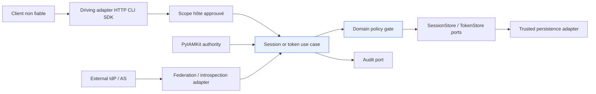
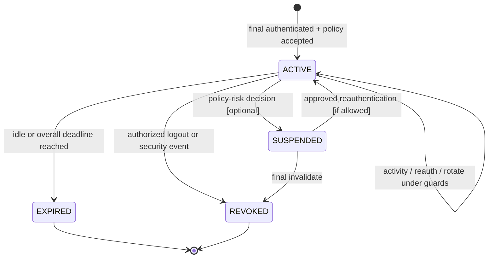
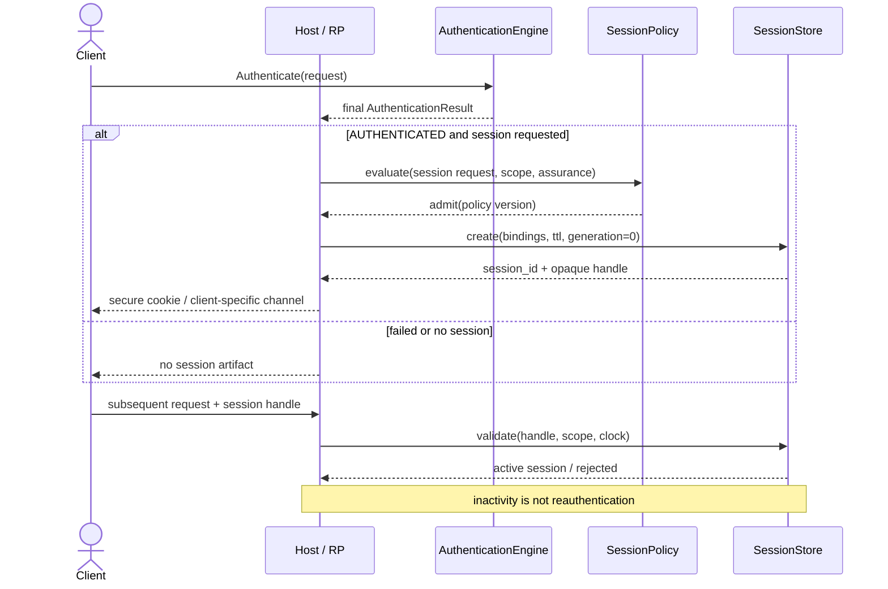
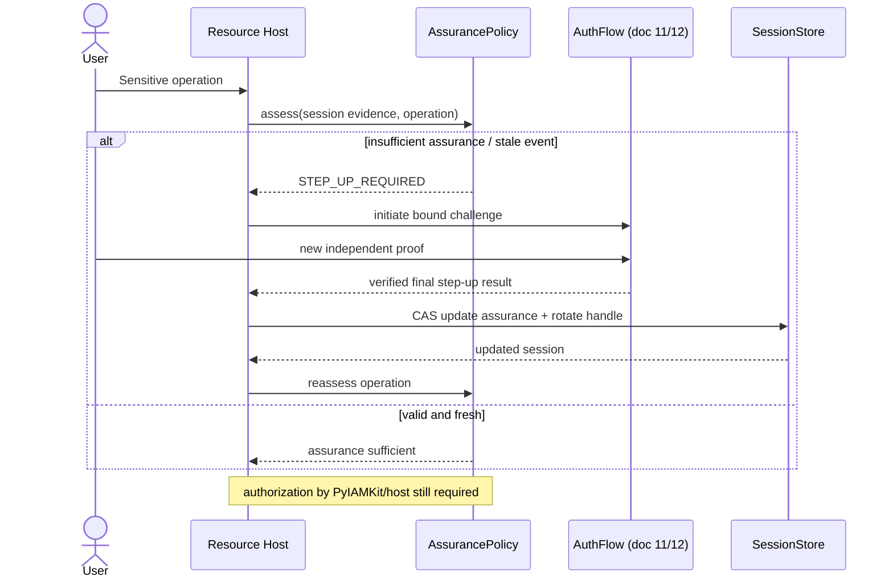
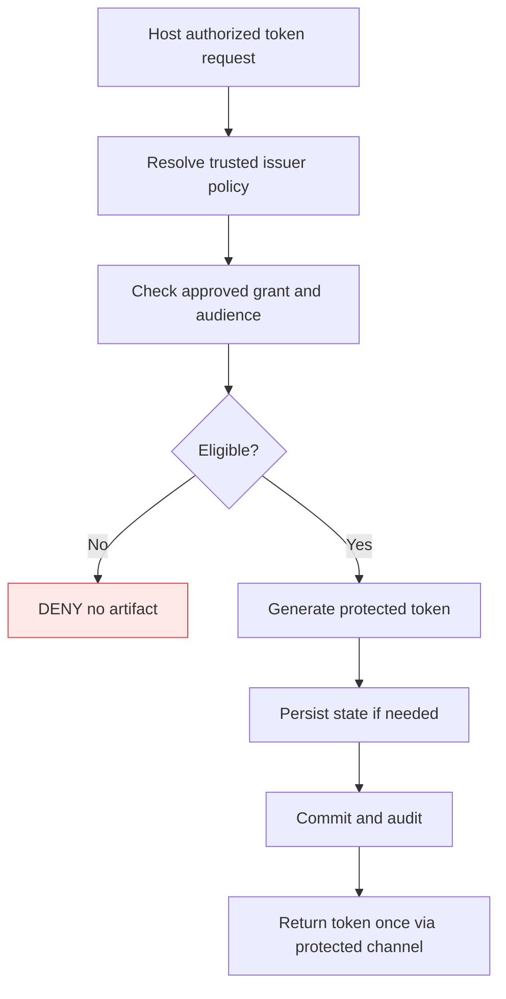
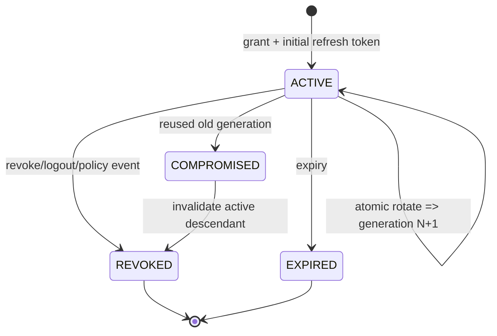
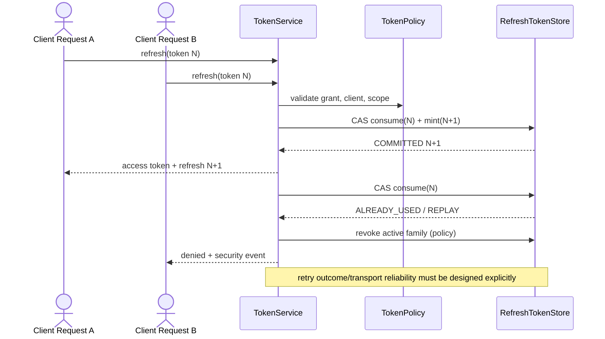
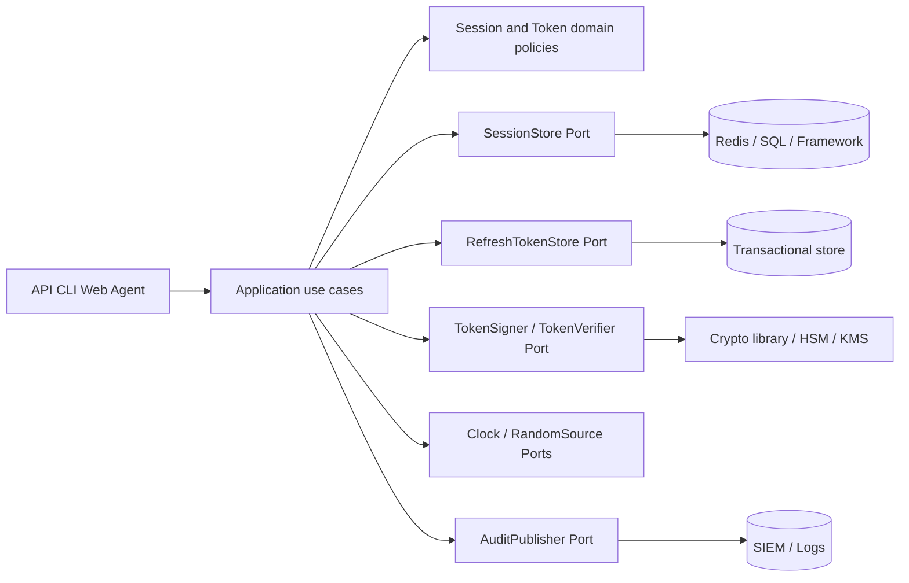
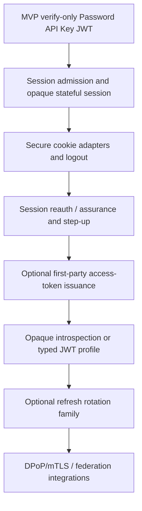

# 13_PYAUTHKIT_SESSION_AND_TOKEN_MODEL

# PyAuthKit — Session and Token Model

> **Document :** `13_PYAUTHKIT_SESSION_AND_TOKEN_MODEL.md`  
> **Produit :** PyAuthKit — Authentication Engine for the Modern Python Ecosystem  
> **Type :** spécification DDD, contrats applicatifs, architecture et sécurité  
> **Statut :** **PROPOSED / DESIGN** — ni implémentation ni conformité déployée démontrée  
> **Version documentaire :** 0.1.0  
> **Date :** 2026-10-29  
> **Langue :** français ; noms d'objets et signatures Python en anglais  
> **Filiation :** documents `00` à `12`, convention `PYAUTHKIT_SOFTWARE_DESIGN_LEARNING_CONVENTION.md`  
> **Phase :** **POST-MVP** ; le MVP valide Password, API Key et JWT **entrants**, sans serveur OAuth ni émission systématique  
> **Suite :** `14_PYAUTHKIT_FEDERATION_OIDC_OAUTH_SAML_MODEL.md`

---

## Guide de lecture

| Parcours | Sections |
|---|---|
| Vision, périmètre et responsabilités | 0–7 |
| Modèle de session et cycles de vie | 8–17 |
| Modèle de tokens et rotation/revocation | 18–30 |
| Contrats, architecture, exemples Python | 31–37 |
| Exigences, invariants, menaces, tests, arbitrages | 38–45 |
| Pédagogie, traçabilité, gouvernance | 46–50 |
| Annexes et références normatives | A–E |

**Règle de lecture :** `session`, `session secret`, `access token`, `refresh token`, `ID token`, `authentication challenge` et `API key` ne désignent pas le même objet. Aucune classe nommée `SecureSession`, `VerifiedToken` ou `AAL3Session` ne démontre sa sécurité par son seul nom.

---

## 0. Résumé exécutif

Une authentification réussie peut conduire **séparément**, si le client et la politique hôte l'autorisent, à une **session** permettant la continuité de l'interaction, à des **tokens** d'usage et d'audience définis, ou à **aucune émission** d'artefact. Un `AuthenticationResult` positif n'est ni une session automatiquement créée, ni un OAuth grant implicite, ni une autorisation IAM.

Le modèle sépare six décisions :

1. **Établir la preuve** : le moteur produit un `AuthenticatedPrincipal` final sous `TrustedScope` et `TrustProfile` approuvés.
2. **Décider de la continuité** : `SessionPolicy` accepte ou refuse l'ouverture d'une session selon l'application, les contraintes temporelles et le niveau d'assurance réel.
3. **Créer la liaison** : `SessionIssuer` produit un secret imprévisible et protège son lien à la session et au scope ; éventuellement un mécanisme de possession cryptographique.
4. **Émettre un token optionnel** : `TokenIssuancePolicy` vérifie si un usage, une audience et des privilèges ont été explicitement approuvés par l'autorité compétente.
5. **Maintenir** : validation, activité, réauthentification, step-up, renouvellement de handle, refresh et révocation suivent des contrats propres.
6. **Terminer** : une expiration, une révocation ou un événement de sécurité empêche les nouvelles utilisations selon le modèle de cohérence documenté.

```text
FINAL AuthenticationResult(AUTHENTICATED)
               │
               ▼
     Host / Application Decision
           ┌───┴────────────────────┐
           │                        │
    NO SESSION/TOKEN          Explicit use case
                                    │
                ┌───────────────────┴─────────────────┐
                ▼                                     ▼
          CreateSession                         IssueToken
                │                                     │
        SessionPolicy                         IssuancePolicy
                │                                     │
        Session + handle                  Access / Refresh / Other
                │                                     │
        Validate / Rotate                 Verify / Refresh / Revoke
                └───────────────────┬─────────────────┘
                                    ▼
                         Audit + lifecycle events

                         PyIAMKit / host
                      separately governs access
```

**Garanties directrices :** aucun succès partiel ne devient une session ; aucun access token n'est interprété automatiquement comme une présence humaine actuelle ; un refresh token ne permet pas d'élever l'assurance ; un token autonome non expiré n'est pas instantanément révoquable par magie ; les décisions d'autorisation restent hors du moteur AuthN.

### 0.1 Résultat documentaire attendu

Le document spécifie une ontologie, des frontières d'agrégats, des responsabilités de services, des états, des ports, des règles de protection, des diagrammes, des exigences vérifiables, des tests et des arbitrages. Le vocabulaire et les contrats sont des **candidats de design**, non des classes déjà livrées.

### 0.2 Décisions volontairement différées

La politique définitive des TTL, le backend, les primitives cryptographiques, la topologie de révocation, la stratégie OAuth AS et l'exposition publique seront arrêtées en ADR, avec preuves d'intégration et tests de sécurité. Aucun TTL chiffré du document ne vaut valeur universelle.

---

## 1. Sources internes et frontières d'autorité

| Source | Contrat repris | Ne pas déduire |
|---|---|---|
| `00` | sessions, access/refresh/ID tokens, stores abstraits, rotation | serveur OAuth complet déjà prévu au MVP |
| `01` | exigences fonctionnelles et non fonctionnelles FR/NFR/SEC/ARC | implementation qualifiée |
| `02` | DIP, SoC, KISS, Hexagonal, fail-closed | pattern GoF obligatoire |
| `03` | couches, composants, ports et adapters | session créée automatiquement |
| `04`–`06` | objets conceptuels, ownership DDD et relations candidates | une table SQL par objet |
| `07` | invariants AUTH et règles de révocation, expiration, isolation | révocation de JWT instantanée |
| `08` | commandes/use cases séparés pour sessions et tokens | `Authenticate` = `IssueToken` |
| `09` | `AuthenticationEngine` publie uniquement un verdict final | token issuer dans le core MVP |
| `10` | vérifier JWT entrant ≠ émettre JWT ; credential ≠ record | JWT d'entrée propre au système |
| `11` | `AuthenticationFlow` et `Challenge` ont leur propre lifecycle | continuation handle = session |
| `12` | AAL, fraîcheur, step-up et provenance | le niveau est déduit d'un nom de méthode |
| Convention | problem first, pattern if justified, test/evidence | sophistication obligatoire |

**Règle de gouvernance :** si un exemple ancien semble lier automatiquement `authenticate()` à `create_session()` ou `issue_token()`, le traiter comme schéma pédagogique et soumettre la correction éventuelle à un ADR. La séparation des cas d'usage établie dans `07`–`12` reste la référence.

## 2. Références normatives vérifiées et portée

- **NIST SP 800-63B-4**, *Session Management* : https://pages.nist.gov/800-63-4/sp800-63b/session/ ; authentification, assurance, secrets de session, inactivité et réauthentification. Une session ne doit pas être considérée à un AAL supérieur à son événement d'authentification ; une présence d'access token ne prouve pas la présence courante de l'abonné.
- **RFC 9700** (*OAuth 2.0 Security Best Current Practice*, janvier 2025) : https://www.rfc-editor.org/rfc/rfc9700 ; public clients : refresh tokens sender-constrained **ou** rotation avec détection de rejeu ; restriction audience/scope, menaces de fuite.
- **RFC 7009** : https://www.rfc-editor.org/rfc/rfc7009 ; interface de révocation OAuth 2.0 et ses limites de propagation.
- **RFC 7662** : https://www.rfc-editor.org/rfc/rfc7662 ; introspection des tokens OAuth par ressources protégées.
- **RFC 9068** : https://www.rfc-editor.org/rfc/rfc9068 ; profil JWT pour access tokens OAuth 2.0, seulement si ce profil est effectivement adopté.
- **RFC 8725** : https://www.rfc-editor.org/rfc/rfc8725 ; bonnes pratiques de sécurité JWT, notamment protections contre la confusion de tokens.
- **RFC 9449** : https://www.rfc-editor.org/rfc/rfc9449 ; DPoP et tokens liés à une clé.
- **RFC 8705** : https://www.rfc-editor.org/rfc/rfc8705 ; tokens liés à un certificat mTLS.
- **OWASP Session Management Cheat Sheet** : https://cheatsheetseries.owasp.org/cheatsheets/Session_Management_Cheat_Sheet.html ; cookies, timeout, fixation, renouvellement, logout et risques XSS/CSRF.

**Différence normative cruciale.** Une **règle NIST** ne devient pas automatiquement un invariant applicable à tous les déploiements de PyAuthKit : il faut déclarer la cible et l'écart éventuel. Les recommandations **OAuth** concernent les composants jouant effectivement le rôle de client, AS ou resource server. Les configurations locales sont des choix de produit, jamais une preuve de certification.

## 3. Problem Statement et pressions réelles

- **Continuité** : éviter de refaire toutes les preuves à chaque requête sans conserver indéfiniment une identité active.
- **Révocation** : invalider une capacité avant son expiration normale, avec une garantie explicite pour chaque topologie.
- **Concurrence** : deux requêtes `refresh` simultanées ne doivent pas produire deux successeurs valides en mode rotatif.
- **Scoping** : le tenant, client, issuer, audience et type de token déterminent l'acceptabilité d'un artefact.
- **Fraîcheur** : une opération sensible exige une preuve récente et une assurance appropriée, sans confondre session encore active et preuve suffisante.
- **Interchangeabilité** : permettre memory/Redis/SQL/custom sans importer leurs types dans le domain.
- **Interopérabilité** : être consommable par FastAPI, Django, CLI, agents et services ; ne pas devenir un fournisseur IAM ou OAuth involontaire.

## 4. Périmètre, phases et non-objectifs

| Capacité | Phase recommandée | Position |
|---|---|---|
| Vérification Password / API Key / JWT **entrants** | MVP (`09`–`10`) | inchangé |
| Résultat d'authentification final et normalisé | MVP | sans état persistant imposé |
| `Session` et session opaque stateful | post-MVP, tranche initiale de `13` | candidat prioritaire |
| Renewal, timeout, logout, revoke session | post-MVP | dépend du backend |
| Validation et issuance de tokens first-party | post-MVP conditionnel | uniquement pour usage déclaré |
| Refresh tokens + rotation et family | post-MVP avancé | nécessite atomicité et replay detection |
| Introspection OAuth, RFC 7009 server | intégration spécialisée | non implicite dans le core |
| ID token OIDC / fédération / logout fédéré | document `14` | contrat IdP/RP distinct |
| DPoP/mTLS sender-constrained | extension avancée | exigences de protocole dédiées |
| Administration globale IAM, consentement, RBAC/ABAC | PyIAMKit / hôte | hors domaine Authentication |
| OAuth Authorization Server générique | hors MVP, décision produit séparée | non déduit d'IssueToken |

## 5. Ubiquitous Language — objets à ne jamais confondre

| Terme | Signification | Ce que ce n'est pas |
|---|---|---|
| `AuthenticationAttempt` | tentative identifiable | session persistante |
| `AuthenticationFlow` | cérémonie de vérification multi-étapes | session finale |
| `AuthenticationChallenge` | épreuve ponctuelle, parfois à usage unique | refresh token |
| `AuthenticationResult` | verdict final/échec/challenge | droit d'accès |
| `AuthenticationSession` | continuité d'un état authentifié sous policy | authenticator |
| `SessionHandle` | secret ou référence client lié à la session | preuve MFA autonome |
| `SessionBinding` | contrat de possession/binding d'une session | identité IAM |
| `AccessToken` | preuve destinée à une ressource spécifique | ID token ou présence actuelle |
| `RefreshToken` | secret pour demander d'autres tokens sous contrat | nouveau facteur |
| `RefreshTokenFamily` | filiation et détection de rejeu d'une chaîne rotative | catalogue de sessions |
| `IDToken` | assertion d'identité OIDC pour un client/RP | bearer d'API par défaut |
| `ChallengeToken` | artefact dédié à une épreuve et sa finalité | session générale |
| `TokenGrant` | décision de droits/usage approuvée par un service autoritatif | consentement inventé par PyAuthKit |
| `TokenClaims` | déclarations dans un artefact protégé | preuve de signature avant validation |
| `TokenIntrospection` | réponse autoritative du serveur concerné | preuve de présence humaine |
| `AAL` | propriété de l'événement et de la session sous exigences NIST | simple compteur de facteurs |

**Nommage.** `Token` nu peut être acceptable dans un diagramme général mais les API doivent utiliser un `TokenKind`, un usage et un `issuer/audience` explicites pour empêcher les substitutions accidentelles.

## 6. Bounded Context, ownership et pouvoirs

- **PyAuthKit/Authentication** possède la vérification et, **si configuré**, le cycle de vie des sessions et des artefacts de continuité qu'il émet localement.
- **Hôte/Relying Party** possède la décision d'ouverture de session, les politiques d'usage, le transport HTTP/cookie et le déploiement effectif des endpoints.
- **Authorization Server externe** possède ses grants, tokens, révocations et introspections ; PyAuthKit ne peut pas prétendre les révoquer localement.
- **PyIAMKit** possède l'identité organisationnelle, le provisioning, les rôles, permissions, politiques d'accès et leur gouvernance.
- **Resource Server** valide une capacité d'accès dans l'audience/portée attendue et consulte l'autorisation effective selon la politique du service.

### 6.1 Authority matrix

| Action | Autorité possible | Preuve requise |
|---|---|---|
| `CreateSession` | hôte + service Session PyAuthKit | succès final + policy + binding |
| `ReauthenticateSession` | engine + session owner | nouvelle preuve fraîche et admissible |
| `RevokeSession` | propriétaire local, acteur autorisé | session/tenant binding + policy |
| `IssueAccessToken` | issuer autorisé | grant/permissions réellement approuvés |
| `RotateRefreshToken` | token issuer + family state | ancien token actif, génération attendue |
| `RevokeExternalToken` | AS distant | protocole et authorization externe |
| `AuthorizeResource` | hôte/PyIAMKit | identité et permissions/policies |

## 7. Frontières de confiance et prévention de l'élévation



Une donnée fournie par le client (`tenant`, `scope`, `audience`, `aal`, `roles`, `auth_time`, `is_verified`) **ne choisit jamais seule** le profil de confiance, l'issuer ou les clés. Un token non vérifié ne peut pas choisir librement son propre JWKS. La validation s'effectue avec un profil reconnu par l'hôte et des autorités explicitement configurées.

## 8. DDD tactique — classification des objets

| Objet | Catégorie candidate | Ownership / invariant central |
|---|---|---|
| `AuthenticationSession` | **Entity / Aggregate Root candidat** | lifecycle, version et révocation |
| `SessionId` | Value Object | identifiant non secret à scope défini |
| `SessionHandle` | secret/value transport | non journalisable, expiration, binding |
| `SessionBinding` | Value Object | tenant/client/device ou preuve de possession autorisée |
| `SessionPolicy` | Domain Policy / contrat | admission, TTL, reauth, rotation |
| `SessionAssurance` | Value Object | AAL ≤ authentification vérifiée et fraîcheur |
| `TokenDescriptor` | Value Object | type, usage, audience, issuer, expiration |
| `AccessToken` | secret transmis / artefact | audience + type explicites |
| `RefreshTokenRecord` | **Entity** si owned | état, génération, famille, révocation |
| `RefreshTokenFamily` | Aggregate Root **candidat conditionnel** | unicité du successeur actif / replay |
| `TokenGrant` | contrat de décision | approuvé hors simple vérification AuthN |
| `TokenIssuancePolicy` | Domain Policy | scope, audience, lifetime et preuve |
| `TokenClaims` | Value Object non fiable avant validation | claims normalisés uniquement après vérification |
| `SessionStore`, `RefreshTokenStore` | Ports | atomicité, expiration, version |
| `SessionManager`, `TokenIssuer` | Application Services | orchestration, aucun pouvoir inventé |

**Décision DDD :** une session hébergée entièrement par Django peut ne jamais devenir un aggregate PyAuthKit. Un `RefreshTokenFamily` devient aggregate seulement si PyAuthKit est propriétaire de la rotation, de la concurrence et de la révocation en chaîne. Le modèle conceptuel n'impose pas de tables SQL.

## 9. `AuthenticationSession` — contrat du domaine

Champs candidats : `session_id`, `principal_ref`, `trusted_scope`, `client_id`, `created_at`, `last_activity_at`, `overall_expires_at`, `idle_expires_at`, `status`, `version`, `binding_id`, `assurance_evidence`, `last_reauthenticated_at`, `revoked_at` et `revocation_reason` **sans secrets en clair**. Les champs d'autorité sont dérivés d'une décision vérifiée, pas d'un DTO de client.

### 9.1 Responsabilités

1. Maintenir l'état de continuité sous un scope stable ;
2. refuser `ACTIVE` après expiration ou révocation ;
3. conserver l'horodatage de la dernière authentification/reauthentication pertinente ;
4. ne jamais accroître l'assurance sur un simple `touch()` ;
5. refuser le changement silencieux de tenant, principal ou client ;
6. vérifier la génération de handle lors d'un changement critique.

### 9.2 Identité et confidentialité

`SessionId` peut être un identifiant public ou interne ; **le session secret est une autre donnée**. Si le même octet sert de handle et de clé de lookup, ce handle est un bearer secret à protéger et ne doit pas apparaître dans les logs, URL ou attributs d'audit.

## 10. Machine à états de session



`EXPIRED` et `REVOKED` sont **terminaux pour la même identité de session**. Une réauthentification après expiration crée une nouvelle session, sauf dérogation explicitement modélisée qui ne réactive jamais secrètement une session terminée. `SUSPENDED` est optionnel : ne pas ajouter cet état sans besoin réel et contrat de reprise.

## 11. Time Model : trois horloges conceptuelles

| Terme | Signification | Règle |
|---|---|---|
| `created_at` | création d'une session | traçabilité, pas freshness |
| `authenticated_at` | dernier événement de preuve vérifiée | source du niveau d'assurance |
| `last_activity_at` | activité du subscriber acceptée | peut actualiser idle timeout uniquement |
| `overall_expires_at` | borne de durée après auth/reauth | ne se repousse pas sur `touch()` |
| `idle_expires_at` | fin maximale sans activité admissible | calcul serveur, sous overall deadline |
| `token.expires_at` | limite d'utilisation d'un artefact | ne vaut pas état de session |
| `issued_at` | instant d'émission d'un token | ne remplace pas `auth_time` |
| `not_before` | avant cette date, token non valide | politique de skew bornée |

La relation minimale est `now < overall_expires_at` **et** `now < idle_expires_at` **et** `status=ACTIVE` ; pour les opérations sensibles, ajouter `now - authenticated_at <= max_age` défini par la policy. La précision UTC, les clocks injectées et les conversions sont un sujet de test. Les valeurs numériques (minutes/heures) sont **définies par profil et AAL**, pas par une constante universelle.

### 11.1 Idle, overall, renewal et reauthentication

- Une activité client qualifiée peut remettre à jour **idle** sans prolonger **overall**.
- Une reauthentication **réellement réussie** peut réinitialiser les limites concernées selon NIST et la policy.
- Une rotation automatique de secret de session n'est pas une authentification nouvelle et ne rafraîchit pas l'assurance.
- Les opérations concurrentes doivent prouver quelle activité/reauth est la plus récente sous cohérence du store.
- L'expiration doit être **enforcée par le serveur**, pas par `Max-Age` d'un cookie uniquement.

## 12. `SessionPolicy` et admission

Une session candidate doit être acceptée ou refusée sur la base de l'`AuthenticationResult` **final**, du type de principal, du tenant, de l'application et de la politique approuvée. Un résultat `CHALLENGE_REQUIRED`, `REJECTED`, `ERROR` ou `CANCELLED` **n'émet pas** de session authentifiée. Un choix d'absence de session reste valide.

**Exemples de raisons de refus** : `NO_FINAL_AUTH`, `INSUFFICIENT_ASSURANCE`, `UNTRUSTED_SCOPE`, `CLIENT_NOT_ALLOWED`, `SESSION_LIMIT_REACHED`, `STORE_UNAVAILABLE`, `INVALID_BINDING`, `POLICY_MISSING`.

La politique d'admission ne décide pas des permissions. L'hôte peut refuser la session même lorsque l'authentification a réussi, pour sa propre politique de risque ou de canal.

## 13. Secret de session et binding

- Créer un secret non prévisible avec un CSPRNG dans un contexte établi après authentification ; choisir un minimum de **64 bits selon la norme NIST applicable**, avec une marge de sécurité supérieure comme politique locale ; ne jamais dériver un secret du `principal_id` ou d'une adresse IP.
- Le secret se transporte uniquement par canal sécurisé et est indisponible aux intermédiaires non autorisés.
- Séparer `session_id` interne, `session_secret` côté client et `session_key_digest` éventuel côté stockage.
- Prévenir la fixation : remplacer toute session pré-auth et émettre un nouveau secret post-auth ; ne pas simplement réutiliser un cookie existant.
- Si la session utilise un secret bearer, elle ne prouve pas à elle seule une présence continue de l'utilisateur ni un deuxième facteur.
- Si un binding cryptographique est retenu, vérifier effectivement la possession de la clé et les propriétés de l'équipement ; ne pas déduire l'effectivité du champ `device_id`.

## 14. Cookies et clients HTTP

Pour les applications web : `Secure`, `HttpOnly` lorsque possible, `SameSite=Lax/Strict` selon le workflow, scope minimal `Domain/Path`, préférence pour un préfixe `__Host-` correctement configuré. `SameSite` réduit le risque CSRF mais ne remplace pas toutes les protections CSRF ; les endpoints sensibles vérifient les exigences de session/CSRF selon la stack et le protocole. Une cookie policy doit rester dans le **framework adapter**, non dans une Entity.

Éviter `localStorage` pour les secrets bearer sensibles en raison des risques XSS ; une architecture BFF et cookie HttpOnly peut être envisagée lorsque la topologie le permet. Les clients CLI et mobiles nécessitent des stratégies de stockage propre au système, pas de copie des règles cookies. Interdire les session secrets dans URL, logs, traces, analytics et messages d'erreur.

## 15. `SessionStore` : port et cohérence

Capacités candidates : `create`, `read_for_validation`, `touch_if_version`, `rotate_secret_if_version`, `revoke_if_version`, `list_for_principal` (administration autorisée uniquement) et `expire` (maintenance). Pour chaque méthode, spécifier `tenant` et éventuellement `client`, les conditions de visibilité, la version et le comportement en cas de panne.

| Backend | Avantage | Limite / preuve |
|---|---|---|
| InMemory | tests unitaires, démonstration | non partagé entre workers, pas production distribuée par défaut |
| Redis | TTL, opérations atomiques possibles | scripts/transaction, persistance et failover à qualifier |
| SQL | transaction, contraintes et audit | contention, index, verrouillage et migrations |
| Hosted framework | réutilise Django et autres | adapter/ownership, garanties non présumées |
| Custom | compatibilité enterprise | contract tests obligatoires |

Une méthode `get()` suivie de `set()` sur deux nœuds n'assure pas l'atomicité : il faut CAS/transaction ou autre primitive vérifiable. Un cache doit déclarer le délai maximal d'obsolescence et son comportement en partition.

## 16. Session lifecycle : séquence create / validate / reauthenticate



## 17. Step-up et assurance dans une session

`SessionAssurance` porte la provenance d'un **événement d'authentification** et sa fenêtre de fraîcheur, pas un booléen `is_mfa`. La session ne peut jamais se déclarer à un niveau supérieur à la preuve réellement vérifiée ; des politiques peuvent retenir un niveau inférieur. Une rotation de token, un refresh OAuth, une activité de navigateur ou la présence d'un cookie ne constituent **pas** une reauthentication forte.

### 17.1 Règle d'élévation contrôlée



Un step-up doit lier la cérémonie au `principal`, au tenant, au client et **à l'opération** selon son contrat. Une policy d'accès peut ensuite refuser l'opération même si la nouvelle assurance est suffisante.

## 18. Token taxonomy — types et frontières

| Token / artefact | Usage principal | Owner / verifier | Implication |
|---|---|---|---|
| `AccessToken` opaque | API sous audience définie | AS/issuer + RS introspection | révocation contrôlable si introspection fiable |
| `AccessToken` JWT | API sous audience définie | issuer + RS signature/claims | pas de révocation immédiate native |
| `RefreshToken` | renouveler tokens selon grant | issuer/AS | secret très sensible, rotation ou PoP selon profil |
| `IDToken` | assertion OIDC à destination RP | IdP ; RP vérifie | ne pas utiliser comme access token API |
| `SessionToken` | continuité de session | session host | sous contrat de session, pas token OAuth par défaut |
| `ChallengeToken` | prouver/continuer une épreuve | flow/challenge owner | usage limité et consommable |
| `PasswordResetToken` | reset credential sous contrôle distinct | credential owner | jamais session universelle |
| `APIKey` | credential machine client | issuer de clé | ne pas la traiter automatiquement comme OAuth access token |
| `DPoPProof` | preuve ponctuelle de possession de clé | client + RS/AS | ne constitue ni token d'accès autonome ni auth utilisateur |

**Registre anti-confusion** : un token avec un JWT valide n'est pas forcément le **bon type**. `iss`, `aud`, `exp`, `nbf`, `typ`, clés et type de token doivent être contrôlés selon un **TrustProfile** sélectionné par le serveur (référence `10`).

## 19. `TokenDescriptor`, `TokenGrant` et `TokenIssuancePolicy`

Un `TokenDescriptor` représente les métadonnées validées d'un artefact, **non** sa capacité brute. Un `TokenGrant` représente une décision d'émission obtenue d'une autorité appropriée (authorization server ou hôte autorisé), et ne doit pas être construit à partir de `request.scopes` ou des claims du client sans vérification.

Proposition :

- `TokenGrant`: `grant_id`, `issuer`, `client_id`, `subject_ref`, `allowed_audiences`, `allowed_scopes`, `tenant`, `effective_time`, `expires_at`, `authority_version`.
- `TokenIssueRequest`: usage précis, audience, scopes demandés, `AuthenticatedPrincipal` prouvé et binding.
- `TokenIssuanceDecision`: `ALLOW/DENY`, scopes accordés (sous-ensemble autorisé), `ttl`, `token_format`, `sender_constraint`, `policy_version`.
- `TokenDescriptor`: `token_type`, `issuer`, `audience`, `subject_ref`, `issued_at`, `not_before`, `expires_at`, `binding_ref`, `key_id` non secret.

**Contrôle** : une décision `ALLOW` ne donne pas de nouveau droit métier ; elle consomme un grant existant. Pour OAuth, la définition précise des grants et consentements appartient au rôle AS/hôte et à `14` ou à un produit spécialisé.

## 20. Émission et vérification — opérations distinctes

`VerifyIncomingToken` ne crée pas de token. `IssueAccessToken` ne prouve pas un nouveau facteur d'authentification. `RefreshAccessToken` ne réauthentifie pas l'humain ; il vérifie l'état d'un grant et d'un refresh token et applique sa politique. `IntrospectToken` ne signifie pas nécessairement que l'utilisateur est présent.



## 21. Access Token : opaque vs JWT

### 21.1 Opaque

L'opaque token ne dévoile pas ses claims au détenteur par simple décodage ; l'issuer/AS en conserve l'état ou un mécanisme de résolution. Les RS ont besoin d'introspection/lookup ou de mécanismes de vérification contractuels. Les risques sont coût de lookup, disponibilité de l'AS, cache obsolète et fuite du secret brut.

### 21.2 JWT

Le JWT peut permettre une vérification locale **sans lookup systématique**, mais cette propriété entraîne un délai de révocation potentiellement égal à sa validité restante lorsque l'on ne dispose ni d'introspection, ni de denylist, ni d'autres mécanismes de désactivation. Un JWT signé n'est pas chiffré par défaut ; ne pas y placer de secrets ni de données personnelles inutiles. Les profils JWT OAuth nécessitent des règles spécifiques (RFC 9068, RFC 8725).

### 21.3 Choix contextuel

| Critère | Opaque stateful | JWT stateless |
|---|---|---|
| Validation | lookup/introspection | signature + claims localement |
| Révocation | au prochain lookup sous cohérence garantie | dépend de stratégie additionnelle |
| Dépendance réseau | service de validation ou cache | clés et policy localement disponibles |
| Confidentialité des claims | généralement mieux dissimulés | payload lisible si JWS simple |
| Compromis | latence et disponibilité | invalidation et fuite d'information |

Ne pas préférer automatiquement JWT par mode ou performance supposée. Mesurer le coût réel et définir le contrat de révocation d'abord.

## 22. Refresh Token et `RefreshTokenFamily`

Un refresh token n'est jamais un deuxième facteur ; son usage concerne **l'autorisation de réémettre** de nouveaux tokens selon un grant valide. Il doit avoir une portée, une audience/résource, un client et une famille ou une clé de liaison cryptographique selon le profil.

**Pour les clients publics OAuth :** RFC 9700 demande soit un refresh token **sender-constrained**, soit une **rotation** permettant de détecter le rejeu. Le mode choisi doit être documenté, pas laissé à l'algorithme de hasard.

### 22.1 Famille rotative (mode candidat)

Attributs : `family_id`, `grant_id`, `client_id`, `trusted_scope`, `current_generation`, `current_token_digest`, `status`, `created_at`, `last_used_at`, `max_expires_at`, `version`, `compromised_at`. Enregistrer un historique minimal permettant de distinguer un token déjà consommé d'un token inconnu sans stocker les secrets bruts.



### 22.2 One-time semantics

L'ancien token devient inutilisable dans la transaction qui crée le successeur. Deux rafraîchissements concurrents avec le même token ne peuvent pas tous deux obtenir des descendants actifs ; le second doit être identifié comme réemploi ou traité selon une stratégie **documentée** qui ne masque pas une attaque. L'issuer ne sait pas toujours distinguer retry réseau légitime et vol : éviter tout mécanisme de grâce non prouvé.

## 23. Rotate Refresh Token — séquence concurrente



**Prudence :** dans un système transactionnel réel, l'ordre des deux requêtes peut s'inverser ; la propriété prouvée est l'existence d'**au plus un successeur actif**, pas la victoire certaine du client A. La réponse peut se perdre après commit ; une politique de récupération doit éviter de réactiver l'ancien token.

## 24. Révocation, invalidation et garanties temporelles

| Cible | Autorité | Effet minimal | Limite honnête |
|---|---|---|---|
| Session stateful | SessionStore local | prochains lookups refusés | cohérence cache/partition |
| Refresh family | issuer + store transactionnel | empêche nouveau refresh | access tokens déjà émis peuvent survivre |
| Opaque access token | issuer/introspection | active=false selon cohérence | caches de RS |
| JWT stateless | issuer/RS | expiration naturelle, denylist ou introspection | pas d'effet instantané sans couplage |
| Token externe OIDC | IdP/AS | appel protocolaire si supporté | garantie et sémantique fournisseur |
| Session RP vs session IdP | autorités distinctes | logout local ≠ logout global | propagation et backchannel optionnels |

### 24.1 Les cinq paramètres obligatoires d'une promesse de révocation

Décrire **quoi** est invalidé, **par qui**, **à quelle frontière**, **dans quel délai observable**, **avec quelle stratégie en cas de panne/partition**. `revoke()` exécutée avec succès ne signifie pas `revoked_everywhere_immediately` si des caches ou des tokens non inspectés existent.

### 24.2 Revocation vs expiration

`expires_at` est une date de fin prévue ; `revoked_at` est une action explicite de retrait avant ou indépendamment de la date de fin. Un statut `REVOKED` est terminal, et ne doit pas redevenir `ACTIVE` par « refresh » ou lecture d'une ancienne réplique.

## 25. Logout : local, client, global, federated

- **Logout local** : session RP invalidée côté serveur ; cookie client supprimé.
- **Logout client** : refresh family du client concerné invalidée lorsque le produit est issuer.
- **Logout all devices** : toutes les sessions accessibles au principal et au tenant visés sont invalidées sous une opération autorisée, avec fenêtre de convergence documentée.
- **Logout fédéré** : RP et IdP peuvent terminer leurs sessions indépendamment ; front-channel/back-channel dépendent du fournisseur et du protocole (`14`).
- **Logout post-compromise** : mise en quarantaine possible de familles de refresh tokens, sessions et credentials selon policy, sans prétendre pouvoir annuler un JWT externe déjà consommé.

## 26. Rotation de handle, de refresh token et de clé : trois opérations différentes

| Opération | Change | Ne change pas automatiquement |
|---|---|---|
| `RotateSessionHandle` | bearer secret/generation | `authenticated_at`, AAL, permissions |
| `RotateRefreshToken` | token actif de la famille | assurance, présence utilisateur, grant |
| `RotateSigningKey` | clés de signature `kid`/JWKS | état de sessions ni révocation par défaut |
| `Reauthenticate` | assurance/`auth_time` si preuve | rôles IAM ou consentement |
| `StepUp` | garantie de facteur et fraîcheur pertinente | autorisation finale de l'action |

Une rotation de clé peut imposer le rejet ou la poursuite d'anciens JWT selon la politique d'acceptation de clés, le TTL et la raison (routine vs compromission) : le plan de transition doit être explicite.

## 27. Protection du client et threat model HTTP

**Cookies et browser** : protection XSS/CSRF, TLS, Host-only/Path, session fixation, cookies `Secure`/`HttpOnly`/`SameSite` correctement configurés ; ne pas se fier à l'effacement du navigateur seul.

**Native/CLI** : stockage du secret dans un store sécurisé natif lorsque possible, réduction de portée, échange protégé, possibilité de révocation.

**Service/agent** : privilégier identités de workload et tokens courts/lés à la charge ; ne pas créer de refresh token humain pour un bot si un flux machine approprié existe. Le type `AGENT` ne prouve pas la délégation ni les privilèges.

**Intermédiaires** : proxies, load balancers et gateways peuvent porter le TLS ; les en-têtes décrivant l'identité du client ou son certificat ne deviennent fiables qu'après vérification de la frontière réseau et de l'adapter.

## 28. Sender-Constrained Tokens : DPoP et mTLS

- **DPoP (RFC 9449)** : jeton lié à clé asymétrique, preuve signée contenant entre autres méthode/URL, horodatage et `jti`, avec binding contrôlé au RS/AS. Un champ `cnf` copié sans validation ne suffit pas.
- **mTLS (RFC 8705)** : preuve de possession d'une clé associée à un certificat et token bound, selon le rôle de l'AS/RS et les contrôles TLS.
- **Bearer** : possession du token suffisant pour sa présentation ; l'exfiltration expose l'utilisateur jusqu'aux limites de révocation/expiration.

Un sender-constrained token ne supprime pas les risques si l'attaquant vole aussi la clé ou contrôle l'endpoint. DPoP n'est pas un mécanisme de login utilisateur en soi et n'attribue pas automatiquement un AAL.

## 29. Multi-tenant, clients, audience et délégation

Un access token pour `(tenant=A, client=X, audience=API-1)` ne doit pas être réutilisable sous `(tenant=B, client=X, audience=API-1)` ni `(tenant=A, client=Y, audience=API-2)` sans grant explicite et vérification. De même une session locale ne franchit pas une frontière de realm par simple changement de header `X-Tenant`.

La délégation de l'identité d'un agent vers une ressource est **une décision distincte** qui peut impliquer PyIAMKit et les mécanismes d'autorisation. Un token d'agent doit porter une autorité de délégation véritable, pas une chaîne `on_behalf_of` non vérifiée.

## 30. Observabilité, audit et secrets

Événements candidats : `SessionCreated`, `SessionValidated` (échantillonné si nécessaire), `SessionReauthenticated`, `SessionRotated`, `SessionExpired`, `SessionRevoked`, `AccessTokenIssued`, `RefreshTokenRotated`, `RefreshTokenReuseDetected`, `TokenRevoked`, `TokenValidationRejected`. Les events de domaine expriment des faits **et ne présupposent pas Kafka/Observer**.

Payload sûr : `event_id`, `tenant_ref` pseudonymisée si nécessaire, `principal_ref` contrôlée, `session_ref`, `token_fingerprint` non réversible, `policy_version`, `outcome`, `reason_code`, `timestamp`, `trace_id`. Exclure mot de passe, access/refresh/session secret brut, authorization header, cookie, assertion non minimisée et clé privée. Le dispositif d'audit doit aussi documenter les délais, les pannes et les droits de consultation.

## 31. Ports & Adapters : interactions minimales



**Dependency rule :** `domain` n'importe jamais Redis, SQLAlchemy, FastAPI, Django, KMS client ou HTTP cookie. Les `adapters` traduisent transport, persistence et erreurs ; la composition root assemble les implémentations.

## 32. Contrats applicatifs : commands / queries

| Opération | Nature | Préconditions | Postconditions / échec |
|---|---|---|---|
| `CreateAuthenticationSession` | Command | résultat final, scope, policy | session ou refus, jamais half-created |
| `ValidateSession` | Query + touch optionnel | handle + trusted scope | contexte ou rejet, pas élévation |
| `ReauthenticateSession` | Command | flow final et liaison à la session | assurance et deadlines réévaluées |
| `RotateSessionHandle` | Command | version ACTIVE, binding valide | ancien secret refusé sous contrat |
| `RevokeSession` | Command | autorité + session située | état terminal et audit |
| `RevokeAllSessions` | Command | autorité supérieure explicitement contrôlée | opérations situées, convergence documentée |
| `IssueAccessToken` | Command | grant + issuer/audience approuvés | artefact ou refus |
| `ValidateAccessToken` | Query | trust profile et type attendu | validated claims ou rejet |
| `RotateRefreshToken` | Command | token actif, famille et grant | successeur unique ou sécurité alert |
| `RevokeTokenFamily` | Command | authorized actor / security trigger | family terminale |
| `IntrospectToken` | Query externe | AS identifié et auth service | état fiable sous contrat de cache |

Les callbacks d'API peuvent être synchrones ou `async`, mais ils doivent préserver les mêmes préconditions et garanties transactionnelles. Le core de `09` n'est pas enrichi de toutes ces commandes par défaut.

## 33. Modèle Python — Value Objects et temps (illustratif)

Le code ci-dessous décrit des **contrats locaux**, non une implémentation d'authentification utilisable en production. Les invariants touchant aux données sensibles et aux sources d'autorité doivent être vérifiés par les cas d'usage et les adapters.

```python
from dataclasses import dataclass
from datetime import datetime, timezone
from enum import Enum
from typing import NewType

SessionId = NewType("SessionId", str)
PrincipalId = NewType("PrincipalId", str)
TenantId = NewType("TenantId", str)

class SessionStatus(str, Enum):
    ACTIVE = "active"
    EXPIRED = "expired"
    REVOKED = "revoked"

@dataclass(frozen=True, slots=True)
class SessionScope:
    tenant_id: TenantId
    client_id: str
    realm: str

@dataclass(frozen=True, slots=True)
class SessionAssurance:
    profile_id: str
    profile_version: str
    granted_level: str
    authenticated_at: datetime
    evidence_reference: str

    def __post_init__(self) -> None:
        if self.authenticated_at.tzinfo is None:
            raise ValueError("authenticated_at must be timezone-aware")

@dataclass(frozen=True, slots=True)
class SessionDeadlines:
    idle_expires_at: datetime
    overall_expires_at: datetime

    def is_valid(self, now: datetime) -> bool:
        if now.tzinfo is None:
            raise ValueError("now must be timezone-aware")
        return now < self.idle_expires_at and now < self.overall_expires_at

@dataclass(frozen=True, slots=True)
class SessionSnapshot:
    session_id: SessionId
    principal_id: PrincipalId
    scope: SessionScope
    status: SessionStatus
    version: int
    deadlines: SessionDeadlines
    assurance: SessionAssurance

    def is_usable(self, now: datetime) -> bool:
        return self.status is SessionStatus.ACTIVE and self.deadlines.is_valid(now)
```

**Note importante :** `is_usable()` ne vérifie pas le bearer secret, l'autorité du tenant, l'état de la révocation dans le store ni l'assurance requise pour une opération. Il exprime seulement une propriété locale de snapshot **déjà issu d'un store autoritatif**. `timezone` figure dans l'exemple comme type standard ; un projet concret utiliserait une horloge injectée plutôt que `datetime.now()` dispersé.

## 34. Modèle Python — ports et atomicité

```python
from dataclasses import dataclass
from datetime import datetime
from enum import Enum
from typing import Protocol

class RotateOutcome(str, Enum):
    ROTATED = "rotated"
    STALE = "stale"
    REVOKED = "revoked"
    EXPIRED = "expired"

@dataclass(frozen=True)
class RotateSessionResult:
    outcome: RotateOutcome
    new_version: int | None = None
    # Never include a raw session secret in audit records.

class SessionStore(Protocol):
    async def read_authoritatively(
        self, tenant_id: str, session_id: str
    ) -> "SessionSnapshot | None": ...

    async def rotate_if_version(
        self,
        tenant_id: str,
        session_id: str,
        expected_version: int,
        new_handle_digest: bytes,
        now: datetime,
    ) -> RotateSessionResult: ...

    async def revoke_if_active(
        self, tenant_id: str, session_id: str, now: datetime
    ) -> bool: ...

class Clock(Protocol):
    def now(self) -> datetime: ...

class SessionSecretGenerator(Protocol):
    def generate(self) -> bytes: ...
```

Le port exprime une intention d'atomicité, pas une preuve d'atomicité. Chaque adapter doit démontrer `CAS` sous concurrence réelle et définir son comportement lorsque la transaction est validée mais que la réponse réseau se perd.

## 35. Modèle Python — états discriminés du refresh

```python
from dataclasses import dataclass
from enum import Enum
from typing import Protocol

class RefreshStatus(str, Enum):
    ACTIVE = "active"
    REVOKED = "revoked"
    COMPROMISED = "compromised"
    EXPIRED = "expired"

class RefreshDecision(str, Enum):
    ALLOWED = "allowed"
    REPLAY_DETECTED = "replay_detected"
    INVALID = "invalid"
    UNAVAILABLE = "unavailable"

@dataclass(frozen=True, slots=True)
class RefreshFamilyRef:
    tenant_id: str
    family_id: str
    client_id: str
    grant_id: str

@dataclass(frozen=True, slots=True)
class RefreshRotationOutcome:
    decision: RefreshDecision
    new_generation: int | None = None
    new_token_reference: str | None = None
    reason_code: str | None = None

class RefreshTokenStore(Protocol):
    async def consume_and_rotate(
        self,
        family: RefreshFamilyRef,
        presented_token_digest: bytes,
        new_token_digest: bytes,
        now_epoch_seconds: int,
    ) -> RefreshRotationOutcome: ...

    async def revoke_family(
        self, family: RefreshFamilyRef, reason: str
    ) -> None: ...
```

L'API ci-dessus ne retourne volontairement **aucun secret brut**. La livraison du nouveau refresh token à un client dépend d'un composant de sécurité distinct capable de protéger le secret en transit, de gérer un résultat de commit ambigu et d'enregistrer des empreintes de secret sans fuite. Aucun `sha256(raw_token)` générique n'est présenté comme une conception suffisante : la stratégie exacte de digest, les tailles, la génération et la résistance aux attaques sont à formaliser dans `20` puis qualifier avec la bibliothèque retenue.

## 36. Modèle Python — politiques explicites sans IAM implicite

```python
from dataclasses import dataclass
from enum import Enum
from typing import Protocol

class Admission(str, Enum):
    ACCEPT = "accept"
    DENY = "deny"

@dataclass(frozen=True, slots=True)
class SessionAdmissionDecision:
    admission: Admission
    policy_version: str
    reason_code: str
    idle_seconds: int | None = None
    overall_seconds: int | None = None

@dataclass(frozen=True, slots=True)
class TokenIssuanceDecision:
    admission: Admission
    policy_version: str
    issuer: str | None
    audience: tuple[str, ...]
    granted_scopes: frozenset[str]
    lifetime_seconds: int | None
    reason_code: str

class SessionPolicy(Protocol):
    def evaluate(self, final_result: object, trusted_context: object
                 ) -> SessionAdmissionDecision: ...

class TokenIssuancePolicy(Protocol):
    def evaluate(self, trusted_grant: object, requested: object
                 ) -> TokenIssuanceDecision: ...
```

La présence de `granted_scopes` est un **résultat d'une autorité de grant**, pas une permission forgée à partir d'une `AuthenticationRequest`. Dans le produit final, `object` sera remplacé par les types canoniques définis en `05`, `08`, `09`, `12` et les frontières du service d'émission.

## 37. Modèle Python — tests pédagogiques locaux

```python
from datetime import datetime, timedelta, timezone

def test_deadlines_are_both_required() -> None:
    now = datetime(2026, 10, 29, tzinfo=timezone.utc)
    deadlines = SessionDeadlines(
        idle_expires_at=now + timedelta(minutes=5),
        overall_expires_at=now + timedelta(minutes=30),
    )
    assert deadlines.is_valid(now)
    assert not deadlines.is_valid(now + timedelta(minutes=6))


def test_terminal_status_cannot_be_used() -> None:
    now = datetime(2026, 10, 29, tzinfo=timezone.utc)
    future = now + timedelta(hours=1)
    snap = SessionSnapshot(
        session_id=SessionId("internal-ref"),
        principal_id=PrincipalId("subject-ref"),
        scope=SessionScope(TenantId("tenant-A"), "web", "main"),
        status=SessionStatus.REVOKED,
        version=3,
        deadlines=SessionDeadlines(future, future),
        assurance=SessionAssurance("local", "1", "LOCAL-AAL", now, "evidence-1"),
    )
    assert not snap.is_usable(now)
```

Les deux fonctions ci-dessus vérifient seulement une logique **pure**, et non la capacité à empêcher le détournement d'une session réelle. Les suites de tests de sécurité, stockage et environnement distribués sont requises avant tout statut de qualification.

## 38. Registre spécialisé des exigences `SES-REQ-*`

Les identifiants sont locaux au document. **MVP** signifie ici compatibilité du modèle d'entrée ou vérification existante ; l'implémentation des sessions et de la gestion de tokens est **post-MVP**. Pour chaque ligne, le critère de vérification est une exigence de qualification, non un test déjà réussi.

| ID | Domaine | Exigence vérifiable | Phase | Preuve attendue |
|---|---|---|---|---|

| `SES-REQ-001` | Boundary | La création de session exige un AuthenticationResult final AUTHENTICATED | MVP interface / post-MVP issuance | refuser états partiels, tests de frontière |

| `SES-REQ-002` | Boundary | L’ouverture de session reste un use case distinct de Authenticate | POST-MVP | aucun side effect dans engine MVP |

| `SES-REQ-003` | Boundary | Toute émission de token requiert une autorité et un grant/usage approuvés | POST-MVP | vérifier issuer, audience, client, scope |

| `SES-REQ-004` | Boundary | Un access token ne prouve pas une présence humaine courante | POST-MVP | re-auth pour opération sensible |

| `SES-REQ-005` | Boundary | La session ne prend pas un AAL supérieur à l’événement vérifié | POST-MVP | tester downscoping et absence de promotion |

| `SES-REQ-006` | Session | Un secret de session provient d’un générateur sûr | POST-MVP | entropie/provenance qualifiées |

| `SES-REQ-007` | Session | Le secret émis après AuthN remplace tout secret de pré-auth | POST-MVP | tester session fixation |

| `SES-REQ-008` | Session | SessionId et session secret sont séparés conceptuellement | POST-MVP | audit sans bearer secret |

| `SES-REQ-009` | Session | Le scope de session reste lié à tenant + client + principal | POST-MVP | tests inter-tenants et inter-clients |

| `SES-REQ-010` | Session | Idle et overall timeouts sont contrôlés côté serveur | POST-MVP | tester les deux dates et bornes |

| `SES-REQ-011` | Session | Une activité ne prolonge pas l’overall timeout | POST-MVP | test touch/refresh |

| `SES-REQ-012` | Session | Réauthentification seule peut réévaluer la fenêtre de preuve | POST-MVP | test freshness |

| `SES-REQ-013` | Session | Session EXPIRED ou REVOKED n’est jamais réactivée silencieusement | POST-MVP | test transitions terminales |

| `SES-REQ-014` | Session | Tout handle rotation utilise CAS/transaction sur génération | POST-MVP | test concurrence multinoeud |

| `SES-REQ-015` | Session | Les protections cookies sont transport-specific | POST-MVP | Secure,HttpOnly,SameSite,CSRF |

| `SES-REQ-016` | Session | Un logout local invalide le côté serveur et client | POST-MVP | test session lookup rejeté |

| `SES-REQ-017` | Session | La persistance ne stocke pas le session secret en clair | POST-MVP | test redaction/storage |

| `SES-REQ-018` | Session | Une session créée ne confère aucune permission IAM par elle-même | POST-MVP | test AuthN/AuthZ boundary |

| `SES-REQ-019` | Assurance | Le step-up conserve une provenance et liaison opération | POST-MVP | test replay cross-operation |

| `SES-REQ-020` | Assurance | Le refresh d’un token ne peut augmenter assurance ou auth_time | POST-MVP | test no implicit upgrade |

| `SES-REQ-021` | Assurance | La rotation de session ne constitue pas MFA ni reauthentication | POST-MVP | test no AAL mutation |

| `SES-REQ-022` | Token | Type de token contrôlé avant acceptation fonctionnelle | MVP validation / post-MVP issuance | token substitution tests |

| `SES-REQ-023` | Token | Le serveur choisit profil, issuer et clés autorisés | MVP validation / post-MVP issuance | header/jku untrusted tests |

| `SES-REQ-024` | Token | Tout access token a une audience et une durée définies | POST-MVP | aud/exp mandatory policy |

| `SES-REQ-025` | Token | Scopes accordés ne dépassent pas le grant approuvé | POST-MVP | scope subset property |

| `SES-REQ-026` | Token | Un ID token n’est jamais consommé comme access token par défaut | POST-MVP | cross-JWT substitution |

| `SES-REQ-027` | Token | Un JWT localement vérifié n’est pas réputé instantanément révocable | POST-MVP | document revocation latency |

| `SES-REQ-028` | Token | Un opaque token exige un état de validation autoritatif | POST-MVP | introspection failure tests |

| `SES-REQ-029` | Token | L’émission de token est dissociée de la validation de JWT entrants | POST-MVP | API separation tests |

| `SES-REQ-030` | Refresh | Un refresh token ne sert qu’au renouvellement sous grant admissible | POST-MVP advanced | usage separation tests |

| `SES-REQ-031` | Refresh | Les refresh tokens de clients publics utilisent PoP ou rotation | POST-MVP advanced | RFC9700 config check |

| `SES-REQ-032` | Refresh | La rotation invalide atomiquement l’ancien token | POST-MVP advanced | two-node concurrency test |

| `SES-REQ-033` | Refresh | Une famille ne garde pas deux refresh tokens actifs simultanément | POST-MVP advanced | race property |

| `SES-REQ-034` | Refresh | Un rejeu d’ancienne génération déclenche une décision sécurité | POST-MVP advanced | family compromised/revoked |

| `SES-REQ-035` | Refresh | Un replay ne restaure jamais une famille révoquée | POST-MVP advanced | state transition tests |

| `SES-REQ-036` | Refresh | La réponse perdue après commit n’autorise pas le réemploi | POST-MVP advanced | network failure simulation |

| `SES-REQ-037` | Refresh | Binding du refresh token : client et ressource/scopes consentis | POST-MVP advanced | wrong-client/wrong-audience |

| `SES-REQ-038` | Revocation | La promesse de révocation contient scope, timing et panne | POST-MVP | test contract + SLO |

| `SES-REQ-039` | Revocation | La révocation d’un token externe ne se déclare pas locale | POST-MVP | upstream status handling |

| `SES-REQ-040` | Revocation | Les caches déclarent leur obsolescence et leur mode de dégradation | POST-MVP | partition and stale reads |

| `SES-REQ-041` | Security | Aucun token brut n’apparaît dans les logs, audit ou erreurs | all | redaction scan |

| `SES-REQ-042` | Security | Un token de signature n’est pas forcément chiffré | all | avoid sensitive claims |

| `SES-REQ-043` | Security | Tokens liés DPoP/mTLS vérifient effectivement la preuve de possession | advanced | real protocol contract tests |

| `SES-REQ-044` | Security | La révocation ne doit pas être contournée par une ancienne réplique | POST-MVP | monotonic consistency tests |

| `SES-REQ-045` | Ops | Clock skew est borné et testé selon profil | all | boundary time tests |

| `SES-REQ-046` | Ops | Les opérations critiques sont auditables sans fuite de secret | POST-MVP | event completeness/redaction |

| `SES-REQ-047` | Ops | Les ports restent indépendants de Redis, Django, SQL et HTTP | all | architecture import tests |

| `SES-REQ-048` | Ops | L’état IMPLEMENTED/TESTED/QUALIFIED est démontré séparément | all | release evidence check |

### 38.1 Exigences négatives explicites

- Aucun refresh token ne doit être généré lors du simple `verify_jwt()` du MVP.
- Aucune session ne doit être créée pour un résultat `CHALLENGE_REQUIRED` ou un `AuthenticatorOutcome` partiel.
- L'option `stateless` ne justifie pas une désactivation silencieuse des contrôles de tenant ou d'audience.
- Un faux `id_token` ne peut pas être substitué à un access token même si la signature est cryptographiquement valide sous une autre politique.
- Aucune intégration ne doit revendiquer `revoked globally` sans preuve et délimitation du domaine de contrôle.

## 39. Invariants de domaine `SES-INV-*`

**Scope et ownership.** Un invariant DDD doit être protégé dans l'objet ou le service qui détient réellement l'autorité et la transaction. `SessionSnapshot.is_usable()` peut protéger une règle locale de temps, mais ne remplace pas l'état autoritatif du store, le binding et la policy d'audience.

| ID | Périmètre | Proposition d'invariant | Propriétaire du contrôle |
|---|---|---|---|

| `SES-INV-001` | Boundary | `issued_session => final_authenticated && policy_admitted` | Host / application use case |

| `SES-INV-002` | Boundary | `issued_access_token => explicit_authorized_grant` | Host / application use case |

| `SES-INV-003` | Session | `status != ACTIVE => reject` | Session aggregate + SessionStore |

| `SES-INV-004` | Session | `now >= overall_expiry => reject` | Session aggregate + SessionStore |

| `SES-INV-005` | Session | `now >= idle_expiry => reject` | Session aggregate + SessionStore |

| `SES-INV-006` | Session | `revoked_at != null => not usable` | Session aggregate + SessionStore |

| `SES-INV-007` | Session | `session.tenant == trusted_scope.tenant` | Session aggregate + SessionStore |

| `SES-INV-008` | Session | `session.client == trusted_client` | Session aggregate + SessionStore |

| `SES-INV-009` | Session | `session.principal unchanged across handle rotation` | Session aggregate + SessionStore |

| `SES-INV-010` | Session | `session.handle generation strictly monotone` | Session aggregate + SessionStore |

| `SES-INV-011` | Session | `successful reauthentication required to move assurance freshness` | Session aggregate + SessionStore |

| `SES-INV-012` | Session | `touch only updates idle activity under policy` | Session aggregate + SessionStore |

| `SES-INV-013` | Session | `old handle rejected after committed rotation under contract` | Session aggregate + SessionStore |

| `SES-INV-014` | Session | `session secret never in audit payload` | Session aggregate + SessionStore |

| `SES-INV-015` | Assurance | `session_assurance <= verified_event_assurance` | AssurancePolicy / Session use case |

| `SES-INV-016` | Assurance | `expired auth freshness => step_up or deny` | AssurancePolicy / Session use case |

| `SES-INV-017` | Assurance | `step_up_result bound to requested operation` | AssurancePolicy / Session use case |

| `SES-INV-018` | Assurance | `refresh alone does not increase AAL` | AssurancePolicy / Session use case |

| `SES-INV-019` | Token | `token type matches the consumer use case` | Issuer/Verifier with TrustProfile |

| `SES-INV-020` | Token | `token issuer anchored in server-selected trust profile` | Issuer/Verifier with TrustProfile |

| `SES-INV-021` | Token | `token audience equals approved recipient set` | Issuer/Verifier with TrustProfile |

| `SES-INV-022` | Token | `token exp and nbf enforced with bounded skew` | Issuer/Verifier with TrustProfile |

| `SES-INV-023` | Token | `token granted scopes subset of authorized grant` | Issuer/Verifier with TrustProfile |

| `SES-INV-024` | Token | `JWT key selection not sourced from untrusted arbitrary URL` | Issuer/Verifier with TrustProfile |

| `SES-INV-025` | Token | `ID token cannot be accepted as access token without explicit separate profile` | Issuer/Verifier with TrustProfile |

| `SES-INV-026` | Token | `tokens are never placed in raw diagnostic payloads` | Issuer/Verifier with TrustProfile |

| `SES-INV-027` | Refresh | `family has at most one active generation` | RefreshTokenFamily + atomic store |

| `SES-INV-028` | Refresh | `consumed refresh token never usable again` | RefreshTokenFamily + atomic store |

| `SES-INV-029` | Refresh | `replay cannot increase generation after family compromise` | RefreshTokenFamily + atomic store |

| `SES-INV-030` | Refresh | `rotate transaction atomic across owner store` | RefreshTokenFamily + atomic store |

| `SES-INV-031` | Refresh | `family tenant/client/grant binding stable` | RefreshTokenFamily + atomic store |

| `SES-INV-032` | Refresh | `refresh family expires independently of access token` | RefreshTokenFamily + atomic store |

| `SES-INV-033` | Refresh | `token rotation cannot widen scope or resource set` | RefreshTokenFamily + atomic store |

| `SES-INV-034` | Revocation | `revoke leaves a terminal marker for owner state` | Issuer/owner + RS validation |

| `SES-INV-035` | Revocation | `revoke of opaque token reflected by owner validation within specified delay` | Issuer/owner + RS validation |

| `SES-INV-036` | Revocation | `stateless JWT revocation guarantee never overstated` | Issuer/owner + RS validation |

| `SES-INV-037` | Revocation | `failure in required authoritative validation => deny` | Issuer/owner + RS validation |

| `SES-INV-038` | Integration | `external IdP session state != local RP session state` | RP/AS boundary |

| `SES-INV-039` | Integration | `authorization not implied by session or access token presence` | RP/AS boundary |

| `SES-INV-040` | Ops | `audit event has correlation but no sensitive raw token` | Audit/observability boundary |

### 39.1 Interdictions de transitions

| Avant | Action | Après interdit | Justification |
|---|---|---|---|
| `REVOKED` | `validate/touch` | `ACTIVE` | réactivation silencieuse |
| `EXPIRED` | `rotate_handle` | `ACTIVE` | dépassement de deadline |
| `COMPROMISED` (family) | `refresh` | `ACTIVE` | abandon de protection anti-rejeu |
| JWT sans `aud` admissible | `verify` | `ACCEPTED` | confusion d'audience |
| session AAL1 | `refresh_token` | session AAL2 | preuve insuffisante |
| challenge vérifié mais non final | `create_session` | `ACTIVE` | succès partiel |

### 39.2 Où exprimer les invariants ?

L'Entity protège ses états locaux ; le Domain Policy exprime l'admission ; le service d'application orchestre les transactions ; l'adapter de persistance est responsable de prouver le CAS ; le Resource Server vérifie audience, binding et révocation selon son contrat. Un `Protocol` ne garantit aucune des propriétés de backend par sa seule présence.

## 40. Registre des menaces `SES-THR-*`

Cette matrice est **une analyse de menaces préliminaire**, à intégrer dans `20_PYAUTHKIT_SECURITY_THREAT_MODEL.md`. Les contre-mesures doivent être validées en tests d'intégration / adversariaux, non par simple lecture du code.

| ID | Menace | Chemin d'attaque | Contre-mesure candidate |
|---|---|---|---|

| `SES-THR-001` | Session fixation | Réutiliser secret pré-auth après login | nouveau secret post-auth, rejet ancien |

| `SES-THR-002` | Cookie theft | Exfiltration par XSS/extension | HttpOnly, TLS, CSP, minimiser données |

| `SES-THR-003` | CSRF | Usage automatique de cookie depuis site tiers | SameSite et anti-CSRF applicatif |

| `SES-THR-004` | Session replay | Vol d’un bearer secret | TTL, binding PoP éventuel, révocation |

| `SES-THR-005` | Session cross-tenant | Modifier X-Tenant côté client | trusted scope serveur et lookup situé |

| `SES-THR-006` | Stale assurance | Session active après fenêtre MFA | fraîcheur et step-up explicites |

| `SES-THR-007` | Session resurrection | Ancienne réplique relit ACTIVE | consistance, version, terminal tombstone |

| `SES-THR-008` | Idle bypass | Client remet cookie Max-Age à zéro | calcul de deadline côté serveur |

| `SES-THR-009` | Rotation race | Deux handles actifs | CAS et contrat de coexistence défini |

| `SES-THR-010` | Access token leak | Bearer dans URL/analytics | transport sûr, minimisation, TTL |

| `SES-THR-011` | JWT token confusion | ID token accepté en API | typ/aud/iss et profil typé |

| `SES-THR-012` | JWT alg confusion | clé/algorithme influencés par token | alg allowlist, trust profile connu |

| `SES-THR-013` | Wrong audience | Token valable pour un autre service | aud restriction et validation RS |

| `SES-THR-014` | Refresh replay | Ancien refresh token réutilisé | rotation avec replay detection/family revoke |

| `SES-THR-015` | Refresh parallel race | Deux successeurs actifs | atomic consume+issue |

| `SES-THR-016` | Refresh lost-response | Commit puis perte de réponse | recovery contract sans réemploi silencieux |

| `SES-THR-017` | Grant inflation | refresh élargit scopes | scope subset et binding ressource |

| `SES-THR-018` | Revocation lag | Cache ne voit pas revoke | budget de staleness, fail-closed requis |

| `SES-THR-019` | DPoP replay | Proof jti rejoué | validation htm/htu/iat/jti nonce et binding |

| `SES-THR-020` | mTLS spoofing | Header proxy prétend certificat | frontière TLS vérifiée |

| `SES-THR-021` | Key compromise | Clé JWT révoquée mais RS stale | plan de rotation emergency, purge cache |

| `SES-THR-022` | Log leakage | Token transmis à SIEM | filtres de redaction et tests |

| `SES-THR-023` | IdP/RP logout confusion | logout RP annoncé global | scopes de logout et sync contract |

| `SES-THR-024` | Service privilege confusion | agent agit au nom d’un humain sans délégation | grant/delegation authorization séparée |

## 41. Plan de tests de qualification `SES-TST-*`

Chaque ligne spécifie un **test à exécuter**, et son résultat attendu ; aucune ligne ne déclare que le test est actuellement `PASSED`. Les essais transactionnels doivent viser l'adapter retenu avec plusieurs workers/processus et injection de pannes, pas seulement un mock en mémoire.

| ID | Catégorie | Cas limite / expérience | Oracle attendu |
|---|---|---|---|

| `SES-TST-001` | Admission | AuthenticationResult=REJECTED | aucune session ni token créé |

| `SES-TST-002` | Admission | AuthenticationResult=CHALLENGE_REQUIRED | pas de session finale |

| `SES-TST-003` | Admission | Authent final mais session refusée par host | pas de session créée |

| `SES-TST-004` | Admission | Outcome technique VERIFIED sans final gate | création interdite |

| `SES-TST-005` | Admission | Session request sur tenant client non autorisé | DENY |

| `SES-TST-006` | Admission | Deux créations concurrentes sous quota hôte | quota respecté atomiquement |

| `SES-TST-007` | SessionSecret | Secret dérivé de principal_id | conception rejetée |

| `SES-TST-008` | SessionSecret | Secret pré-auth présenté après auth | ancien handle rejeté |

| `SES-TST-009` | SessionSecret | Raw session handle dans log | redaction/échec test |

| `SES-TST-010` | SessionSecret | Handle absent du store | rejet uniforme |

| `SES-TST-011` | SessionSecret | Faux binding device_id fourni client | ne suffit pas pour PoP |

| `SES-TST-012` | SessionSecret | Session active dans un autre client_id | rejet cross-client |

| `SES-TST-013` | Scope | Tenant A handle présenté tenant B | rejet cross-tenant |

| `SES-TST-014` | Scope | Modification de realm header | impossible de changer autorité |

| `SES-TST-015` | Scope | Session principal remplacé dans body | aucun subject switch |

| `SES-TST-016` | Scope | Principal désactivé dans système autoritatif | policy de contrôle documentée |

| `SES-TST-017` | Scope | Client_id absent | rejet selon profil |

| `SES-TST-018` | Scope | Deux scopes qui partagent SessionId | isolation démontrée |

| `SES-TST-019` | Timeout | now = idle_expiry - epsilon | admissibilité selon borne définie |

| `SES-TST-020` | Timeout | now = idle_expiry | rejet |

| `SES-TST-021` | Timeout | now = overall_expiry | rejet |

| `SES-TST-022` | Timeout | activité juste avant overall expiry | overall non prolongé |

| `SES-TST-023` | Timeout | touch sans activité authentifiée | aucun rafraîchissement abusive |

| `SES-TST-024` | Timeout | clock naïve sans timezone | refus ou normalisation contrôlée |

| `SES-TST-025` | Timeout | heure backward sous wall-clock skew | pas de prolongation indue |

| `SES-TST-026` | Timeout | session expiration sans cleanup | refus par validation |

| `SES-TST-027` | SessionLifecycle | revoke puis validate | rejet |

| `SES-TST-028` | SessionLifecycle | expire puis rotate | rejet |

| `SES-TST-029` | SessionLifecycle | revoke puis create same session_id | pas de resurrection |

| `SES-TST-030` | SessionLifecycle | suspend optionnel puis reauth refusée | terminal ou suspendu |

| `SES-TST-031` | SessionLifecycle | double logout | idempotence sans revival |

| `SES-TST-032` | SessionLifecycle | logout all devices erreur partielle | résultat partiel explicite |

| `SES-TST-033` | SessionRotation | deux rotations sur génération 1 | une seule gagne |

| `SES-TST-034` | SessionRotation | ancienne génération immédiatement après commit | rejet selon contrat |

| `SES-TST-035` | SessionRotation | CAS attend version 4 reçoit 5 | STALE |

| `SES-TST-036` | SessionRotation | perte de réponse rotation après commit | aucun ancien handle réactivé |

| `SES-TST-037` | SessionRotation | redis failover pendant rotate | garantie et incidents qualifiés |

| `SES-TST-038` | SessionRotation | rotation sans reauth | AAL et auth_time inchangés |

| `SES-TST-039` | Assurance | Session AAL1 step-up pour AAL2 | challenge requis |

| `SES-TST-040` | Assurance | Session AAL2 mais freshness dépassée | réauth requise |

| `SES-TST-041` | Assurance | Session AAL2 + access token neuf | fraîcheur non modifiée |

| `SES-TST-042` | Assurance | Session AAL1 + refresh token | AAL1 inchangé |

| `SES-TST-043` | Assurance | Step-up pour opération X rejoué opération Y | rejet |

| `SES-TST-044` | Assurance | Claims acr/amr externes non mappés | AAL non attribué |

| `SES-TST-045` | Assurance | Source d’assurance sans version de profile | refus/diagnostic |

| `SES-TST-046` | Assurance | Policy AAL3 sans contraintes matérielles | pas d’AAL3 déclaré |

| `SES-TST-047` | TokenType | ID token envoyé au Resource Server API | rejet |

| `SES-TST-048` | TokenType | Challenge token envoyé comme access token | rejet |

| `SES-TST-049` | TokenType | JWT autre issuer valide cryptographiquement | rejet |

| `SES-TST-050` | TokenType | JWT autre audience | rejet |

| `SES-TST-051` | TokenType | JWT exp égal à now | rejet selon skew déclaré |

| `SES-TST-052` | TokenType | JWT nbf futur hors skew | rejet |

| `SES-TST-053` | TokenType | JWT avec algorithm none | rejet |

| `SES-TST-054` | TokenType | Header jku pointe domaine attaquant | aucun fetch non approuvé |

| `SES-TST-055` | TokenType | JWT typ incorrect | rejet selon profil |

| `SES-TST-056` | TokenType | token scope gonflé par client | limité au grant |

| `SES-TST-057` | Issuance | Demande token sans grant | DENY |

| `SES-TST-058` | Issuance | Demande audience non consentie | DENY |

| `SES-TST-059` | Issuance | Demande scopes supplémentaires | scopes restreints ou DENY |

| `SES-TST-060` | Issuance | Demande durée supérieure au profil | durée bornée ou DENY |

| `SES-TST-061` | Issuance | Echec signer/KMS | aucun token publié |

| `SES-TST-062` | Issuance | Echec persistance après signature | pas de token utilisable publié |

| `SES-TST-063` | Opaque | Introspection token actif | validation sous scope |

| `SES-TST-064` | Opaque | Introspection token révoqué | rejet |

| `SES-TST-065` | Opaque | Introspection serveur indisponible | fail-closed si requis |

| `SES-TST-066` | Opaque | Introspection réponse en cache périmée | budget de staleness respecté |

| `SES-TST-067` | Opaque | Introspection d’AS non approuvé | rejet |

| `SES-TST-068` | Opaque | Opaque token inconnu | erreur sans fuite de validation oracle |

| `SES-TST-069` | Refresh | Rotation token N active | token N+1 unique |

| `SES-TST-070` | Refresh | Deux appels parallèles de token N | au plus un succès |

| `SES-TST-071` | Refresh | Ancien token N après N+1 | replay détecté |

| `SES-TST-072` | Refresh | Famille COMPROMISED après rejoué N | aucun descendant valide selon policy |

| `SES-TST-073` | Refresh | Famille REVOKED tente refresh | rejet |

| `SES-TST-074` | Refresh | Grant expiré mais refresh token actif | rejet |

| `SES-TST-075` | Refresh | Autre client utilise family token | rejet |

| `SES-TST-076` | Refresh | Autre tenant utilise family token | rejet |

| `SES-TST-077` | Refresh | Resource scope élargi au refresh | rejet |

| `SES-TST-078` | Refresh | Client public sans rotation ni PoP | configuration rejetée |

| `SES-TST-079` | Refresh | Commit OK réponse token perdue | résolution selon contrat sans revival |

| `SES-TST-080` | Refresh | Token N inconnu sans family data | rejet sans confirmer existence |

| `SES-TST-081` | Revocation | Revoke session active | next authoritative read denied |

| `SES-TST-082` | Revocation | Revoke opaque token actif | introspection inactive après délai |

| `SES-TST-083` | Revocation | Revoke refresh family | tous nouveaux refresh refusés |

| `SES-TST-084` | Revocation | Revoke JWT stateless sans denylist | aucune fausse garantie immédiate |

| `SES-TST-085` | Revocation | Partition entre RS et AS | mode de dégradation conforme au profil |

| `SES-TST-086` | Revocation | Revoke session RP alors que IdP actif | états distincts explicités |

| `SES-TST-087` | SenderConstraint | DPoP htm non correspondant | rejet |

| `SES-TST-088` | SenderConstraint | DPoP htu non correspondant | rejet |

| `SES-TST-089` | SenderConstraint | DPoP preuve rejouée jti | rejet |

| `SES-TST-090` | SenderConstraint | mTLS certificat différent | rejet |

| `SES-TST-091` | SenderConstraint | DPoP preuve et token ont clés différentes | rejet |

| `SES-TST-092` | SenderConstraint | Header x-client-cert forgeable | non accepté hors trust proxy |

| `SES-TST-093` | Audit | Access token brut dans exception | redaction vérifiée |

| `SES-TST-094` | Audit | Token fingerprint reversible | refus conception |

| `SES-TST-095` | Audit | Event duplicate après retry | comportement documenté/idempotent |

| `SES-TST-096` | Audit | Trace sans tenant_scope | diagnostic adapté avec privacy |

| `SES-TST-097` | Architecture | Import fastapi dans domain | fitness function échoue |

| `SES-TST-098` | Architecture | Import redis dans domain | fitness function échoue |

| `SES-TST-099` | Architecture | Mock store OK mais backend non testé | non QUALIFIED |

| `SES-TST-100` | Architecture | Statut stable sans preuves CI / revision | statut refusé |

### 41.1 Propriétés à vérifier par tests de modèle

```text
property 1: revoked(session) -> always reject(session_id) for all future owner reads
property 2: rotated(family) -> number_of_active_refresh_tokens <= 1
property 3: issued_scope subset_of granted_scope
property 4: session.assurance <= linked verified_event.assurance
property 5: refresh(token) never changes authentication.auth_time
property 6: issued_token.audience is approved for issuer and grant
property 7: session.tenant never changes in-place
property 8: old_handle not accepted after committed rotation under guarantee
```

### 41.2 Pannes obligatoires à injecter

- Panne avant validation du grant : rien n'est muté.
- Panne après validation mais avant commit : aucun successeur publié.
- Panne après commit avant réponse réseau : l'ancien token n'est pas réactivé.
- Bascule de leader et lecture d'une réplique obsolète : respecter le contrat de révocation.
- Répartition sur deux processus, deux zones de disponibilité, deux versions logicielles : vérifier les garanties effectivement revendiquées.
- Timeout côté client pendant que le serveur commit : la sémantique de retry doit être prouvée.

### 41.3 Architecture Fitness Functions

- `domain/` n'importe ni `redis`, ni `fastapi`, ni `django`, ni `sqlalchemy` ni bibliothèques HTTP.
- Aucun use case d'authentification MVP ne déclenche directement `IssueAccessToken` ou `CreateSession`.
- La signature des tokens se fait derrière un port dédié ; aucune clé secrète hardcodée.
- Les policies d'autorisation IAM restent hors des contrats d'`AuthenticationEngine`.
- Les états terminaux sont protégés dans le backend réel.
- Les preuves `AAL` et `auth_time` ne sont jamais synthétisées à partir de `issued_at`.

## 42. Décisions ouvertes `SES-DEC-*` (candidates ADR)

Aucune de ces décisions n'est automatiquement acceptée par la rédaction du document. La phase d'implémentation doit produire un ADR lorsque la décision modifie la frontière, la sécurité ou la persistance du système.

| ID | Question | Alternatives | Critère d'arbitrage |
|---|---|---|---|

| `SES-DEC-001` | Qui possède les sessions : hôte ou PyAuthKit ? | Django/Starlette session adapter vs store interne | séparation ownership et contract tests |

| `SES-DEC-002` | Stratégie de session par défaut | opaque stateful vs signed stateless | révocation et performance mesurées |

| `SES-DEC-003` | Séparation SessionId / SessionHandle | ID non secret vs handle hybride | limiter fuite et fixer cardinalités |

| `SES-DEC-004` | SessionStore par défaut | InMemory/Redis/SQL/external | profil de cohérence et pannes |

| `SES-DEC-005` | Politique idle et overall TTL | config AAL/tenant vs valeurs globales | source normative et tests bornes |

| `SES-DEC-006` | Politique de réauthentification et freshness | clock per evidence vs session timestamp | pas de fausse élévation |

| `SES-DEC-007` | Gestion de session fixation | preauth cookie reuse vs session regeneration | test fixation après auth |

| `SES-DEC-008` | Rotation de session handle | CAS immédiat vs fenêtre de transition | pas de double secret à risque |

| `SES-DEC-009` | Sémantique du logout all devices | sync fanout vs async convergence | SLO de convergence explicit |

| `SES-DEC-010` | Stockage du secret de session | digest/HMAC vs secret opaque externalisé | redaction, lookup et rotation |

| `SES-DEC-011` | Format access token first-party | opaque vs JWT | choix usage/audience menaces |

| `SES-DEC-012` | Introduction du rôle OAuth AS | issuer limité vs AS complet | frontière produit explicite |

| `SES-DEC-013` | TTL et scopes des access tokens | policy par client/tenant/resource | pas d’élargissement implicite |

| `SES-DEC-014` | Source du TokenGrant | IAM/hôte vs trusted AS | autorité prouvée |

| `SES-DEC-015` | Emettre ou non refresh tokens | none vs rotation vs PoP | RFC 9700 client public |

| `SES-DEC-016` | Famille RefreshToken comme Aggregate | family vs record individually | atomic rotation and replay |

| `SES-DEC-017` | Token refresh response lost | force reauth vs recovery token idempotent | pas de re-use permissif |

| `SES-DEC-018` | Stratégie de révocation JWT | short TTL vs denylist vs introspection | délai / charge et sincérité |

| `SES-DEC-019` | Limite de cache introspection | no cache vs bounded cache | staleness tested |

| `SES-DEC-020` | Sender constraint | Bearer vs DPoP vs mTLS | profil client et preuve PoP |

| `SES-DEC-021` | Gestion des clés de signature | local managed key vs KMS/HSM | kid rotate, compromise plan |

| `SES-DEC-022` | Adoption de RFC 9068 | profil strict vs private token format | interop and tests type |

| `SES-DEC-023` | Propagation de AAL via session/token | reference to evidence vs embedded claim | version et freshness |

| `SES-DEC-024` | Frontière de logout RP et IdP | local only vs federated logout | exigence `14` |

### 42.1 ADR minimal pour ces arbitrages

```text
Context / Security Problem
Trust Authority and Owned State
Evidence / Invariants
Failure and Time Semantics
Alternatives
Decision and Scope
Operational Guarantees
Tests and Rollback
Status: PROPOSED | ACCEPTED | SUPERSEDED
```

## 43. Critères d'acceptation par tranche

### 43.1 Tranche A — Session opaque stateful

- La session ne naît qu'après final authentication et approbation explicite.
- Le store refuse expiration idle/overall, révocation, wrong client/tenant et anciennes générations.
- Un logout invalide la session côté serveur et supprime le handle côté client.
- Les cookies sont sécurisés dans les adapters HTTP (pas dans le domaine).
- Les tests de concurrence valident rotation et révocation sur le backend effectivement retenu.
- Les événements d'audit ne contiennent aucun bearer secret.

### 43.2 Tranche B — Access Tokens first-party

- Cas d'émission et autorité du grant délimités.
- Access token `aud`/`iss`/`typ`/`exp` contrôlés selon profil.
- Algorithmes et clés conformes à un TrustProfile approuvé.
- Le Resource Server rejette les tokens wrong audience/type/issuer.
- La révocation et sa latence sont documentées et mesurées.

### 43.3 Tranche C — Refresh / Rotation

- Toute émission de refresh token est justifiée par une analyse de risque et un client autorisé.
- Les clients publics satisfont le choix sender-constrained **ou** rotation anti-rejeu (RFC 9700).
- Une seule génération de refresh token est active en rotation.
- Le rejeu d'un descendant consommé entraîne une réaction de sécurité définie.
- Le service ne promet pas une livraison exactly-once non démontrée.
- Les essais multinoeuds, failover et réponses perdues passent sur l'infrastructure réelle.

### 43.4 Tranche D — Assurance / Step-up

- La session ne se voit jamais attribuer un niveau d'assurance supérieur à l'événement validé.
- Step-up lié à une opération ne devient pas permission IAM.
- Une reauthentication réussie est nécessaire pour actualiser la date de preuve pertinente.
- Les fenêtres temporelles sont testées aux frontières et dans le multi-tenant.

## 44. Design Learning Cards — Problem First, Pattern Second

Les cartes ci-dessous illustrent la convention : **problème réel → pression de conception → principe → pattern si justifié → Python → test**. Elles ne justifient pas l'existence de toutes les interfaces au MVP.

### 44.1 `SessionPolicy`

**Problem.** L’hôte doit décider si une preuve finale ouvre une session.  
**Design pressure / principles.** SRP, DIP, Policy Object, Strategy si plusieurs policies réellement substituables.  
**Python mechanism.** Protocol ou fonction pure.  
**Test evidence.** Comparer accept/deny selon client, AAL, tenant ; ne pas convertir directement AuthenticationResult en cookie.

**Alternative simple à conserver :** tant qu'une fonction pure, un type de données ou un appel explicite offre le même contrat avec moins de dépendances, ne pas introduire une hiérarchie de stratégies ou d'agrégats artificiels. Documenter le *why*, les hypothèses et les tests avant de nommer une solution « production-ready ».

### 44.2 `AuthenticationSession`

**Problem.** Une session a une identité et un état de vie propres.  
**Design pressure / principles.** DDD Entity/Aggregate Root si owned, Encapsulation.  
**Python mechanism.** dataclass mutable encadrée ou modèle explicite.  
**Test evidence.** Tester expiration/révocation/tenant ; ne pas muter depuis une vue API.

**Alternative simple à conserver :** tant qu'une fonction pure, un type de données ou un appel explicite offre le même contrat avec moins de dépendances, ne pas introduire une hiérarchie de stratégies ou d'agrégats artificiels. Documenter le *why*, les hypothèses et les tests avant de nommer une solution « production-ready ».

### 44.3 `SessionHandle`

**Problem.** Un secret bearer n’est pas une référence de domaine neutre.  
**Design pressure / principles.** Value Object de transport sensible, Information Hiding.  
**Python mechanism.** opaque bytes / secret wrapper.  
**Test evidence.** Tester redaction, entropie et fixation ; éviter logging et repr.

**Alternative simple à conserver :** tant qu'une fonction pure, un type de données ou un appel explicite offre le même contrat avec moins de dépendances, ne pas introduire une hiérarchie de stratégies ou d'agrégats artificiels. Documenter le *why*, les hypothèses et les tests avant de nommer une solution « production-ready ».

### 44.4 `SessionStore`

**Problem.** Le domaine ne doit pas connaître Redis/Django/SQL.  
**Design pressure / principles.** Repository/Port, DIP, Hexagonal.  
**Python mechanism.** typing.Protocol, adapter concret.  
**Test evidence.** Tester CAS et cohérence sur vrai store ; pas uniquement mock.

**Alternative simple à conserver :** tant qu'une fonction pure, un type de données ou un appel explicite offre le même contrat avec moins de dépendances, ne pas introduire une hiérarchie de stratégies ou d'agrégats artificiels. Documenter le *why*, les hypothèses et les tests avant de nommer une solution « production-ready ».

### 44.5 `SessionRotation`

**Problem.** Deux requêtes ne doivent pas réutiliser la même génération.  
**Design pressure / principles.** Concurrency Control, CAS, Idempotency conditionnelle.  
**Python mechanism.** version int, transactional update.  
**Test evidence.** Tester deux processus et perte réponse ; State Pattern non exigé.

**Alternative simple à conserver :** tant qu'une fonction pure, un type de données ou un appel explicite offre le même contrat avec moins de dépendances, ne pas introduire une hiérarchie de stratégies ou d'agrégats artificiels. Documenter le *why*, les hypothèses et les tests avant de nommer une solution « production-ready ».

### 44.6 `SessionAssurance`

**Problem.** Une continuité n’est pas une reauthentication.  
**Design pressure / principles.** Explicit Modeling, immutabilité, fail-closed.  
**Python mechanism.** frozen dataclass, clock.  
**Test evidence.** Tester freshness, downscope et step-up sans droit IAM.

**Alternative simple à conserver :** tant qu'une fonction pure, un type de données ou un appel explicite offre le même contrat avec moins de dépendances, ne pas introduire une hiérarchie de stratégies ou d'agrégats artificiels. Documenter le *why*, les hypothèses et les tests avant de nommer une solution « production-ready ».

### 44.7 `TokenGrant`

**Problem.** La permission d’émettre un token ne découle pas d’un login.  
**Design pressure / principles.** Authority Separation / DDD Context Mapping.  
**Python mechanism.** Value Object de décision signée/référencée.  
**Test evidence.** Tester wrong audience, scopes trop larges.

**Alternative simple à conserver :** tant qu'une fonction pure, un type de données ou un appel explicite offre le même contrat avec moins de dépendances, ne pas introduire une hiérarchie de stratégies ou d'agrégats artificiels. Documenter le *why*, les hypothèses et les tests avant de nommer une solution « production-ready ».

### 44.8 `OpaqueAccessToken`

**Problem.** La révocation est importante à très court terme.  
**Design pressure / principles.** Stateful lookup / Introspection, trade-off disponibilité.  
**Python mechanism.** Adapter + cache TTL borné.  
**Test evidence.** Prouver staleness et behavior lors partition.

**Alternative simple à conserver :** tant qu'une fonction pure, un type de données ou un appel explicite offre le même contrat avec moins de dépendances, ne pas introduire une hiérarchie de stratégies ou d'agrégats artificiels. Documenter le *why*, les hypothèses et les tests avant de nommer une solution « production-ready ».

### 44.9 `JWTAccessToken`

**Problem.** La vérification locale facilite le scale mais complique révocation.  
**Design pressure / principles.** Typed JWT profile, explicit trust config, KISS.  
**Python mechanism.** typed verifier/claims (not raw JWT decode).  
**Test evidence.** Tester typ/iss/aud/exp/alg, et délai de revocation honnête.

**Alternative simple à conserver :** tant qu'une fonction pure, un type de données ou un appel explicite offre le même contrat avec moins de dépendances, ne pas introduire une hiérarchie de stratégies ou d'agrégats artificiels. Documenter le *why*, les hypothèses et les tests avant de nommer une solution « production-ready ».

### 44.10 `RefreshTokenFamily`

**Problem.** Le rejeu doit invalider une famille après un vol.  
**Design pressure / principles.** Aggregate candidat + atomicity, State Machine (non GoF automatique).  
**Python mechanism.** transaction/CAS, enum.  
**Test evidence.** Tester at-most-one successor, concurrent replay et commit lost.

**Alternative simple à conserver :** tant qu'une fonction pure, un type de données ou un appel explicite offre le même contrat avec moins de dépendances, ne pas introduire une hiérarchie de stratégies ou d'agrégats artificiels. Documenter le *why*, les hypothèses et les tests avant de nommer une solution « production-ready ».

### 44.11 `DPoPBinding`

**Problem.** Un access token volé ne doit pas être utilisable sans clé.  
**Design pressure / principles.** Sender-constrained token, Adapter, Security Boundary.  
**Python mechanism.** cryptographic verifier port.  
**Test evidence.** Tester htm, htu, ath, jti, clock, binding ; pas de false PoP.

**Alternative simple à conserver :** tant qu'une fonction pure, un type de données ou un appel explicite offre le même contrat avec moins de dépendances, ne pas introduire une hiérarchie de stratégies ou d'agrégats artificiels. Documenter le *why*, les hypothèses et les tests avant de nommer une solution « production-ready ».

### 44.12 `LogoutAndRevocation`

**Problem.** L’intention de fin de session ne garantit pas propagation globale.  
**Design pressure / principles.** Distributed consistency, observability, explicit trade-off.  
**Python mechanism.** application service + events.  
**Test evidence.** Mesurer propagation cache et distinguer RP/IdP.

**Alternative simple à conserver :** tant qu'une fonction pure, un type de données ou un appel explicite offre le même contrat avec moins de dépendances, ne pas introduire une hiérarchie de stratégies ou d'agrégats artificiels. Documenter le *why*, les hypothèses et les tests avant de nommer une solution « production-ready ».

## 45. Anti-patterns et refactoring sécurisé

| Anti-pattern | Symptôme | Réponse guidée par le problème |
|---|---|---|
| `AuthenticationGodManager` | vérifie mot de passe, gère Redis, émet OAuth, autorise | découpler les use cases et trust boundaries |
| Session = JWT | toute session supposée stateless | choisir le modèle de continuité selon révocation souhaitée |
| `is_mfa=True` | pas de provenance ni freshness | `SessionAssurance` et `AssuranceAssessment` vérifiés |
| `jwt.decode(..., verify=False)` | claims non vérifiés traités comme identité | verifier sous TrustedScope, deny by default |
| JWT comme token universel | mélange ID token, access, challenge | token type et audience explicites |
| `latest_key()` arbitraire | clés/issuer choisis selon token non fiable | trust profile approuvé par hôte |
| `old.active=False; new.active=True` sans transaction | deux actifs après race | CAS transactionnel sur family |
| Session « active » par cookie seul | ignore expiration serveur | SessionStore validation active |
| Refresh token long sans rotation/PoP | réemploi illimité en cas de fuite | RFC 9700 client public / analyse risque |
| Revocation dans le nom uniquement | `revoke()` sans RS checking | SLO et stratégie introspection/denylist/TTL |
| Gestion IAM dans SessionEngine | rôles/scopes inventés pendant auth | PyIAMKit/host authority |
| Secrets en trace | full authorization header logs | fingerprint non réversible et redaction |
| Tout en `State` classes | 7 classes pour deux transitions | Enum + transitions contrôlées |

## 46. Traçabilité vers les autres documents

| Document | Contrat consommé | Éléments que `13` transmet |
|---|---|---|
| `07` | `AUTH-INV-*` et `AUTH-BR-*` | invariants spécialisés `SES-INV-*` |
| `08` | `APP-CMD-*`, `APP-UC-*` | opérations `Create/Validate/Rotate/Revoke` |
| `09` | final gate et `AuthenticationResult` | seulement des use cases **post-vérification** |
| `10` | credential verification et JWT entrant | type issu distinct de type vérifié |
| `11` | `Flow`, `Challenge` et continuation | jamais session implicite sur challenge |
| `12` | factor verification, assurance, freshness | `SessionAssurance` situé et daté |
| `14` | fédération OIDC, IdP/RP, FAL | ID token et logout externe détaillés ensuite |
| `18` | architecture ports/adapters | SessionStore, TokenIssuer, Clock, KMS ports |
| `19` | persistence et stores | atomicité, TTL, index, caches |
| `20` | threat model | menaces `SES-THR-*` |
| `21` | audit et observabilité | événements, corrélation, redaction |
| `22` | intégrations framework | cookies et middleware |
| `23` | PyIAMKit contract | grant/authorization non inventés par AuthN |
| `24` | public SDK/API | interfaces retenues et stabilité |
| `25` | configuration | limites par policy, tenant, client |
| `26` | qualification | suites `SES-TST-*` et evidence |
| `27`–`28` | roadmap / bootstrap | milestones, acceptance, ADR |

## 47. Plan de mise en œuvre et découpage incrémental



1. **Tranche 0 / compatibilité :** aucun changement automatique du comportement `AuthenticationEngine` MVP.
2. **Tranche 1 :** session opaque, deadlines et revoke, d'abord Python pur puis adapter `InMemory` de test, ensuite backend production qualifié.
3. **Tranche 2 :** preuve de cohérence multinoeuds, cookies et intégrations des frameworks.
4. **Tranche 3 :** reauthentication/step-up, audit, flux de sécurité ; aucune auto-autorisation.
5. **Tranche 4 :** access-token issuance si un cas réel l'exige ; explicitement hors du coeur `verify`.
6. **Tranche 5 :** refresh families et sender-constrained tokens lorsque le besoin et le profil OAuth sont établis.
7. **Tranche 6 :** fédération et intégrations du document `14`, puis qualification globale `26`.

## 48. Definition of Ready / Definition of Done

### 48.1 Ready — une capacité Session/Token

- [ ] Objectif utilisateur, host/issuer/RS et rôle IAM explicités.
- [ ] Owner de la source de vérité, tenant/realm/client identifiés.
- [ ] Type de token/session, audience et risques de confusion définis.
- [ ] Durées de vie, horloge, révocation et objectifs de convergence documentés.
- [ ] Contrat de store/CAS spécifié si état muté.
- [ ] Adapters nécessaire(s) justifiés par une variation réelle.
- [ ] Schémas de séquences et cas limites décrits.
- [ ] Menaces, critères de rejet et protections secrets identifiés.

### 48.2 Done — une capacité livrée

- [ ] Propriété d'état implémentée et maintenue par invariants exécutables.
- [ ] Tests unitaires, négatifs et de propriété passés.
- [ ] Contrats du store testés en concurrent/distribué quand requis.
- [ ] Protection des cookies/clients vérifiée dans le contexte du framework.
- [ ] Révocation et propagation réellement mesurées (si annoncées).
- [ ] Redaction et audit vérifiés en logs et télémétrie.
- [ ] Threat model et exceptions de sécurité revus.
- [ ] ADR, API publique, exemples et migration documentés.
- [ ] Statut de release fondé sur commit/CI/artefacts qualifiés, pas sur l'existence de ce document.

## 49. Gouvernance documentaire et statut des preuves

| Statut | Ce qu'il signifie | Ce qu'il ne prouve pas |
|---|---|---|
| `CONCEPTUAL` | concept et rôle nommés | contrat prêt à coder |
| `SPECIFIED` | préconditions, invariants, tests rédigés | code fonctionnel |
| `IMPLEMENTED` | code dans une révision identifiée | sûreté des adaptations distribuées |
| `TESTED` | tests exécutés, environnement connu | conformité à une norme |
| `QUALIFIED` | preuves définies réunies dans périmètre précis | certification générale |
| `PUBLISHED` | artefact publié identifié | sécurité absolue |

Une affirmation « logout immédiat », « refresh secure », « AAL3 », « NIST compliant » ou « JWT revoked » doit inclure la topologie exacte, les limites et les sources probantes. Un test syntaxique réussi ne peut pas remplacer un test d'intégration de sécurité.

## 50. Conclusion — North Star

**PyAuthKit doit prouver qui est authentifié, puis permettre une continuité limitée et sûre lorsque l'hôte le demande.** La session exprime cette continuité ; le token exprime une capacité pour un usage précis ; le refresh exprime une possibilité contrôlée de renouvellement ; aucun de ces artefacts ne crée spontanément une permission IAM ou une preuve de présence humaine actuelle.

```text
AUTHENTICATE ONLY WITH VERIFIED EVIDENCE.
ISSUE ONLY UNDER EXPLICIT AUTHORITY.
BIND SESSION, TOKEN, TENANT AND AUDIENCE.
KEEP ASSURANCE EVIDENCE FRESH AND TRACEABLE.
REVOKE WITH A DOCUMENTED CONSISTENCY CONTRACT.
ROTATE REFRESH TOKENS ATOMICALLY WHERE REQUIRED.
TEST THE STORE, THE FAILURE AND THE REAL CLIENT.
NEVER CONFUSE AUTHENTICATION WITH AUTHORIZATION.
```

---

# Annexes

## Annexe A — Exemple de policy de session (indicatif, pas une configuration officielle)

```yaml
session:
  enabled: true
  mode: opaque_stateful
  ownership: host_or_pyauthkit  # decision required
  idle_timeout: policy_defined
  overall_timeout: policy_defined
  rotate_on_authentication: true
  secure_cookie_adapter:
    secure: true
    http_only: true
    same_site: Lax
  revoked_read_consistency: strong_or_explicitly_bounded
  timeouts_follow_assurance_profile: true

refresh:
  enabled: false  # enabled only for a specifically approved client/use case
  public_client_protection: sender_constrained_or_rotation
  replay_detection: required_when_rotating
  store: transactionally_qualified
```

Toutes les valeurs sémantiques de ce YAML sont **illustratives**. `policy_defined` et `strong_or_explicitly_bounded` sont des intentions, pas des valeurs de configuration exécutables.

## Annexe B — Checklist de revue de sécurité

- [ ] Session secret imprévisible et protégé (cryptographie + transport + stockage).
- [ ] Id interne et secret bearer séparés ; fixation pré-auth empêchée.
- [ ] Idle/overall expirations enforcées par serveur et testées aux bornes.
- [ ] Principal, tenant, realm, client et session binding stables et vérifiés.
- [ ] Reauthentication et step-up n'infèrent pas un droit IAM.
- [ ] Access-token usage/type/issuer/audience/claims validés sous un profil explicite.
- [ ] Refresh public-client : sender constraint ou rotation avec replay detection.
- [ ] CAS/family revocation qualifiés dans le backend réellement retenu.
- [ ] Limites de révocation JWT, caches et latence de propagation documentées.
- [ ] Logout local distinct de logout global/fédéré.
- [ ] Secret non présent dans audit, logs, erreurs ni telemetry.
- [ ] Test de compromission, panne, concurrence et perte de réponse reproductible.

## Annexe C — Référentiel de conventions d'identifiants

| Préfixe | Sens |
|---|---|
| `SES-REQ-###` | exigence spécialisée |
| `SES-INV-###` | invariant proposé |
| `SES-THR-###` | menace ou abus |
| `SES-TST-###` | test candidat, non exécuté |
| `SES-DEC-###` | décision ouverte / ADR candidat |

Le document ne réattribue aucun identifiant `AUTH-INV`, `MFA-*`, `FLOW-*` ni `APP-*` provenant des documents précédents.

## Annexe D — Références et statut

**Sources internes** : `00` à `12`, plus la convention de conception PyAuthKit.  
**Normes / référentiels externes** : NIST SP 800-63B-4 (session, reauthentication), RFC 9700, RFC 7009, RFC 7662, RFC 9068, RFC 8725, RFC 9449, RFC 8705, OWASP Session Management.  
**Statut de recherche** : références consultées au 29 octobre 2026 ; les exigences propres à la version effectivement appliquée devront être relues lors de toute qualification.

## Annexe E — Contrat de preuve avant release

```text
SOURCE-DERIVED REQUIREMENT
   -> DESIGN CONTRACT / ADR
   -> CODE AT EXACT COMMIT
   -> TEST RUN ON IDENTIFIED ENVIRONMENT
   -> SECURITY REVIEW + NEGATIVE TESTS
   -> OBSERVED METRICS / FAILURE MODES
   -> ACCEPTANCE DECISION WITH SCOPE
```

**Conclusion documentaire :** ce fichier rend les questions de session et de token **spécifiables et testables**. Il ne prouve pas que PyAuthKit gère déjà des sessions, émet des tokens ou satisfait NIST/OAuth en production.

