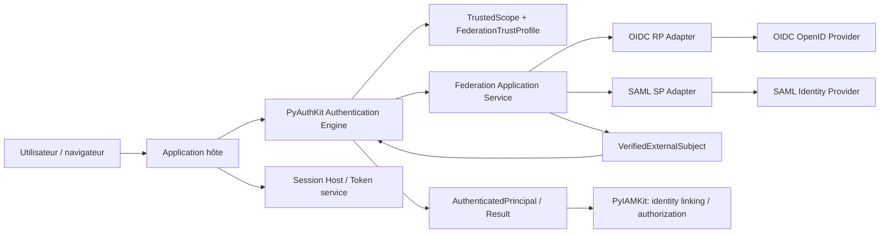
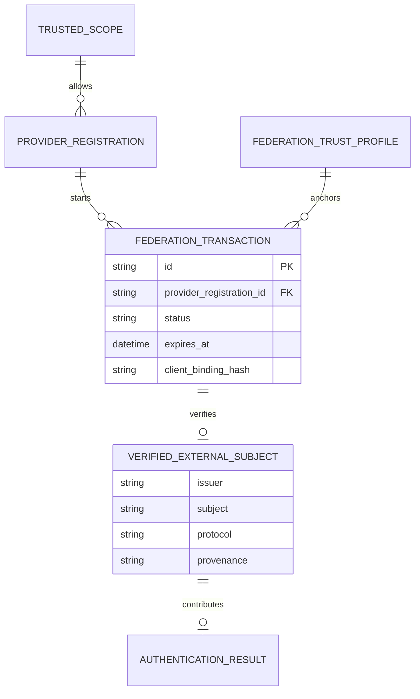
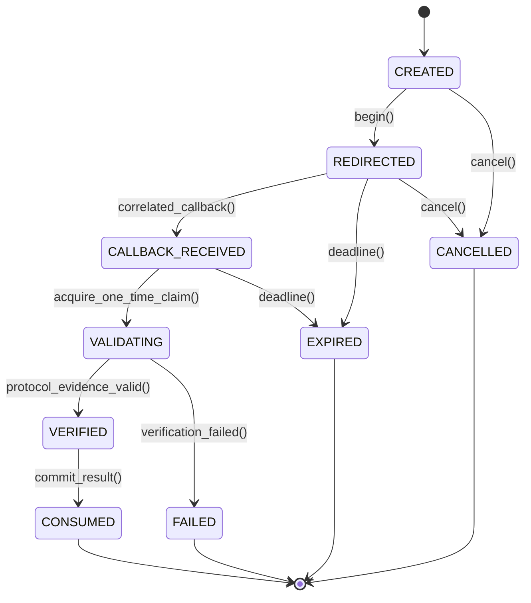
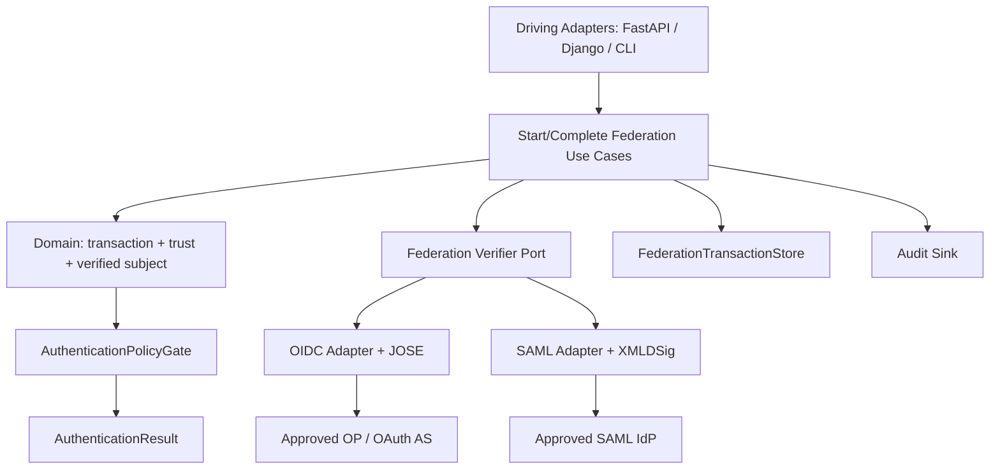
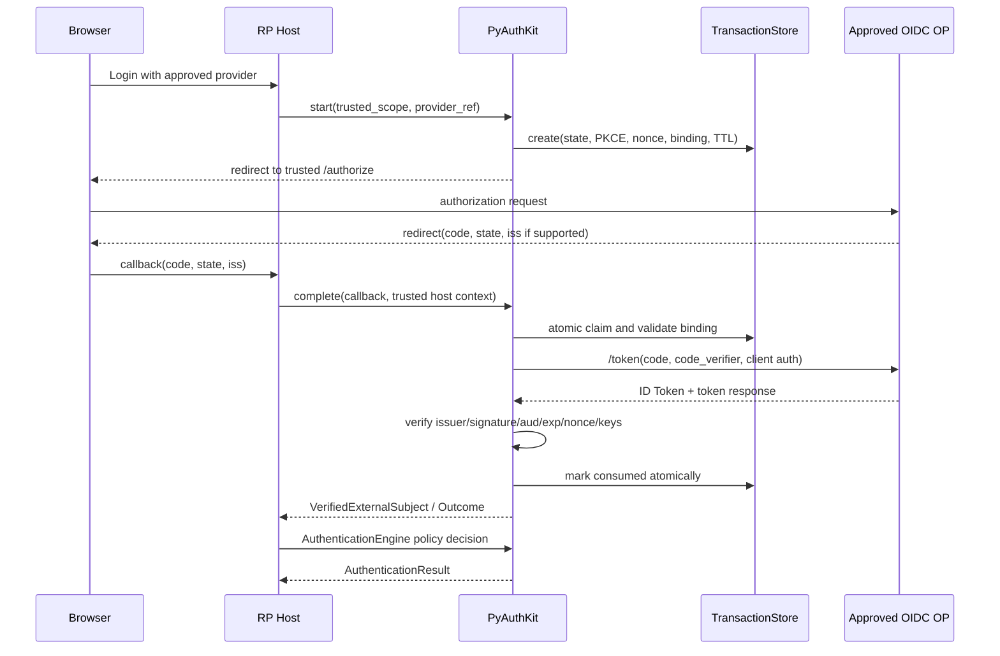
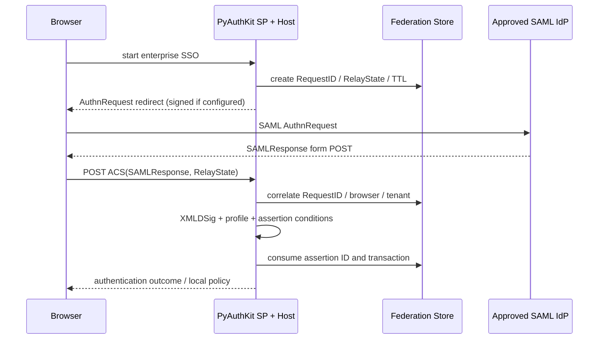
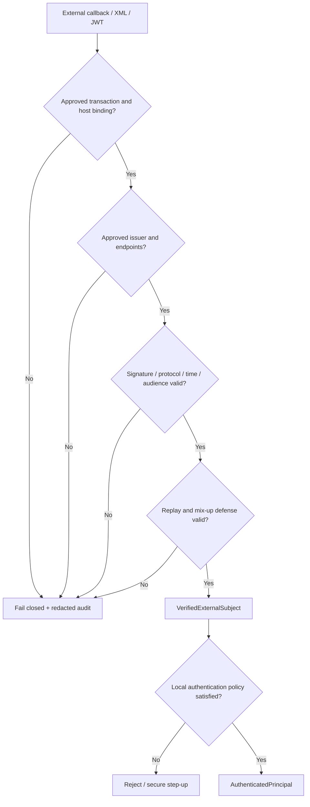
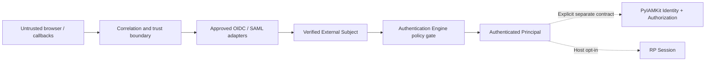

# 14_PYAUTHKIT_FEDERATION_OIDC_OAUTH_SAML_MODEL

# PyAuthKit — Federation, OIDC, OAuth 2.0 and SAML Model

> **Document :** `14_PYAUTHKIT_FEDERATION_OIDC_OAUTH_SAML_MODEL.md`  
> **Produit :** PyAuthKit — Authentication Engine for the Modern Python Ecosystem  
> **Type :** spécification du domaine fédération, protocoles, architecture applicative, sécurité et apprentissage de conception  
> **Statut :** **PROPOSED / DESIGN** — aucune implémentation, interopérabilité ni conformité certifiée présumée  
> **Version documentaire :** 0.1.0  
> **Date :** 2026-10-29  
> **Langue :** français ; API, classes, claims et vocabulaire protocolaire en anglais  
> **Filiation :** `00` à `13` et `PYAUTHKIT_SOFTWARE_DESIGN_LEARNING_CONVENTION.md`  
> **Phase :** **POST-MVP** ; le MVP valide Password, API Key et JWT entrants, **sans** imposer un serveur OAuth/OIDC ou SAML  
> **Suite :** `15_PYAUTHKIT_WEBAUTHN_PASSKEY_AND_PASSWORDLESS_MODEL.md`

---

## Guide de lecture

| Parcours | Sections | Objectif |
|---|---|---|
| Principes et frontières | 0–9 | Définir ce que fédérer signifie, qui possède la confiance |
| Modèle et architecture | 10–17 | Objets, relations, ports et protocoles |
| OIDC et OAuth | 18–25 | Séquences, validations, profils de clients et social login |
| SAML et gestion externe | 26–32 | Assertions, signatures, SSO, liaison et provisioning |
| Exploitation transverse | 33–40 | Assurance, sessions, sécurité, observabilité, runtime |
| Contrats et qualification | 41–48 | Python, exigences, invariants, menaces, tests, ADR |
| Conception et gouvernance | 49–56 | Design Learning Cards, anti-patterns, roadmap et références |

> **Règle de lecture :** un *exemple de protocole* n'est ni un composant implémenté, ni une promesse de conformité. Une relation de confiance explicite et testée est nécessaire pour accepter une assertion.

---

## 0. Résumé exécutif

PyAuthKit doit permettre à une application Python d'accepter une authentification prouvée par une **autorité externe configurée**. Le produit peut jouer le rôle de **Relying Party (RP)** OIDC, de **Service Provider (SP)** SAML, ou de client de flux OAuth dans des usages strictement contextualisés. Il ne devient pas, du seul fait de ces intégrations, un **Identity Provider (IdP)**, un **OAuth Authorization Server (AS)**, un annuaire ou un moteur d'autorisation.

Le résultat attendu est un `VerifiedExternalSubject`, puis, **seulement après contrôle des politiques de PyAuthKit**, un `AuthenticatedPrincipal` dans un `AuthenticationResult`. PyIAMKit ou l'application détient l'ownership du compte local, des organisations, des rôles, des décisions de linking et de provisioning.

Les règles fondamentales sont : **trusted configuration before external input**, validation cryptographique et protocolaire complète, corrélation forte de la cérémonie, isolation multi-tenant, rejet des substitutions de tokens et de fournisseurs, et absence de privilèges déduits de claims non gouvernés.

## 1. Pourquoi un sous-domaine Federation ?

Les systèmes doivent souvent déléguer l'authentification humaine à un fournisseur externe pour mutualiser SSO et MFA, limiter la conservation de mots de passe locaux et intégrer plusieurs organisations. Cette délégation introduit une nouvelle **frontière de confiance** : l'application accepte un fait d'authentification provenant d'une autorité indépendante, sous conditions définies à l'avance.

Problèmes à résoudre :

1. Reconnaître de manière non ambiguë l'autorité émettrice.
2. Vérifier l'intégrité, le destinataire, la temporalité et le contexte de l'assertion.
3. Rattacher la réponse à une cérémonie réellement initiée, ou appliquer une politique explicite de réception non sollicitée.
4. Normaliser les preuves de fournisseurs sans effacer leur provenance ni leur granularité d'assurance.
5. Empêcher les confusions entre login, consentement OAuth, autorisation applicative et création de compte.
6. Pouvoir changer de fournisseur sans modifier le noyau d'authentification.

## 2. Objectifs et non-objectifs

### 2.1 Objectifs

- Supporter une intégration OIDC via Authorization Code + PKCE et un adaptateur SAML SP.
- Recevoir une preuve fédérée **validée sous une politique de confiance choisie par l'hôte**.
- Exposer une représentation `FederatedAuthenticationEvidence` normalisée et traçable.
- Prévoir les flux multi-tenant et multi-IdP, avec défense contre les attaques de mix-up.
- Conserver les frontières de responsabilité avec `AuthenticationEngine`, `AuthenticationFlow`, `Session` et PyIAMKit.
- Préserver une API Python pure, stable par port et extensible par adapters.
- Fournir des diagnostics sûrs et des tests négatifs exécutables.

### 2.2 Non-objectifs

- Construire dès `14` un serveur OAuth 2.0/OIDC complet, un fournisseur SAML IdP, un LDAP ou un IAM.
- Traiter un simple access token OAuth comme preuve universelle d'authentification utilisateur.
- Fabriquer un compte local, une permission, un rôle ou une délégation automatiquement.
- Garantir une déconnexion globale ou une révocation immédiate d'une session externe.
- Déduire AAL/IAL/FAL d'un texte `acr`, d'un groupe IdP ou du seul mot « MFA ».
- Prendre en charge tous les fournisseurs et toutes les extensions protocolaires au premier incrément.

## 3. Filiation et responsabilités des documents

| Document | Contrat repris | Contrat détaillé ici |
|---|---|---|
| `00` | Fédération et Social Login dans le besoin | mécanismes et frontières de confiance |
| `03` | Hexagonal / Ports & Adapters | topology RP/SP vers IdP/AS |
| `04`–`06` | domaine, identité, associations | preuves, transactions et provider configurations |
| `07` | fail-closed, tenant, non-rejeu | invariants spécifiques OIDC/SAML |
| `08` | commands/queries et use cases | Start/CompleteFederatedAuthentication |
| `09` | verdict final par AuthenticationEngine | le vérificateur externe ne décide pas seul |
| `10` | authenticator vs credential, trust profile | `OIDCAuthenticator`, `SAMLAuthenticator` adapters |
| `11` | `AuthenticationFlow`, challenge, continuation | transactions OAuth/SAML et liaison au navigateur |
| `12` | `AssuranceAssessment` et step-up | interprétation contrôlée de `acr`, `amr`, `AuthnContext` |
| `13` | session RP, tokens et révocation | identité fédérée ≠ session locale ; logout |
| `15` | passwordless/WebAuthn | résultats fédérés qui attestent éventuellement ces méthodes |
| `23` | contrat PyIAMKit | account linking, provisioning et gouvernance |

## 4. Terminologie et conventions de confiance

| Terme | Sens précis | Ne signifie pas |
|---|---|---|
| `Federation` | confiance entre autorités distinctes | fusion des annuaires |
| `IdP` | fournisseur qui authentifie et émet des assertions | autorité universelle pour chaque tenant |
| `OP` | OpenID Provider OIDC | simple serveur OAuth quelconque |
| `RP` | client OIDC consommant ID Tokens | serveur de ressources OAuth |
| `SP` | service consommateur de SAML | OP OIDC |
| `AS` | OAuth Authorization Server délivrant des grants/tokens | vérification de l'identité humaine par définition |
| `Resource Server` | API recevant un access token destiné à elle | RP habilitée à accepter un ID Token pour accès API |
| `ID Token` | assertion d'authentification OIDC adressée au RP | access token générique |
| `Access Token` | artefact d'accès à une ressource définie | preuve de login universelle |
| `SAML Assertion` | déclarations XML signées/validables selon profil | compte PyIAMKit |
| `Issuer` | identifiant stable d'une autorité externe | domaine email présumé fiable |
| `Subject` | sujet stable **dans son espace de noms** | identifiant global inter-fournisseurs |
| `Federation Transaction` | tentative corrélée, limitée dans le temps | session utilisateur authentifiée |
| `Federated Link` | association externe ↔ locale gouvernée | alias décidé par PyAuthKit |
| `FAL` | Federation Assurance Level NIST si profil adopté | synonyme d'AAL |

## 5. Trois protocoles, trois responsabilités

### 5.1 OAuth 2.0 : délégation d'autorisation

OAuth 2.0 permet à un client d'obtenir un accès limité à des ressources, pour le compte d'un utilisateur ou en son propre nom. **OAuth 2.0 seul ne définit pas une authentification utilisateur normalisée.** Un fournisseur « Social Login OAuth-only » demande un protocole fournisseur explicite, validé de bout en bout ; il ne devient pas implicitement OIDC.

### 5.2 OpenID Connect : identité au-dessus d'OAuth

OIDC ajoute une couche d'identité : `ID Token`, `issuer`, `subject`, `audience`, éventuellement `nonce`, claims et UserInfo. Le flux candidat par défaut est **Authorization Code + PKCE S256** pour les clients pris en charge, avec une protection effective contre CSRF et mix-up.

### 5.3 SAML 2.0 : assertions XML et profils de fédération

SAML fournit protocoles, assertions, bindings, metadata et profils. Le profil **Web Browser SSO** constitue la cible principale de PyAuthKit en tant que SP. L'acceptation dépend des signatures, du `Destination`, du `Recipient`, de l'audience, du `InResponseTo` si applicable et du temps de validité.

## 6. Frontières d'ownership — PyAuthKit / PyIAMKit

| Décision/état | Propriétaire | Limite |
|---|---|---|
| Autorités IdP/OP autorisées pour le contexte | hôte + configuration/trust registry | jamais choisi uniquement par callback |
| Validation d'une assertion externe | PyAuthKit federation adapter | pas d'attribution de rôle IAM |
| Évaluation et résultat AuthN | PyAuthKit AuthenticationEngine | ne crée pas implicitement la session |
| Gestion des comptes et identités locales | PyIAMKit / hôte | pas d'auto-link par email |
| Mapping `ExternalSubjectKey → LocalIdentity` | PyIAMKit / identity-linking service | opération auditée, politiques explicites |
| Détermination d'autorisations | PyIAMKit / service métier | claims externes non autoritatifs par défaut |
| Session de l'application RP | hôte / Session capability `13` | distincte de session IdP |
| Tokens d'accès API externes | AS externe | jamais « re-signés » comme preuve locale sans nouveau grant |

## 7. Trusted Scope avant la preuve

Le `TrustedScope` provient d'un contexte **approuvé côté serveur** : application cliente, tenant/realm résolu, route/config hôte et politique d'authentification. Le fournisseur attendu est choisi **avant** que les claims ou paramètres du callback puissent exercer une autorité.

**Invariant de direction :** `HostContext → TrustedScope → FederationTrustProfile → Provider endpoints/keys`. Jamais `unverified_token.iss → trust arbitrary URL/key → authenticated`.

Un hint UI (« Se connecter avec Microsoft »), une adresse email, un paramètre de callback ou un tenant déclaré par le navigateur peuvent demander une voie : ils doivent être **reconciliés avec une allowlist/configuration serveur**, et non convertir la demande en relation de confiance.

## 8. Vue de contexte (C4/DDD)



**Les flèches ne décrivent pas une confiance transitive implicite.** Chaque retour d'un fournisseur passe par validation de protocole et `AuthenticationPolicyGate` avant le résultat final.

## 9. Bounded Context et model ownership

Le **Federated Authentication** constitue un sous-domaine de PyAuthKit, pas obligatoirement un package ou une base dédiée. Il partage les primitives `AuthenticationRequest`, `VerifiedSubject`, `AuthenticationResult`, `TrustProfile` et `FlowBinding` avec le noyau mais apporte son vocabulaire : `FederationTransaction`, `ProviderRegistration`, `OIDCIdTokenEvidence`, `SAMLAssertionEvidence`.

Une relation avec le domaine IAM est traversée **par un contrat publié** tel que `VerifiedExternalSubject`, non par une référence à une table utilisateur ou par `User.objects.get(email=...)` dans le vérificateur OIDC.

## 10. Carte des objets du domaine

| Objet | Catégorie DDD candidate | Responsabilité |
|---|---|---|
| `FederationTrustProfile` | Value Object/configuration versionnée | issuer, clés, audiences, algorithmes et garanties attendues |
| `ProviderRegistration` | Configuration Entity si lifecycle possédé | liaison tenant/client/provider, état et versions |
| `FederationTransaction` | Aggregate Root candidat | corrélation, état, expiration, consommation atomique |
| `FederationTransactionId` | Value Object | identité opaque de transaction |
| `ExternalSubjectKey` | Value Object | `(protocol, issuer/entity_id, subject)` sous scope |
| `OIDCIdTokenEvidence` | Evidence VO non fiable tant que non vérifié | assertion OIDC reçue |
| `SAMLAssertionEvidence` | Evidence VO non fiable tant que non vérifié | assertion XML reçue |
| `VerifiedExternalSubject` | Value Object signé conceptuellement par un verifier de confiance | identité et provenance validées |
| `FederationAssuranceEvidence` | Value Object | contexte d'authentification attesté avec limites |
| `FederatedAuthenticationOutcome` | Result Object | rejet, continuation ou preuve externe validée |
| `ExternalIdentityLinkRequest` | DTO d'intégration | demande au domaine IAM, non mutation AuthN |
| `ProviderMetadataSnapshot` | Value Object/config | issuer, endpoints et clés ancrés avec version |
| `FederationSessionLink` | Relation candidate | RP session ↔ identifiant de session externe, si supporté |
| `FederationLogoutEvent` | Domain/Integration Event candidat | propagation de logout dans un périmètre déclaré |
| `FederationAdapter` | Port/application interface | validation d'un protocole via backend sécurisé |
| `FederationTransactionStore` | Port | stockage atomique et consommation unique |

**Prudence DDD :** une transaction courte peut être un simple record dans un store sécurisé, sans Aggregate Root riche, si les invariants peuvent être protégés par un service + une transaction atomique. `ProviderRegistration` n'est une Entity que lorsque PyAuthKit en détient réellement le lifecycle.

## 11. Identité externe et clé composite

`sub` OIDC ou `NameID` SAML ne constituent pas à eux seuls des identifiants universels. La clé externe doit inclure l'autorité **validée** : `provider registration / issuer-or-entityID / subject` et, lorsque nécessaire, tenant, qualifier, format ou pairwise audience. Ne jamais fusionner deux comptes sur `email`, `preferred_username`, `given_name` ou le même `sub` reçu d'issuers distincts.

La `FederationTrustProfile` détermine l'usage de `email_verified` comme information **fournisseur-spécifique**, mais même une adresse validée ne donne pas automatiquement le droit de créer/relier un compte existant. Les règles de linking restent dans PyIAMKit.

## 12. Relations, cardinalités et frontières

| Relation | Cardinalité proposée | Contrôle |
|---|---|---|
| `TrustedScope` → `ProviderRegistration` | 0..N profils explicitement autorisés | sélection hôte non ambiguë |
| `ProviderRegistration` → `FederationTrustProfile` | 1 profil actif/version retenue | version pinning par transaction |
| `FederationTransaction` → `ProviderRegistration` | exactement 1 | ne change jamais après démarrage |
| `FederationTransaction` → `ClientBinding` | exactement 1 | callback et redirect liés |
| `FederationTransaction` → `CorrelationSecret` | 1 ensemble de protections | stockage chiffré/opaque et TTL |
| `FederationTransaction` → `VerifiedExternalSubject` | 0..1 après validation | finalisation idempotente |
| `VerifiedExternalSubject` → `AuthenticatedPrincipal` | 0..1 après policy gate | évaluation côté moteur |
| `ExternalSubjectKey` → identité IAM locale | 0..1 ou règle IAM spécifique | linking réservé PyIAMKit |
| `SessionRP` → `FederationSessionLink` | 0..N suivant fournisseur | logout non présumé global |



**ERD logique et conditionnel.** L'ERD ne préjuge ni SQL ni d'un `User` local dans PyAuthKit. Une transaction store Redis atomique ou un backend applicatif propre sont envisageables.

## 13. Machines à états de transaction

États candidats : `CREATED`, `REDIRECTED`, `CALLBACK_RECEIVED`, `VALIDATING`, `VERIFIED`, `CONSUMED`, `FAILED`, `EXPIRED`, `CANCELLED`. `VERIFIED` n'est pas un synonyme de login accepté : la politique d'authentification et la transaction de finalisation restent à contrôler.



Une transaction **ne redémarre pas** automatiquement après `FAILED` ni `CONSUMED`. Les redirections de reprise créent une nouvelle transaction ; deux callbacks concurrents ne peuvent pas produire deux consommations acceptées.

## 14. Ports, adapters et Composition Root

| Port | Implémentations possibles | Nature |
|---|---|---|
| `FederationProviderResolver` | configuration approuvée tenant/client | port de lecture de confiance |
| `FederationTransactionStore` | mémoire de test, Redis CAS, SQL transactionnel | port atomique |
| `OIDCMetadataProvider` | cache HTTP contrôlé, snapshot pin | port externe sécurisé |
| `OIDCIDTokenVerifier` | bibliothèque JOSE éprouvée | adapter cryptographique |
| `OAuthTokenEndpointClient` | HTTP TLS contrôlé | adapter back-channel |
| `SAMLAssertionVerifier` | moteur XMLDSig hardened | adapter cryptographique |
| `SAMLMetadataProvider` | metadata signature/pin vérifié | port trust metadata |
| `FederationAuditSink` | logs redigés, SIEM, event publisher | port de sortie |
| `ExternalIdentityResolver` | PyIAMKit, callback hôte | frontière IAM |
| `Clock` / `NonceGenerator` | implementations testables | ports transverses |

Le **Composition Root** configure les URLs, timeouts, certificats, clés, issuer, client, audiences, algorithmes et ports. Les adapters ne doivent pas découvrir une URL arbitraire à partir d'un claim non vérifié.



## 15. Commands, Queries et Use Cases

| Opération candidate | Kind | Entrées approuvées / résultat |
|---|---|---|
| `StartFederatedAuthentication` | Command | `TrustedScope`, `provider_ref`, callback binding → redirect/request |
| `CompleteOIDCCallback` | Command | code/state/issuer → `FederatedAuthenticationOutcome` |
| `CompleteSAMLResponse` | Command | XML response + transport binding → outcome |
| `CancelFederationTransaction` | Command | transaction id + authority → cancelled |
| `ProcessFederatedLogout` | Command | trusted logout message → scoped session invalidation |
| `GetFederationTransactionStatus` | Query | handle autorisé → état redigé |
| `GetConfiguredFederationProviders` | Query | tenant/client approuvés → liste allowlist |
| `ValidateProviderConfiguration` | Admin use case | contrôle des metadata, clés, redirect URIs et algs |
| `RequestExternalIdentityLink` | Integration Command | verified subject + host identity → décision PyIAMKit |

Ces noms sont des **contrats candidats**, pas une preuve qu'ils existent dans le code. CQRS n'impose ni `CommandBus`, ni séparation de bases, ni GoF Command Pattern.

## 16. Résultat intermédiaire et verdict final

```text
Inbound callback (untrusted)
   ↓ scoped transaction + trust resolution
Protocol verification (OIDC/SAML)
   ↓
VerifiedExternalSubject [authenticated externally]
   ↓ local policy evaluation
AuthenticatorOutcome [evidence accepted / rejected]
   ↓ AuthenticationEngine
AuthenticationResult [authenticated / challenge / failed]
   ↓ optional separate use case
Local RP Session / token / identity-resolution IAM
```

Ne pas promouvoir un `ID Token` valide en `AuthenticatedPrincipal` avant confirmation du `client`, du tenant, du mapping acceptable, de l'assurance requise et de la politique hôte. `TrustedSubject` ne doit pas être constructible à partir de claims arbitraires par une API publique non contrôlée.

## 17. Un modèle d'assurance avec provenance

`FederationAssuranceEvidence` contient au minimum : source vérifiée, protocole, `issuer`, instant du fait authentifié (`auth_time` ou équivalent si fiable), référence de méthode (`acr`, `amr`, SAML `AuthnContextClassRef`), version du trust profile et limites de l'évaluation.

Le domaine Assurance (`12`) peut **évaluer** ces données sous un mapping explicitement gouverné. Les fournisseurs définissent leurs propres valeurs `acr`/`amr`, parfois non comparables ; elles ne deviennent pas automatiquement `AAL2` ou `FAL2`. Un claim présent ne remplace pas la certification des composants ou le respect d'une politique NIST.

## 18. OIDC — Authorization Code + PKCE S256

Cérémonie cible (client web RP) :

1. L'hôte détermine `TrustedScope` et `provider_ref` autorisé.
2. PyAuthKit charge `FederationTrustProfile` et configuration OP pré-approuvée.
3. Une transaction à usage unique contient `state`, `nonce` si retenu/exigé, `code_verifier` PKCE, `redirect_uri`, client/tenant, issuer et expiration.
4. Le RP redirige vers **l'authorization endpoint approuvé** avec `response_type=code`, `scope=openid`, `code_challenge_method=S256` et binding de session.
5. Le callback compare `state` lié au navigateur, l'issuer attendu / la protection mix-up, la transaction et les erreurs sans consommer une identité.
6. Le RP échange le code une seule fois avec l'OP attendu via back-channel TLS, PKCE et authentification client selon le profil.
7. Le vérificateur valide complètement l'ID Token et lie la réponse à la transaction.
8. Le mapping OIDC crée une `VerifiedExternalSubject` avec provenance, jamais un rôle IAM.
9. Le `AuthenticationPolicyGate` peut accepter, demander un step-up ou refuser.
10. Le module Sessions (`13`) ne crée une session RP que si le host l'a demandé et selon une politique distincte.

**Sécurité de référence :** PKCE S256 recommandé comme politique produit pour tout code flow. La RFC 9700 impose PKCE aux clients publics et le recommande aux clients confidentiels, avec des conditions strictes de protection si une alternative est retenue. Cette spécification PyAuthKit choisit **S256 par défaut pour tous**.



## 19. OIDC Discovery et configuration de l'OP

Les métadonnées OIDC peuvent exposer `issuer`, `authorization_endpoint`, `token_endpoint`, `jwks_uri`, méthodes d'authentification du client, algorithmes supportés, `userinfo_endpoint` et indications de sécurité.

Règles :

- L'`issuer` d'un document Discovery doit correspondre à l'issuer configuré **exactement** selon les règles du protocole ; les redirects ou alias non approuvés sont rejetés.
- Les URLs réseau chargées appartiennent à une origine/allowlist de confiance : HTTPS, prévention SSRF, redirect HTTP désactivé ou contrôlé et limite de taille.
- Les snapshots de metadata/clé portent version, expiration de cache et provenance. Un cache périmé au-delà d'une tolérance approuvée échoue de manière sûre.
- Une clé inconnue `kid` ne déclenche jamais un fetch libre vers un `jku`/`x5u` arbitraire ; seule la metadata ancrée du provider est utilisable.
- La rotation de clés exige des règles de cache, refresh borné, désactivation de clés compromises et tests d'indisponibilité.
- Les algorithmes crypto permis sont **allowlistés par trust profile** ; aucune négociation implicite via un header de token.

## 20. Validation d'un ID Token : contrat de refus

Une validation OIDC doit vérifier selon le profil de flux :

1. Format compact JOSE et limites d'entrées ; JWT attendu, pas un token quelconque.
2. Signature cryptographique conforme et algorithme explicitement autorisé par le RP.
3. Clé de l'issuer attendu, désignée par metadata approuvée, avec usage et paramètres cohérents.
4. `iss` égal à l'issuer attendu ; `aud` contenant le `client_id` réel du RP.
5. `azp` et audiences additionnelles selon les règles OIDC ; rejet si le token vise un client inconnu.
6. `exp`, `iat`, `nbf` lorsque présent, avec horloge fiable et tolérance bornée.
7. `nonce` si généré/attendu ou exigé par le mode, égal à la valeur de la transaction ; si absent alors qu'attendu → rejet.
8. `auth_time` si exigé (p. ex. `max_age`), avec sémantique et fraîcheur contrôlées.
9. `acr`, `amr` **interprétés** selon la politique locale ; jamais directement « droit d'accès ».
10. Pas de réutilisation d'un ID Token comme access token destiné à une API.
11. Réponse `UserInfo` facultative : vérifier `sub` identique à celui de l'ID Token ; toute divergence provoque un rejet.
12. Pas de promotion de `email_verified` en preuve de possession d'un compte local existant.

**Précision normative :** `nonce` n'est pas systématiquement un MUST de l'Authorization Code Flow dans OIDC Core ; PyAuthKit peut l'exiger comme politique produit pour les intégrations qui le supportent. Les `at_hash`/`c_hash` dépendent du flux et de leur présence ; ne pas les déclarer obligatoires uniformément.

## 21. OAuth — sécurité du client et limites de rôle

| Mécanisme | Rôle | Recommandation de conception |
|---|---|---|
| Authorization Code | redirection + échange backend | PKCE S256, redirect exact, `state`/binding |
| PKCE | lie code à client initial | `code_verifier` secret et transaction-scoped |
| `state` | corrélation/CSRF selon architecture | non prédictible, lié au navigateur et vérifié |
| RFC 9207 `iss` | défense mix-up multiserveurs | comparer à issuer attendu et configuration |
| PAR RFC 9126 | envoi protégé de paramètres auth | extension optionnelle pour profils exigeants |
| DPoP RFC 9449 | access tokens sender-constrained | extension spécifique, pas un contrôle de login |
| mTLS RFC 8705 | liaison de client/token à certificat | option B2B et clients confidentiels |
| Client Credentials | OAuth machine-to-machine | ne fait pas naître une identité humaine |
| Refresh tokens | continuité des grants | renvoi à `13` et RFC 9700 |
| Resource Owner Password Credentials | grant historique | interdit dans les profils modernes PyAuthKit |
| Implicit flow | legacy | refusé par défaut : surface d'attaque accrue |

**OAuth 2.1 :** au 29 octobre 2026, `draft-ietf-oauth-v2-1-16` (3 septembre 2026) demeure un **Internet-Draft**, non une RFC publiée. Le socle normatif retenu est OAuth 2.0 + RFC 9700 et les RFC applicables ; les orientations du brouillon sont informatives jusqu'à publication.

## 22. Mix-up, CSRF, injection de code et redirect

**Mix-up attack** : si plusieurs AS/OP sont configurés, le callback peut provenir d'un autre émetteur que celui enregistré au démarrage. La transaction doit enregistrer l'autorité attendue et vérifier l'`iss` de réponse lorsqu'il est défini/nécessaire, ou appliquer une alternative formellement sûre et documentée (par exemple des redirect URIs distinctes par AS selon le profil de sécurité).

**CSRF et login CSRF** : un `state` seul sans liaison robuste au navigateur n'est pas suffisant. La politique hôte peut utiliser un cookie lié à la session ou un secret serveur corrélé, avec `SameSite`, `HttpOnly`, `Secure` et contrôle d'origine selon la menace. Ne pas traiter un `nonce` arbitraire de réponse comme preuve de la bonne transaction.

**Code injection et redirect** : le callback n'accepte pas de redirect final arbitraire fourni dans un `next` non validé ; toutes les `redirect_uri` sont configurées précisément et jamais reconstruites depuis un `Host` HTTP non fiable.

## 23. Social Login : OIDC natif et OAuth-only

| Famille de fournisseur | Adaptateur candidat | Contrat de confiance |
|---|---|---|
| OP OIDC standard | `GenericOIDCProviderAdapter` | ID Token conforme + Discovery vérifiée |
| Microsoft Entra ID | `EntraOIDCAdapter` optionnel | issuer tenant-specific approuvé, clés, aud, claims |
| Google | `GoogleOIDCAdapter` optionnel | ID Token + issuer/audience selon configuration |
| IdP d'entreprise | `EnterpriseOIDCAdapter` | issuer, realm, trust profile contractuel |
| GitHub Login | `GitHubOAuthIdentityAdapter` selon support courant | OAuth + appel identité fournisseur et assurance explicitement limitée |
| SAML entreprise | `SAMLServiceProviderAdapter` | metadata signée, bindings et assertions |
| Fournisseur custom | `CustomFederationAdapter` | protocole documenté + contrat de vérification et tests |

Une API OAuth de profil utilisateur n'est pas intrinsèquement OIDC. Pour le mode OAuth-only, la **source de l'identité** doit être documentée et validée via l'endpoint de profil exact prévu par le fournisseur sous token d'accès destiné à cet usage. La preuve n'obtient aucun FAL/AAL normatif par simple supposition.

## 24. UserInfo, claims, consentement et minimisation

`UserInfo` peut compléter le profil **après** validation de l'ID Token, sous accès autorisé et provenance contrôlée. Les claims standard ne sont pas tous stables ou vérifiés. La clé de relation est `iss + sub` (dans le scope pertinent), pas un email modifiable.

Préciser : `required_claims`, `optional_claims`, `transient_claims`, `retention_policy`, `sensitive_claim_handling`, `userinfo_ttl`, `pairwise_subject_support`. La consommation de claims soumis à un consentement doit respecter le but annoncé ; ne pas journaliser des tokens ou des profils personnels complets.

## 25. OIDC logout et session RP

`RP Logout` : fin de la session locale selon `13`. `OP Logout` : fin de session auprès du fournisseur, si endpoint et profil disponibles. `Front-channel logout` et `Back-channel logout` sont des capacités distinctes, configurables et testées. L'une n'implique pas l'autre.

Pour un Back-Channel Logout, la validation d'un logout token doit vérifier profil de token **spécifique**, issuer, audience, signature, événements, timestamp et anti-rejeu selon spécification. Ne pas accepter un ID Token ou JWT access token quelconque comme logout token.

La propagation de logout dans plusieurs applications n'est pas instantanée par nature ; l'observabilité doit mesurer les délais de propagation et la cohérence réellement obtenue.

## 26. SAML 2.0 — rôles, assertions et bindings

Dans le scénario cible, PyAuthKit agit comme **SP**. L'IdP reçoit une `AuthnRequest`, authentifie l'utilisateur, puis livre un `SAMLResponse` contenant une ou plusieurs assertions conformément au profil Web Browser SSO et au binding retenu (souvent HTTP-Redirect pour la requête, HTTP-POST pour la réponse).

Le SP configure `entityID`, `AssertionConsumerServiceURL`, endpoints de logout optionnels, certificats et règles de sécurité. Les metadata IdP ne sont pas des données auto-déclarées librement par le navigateur. Les algorithmes de signature et XML parser sont définis et restrictifs par profil.



## 27. SAML Metadata et chaîne de confiance

L'IdP metadata peut contenir `entityID`, `SingleSignOnService` et certificats de signature. Une metadata téléchargée via URL doit être **ancrée à une confiance préalable**, notamment signature de metadata vérifiée ou pinning hors bande suivant la politique. HTTPS seul ne suffit pas à établir que le contenu est celui de l'autorité autorisée.

- Interdire le choix d'un IdP par lecture non gouvernée d'un `Issuer` XML reçu.
- Contrôler `entityID` exact, endpoint, signature et validité des certificats selon contrat.
- Séparer la rotation IdP/SP de la période de validité des assertions.
- Ne pas considérer tout certificat X.509 envoyé par l'assertion comme une ancre de confiance.
- Interdire la résolution réseau de DTD, XInclude ou ressources XML arbitraires.
- Journaliser référence de metadata et empreinte, non les secrets ni les XML bruts sensibles.

## 28. Validation SAML assertion et response

Le vérificateur doit établir, selon le profil SSO et les options configurées :

1. XML parsé par bibliothèque durcie (XXE/entités externes interdits, taille/profondeur bornées).
2. Signature XMLDSig exigée sur l'élément approprié selon le profil ; références, transforms et éléments effectivement consommés alignés pour empêcher le *signature wrapping*.
3. Signature ancrée à la clé IdP approuvée, pas à un certificat auto-présenté.
4. `Issuer` égal au `entityID` approuvé.
5. `Destination`, `Recipient`, `AudienceRestriction` conformes au SP attendu.
6. `InResponseTo` corrélé à la `AuthnRequest` quand SP-initiated ; refus par défaut de l'IdP-initiated non sollicité.
7. `NotBefore`, `NotOnOrAfter`, `SubjectConfirmationData` et conditions temporelles contrôlés à l'horloge fiable.
8. `StatusCode` et nombre de assertions/subjects cohérents ; stratégie en cas d'ambiguïté.
9. `NameID`, `NameIDFormat`, qualifiers et contexte de session interprétés explicitement.
10. `AssertionID` ou identifiant de réponse consommé atomiquement pour prévenir le rejeu.
11. `RelayState` corrélé à l'action initiée et jamais utilisé comme URL libre.
12. `AuthnContextClassRef` évalué comme donnée d'assurance, jamais comme permission locale.

**SAML unsolicited (IdP-initiated)** : mode **désactivé par défaut** dans la cible PyAuthKit. Son activation demande une politique ADR explicitant l'absence de `InResponseTo`, l'atténuation du login CSRF, la destination du résultat et la stratégie de liaison de session.

## 29. SAML XML Signature Wrapping et risques du parser

Une signature cryptographique valide sur un **nœud non consommé** ne suffit pas. Une implémentation vulnérable pourrait vérifier l'assertion A et lire la revendication de l'assertion B. La bibliothèque doit lier *exactement* l'élément vérifié à l'élément interprété, avec références ID uniques, mapping des namespaces, transforms allowlistées et refus de plusieurs assertions ambiguës.

Le noyau ne doit **pas** écrire lui-même une vérification XMLDSig ad hoc. Utiliser des bibliothèques maintenues, durcies et testées ; conserver un port de vérification derrière une interface stable. Tests d'attaque requis avant toute mise en production.

## 30. SAML NameID, attributs et linking IAM

`NameID` peut être `persistent`, `transient`, email-address ou autre format. Une association locale ne doit pas dépendre d'un `NameID` transient susceptible de changer ; le trust profile doit indiquer ce qui constitue une identité stable et si cette stabilité est contractuellement garantie.

Les attributs `mail`, `groups`, `role`, `department` sont de l'information externe. Seul PyIAMKit peut décider si et comment certains groupes deviennent des rôles applicatifs après validation de source, mapping et gouvernance.

## 31. SAML Single Logout (SLO)

SLO peut nécessiter des requêtes/réponses signées, des destinations exactes, `NameID`, `SessionIndex` et corrélation. La réussite d'un `LogoutResponse` ne garantit pas toutes les sessions SP/IdP/tiers terminées.

Choix initial : **logout local sûr d'abord**, protocole SLO ensuite si un provider concret le justifie. Une implémentation ne doit pas bloquer sans borne sur IdP indisponible ; documenter le résultat local et l'état de propagation distante.

## 32. Federation configuration multi-tenant

Une même application peut accepter plusieurs autorités, mais chaque transaction fixe : `tenant_id`, `client_id`, `provider_registration_id`, `issuer`, `redirect_uri`, `scopes` demandés, `trust_profile_version` et `correlation_binding`. Les metadata communes ne doivent pas faire disparaître la séparation des clients, autorités et groupes de secrets.

Un tenant A ne peut pas réutiliser la transaction, la clé de callback, la configuration ou le lien d'identité du tenant B. Toute option de multi-issuer doit expliciter la résolution d'issuer à partir d'un registre allowlisté plutôt que d'un claim non fiable.

## 33. Federation assurance : AAL, IAL, FAL

Selon NIST SP 800-63-4, **AAL** concerne le niveau d'assurance de l'authentification, **IAL** les garanties de vérification d'identité et **FAL** les propriétés de l'assertion/fédération. La norme pertinente à la fédération est SP 800-63C-4 ; le profil de déploiement détermine les exigences applicables.

- Une MFA déclarée par l'IdP ne permet pas de revendiquer arbitrairement un AAL.
- Une assertion SAML/OIDC signée ne suffit pas, à elle seule, à revendiquer FAL élevé.
- Un `acr` ou un `AuthnContextClassRef` non mappé avec preuve est une **valeur de fournisseur**, non une certification.
- Le step-up peut exiger un retour IdP avec `max_age`/`prompt` ou un facteur local et une fraîcheur vérifiables.
- L'authentification federated reste distincte des décisions d'accès aux ressources.

## 34. Gestion des erreurs et des refus

| Code candidat | Diagnostic interne | Diagnostic public |
|---|---|---|
| `FED_PROVIDER_NOT_ALLOWED` | issuer/tenant non approuvé | Login indisponible |
| `FED_TRANSACTION_UNKNOWN` | state/RelayState absent ou invalide | Connexion expirée ou invalide |
| `FED_TRANSACTION_REPLAY` | callback déjà consommé | Connexion invalide |
| `FED_ISSUER_MISMATCH` | issuer inattendu | Connexion refusée |
| `FED_SIGNATURE_INVALID` | JOSE/XMLDSig invalide | Connexion refusée |
| `FED_AUDIENCE_MISMATCH` | audience SP/client inattendue | Connexion refusée |
| `FED_NONCE_INVALID` | nonce attendu manquant/invalide | Connexion refusée |
| `FED_ASSERTION_EXPIRED` | assertion hors fenêtre | Connexion expirée |
| `FED_METADATA_UNAVAILABLE` | confiance/clé indisponible | Connexion temporairement indisponible |
| `FED_SUBJECT_AMBIGUOUS` | subject/NameID non univoque | Connexion refusée |
| `FED_ASSURANCE_INSUFFICIENT` | politique locale non satisfaite | Validation supplémentaire nécessaire |
| `FED_IDENTITY_LINK_REQUIRED` | identité externe non associée | Action de compte requise |

**Aucun** diagnostic public ne doit exposer un secret OAuth, la valeur brute d'un assertion, les claims privés ou une indication exploitable d'existence de compte.

## 35. Flux de menace et barrières



## 36. Privacy, minimisation et rétention

Conserver par défaut seulement : clé externe pseudonymisée ou stable, référence de transaction, issuer approuvé, décision, timestamps, provenance de trust, catégorie d'erreur et identifiants de corrélation redigés. Toute conservation d'ID Token brut, assertion SAML, adresse email, groupe ou metadata personnelle nécessite justification, durée explicite et protections supplémentaires.

`IdentityLink` et profils personnels sont détenus par PyIAMKit si ce produit assume cette fonction. Conformité RGPD : finalité, minimisation, base légale, information, conservation et contrôles organisationnels à évaluer par le déploiement ; aucun rapport ne vaut conformité.

## 37. Performance, résilience et disponibilité

- HTTP clients configurés avec timeouts, tailles maximales, TLS et pool borné.
- Discovery/JWKS/metadata XML cachées selon politique et cache sécurisé ; invalider en cas de révocation/compromission.
- Pas de « fail-open » si OP/IdP inaccessible ou si les clés deviennent indisponibles sans cache encore approuvé.
- Backoff borné et protection contre l'amplification des fetchs sur `kid` inconnu.
- Circuit breakers facultatifs selon pression réelle ; ne pas masquer les erreurs de validation dans un retry générique.
- Distinction p95 de préparation, redirection utilisateur, callback, échange token et validation cryptographique.
- La consommation atomique doit tenir en multi-worker et redémarrage de service si reprise durable promise.

## 38. Observabilité et événements

| Événement candidat | À tracer (minimal) | Interdits |
|---|---|---|
| `FederationStarted` | transaction_ref, provider_ref, tenant_ref | `state` brut, PKCE verifier |
| `FederationCallbackReceived` | correlation_ref, protocol, status | code OAuth, SAMLResponse |
| `FederationAssertionVerified` | issuer_ref, trust_version, verifier_type | ID Token / XML complet |
| `FederationVerificationRejected` | error code, phase | contenu secret, signature brute |
| `FederationAssuranceEvaluated` | required vs assessed, provenance | PII inutile |
| `FederationCompleted` | outcome, duration, request_ref | clé/secret/claims bruts |
| `FederationLogoutProcessed` | local vs remote, outcome | session cookie/token brut |

Les événements doivent conserver une sémantique claire : **une preuve validée** n'est pas encore **un login accepté**, et un logout distant demandé n'est pas forcément confirmé.

## 39. Session, tokens et limites d'intégration

- `AuthenticationResult` positif peut déclencher **une commande séparée** de création de session RP (document `13`).
- Les access/refresh tokens externes appartiennent à l'AS ; leur audience et leur usage limitent l'accès ; éviter leur persistance si non nécessaire.
- Ne jamais remettre au navigateur un ID Token externe sous prétexte qu'il s'agit d'un token API local.
- La session RP peut survivre à une fin de session OP selon politique et signaux de logout ; ne pas annoncer l'inverse.
- La synchronisation des comptes/groupes est une activité de provisionnement IAM, pas un effet automatique de `CompleteOIDCCallback`.

## 40. Stratégie de tests en couches

| Niveau | Objet de preuve |
|---|---|
| Unit domain | transaction, ID composite, time windows, résultats discriminés |
| Contract | Port/Adapter équivalence, erreurs et configurations |
| Crypto/protocol | ID Token, XMLDSig, audience, signature, replay, mix-up |
| Integration | OP de test, IdP SAML de test, stores réels, callbacks |
| End-to-end | navigateur, cookies, redirections, login/logout et step-up |
| Property-based | isolation, cardinalités, monotonicité états, no duplicate consume |
| Architecture | dépendances, pas de provider SDK en core, IAM séparé |
| Operational | JWKS rotation, délais, pannes, logs redigés, concurrence |

## 41. Contrats Python candidats — domaine et ports

Les modèles ci-dessous sont des **illustrations syntaxiques**, pas une bibliothèque cryptographique. Ils rendent explicites les responsabilités et les types ; les garanties de confiance dépendent du Composition Root, des verifiers, de la politique et des tests d'intégration.

### 41.1 Value Objects et transactions

```python
from __future__ import annotations
from dataclasses import dataclass
from datetime import datetime
from enum import StrEnum
from typing import Mapping


class FederationProtocol(StrEnum):
    OIDC = "oidc"
    SAML = "saml"
    OAUTH_PROVIDER_IDENTITY = "oauth_provider_identity"


class FederationState(StrEnum):
    CREATED = "created"
    REDIRECTED = "redirected"
    VALIDATING = "validating"
    VERIFIED = "verified"
    CONSUMED = "consumed"
    FAILED = "failed"
    EXPIRED = "expired"
    CANCELLED = "cancelled"


@dataclass(frozen=True, slots=True)
class ExternalSubjectKey:
    protocol: FederationProtocol
    issuer: str
    subject: str
    tenant_scope: str

    def __post_init__(self) -> None:
        if not all((self.issuer, self.subject, self.tenant_scope)):
            raise ValueError("ExternalSubjectKey requires explicit scope")


@dataclass(frozen=True, slots=True)
class FederationAssuranceEvidence:
    provider_method: str | None
    authenticated_at: datetime | None
    profile_ref: str
    mapping_version: str | None


@dataclass(frozen=True, slots=True)
class VerifiedExternalSubject:
    key: ExternalSubjectKey
    transaction_id: str
    trust_profile_version: str
    verified_at: datetime
    assurance: FederationAssuranceEvidence
    safe_claims: Mapping[str, str]
```

**Avertissement important :** `VerifiedExternalSubject(...)` est constructible directement dans cet exemple. En production, ne jamais accepter un tel objet directement depuis une interface publique : seul un `FederationVerifier` de confiance doit produire une preuve consommable par `AuthenticationEngine`, avec un provenance/capability boundary testable.

### 41.2 Ports dédiés et chemins d'échec

```python
from __future__ import annotations
from dataclasses import dataclass
from typing import Protocol, Mapping


@dataclass(frozen=True, slots=True)
class TrustedFederationConfig:
    provider_ref: str
    tenant_ref: str
    issuer: str
    client_id: str
    trust_version: str
    allowed_algorithms: tuple[str, ...]


@dataclass(frozen=True, slots=True)
class FederatedProof:
    external_subject_key: str
    issuer: str
    assurance_ref: str | None
    provenance_ref: str


class FederationConfigurationResolver(Protocol):
    def resolve(self, host_scope: str, provider_ref: str) -> TrustedFederationConfig: ...


class OIDCIDTokenVerifier(Protocol):
    async def verify_id_token(
        self,
        raw_token: str,
        trusted: TrustedFederationConfig,
        expected_nonce: str | None,
    ) -> FederatedProof: ...


class SAMLAssertionVerifier(Protocol):
    async def verify_saml_response(
        self,
        raw_xml: bytes,
        trusted: TrustedFederationConfig,
        request_id: str | None,
        expected_destination: str,
    ) -> FederatedProof: ...


class FederationTransactionStore(Protocol):
    async def claim_once(self, transaction_id: str, browser_binding: str) -> bool: ...
    async def finish_once(self, transaction_id: str, proof: FederatedProof) -> None: ...
```

Les exceptions réelles seront une hiérarchie typée (`FederationTrustError`, `FederationProtocolError`, `FederationReplayError`, etc.) traduite aux frontières. Les `Protocol` ne protègent pas, à eux seuls, contre une implémentation malveillante : les adapters doivent être considérés comme faisant partie du **Trusted Computing Base** du déploiement.

### 41.3 Classification pure d'un verdict intermédiaire

```python
from __future__ import annotations
from dataclasses import dataclass
from enum import StrEnum


class FederationOutcomeStatus(StrEnum):
    VERIFIED = "verified"
    REJECTED = "rejected"
    STEP_UP_REQUIRED = "step_up_required"


@dataclass(frozen=True, slots=True)
class FederationOutcome:
    status: FederationOutcomeStatus
    subject_ref: str | None
    reason_code: str | None

    def __post_init__(self) -> None:
        if self.status is FederationOutcomeStatus.VERIFIED and not self.subject_ref:
            raise ValueError("Verified outcome requires a subject reference")
        if self.status is not FederationOutcomeStatus.VERIFIED and self.subject_ref:
            raise ValueError("Non-verified outcome cannot expose a subject")
```

Cette propriété protège une **cohérence de résultat**, pas la validité cryptographique du sujet. Un résultat `VERIFIED` doit encore passer par la policy finale pour produire l'`AuthenticationResult` de `09`.

### 41.4 Intégration applicative illustrative (pseudo-code orienté ports)

```python
from __future__ import annotations
from dataclasses import dataclass
from typing import Protocol


@dataclass(frozen=True)
class BeginFederation:
    trusted_scope: str
    provider_ref: str
    return_target_ref: str


@dataclass(frozen=True)
class FederationRedirect:
    url: str
    transaction_ref: str


class StartFederationUseCase(Protocol):
    async def execute(self, request: BeginFederation) -> FederationRedirect: ...


class CompleteFederationUseCase(Protocol):
    async def execute(self, transaction_ref: str, callback_ref: str) -> FederationOutcome: ...
```

Le `return_target_ref` désigne une cible **déjà allowlistée** par l'hôte, jamais une URL arbitraire issue d'un paramètre browser. Le `callback_ref` est conceptuel ; un adapter HTTP réel transmet les données strictement nécessaires selon le binding, sans exposer les secrets en logs.

### 41.5 Tests unitaires pédagogiques (sans cryptographie)

```python
import pytest


def test_external_subject_identity_is_scoped():
    a = ExternalSubjectKey(FederationProtocol.OIDC, "https://issuer-a.example", "42", "tenant-1")
    b = ExternalSubjectKey(FederationProtocol.OIDC, "https://issuer-b.example", "42", "tenant-1")
    assert a != b


def test_nonverified_outcome_cannot_expose_subject():
    with pytest.raises(ValueError):
        FederationOutcome(FederationOutcomeStatus.REJECTED, "subject-42", "invalid")
```

Ces deux exemples vérifient des **invariants de type** seulement. Ils ne remplacent ni tests JOSE/XMLDSig ni essais d'intégration avec un vrai OP/IdP et un transaction store atomique.

## 42. Matrice de responsabilité et de sécurité

| Étape | Entrée non fiable | Responsable de preuve | Invariant prioritaire |
|---|---|---|---|
| Choix IdP/OP | provider hint | `FederationProviderResolver` | allowlist tenant/client |
| Départ | `redirect_target` éventuel | `StartFederationUseCase` | cible et URI pré-approuvées |
| Callback | `state`, code, SAML response | Flow/Transaction Manager | corrélation et anti-rejeu |
| Échange code | authorization code | OAuth Token Client | endpoint, PKCE, client auth |
| Validation ID Token | JOSE/claims | OIDC verifier | iss/aud/signature/temps/nonce |
| Validation SAML | XML/assertions | SAML verifier | signature élément consommé et conditions |
| Normalisation | provider claims | adapter/ACL | provenance et identité stable |
| Assurance | acr/amr/AuthnContext | Assurance evaluator | mapping gouverné et vérifiable |
| Décision finale | verified proof | Authentication Engine + policy | aucun accès sans ALLOW final |
| Linking | external subject | PyIAMKit | pas d'auto-link par email |
| Session | result + host intent | Session Host | pas de session implicite |

## 43. Scénarios de référence end-to-end

### 43.1 Login OIDC entreprise multi-tenant

**Given** un tenant T1, une application C1 et un OP O1 autorisé ; **When** une cérémonie est initiée puis complétée avec code, PKCE, issuer, signature et audience vérifiés ; **Then** le système peut retourner un `VerifiedExternalSubject` uniquement pour T1/C1/O1, puis appliquer la policy de l'application. Toute réponse O2 ou tenant T2 est rejetée, même si la signature d'O2 est valide pour O2.

### 43.2 Social Login OIDC

**Given** un fournisseur OIDC approuvé ; **When** le login termine ; **Then** `iss + sub` permet une identité externe stable, tandis que l'adresse email et les droits restent des données soumises à vérification/politique. Aucun linking n'est créé dans PyIAMKit sans procédure autorisée.

### 43.3 Social Login OAuth-only

**Given** un fournisseur proposant OAuth et un endpoint d'identité spécifique ; **When** le client reçoit un access token puis interroge cet endpoint sous contrat ; **Then** les informations obtenues conservent la provenance et les limites d'assurance de ce fournisseur. Le moteur n'affirme pas avoir validé un ID Token OIDC absent.

### 43.4 SAML SP-initiated

**Given** `AuthnRequest.ID = R1`, destination ACS et métadonnées IdP approuvées ; **When** le SP reçoit une réponse XML ; **Then** il valide la signature sur l'assertion utilisée, les conditions temporelles, `InResponseTo=R1`, l'audience et la consommation unique. Toute tentative de replay échoue.

### 43.5 Logout federated partiel

**Given** la session locale RP active et la session IdP externe ; **When** le RP supprime sa session mais que l'IdP est indisponible ; **Then** la session locale est terminée, l'état distant est « non confirmé » et l'application n'annonce pas un logout global réussi.

### 43.6 MFA step-up via OP

**Given** un accès sensible nécessitant fraîcheur et assurance renforcée ; **When** l'OP renvoie une assertion comportant `acr`/`amr` ; **Then** la policy d'assurance évalue des garanties documentées et peut exiger un facteur supplémentaire plutôt que traduire aveuglément `acr` en AAL2.

## 44. Registre des exigences spécialisées — FED-REQ

**Statut : candidat.** Les exigences OIDC/SAML sont **POST-MVP** sauf les règles transversales trust/JWT déjà présentes dans le MVP `09`–`10`. Un identifiant stable ne prétend pas que le comportement est livré.

### 44.1 Trust

| ID | Exigence vérifiable | Critère d’acceptation | Phase |
|---|---|---|---|
| `FED-REQ-001` | Configuration du provider approuvée dans le tenant/client | Référence de provider non autorisée refusée | MVP trust shared / POST-MVP federation |
| `FED-REQ-002` | Issuer et trust profile ancrés avant inspection du token | Header/claim modifié ne change pas autorité | MVP trust shared / POST-MVP federation |
| `FED-REQ-003` | Version du profil de confiance fixée par transaction | Rotation non rétroactive ou migration explicitement gouvernée | MVP trust shared / POST-MVP federation |
| `FED-REQ-004` | Endpoints/keys depuis metadata approuvée | URL non approuvée/SSRF rejetée | MVP trust shared / POST-MVP federation |
| `FED-REQ-005` | Sélection multi-issuer déterministe | Conflit ou absence → refus explicite | MVP trust shared / POST-MVP federation |
| `FED-REQ-006` | Port de vérification à implémentation qualifiée | Fallback crypto ad hoc impossible | MVP trust shared / POST-MVP federation |

### 44.2 Lifecycle

| ID | Exigence vérifiable | Critère d’acceptation | Phase |
|---|---|---|---|
| `FED-REQ-007` | Transaction courte et à usage unique | Rejeu du callback rejeté | POST-MVP |
| `FED-REQ-008` | Callback lié au navigateur initial | state d’une autre session rejeté | POST-MVP |
| `FED-REQ-009` | Client, tenant, issuer et redirect figés | Cross-scope rejeté | POST-MVP |
| `FED-REQ-010` | Expiration contrôlée avec horloge injectée | Callback tardif rejeté | POST-MVP |
| `FED-REQ-011` | Deux consommations concurrentes impossibles | Une finalisation acceptée au maximum | POST-MVP |
| `FED-REQ-012` | Echec/cancel irréversibles sans nouvelle cérémonie | Aucune reprise implicite d’un contexte invalide | POST-MVP |

### 44.3 OIDC

| ID | Exigence vérifiable | Critère d’acceptation | Phase |
|---|---|---|---|
| `FED-REQ-013` | Authorization Code + PKCE S256 par défaut | Code sans binding PKCE rejeté | POST-MVP |
| `FED-REQ-014` | `state` fort et contrôlé au callback | CSRF/login CSRF rejeté | POST-MVP |
| `FED-REQ-015` | Défense contre mix-up multi-provider | `iss` ou alternative approuvée vérifiée | POST-MVP |
| `FED-REQ-016` | ID Token signature et algorithme allowlistés | `none`/mauvaise clé rejetés | POST-MVP |
| `FED-REQ-017` | Issuer, audience, azp vérifiés selon OIDC | wrong client/issuer rejeté | POST-MVP |
| `FED-REQ-018` | Nonce, time, auth_time vérifiés selon profil | Mismatch, expiré, trop ancien rejetés | POST-MVP |

### 44.4 OAuth

| ID | Exigence vérifiable | Critère d’acceptation | Phase |
|---|---|---|---|
| `FED-REQ-019` | OAuth-only distinct d’authentification OIDC | Absence ID Token non masquée | POST-MVP |
| `FED-REQ-020` | Scopes et access tokens limités à leur destination | Access token ne devient pas login universel | POST-MVP |
| `FED-REQ-021` | Échange code sur token endpoint approuvé | Callback ne choisit pas endpoint | POST-MVP |
| `FED-REQ-022` | Redirect URI exacte et target finale allowlistée | Open redirect refusé | POST-MVP |
| `FED-REQ-023` | Client auth appropriée à son type | Client public vs confidentiel contractuels | POST-MVP |
| `FED-REQ-024` | Refresh grant/rotation délégués au rôle pertinent | Pas d’émission implicite par AuthEngine | POST-MVP |

### 44.5 SAML

| ID | Exigence vérifiable | Critère d’acceptation | Phase |
|---|---|---|---|
| `FED-REQ-025` | Signature vérifie le nœud XML réellement consommé | Signature wrapping rejeté | POST-MVP |
| `FED-REQ-026` | Metadata et certificats IdP ancrés | Certificat auto-présenté rejeté | POST-MVP |
| `FED-REQ-027` | Conditions temporelles/audience/destination vérifiées | Wrong SP/ACS/expired rejeté | POST-MVP |
| `FED-REQ-028` | `InResponseTo` vérifié pour SP-initiated | Réponse non corrélée rejetée | POST-MVP |
| `FED-REQ-029` | Assertion ID consommé contre rejeu | Deux traitements refusés | POST-MVP |
| `FED-REQ-030` | XML parser sécurisé et limites ressources | DTD/XXE/bombe XML rejetés | POST-MVP |

### 44.6 Identity

| ID | Exigence vérifiable | Critère d’acceptation | Phase |
|---|---|---|---|
| `FED-REQ-031` | ExternalSubjectKey inclut autorité/scope | Même sub autre issuer distinct | POST-MVP |
| `FED-REQ-032` | Email non utilisé pour auto-link | Email identique ne fusionne pas comptes | POST-MVP |
| `FED-REQ-033` | Mapping de compte local délégué à IAM | Aucune création implicite AuthN | POST-MVP |
| `FED-REQ-034` | Claims/groups extérieurs non autoritatifs par défaut | Aucun rôle local hérité automatiquement | POST-MVP |
| `FED-REQ-035` | Informations UserInfo liées au sub ID Token | Sub différent rejeté | POST-MVP |
| `FED-REQ-036` | Provenance/assurance conservées dans l’outcome | Impossible d’élever AAL par simple texte | POST-MVP |

### 44.7 Operations

| ID | Exigence vérifiable | Critère d’acceptation | Phase |
|---|---|---|---|
| `FED-REQ-037` | Sessions RP distinctes des sessions IdP | Logout local ≠ logout global | POST-MVP |
| `FED-REQ-038` | Logout token de type spécifique | ID Token utilisé pour logout refusé | POST-MVP |
| `FED-REQ-039` | Erreurs publiques et événements redigés | Aucun secret dans logs/erreurs | POST-MVP |
| `FED-REQ-040` | Cache metadata borné et fail-closed | Expiry/compromission ne deviennent pas succès | POST-MVP |
| `FED-REQ-041` | Timeout/retry réseau bornés | Panne externe ne contourne pas les vérifications | POST-MVP |
| `FED-REQ-042` | Assurance cohérente avec politique hôte | Step-up ou rejet si insuffisante | POST-MVP |

### 44.8 Architecture

| ID | Exigence vérifiable | Critère d’acceptation | Phase |
|---|---|---|---|
| `FED-REQ-043` | Core sans client OAuth/SAML concret | Test import boundaries | POST-MVP |
| `FED-REQ-044` | Ports spécifiques, pas God Service | Single responsibility testée | POST-MVP |
| `FED-REQ-045` | Séparation DTO non fiable vs Verified subject | Pas de promotion directe de claims | POST-MVP |
| `FED-REQ-046` | Provider adapters remplaçables | Contract test multi-implémentations | POST-MVP |
| `FED-REQ-047` | Aucune base/ORM obligatoire dans domaine | Test sans DB réelle | POST-MVP |
| `FED-REQ-048` | Statut implémenté seulement avec preuve vérifiable | CI/commit/tests requis avant promotion | POST-MVP |

## 45. Registre des invariants — FED-INV

Ces invariants sont des **candidats** à documenter et protéger par tests ; un invariant protocolaire peut être conditionnel au flux retenu (notamment nonce OIDC et InResponseTo SAML).

| ID | Catégorie | Invariant ou propriété |
|---|---|---|
| `FED-INV-001` | Trust | `issuer_expected == profile.issuer` |
| `FED-INV-002` | Trust | `trusted_provider belongs_to trusted_scope` |
| `FED-INV-003` | Trust | `profile.version pinned for transaction` |
| `FED-INV-004` | Trust | `callback cannot mutate registered provider` |
| `FED-INV-005` | Trust | `key_reference originates_from approved_metadata` |
| `FED-INV-006` | Trust | `unknown_issuer never accepted` |
| `FED-INV-007` | Transaction | `one_transaction is scoped to one tenant/client` |
| `FED-INV-008` | Transaction | `consumed_transaction cannot be consumed again` |
| `FED-INV-009` | Transaction | `expired_transaction cannot produce verified subject` |
| `FED-INV-010` | Transaction | `state and browser binding must match` |
| `FED-INV-011` | Transaction | `callback cannot promote without successful verification` |
| `FED-INV-012` | Transaction | `concurrent_finish yields at most one success` |
| `FED-INV-013` | OIDC | `id_token issuer matches expected issuer` |
| `FED-INV-014` | OIDC | `id_token audience includes expected client` |
| `FED-INV-015` | OIDC | `id_token signature uses approved alg/key` |
| `FED-INV-016` | OIDC | `nonce_matches_if_required_by_transaction` |
| `FED-INV-017` | OIDC | `id_token time conditions valid in bounded window` |
| `FED-INV-018` | OIDC | `userinfo.sub must equal id_token.sub` |
| `FED-INV-019` | OAuth | `oauth_access_token is not an id_token` |
| `FED-INV-020` | OAuth | `code exchange uses trusted token endpoint` |
| `FED-INV-021` | OAuth | `pkce_verifier tied_to original code_challenge` |
| `FED-INV-022` | OAuth | `redirect_uri matches registered target` |
| `FED-INV-023` | OAuth | `public client cannot rely on client secret as proof` |
| `FED-INV-024` | OAuth | `token scope cannot imply local role` |
| `FED-INV-025` | SAML | `parsed_subject originates_from signature_verified_element` |
| `FED-INV-026` | SAML | `SAML issuer matches approved IdP entityID` |
| `FED-INV-027` | SAML | `SAML audience equals approved SP entityID` |
| `FED-INV-028` | SAML | `SAML recipient/destination match ACS` |
| `FED-INV-029` | SAML | `SAML assertion within allowed time window` |
| `FED-INV-030` | SAML | `SAML assertion ID cannot be replayed` |
| `FED-INV-031` | Identity | `ExternalSubjectKey includes issuer and scope` |
| `FED-INV-032` | Identity | `email alone cannot link identities` |
| `FED-INV-033` | Identity | `claims cannot directly assign IAM permissions` |
| `FED-INV-034` | Identity | `verified subject only on verified outcome` |
| `FED-INV-035` | Identity | `FAL/AAL cannot exceed validated evidence` |
| `FED-INV-036` | Identity | `local session created only on explicit host command` |
| `FED-INV-037` | Operations | `raw tokens and assertions absent from audit payloads` |
| `FED-INV-038` | Operations | `metadata unavailable never implies default trust` |
| `FED-INV-039` | Operations | `cross_tenant_callback rejected` |
| `FED-INV-040` | Operations | `untrusted redirect target never used` |
| `FED-INV-041` | Operations | `local logout does not claim IdP logout` |
| `FED-INV-042` | Operations | `provider verification failure yields fail_closed` |

## 46. Threat Model — FED-THR

| ID | Menace | Scénario | Barrière de sécurité |
|---|---|---|---|
| `FED-THR-001` | Issuer substitution | Provider hint choisit un OP malveillant | Allowlist côté serveur et issuer exact |
| `FED-THR-002` | OAuth mix-up | Code échangé au mauvais endpoint | Issuer response / transaction-bound AS |
| `FED-THR-003` | SSRF via Discovery | JWKS URI non approuvée | URL allowlist + réseau sortant restreint |
| `FED-THR-004` | JWT alg confusion | `alg=none` ou clé incompatible | Allowlist et librairie JOSE qualifiée |
| `FED-THR-005` | Untrusted jku | Header fait chercher une clé distante | Metadata ancrée uniquement |
| `FED-THR-006` | JWKS rotation race | Clé introuvable provoque fail-open | Refresh borné, échec contrôlé |
| `FED-THR-007` | Login CSRF | Callback non lié au navigateur | state + binding + nonce si profil |
| `FED-THR-008` | Authorization code injection | Code hors transaction accepté | PKCE + corrélation + issuer |
| `FED-THR-009` | Open redirect | next paramètre externe | Cibles finales référencées allowlist |
| `FED-THR-010` | Callback replay | Même state/code plusieurs fois | Consommation atomique |
| `FED-THR-011` | Parallel callbacks | Deux workers valident simultanément | CAS + idempotence de finalisation |
| `FED-THR-012` | Transaction fixation | Cérémonie liée à mauvaise session | ID et cookie corrélés et rotation |
| `FED-THR-013` | XML external entity | DTD charge ressource ou fichier | Parser hardened, DTD/XXE interdits |
| `FED-THR-014` | XML Signature Wrapping | Vérification d’un nœud non consommé | Sélection de nœud signé unique et stricte |
| `FED-THR-015` | SAML replay | Assertion copiée sur un nouveau POST | ID déjà consommé rejeté |
| `FED-THR-016` | SAML recipient confusion | Assertion pour autre ACS acceptée | Recipient/Destination et audience exactes |
| `FED-THR-017` | SAML unsolicited login CSRF | Réponse IdP-initiated non corrélée | Mode refusé par défaut |
| `FED-THR-018` | Weak XML signature algorithms | Algorithme dépassé accepté | Algorithm policy et clés approuvées |
| `FED-THR-019` | Account takeover via email | Fusion d’identités à même email | Issuer+sub et linking IAM explicite |
| `FED-THR-020` | Tenant breakout | Callback provider T1 dans T2 | Scope fixé + contrôles d’isolation |
| `FED-THR-021` | Role claim abuse | Groupe IdP devenu rôle admin | IAM mapping gouverné |
| `FED-THR-022` | Assurance inflation | acr arbitraire traité AAL3 | Assurance evaluator + mapping versionné |
| `FED-THR-023` | Logout confusion | Logout RP annoncé global | États OP/RP distincts et propagation mesurée |
| `FED-THR-024` | Secrets in telemetry | Codes ou assertions dans logs | Redaction et tests de fuite |

**Menaces hors scope direct :** compromission complète de l’IdP, malveillance d’un administrateur tenant doté d’un droit de modifier les trust profiles, vol de session via navigateur compromis et fraude d’identité avant l’authentification doivent être évalués au niveau hôte/IAM/opérationnel. PyAuthKit ne peut pas les éliminer par un simple verifier de token.

## 47. Catalogue de tests candidats — FED-TST

**Statut de preuve : NOT RUN.** Les 100 cas ci-dessous décrivent un plan de qualification, sans résultat de CI. Les fixtures cryptographiques, IdP de test et transaction stores devront fournir les preuves exécutables.

### 47.1 Trust

| ID | Cas de test | Résultat attendu |
|---|---|---|
| `FED-TST-001` | Provider autorisé sous tenant | resolved trusted provider |
| `FED-TST-002` | Provider absent de allowlist | reject |
| `FED-TST-003` | Claim iss choisit URL externe | reject |
| `FED-TST-004` | Autre issuer signe correctement | reject |
| `FED-TST-005` | Client ID non autorisé | reject |
| `FED-TST-006` | Version config change en cours de flow | transaction anchored |
| `FED-TST-007` | Metadata issuer mismatch | reject |
| `FED-TST-008` | Metadata redirect vers IP privée | reject |
| `FED-TST-009` | Header jku malveillant | never fetch |
| `FED-TST-010` | Clé kid inconnue | bounded refresh then fail |

### 47.2 Transaction

| ID | Cas de test | Résultat attendu |
|---|---|---|
| `FED-TST-011` | state valide lié au navigateur | accepted for validation |
| `FED-TST-012` | state modifié | reject |
| `FED-TST-013` | state depuis autre navigateur | reject |
| `FED-TST-014` | TTL exactement expiré | reject |
| `FED-TST-015` | callback répété après succès | reject |
| `FED-TST-016` | 2 callbacks en concurrence | one consume |
| `FED-TST-017` | client/tenant modifié | reject |
| `FED-TST-018` | transaction annulée | reject |
| `FED-TST-019` | store indisponible avant claim | fail-closed |
| `FED-TST-020` | retour final next non autorisé | reject |

### 47.3 OIDC

| ID | Cas de test | Résultat attendu |
|---|---|---|
| `FED-TST-021` | Code flow PKCE S256 sain | verified external subject |
| `FED-TST-022` | code_verifier erroné | reject |
| `FED-TST-023` | ID Token signature invalide | reject |
| `FED-TST-024` | alg none non autorisé | reject |
| `FED-TST-025` | aud différent client_id | reject |
| `FED-TST-026` | azp incompatible | reject |
| `FED-TST-027` | iss non reconnu | reject |
| `FED-TST-028` | ID Token expiré | reject |
| `FED-TST-029` | nonce différent | reject |
| `FED-TST-030` | auth_time trop ancien quand exigé | step-up/reject |

### 47.4 OIDC-Claims

| ID | Cas de test | Résultat attendu |
|---|---|---|
| `FED-TST-031` | UserInfo sub concordant | accept optional claims |
| `FED-TST-032` | UserInfo sub divergent | reject |
| `FED-TST-033` | Claims provider inconnus | ignore untrusted extension |
| `FED-TST-034` | Email vérifié sans IAM link | no auto-link |
| `FED-TST-035` | Même sub sur 2 issuers | two distinct external keys |
| `FED-TST-036` | Même email sur 2 issuers | two distinct external keys |
| `FED-TST-037` | ID token en access token API | reject |
| `FED-TST-038` | Access token en ID token | reject |
| `FED-TST-039` | acr sans mapping | no AAL uplift |
| `FED-TST-040` | Multi-audience sans confiance explicite | reject |

### 47.5 OAuth

| ID | Cas de test | Résultat attendu |
|---|---|---|
| `FED-TST-041` | OAuth-only provider validé sous contrat | limited provider identity |
| `FED-TST-042` | OAuth-only sans endpoint fiable | reject |
| `FED-TST-043` | Wrong token endpoint sélectionné par callback | reject |
| `FED-TST-044` | Redirect URI wildcard | reject |
| `FED-TST-045` | Legacy implicit sollicité | reject by default |
| `FED-TST-046` | Legacy ROPC sollicité | reject by default |
| `FED-TST-047` | PKCE désactivé par configuration faible | configuration reject |
| `FED-TST-048` | OAuth client public avec secret statique | not treated confidential |
| `FED-TST-049` | Refresh ancien rejoué | handled by token subsystem |
| `FED-TST-050` | Grant access token autre audience | reject |

### 47.6 SAML

| ID | Cas de test | Résultat attendu |
|---|---|---|
| `FED-TST-051` | SP-initiated Response valide | verified external subject |
| `FED-TST-052` | Signature sur assertion différente | reject |
| `FED-TST-053` | Réponse XML non signée lorsque requis | reject |
| `FED-TST-054` | Certificat non approuvé | reject |
| `FED-TST-055` | Issuer entityID différent | reject |
| `FED-TST-056` | AudienceRestriction erronée | reject |
| `FED-TST-057` | Recipient ACS incorrect | reject |
| `FED-TST-058` | InResponseTo inconnu | reject |
| `FED-TST-059` | NotOnOrAfter atteint | reject |
| `FED-TST-060` | SAML AssertionID réutilisé | reject |

### 47.7 SAML-Adversarial

| ID | Cas de test | Résultat attendu |
|---|---|---|
| `FED-TST-061` | DTD entity injection | reject |
| `FED-TST-062` | Bombe XML profondeur/volume | reject |
| `FED-TST-063` | Duplicate XML ID | reject |
| `FED-TST-064` | Plusieurs assertions ambiguës | reject |
| `FED-TST-065` | Algorithme XMLDSig non approuvé | reject |
| `FED-TST-066` | RelayState open redirect | reject |
| `FED-TST-067` | SAML unsolicited sans ADR | reject |
| `FED-TST-068` | Transient NameID auto-linked | reject |
| `FED-TST-069` | IdP metadata non signée et non pinnée | reject |
| `FED-TST-070` | LogoutRequest signé par autre IdP | reject |

### 47.8 Assurance-IAM

| ID | Cas de test | Résultat attendu |
|---|---|---|
| `FED-TST-071` | AAL exigé supérieur à preuve | reject/step-up |
| `FED-TST-072` | Session créée sans commande host | no session |
| `FED-TST-073` | Rôle admin externe non mappé IAM | no local admin role |
| `FED-TST-074` | Identity link par email seul | reject |
| `FED-TST-075` | IAM résolution indisponible | no silent create |
| `FED-TST-076` | Source verified subject forged by controller | reject boundary |
| `FED-TST-077` | FAL déclaré sans profile NIST | no FAL claim |
| `FED-TST-078` | SAML AuthnContext sans mapping | no AAL uplift |
| `FED-TST-079` | OP frais, RP ancienne session | policy checks freshness |
| `FED-TST-080` | 2 tenants même user external key | isolated scoped identities |

### 47.9 Operations

| ID | Cas de test | Résultat attendu |
|---|---|---|
| `FED-TST-081` | OP time-out échange code | fail-closed |
| `FED-TST-082` | JWKS stale hors politique | fail-closed |
| `FED-TST-083` | Rotation de clés signées valide | new key accepted after trusted refresh |
| `FED-TST-084` | Clé compromise révoquée | reject |
| `FED-TST-085` | Logout RP sans IdP | local logout + remote unknown |
| `FED-TST-086` | Backchannel logout token replay | reject |
| `FED-TST-087` | Erreur publique sans tokens | redacted |
| `FED-TST-088` | Audit event ne contient pas SAMLResponse | redacted |
| `FED-TST-089` | Rate limit des metadata fetchs | bounded requests |
| `FED-TST-090` | Reprise après restart avec store durable | transaction integrity |

### 47.10 Architecture

| ID | Cas de test | Résultat attendu |
|---|---|---|
| `FED-TST-091` | Domain importe FastAPI | architecture failure |
| `FED-TST-092` | Domain importe XML crypto SDK | architecture failure |
| `FED-TST-093` | Adapter OIDC substitué | contract passes |
| `FED-TST-094` | Adapter SAML substitué | contract passes |
| `FED-TST-095` | Memory store conforme au contrat | contract passes |
| `FED-TST-096` | Redis store concurrent | atomicity contract passes |
| `FED-TST-097` | Pure Python core without provider | imports work |
| `FED-TST-098` | Missing provider specific tests | qualification blocked |
| `FED-TST-099` | API public ne retourne pas raw token | contract passes |
| `FED-TST-100` | Status QUALIFIED sans test evidence | governance failure |

### 47.11 Property-based et tests de concurrence complémentaires

```text
for all (trusted_scope, token_issuer) where token_issuer != trusted_scope.expected_issuer: deny
for all (tenant_A, tenant_B) where tenant_A != tenant_B: callback cannot cross scope
for all concurrent callback attempts: accepted_consumptions <= 1
for all unapproved algorithms or key URLs: no VerifiedExternalSubject
for all profiles with insufficient assurance: no authenticated result with claimed higher AAL
for all identity pairs with same email but different issuer/sub: never auto-merge
```

## 48. ADR et décisions ouvertes — FED-DEC

| ID | Décision ouverte | Alternatives | Force de décision |
|---|---|---|---|
| `FED-DEC-001` | Premier fournisseur OIDC | GenericOIDC d’abord vs adapter dédié | interopérabilité / complexité |
| `FED-DEC-002` | Stratégie GitHub OAuth-only | SDK fournisseur vs adapter OAuth strict | assurance et identité |
| `FED-DEC-003` | Forme de FederationTransaction | record atomique vs aggregate | cohérence / simplicité |
| `FED-DEC-004` | Backend transaction | Redis CAS vs SQL vs hôte | multi-worker / opérations |
| `FED-DEC-005` | State binding browser | cookie hôte vs binding serveur | CSRF et déploiement |
| `FED-DEC-006` | Nonce policy Code Flow | obligatoire produit vs profil spécifique | compatibilité / sécurité |
| `FED-DEC-007` | PKCE mandatory S256 | tout client vs exceptions explicitement gouvernées | interop/BCP |
| `FED-DEC-008` | Défense multi-AS mix-up | RFC 9207 iss vs redirects distincts | interopérabilité |
| `FED-DEC-009` | Discovery dynamique | pinnée vs allowlist et cache | SSRF / agilité |
| `FED-DEC-010` | JWKS rotation | refresh/TTL/fallback après erreur | availability / fail-closed |
| `FED-DEC-011` | Profil JOSE autorisé | algs par issuer/client | crypto agility |
| `FED-DEC-012` | Usage UserInfo | désactivé vs opt-in | minimisation / sécurité |
| `FED-DEC-013` | Claims email_verified | copie informative vs mapping contrôlé | takeover risk |
| `FED-DEC-014` | Sujet pairwise | mapping de sector identifier | stabilité identité |
| `FED-DEC-015` | IdP-initiated SAML | refusé par défaut vs support limité | CSRF / interop |
| `FED-DEC-016` | Bibliothèque XMLDSig | adapter hardened à sélectionner | supply chain / wrapping |
| `FED-DEC-017` | SAML metadata trust | signed metadata vs pin | rotation |
| `FED-DEC-018` | SAML signature policy | Response vs Assertion et bindings | interop / validation |
| `FED-DEC-019` | SAML NameID format | persistent vs external stable mapping | identity linking |
| `FED-DEC-020` | Federated logout | local-only vs front/backchannel | propagation |
| `FED-DEC-021` | Assurance mapping | acr/amr/AuthnContext par profil | pas de surclassement |
| `FED-DEC-022` | AAL/FAL compliance profile | NIST opt-in documenté | gouvernance |
| `FED-DEC-023` | External subject → IAM link | callback / protocole publié | ownership IAM |
| `FED-DEC-024` | Ordre des incréments | OIDC first / SAML second / logout later | risque de livraison |

## 49. Software Design Learning Cards — cas concrets PyAuthKit

Chaque fiche part d'une **pression de conception réelle** et non de l'envie d'utiliser un pattern. Les noms de classes expriment le domaine ; les concepts de design sont identifiés dans la documentation.

### DLC-FED-01 — `FederationTrustProfile`

- **Problem.** Plusieurs providers possèdent des issuers, algorithmes, clés, audiences et exigences distincts.
- **Domain / Authority.** La configuration approuvée par l'hôte contrôle la relation de confiance ; pas l'assertion entrante.
- **Principles.** DIP, explicit dependencies, information hiding, fail-closed.
- **Design.** Configuration Value Object / Trust Policy ; pas de GoF nécessaire.
- **Python.** `frozen dataclass`, types nominaux, validation des préconditions.
- **Alternative écartée.** Accepter l'issuer d'après `jwt.decode(..., verify=False)` puis chercher la clé au hasard.
- **Tests.** `FED-TST-001`–`010` ; issuer mismatch, bad jwks, wrong tenant.

### DLC-FED-02 — `FederationTransaction`

- **Problem.** Une redirection navigateur et son callback ont lieu à des moments différents, parfois sur des workers différents.
- **Invariant.** Une transaction possède un provider et un scope figés ; sa continuation doit être consommée au plus une fois.
- **Design.** State Machine + transaction store atomique. **GoF State Pattern non requis** à ce stade.
- **Python.** `Enum`, command handler, `Protocol`, CAS via port.
- **Trade-off.** Store mémoire simple pour tests ; Redis/SQL nécessaire si reprise distribuée promise.
- **Tests.** Callback double, race, expiration, cross-browser et store indisponible.

### DLC-FED-03 — `GenericOIDCProviderAdapter`

- **Problem.** Changer d'OP sans réécrire l'orchestrateur et sans exposer les SDK externes au domaine.
- **Design Pressure.** Plusieurs providers conformes à des interfaces similaires avec des variations de metadata et de claims.
- **Principles.** OCP, DIP, Separation of Concerns.
- **Patterns.** Adapter + Anti-Corruption Layer ; Strategy si plusieurs algorithmes de validation réellement interchangeables.
- **Python.** `Protocol`, composition avec verifier JOSE et client HTTP.
- **Alternative.** Un `if google / elif microsoft` dans `AuthenticationEngine` fuit le protocole.
- **Tests.** Contrat commun, erreur provider normalisée, aucun rôle IAM créé.

### DLC-FED-04 — `OIDCIDTokenVerifier`

- **Problem.** Un token signé peut être valide cryptographiquement mais adressé au mauvais client ou issuer.
- **Authority.** Trust profile côté serveur + algorithmes et clés pré-approuvés.
- **Principles.** Defense in depth, fail-closed, least authority.
- **Design.** Port cryptographique + adapter éprouvé ; **le nom `Verifier` est une responsabilité, pas un pattern GoF**.
- **Python.** interface à résultat typé ; ne pas implémenter RSA, ECDSA ou JOSE à la main.
- **Tests.** Wrong audience, wrong azp, unknown key, expiration, replay et nonce.

### DLC-FED-05 — `FederationProviderResolver`

- **Problem.** Le nom d'un provider soumis par l'utilisateur ne détermine pas le tenant ou le client autorisé.
- **Design.** Resolver métier sous TrustedScope ; aucun design pattern obligatoire.
- **Algorithms.** Filtering par tenant/client/policy ; 0 match, 1 match, plusieurs matches.
- **Failure semantics.** Missing/ambiguous ⇒ refuse ; jamais `first()` implicite.
- **Trade-offs.** Mapping statique initial suffisant, configuration dynamique plus tard.
- **Tests.** Tenants croisés, noms dupliqués, provider désactivé, version inconnu.

### DLC-FED-06 — `ExternalSubjectKey`

- **Problem.** Deux IdP peuvent déclarer le même email ou la même valeur `sub`.
- **DDD.** Value Object d'identité **scopée** ; l'égalité porte sur issuer, subject et scope pertinents.
- **Principles.** Explicit modeling, invalid states unrepresentable, information hiding.
- **Pattern.** Aucun GoF.
- **Python.** `frozen dataclass` et identifiants dédiés ; validation des champs.
- **Tests.** Même subject sous deux issuers ⇒ deux clés distinctes ; aucun auto-link par email.

### DLC-FED-07 — `SAMLAssertionVerifier`

- **Problem.** XMLDSig et SAML possèdent des structures complexes et un risque de signature wrapping.
- **Principles.** Security by design, supply chain awareness, information hiding.
- **Patterns.** Port/Adapter et ACL entre XML et objets de domaine.
- **Python.** interface sur `bytes`; implémentation spécialisée avec limites de parsing.
- **Alternative écartée.** Parser DOM générique puis sélectionner un `NameID` indépendant du nœud signé.
- **Tests.** XML wrapping, duplicated IDs, bad recipient, wrong metadata key.

### DLC-FED-08 — `FederationAssuranceEvaluator`

- **Problem.** `acr`, `amr` et `AuthnContextClassRef` sont des valeurs de fournisseurs hétérogènes.
- **Domain.** Domain Policy traduisant une preuve en niveau de confiance reconnu **par le déploiement**.
- **Design.** Policy Object, Strategy **si** les mappings varient sous contrat stable.
- **Python.** `Protocol`, règles de mapping versionnées, résultat explicable.
- **Alternative écartée.** `if "mfa" in acr: return AAL2`.
- **Tests.** Mapping inconnu, preuve trop ancienne, profils de sécurité différents.

### DLC-FED-09 — `ExternalIdentityResolver`

- **Problem.** Après une authentification externe, quel compte local correspond au sujet ?
- **Bounded contexts.** PyAuthKit connaît la preuve ; PyIAMKit possède le compte local.
- **Design.** Published Language + Anti-Corruption Layer / ports d'intégration.
- **Principles.** SoC, DIP, low coupling.
- **Alternative écartée.** SQL sur `User.email` dans `OIDCAuthenticator`.
- **Tests.** No-link, ambiguous link, permission denied, provider changed, user disabled.

### DLC-FED-10 — `FederationLogoutCoordinator`

- **Problem.** Session RP et session IdP évoluent indépendamment et peuvent être indisponibles.
- **Design.** Application Service de coordination, états et résultats explicites.
- **Patterns.** Event-driven possible pour les notifications ; Observer GoF non impliqué automatiquement.
- **Runtime.** Retries bornés, audit, idempotence, cohérence éventuelle annoncée.
- **Alternative.** Ne pas promettre un « global logout » après destruction de cookie RP.
- **Tests.** Logout RP seul, backchannel valide/invalide, OP down, retry.

### DLC-FED-11 — `ProviderMetadataSnapshot`

- **Problem.** Un provider fait tourner ses clés ou change ses endpoints pendant un flow.
- **Domain.** Value Object de configuration effectivement retenue, avec version/provenance.
- **Design.** Snapshot idiom, **pas** preuve d'un replay historique bit-à-bit.
- **Principles.** Determinism under fixed trust, explicit configuration, fail-closed.
- **Alternative.** Recharger librement « latest metadata » au milieu du callback sans règle.
- **Tests.** Rotation planifiée, metadata expirée, clé compromise, mismatch de version.

### DLC-FED-12 — `SocialIdentityProviderAdapter`

- **Problem.** Certains fournisseurs sociaux possèdent un endpoint OAuth de profil mais pas un ID Token OIDC interopérable.
- **Design.** Provider-specific Adapter avec un contrat d'évidence limité.
- **Principles.** Precise naming, information hiding, least authority.
- **Anti-pattern.** Déguiser une réponse de profil OAuth en ID Token ou FAL garanti.
- **Trade-offs.** Élargit la compatibilité, mais crée des obligations spécifiques de validation et maintenance.
- **Tests.** Mauvais scope, endpoint de profil indisponible, ID non stable, auto-link interdit.

## 50. Anti-patterns et distinctions à ne pas confondre

| Anti-pattern / confusion | Conséquence | Remède |
|---|---|---|
| `OAuth access token == User authentication` | identité non établie | OIDC ou fournisseur OAuth-only contractuel |
| `ID Token == API access token` | confusion d'audience | usages distincts et type-validation |
| `email == stable external identity` | account takeover | `issuer + subject + scope` |
| `provider hint == trusted issuer` | provider injection | registry/TrustedScope hôte |
| `JWKS kid == URL selection` | SSRF/key confusion | JWKS ancré et alg allowlist |
| `valid JWT signature == AuthenticatedPrincipal` | bypasse policy gate | verdict final du moteur |
| `SAML valid signature == right XML node` | XML signature wrapping | lecture du nœud vérifié |
| `SAML group == IAM role` | escalation de privilèges | mapping explicite PyIAMKit |
| `acr == AAL` | assurance usurpée | mapping versionné et preuve |
| `FAL == AAL == IAL` | assurance trompeuse | trois dimensions séparées |
| `State Machine == GoF State Pattern` | hiérarchies superflues | Enum + transitions si suffisant |
| `Command == GoF Command Pattern` | mauvais niveau de conception | CQRS/application vs GoF distincts |
| `Domain Event == Kafka` | fuite d'infrastructure | événements purs puis adapter transport |
| `Logout RP == Logout IdP` | assurance de session mensongère | statuts indépendants |
| `all metadata fetched dynamically` | SSRF, variation non maîtrisée | trust profile pin / allowlist |
| `UniversalFederationManager` | God Object | composants par responsabilité |
| `validate=False for development` | bypass accidental prod | injection de verifier de test séparé |
| `test successful demo == RFC compliance` | fausse qualification | tests, trace et critères normatifs |

## 51. Architecture Fitness Functions — règles automatisables

```text
FED-ARCH-001  domain must not import requests/httpx
FED-ARCH-002  domain must not import fastapi/django
FED-ARCH-003  domain must not import jose/xmlsec concrete SDKs
FED-ARCH-004  application may depend on domain and ports, not concrete adapters
FED-ARCH-005  OIDC adapter must never call PyIAMKit database directly
FED-ARCH-006  SAML adapter must not produce IAM role directly
FED-ARCH-007  no API allows raw claim to become VerifiedExternalSubject without verifier
FED-ARCH-008  no callback chooses an arbitrary remote endpoint
FED-ARCH-009  no adapter logs raw token, SAMLResponse or code_verifier
FED-ARCH-010  provider adapters implement common failure contract
FED-ARCH-011  no account-linking side effect in pure verification
FED-ARCH-012  state machine terminal state cannot re-enter success
FED-ARCH-013  test fixture cannot be accidentally registered as production verifier
FED-ARCH-014  no module imports other tenant's private trust configuration
FED-ARCH-015  public DTO cannot leak internal trust keys or secrets
FED-ARCH-016  final result requires AuthenticationPolicyGate success
```

## 52. Plan d'implémentation progressif — sans forcer le MVP

| Tranche candidate | Contenu | Conditions de sortie |
|---|---|---|
| **F0 — Foundation** | contrats, `TrustProfile`, `ExternalSubjectKey`, erreurs, fake verifiers | tests invariants/imports |
| **F1 — Transactions** | `FederationTransaction`, state, PKCE, atomic store | replay/race/cross-scope refusés |
| **F2 — OIDC RP** | Authorization Code + PKCE S256, Discovery, JOSE | tests négatifs + OP interop réel |
| **F3 — OIDC Providers** | 1 OP standard puis adapters ciblés si justifiés | mapping issuer/sub, compatibilité |
| **F4 — IAM Integration** | contrat de linking explicite et contrôlé | droits/tenants exclus du verifier |
| **F5 — SAML SP** | metadata, AuthnRequest, ACS, XMLDSig | XSW/XXE/replay + IdP interop |
| **F6 — Assurance** | mapping `acr`/`amr`/AuthnContext, step-up | provenance et refus tests |
| **F7 — Logout** | local, puis option backchannel/SLO | visibilité propagation et échecs |
| **F8 — Extended** | OAuth-only social, PAR/DPoP/mTLS si besoin | contrats fournisseurs / threat model |

**Important :** cette trajectoire est documentaire, pas une roadmap publiée ni un engagement de version. Elle ne modifie pas la portée Password/API Key/JWT du MVP `09`–`10`.

## 53. Template d'ADR fédération

```markdown
# ADR-FED-XXX — [Décision précise]

## Status
Proposed | Accepted | Rejected | Superseded

## Context & Trust Boundary
Quel RP/SP/IdP, tenant, client et profil ?

## Protocol & Normative Scope
OIDC Core, OAuth RFC, SAML Profiles, NIST profile si applicable.

## Domain Problem & Invariants
Quels risques et preuves ?

## Alternatives
Pourquoi ne pas utiliser la solution la plus simple ?

## Decision
Répartition des responsabilités, ports/adapters et échecs.

## Security & Failure Semantics
Mix-up, CSRF, replay, signature, durée, indisponibilité.

## Tests and Evidence
Fixtures, versions, tests, interop et CI exacts.

## Learning Notes
Principes/patterns réellement employés et trade-offs.
```

## 54. Definition of Done — composant de fédération

- [ ] `issuer`, `client_id`, tenant, protocole et authority owner explicités.
- [ ] Inputs non fiables identifiés et frontières de confiance dessinées.
- [ ] Contrats de session, transaction et anticollision fixés.
- [ ] Validation crypto et protocole assurée par bibliothèques maintenues.
- [ ] Validation de claims/conditions spécifique au protocole testée.
- [ ] SSRF, injection de provider, mix-up, CSRF et replay testés négativement.
- [ ] Aucune création de compte ou permission IAM implicite.
- [ ] Assurance évaluée avec provenance et mapping documenté.
- [ ] Scope de session RP/IdP et logout explicité.
- [ ] Logs dépourvus de tokens, codes, secrets et assertions brutes.
- [ ] Contrats de ports substituables et fitness functions exécutés.
- [ ] Échecs réseau, rotation de clés, concurrence et timestamps testés.
- [ ] ADR signé pour toute exception de sécurité ou mode legacy.
- [ ] Périmètre de conformité (si revendiqué) et preuves accessibles.
- [ ] Statut `IMPLEMENTED`, `TESTED`, `QUALIFIED` communiqué seulement avec preuve.

## 55. Références normatives vérifiées et sources de conception

**Sources normatives primaires (consultées le 29 octobre 2026) :**

| Référence | Usage PyAuthKit | Autorité / statut |
|---|---|---|
| [OpenID Connect Core 1.0 Errata 2](https://openid.net/specs/openid-connect-core-1_0-errata2.html) | validation ID Token, nonce, flux et claims | OpenID Foundation, spec OIDC |
| [OpenID Connect Discovery 1.0](https://openid.net/specs/openid-connect-discovery-1_0-final.html) | issuer, metadata, endpoints et JWKS | OpenID Foundation |
| [OAuth 2.0 Security Best Current Practice — RFC 9700](https://www.rfc-editor.org/rfc/rfc9700.html) | PKCE, redirects, mix-up, tokens | IETF BCP, janvier 2025 |
| [OAuth 2.0 Authorization Server Issuer Identification — RFC 9207](https://www.rfc-editor.org/rfc/rfc9207.html) | défense mix-up via `iss` | IETF RFC |
| [OAuth 2.0 AS Metadata — RFC 8414](https://www.rfc-editor.org/rfc/rfc8414.html) | metadata OAuth/issuer | IETF RFC |
| [PKCE — RFC 7636](https://www.rfc-editor.org/rfc/rfc7636.html) | protection authorization code | IETF RFC |
| [JWT BCP — RFC 8725](https://www.rfc-editor.org/rfc/rfc8725.html) | confusions algorithme/type/clés | IETF BCP |
| [OAuth JWT Access Tokens — RFC 9068](https://www.rfc-editor.org/rfc/rfc9068.html) | distinct de l'ID Token | IETF RFC |
| [OAuth DPoP — RFC 9449](https://www.rfc-editor.org/rfc/rfc9449.html) | extension sender-constrained | IETF RFC |
| [OAuth mTLS — RFC 8705](https://www.rfc-editor.org/rfc/rfc8705.html) | extension client auth/token binding | IETF RFC |
| [OASIS SAML 2.0 Standard Archive](https://www.oasis-open.org/standards/) | assertions, bindings, profiles, metadata | OASIS Standard |
| [OASIS SAML 2.0 Technical Overview](https://docs.oasis-open.org/security/saml/Post2.0/sstc-saml-tech-overview-2.0.html) | scénarios SSO, sécurité XML | OASIS — aperçu informatif |
| [NIST SP 800-63C-4](https://csrc.nist.gov/pubs/sp/800/63/c/4/final) | assurance de fédération, assertions | NIST, final juillet 2025 |
| [NIST SP 800-63B-4](https://csrc.nist.gov/pubs/sp/800/63/b/4/final) | authentification et AAL | NIST |
| [OAuth 2.1 Internet-Draft -16](https://datatracker.ietf.org/doc/draft-ietf-oauth-v2-1/) | tendance future, **non normative RFC** | IETF Internet-Draft 2026-09 |

**Notes de vérification :** les pages anciennes peuvent encore mentionner SSL 3.0 / TLS 1.0 ou des usages legacy ; ne **jamais** copier ces valeurs comme paramètres modernes. Les recommandations de protocole doivent être interprétées avec les BCP récentes et les profils choisis. La conformité NIST, OIDC, OAuth et SAML exige une matrice de conformance distincte, des environnements et des résultats de tests, non un simple lien vers une spécification.

## 56. Synthèse et transmission aux documents suivants

**PyAuthKit possède la vérification de la preuve fédérée**, la corrélation de la cérémonie, la traduction vers `VerifiedExternalSubject` et la politique d'authentification finale. **PyIAMKit possède la vérité des identités et les autorisations.** L'hôte possède ses choix de session et l'autorité de choisir ses providers de confiance.

**Design North Star :**

```text
TRUSTED SCOPE
    ↓
APPROVED PROVIDER REGISTRATION
    ↓
CORRELATED FEDERATION TRANSACTION
    ↓
PROTOCOL-SPECIFIC VERIFICATION
    ↓
VERIFIED EXTERNAL SUBJECT + PROVENANCE
    ↓
AUTHENTICATION POLICY GATE
    ↓
AUTHENTICATION RESULT
    ↓ optional separate actions
LOCAL RP SESSION / IAM ACCOUNT LINK / AUTHORIZATION
```

La conception doit rendre impossible, ou au moins immédiatement détectable par tests, toute promotion d'un **claim non vérifié**, d'un **token du mauvais usage**, d'une **réponse SAML d'une autre audience** ou d'un **provider non autorisé** en principal authentifié.

**Prochain document :** `15_PYAUTHKIT_WEBAUTHN_PASSKEY_AND_PASSWORDLESS_MODEL.md` — preuves WebAuthn/FIDO, authenticator binding, passkeys, contraintes cryptographiques et intégration aux flows et niveaux d'assurance.

---

# Annex A — Résumé des frontières de confiance



# Annex B — Catalogue des types de vérification

| Catégorie | Profils | Contre-exemple à rejeter |
|---|---|---|
| OIDC RP | ID Token destiné au client | API JWT pour un autre aud |
| OAuth-only | contrat fournisseur spécifique | access token quelconque sans lookup/validation |
| SAML SP | Response/Assertion profil Web Browser SSO | XML dont l'élément utilisé n'est pas signé |
| Session RP | session créée localement | session IdP supposée équivalente |
| Logout | profile token/requête dédiée | ID Token recyclé en logout token |
| IAM Linking | mapping explicite `issuer+sub` | email seul |

# Annex C — Traçabilité et qualification

| Registre | Nombre | Objet |
|---|---:|---|
| `FED-REQ` | 48 | exigences spécialisées |
| `FED-INV` | 42 | invariants candidats |
| `FED-THR` | 24 | menaces et contre-mesures |
| `FED-TST` | 100 | tests candidats **non exécutés** |
| `FED-DEC` | 24 | décisions ouvertes |
| `DLC-FED` | 12 | fiches d'apprentissage de conception |

**Traçabilité recommandée :** chaque décision majeure référence `FED-REQ → FED-INV → FED-THR → FED-TST → ADR → commit/CI/interop evidence`, avec date et statut.

# Annex D — Matrice d'état documentaire

| État | Définition | Preuve |
|---|---|---|
| `CONCEPTUAL` | intention et responsabilité | document |
| `SPECIFIED` | contrat testable décrit | spec validée en revue |
| `IMPLEMENTED` | code intégré | commit exact |
| `TESTED` | cas exécutés et résultats connus | CI logs / fixtures |
| `QUALIFIED` | exigences de qualification satisfaites dans un profil | rapport et périmètre |
| `PUBLISHED` | artefact distribué | tag/release/hashes |

Ce document est actuellement **PROPOSED / DESIGN** : des contrats candidats ont été spécifiés, mais leur adoption en architecture et toute qualification fédérée réelle restent à démontrer.

# Annex E — Software Design Learning: leçons réutilisables

- **Trust first.** La sécurité d'un protocole dépend des autorités approuvées, pas seulement de sa cryptographie.
- **Domain names first.** `FederationProviderResolver` explique le rôle, pas `FactoryStrategyImpl`.
- **Problem before pattern.** Le multi-provider peut justifier Adapter ; le State Pattern n'est pas obligatoire.
- **Protocol verification ≠ IAM decision.** Toute vérification externe conserve provenance, scope et limites.
- **Proof before compliance.** Un diagramme de flux, même correct, n'est ni un test de sécurité ni une certification.
- **Reuse the reasoning.** Les mêmes problèmes de provenance et d'identité scopée existent dans PyAgentsKit, PyIAMKit, PySRMKit et les intégrations de services.

