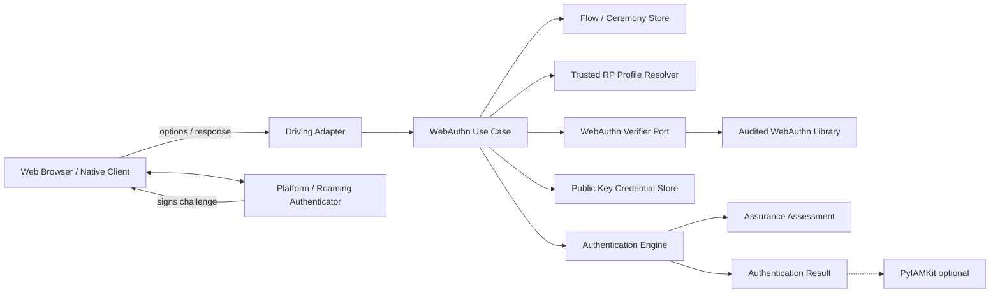
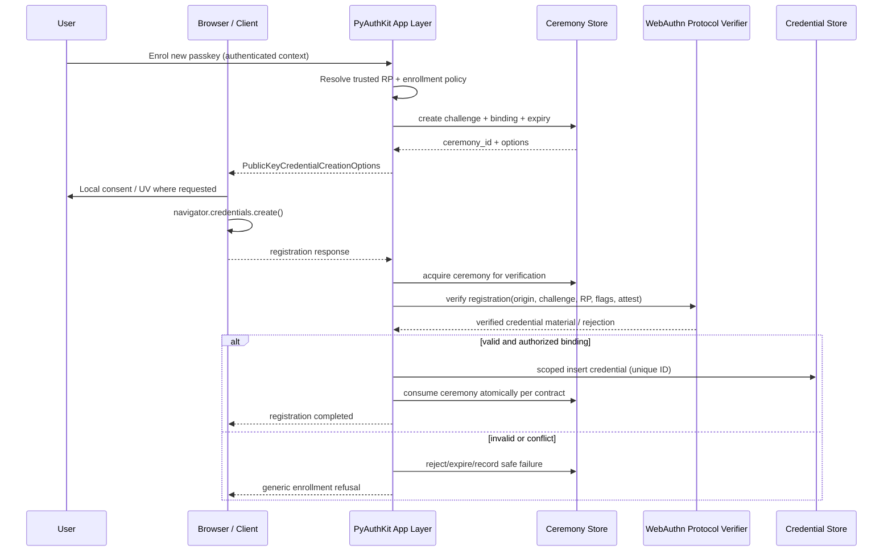
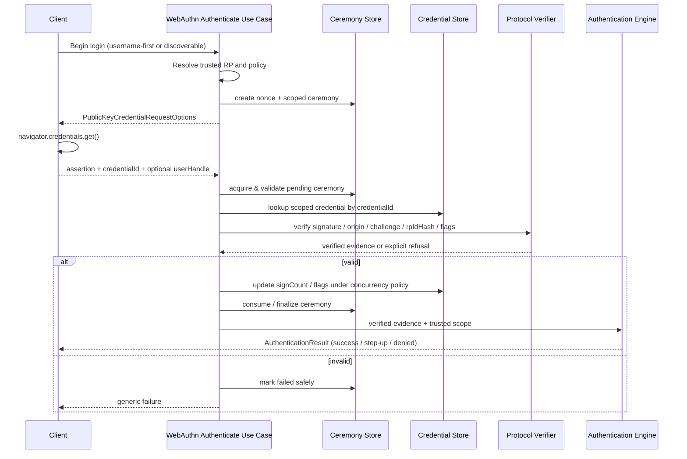
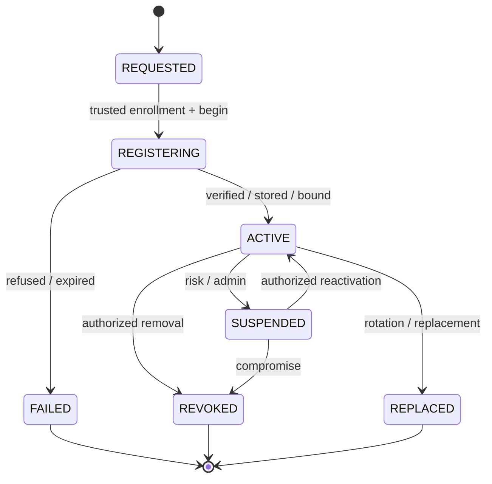
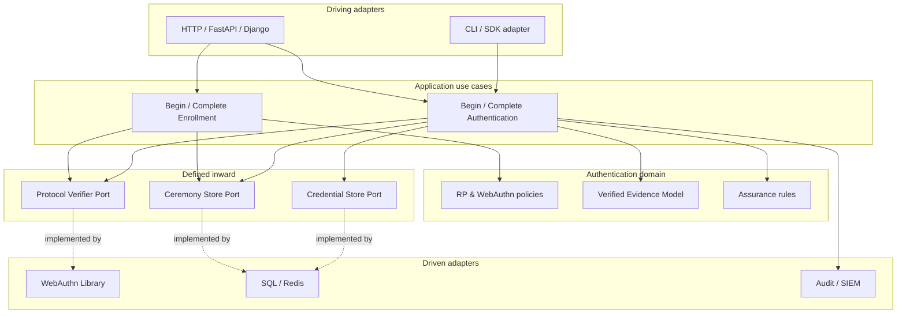

# 15_PYAUTHKIT_WEBAUTHN_PASSKEY_AND_PASSWORDLESS_MODEL

# PyAuthKit — WebAuthn, Passkeys and Passwordless Authentication Model

> **Produit :** PyAuthKit — Authentication Engine for the Modern Python Ecosystem  
> **Document :** `15_PYAUTHKIT_WEBAUTHN_PASSKEY_AND_PASSWORDLESS_MODEL.md`  
> **Type :** Domain & Security Design Specification / Software Design Learning  
> **Statut :** **PROPOSED / DESIGN** — aucune implémentation, certification FIDO ou conformité NIST attestée  
> **Version documentaire candidate :** `0.1.0`  
> **Date de référence :** 29 octobre 2026  
> **Langue :** français ; identifiants techniques et code en anglais  
> **Dépendances documentaires :** `00` à `14` et `PYAUTHKIT_SOFTWARE_DESIGN_LEARNING_CONVENTION.md`  
> **Trajectoire produit :** extension post-MVP, **non incluse** dans le MVP Password / API Key / JWT  
> **Suite documentaire :** `16_PYAUTHKIT_MACHINE_WORKLOAD_AND_AGENT_AUTH_MODEL.md`

---

## Guide de lecture

Ce texte **spécifie une cible de conception**, non une réalisation. Les catégories normatives sont distinguées :

- **Normatif externe** : règles du standard W3C ou des recommandations NIST, dans leur périmètre exact ; la source est indiquée.
- **Invariants PyAuthKit proposés** : engagements produits candidats qui doivent être arbitrés, puis testés.
- **Exemples pédagogiques** : esquisses Python, diagrammes et chiffres illustratifs qui ne fournissent aucune implémentation cryptographique sûre.
- **Décisions ouvertes** : options qui dépendent du niveau d'assurance recherché, de l'environnement, des authenticators et de l'ownership.

Notation : `RP` = Relying Party ; `UV` = User Verification ; `UP` = User Presence ; `BE` = Backup Eligibility ; `BS` = Backup State ; `CTAP` = Client to Authenticator Protocol ; `AAL` = Authenticator Assurance Level.

### Parcours conseillés

| Lecteur | Sections clés | Question |
|---|---|---|
| Domain designer | 0–12, 21–27 | Qui possède quels objets, et quelle preuve est réellement fiable ? |
| Security engineer | 13–20, 28–34, registres | Comment prévenir substitution, rejeu, downgrade et takeover ? |
| Python developer | 22–27, 35–39 | Quels contrats abstraits doivent être implémentés et testés ? |
| Reviewer / architecte | 40–55, annexes | Quelles décisions, preuves et limites restent à documenter ? |

---

## 0. Résumé exécutif

PyAuthKit doit pouvoir authentifier des **humains** par credentials cryptographiques WebAuthn, et favoriser le mode **passwordless** sans introduire un second modèle d'identité ni une dépendance à un navigateur spécifique dans le noyau. Une *passkey* est généralement un credential FIDO découvrable utilisable pour l'authentification ; elle peut être **synchronisée** entre appareils ou **liée à un appareil**, et le choix affecte notamment recovery et assurance.

Le moteur ne fabrique ni n'exporte les clés privées des utilisateurs. Le navigateur ou client plateforme pilote la cérémonie ; l'authenticator produit la clé privée et les signatures ; PyAuthKit, **en tant que serveur RP**, prépare des options, maintient une transaction, valide la réponse avec un vérificateur spécialisé et décide ensuite si cette preuve est admissible dans le contexte de confiance.

Le succès d'une signature ne constitue pas à lui seul une authentification finale : il faut aussi vérifier le challenge, l'origine, le RP ID, le credential attendu, les flags pertinents, la fraîcheur de transaction, son usage unique, le scope/tenant et la politique d'assurance. Un enregistrement de passkey n'est pas en soi une preuve de possession antérieure d'un compte : le *binding* à une identité existante doit être autorisé et vérifié.

### 0.1 North Star

> **Prove control of a registered public-key credential, bind the proof to a trusted RP context, and only then establish a verified subject — without confusing authentication, enrollment, identity linking and authorization.**

### 0.2 Principaux résultats attendus

1. Un modèle distinct pour `WebAuthnRegistration` et `WebAuthnAuthentication`.
2. Des contrats `PublicKeyCredentialRecord`, `WebAuthnCeremony`, `WebAuthnTrustPolicy` et `WebAuthnVerificationEvidence`.
3. Un vérificateur de protocole isolé derrière un port ; aucun parseur CBOR ou code crypto « maison » dans l'engine.
4. Des contrôles de sécurité explicites, testés positivement et négativement.
5. Un modèle de synchronisation, d'assurance, de récupération et de révocation compatible avec `10`, `11`, `12` et `13`.
6. Des diagrammes, règles, ADR candidats et supports de pratique délibérée en conception.

### 0.3 Ce document ne prétend pas

- que tous les browsers, OS, extensions WebAuthn ou authenticators prennent en charge exactement les mêmes possibilités ;
- que toute passkey constitue automatiquement un MFA ou un AAL2 ;
- qu'une passkey dite *device-bound* satisfait automatiquement AAL3 ;
- qu'un `signCount` faible ou nul prouve une compromission ;
- qu'un résultat WebAuthn autorise une ressource au sens RBAC/ABAC ;
- qu'une bibliothèque Python illustrative est prête pour la production.

## 1. Filiation documentaire et autorité des modèles

| Document | Autorité / responsabilité conservée |
|---|---|
| `04`–`06` | Catalogue, entités et relations conceptuelles ; ne pas forcer un objet = une table |
| `07` | Invariants globaux de confiance, multi-tenant, cycle de vie et fail-closed |
| `08` | Commands / Queries / Use Cases ; la cérémonie n'est pas un bus obligatoire |
| `09` | `AuthenticationEngine`, trust context, résolution des authenticators et décision finale |
| `10` | `Authenticator`, `CredentialRecord`, vérification et ownership du credential |
| `11` | `AuthenticationFlow`, `AuthenticationChallenge`, continuation, expiration et atomicité |
| `12` | `AssuranceAssessment`, `FactorVerification`, AAL, step-up et fraîcheur |
| `13` | Sessions et tokens **après** décision ; ne pas les émettre dans l'adapter WebAuthn |
| `14` | Fédération OIDC/SAML distincte du RP WebAuthn ; providers externes non implicitement équivalents |
| Convention d'apprentissage | Problem First, Trust First, Pattern Second ; patterns justifiés par les forces du domaine |

En cas de contradiction : ne pas réécrire silencieusement les contrats antérieurs ; ouvrir un ADR et préciser `CURRENT / TARGET / GAP`.

## 2. Références normatives vérifiées et statut en 2026

- **W3C Web Authentication Level 3**, **Recommendation du 25 août 2026** : https://www.w3.org/TR/webauthn-3/ . Source principale pour les cérémonies, les vérifications RP, les flags et les données structurées.
- **W3C Web Authentication Level 4**, *First Public Working Draft* du 15 septembre 2026 : https://www.w3.org/TR/webauthn-4/ . **Non** utilisé ici comme baseline normative de production.
- **FIDO Alliance — Passkeys**, vocabulaire `synced passkeys` et `device-bound passkeys` : https://fidoalliance.org/passkeys-2/ . Guidance d'usage, non substitution à WebAuthn.
- **NIST SP 800-63B-4**, édition finale 2025, AAL, cryptographic authenticators et Appendix B sur les syncable authenticators : https://pages.nist.gov/800-63-4/sp800-63b.html . Application seulement dans son périmètre.
- **NIST — Syncable Authenticators** : https://pages.nist.gov/800-63-4/sp800-63b/syncable/ . Interprétation des flags UV/BE/BS, limitations d'attestation et contexte entreprise.

La spécification W3C régit le protocole WebAuthn ; NIST traite des exigences d'assurance du système global. **Une validation WebAuthn conforme au protocole ne certifie pas automatiquement AAL2/AAL3.**

## 3. Problème métier et pressions de conception

Un compte peut devoir être accessible sans mot de passe, sur plusieurs appareils, sans exposer de secret partagé au serveur. Le produit doit néanmoins empêcher qu'un attaquant : (a) enregistre sa propre clé sur le compte d'un tiers ; (b) rejoue une assertion ; (c) substitue un `rpId` ou une origine ; (d) fasse valider un credential lié à un autre tenant ; (e) exploite un recovery plus faible que l'authentification ; (f) revendique un AAL sans preuves suffisantes.

Pressions observables : variation des clients, choix de politique d'attestation, appareils synchronisés, multi-tenant, assurance, lifecycle des credentials, annulations navigateur, opérations concurrentes et compatibilité backwards avec les méthodes du MVP.

La conception doit rester **provider-agnostic**, **framework-agnostic**, **storage-agnostic** et testable, sans introduire un « UniversalPasskeyManager » omnipotent.

## 4. Périmètre et non-objectifs

### 4.1 Inclus

- Cérémonies registration (`create`) et authentication (`get`) côté serveur RP.
- Génération d'options, challenges et corrélation de transaction.
- Validation des réponses, origine, RP ID, signature et flags.
- Enregistrement, découverte, statut, désactivation et retrait des credentials selon ownership.
- Modèle passkey synchronisée/device-bound, passkeys découvrables, login username-first et username-less.
- UV / UP, attestation conditionnelle, BE / BS, signCount et assurance avec provenance.
- WebAuthn comme premier facteur ou facteur de step-up dans un flow.
- Limites de recovery, audit, stockage de clé publique, multi-tenant et tests.

### 4.2 Exclus / non possédés

- Création, gestion ou sauvegarde des clés privées de l'authenticator.
- Implémentation de CTAP/USB/NFC/BLE, de l'OS ou du navigateur.
- Gestion complète de l'utilisateur, du rôle, des permissions ou du lifecycle IAM (`PyIAMKit`).
- Fonction de CA/PKI générale ou serveur FIDO2 indépendant, certification FIDO.
- Collecte ou stockage central de biométrie utilisateur.
- Autorisation d'opération métier ; issuance de session/token indépendante (`13`).
- Synchronisation des passkeys entre appareils : assurée par l'authenticator/provider concerné.

## 5. Ubiquitous Language — glossaire précis

| Terme | Sens dans PyAuthKit | À ne pas confondre avec |
|---|---|---|
| `RelyingParty` | Serveur/app vérifiant les preuves WebAuthn | Identity Provider OIDC |
| `RelyingPartyId` | Identifiant de domaine pour le scope d'un credential | URL exacte de `origin` |
| `AllowedOrigin` | Origine autorisée dans le trust context | Domaine déduit du navigateur |
| `WebAuthnCeremony` | Transaction serveur registration/authentication | Session applicative de long terme |
| `ChallengeNonce` | Valeur aléatoire à usage borné | Un code TOTP ou URL de recovery |
| `PublicKeyCredentialRecord` | Association RP/credential/public key/subject | Secret privé ou credential de session |
| `CredentialId` | Identifiant opaque d'une paire de clés RP | `PrincipalId` ou email |
| `UserHandle` | Identifiant utilisateur opaque associé au credential | Compte automatiquement résolu sans confiance |
| `AttestationEvidence` | Preuve facultative d'origine/propriétés d'authenticator | Preuve de possession finale de compte |
| `AssertionEvidence` | Réponse signée produite à l'authentification | `AuthenticationResult` final |
| `UserPresence` (`UP`) | Indicateur de présence/utilisation | Vérification locale d'identité (`UV`) |
| `UserVerification` (`UV`) | Vérification locale par l'authenticator | Biométrie communiquée au serveur |
| `BackupEligibility` (`BE`) | Credential apte à la sauvegarde/synchronisation | Indicateur qu'il a effectivement été sauvegardé |
| `BackupState` (`BS`) | État déclaré de sauvegarde au moment de l'assertion | Preuve exhaustive du fournisseur de synchronisation |
| `SignatureCounter` | Signal utile à la détection d'anomalies | Garantie universelle anti-clonage |
| `AuthenticatorAttachment` | Plateforme / roaming | Niveau de confiance suffisant pour AAL3 |
| `DiscoverableCredential` | Credential découvrable par l'authenticator | Clé garantie device-bound |
| `Passkey` | Credential FIDO utilisable pour login sans password | Nouveau protocole distinct de WebAuthn |
| `VerifiedWebAuthnSubject` | Subject établi après vérification sous trust context | Compte IAM, rôle ou permission |

## 6. Bounded Context et frontières d'autorité

| Zone | Possède | Ne décide pas |
|---|---|---|
| **PyAuthKit AuthN** | Transaction, preuve, trust profile, résultat authentifié | Groupes, permissions, organisations IAM |
| **WebAuthn Adapter** | Décodage et vérification protocolaire via bibliothèque auditée | Assurance finale, consentement d'enrollment, autorisation |
| **Credential Store** | État persistant des credentials si localement possédés | Création de clés privées de l'utilisateur |
| **AuthenticationFlow** | Reprise, challenge, deadlines et transitions | Inscription IAM sans permission |
| **Assurance Model** | Évaluation motivée de facteurs et capacités | Autorisation d'opération sensible |
| **PyIAMKit** | Référentiel d'identités, account linking, lifecycle, accès | Validité cryptographique de l'assertion |
| **Browser/OS/Authenticator** | API cliente, interaction humaine et opérations privées | Décision finale d'authentification serveur |

Séquence d'autorité : *trusted RP config* → *ceremony* → *client evidence* → *protocol validation* → *verified subject candidate* → *policy/assurance gate* → *authenticated principal* → *session/token optionally* → *PyIAMKit authorization separately*.

## 7. Cartographie C4 — RP WebAuthn



**Direction de dépendance** : Application/domain dépend de ports ; adapters peuvent connaître bibliothèques, client SDK, cache, SQL, Redis. Le domaine ne dépend pas d'un nom de navigateur ni de `navigator.credentials`.

## 8. Domain model — objets WebAuthn et classification DDD

| Objet candidat | Classification | Justification / frontière |
|---|---|---|
| `RelyingPartyProfile` | Configuration immuable versionnée | RP ID + origines + policy, sélectionnée depuis trusted scope |
| `WebAuthnCeremony` | Entity/aggregate candidat si durable | Suivi challenge, usage, principal/tenant, expiration et résultat |
| `ChallengeNonce` | Value Object sensible | Entropie, durée, usage, binding |
| `RegistrationOptions` | DTO / protocole | Données à envoyer au client ; pas autorité |
| `AuthenticationOptions` | DTO / protocole | Contient RP ID, challenge, filtres souhaités |
| `PublicKeyCredentialRecord` | Entity si lifecycle owned | Credential ID stable, public key, owner, flags, statut |
| `CredentialPublicKey` | Value Object validé | Format et algorithme autorisés ; jamais clé privée |
| `AuthenticatorDescriptor` | Descripteur non autoritatif | Métadonnées disponibles, provenance et confiance |
| `AttestationAssessment` | Result Object | Conditions et preuves d'attestation, sans promotion implicite |
| `WebAuthnVerificationEvidence` | Value Object de preuve validée, construction contrôlée | Résultat intermédiaire du port cryptographique |
| `VerifiedWebAuthnSubject` | Result Object contrôlé | Subject autorisé dans le contexte RP, puis soumis aux politiques |
| `WebAuthnPolicy` | Domain Policy | UV, algorithmes, credentials syncables, attestation, assurance |
| `WebAuthnProtocolVerifier` | Port | Validation cryptographique externalisée |
| `WebAuthnCredentialStore` | Port | Lecture/écriture scoped, transactions et unicité |
| `WebAuthnCeremonyStore` | Port | Consommation atomique et expiration |
| `WebAuthnAuthenticator` | Adapter/strategy | Bridge vers le registre des authenticators (`10`) |

*Ne pas créer ces quinze classes de force dans le MVP* : une première implémentation peut utiliser des types internes et contrats minimaux. Nommer précisément chaque objet uniquement lorsqu'il porte une responsabilité testable.

## 9. Relations conceptuelles et cardinalités

| Relation | Cardinalité candidate | Condition |
|---|---|---|
| `RelyingPartyProfile` → `WebAuthnCeremony` | 1 → 0..* | Un profile résolu est figé dans la transaction |
| `PrincipalRef` → `PublicKeyCredentialRecord` | 1 → 0..* | Seulement si l'owner est résolu et lié |
| `PublicKeyCredentialRecord` → `CredentialPublicKey` | 1 → 1 | Clé publique validée pour son algorithme |
| `WebAuthnCeremony` → `ChallengeNonce` | 1 → 1 | Nonce propre à la cérémonie |
| `AuthenticationFlow` → `WebAuthnCeremony` | 1 → 0..* | Reprise explicite, pas de transaction implicite |
| `WebAuthnCeremony` → `AssertionEvidence` | 1 → 0..* | Plusieurs réponses peuvent être présentées mais une seule acceptée |
| `PublicKeyCredentialRecord` → `AssertionEvidence` | 1 → 0..* | Historique facultatif et sensible ; éviter la rétention brute |
| `VerifiedWebAuthnSubject` → `AuthenticationResult` | 0..1 → 1 | Sans verdict final si policy refuse |

`tenant_id` et RP ID ne sont pas identités interchangeables : un RP ID peut être partagé par plusieurs tenants, mais la résolution doit préserver les frontières de confiance configurées. Ne jamais sélectionner automatiquement un tenant à partir d'une réponse non vérifiée.

## 10. Aggregate boundaries et cohérence transactionnelle

Trois frontières candidates : (1) `WebAuthnCeremony` protège l'usage unique du challenge ; (2) `PublicKeyCredentialRecord` protège statut, owner, algorithme, provenance et compteur ; (3) `AuthenticationFlow` protège le parcours multi-étapes. Il n'est pas nécessaire qu'elles partagent une transaction SQL unique si des invariants et compensations sont explicites ; un enrollment qui consomme la cérémonie mais échoue à enregistrer le credential doit produire un état de reprise **sans** autoriser un rebinding non vérifié.

**Ownership conditionnel.** Si un serveur IAM externe possède les credentials, PyAuthKit peut ne conserver aucun aggregate durable, mais doit toujours imposer des contrats de validation, une résolution scoped et une transaction anti-rejeu fiable.

## 11. Trust profile : `rpId`, `origin` et `tenant`

Le `RelyingPartyProfile` doit venir d'une configuration de confiance préalablement sélectionnée (route fiable, client enregistré, tenant authentifié), jamais d'une propriété auto-déclarée de `clientDataJSON`. Il définit : RP ID autorisé, ensemble d'origines autorisées **exactes**, capacités cross-origin acceptées, algorithmes COSE admis, politique UV/UP, attestation requise ou non, audience client, tenant scope, détection d'anomalie et version.

**RP ID ≠ origin** : `rpId` est lié à l'espace de noms de domaine pour la clé ; `origin` est l'origine web réelle (`scheme://host[:port]`). Ne pas faire de validation par sous-chaîne ou suffixe ambigu. Tout usage de `topOrigin`, `crossOrigin` ou *related origin requests* est **opt-in**, gouverné par policy et par les conditions du standard.

## 12. Typologie de credentials et cas UX

| Catégorie | Environnement fréquent | Propriété de sécurité à considérer |
|---|---|---|
| Synced passkey | Credential manager multi-device | Clé exportable vers sync fabric ; recovery facilité, contrôle du provider limité |
| Device-bound passkey | Clé de sécurité, secure element ou device contrôlé | Non-exportabilité à vérifier si exigée ; perte d'appareil possible |
| Discoverable credential | Username-less, account selector | `userHandle` et mapping scoped indispensables |
| Non-discoverable credential | Username-first, allowCredentials | L'application aide l'authenticator à sélectionner le credential |
| Platform authenticator | Téléphone ou ordinateur | Capacités varient ; UV n'est pas une preuve de provenance hardware |
| Roaming authenticator | USB/NFC/BLE, sécurité portable | Binding/provenance à vérifier si assurance élevée recherchée |

Une passkey synchronisée n'est pas automatiquement moins sûre qu'une solution password + SMS ; les politiques doivent apprécier le risque du contexte, les exigences d'assurance et la disponibilité du recovery.

## 13. Baseline des cérémonies et contrôles RP

La création et l'authentification utilisent deux types de réponse différents. `clientDataJSON.type` doit correspondre à `webauthn.create` ou `webauthn.get`. Le serveur reconstitue les entrées vérifiées à partir du challenge original, du profil RP, de la clé publique enregistrée et des données signées ou attestées.

**Registration** : générer options et challenge, vérifier l'intention d'enrollment, demander la création de credential, puis valider clientData/origin/challenge/rpIdHash/UP/UV/structure attested data, algorithmes, attestation si policy le requiert, credential ID et public key, avant de lier au bon owner de manière atomique.

**Authentication** : générer challenge, recevoir assertion, sélectionner le credential uniquement dans le scope attendu, vérifier clientData/origin/challenge/rpIdHash/flags et signature sur `authenticatorData || SHA256(clientDataJSON)` avec la **clé publique déjà enregistrée** ; évaluer le compteur comme signal ; consommer transaction ; décider selon la politique et produire une preuve intermédiaire.

La cryptographie et la sérialisation WebAuthn doivent être déléguées à une implémentation reconnue, suivie et testée. **Ne jamais prendre les pseudo-codes du présent document pour un vérificateur WebAuthn.**

## 14. Cérémonie d'enrollment — préconditions et validation

### 14.1 Préconditions d'inscription

1. Le demandeur est déjà authentifié selon une politique d'enrôlement adaptée, ou passe un parcours d'onboarding **explicitement** autorisé.
2. La résolution `PrincipalRef` / `AccountRef` dépend du système autoritatif, pas d'un `user.id` arbitraire transmis par le navigateur.
3. Le tenant et le `RelyingPartyProfile` sont fixés avant d'émettre le challenge.
4. Une demande sensible peut exiger un step-up récent et un acte utilisateur explicite.
5. Le credential ne peut être ajouté si compte désactivé, suspendu ou interdit par une policy.

### 14.2 Options `PublicKeyCredentialCreationOptions`

- `rp.id`, `rp.name` : domaine et nom RP configurés ; le navigateur et le serveur doivent vérifier leur cohérence.
- `user.id` : `UserHandle` opaque, stable dans la portée RP, sans adresse email ni PII directement exposée.
- `challenge` : bytes aléatoires générés côté serveur et associés à la cérémonie.
- `pubKeyCredParams` : algorithmes COSE admis par policy ; aucun choix dicté par une réponse du client.
- `authenticatorSelection` : politique `residentKey` / discoverability, `userVerification` et, éventuellement, attachment ; ne préjuge pas à lui seul du résultat.
- `excludeCredentials` : prévention UX des doubles enregistrements ; **ne remplace pas** une contrainte d'unicité serveur.
- `attestation` : `none` par défaut pour un cas grand public candidat ; `direct`/`enterprise` uniquement pour policy et consentement/contextes adaptés.
- `extensions` : options explicites ; extensions inconnues ou non comprises ne créent jamais de trust supplémentaire.

### 14.3 Vérification d'inscription — ordre conceptuel

1. Charger la cérémonie dans le tenant, client et RP attendus, confirmer `CREATED` et non expirée.
2. Normaliser/décoder les buffers via un parseur WebAuthn défensif ; refuser formes invalides.
3. Comparer le `challenge` présenté au challenge associé à la transaction ; vérifier `webauthn.create`, `origin`, `crossOrigin/topOrigin` selon policy.
4. Vérifier `rpIdHash = SHA256(rpId)` dans `authenticatorData` ; vérifier flags UP/UV requis.
5. Valider la structure attested credential data, credential ID, COSE public key et algorithme.
6. Évaluer attestation et metadata **seulement** si demandé ; une attestation absente ne signifie pas toujours invalidité.
7. Vérifier la non-collision de credential ID dans la portée pertinente et le bon binding `UserHandle`/subject.
8. Persister la clé publique et les métadonnées nécessaires sans secret privé, sous transaction scoped.
9. Consommer la cérémonie selon la règle d'atomicité adoptée, émettre un événement minimal sans preuve brute.

### 14.4 Postconditions

`PublicKeyCredentialRecord` existe en état actif, avec identifiants stables, liaison autorisée au subject, RP ID, algorithme, clé publique, credential ID, flags BE/BS cohérents, éventuels attributs AAGUID/attestation à provenance explicite, timestamps et revision. Le système ne crée **pas** de session de login automatiquement du seul fait de l'enrôlement.

## 15. Sequence — Registration / Create Credential



**Attention transactionnelle :** le diagramme est logique. Une implémentation distribuée doit définir explicitement l'ordre commit/consume, la stratégie idempotente, le cas *write succeeded / acknowledgment failed*, et les garanties d'unicité avant exposition en production.

## 16. Cérémonie d'authentification — username-first et username-less

### 16.1 Username-first

Le compte est revendiqué avant la cérémonie, sans être considéré comme vérifié. Le serveur recherche **dans le scope configuré** les credential IDs admissibles et les place éventuellement dans `allowCredentials`. Le résultat doit toujours revenir avec une preuve crypto validée et l'owner enregistré, pas avec l'email demandé.

### 16.2 Username-less / discoverable

`allowCredentials` peut être absent ou vide selon le parcours. Le navigateur/authenticator choisit un credential ; le serveur retrouve un enregistrement par credential ID **dans le profil RP autorisé**, puis compare `userHandle` s'il est présent à la liaison attendue. Le credential ID n'est **pas** une identité autoritative sans clé publique, scope et signature validés.

### 16.3 Conditional UI / autofill

`conditional mediation` améliore l'UX de découverte mais ne réduit aucun contrôle serveur. La découverte ne vaut pas consentement du compte IAM ; l'activation du credential et le résultat cryptographique restent nécessaires.

### 16.4 Postconditions

Le validateur produit une `WebAuthnVerificationEvidence` bornée à la cérémonie, au RP, au credential et au sujet, plus des flags et signaux évaluables. Le moteur peut encore refuser pour politique, compte inactif, risque, assurance requise, session trop ancienne ou incohérence de tenant.

## 17. Sequence — Authentication / Get Assertion



## 18. Contrôle du challenge, des expirations et du rejeu

Le challenge est créé **côté serveur** avec un CSPRNG. Une politique candidate peut exiger **au moins 32 octets aléatoires**, sans prétendre que cette valeur est un minimum universel imposé par le W3C. Une durée de vie de **quelques minutes** constitue un point de départ à tester, non un chiffre normatif du standard.

Le challenge ne doit pas être : choisi par le client, réutilisé pour plusieurs cérémonies indépendantes, journalisé en clair sans nécessité, ou accepté après consommation/expiration. L'instance est liée au RP, tenant, client, flow, usage (`registration` ou `authentication`) et, quand approprié, account/subject et opération à protéger.

**Concurrence** : deux réponses identiques reçues simultanément ne peuvent pas toutes deux établir de nouveaux succès indépendants. Une transaction `pending → consumed` atomique, un CAS ou une contrainte d'unicité équivalente est attendu ; les stratégies de traitement de retries « succès déjà enregistré » versus « réponse refusée » doivent être décidées avant implémentation.

## 19. Validation de signature et encodage

WebAuthn utilise des structures binaires (CBOR, COSE, base64url dans les enveloppes de transport). La signature d'assertion couvre les octets `authenticatorData` suivis de `SHA-256(clientDataJSON)` ; elle ne doit jamais être validée sur une ré-sérialisation JSON improvisée. Le choix de la clé publique se fait à partir du credential record de confiance, **pas** d'une clé prétendument fournie par la réponse.

- Vérifier type de credential et format de la réponse.
- Parser de manière bornée et défensive, avec limites de longueur/profondeur.
- Rejeter algorithmes inconnus ou non autorisés, clés malformées, signatures invalides.
- Vérifier `rpIdHash`, `challenge`, `origin`, flags et options de l'extension pertinentes.
- Ne pas confondre `attestationObject` d'enrôlement et `authenticatorData` d'assertion.
- Propager un code d'erreur sûr, sans données sensibles brutes.

Une bibliothèque spécialisée constitue **un adapter**, non une dépendance du Domain Layer.

## 20. UP, UV, BE, BS, `signCount` : interprétation non naïve

| Champ | Signification | Erreur à éviter |
|---|---|---|
| `UP` | L'utilisateur était présent pour la cérémonie | Le traiter comme preuve suffisante de MFA |
| `UV` | Une vérification utilisateur locale a eu lieu | Supposer quelle biométrie/PIN a été employée |
| `BE` | Credential éligible au backup ; invariant par credential | Le faire changer entre réponses sans anomalie |
| `BS` | Credential sauvegardé à l'instant déclaré | Le traiter comme clé définitivement clonée/compromise |
| `signCount` | Signal de progression quand utilisé | Rejeter aveuglément toute valeur zéro ou non monotone |
| `AAGUID` | Identifiant de classe d'authenticator sous contexte | Déduire à lui seul un niveau AAL ou matériel certifié |
| `UV method` extension | Signal supplémentaire si supporté et évalué | Considérer une extension absente comme preuve implicite |

### 20.1 État `BE/BS`

Combinaisons de la spécification : `BE=0,BS=0` single-device ; `BE=1,BS=0` multi-device pas actuellement sauvegardé ; `BE=1,BS=1` multi-device sauvegardé ; `BE=0,BS=1` **invalide**. `BE` est stable ; `BS` peut évoluer au cours du temps. Les flags restent des signaux de protocole à intégrer au modèle de menace, non la preuve indépendante du fournisseur de synchronisation.

### 20.2 SignCount

Certains authenticators renvoient toujours `0`, et les credentials synchronisés peuvent être utilisés sur plusieurs appareils. Selon WebAuthn L3, un compteur non croissant est **un signal, pas une preuve** de clonage ; l'action (refus, alerting, step-up) dépend des politiques et de la concurrence observée. La mise à jour persistée du compteur ne doit pas réintroduire une race causant des faux positifs.

## 21. Attestation et contrôle de provenance

Le traitement d'attestation est une **décision de trust** distincte de la validation minimale d'une registration. Politique candidate : `none` par défaut pour une application grand public ; vérification explicite des attestation formats, chaînes de certificats/metadata et restrictions de privacy uniquement si besoin défini (par exemple flotte d'entreprise ou AAL exigeant des propriétés attestées).

Ne pas présumer qu'une attestation existe, qu'elle constitue une identité civile, ni qu'elle prouve la non-exportabilité d'une clé sans politique, chaîne de confiance et éléments techniques suffisants. Refuser un credential sans attestation seulement si un profil clairement configuré le requiert, avec parcours UX et recours adaptés.

L'attestation est un endroit où la simple `Strategy` ne résout pas tout : il faut aussi une source de confiance pour les racines, métadonnées, révocations et dates d'effet.

## 22. Assurance AAL, phishing resistance et step-up

- WebAuthn peut fournir **résistance au phishing par liaison au nom du vérificateur** quand le protocole et les validations RP sont correctement appliqués.
- Le couple cryptographic credential + `UV=1` peut satisfaire une exigence de *multi-factor cryptographic authenticator* dans le cadre NIST pertinent **si toutes les autres exigences sont respectées**.
- `UV=0` n'autorise pas l'affirmation automatique de MFA ; la politique peut exiger un facteur supplémentaire ou refuser.
- Les **synced passkeys** peuvent soutenir AAL2 sous conditions ; elles **ne satisfont pas AAL3** dans NIST SP 800-63B-4 à cause de l'exportabilité requise pour la synchronisation.
- Les credentials **device-bound** ne suffisent pas automatiquement à AAL3 : non-exportabilité effective, authenticator conforme, authentification intent, techniques cryptographiques et autres conditions doivent être démontrées.
- `AuthenticationResult.assurance` doit contenir le niveau **effectivement évalué**, les raisons, le profil de politique versionné et la fraîcheur de preuve, pas seulement `webauthn=True`.

Un step-up WebAuthn pour signer une opération sensible nécessite un binding adéquat à la session, à la transaction et à l'objet de l'opération. Le W3C challenge seul, s'il est seulement lié au login RP, n'établit **pas** une signature transactionnelle métier universelle.

## 23. Enrollment lifecycle et recovery



Ces états sont **candidats**. On peut également garder un `status` réduit (`ACTIVE`, `REVOKED`) et une table de transitions/audit séparée si cela protège mieux les invariants sans multiplier les classes State.

### 23.1 Perte et remplacement

Le mode passwordless exige un recovery robuste, indépendant d'une seule clé disparue : second authenticator, recovery code sécurisé, workflow de support contrôlé ou autre mécanisme jugé acceptable par le produit. Le **mécanisme de récupération ne doit pas permettre d'ajouter silencieusement une clé à un compte tiers**. L'API doit montrer l'historique des credentials et offrir leur retrait authentifié.

### 23.2 Suppression et revocation

La suppression dans le compte RP invalide le credential côté serveur immédiatement selon le contrat de cohérence du store. Le serveur ne peut pas garantir l'effacement de la copie chez tous les passkey providers : distinguer **revocation RP** de **deletion on device/sync fabric**.

## 24. Passwordless UX et privacy

- Offrir un chemin *passwordless first* sans transformer un échec du navigateur en downgrade invisible.
- Conserver `userHandle` opaque, sans email/téléphone ou PII directement encodée.
- Présenter au titulaire ses credentials enregistrés, dates approximatives d'usage et état de révocation, dans les limites d'audit et privacy.
- Éviter le stockage de `clientDataJSON`, attestation brute ou assertion brute sur longue période par défaut ; préférer codes d'événements, corrélation et résumés.
- Prévoir accessibilité et contraintes d'équipement, cas d'absence de support WebAuthn, migration progressive et changement de passkey provider.
- Un QR code de *cross-device authentication* n'est pas un moyen alternatif de sauter la vérification cryptographique : la cérémonie serveur reste identique.

## 25. Multi-tenant, domaines et RP IDs

Un deployment multi-tenant peut utiliser : (a) un RP ID commun et des tenants séparés en domaine applicatif ; (b) des sous-domaines par tenant avec politique RP adaptée ; (c) des RP IDs isolés. Chaque variante a des implications UX, origin, discoverability, migration et boundary.

Les credentials sont scopés par `rp_id` **et** par résolution autorisée d'owner/tenant ; un credential d'un tenant ne doit pas être accepté dans un autre simplement parce qu'ils partagent un suffixe DNS ou le même backend. Les politiques de migration de domaine doivent être traitées explicitement ; renommer un domaine ne re-scoppe pas magiquement les clés enregistrées.

## 26. Ports & Adapters — contrats candidats

| Port | Rôle essentiel | Contrat de sécurité |
|---|---|---|
| `WebAuthnCeremonyStore` | begin/load/consume, CAS | Opération single-use, TTL, scoped lookup |
| `WebAuthnCredentialStore` | get/add/update/revoke | Unicité credential ID, owner/scope, concurrence |
| `WebAuthnProtocolVerifier` | registration/assertion checks | Signatures, origin, RP, challenge, flags et schémas vérifiés |
| `RelyingPartyProfileResolver` | config de confiance | Ne jamais résoudre depuis claims non vérifiés |
| `WebAuthnAssuranceEvaluator` | niveau et provenance | NIST profile versionné, pas d'AAL inféré d'un booléen |
| `TimeSource` | temps | Horloge injectable pour tests de durée |
| `EventSink` | audit filtré | Aucune clé privée / preuve brute secrète en événements |

La couche `Application` orchestre les ports et présente des DTO ; le `Domain` protège des invariants et policies ; les adapters parlent navigateur, WebAuthn library, PostgreSQL/Redis et notifications. Les stores ne possèdent pas le modèle d'autorisation IAM.

## 27. Diagramme de dépendances — Hexagonal



Le diagramme représente la *direction logique* des dépendances ; il ne signifie pas que Domain doit importer ses adapters ni qu'un event sink est intrinsèquement le mécanisme GoF Observer.

## 28. Gestion des erreurs — typologie sans fuites

| Condition | Erreur interne candidate | Sortie publique conseillée |
|---|---|---|
| Challenge expiré/consommé | `CEREMONY_NOT_ACTIVE` | Connexion impossible ; recommencer |
| RP/origin inattendus | `TRUST_CONTEXT_MISMATCH` | Réponse non valide |
| Credential inconnu ou absent du scope | `CREDENTIAL_NOT_FOUND_IN_SCOPE` | Connexion impossible |
| Signature, algorithme, CBOR invalides | `PROOF_INVALID` | Réponse non valide |
| UV obligatoire non satisfait | `USER_VERIFICATION_REQUIRED` | Vérification supplémentaire nécessaire ou refus |
| Credential révoqué | `CREDENTIAL_REVOKED` | Connexion impossible |
| Profil d'assurance non satisfait | `ASSURANCE_INSUFFICIENT` | Step-up / méthode forte selon policy |
| Conflit de consommation | `CEREMONY_CONCURRENCY_CONFLICT` | Recommencer, ne pas dupliquer |
| Dépendance critique indisponible | `VERIFICATION_UNAVAILABLE` | Refus temporaire fail-closed |

Les logs internes peuvent enregistrer codes, profils, durées, `correlation_id` et identifiants pseudonymisés ; aucun secret ou signature brute ne doit être systématiquement loggé.

## 29. Observabilité et audit

Événements proposés au passé : `WebAuthnEnrollmentStarted`, `WebAuthnEnrollmentSucceeded`, `WebAuthnEnrollmentRejected`, `WebAuthnAuthenticationStarted`, `WebAuthnAuthenticationSucceeded`, `WebAuthnAuthenticationRejected`, `WebAuthnCredentialRevoked`, `WebAuthnCredentialBackupStateChanged`, `WebAuthnAssuranceInsufficient`.

Champs minimaux : timestamp, correlation ID, event ID, scope pseudonymisé, policy version, reason code, result status, latency bucket ; éventuel `credential_id` haché/pseudonymisé selon privacy. Les décisions de sécurité peuvent intégrer `BE/BS` et risque de compteur sans divulguer la clé publique ou les réponses brutes.

## 30. Performance, disponibilité et modes de panne

Les coûts majeurs sont vérification cryptographique, parsing/décodage, écritures de cérémonie, accès au credential, attestation/metadata et observabilité. La validation normale ne devrait pas dépendre d'un appel live au fournisseur de passkeys. La résolution de trust et de clés doit utiliser des versions cohérentes.

**Dégradations permises** : erreur d'enrollment explicite, récupération d'une configuration déjà validée et sûre dans sa période de validité si policy le permet, retry contrôlé. **Dégradations interdites** : passer à `UV=optional` silencieusement, ignorer l'origin, autoriser credential inconnu, accepter un challenge expiré ou attribuer AAL3 à défaut de signal.

## 31. Threat Model — panorama

Surfaces : navigateur (XSS, faux domaine, frame), API (CSRF sur enrollment, rate limiting, replay), protocol (CBOR malformé, signatures, origin), storage (credential linking, cache, statuts), IAM (account takeover, recovery), device (sync fabric, perte), assurance (mauvais niveau), opération (session/step-up). Les contre-mesures doivent être testées **à la frontière réellement autoritative** et non seulement simulées côté UI.

## 32. Privacy and compliance boundaries

Le RGPD et les obligations locales imposent des décisions spécifiques sur rétention, transparence, droits et bases juridiques ; ce document n'atteste aucune conformité juridique. Le système **n'a pas besoin de recevoir ni de stocker les échantillons biométriques** pour utiliser l'activation locale de passkeys. `AAGUID`, device metadata et attestation peuvent être sensibles pour la vie privée et ne doivent être collectés que si leur usage est justifié.

## 33. Client integration (browser / mobile)

Le navigateur fait des appels `navigator.credentials.create()` et `.get()` selon des options produites côté serveur. La conversion JSON/base64url des buffers doit être sûre et strictement compatible avec la représentation attendue. Le client ne décide ni de la validité cryptographique finale ni du tenant/identity binding.

Pour applications natives, utiliser les API de plateforme et règles de domaines associés, mais conserver les mêmes contrôles RP côté serveur ; ne pas inventer un protocole maison pour « remplacer » WebAuthn.

## 34. Migration progressive depuis Password/MFA

Une activation passwordless est une **migration de modèle d'authentification**, pas une suppression immédiate du mot de passe : enrollment avec preuve et step-up, ajout d'une seconde méthode de secours, observation des usages, option contrôlée de désactivation password si recovery viable, politique de révocation après incident. Les anciens credentials doivent rester suivis et révocables pendant la coexistence.

**Risque critique** : laisser « mot de passe oublié » servir de porte dérobée pour enregistrer une nouvelle passkey avec une assurance bien plus faible que celle exigée pour l'opération ; ce parcours doit être explicitement conçu et testé.

## 35. API candidate et contrats d'application

| Command / Query | Input conceptuel | Output / effet |
|---|---|---|
| `BeginWebAuthnEnrollment` | trusted scope, actor, owner, policy | `RegistrationOptions` + opaque ceremony handle |
| `CompleteWebAuthnEnrollment` | ceremony handle, registration response | status + credential reference, audit |
| `BeginWebAuthnAuthentication` | trusted scope, optional claimed identity | `AuthenticationOptions` + handle |
| `CompleteWebAuthnAuthentication` | handle, assertion response | verified evidence / challenge / refusal |
| `RevokeWebAuthnCredential` | actor, owner, credential ref, reason | credential deactivated + audit |
| `ListWebAuthnCredentials` | authorized owner, page | public metadata only |
| `GetWebAuthnAuthenticatorCapabilities` | trusted profile / registered metadata | supported & policy-filtered options |
| `EvaluateWebAuthnAssurance` | verified proof + profile version | assessment with explicit reasons |

Le nom d'une commande **ne constitue pas** automatiquement une implémentation du GoF Command Pattern. La séparation CQRS est sélective ; aucun `CommandBus` central n'est imposé.

## 36. Python — types immuables et frontière de confiance (illustratif)

Cet extrait montre une séparation de concepts ; il **ne** parse ni ne valide une réponse WebAuthn.

```python
from __future__ import annotations
from dataclasses import dataclass
from datetime import datetime, timezone
from enum import Enum
from typing import Literal


class CeremonyPurpose(str, Enum):
    REGISTER = "registration"
    AUTHENTICATE = "authentication"


class CeremonyStatus(str, Enum):
    PENDING = "pending"
    CONSUMED = "consumed"
    EXPIRED = "expired"
    FAILED = "failed"


@dataclass(frozen=True, slots=True)
class TrustedRpScope:
    tenant_id: str
    rp_id: str
    allowed_origins: frozenset[str]
    policy_version: str

    def __post_init__(self) -> None:
        if not self.tenant_id or not self.rp_id or not self.allowed_origins:
            raise ValueError("Trusted RP scope is incomplete")


@dataclass(frozen=True, slots=True)
class CeremonyRef:
    ceremony_id: str
    purpose: CeremonyPurpose
    rp_id: str
    tenant_id: str
    expires_at: datetime


@dataclass(frozen=True, slots=True)
class CredentialRef:
    credential_id: bytes
    principal_ref: str
    rp_id: str
    tenant_id: str


@dataclass(frozen=True, slots=True)
class BackupSignals:
    eligible: bool
    backed_up: bool

    def __post_init__(self) -> None:
        if self.backed_up and not self.eligible:
            raise ValueError("BS=1 requires BE=1")


@dataclass(frozen=True, slots=True)
class VerifiedWebAuthnEvidence:
    # Produced only by a trusted protocol verification boundary.
    credential: CredentialRef
    ceremony_id: str
    user_present: bool
    user_verified: bool
    backup: BackupSignals
    verified_at: datetime
    verifier_name: Literal["webauthn-port"] = "webauthn-port"
```

**Limite de preuve :** un appelant Python malveillant peut construire la dataclass `VerifiedWebAuthnEvidence` directement. Le type sert à la modélisation ; la **provenance réelle** doit être protégée par l'architecture (service interne de vérification, séparation d'API, contrôles à l'exécution, tests et trust boundaries). Ne pas considérer le constructeur comme une validation cryptographique.

## 37. Python — ports de cérémonie et de vérification

```python
from __future__ import annotations
from dataclasses import dataclass
from typing import Protocol


@dataclass(frozen=True)
class CeremonyLease:
    ceremony_id: str
    revision: int
    purpose: str
    challenge: bytes
    expires_at_epoch: int
    tenant_id: str
    rp_id: str


@dataclass(frozen=True)
class VerifiedAssertion:
    credential_id: bytes
    user_handle: bytes | None
    user_present: bool
    user_verified: bool
    backup_eligible: bool
    backup_state: bool
    sign_count: int


class WebAuthnCeremonyStore(Protocol):
    async def load_pending(
        self, ceremony_id: str, *, tenant_id: str, rp_id: str
    ) -> CeremonyLease | None: ...

    async def consume_once(
        self, ceremony_id: str, *, expected_revision: int
    ) -> bool: ...


class WebAuthnProtocolVerifier(Protocol):
    async def verify_authentication(
        self,
        *,
        raw_response: bytes,
        expected_challenge: bytes,
        expected_origin: str,
        expected_rp_id: str,
        stored_public_key: bytes,
        require_user_verification: bool,
    ) -> VerifiedAssertion: ...
```

**Rationale :** ports petits et explicitement orientés métier (`ISP`, `DIP`). Un `bool` de `consume_once()` doit être relié à une transaction atomique réelle dans l'adapter ; l'existence de la méthode Python ne constitue pas une garantie de single-use.

## 38. Python — politique pure d'admissibilité (sans cryptographie)

```python
from dataclasses import dataclass
from enum import Enum


class AdmissionReason(str, Enum):
    ACCEPTABLE = "acceptable"
    MISSING_UP = "missing_up"
    MISSING_UV = "missing_uv"
    BACKUP_NOT_ALLOWED = "backup_not_allowed"
    INCONSISTENT_BACKUP = "inconsistent_backup"


@dataclass(frozen=True)
class WebAuthnPolicySnapshot:
    require_user_presence: bool = True
    require_user_verification: bool = True
    allow_backup_eligible: bool = True


@dataclass(frozen=True)
class WebAuthnFlags:
    up: bool
    uv: bool
    be: bool
    bs: bool


def assess_flags(
    policy: WebAuthnPolicySnapshot, flags: WebAuthnFlags
) -> AdmissionReason:
    if flags.bs and not flags.be:
        return AdmissionReason.INCONSISTENT_BACKUP
    if policy.require_user_presence and not flags.up:
        return AdmissionReason.MISSING_UP
    if policy.require_user_verification and not flags.uv:
        return AdmissionReason.MISSING_UV
    if not policy.allow_backup_eligible and flags.be:
        return AdmissionReason.BACKUP_NOT_ALLOWED
    return AdmissionReason.ACCEPTABLE
```

**Ce que cela n'est pas :** ni `WebAuthnProtocolVerifier`, ni un contrôleur AAL, ni une autorisation. Les flags sont supposés déjà vérifiés et extraits d'une réponse cryptographiquement validée. Ils peuvent être des **entrées** dans l'assessment d'assurance, pas des preuves suffisantes pour affirmer AAL3.

## 39. Python — tests pédagogiques d'invariants et de policy

```python
import unittest


class TestWebAuthnConcepts(unittest.TestCase):
    def test_backup_state_cannot_be_true_without_eligibility(self):
        with self.assertRaises(ValueError):
            BackupSignals(eligible=False, backed_up=True)

    def test_policy_requires_uv(self):
        policy = WebAuthnPolicySnapshot(require_user_verification=True)
        flags = WebAuthnFlags(up=True, uv=False, be=True, bs=True)
        self.assertEqual(assess_flags(policy, flags), AdmissionReason.MISSING_UV)

    def test_syncable_can_be_allowed_under_explicit_policy(self):
        policy = WebAuthnPolicySnapshot(allow_backup_eligible=True)
        flags = WebAuthnFlags(up=True, uv=True, be=True, bs=True)
        self.assertEqual(assess_flags(policy, flags), AdmissionReason.ACCEPTABLE)

    def test_syncable_rejected_when_policy_disallows_it(self):
        policy = WebAuthnPolicySnapshot(allow_backup_eligible=False)
        flags = WebAuthnFlags(up=True, uv=True, be=True, bs=False)
        self.assertEqual(
            assess_flags(policy, flags), AdmissionReason.BACKUP_NOT_ALLOWED
        )
```

Ces tests ne prouvent rien sur la conformité d'une bibliothèque WebAuthn ou la résistance à une attaque réelle. Ils illustrent un **Value Object invariant** et une **Domain Policy** testable hors infrastructure.

## 40. Design decisions : problème → concept → pattern → preuve

| Problème observable | Principe | Pattern candidat si nécessaire | Type Python | Preuve exigée |
|---|---|---|---|---|
| Plusieurs vérificateurs/protocol libraries | DIP, OCP | Adapter | `Protocol` + adapter | Contract tests croisés |
| Politiques UV/attestation variables par RP | OCP, SoC | Strategy/Policy Object | fonction pure / `Protocol` | Tests de profils et refus |
| Challenge consommé une fois | fail-closed, consistency | Aggregate + CAS, si durable | entity + port transactionnel | Double submit concurrent |
| Credential local révocable | encapsulation | Repository si ownership | entity + port scoped | Revocation immediacy contract |
| Synchronisation et assurance | explicit evidence | Result Object | dataclass immuable | AAL2/AAL3 negative cases |
| Événements pour audit | loose coupling | Event-driven (transport plus tard) | immutable event | Pas de preuve sensible/log |
| Enrollment + account linking | authority separation | ACL / anti-corruption layer | service + IAM port | Account takeover tests |
| Cérémonie multi-step | state invariants | State Machine (pas nécessairement GoF State) | enum + guards | Transition table tests |

### 40.1 Patterns volontairement non imposés

- **GoF State** : une `Enum` + transitions gardées suffit tant que la logique reste simple.
- **Builder** : pas nécessaire pour construire quelques options WebAuthn typées.
- **CQRS complet** : pas requis pour séparer `BeginEnrollment` de `ListCredentials`.
- **Event Sourcing** : aucun besoin démontré de rejouer l'intégralité des preuves crypto.
- **Universal Factory** : le choix concret d'adapters peut rester une composition explicite.
- **Microservices** : pas nécessaire à la preuve d'authentification.

## 41. Architecture Fitness Functions (candidates)

| ID | Règle exécutable à protéger |
|---|---|
| `WPA-AFF-01` | `domain` n'importe ni FastAPI, Django, Redis, SQLAlchemy, ni module browser |
| `WPA-AFF-02` | aucune clé privée n'est représentée dans le schéma de credential RP |
| `WPA-AFF-03` | `WebAuthnProtocolVerifier` n'instancie pas de `AuthenticatedPrincipal` |
| `WPA-AFF-04` | `CredentialStore` exige un scope de tenant/RP sur les opérations sensibles |
| `WPA-AFF-05` | `CeremonyStore.consume_once` possède une preuve de transaction/cas concurrent |
| `WPA-AFF-06` | aucun fallback de `UV=true` vers `UV=false` sans policy explicite |
| `WPA-AFF-07` | aucun `AAL3` attribué sur la seule base de `UV` ou `BE=0` |
| `WPA-AFF-08` | les origines sont comparées à des profils de confiance, pas extraites d'assertion non vérifiée |
| `WPA-AFF-09` | les events/logs n'incluent pas raw assertion ni challenge en clair par défaut |
| `WPA-AFF-10` | seul le use case d'enrollment autorisé peut lier un credential à un principal |
| `WPA-AFF-11` | la sélection d'un credential ne repose pas sur un email non vérifié |
| `WPA-AFF-12` | la registration ne peut pas émettre automatiquement un token d'accès |
| `WPA-AFF-13` | les caches ne rendent pas un credential révoqué réutilisable au-delà du contrat explicite |
| `WPA-AFF-14` | `AuthenticationFlow` conserve son purpose et le contrôle `challenge` unique |
| `WPA-AFF-15` | les adapters doivent passer les mêmes tests de port et d'échec |
| `WPA-AFF-16` | les erreurs publiques ne permettent pas d'énumérer les comptes/credentials |
| `WPA-AFF-17` | version de `RelyingPartyProfile` persistée ou liée au résultat sensible |
| `WPA-AFF-18` | les exemples Python annoncés « exécutables » sont réellement exécutés en CI |

## 42. Scénarios de référence E2E

### 42.1 Enregistrement réussi sur compte existant

Utilisateur authentifié et autorisé à modifier ses credentials → RP profile résolu → challenge → `create()` → signature/attestation et bindings vérifiés → insertion unique → événement filtré → credential actif visible dans la gestion de compte.

### 42.2 Authentification passwordless discoverable

Pas d'email initial → challenge RP → choix passkey local → assertion → lookup `credentialId` scoped → vérification crypto et `userHandle` → `VerifiedWebAuthnSubject` → assessment d'assurance → résultat final → session/token éventuels via `13`.

### 42.3 Step-up pour opération sensible

Session valide à assurance insuffisante → policy demande WebAuthn et reauth récente → challenge bound à opération et session → vérification → mise à jour d'assurance selon `12` → autorisation **indépendante** dans PyIAMKit.

### 42.4 Perte du seul device-bound credential

Connexion impossible → recovery alternatif plus contrôlé → confirmation d'ownership → révocation ancienne clé → enregistrement d'une nouvelle, avec audit. Aucun bypass par création de compte fantôme ou conversion silencieuse de subject.

### 42.5 Synced passkey chez consommateur

Enrôlement `BE=1` puis login `UV=1` sur autre appareil → BS potentiellement changé → aucun rejet systématique pour `signCount=0` → assurance calculée par politique. **AAL3 non déclaré** pour cette preuve synchronisée.

### 42.6 Cross-tenant replay

Une assertion cryptographiquement correcte mais présentée au mauvais tenant/RP/flow est **refusée** ; vérification de signature isolée ne suffit pas.

### 42.7 Invalid challenge concurrent

Deux requêtes simultanées pour la même cérémonie → une consommation réussie au plus → refus/retry gouverné par policy, sans deux sessions ni deux credentials enregistrés.

### 42.8 Incident et révocation

Credential marqué compromis et révoqué → vérification de statut et caches → nouvelles assertions refusées → sessions existantes invalidées si la politique incident le demande ; ne pas présumer que la révocation du credential annule par magie tous les tokens stateless émis.

## 43. Registre des exigences spécialisées — `WPA-REQ-*`

Chaque entrée suivante est une **exigence PyAuthKit candidate** et non une citation textuelle d'une norme. La norme associée est précisée lorsqu'elle fournit le fondement du comportement. L'acceptation globale exige un test positif, négatif et d'isolation quand pertinent.

| ID | Catégorie | Exigence | Critère d'acceptation vérifiable |
|---|---|---|---|

| `WPA-REQ-001` | Trust | **Trusted RP scope** | RP profile is resolved from authenticated application configuration before any client data is considered. |

| `WPA-REQ-002` | Trust | **RP ID validation** | Registration and authentication verify rpIdHash against the pinned RP ID. |

| `WPA-REQ-003` | Trust | **Exact origin allowlist** | Unexpected origin is rejected, including lookalike hostnames and scheme changes. |

| `WPA-REQ-004` | Trust | **Cross-origin explicit policy** | crossOrigin/topOrigin and embedded contexts are accepted only under documented profile rules. |

| `WPA-REQ-005` | Trust | **Tenant isolation** | Every sensitive lookup and resulting subject are bound to the trusted tenant scope. |

| `WPA-REQ-006` | Trust | **Profile versioning** | The security profile version used for a ceremony is recorded or reproducibly bound. |

| `WPA-REQ-007` | Trust | **No client-selected verifier** | Client-supplied issuer, rpId, algorithm or credential metadata cannot bypass trusted selection. |

| `WPA-REQ-008` | Trust | **Credential scope resolution** | Credential ID is found only among records belonging to the configured RP/tenant policy. |

| `WPA-REQ-009` | Ceremony | **Server nonce generation** | A CSPRNG-generated unique challenge is associated with each ceremony. |

| `WPA-REQ-010` | Ceremony | **Purpose binding** | Registration response cannot complete an authentication transaction or vice versa. |

| `WPA-REQ-011` | Ceremony | **Finite TTL** | Expired ceremony is rejected regardless of valid cryptographic signature. |

| `WPA-REQ-012` | Ceremony | **Single-use completion** | A consumed ceremony cannot produce a second successful completion. |

| `WPA-REQ-013` | Ceremony | **Concurrent consume** | Two concurrent completions cannot both commit distinct success effects. |

| `WPA-REQ-014` | Ceremony | **Continuation binding** | Continuation handle is tied to flow, RP, client, subject as applicable, and purpose. |

| `WPA-REQ-015` | Ceremony | **Failure state semantics** | A failed verification does not silently reset challenge validity or policy. |

| `WPA-REQ-016` | Ceremony | **Transport encoding** | Buffers and JSON decoding reject malformed, overlong and ambiguous forms. |

| `WPA-REQ-017` | Registration | **Authorized enrollment** | Only an authorized account or onboarding state may attach a credential. |

| `WPA-REQ-018` | Registration | **Opaque user handle** | A stable non-PII userHandle is assigned in the RP context. |

| `WPA-REQ-019` | Registration | **Server uniqueness** | Duplicate credential IDs cannot be registered across forbidden scopes or owners. |

| `WPA-REQ-020` | Registration | **Algorithm allowlist** | Only supported COSE public-key algorithms and valid key types can be stored. |

| `WPA-REQ-021` | Registration | **Credential data validation** | Credential public key, ID and registration structure are fully parsed and verified. |

| `WPA-REQ-022` | Registration | **Attestation policy** | Attestation is evaluated only according to a pinned policy and trust anchors. |

| `WPA-REQ-023` | Registration | **No private key stored** | Persistent RP records contain public keys and metadata only. |

| `WPA-REQ-024` | Registration | **Enrollment no implicit login** | Registering a passkey does not implicitly issue a session or access token. |

| `WPA-REQ-025` | Registration | **Credential binding audit** | Owner, actor, method, policy and reason are auditable without storing raw secrets. |

| `WPA-REQ-026` | Authentication | **ClientData type validation** | webauthn.get is required for assertions and webauthn.create for registration. |

| `WPA-REQ-027` | Authentication | **Signature validation** | Assertion signature validates with the registered public key over the exact signed bytes. |

| `WPA-REQ-028` | Authentication | **User presence check** | UP is checked as demanded by WebAuthn and profile policy. |

| `WPA-REQ-029` | Authentication | **User verification check** | UV is checked against the effective assurance requirements. |

| `WPA-REQ-030` | Authentication | **Discoverable account binding** | When a userHandle is returned, it is consistent with the credential owner. |

| `WPA-REQ-031` | Authentication | **Claimed identity not trusted** | Username or email claim is not elevated into VerifiedSubject without proof. |

| `WPA-REQ-032` | Authentication | **Subject is post-verification** | A verified subject is constructed only after full protocol and scope checks. |

| `WPA-REQ-033` | Authentication | **Engine owns final verdict** | The WebAuthn verifier cannot authorize a resource or issue final authentication alone. |

| `WPA-REQ-034` | Authentication | **Revoked credential rejection** | Revoked, disabled or compromised local credentials are rejected according to status contract. |

| `WPA-REQ-035` | Signals | **BE stable** | Backup eligibility cannot silently change for the same credential record. |

| `WPA-REQ-036` | Signals | **BS combination validity** | BE=0 and BS=1 is rejected as invalid. |

| `WPA-REQ-037` | Signals | **BS temporal tracking** | Backup state changes are recorded as observations, not overtrusted identity proofs. |

| `WPA-REQ-038` | Signals | **Counter risk interpretation** | Zero/nonmonotone signCount is evaluated with context; not unconditional clone proof. |

| `WPA-REQ-039` | Signals | **AAGUID/metadata provenance** | Device and certification claims require explicit verified metadata provenance. |

| `WPA-REQ-040` | Assurance | **No AAL by label** | WebAuthn success or passkey name alone cannot produce an AAL2 or AAL3 claim. |

| `WPA-REQ-041` | Assurance | **Synced AAL3 excluded** | Exportable/synced authenticators cannot satisfy NIST AAL3 under baseline. |

| `WPA-REQ-042` | Assurance | **UV not biometrics claim** | UV proves local verification flag, not which personal biometric was used. |

| `WPA-REQ-043` | Assurance | **Step-up operation binding** | Elevation is linked to the intended operation, session and freshness contract. |

| `WPA-REQ-044` | Assurance | **Assurance versioning** | Assessment references the effective policy and reasons for decision. |

| `WPA-REQ-045` | Lifecycle | **Credential revocation** | Revocation is an authoritative RP decision distinct from device deletion. |

| `WPA-REQ-046` | Lifecycle | **Recovery authorization** | Recovery cannot silently bind a new key to a foreign account. |

| `WPA-REQ-047` | Lifecycle | **Password downgrade prohibited** | Enrollment or login failure cannot silently switch to a weaker method. |

| `WPA-REQ-048` | Lifecycle | **Multi-device availability** | Account UX provides a second credential or controlled recovery path. |

| `WPA-REQ-049` | Security | **Fail-closed dependencies** | Uncertain trust, missing state or crypto verifier failure denies authentication. |

| `WPA-REQ-050` | Security | **Minimized audit** | Audit data excludes private keys, raw assertions and unnecessary PII. |

| `WPA-REQ-051` | Security | **Rate limiting** | Enrollment and assertion endpoints have abuse protections with documented ownership. |

| `WPA-REQ-052` | Security | **Safe error surfaces** | Public errors do not expose account existence or secret verification details. |

| `WPA-REQ-053` | Security | **Contract tests across adapters** | Every protocol/store adapter meets shared negative and concurrency contracts. |

| `WPA-REQ-054` | Security | **No hidden authorization** | PyIAMKit decides permissions after authentication and account linking. |

## 44. Invariants de domaine — `WPA-INV-*`

Chaque invariant a un propriétaire explicite et doit être protégé au point où il peut être contourné. Un `Value Object` protège ses propres valeurs ; une transaction/store protège l'unicité et la concurrence ; une policy protège l'admissibilité ; le moteur protège le verdict final.

| ID | Scope | Invariant | Cas de violation à tester |
|---|---|---|---|

| `WPA-INV-001` | Pre-auth | **Claimed identity is untrusted** | No credential record is picked from unverified identity alone. |

| `WPA-INV-002` | Pre-auth | **Trusted scope is immutable for ceremony** | Profile and rpId cannot be replaced mid-ceremony by client input. |

| `WPA-INV-003` | Pre-auth | **Origin check always performed** | Passing signature does not bypass origin allowlist. |

| `WPA-INV-004` | Pre-auth | **RP ID and origin distinct** | Valid parent RP ID does not imply arbitrary allowed origin. |

| `WPA-INV-005` | Ceremony | **Registration/authentication purpose distinct** | Purpose mismatch always fails. |

| `WPA-INV-006` | Ceremony | **Challenge nonempty and random** | A zero/empty/fixed challenge cannot be accepted. |

| `WPA-INV-007` | Ceremony | **Challenge bound to one transaction** | The response is not valid for a different transaction. |

| `WPA-INV-008` | Ceremony | **TTL is enforced** | Expired challenge is not accepted even if cryptographically sound. |

| `WPA-INV-009` | Ceremony | **Single use** | At most one successful terminal transition per ceremony. |

| `WPA-INV-010` | Ceremony | **Terminal states irreversible** | Consumed/expired/rejected cannot become pending without new ceremony. |

| `WPA-INV-011` | Registration | **Authorization required** | An unauthenticated attacker cannot enroll on another owner's account. |

| `WPA-INV-012` | Registration | **Credential ID unique under policy** | Duplicate credential insert does not transfer ownership. |

| `WPA-INV-013` | Registration | **Key is public** | No authenticator private key is persisted by the RP. |

| `WPA-INV-014` | Registration | **Public key algorithm validated** | Invalid or disallowed COSE key prevents registration. |

| `WPA-INV-015` | Registration | **UserHandle opaque** | Handle does not contain raw PII. |

| `WPA-INV-016` | Registration | **No implicit session** | Enrollment success alone does not imply login success. |

| `WPA-INV-017` | Assertion | **Stored public key authoritative** | Response does not choose its own signing key. |

| `WPA-INV-018` | Assertion | **Signature covers exact bytes** | Only authenticatorData plus hash raw clientData is signature input. |

| `WPA-INV-019` | Assertion | **Credential belongs to RP scope** | Cross-RP credential is refused. |

| `WPA-INV-020` | Assertion | **Claimed subject must match credential** | Mismatched userHandle is refused when applicable. |

| `WPA-INV-021` | Assertion | **UV policy dominates** | Mandatory UV cannot be downgraded by client request. |

| `WPA-INV-022` | Assertion | **UP policy enforced** | Required user presence must be observed. |

| `WPA-INV-023` | Assertion | **Proof precedes subject** | No VerifiedSubject is constructed from failed verification. |

| `WPA-INV-024` | Assertion | **Protocol result precedes AuthN result** | No session/token/autz via adapter alone. |

| `WPA-INV-025` | Flags | **BE cannot flip** | Unexpected BE change triggers refusal/investigation per policy. |

| `WPA-INV-026` | Flags | **BS implies BE** | Invalid BE=0,BS=1 never accepted. |

| `WPA-INV-027` | Flags | **BS may evolve** | Valid BS changes do not retroactively rewrite previous observations. |

| `WPA-INV-028` | Flags | **SignCount zero permitted by model** | Zero by itself does not equal clone compromise. |

| `WPA-INV-029` | Assurance | **Synced AAL3 forbidden** | Synced key cannot be certified AAL3 by an internal label. |

| `WPA-INV-030` | Assurance | **UV does not identify biometric** | UV alone cannot assert Face ID, fingerprint or PIN method. |

| `WPA-INV-031` | Assurance | **AAL requires all conditions** | No assurance level is derived from a single bool. |

| `WPA-INV-032` | Assurance | **Step-up bound to operation** | Evidence for operation A cannot elevate operation B without new policy approval. |

| `WPA-INV-033` | Ownership | **Revocation scoped** | Credential may be revoked by authorized owner/admin only. |

| `WPA-INV-034` | Ownership | **Revoked is not active** | Locally revoked credential cannot be used after guaranteed propagation point. |

| `WPA-INV-035` | Ownership | **Recovery is not automatic linking** | Recovery evidence must satisfy explicit ownership policy. |

| `WPA-INV-036` | Multi-tenant | **No cross-tenant subject mapping** | Identical username/email across tenants does not merge identities. |

| `WPA-INV-037` | Multi-tenant | **RP migration is explicit** | Changing domain cannot automatically transfer credential scope. |

| `WPA-INV-038` | Reliability | **Indeterminate trust fails closed** | Missing critical store/verifier cannot authenticate. |

| `WPA-INV-039` | Privacy | **Raw biometric data never required** | RP doesn't request or persist biometric samples. |

| `WPA-INV-040` | Privacy | **Audit minimized** | Logs cannot leak raw response, private key or sensitive challenge. |

## 45. Threat register — `WPA-THR-*`

| ID | Menace | Scénario de risque | Barrières candidates |
|---|---|---|---|

| `WPA-THR-001` | **Phishing by lookalike domain** | Accepting unexpected origin | Exact origin allowlist, rpIdHash and TLS context. |

| `WPA-THR-002` | **Cross-origin embedding** | Unexpected frame origin or topOrigin | Explicit cross-origin policy, frame restrictions. |

| `WPA-THR-003` | **RP ID confusion** | Using untrusted rpId from assertion | Pin RP ID before ceremony and verify rpIdHash. |

| `WPA-THR-004` | **Challenge replay** | Reuse old signed response | Single-use atomic ceremony and short TTL. |

| `WPA-THR-005` | **Concurrent double-submit** | Two accepted outcomes for one nonce | CAS/unique state transition, safe retries. |

| `WPA-THR-006` | **Cross-tenant takeover** | Credential mapped in wrong tenant | Scoped RP/tenant credential lookups. |

| `WPA-THR-007` | **Credential substitution** | Unknown public key accepted from response | Load public key from trusted record only. |

| `WPA-THR-008` | **Account-binding hijack** | Attacker enrolls key on victim account | Authorized enrollment, step-up, audit. |

| `WPA-THR-009` | **Username enumeration** | Different errors for unknown users | Generic failure, rate limits, privacy-safe logs. |

| `WPA-THR-010` | **CBOR parser abuse** | Malformed or oversized binary object | Audited parser, hard size/depth limits. |

| `WPA-THR-011` | **Algorithm downgrade** | Acceptance of deprecated/unknown COSE alg | Server-side allowlist and key/alg compatibility. |

| `WPA-THR-012` | **Missing UV** | Treating UP alone as MFA | UV policy check and separate assurance assessment. |

| `WPA-THR-013` | **Forged attestation** | Trusting unverified metadata | Attestation verification/trust anchors when required. |

| `WPA-THR-014` | **Attestation tracking** | Unnecessary stable device identifiers | Privacy-minimal policy and consent/context. |

| `WPA-THR-015` | **SignCount race** | False clone alert caused by out-of-order responses | Concurrency-aware risk scoring and persistence. |

| `WPA-THR-016` | **Synced-to-AAL3 error** | Exportable key classified as hardware non-exportable | AAL3 policy excludes syncable credentials. |

| `WPA-THR-017` | **Recovery bypass** | Weak email flow creates new passkey | Recovery ownership checks, explicit approval and audit. |

| `WPA-THR-018` | **Credential loss lockout** | No other enrollment or recovery route | Multiple credentials/recovery UX. |

| `WPA-THR-019` | **Revocation cache lag** | Revoked credential accepted on stale node | Versioned state and bounded invalidation contract. |

| `WPA-THR-020` | **Logging secret leakage** | Dump raw clientData/assertion to logs | Redaction and field-level restrictions. |

| `WPA-THR-021` | **CSRF enrollment** | Cross-site bind on active account session | CSRF/anti-clickjacking safeguards, reauth as applicable. |

| `WPA-THR-022` | **Session fixation after passkey** | Authenticated state attached to attacker session | Session rotation and safe issuance boundary. |

| `WPA-THR-023` | **Cloud sync provider compromise** | Synced key available beyond intended devices | Assurance policy and provider risk signals. |

| `WPA-THR-024` | **Privilege escalation** | AuthN proof incorrectly grants permissions | PyIAMKit authorization separately. |

## 46. Registre des tests de qualification — `WPA-TST-*`

Ces tests sont **candidats non exécutés sur une implémentation WebAuthn réelle**. Les fixtures cryptographiques de registration et d'assertion devront être produites et vérifiées par des bibliothèques adaptées ; les tests doivent différencier refus du *protocol verifier*, refus applicatif et refus de policy.

| ID | Bloc | Scénario | Résultat attendu |
|---|---|---|---|

| `WPA-TST-001` | Trust | Expected HTTPS origin | Accept only exact configured origin after all other checks. |

| `WPA-TST-002` | Trust | HTTP origin in production | Reject unexpected nonsecure origin. |

| `WPA-TST-003` | Trust | Lookalike hostname | Reject malicious suffix/Unicode lookalike. |

| `WPA-TST-004` | Trust | Unexpected port | Reject origin not on exact allowed list. |

| `WPA-TST-005` | Trust | Unexpected subdomain | Reject even when RP ID looks related if not configured. |

| `WPA-TST-006` | Trust | Wrong rpIdHash | Reject despite otherwise valid response. |

| `WPA-TST-007` | Trust | RP config missing | Fail closed without building VerifiedSubject. |

| `WPA-TST-008` | Trust | Client sends different rpId | Ignore or reject client-selected trust scope. |

| `WPA-TST-009` | Trust | Tenant mismatch | Refuse credential from wrong tenant. |

| `WPA-TST-010` | Trust | Stale policy snapshot | Apply effective versioning or refuse per contract. |

| `WPA-TST-011` | Trust | Cross-origin disabled | Reject crossOrigin=true when forbidden. |

| `WPA-TST-012` | Trust | Cross-origin allowed case | Accept only explicitly configured topOrigin and context. |

| `WPA-TST-013` | Trust | Untrusted topOrigin | Reject when required topOrigin is unexpected. |

| `WPA-TST-014` | Trust | Related origins disallowed | Reject federation of domains not configured. |

| `WPA-TST-015` | Trust | Shared RP ID isolated tenants | No cross-tenant account mapping. |

| `WPA-TST-016` | Trust | Profile origin rotation | Existing ceremony applies pinned policy semantics. |

| `WPA-TST-017` | Trust | Opaque userHandle | No clear email/phone included in generated handle. |

| `WPA-TST-018` | Trust | Scoped credential list | No credential of another tenant leaks to allowCredentials. |

| `WPA-TST-019` | Trust | IdP claim not RP proof | OIDC claim alone does not complete WebAuthn ceremony. |

| `WPA-TST-020` | Trust | Origin after signature | Wrong origin always refused even if signature valid. |

| `WPA-TST-021` | Enrollment | Registration begin authenticated | Issue options only to authorized actor. |

| `WPA-TST-022` | Enrollment | Untrusted enrollment attempt | Refuse credential bind on victim account. |

| `WPA-TST-023` | Enrollment | Valid passkey create | Store verified public key, ID and owner. |

| `WPA-TST-024` | Enrollment | Registration type wrong | Reject webauthn.get during create completion. |

| `WPA-TST-025` | Enrollment | Registration challenge wrong | Reject even if clientData well formed. |

| `WPA-TST-026` | Enrollment | Registration challenge expired | Reject once TTL elapsed. |

| `WPA-TST-027` | Enrollment | Registration challenge consumed | Reject second completion. |

| `WPA-TST-028` | Enrollment | Registration rpIdHash wrong | Reject mismatched RP ID. |

| `WPA-TST-029` | Enrollment | Registration missing UP | Reject when policy requires UP. |

| `WPA-TST-030` | Enrollment | Registration missing UV | Reject when policy requires UV. |

| `WPA-TST-031` | Enrollment | Registration unsupported algorithm | Reject COSE algorithm not allowed. |

| `WPA-TST-032` | Enrollment | Registration malformed CBOR | Reject without process crash. |

| `WPA-TST-033` | Enrollment | Registration oversized response | Reject at configured bounds. |

| `WPA-TST-034` | Enrollment | Public key invalid shape | Reject invalid curve/key parameters. |

| `WPA-TST-035` | Enrollment | Duplicate credential ID same owner | Idempotency or explicit conflict per documented policy. |

| `WPA-TST-036` | Enrollment | Duplicate ID different owner | Never rebind credential automatically. |

| `WPA-TST-037` | Enrollment | Attestation none allowed | Accept valid registration where policy allows none. |

| `WPA-TST-038` | Enrollment | Attestation mandatory unavailable | Reject or approved alternative per policy. |

| `WPA-TST-039` | Enrollment | Untrusted attestation root | Reject claimed enterprise provenance. |

| `WPA-TST-040` | Enrollment | Enrollment database write failure | No half-authorized credential usable. |

| `WPA-TST-041` | Enrollment | Enrollment acknowledgement lost | Safe retry does not duplicate owner record. |

| `WPA-TST-042` | Enrollment | Registration no login side effect | No session or token issued by registration alone. |

| `WPA-TST-043` | Enrollment | Second credential backup | One principal can enroll multiple allowed credentials. |

| `WPA-TST-044` | Enrollment | Account disabled during enrollment | Refuse final commit after policy recheck. |

| `WPA-TST-045` | Enrollment | CSRF attempt on credential add | Refuse state-changing request without proper protections. |

| `WPA-TST-046` | Authentication | Valid username-first login | Credential signature and owner match. |

| `WPA-TST-047` | Authentication | Valid discoverable login | Resolve scoped credential and consistent userHandle. |

| `WPA-TST-048` | Authentication | Unknown credential ID | Reject generically without identity leak. |

| `WPA-TST-049` | Authentication | Revoked credential ID | Reject before AuthenticatedPrincipal. |

| `WPA-TST-050` | Authentication | Signature altered | Reject signature validation. |

| `WPA-TST-051` | Authentication | Wrong stored public key | Reject even with validly formed assertion. |

| `WPA-TST-052` | Authentication | clientDataJSON bytes modified | Reject; signature checks raw byte hash. |

| `WPA-TST-053` | Authentication | Wrong get type | Reject webauthn.create for authentication. |

| `WPA-TST-054` | Authentication | Assertion missing UP | Reject when required. |

| `WPA-TST-055` | Authentication | Assertion missing UV | Refuse or require step-up per effective policy. |

| `WPA-TST-056` | Authentication | UserHandle inconsistent | Refuse mismatch with scoped credential. |

| `WPA-TST-057` | Authentication | No UserHandle where optional | Accept only when allowed by protocol and flow. |

| `WPA-TST-058` | Authentication | Credentials from another RP | Reject cross-RP assertion. |

| `WPA-TST-059` | Authentication | Raw response extra fields | Unrecognized data cannot increase trust. |

| `WPA-TST-060` | Authentication | Valid crypto but disabled account | Final engine rejects per account state policy. |

| `WPA-TST-061` | Authentication | Valid crypto but forbidden operation | IAM denies despite AuthN success. |

| `WPA-TST-062` | Authentication | Valid proof but policy risk high | Return step-up/denied, not unconditional success. |

| `WPA-TST-063` | Authentication | Expired flow continuation | Reject even if assertion valid. |

| `WPA-TST-064` | Authentication | Wrong flow purpose | Authentication response cannot finish enrollment. |

| `WPA-TST-065` | Authentication | Timeout during verifier call | Fail closed without session. |

| `WPA-TST-066` | Authentication | Browser abort | No success and safe cleanup. |

| `WPA-TST-067` | Authentication | Client retries same assertion | At most one committed ceremony success. |

| `WPA-TST-068` | Authentication | Duplicate concurrent get assertions | At most one final transition for same challenge. |

| `WPA-TST-069` | Authentication | Credential state changes during verify | Recheck or use atomic guarded commit. |

| `WPA-TST-070` | Lifecycle | Credential active status | Only active records accepted. |

| `WPA-TST-071` | Lifecycle | Owner revokes credential | Authorized removal and audit event. |

| `WPA-TST-072` | Lifecycle | Attacker revokes victim credential | Reject without proper authorization. |

| `WPA-TST-073` | Lifecycle | Revoked cached credential | Fail according to invalidation guarantee. |

| `WPA-TST-074` | Lifecycle | Re-enroll after revocation | New credential must complete new authorized ceremony. |

| `WPA-TST-075` | Lifecycle | Device lost recovery | Alternate ownership proof required. |

| `WPA-TST-076` | Lifecycle | Recovery via weak email only | Reject when profile demands stronger proof. |

| `WPA-TST-077` | Lifecycle | Delete last passkey | Warn or enforce recovery safeguards per policy. |

| `WPA-TST-078` | Lifecycle | BE flag unchanged | Stable BE across successful assertions. |

| `WPA-TST-079` | Lifecycle | BE unexpectedly changes | Refuse/investigate according to policy. |

| `WPA-TST-080` | Lifecycle | BE=0 and BS=1 | Reject invalid combination. |

| `WPA-TST-081` | Lifecycle | BS 0 to 1 | Capture state change without automatically elevating assurance. |

| `WPA-TST-082` | Lifecycle | BS 1 to 0 | Capture risk signal and use relevant backup guidance. |

| `WPA-TST-083` | Lifecycle | SignCount increasing | Update expected progression safely. |

| `WPA-TST-084` | Lifecycle | SignCount always zero | Do not automatically declare cloned key. |

| `WPA-TST-085` | Lifecycle | SignCount nonmonotone with concurrency | Risk signal not unconditional compromise. |

| `WPA-TST-086` | Lifecycle | Cross-device synced login | Policy allows appropriately verified assertion. |

| `WPA-TST-087` | Lifecycle | Revocation while session alive | Session impact follows explicit incident policy. |

| `WPA-TST-088` | Lifecycle | Sync provider deletion claim | Do not mistake RP revocation for remote key erasure. |

| `WPA-TST-089` | Assurance | UV=1 with synced key | Potential AAL2 only after full profile evaluation. |

| `WPA-TST-090` | Assurance | UV=0 without second factor | Never automatically claim MFA. |

| `WPA-TST-091` | Assurance | Synced passkey requested AAL3 | Reject AAL3 claim. |

| `WPA-TST-092` | Assurance | Device-bound without attestation | Do not infer hardware AAL3 automatically. |

| `WPA-TST-093` | Assurance | AAL3 proven hardware policy | Only qualify with all configured verifier/authenticator proofs. |

| `WPA-TST-094` | Assurance | Step-up fresh valid assertion | Elevate only permitted session/operation context. |

| `WPA-TST-095` | Assurance | Step-up reused on different operation | Refuse unintended transposition. |

| `WPA-TST-096` | Assurance | Step-up stale timestamp | Refuse until new proof. |

| `WPA-TST-097` | Assurance | FIDO sign-in without biometrics | No invented fingerprint/face evidence from UV. |

| `WPA-TST-098` | Assurance | Phishing-resistance flag | Only set after full RP/name binding verification. |

| `WPA-TST-099` | Assurance | Security log event minimization | No raw assertion/challenge/private key in logs. |

| `WPA-TST-100` | Assurance | DoS binary parser fuzz | No crash or unbounded memory/CPU. |

| `WPA-TST-101` | Assurance | Protocol verifier adapter swap | Same negative validation contract. |

| `WPA-TST-102` | Assurance | Ceremony store CAS under load | No multiple winners across processes. |

| `WPA-TST-103` | Assurance | Store outage | No fallback bypassing proof/credential checks. |

### 46.1 Tests de propriété (property-based candidates)

1. Pour tous `BE,BS`, la combinaison `BE=0 ∧ BS=1` est refusée.
2. Pour tout RP `A` et RP `B` distincts, une assertion signée sous A n'est pas autorisée par le trust context B.
3. Pour tout challenge terminé, aucune suite de reprises/concurrences ne produit un deuxième effet de succès.
4. Pour toute réponse malformée, le vérificateur retourne un rejet typé sans exception non contrôlée ou fuite de secret.
5. Pour tout ensemble de tenants, un credential lié au tenant A ne donne aucun VerifiedSubject de B sans relation autorisée et attestée.
6. Pour tout `signCount` à zéro, l'évaluation de risque peut conserver le signal mais n'en déduit pas mécaniquement une compromission.
7. Toute émission de `AuthenticatedPrincipal` exige l'existence d'un verdict protocolaire positif, d'un profil valide et d'une décision d'admission.

### 46.2 Tests de concurrence et de panne

Injection : deux workers, crash entre insert et consume, délai de propagation cache, failover du store, latency du verifier, retry après 502, réponse du navigateur dupliquée, renouvellement de session concurrent, step-up sur deux opérations en parallèle. Chaque test documente les garanties réellement obtenues plutôt que « exactly once » sans modèle de transaction.

### 46.3 Qualité des fixtures

Documenter library/version, algorithme, RP ID, origine, authenticator flags, signature, trust profile et tenant de chaque fixture. Conserver des fixtures artificielles sans information utilisateur ; ne pas diffuser de clés privées d'authenticators réels.

## 47. Décisions architecturales ouvertes — `WPA-DEC-*`

Les éléments ci-dessous sont à arbitrer via ADR avant qu'une implémentation puisse prétendre aux garanties correspondantes. Chaque ADR doit présenter contexte, threat model, alternatives simples, décision, trade-offs, tests et statut.

| ID | Décision | Questions concrètes |
|---|---|---|

| `WPA-DEC-001` | **Choice of RP ID deployment model** | Shared versus tenant-specific domain and migration implications. |

| `WPA-DEC-002` | **Origin allowlist representation** | Exact strings, registered clients, topOrigin cross-origin policy. |

| `WPA-DEC-003` | **Challenge entropy and TTL** | Numeric defaults and operational expiry strategy. |

| `WPA-DEC-004` | **Ceremony persistence backend** | Memory/Redis/SQL, durability, consistency and replication. |

| `WPA-DEC-005` | **Atomic completion model** | CAS, transaction and ambiguous retries. |

| `WPA-DEC-006` | **Credential ownership** | PyAuthKit local or external IAM authority. |

| `WPA-DEC-007` | **UserHandle scheme** | Opaque stable identifier and account migration strategy. |

| `WPA-DEC-008` | **Algorithms and key types** | Allowed COSE signature algorithms and deprecation lifecycle. |

| `WPA-DEC-009` | **Attestation default policy** | none, indirect, direct or enterprise by use case. |

| `WPA-DEC-010` | **Attestation trust store** | Metadata roots, provenance, revocation and updates. |

| `WPA-DEC-011` | **User verification policy** | Required versus preferred conditional on scenario. |

| `WPA-DEC-012` | **SignCount anomaly response** | Risk only, step-up, refuse, concurrency reconciliation. |

| `WPA-DEC-013` | **Synced versus device-bound policy** | Consumer UX versus controlled enterprise needs. |

| `WPA-DEC-014` | **AAL mapping rule** | Versioned NIST profiles and evidence requirements. |

| `WPA-DEC-015` | **Enroll-by-recovery process** | Recovery assurance, helpdesk and incident workflow. |

| `WPA-DEC-016` | **Username-less supported path** | Discoverable credential and privacy guardrails. |

| `WPA-DEC-017` | **Multi-tenant RP scope sharing** | Credential lookup and subject mapping boundaries. |

| `WPA-DEC-018` | **Credential lifecycle states** | ACTIVE/REVOKED or richer lifecycle. |

| `WPA-DEC-019` | **Session effects of revocation** | How to invalidate existing sessions and stateless tokens. |

| `WPA-DEC-020` | **Audit retention and data minimization** | Event payload and identity pseudonymization. |

| `WPA-DEC-021` | **Browser/native client adapters** | Bindings, transport encoding and origin rules. |

| `WPA-DEC-022` | **Performance budgets** | Latency and parsing memory limit thresholds. |

| `WPA-DEC-023` | **Counter/BE/BS storage** | Mutation concurrency and historical observability. |

| `WPA-DEC-024` | **Passkey migration strategy** | Password disablement, backward compatibility, recovery. |

## 48. Design Learning Cards — pratique délibérée

Ces fiches suivent la convention `PROBLEM → DOMAIN BOUNDARY → DESIGN PRESSURE → PRINCIPLES → PATTERN IF NEEDED → PYTHON MECHANISM → TEST EVIDENCE`. Les noms du code restent naturels ; les patterns sont nommés dans la documentation **seulement si les caractéristiques observables existent**.

### 48.1 `TrustedRpScope`

**Problem.** Un client peut prétendre utiliser n'importe quel RP/origine.  
**Boundary / pressure.** Le serveur doit fixer son autorité avant de lire les données non fiables.  
**Principles.** SoC, Information Hiding, fail-closed.  
**Pattern (if justified).** Value Object de configuration; pas de GoF obligatoire.  
**Python mechanism.** `frozen dataclass`, factory de trusted configuration.  
**Test evidence.** Mauvaise origine et RP ID refusés même avec signature valide.

### 48.2 `WebAuthnProtocolVerifier`

**Problem.** Les vérifications binaires/cryptographiques diffèrent de la décision métier.  
**Boundary / pressure.** Éviter la fuite CBOR/COSE dans le core et pouvoir changer d'implémentation.  
**Principles.** DIP, SRP, ISP.  
**Pattern (if justified).** Port + Adapter; pas de crypto maison.  
**Python mechanism.** `Protocol` et adapter de bibliothèque spécialisée.  
**Test evidence.** Contract tests de signatures, formats et algorithmes.

### 48.3 `WebAuthnCeremony`

**Problem.** Le même challenge ne doit pas être réutilisé.  
**Boundary / pressure.** Usage unique sous plusieurs workers et retries.  
**Principles.** Consistency, encapsulation, fail-closed.  
**Pattern (if justified).** Aggregate conditionnel, CAS transactionnel; pas GoF State automatique.  
**Python mechanism.** Entity + `CeremonyStore.consume_once()`.  
**Test evidence.** Tests simultanés et failover.

### 48.4 `PublicKeyCredentialRecord`

**Problem.** Le serveur doit révoquer sans posséder la clé privée.  
**Boundary / pressure.** Cycle de vie et ownership indépendants du transport.  
**Principles.** DDD entity si owned, DIP.  
**Pattern (if justified).** Repository si stockage local et invariants durables.  
**Python mechanism.** `CredentialStore` scoped et `CredentialRef`.  
**Test evidence.** Revoke/lookup/duplicate-owner contract.

### 48.5 `UserHandle`

**Problem.** Le mode discoverable doit retrouver un compte sans PII exposée.  
**Boundary / pressure.** Stable lookup opaque et mapping strict au credential.  
**Principles.** Privacy by design, explicit modeling.  
**Pattern (if justified).** Value Object; aucun GoF nécessaire.  
**Python mechanism.** `bytes` opaques, mapping IAM isolé.  
**Test evidence.** Mismatch userHandle et cross-tenant refusés.

### 48.6 `WebAuthnPolicy`

**Problem.** Les règles UV, attestation et backup varient selon RP/usage.  
**Boundary / pressure.** Variation du comportement derrière une interface stable.  
**Principles.** OCP, DIP, KISS.  
**Pattern (if justified).** Domain Policy; Strategy uniquement si implémentations réellement interchangeables.  
**Python mechanism.** Fonction pure avant hiérarchie de classes.  
**Test evidence.** Tests de substitutions et profils.

### 48.7 `BackupSignals`

**Problem.** BE et BS sont souvent confondus.  
**Boundary / pressure.** Un flag immuable et un flag temporel avec combinaison interdite.  
**Principles.** DDD Value Object, invariant local.  
**Pattern (if justified).** Aucun GoF.  
**Python mechanism.** `dataclass(frozen=True)` + validation.  
**Test evidence.** BE=0/BS=1 toujours interdit.

### 48.8 `CounterRiskSignal`

**Problem.** SignCount ne progresse pas toujours en multi-device.  
**Boundary / pressure.** Risque de faux positifs en synchronisation/concurrence.  
**Principles.** Separation of facts and policy.  
**Pattern (if justified).** Result Object + Risk Policy, éventuellement Strategy.  
**Python mechanism.** Enum, provenance, time, `signCount`.  
**Test evidence.** Zéro et non-monotone traités comme signaux, pas preuve.

### 48.9 `AttestationAssessment`

**Problem.** Certaines entreprises exigent un authenticator contrôlé.  
**Boundary / pressure.** Provenance et confiance externe, parfois indisponible.  
**Principles.** Explicit Trust, DIP, failure semantics.  
**Pattern (if justified).** Adapter + vérification metadata, pas Simple Factory de confiance.  
**Python mechanism.** Résultat discriminé, policy versionnée.  
**Test evidence.** Root inconnue et absence admise/refusée selon profil.

### 48.10 `VerifiedWebAuthnEvidence`

**Problem.** Une preuve cryptographique valide n'est pas encore un accès autorisé.  
**Boundary / pressure.** Le moteur doit admettre le subject et appliquer l'assurance.  
**Principles.** SoC, explicit boundaries.  
**Pattern (if justified).** Result Object, pas Entity/aggregate par défaut.  
**Python mechanism.** Dataclass interne non exposée comme constructeur public de trust.  
**Test evidence.** Impossible d'émettre token depuis l'adapter.

### 48.11 `PasskeyRecovery`

**Problem.** L'utilisateur perd son unique authenticator.  
**Boundary / pressure.** Besoin de récupération sans ouvrir une voie de takeover.  
**Principles.** Least privilege, fail-closed.  
**Pattern (if justified).** Application Use Case et policies; pas de pattern obligatoire.  
**Python mechanism.** Commands explicites et ledger d'audit minimal.  
**Test evidence.** Recovery hostile ne peut enregistrer une clé.

### 48.12 `PasswordlessMigration`

**Problem.** Migration password → passkey sans exclure des utilisateurs.  
**Boundary / pressure.** Coexistence et retrait progressif des anciens credentials.  
**Principles.** KISS, backward compatibility.  
**Pattern (if justified).** State transition + feature policy; pas microservices obligatoires.  
**Python mechanism.** Configuration versionnée et workflow simple.  
**Test evidence.** No downgrade/lockout, recovery et rollback UX.

## 49. Critères d'acceptation d'une implémentation WebAuthn

Une capacité peut passer de `SPECIFIED` à `IMPLEMENTED` uniquement si les points suivants sont prouvés dans la codebase :

- les deux cérémonies avec une bibliothèque/protocol adapter clairement identifiés ;
- un profil de confiance sélectionné de façon non manipulable ;
- des opérations de store scoped et concurrentes qualifiées ;
- les cas de refus sur signature, challenge, origin, RP ID, flags, utilisateur, tenant, révocation ;
- le mapping correct de `WebAuthnVerificationEvidence` vers le moteur et le modèle d'assurance ;
- des contrôles d'enrollment et recovery séparés de login ;
- une gestion de sessions/tokens conforme aux contrats de `13` ;
- un audit minimal et des tests de privacy ;
- des tests sur des fixtures cross-browser/authenticator adaptées ;
- des mesures de performance et de résilience avant tout statut `PRODUCTION READY`.

Un rapport de tests unitaires verts ne représente **ni** une certification FIDO, **ni** une validation AAL3, **ni** un audit de pénétration.

## 50. Definition of Ready (DoR) — nouvelle capacité WebAuthn

- [ ] User problem, parcours et tenant/RP target identifiés.
- [ ] Statut MVP/post-MVP et ownership définis.
- [ ] Scénario de fraude/compromission identifié.
- [ ] Configuration RP/Origins/UV/attestation documentée.
- [ ] Carte `CredentialRecord` et account linking acceptée.
- [ ] TTL, atomicité et convergence des stores décidés.
- [ ] Niveaux d'assurance visés déclarés avec référentiel/version.
- [ ] Recovery et accessibilité traités.
- [ ] Librairie vérificatrice choisie et maintenue.
- [ ] Tests négatifs et ADR critiques planifiés.

## 51. Definition of Done (DoD) — implémentation

- [ ] Tests WebAuthn positifs/négatifs représentatifs passent en CI.
- [ ] Fixtures cryptographiques référencées et versionnées.
- [ ] Tests de replay et consommation concurrente passent.
- [ ] Cross-tenant and RP isolation prouvée.
- [ ] Attestation policy testée si activée.
- [ ] Recovery / revocation / session impacts éprouvés.
- [ ] Observabilité et logs de preuve brute vérifiés.
- [ ] Review sécurité et dépendances tierces signées.
- [ ] Migrations de schéma/version documentées.
- [ ] Tests browser/native sur matrice déclarée.
- [ ] Spécifications et ADR mis à jour avec liens aux résultats.
- [ ] Statut `QUALIFIED` soutenu par commit + CI + artefacts identifiables.

## 52. Roadmap fonctionnelle ciblée (proposition, non release officielle)

| Phase | Livraison possible | Garde-fous |
|---|---|---|
| P0 — Préparation | RP profile, ports, Threat Model, intégration `11` | Choix d'ownership et library |
| P1 — Registration baseline | Enrollement contrôlé, credential record, anti-rejeu | Attestation `none` par défaut candidat, tenant/RP binding |
| P2 — Authentication baseline | Username-first et discoverable | Origin, RP, signature, UV/UP, userHandle, status |
| P3 — Assurance / step-up | Flags, NIST profiles, session freshness | Pas d'AAL3 implicite |
| P4 — Recovery / device lifecycle | Multi-credential, revocation, incidents | Recovery contre takeover |
| P5 — Enterprise hardening | Device-bound policies, attestation, metadata | Preuve provenance, hardware qualification si visée |
| P6 — Qualification | Interop, fuzzing, load, pen test | Evidence de tests, caveats documentés |

Ces phases ne remplacent pas la roadmap `27` ni le plan bootstrap `28` et n'affirment aucun code publié.

## 53. Traçabilité avec les documents PyAuthKit

| Question | Document source | Ce que `15` ajoute |
|---|---|---|
| Comment une preuve devient AuthN ? | `09` | WebAuthn verification evidence sous RP trust |
| Qu'est-ce qu'un credential ? | `10` | PublicKeyCredentialRecord, COSE, lifecycle et counter |
| Comment reprendre un flow ? | `11` | Challenge binding, enrollment/authentication, CAS |
| Comment décider AAL et MFA ? | `12` | UP, UV, BE/BS, device-bound/synced et provenance |
| Comment propager la connexion ? | `13` | Session et tokens restent hors verifier |
| Quelle différence avec OIDC/SAML ? | `14` | RP de credentials locaux vs relation à IdP externe |
| Quelles extensions agents/workloads ? | `16` | WebAuthn humain distinct des credentials machine |
| Quelles attaques globales ? | `20` | Menaces WebAuthn à intégrer au Threat Model transversal |
| Comment documenter les tests ? | `26` | FIDO/WebAuthn contract & interop qualification |

## 54. Règles de rédaction pour les futurs développements

1. Nommer l'acteur RP, client, authenticator, IAM et utilisateur avant de décrire une séquence.
2. Inscrire **l'origine du trust** pour chaque donnée.
3. Distinguer le type WebAuthn, le facteur UV, le niveau AAL et la permission IAM.
4. Préciser si le credential est locally owned ou externally owned avant de créer des repositories.
5. Documenter les chemins d'échec et non seulement le happy path.
6. Ne jamais ajouter une classe `*Strategy` pour apprendre Strategy.
7. Annoncer tout exemple crypto comme non sûr si aucune bibliothèque et suite de tests réelles ne le qualifient.
8. Associer un invariant à un propriétaire et un ou plusieurs tests, notamment en concurrence.
9. Documenter les compromis synced vs device-bound sans jugement global non sourcé.
10. Signaler les limites de la source : W3C L3 protocol, NIST assurance, FIDO UX guidance.

## 55. Conclusion et North Star de qualification

**WebAuthn n'est pas « juste une signature ».** C'est une cérémonie de preuve **cryptographique, contextualisée et bornée**, impliquant un navigateur/OS, un authenticator, des credentials enregistrés, un RP qui vérifie, un moteur qui décide, et éventuellement un IAM qui autorise.

Le problème vient avant le pattern. Le **trusted RP scope** vient avant la réponse. Les flags sont interprétés, jamais idolâtrés. La sûreté de l'enrollment et du recovery est aussi importante que celle du login. La preuve d'exécution vient avant toute déclaration de conformité.

> **Design for the trust boundary. Verify the protocol. Bind the subject. Evaluate assurance. Keep authorization separate. Test the failures.**

---

# Annexes

## Annexe A — Notation documentaire

- `SPECIFIED` : comportement et tests décrits, sans preuve d'exécution.
- `IMPLEMENTED` : code présent à un commit identifié, sans qualifier automatiquement sécurité/interop.
- `TESTED` : résultats reproductibles, environnement et commit indiqués.
- `QUALIFIED` : critères de qualification définis **et** preuves correspondantes vérifiées.
- `PRODUCTION READY` : statut de déploiement supplémentaire, distinct de la présente spécification.

## Annexe B — Références officielles (consultées le 29 octobre 2026)

1. W3C, **Web Authentication Level 3 — Recommendation**, 25 août 2026 : https://www.w3.org/TR/webauthn-3/
2. W3C, **WebAuthn Level 3 — Publication History** : https://www.w3.org/standards/history/webauthn-3/
3. W3C, **WebAuthn Level 4 — Working Draft** : https://www.w3.org/TR/webauthn-4/
4. FIDO Alliance, **Passkeys / terminology** : https://fidoalliance.org/passkeys-2/
5. NIST, **SP 800-63B-4 — Authentication and Authenticator Management** : https://pages.nist.gov/800-63-4/sp800-63b.html
6. NIST, **Syncable Authenticators — Appendix B / WebAuthn-specific signals** : https://pages.nist.gov/800-63-4/sp800-63b/syncable/

**Note de gouvernance :** les URL fournissent des textes normatifs et des guidances, pas une certification PyAuthKit. Vérifier la version citée lors des prochaines releases.

## Annexe C — Lexique des distinctions négatives

```text
Registration                 != Authentication
WebAuthn                     != OAuth 2.0
Passkey                      != Separate cryptographic protocol
Credential ID                != Principal identity
UserHandle                   != Email
Proof validation             != AuthenticationResult
AuthenticationResult         != Authorization Decision
UserPresence (UP)            != UserVerification (UV)
UserVerification (UV)        != Specific biometric method
BE (backup eligible)         != BS (currently backed up)
Synced passkey               != Device-bound passkey
Device-bound claim           != Automatic AAL3 qualification
Attestation                  != Account ownership proof
Credential revocation at RP  != Device/cloud deletion
WebAuthn challenge           != Operation signature by itself
State machine                != GoF State Pattern
DDD Repository               != Generic ORM wrapper
Domain Event                 != Kafka event
```

## Annexe D — Extension à d'autres projets Py*Kit

La leçon *signed proof under trusted context* peut se retrouver dans `PyIAMKit` (identity linking et claims), `PyAgentsKit` (agent identity), `PyRuntimeKit` (workload verification) et `PyLLMKit` (provider credentials), mais **les objets ne doivent pas être copiés mécaniquement** entre bounded contexts. Une passkey répond d'abord à un cas de **preuve de présence/contrôle humaine**, et ne fournit pas seule une identité de workload.

## Annexe E — Changelog documentaire

| Version | Date | Évolution |
|---|---|---|
| `0.1.0` (proposed) | 2026-10-29 | Modèle WebAuthn L3, registration/authentication, passkeys, flags, assurance, challenge, recovery, ports, registres et qualifications candidates |

**Prochain document recommandé :** `16_PYAUTHKIT_MACHINE_WORKLOAD_AND_AGENT_AUTH_MODEL.md`.
