# 16_PYAUTHKIT_MACHINE_WORKLOAD_AND_AGENT_AUTH_MODEL

# PyAuthKit — Machine, Workload and Agent Authentication Model

> **Document :** `16_PYAUTHKIT_MACHINE_WORKLOAD_AND_AGENT_AUTH_MODEL.md`  
> **Projet :** PyAuthKit — Authentication Engine for the Modern Python Ecosystem  
> **Type :** Spécification de domaine / architecture de sécurité / document pédagogique  
> **Version documentaire :** 0.1.0 — 29 octobre 2026  
> **Statut :** **PROPOSED / DESIGN — non implémenté, non qualifié**  
> **Portée :** services, applications, workloads, CI/CD, devices, agents IA, federation, délégation  
> **Références internes :** `00` à `15`, `PYAUTHKIT_SOFTWARE_DESIGN_LEARNING_CONVENTION.md`  
> **Document suivant :** `17_PYAUTHKIT_ADAPTIVE_AUTH_AND_RISK_MODEL.md`

> **North Star :** *A non-human actor must prove a workload-bound identity under an explicit trust policy; acting on behalf of someone else requires a separate, verifiable delegation decision.*

> **Convention de preuve :** les modèles, classes, noms de ports, invariants et tests de ce document sont des **propositions de conception**. Les exemples de configuration ne constituent pas des paramètres universellement sûrs. Les référentiels externes ont été consultés le 29 octobre 2026 ; leur statut exact peut évoluer. Aucune fonctionnalité n'est déclarée IMPLEMENTED, TESTED ou QUALIFIED.

---

## Guide de lecture

| Lecteur | Parcours conseillé |
|---|---|
| Architecte | 0 → 3 → 5 → 8 → 9 → 11 → 31 → 36 → 43 → 49 |
| Développeur Python | 9 → 10 → 14 → 16–24 → 39–42 → 46 |
| Sécurité | 2 → 7 → 11 → 27–38 → 44–48 |
| Intégrateur PyAgentsKit | 25 → 27–33 → 40–42 → 47 |
| Pédagogie Software Design | 4 → 9 → 39 → 50 → Annexes |

**Statuts des capacités :** `MVP-REUSE` = réutilisation des primitives du noyau Password / API Key / JWT existant en conception ; `EXTENSION` = capacité à spécifier/implémenter après le MVP ; `CONDITIONAL` = selon l'environnement ; `EXTERNAL-OWNED` = gouverné par un autre système. Aucun de ces statuts ne signifie que du code est déjà livré.

---

## 0. Résumé exécutif

L'authentification non humaine (*Non-Human Identity*, NHI) porte sur des sujets qui exécutent des opérations sans interaction directe avec un utilisateur : services, applications, workers, conteneurs, jobs de CI, devices et agents IA. Le défi n'est pas seulement de reconnaître un identifiant de service. Il consiste à relier **une preuve vérifiée**, un **workload effectivement en cours d'exécution**, un **domaine de confiance**, un **contexte d'utilisation**, puis éventuellement une **autorité déléguée**.

PyAuthKit devra recevoir une demande d'authentification, résoudre une configuration de confiance autoritative, vérifier les preuves (JWT, certificat, mTLS, assertion, API key, SVID), produire un `VerifiedSubject`, appliquer ses politiques puis retourner un `AuthenticatedPrincipal`. PyIAMKit reste responsable de la gestion des identités et des droits ; PyAgentsKit et les runtimes d'agents restent responsables des actions, de la planification et de l'exécution des agents.

**Décision structurante :** `authenticated_agent != authorized_delegate`. Une identité technique vérifiée ne prouve pas qu'un utilisateur a consenti à une action, ni qu'un agent dispose d'une permission spécifique, ni qu'un modèle LLM est fiable.

**Priorités d'ingénierie :** credentials courts, preuves limitées à une audience, clés protégées, séparation par tenant et environnement, autorité de confiance explicite, absence de repli implicite, visibilité de l'acteur et du sujet de délégation, gestion de la révocation et audit sans secrets.

---

## 1. Filiation documentaire et règles d'autorité

| Document | Réutilisation dans `16` |
|---|---|
| `00` Expression du besoin | Principals humains et non humains, M2M, agents, providers, indépendance |
| `01` Requirements | Traçabilité des exigences sécurité et intégration |
| `02` Product Vision | Séparation des responsabilités, SoC, DIP, KISS, YAGNI |
| `03` System Architecture | Ports, adapters, orchestration, trust boundaries |
| `04` Domain Objects | Principal, Credential, Evidence, VerifiedSubject, Policy |
| `05` Entities / Value Objects | Classifications DDD candidates, identifiants, valeurs immuables |
| `06` Domain Relationships / ERD | Relations conceptuelles ≠ schéma SQL universel |
| `07` Invariants | Fail-closed, provenance, tenant, révocation, jamais d'authN fictive |
| `08` Commands / Queries / Use Cases | Use cases applicatifs et DTO séparés |
| `09` Authentication Engine | Validation structurelle → profil de confiance → preuve → décision |
| `10` Authenticator / Credential | Proof ≠ CredentialRecord, résolution via authenticator |
| `11` Flow / Challenge | Continuations, state machines, anti-rejeu |
| `12` MFA / Assurance | Assurance prouvée, sans assimilation NHI↔AAL humain |
| `13` Session / Token | Émission ≠ vérification, rotation, statut des tokens |
| `14` Federation | Trust profile externe, issuer, subject, claims et delegation |
| `15` WebAuthn / Passkeys | Authenticators humains ≠ attestation ou identité de device |
| Software Design Learning Convention | Problem First; design patterns seulement si justifiés |

**Règle de précédence :** un contrat normatif externe gouverne uniquement son protocole ; les exigences de sécurité explicites gouvernent l'implémentation ; les diagrammes ne remplacent pas des tests. En cas de contradiction entre documents, créer un ADR ou un `CURRENT/TARGET/GAP`, sans trancher silencieusement.

## 2. Références normatives et leur portée

Les sources suivantes ont été contrôlées au moment de la rédaction. Un document de conception ne vaut ni certification normative ni preuve de conformité du runtime.

| Référence | Usage réellement couvert | Précaution |
|---|---|---|
| SPIFFE ID | Identité URI structurée par trust domain | Un `spiffe://` textuel non vérifié n'est pas une preuve |
| SPIFFE X.509-SVID | Identité workload portée par certificat X.509 | Validation de la chaîne, du trust bundle et de l'URI SAN |
| SPIFFE JWT-SVID | Identité workload portée par JWT | Audience, expiration, signature, issuer selon profil |
| SPIFFE Workload API / SPIRE | Distribution de SVID et bundles aux processus autorisés | Le socket local est une frontière privilégiée |
| Kubernetes ServiceAccounts | Tokens projetés, courts, audience et objet lié | Une signature locale ne vérifie pas toute révocation liée à l'objet |
| RFC 6749 §4.4 | OAuth Client Credentials | Grant M2M ≠ preuve d'une identité humaine |
| RFC 7523 | JWT assertions et authentification client JWT | Audience, algorithme, signature, temps, rejeu |
| RFC 8705 | OAuth mTLS client auth et certificate-bound tokens | Client TLS ≠ automatiquement sujet du token |
| RFC 8693 | Security Token Exchange, délégation, impersonation | Token exchange n'est pas autorisation de déléguer |
| RFC 9068 | Profil JWT access tokens OAuth | Access token ≠ ID token OIDC |
| RFC 9449 | DPoP sender-constrained tokens | Preuve DPoP complète requise, pas simple clé déclarée |
| RFC 9700 | Bonnes pratiques de sécurité OAuth 2.0 | Faire primer les contraintes du profil déployé |
| OWASP NHI Top 10:2025 | Risques de cycle de vie, secrets et privilèges | Référentiel de menaces, non certification |
| Google/Entra/EKS Docs | Patterns de fédération cloud concrets | Sémantique et disponibilité spécifiques aux plateformes |

**Bibliographie vérifiable en section 54** ; ne pas confondre recommandations de PyAuthKit et obligations textuelles d'une RFC.

## 3. Problem Statement : pourquoi une identité non humaine ?

L'exigence centrale est de pouvoir répondre : **quel composant s'est réellement authentifié, dans quel contexte et sur quelle base vérifiable ?** `service-name`, `agent_name`, un nom de pod, une variable d'environnement ou un email propriétaire sont des indications déclarées ; elles ne suffisent pas à construire une identité prouvée.

Exemples : une API d'inventaire appelle un service de paiement ; un job de build publie un artefact ; un pod accède au secret manager ; un robot de support traite un ticket ; un orchestrateur d'agents demande à un agent spécialisé de consulter une ressource. Dans chaque cas, le système doit résister à la substitution du subject, à l'usage d'un credential copié, à la confusion d'audience et à l'élévation de privilèges.

### 3.1 Pressions de conception

- Plusieurs émetteurs (SPIRE, Kubernetes, cloud, IdP entreprise) partagent un moteur de décision.
- Certains workloads n'ont pas de secret statique provisionné à l'avance.
- Un certificat ou token peut être valide cryptographiquement, mais étranger au tenant, à l'environnement ou au service attendu.
- Les workloads sont éphémères et remplacés fréquemment ; la simple rotation manuelle est fragile.
- Une identité d'agent peut représenter un logiciel, une instance ou un rôle logique ; aucune de ces notions ne donne automatiquement accès à des données utilisateur.
- Les preuves peuvent être déléguées, échangées, liées à une clé, ou indépendantes du transport.
- La tolérance aux pannes et les caches rendent la révocation et l'observabilité non triviales.

## 4. Vision produit et définition de réussite

PyAuthKit doit permettre de vérifier des identités non humaines **sans imposer** SPIRE, un cloud, Kubernetes, FastAPI ou une bibliothèque de certificat spécifique. Le `core` exprime les invariants communs ; des adapters de fournisseurs encapsulent la récupération, la validation spécialisée et les différences de transport.

La conception réussit si deux applications non humaines de tenants différents ne peuvent pas échanger leurs preuves par accident ; si une assertion valide pour `service-A` est refusée par `service-B` ; si la défaillance d'un fournisseur de confiance aboutit à un refus explicite ; si l'authentification de l'acteur est visible indépendamment de son autorisation et de la délégation qu'il sollicite.

## 5. Bounded Contexts et Truth Ownership

| Contexte | Source d'autorité / responsabilité | Hors de sa responsabilité |
|---|---|---|
| **PyAuthKit / Authentication** | Vérification de preuves et profil de confiance ; principal vérifié | Attribution finale des permissions |
| **PyIAMKit / IAM** | Principal métier, relations, compte, tenant, politiques d'accès et délégation | Vérification cryptographique bas niveau |
| **PyAgentsKit / Agent Runtime** | Agent logique, orchestration, outils et traces d'action | Accorder à lui seul des droits d'accès |
| **PyRuntimeKit / Execution** | Exécution de jobs/workloads et métadonnées runtime | Déclarer souverainement une identité authentifiée |
| **SPIRE / IdP / Cloud STS** | Attestation locale, émission et rotation de preuves selon fournisseur | Gouverner les permissions de toutes les applications consommatrices |
| **Resource Server** | Application des décisions d'accès après authN | Croire implicitement une identité déclarée par un appelant |

**Truth owner :** la réalité « l'agent X a reçu le mandat Y » appartient à une autorité de délégation ; PyAuthKit peut vérifier cette preuve et sa provenance mais ne doit pas créer le mandat par simple authentification de l'agent.

## 6. Ubiquitous Language

| Terme | Sens canonique | Ne pas confondre avec |
|---|---|---|
| `NonHumanPrincipal` | Principal de catégorie non humaine | Compte utilisateur humain |
| `MachinePrincipal` | Identité d'application ou service technique | Matériel physique nécessairement |
| `WorkloadPrincipal` | Identité attachée à une exécution ou service déployé | Nom de conteneur choisi par l'appelant |
| `AgentPrincipal` | Identité vérifiée d'un agent ou runtime agentique | Modèle LLM, prompt, permissions héritées |
| `DevicePrincipal` | Identité authentifiable d'un appareil | Attestation globale de l'état sécurisé |
| `WorkloadIdentity` | Identifiant émis/attesté dans un domaine de confiance | Secret de stockage |
| `AttestationEvidence` | Preuve sur l'environnement ou l'origine d'exécution | Authentification finale d'utilisateur |
| `SVID` | SPIFFE Verifiable Identity Document | Credential générique interchangeable sans validation |
| `TrustDomain` | Ensemble nommé de racines de confiance SPIFFE | Tenant PyIAMKit, un à un |
| `TrustProfile` | Politique locale des issuers, clés, audiences, méthodes | Claims non vérifiés |
| `ClientCredential` | Preuve d'un client OAuth confidentiel | Access token délivré par l'AS |
| `TokenExchange` | Protocole d'obtention d'un nouveau token basé sur preuve(s) | Autorisation implicite d'échange |
| `Delegation` | Droit d'agir explicitement pour un subject par un actor | Impersonation, authentification |
| `Impersonation` | Acting-as selon le profil de sécurité | Délegation traçable conservant l'acteur |
| `Actor` | Celui qui effectue concrètement l'action | Resource owner / subject seul |
| `Subject` | Sujet décrit par une assertion/jeton | Acteur agissant forcément |
| `Audience` | Destinataire autorisé de la preuve | N'importe quel domaine réseau du même tenant |
| `SenderConstrainedToken` | Token lié à une preuve de possession de clé | Bearer token nu |
| `WorkloadInstance` | Instance éphémère sous une identité logique | Identité de service durable |
| `TrustBinding` | Liaison vérifiée (tenant, issuer, subject, audience, environnement) | Choix libre du client |

## 7. Taxonomie des principals et identité multi-niveaux

| Principal | Exemple | Propriété stable | Propriété éphémère |
|---|---|---|---|
| Service | `billing-api` | Service/owner logique | Pod/instance, IP, révision |
| Application | `reporting-worker` | Enregistrement client | Processus/instance |
| Kubernetes workload | Deployment `worker` | ServiceAccount + namespace contrôlé | Pod UID, token lié |
| Batch job | `daily-close` | Définition contrôlée du job | Exécution `job_run_id` |
| CI/CD | Build GitHub Actions | Repo/workflow attesté | Run ID, ref, environnement |
| Agent IA | `finance-research-agent` | Enregistrement de l'agent | Instance, run, task |
| Device | Terminal IoT | Certificat/identité usine ou provisionnée | Session réseau, posture |
| External integration | Service partenaire | Contrat de confiance | Credential et session |

**Règle :** `principal_id` local ne se déduit pas de `sub` seul. La résolution externe exige au minimum l'origine autoritative (`issuer` ou `trust_domain` selon le mécanisme), le subject et le scope pertinent. La stabilité d'un nom n'implique pas la stabilité de l'instance.

## 8. Carte du contexte (C4/DDD)

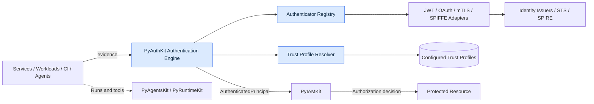

Les pointillés ne représentent pas une preuve d'authentification : une exécution technique ne suffit pas à établir une identité cryptographiquement vérifiée.

## 9. Carte du domaine et classification DDD

| Objet candidat | Classification proposée | Ownership / rôle | Phase |
|---|---|---|---|
| `NonHumanPrincipal` | Typed domain representation | Catégorie de principal vérifié | EXTENSION |
| `MachinePrincipalId` | Value Object | Identifiant local typé | EXTENSION |
| `WorkloadSubjectKey` | Value Object | Issuer/trust domain + subject | EXTENSION |
| `AgentSubjectKey` | Value Object | Clé externe d'agent validée | EXTENSION |
| `TrustDomainId` | Value Object | Domaine SPIFFE ou fédéré | EXTENSION |
| `WorkloadEvidence` | DTO d'entrée non fiable | Preuve brute et provenance | EXTENSION |
| `WorkloadTrustProfile` | Configuration/VO versionné | Issuers, aud, alg, anchors | EXTENSION |
| `WorkloadBinding` | VO / relation candidate | Subject→tenant/service/env | EXTENSION |
| `CertificateEvidence` | DTO d'entrée non fiable | Certificat/chaîne transport | EXTENSION |
| `VerifiedCertificateIdentity` | Résultat interne vérifié | Preuve X509 strictement validée | EXTENSION |
| `JwtSvidEvidence` | DTO non fiable | Token fourni | EXTENSION |
| `VerifiedWorkloadSubject` | Résultat interne vérifié | Provenance vérifiée | EXTENSION |
| `AttestationResult` | VO vérifié par provider | Propriétés d'environnement | CONDITIONAL |
| `MachineAuthenticationPolicy` | Domain Policy | Contraintes d'acceptation authN | EXTENSION |
| `ClientAssertionVerification` | Domain Service / Adapter | Vérifie assertion signée | EXTENSION |
| `TokenExchangeRequest` | Command DTO | Demande d'échange | EXTENSION |
| `DelegationEvidence` | DTO non fiable | Jeton ou mandat déclaré | EXTENSION |
| `VerifiedDelegation` | Résultat vérifié conditionnel | Mandat, actor, subject, scope | EXTENSION |
| `ActorChain` | VO | Chaîne d'acteurs limitée | EXTENSION |
| `AgentExecutionContext` | Context Object | Run, task, tool, tenant | EXTENSION |
| `CredentialLease` | Concept de durée de vie | Credential éphémère | CONDITIONAL |
| `MachineCredentialRecord` | Entity conditionnelle | Uniquement si lifecycle possédé | CONDITIONAL |
| `WorkloadIdentityResolver` | Port | Résolution stable et contrôlée | EXTENSION |
| `AttestationVerifier` | Port | Vérification fournisseur | CONDITIONAL |
| `SvidSource` | Port | Récupération sécurisée des SVID | CONDITIONAL |
| `DelegationVerifier` | Port | Vérification d'un mandat existant | EXTENSION |
| `DelegationAuthorizationGateway` | Port sortant | Demande une décision IAM | EXTENSION |

**Ne pas créer de tables SQL pour chacun de ces objets** : un jeton présenté, un résultat de preuve et un `WorkloadTrustProfile` peuvent vivre dans des couches différentes et être entièrement éphémères. `MachineCredentialRecord` n'est une Entity que si PyAuthKit est réellement propriétaire de son identité et de son cycle de vie.

## 10. Relations et cardinalités conceptuelles

| Association | Cardinalité candidate | Contrainte |
|---|---|---|
| TrustDomain → Workload identity | 1 → 0..N | La racine de confiance doit être connue |
| TrustProfile → issuers autorisés | 1 → 1..N | Liste explicite, pas découverte libre par claims |
| Service → Workload instance | 1 → 0..N | Instance éphémère ≠ service logique |
| Principal → Credential refs | 1 → 0..N | Ownership dépend du système d'identité |
| AuthAttempt → Presented evidence | 1 → 1..N | Valeurs brutes conservées au minimum |
| VerifiedWorkloadSubject → trust evidence | 1 → 1..N | Provenance conservée sans secret |
| AgentPrincipal → AgentExecutionContext | 1 → 0..N | Aucun run n'hérite implicitement des permissions |
| AgentRun → tool invocation | 1 → 0..N | Audit des actions |
| Delegation → actor | 1 → 1 | Actor explicitement vérifié |
| Delegation → original subject | 1 → 1 | Sujet original conservé |
| Delegation → permitted resources | 1 → 1..N | Ressources/scopes bornés |
| Token exchange → issued token | 1 → 0..1+ | Aucun token sur refus ; détails issuer externes |

Les cardinalités sont **conceptuelles**. Leur persistance et leurs transactions dépendront des décisions d'ownership et de déploiement.

## 11. Frontières de confiance `NHI-TB-*`

| ID | Frontière | Risque | Garantie attendue |
|---|---|---|---|
| NHI-TB-01 | Client → API AuthN | Sujet déclaré comme vérifié | `PresentedEvidence` reste non fiable |
| NHI-TB-02 | Client → tenant | Tenant choisi librement | `TrustedScope` vient de l'hôte/route |
| NHI-TB-03 | Token → issuer/JWKS | SSRF, `jku` choisi par attaquant | Trust profile autoritatif avant vérification |
| NHI-TB-04 | mTLS terminator → app | Faux header d'identité client | Injection seulement depuis canal proxy sûr |
| NHI-TB-05 | Pod → Workload API | Usurpation de process/socket | Attestation et contrôle local de l'endpoint |
| NHI-TB-06 | Kubernetes → service externe | Audience ou liveness non vérifiées | TokenReview ou garanties explicites de profil |
| NHI-TB-07 | SPIFFE trust domain → autre | Federation non approuvée | Trust bundles configurés, policy explicite |
| NHI-TB-08 | STS → resource server | Confusion JWT assertion/access token | Typage et audience de tokens |
| NHI-TB-09 | Agent prompt → identity | Texte adversarial se prétend autorité | Aucun prompt ne peut émettre preuve ou droit |
| NHI-TB-10 | Agent runtime → tool | Confusion actor/user | Mandat vérifié pour opération spécifique |
| NHI-TB-11 | Event/logging → observabilité | Fuite de credentials | Audit filtré et secrets jamais loggués |
| NHI-TB-12 | Cache → décision d'authN | Révocation périmée | TTL et garanties d'invalidation explicites |

**Fail-closed :** `unknown issuer`, `ambiguous subject binding`, `tenant mismatch`, `expired evidence`, `untrusted proxy`, `invalid signature` et `missing delegation` sont des refus vérifiables ; pas un repli vers des credentials différents sans politique autoritative.

## 12. Registre de capacités et phasage produit

| Capacité | Phase | Pourquoi |
|---|---|---|
| AuthenticationEngine / résultats normalisés | MVP-REUSE | Contrat de base déjà défini en documentation |
| API key non humaine | MVP-REUSE | Couverture M2M minimale, risque de clé statique |
| JWT entrant pour service | MVP-REUSE | Précise validation et audience du profil |
| OAuth Client Credentials | EXTENSION | Échange et vérification via AS externe |
| Private Key JWT / assertions RFC 7523 | EXTENSION | AuthN client sans secret partagé |
| Certificats X.509 / mTLS | EXTENSION | Identité transport, clés, preuve de possession |
| SPIFFE X.509-SVID / JWT-SVID | EXTENSION | Workloads multi-environnements |
| Kubernetes TokenReview | CONDITIONAL | Nécessaire selon garanties de liveness requises |
| Cloud Workload Identity Federation | CONDITIONAL | Dépend du fournisseur et du contrat STS |
| Device identity/attestation | CONDITIONAL | Besoins device/PKI et plateforme |
| CI/CD ephemeral identity | EXTENSION | Empêche secrets de pipeline à longue durée |
| Agent identity et context binding | EXTENSION | Traçabilité des agents et des runs |
| RFC 8693 Token Exchange et délégation | EXTENSION | Autorité « on behalf of » vérifiable |
| Gestion des permissions et gouvernance | EXTERNAL-OWNED | PyIAMKit et autorités d'autorisation |
| Agent planning et exécution | EXTERNAL-OWNED | PyAgentsKit / runtime |
| PKI/CA complète | EXTERNAL-OWNED | SPIRE, CA ou fournisseur PKI |

## 13. Authentification machine : sélectionner un mécanisme

| Contexte | Choix candidat | Risques et garde-fous |
|---|---|---|
| Service interne sous maillage géré | mTLS avec X.509-SVID | Rotation, trust bundle, identité de pair et terminaison TLS |
| App confidentielle contre AS | Client Credentials avec `private_key_jwt` ou mTLS | Client auth distinct de scope d'accès |
| Workload Kubernetes | Token projeté audience-spécifique / federation | Claims liés au pod, politique de liveness |
| Job GitHub Actions | OIDC federation vers STS | Conditions strictes sur repo/workflow/ref/env |
| Service on-premises sans SPIRE | Certificat et clé protégée ou JWT signé | PKI, rotation et exigences d'audience |
| Agent autonome en plateforme | Identité workload + `AgentPrincipal` lié au run | Pas de mandat implicite utilisateur |
| Agent agissant pour un utilisateur | AuthN agent + délégation IAM/STS bornée | `actor`, `subject`, `resource`, durée, consentement |
| Device IoT | Clé device + certificat/attestation conditionnelle | PKI et lifecycle de device hors noyau |
| Intégration legacy | API key hachée et scope limité | Migration vers credential court recommandée |

Aucune ligne ne dispense de l'évaluation du risque et du modèle de déploiement. **Aucun protocole n'est automatiquement « plus sûr » indépendamment de l'implémentation.**

## 14. AuthenticationEngine : pipeline NHI

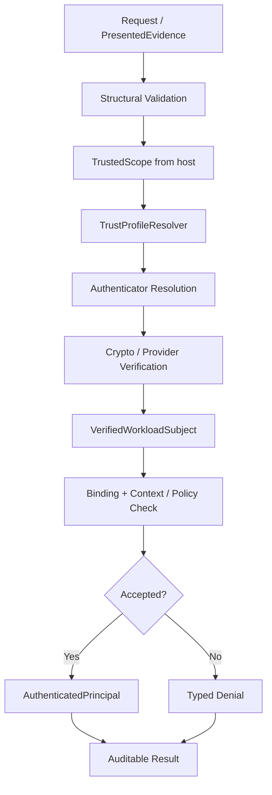

Étapes communes : (1) borne de taille, parsing non autoritatif ; (2) scope contrôlé ; (3) profil de confiance ; (4) méthode autorisée ; (5) validation cryptographique ou provider ; (6) identité vérifiée avec preuve de provenance ; (7) binding tenant/env/service et policy ; (8) décision authN, (9) audit assaini. La **délégation** est un contrôle séparé après authentification du runtime actor.

## 15. API Keys : baseline / migration

Une API key peut authentifier un service dans le MVP si sa propriété, son tenant, son audience/usage, sa validité et sa révocation sont gérés par un port de vérification. Un secret stocké en clair ou loggué rend la capacité dangereuse même si l'API fonctionne.

**Règles proposées :** génération par CSPRNG ; préfixe de recherche non secret et vérification sûre ; stockage sous hash de clé ou dérivation adaptée ; rotation chevauchante contrôlée ; scope minimal, tenant strict, expiration ; aucune élévation de droits sur une clé technique ; désactivation lors de la suppression du service propriétaire.

**Migration :** l'abstraction `Authenticator` doit permettre à un client de passer à mTLS, JWT signé ou workload federation sans modifier les use cases métier. Le compte de service et son rôle IAM sont distincts du credential qui le prouve.

## 16. OAuth 2.0 Client Credentials — authentification client ≠ authorization

Le grant `client_credentials` convient aux clients confidentiels lorsqu'ils obtiennent un access token pour leurs propres ressources, sans utilisateur humain associé. La demande d'un token n'est pas à elle seule une authentification de l'application auprès de PyAuthKit : le système doit vérifier le token reçu à la bonne audience et au bon profil avant de le consommer.

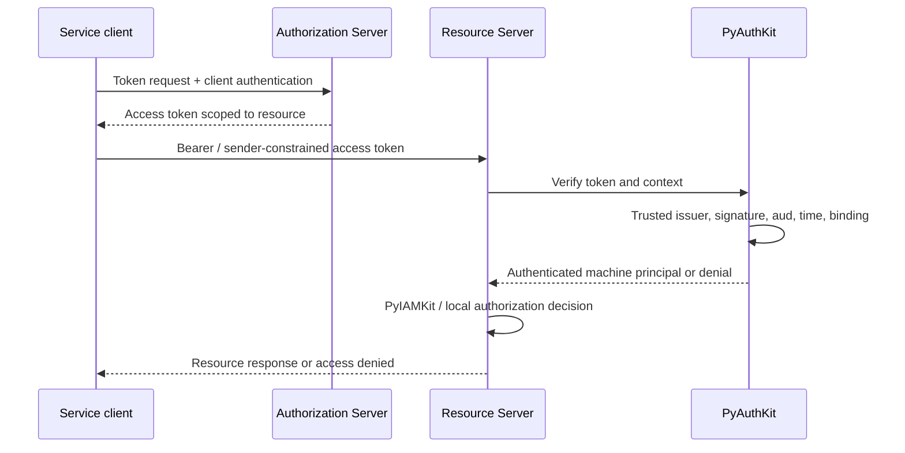

**À vérifier :** `iss`, `aud`, `exp`, `nbf` le cas échéant, signature, algorithmes autorisés, type/purpose du token, client identity, `cnf` lorsqu'il est sender-constrained et politiques propres au resource server. `scope`/permissions restent soumis à une décision d'accès indépendante. Un `sub` dans un JWT access token pour `client_credentials` peut identifier le client, sous le profil RFC 9068 ; il ne doit pas être supposé identique à un utilisateur.

## 17. `private_key_jwt` et assertions JWT RFC 7523

L'authentification client au token endpoint peut employer une assertion JWT signée par une clé privée contrôlée par le client, plutôt qu'un secret partagé. La vérification côté AS doit contrôler algorithme, signature, issuer/subject client attendu, audience du token endpoint, bornes de temps et gestion du rejeu suivant le profil effectivement négocié.

**Distinctions :** un JWT d'assertion client est présenté **à l'AS** ; un JWT access token est présenté **au resource server**. PyAuthKit peut valider un jeton reçu selon son profil, mais ne doit jamais deviner le profil à partir d'un `typ` ou d'un `sub` non vérifiés.

**Design :** `ClientAssertionAuthenticator` adapte une primitive commune de signature sans transformer `AuthenticationEngine` en serveur OAuth complet. Les règles de durée, de `jti`, de rotation de clé et de `kid` sont des politiques externes explicites ; le header JOSE ne doit pas autoriser une URL libre de téléchargement de clés.

## 18. TLS/mTLS et preuve d'identité de pair

L'établissement mTLS peut authentifier le client au niveau du transport, mais **le certificat reçu par le core doit être attesté par le composant qui termine réellement TLS**. Un header `X-Client-Cert` reçu depuis Internet sans frontière proxy de confiance n'est pas une preuve.

Validation candidate : chaîne de confiance et ancre autorisée, validité temporelle, Key Usage/EKU selon profil, nom/SAN attendu, identité du pair, politique de révocation applicable, hostname/service binding et tenant. Le résultat distingue `PeerCertificateVerified` du `AuthenticatedPrincipal` final.

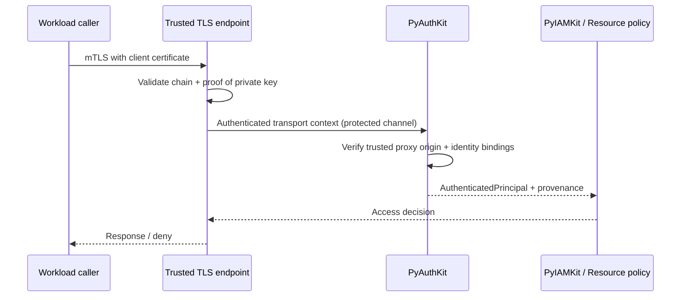

**RFC 8705 :** l'authentification du client par mTLS et la contrainte d'un access token à un certificat sont des mécanismes complémentaires, **non identiques**. Si token lié à un certificat, le resource server doit contrôler la correspondance réelle au présentateur.

## 19. Certificats X.509 : politique et lifecycle

- Valider les certificats selon le profil qui les a émis : X.509 générique, SVID, PKI d'entreprise ou mTLS OAuth n'ont pas les mêmes contraintes.
- Ne pas supposer que le Common Name suffit à identifier un service ; privilégier la SAN appropriée.
- Séparer **identité de service**, **identité d'instance**, **matériel de signature**, **chaîne de confiance** et **certificat transport**.
- Le certificate pinning universel peut casser la rotation ; l'utiliser seulement lorsque le modèle de confiance le justifie.
- Éviter de déclarer « révocation immédiate » lorsque les vérificateurs utilisent des caches/chaînes ou ne font pas les mêmes contrôles de statut.
- Documenter validité, rotation, trust bundle, distribution, accès aux clés privées, horloge, fallback et gestion des incidents.

## 20. SPIFFE : trust domains, SPIFFE IDs et SVID

Un SPIFFE ID suit le schéma `spiffe://trust-domain/path`. Son *trust domain* identifie l'autorité de confiance, non automatiquement un tenant PyIAMKit. Un subject est représenté dans un X.509-SVID par l'URI SAN appropriée, ou dans un JWT-SVID par le claim `sub`.

**X.509-SVID** : selon le profil SPIFFE, une identité unique en URI SAN, chaîne vérifiée à partir des bundles du trust domain, certificat leaf non-CA et contraintes cryptographiques adaptées. **JWT-SVID** : au minimum `sub` SPIFFE, `aud`, `exp`, signature vérifiée et règles JWT-SVID ; pour un issuer externe, `iss`, JWKS et trust mapping supplémentaires sont définis dans le profil d'intégration lorsqu'exigés.

**Interdiction :** un URI ressemblant à `spiffe://...` dans un claim libre, un log ou un certificat non validé ne vaut pas identité SPIFFE vérifiée.

## 21. SPIRE / Workload API : attestation locale et renouvellement

SPIRE est une implémentation de l'écosystème SPIFFE. Le Workload API permet d'obtenir des identités, certificats et bundles depuis un endpoint local ; l'authentification du processus par cet endpoint appartient à l'implémentation SPIFFE/SPIRE, pas au consumer PyAuthKit.

**Adaptateur candidat :** `SpiffeWorkloadIdentitySource` récupère SVID/bundles pour un workload local ; `SpiffePeerAuthenticator` valide la preuve d'un appelant ; `SpiffeJwtSvidAuthenticator` applique la signature, l'audience et le domaine de confiance. Ces responsabilités n'appellent pas une unique classe God Object.

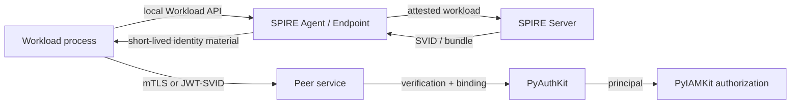

**Important :** l'API SPIFFE peut évoluer (profils additionnels) ; ce document se concentre sur les profils X.509-SVID et JWT-SVID pertinents aux parcours définis, sans exiger la prise en charge de toutes les extensions.

## 22. JWT-SVID : validation d'une identité de workload

**Préconditions :** trust domain approuvé, JWKS/bundle associé issu d'un canal autoritatif, audience exacte attendue, contraintes temporelles, typologie SVID explicitement activée. Un `sub=spiffe://...` ne doit jamais entraîner une découverte automatique de domaine ou de JWKS au choix de l'appelant.

**Postconditions :** identité workload vérifiée, issuer/trust domain, audience et provenance conservés ; absence de token brut dans résultat/audit. En cas d'expiration, de signature invalide, de mauvaise audience ou de domaine non fiable : `REJECTED`, pas de `AuthenticatedPrincipal`.

**Anti-confusion :** un JWT-SVID n'est pas un ID Token OIDC même si des métadonnées JWKS peuvent être publiées via un endpoint de découverte ; il n'autorise pas à lui seul des actions sur des ressources.

## 23. Kubernetes : service-account projeté, TokenRequest, TokenReview

Une Pod ServiceAccount peut recevoir un token projeté à durée limitée, doté d'une audience et d'un éventuel binding à un objet Kubernetes. Le kubelet renouvelle les tokens projetés ; les Secret-based long-lived service account tokens ne sont pas la voie recommandée.

**Deux modèles de validation à ne pas confondre :**

1. **Vérification JWT locale** — signature, issuer, audience, temporalité et claims statiques ; elle ne prouve pas nécessairement qu'un objet lié existe encore à l'instant de la vérification.
2. **TokenReview** — validation par l'API server de Kubernetes, pouvant contrôler les claims d'objet lié ; requis par le consumer qui exige ces garanties de liveness.

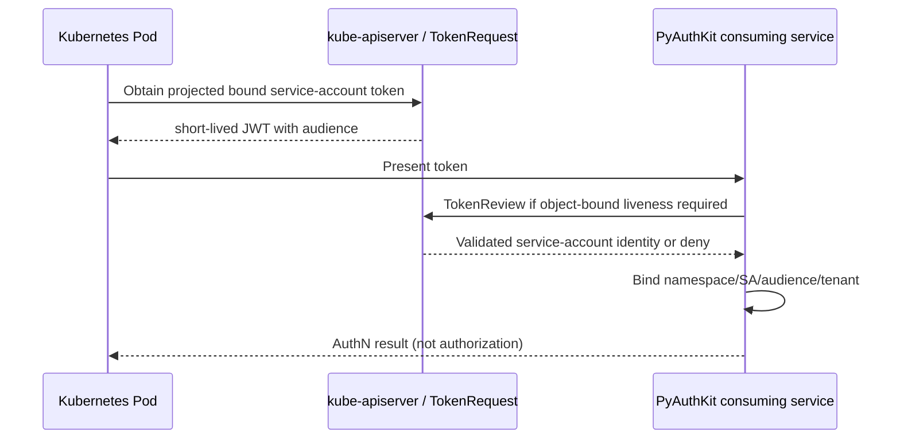

**Conception :** `KubernetesServiceAccountAuthenticator` s'appuie sur un port de vérification ; le core ne dépend pas de `kubernetes` SDK. N'utiliser un token de service-account à destination de l'API server pour un autre service qu'avec une audience explicitement prévue et validée.

## 24. Cloud Workload Identity Federation

| Environnement | Preuve primaire candidate | Service de confiance | Attention |
|---|---|---|---|
| Google Cloud WIF | OIDC/SAML/X.509 ou autre fournisseur accepté | STS Google | Mapping d'attributs et conditions du pool |
| Microsoft Entra WIF | Token d'issuer externe OIDC | Entra token endpoint | `issuer`, `subject`, audience, contraintes de fédération |
| AWS EKS IRSA | Jeton OIDC projeté du ServiceAccount | AWS IAM / STS | Relation de confiance au service account et OIDC issuer |
| GitHub Actions | OIDC token de job | STS cloud cible | Repo, workflow, ref, environment, aud stricts |
| SPIFFE external API | JWT-SVID | API/STS acceptant SPIFFE | Trust domain, issuer, aud, JWKS et binding |

Le principe commun est **fédérer une preuve courte et vérifiable** au lieu de distribuer une clé cloud durable à chaque workload. Les exigences exactes du fournisseur, son modèle de subject et ses règles d'émission restent sous son contrôle. Une identité cloud est une nouvelle assertion avec son propre issuer, sa propre audience et ses propres droits.

## 25. CI/CD, builds et identité éphémère

Un job CI ne doit pas hériter de la même identité que l'administrateur du dépôt ou que le runtime production. Son certificat/token doit être lié au fournisseur, au repo/organisation, au workflow, à l'environnement et à la durée de vie du job selon les garanties disponibles.

**Séquence cible :** job attesté → OIDC ou autre preuve éphémère → STS → token limité → opération d'artefact/déploiement → expiration/offboarding automatique. Ne jamais logger l'assertion ni mettre la clé en cache d'un build à un autre. Les conditions de trust devraient rejeter un workflow de fork ou de branche non autorisée pour un déploiement sensible.

## 26. Device Identity : authentification ≠ posture

La preuve d'un appareil peut prendre la forme d'un certificat, d'une clé matériellement protégée ou d'une attestation fournie par un écosystème adapté. La vérification de possession de clé ne démontre pas automatiquement que le firmware, l'OS, le navigateur ou l'environnement sont exempts de compromission.

Le module `DeviceAttestationVerifier` est une **extension conditionnelle**. Une attestation valide possède sa propre chaîne de confiance, son format, ses claims d'état, sa fraîcheur et une politique de consommation. PyAuthKit peut publier l'information de confiance résultante ; la décision d'accès fondée sur posture appartient au policy engine adéquat.

## 27. Agent Identity : modèle, processus, instance et rôle

Un **agent IA** n'est pas automatiquement une nouvelle primitive cryptographique. Il peut être exécuté comme service, workload ou process et prouver cette identité via les mécanismes NHI standards ; il possède en outre un identifiant logique d'agent, une instance d'exécution et un contexte de tâche.

| Dimension | Exemple | Provenance acceptable |
|---|---|---|
| `agent_definition_id` | `finance-research` | Registry d'agents administré |
| `agent_instance_id` | `agent-inst-...` | Runtime contrôlé |
| `agent_run_id` | `run-...` | Runtime / scheduler |
| `workload_subject` | URI SPIFFE / OAuth client | Preuve cryptographique / provider |
| `requested_action` | `read_market_data` | Use case d'application |
| `user_subject` | User issu de PyIAMKit | Contexte IAM vérifié, pas prompt |
| `delegation_id` | Mandat signé/référence | Autorité de délégation |

**Invariant :** le texte produit par un modèle, les instructions système, une variable `role=admin`, le nom du tool ou un appel de fonction ne sont jamais des preuves de permission. L'autorisation des outils doit être appliquée **côté exécution**, même si l'agent affirme disposer de l'accord de l'utilisateur.

## 28. Direct identity vs delegated identity

- **Direct machine authentication** : `agent/service → API`, avec une identité propre à l'agent ou au service ; aucune délégation utilisateur.
- **Delegated operation** : `user grants bounded authority → agent` ; l'agent présente son identité propre et une preuve du mandat pour l'opération.
- **Impersonation** : l'acteur est vu comme le sujet dans un contexte explicitement encadré ; ce n'est pas le mode par défaut recommandé pour la traçabilité agentique.

Le `AuthenticatedPrincipal` répond **qui est authentifié** ; une structure distincte `VerifiedDelegation` répond **au nom de qui et dans quelle limite** ; la décision IAM répond **cette action est-elle autorisée ?**.

## 29. RFC 8693 Security Token Exchange : actor, subject et audience

Le RFC 8693 définit un protocole STS pouvant prendre en compte un `subject_token` et un `actor_token`, et décrire l'acteur courant via `act`. L'échange reste soumis à la décision de l'authorization server ; un client ne peut pas auto-émettre une délégation valable en recopiant des claims.

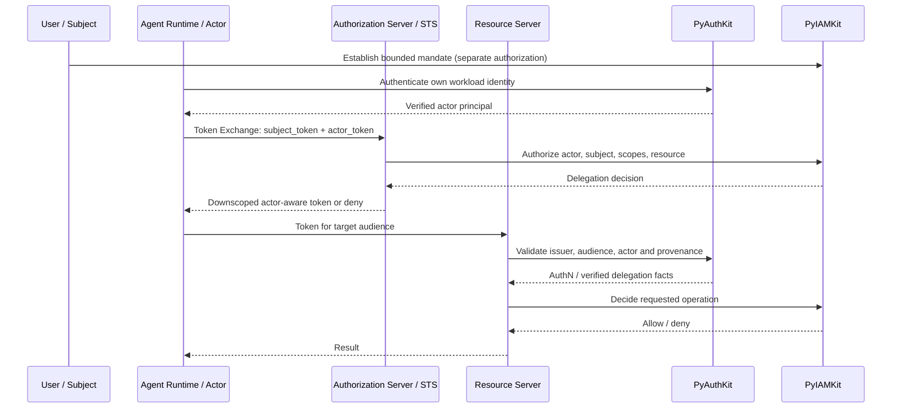

**À ne pas confondre :** `may_act` est une information pouvant aider le serveur à décider de l'autorisation de déléguer ; elle ne confère pas universellement ce droit au porteur. Les chaînes `act` peuvent être utilisées pour la provenance, mais seules les informations d'acteur pertinentes selon le profil et le RFC gouvernent la décision d'accès ; des acteurs historiques ne sont pas des permissions cumulées.

## 30. Delegation Grant : contrat minimal candidat

Une délégation candidate doit identifier son émetteur autoritatif, le sujet original, l'acteur actuel, le ou les destinataires, les opérations/scopes, sa période de validité, les restrictions de tenant, le statut de révocation et, si nécessaire, une approbation humaine sensible. `VerifiedDelegation` ne doit être instanciée par l'application qu'après vérification de cette chaîne de confiance.

**Interdictions :** pas de passage `actor=admin` dans un prompt ; pas de copie automatique de tous les rôles de l'utilisateur à l'agent ; pas de jeton d'accès hors audience ; pas de refresh token humain exposé à un outil LLM ; pas de réutilisation transversale de mandat après expiration ou révocation.

## 31. Multi-hop agents, downstream calls et chaîne de responsabilité

Une exécution peut suivre `User → Orchestrator Agent → Research Agent → API`. L'identité d'un appel downstream doit décrire l'acteur qui exécute réellement l'appel, et la délégation doit être bornée par le mandat initial ; chaque hop applique les restrictions de son propre resource server.

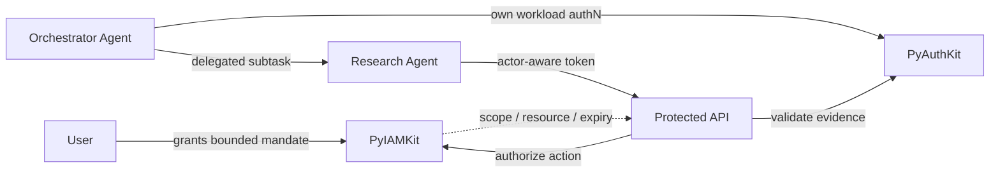

**Principe :** *delegation downscoping* — pas d'élargissement de scope par multiplication des hops. Prévoir des limites explicites sur profondeur de chaîne et durée de vie ; l'absence de chaîne complète de provenance doit provoquer un refus ou une escalade selon une politique configurée.

## 32. Tool Invocation & Prompt Injection Boundary

L'agent peut recevoir une réponse externe contenant une instruction malveillante, sans que cela modifie son identité technique. La sécurité d'authentification exige que l'agent **ne transforme pas du contenu non fiable en autorité** : aucun résultat RAG, page Web, email, argument d'outil ou contenu généré n'autorise un nouvel identity binding.

`ToolInvocationContext` est construit par l'orchestrateur de confiance à partir de `actor_principal`, `run_id`, `delegation_ref`, `resource`, `operation` et policy. Le tool runtime effectue sa propre vérification ou consomme une décision IAM limitée, fraîche et vérifiable. Les identifiants transmis par l'agent seul restent une entrée non fiable.

## 33. Assurance NHI et provenance

NIST AAL1/2/3 décrit des garanties d'authentification de personnes et de leurs authenticators selon son référentiel ; ces niveaux ne se transposent pas automatiquement à un workload, à SPIFFE ou à un agent IA. Proposer plutôt des propriétés de preuve explicites : `issuer_trusted`, `key_possession_proved`, `sender_constrained`, `workload_attested`, `bound_to_audience`, `credential_fresh`, `origin_verified` et `delegation_verified`.

**Attention :** le niveau de confiance final ne doit pas être dérivé d'une simple liste de flags non vérifiés. Chaque propriété comporte une source, une méthode de vérification et une période de validité. Un workload correctement authentifié reste soumis à des autorisations séparées.

## 34. Sender-Constrained Tokens : mTLS / DPoP

Un bearer token peut être rejoué par quiconque le détient tant que les protections applicables ne l'empêchent pas. Des tokens contraints au présentateur peuvent exiger la preuve d'une clé (mTLS certificate-bound, RFC 8705 ; DPoP, RFC 9449). `cnf`, une empreinte de certificat ou une JWK dans le token ne prouvent pas isolément que le requérant détient la clé correspondante.

**Contrôles selon profil :** preuve de possession à la requête, correspondance du token au key material, cible HTTP/URI et méthode pour DPoP, anti-rejeu (`jti`, temps, nonce si applicable), audience et signature JWT. Le choix dépend du transport et des capacités du fournisseur, et ne doit pas forcer tous les clients à mTLS.

## 35. Lifecycle des identités et credentials non humains

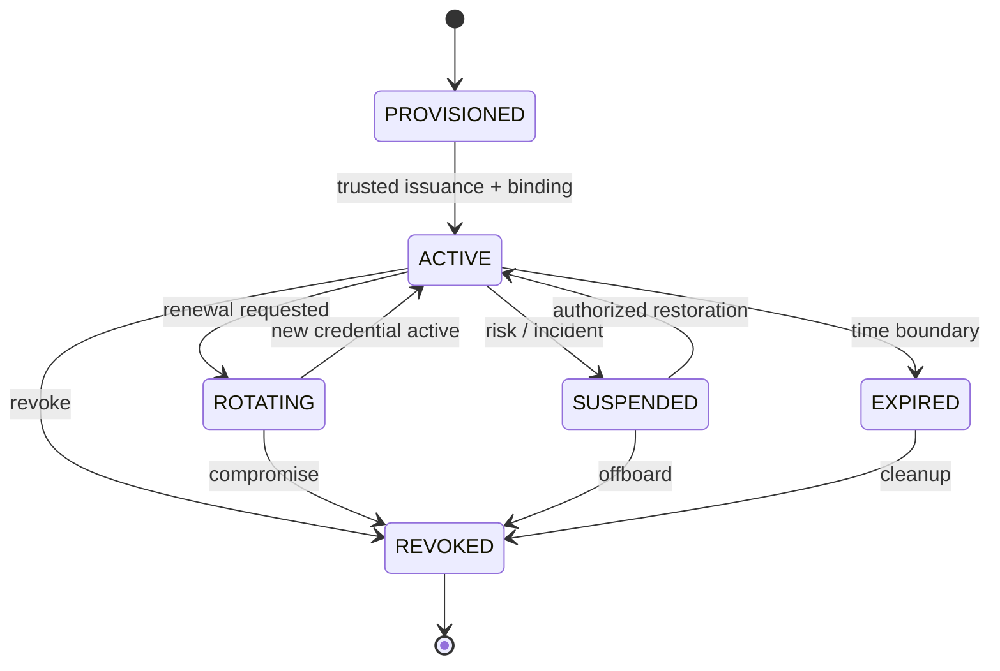

Le diagramme porte sur un *credential localement géré* lorsque PyAuthKit possède ce cycle. Un Kubernetes token ou un SVID émis par une autorité externe vit principalement dans le cycle de vie de **son issuer** ; PyAuthKit suit une représentation de vérification et d'état, sans le révoquer par magie.

**Offboarding :** désactivation d'identité, invalidation des bindings, propagation aux caches et traitements en file d'attente, retrait des secrets et vérification de la fin d'accès ; le périmètre de chaque action doit être attribué à PyIAMKit, au provider ou à l'application selon ownership.

## 36. Secrets, clés et hygiène cryptographique

- Préférer les credentials éphémères, délivrés à la demande, aux secrets statiques réutilisés.
- Protéger clés privées (permissions locales, KMS/HSM/TPM lorsque nécessaire), sockets SPIRE et tokens montés.
- Ne pas sérialiser les clés ni secrets dans les DTO, events, logs, traces ou prompts.
- Ne pas coder un validateur JWT/X.509/DPoP ad hoc lorsque des bibliothèques maintenues existent.
- Gérer les algorithmes explicitement ; les claims ou le header ne doivent jamais élargir la liste des algorithmes autorisés.
- Documenter stockage, rotation, révocation, délais d'invalidation et gestion des clés compromises.
- La signature du token et la confiance dans l'émetteur ne dispensent pas d'un scope et d'une audience.
- Prévoir des contrôles anti-rejeu pour assertions à durée courte et mécanismes qui en ont besoin.

## 37. Multi-Tenant, environments, namespaces et trust domains

Une configuration doit expliciter les bindings entre **tenant**, **application**, **namespace Kubernetes**, **service account**, **SPIFFE trust domain**, **issuer externe**, **audience** et **environment**. Ces concepts ne sont pas interchangeables : un domaine SPIFFE peut couvrir plusieurs tenants, un tenant peut accepter plusieurs issuers, et une même app peut avoir des environnements isolés.

**Invariant :** aucun utilisateur ou workload ne choisit librement le profil « production » via un claim fourni ; le contexte de confiance est résolu depuis une configuration autoritative et une route contrôlée. Une configuration ambiguë ou couvrant plusieurs tenants sans critère de sélection fiable échoue fermée.

## 38. Audit et observabilité des NHIs

Un événement de sécurité minimal peut porter : `event_id`, `time`, `attempt_id`, `principal_type`, `issuer/trust_domain`, `subject_fingerprint`, `tenant_id`, `audience`, `authenticator_type`, `decision`, `reason_code`, `policy_version`, `proof_kind`, `delegation_ref` et `correlation_id`. Les données personnelles ou sensibles et les secrets ne sont pas des champs d'audit par défaut.

Publier les faits au passé (`MachineAuthenticated`, `WorkloadAuthenticationRejected`, `DelegationVerificationFailed`) sans déclarer `AgentAuthorized` si l'autorisation n'est pas détenue par PyAuthKit. Les logs doivent être suffisants pour enquêter sur les chaînes actor/subject, sans enregistrer les tokens bruts ni contenu de prompt.

## 39. Software Design Learning : Problème → mécanisme

| Pression réelle | Concept DDD / Principe | Pattern éventuel | Matérialisation Python |
|---|---|---|---|
| Plusieurs émetteurs avec vérification distincte | DIP, OCP | Strategy, Adapter | `Authenticator(Protocol)` |
| Séparer preuve et décision | SoC, domain boundary | Result Object | `VerifiedWorkloadSubject` |
| Résoudre un trust profile stable | Explicit authority, fail-closed | Resolver (rôle naturel) | `TrustProfileResolver` |
| Fournir SVID sans imposer SPIRE | DIP, information hiding | Port + Adapter | `SvidSource(Protocol)` |
| Éviter couplage Kubernetes | Hexagonal | Adapter | `TokenReviewVerifier` |
| Évaluer délégation sans posséder IAM | Context mapping, ACL | Anti-Corruption Layer | `DelegationAuthorizationGateway` |
| Un credential a un cycle local | DDD Aggregate conditionnel | State machine | Enum + transitions gardées |
| Audit après décision | SoC / events | Domain Event (pas Observer automatique) | `AuthenticationEvent` |

**Rule:** `State Machine ≠ GoF State Pattern`, `OAuth token ≠ OIDC ID Token`, `Agent ID ≠ Proof`, `Delegation ≠ Impersonation`, `Identity ≠ Authorization`, `Issuer trust ≠ Resource scope`. Chaque pattern doit répondre à une pression réelle, et son coût doit être expliqué.

## 40. Ports & Adapters proposés

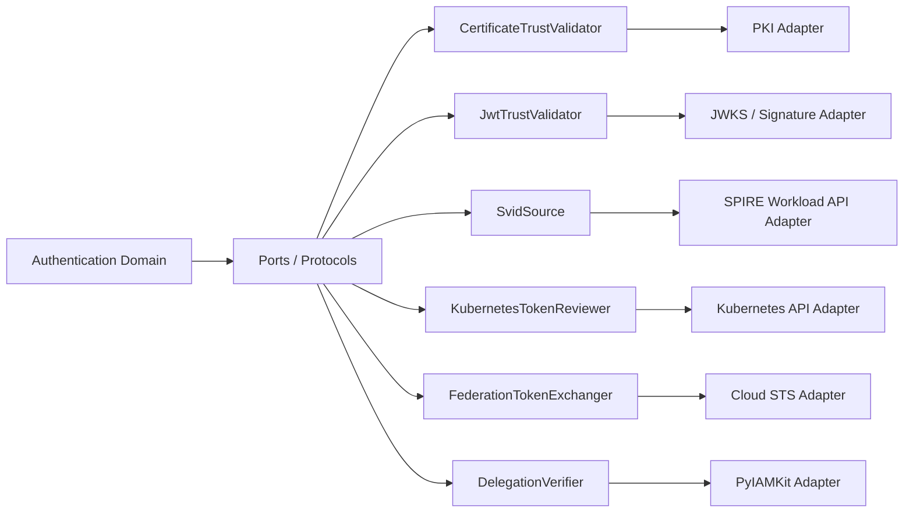

**Pas de God Port :** ne pas créer un `NonHumanAuthProvider` réalisant à la fois attestation, mTLS, JWT, émission de tokens, provisioning, accès à IAM, logs et orchestration d'agents. Les ports sont définis par le besoin du use case et non par la structure d'un SDK cloud.

## 41. Contrats Python illustratifs (non cryptographiques)

Ces fragments fixent des formes typées ; ils ne vérifient pas de JWT, n'ouvrent pas de session mTLS et ne doivent pas être utilisés directement comme système d'authentification.

```python
from __future__ import annotations
from dataclasses import dataclass
from datetime import datetime
from enum import Enum
from typing import Protocol

class NonHumanKind(str, Enum):
    SERVICE = "service"
    WORKLOAD = "workload"
    AGENT = "agent"
    DEVICE = "device"
    CI_JOB = "ci_job"

@dataclass(frozen=True)
class ExternalWorkloadKey:
    issuer: str
    subject: str
    trust_domain: str | None = None

    def __post_init__(self) -> None:
        if not self.issuer or not self.subject:
            raise ValueError("issuer and subject are required")

@dataclass(frozen=True)
class VerifiedWorkloadSubject:
    key: ExternalWorkloadKey
    proof_kind: str
    evidence_id: str
    verified_at: datetime
    trust_profile_version: str

@dataclass(frozen=True)
class MachineAuthenticationContext:
    tenant_id: str
    target_audience: str
    environment: str
    correlation_id: str

class WorkloadAuthenticator(Protocol):
    async def verify(
        self, evidence: bytes, context: MachineAuthenticationContext
    ) -> VerifiedWorkloadSubject: ...
```

L'objet `VerifiedWorkloadSubject` est un type interne **émis uniquement par un vérificateur de confiance** dans le modèle d'application ; son constructeur public en Python n'est pas une barrière de sécurité en soi. Les use cases doivent garantir sa provenance et le refuser lorsqu'il est construit depuis des entrées non fiables.

```python
from __future__ import annotations
from dataclasses import dataclass
from datetime import datetime
from typing import Protocol

@dataclass(frozen=True)
class DelegationRequirement:
    actor_subject: str
    original_subject: str
    audience: str
    operation: str
    tenant_id: str
    now: datetime

@dataclass(frozen=True)
class VerifiedDelegation:
    grant_id: str
    issuer: str
    actor_subject: str
    original_subject: str
    audience: str
    allowed_operations: frozenset[str]
    expires_at: datetime
    policy_version: str

class DelegationVerifier(Protocol):
    async def verify(
        self, token: bytes, requirement: DelegationRequirement
    ) -> VerifiedDelegation: ...


def delegation_covers(
    grant: VerifiedDelegation, requirement: DelegationRequirement
) -> bool:
    return (
        grant.actor_subject == requirement.actor_subject
        and grant.original_subject == requirement.original_subject
        and grant.audience == requirement.audience
        and requirement.operation in grant.allowed_operations
        and requirement.now < grant.expires_at
    )
```

`delegation_covers` n'est qu'une **vérification illustrative de portée** : elle ne vérifie ni signature, ni révocation, ni issuer, ni tenant, ni consentement et **ne peut pas autoriser une action à elle seule**. Le résultat final requiert un vérificateur réel et une décision IAM/contextuelle indépendante.

## 42. Use Cases, Commands et résultats

| ID | Opération | Entrées non fiables | Sortie possible | Ownership |
|---|---|---|---|---|
| NHI-UC-01 | `AuthenticateMachine` | API key / JWT / certificate | AuthenticatedPrincipal ou refus | PyAuthKit |
| NHI-UC-02 | `AuthenticateWorkload` | SVID / K8s token | Verified workload principal ou refus | PyAuthKit |
| NHI-UC-03 | `VerifyClientAssertion` | JWT assertion | Verified client identity ou refus | PyAuthKit/AS adapter |
| NHI-UC-04 | `VerifyMtlsPeer` | TLS proof | Verified peer ou refus | Adapter + PyAuthKit |
| NHI-UC-05 | `ResolveWorkloadBinding` | Verified subject | Tenant/service/owner binding | PyAuthKit via port IAM |
| NHI-UC-06 | `AuthenticateAgent` | Workload proof + run metadata | Agent principal ou refus | PyAuthKit |
| NHI-UC-07 | `VerifyDelegation` | Subject/actor tokens | Verified mandate ou refus | Trust verifier / IAM |
| NHI-UC-08 | `ExchangeDelegationToken` | Tokens + target | Issued token ou refus | Authorization Server / STS |
| NHI-UC-09 | `InspectMachineIdentity` | Verified identity ref | Read-only metadata | PyIAMKit / application |
| NHI-UC-10 | `RevokeMachineCredential` | Authenticated admin command | State change if owned | Credential owner |
| NHI-UC-11 | `RotateMachineCredential` | Authorized request | New credential lease | Issuer / owner |
| NHI-UC-12 | `AuditAgentToolCall` | Verified context | Sanitized event | Runtime and audit |

`AuthenticateMachine` est distinct de `AuthorizeMachineAction`. La séparation **Commands vs Queries** doit rester sélective ; aucun bus global de commandes n'est requis pour disposer d'un use case clair.

## 43. Politique de sûreté et erreurs typées

| Erreur | Comportement sûr |
|---|---|
| `UnknownTrustDomain` | Refus, pas d'auto-enrollment |
| `UnknownIssuer` | Refus, pas de JWKS à URL arbitraire |
| `AudienceMismatch` | Refus, aucune audience dérivée de la preuve |
| `CredentialExpired` | Refus, rotation externe éventuelle |
| `UnverifiedPeerContext` | Refus mTLS, pas de header fallback |
| `TokenReviewUnavailable` | Refus lorsque la liveness est requise |
| `TrustBundleUnavailable` | Refus ou lecture d'un cache **encore valide selon contrat** |
| `TenantBindingAmbiguous` | Refus sans sélection du premier |
| `AgentDelegationMissing` | AuthN de l'agent possible, action déléguée refusée |
| `DelegationRevoked` | Refus, pas d'usage offline au-delà de garantie |
| `AgentRunMismatch` | Refus, contexte non substituable |
| `UnauthorizedScope` | AuthN distinctement réussie, action refusée |
| `SignerKeyUnknown` | Refus, récupération contrôlée seulement |
| `SenderProofMissing` | Refus d'un token sender-constrained |

La sémantique d'erreur publique doit rester non révélatrice ; les codes internes et l'audit assaini peuvent être précis. Une erreur IAM ou STS ne doit pas se transformer en succès sans contrôle explicite et sécurisé.

## 44. Threat Model — arbre de menaces

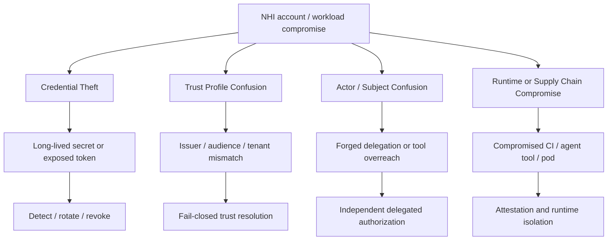

---

## 45. Registre d'exigences spécialisées `NHI-REQ-*`

Les identifiants qui suivent sont **des exigences candidates** liées à ce document, pas des labels déjà attribués au code. `MUST` / `SHOULD` décrivent l'intention produit, non le statut normatif universel. `ALL` signifie transversal à la trajectoire, pas implémenté.

### 45.1 Trust & context

| ID | Exigence vérifiable | Priorité | Phase |
|---|---|---|---|
| NHI-REQ-001 | TrustedScope résolu depuis route/config de confiance et non depuis un claim de l’appelant | MUST | MVP-REUSE |
| NHI-REQ-002 | Issuer ou trust domain appartenant à une liste configurée et versionnée | MUST | EXTENSION |
| NHI-REQ-003 | Audience exacte contrôlée par le consumer | MUST | MVP-REUSE |
| NHI-REQ-004 | Identité externe résolue via issuer + subject, jamais subject seul | MUST | EXTENSION |
| NHI-REQ-005 | Isolation tenant/environnement lors de toute authentification non humaine | MUST | EXTENSION |
| NHI-REQ-006 | Binding subject ambigu interdit, échec explicite | MUST | EXTENSION |
| NHI-REQ-007 | Conserver la provenance du mécanisme et du trust profile dans le verdict | MUST | EXTENSION |
| NHI-REQ-008 | Enregistrer l’horizon de validité du verdict et de ses preuves | MUST | EXTENSION |

### 45.2 Authenticators & credentials

| ID | Exigence vérifiable | Priorité | Phase |
|---|---|---|---|
| NHI-REQ-009 | Resolver les authenticators via contrat stable et liste des méthodes autorisées | MUST | MVP-REUSE |
| NHI-REQ-010 | Vérifier propriété, statut, scope, expiration et secret sans stockage clair | MUST | MVP-REUSE |
| NHI-REQ-011 | Vérifier signature, algorithme, typologie, issuer, audience, temps selon profil | MUST | MVP-REUSE |
| NHI-REQ-012 | Supporter assertions JWT d’authentification client suivant profil RFC 7523 | SHOULD | EXTENSION |
| NHI-REQ-013 | Accepter l’identité TLS seulement après validation du canal ou proxy de confiance | MUST | EXTENSION |
| NHI-REQ-014 | Vérifier chaîne X.509, usages, SAN et statut sous profil explicite | MUST | EXTENSION |
| NHI-REQ-015 | Valider sender-constraining lorsque requis par le token | MUST | EXTENSION |
| NHI-REQ-016 | Prévoir protection contre rejeu pour assertions/DPoP selon protocole | MUST | EXTENSION |
| NHI-REQ-017 | Charger les clés depuis une source autoritative ; interdire discovery non contrôlée | MUST | EXTENSION |
| NHI-REQ-018 | Pouvoir supporter rotation sans retrait non planifié de toute identité valide | SHOULD | EXTENSION |

### 45.3 SPIFFE / Kubernetes / federation

| ID | Exigence vérifiable | Priorité | Phase |
|---|---|---|---|
| NHI-REQ-019 | Résoudre SPIFFE ID et trust domain depuis une preuve SVID vérifiée | MUST | EXTENSION |
| NHI-REQ-020 | Vérifier URI SAN et bundle sous profil X.509-SVID | MUST | EXTENSION |
| NHI-REQ-021 | Vérifier JWT-SVID avec audience, expiration et chaîne de confiance | MUST | EXTENSION |
| NHI-REQ-022 | Accéder au Workload API par port/adapter et sécuriser socket local | SHOULD | CONDITIONAL |
| NHI-REQ-023 | Vérifier audience explicite des tokens de ServiceAccount | MUST | CONDITIONAL |
| NHI-REQ-024 | Utiliser TokenReview lorsque la preuve exige la validité de l’objet lié | MUST | CONDITIONAL |
| NHI-REQ-025 | Isoler les différences des STS Google/Entra/AWS par adapters | SHOULD | CONDITIONAL |
| NHI-REQ-026 | Lier les déploiements sensibles aux claims de job/branche/env autorisés | MUST | EXTENSION |
| NHI-REQ-027 | Privilégier workload federation plutôt que secrets cloud durables si disponible | SHOULD | CONDITIONAL |

### 45.4 Agent auth & delegation

| ID | Exigence vérifiable | Priorité | Phase |
|---|---|---|---|
| NHI-REQ-028 | Authentifier un agent via identité technique vérifiée et pas via son nom/prompt | MUST | EXTENSION |
| NHI-REQ-029 | Préserver le lien entre identité agent, instance, run et tenant | MUST | EXTENSION |
| NHI-REQ-030 | Exiger une décision d’accès indépendante pour chaque opération outil protégée | MUST | EXTENSION |
| NHI-REQ-031 | Ne pas déduire la délégation d’une authentification de machine | MUST | EXTENSION |
| NHI-REQ-032 | Conserver actor et original subject distincts | MUST | EXTENSION |
| NHI-REQ-033 | Vérifier issuer, preuve, scope, expiration, audience et révocation du mandat | MUST | EXTENSION |
| NHI-REQ-034 | Ne pas élargir la portée d’une délégation par un hop intermédiaire | MUST | EXTENSION |
| NHI-REQ-035 | Obtenir l’autorisation IAM et, lorsque requis, l’approbation humaine | MUST | EXTENSION |
| NHI-REQ-036 | Supporter token exchange via port externe, jamais auto-émission non autorisée | SHOULD | EXTENSION |
| NHI-REQ-037 | Ignorer toute instruction de contenu non fiable tentant de créer des droits | MUST | EXTENSION |
| NHI-REQ-038 | Préserver chaîne d’acteurs selon contrat avec limite de taille/profondeur | SHOULD | EXTENSION |

### 45.5 Operations & integrity

| ID | Exigence vérifiable | Priorité | Phase |
|---|---|---|---|
| NHI-REQ-039 | N’exposer aucune clé/token brut dans logs, traces, événements et résultats | MUST | ALL |
| NHI-REQ-040 | Tracer décisions d’authN, refus et preuves d’autorité sans données sensibles | MUST | EXTENSION |
| NHI-REQ-041 | Décrire les délais réels de révocation et invalidation des caches | MUST | EXTENSION |
| NHI-REQ-042 | Utiliser validation temporelle explicite avec skew borné | MUST | ALL |
| NHI-REQ-043 | Produire erreurs typées internes et messages publics non révélateurs | MUST | ALL |
| NHI-REQ-044 | Définir timeouts, retries sûrs et disponibilité des fournisseurs externes | SHOULD | EXTENSION |
| NHI-REQ-045 | Mesurer coût des vérifications crypto, TokenReview et appels STS | SHOULD | EXTENSION |
| NHI-REQ-046 | Maintenir un core Python indépendant de Kubernetes/cloud/ORM | MUST | ALL |
| NHI-REQ-047 | Attribuer le lifecycle des credentials à un owner explicite | MUST | EXTENSION |
| NHI-REQ-048 | Retirer credentials/bindings lorsqu’une identité non humaine est offboardée | MUST | EXTENSION |
| NHI-REQ-049 | Qualifier les chemins négatifs et de concurrence avant production | MUST | ALL |
| NHI-REQ-050 | Fournir exemples Python purs et guides d’adapters distincts | SHOULD | ALL |

## 46. Registre d'invariants `NHI-INV-*`

Chaque invariant doit être relié à un propriétaire fonctionnel, à un contrat de vérification et à au moins un test négatif. L'absence d'un mécanisme post-MVP ne rend pas un invariant « déjà garanti ».

### 46.1 Identité et trust

| ID | Invariant proposé | Preuve de test recherchée |
|---|---|---|
| NHI-INV-001 | Une preuve non vérifiée ne peut produire un `AuthenticatedPrincipal`. | Aucune sortie positive après erreur crypto. |
| NHI-INV-002 | Issuer/trust domain doit être autoritatif avant la vérification. | Issuer inconnu refusé. |
| NHI-INV-003 | Audience présentée doit couvrir exactement le destinataire attendu. | Token destiné à autre API refusé. |
| NHI-INV-004 | La clé externe inclut une origine autoritative et un subject. | Deux issuers de même `sub` restent distincts. |
| NHI-INV-005 | Un tenant ne peut substituer un subject homonyme d’un autre tenant. | Test tenant croisé refusé. |
| NHI-INV-006 | Deux bindings concurrents également applicables ne sont pas choisis arbitrairement. | Refus sur ambiguïté. |
| NHI-INV-007 | Une preuve expirée, future hors skew ou révoquée ne doit pas authentifier. | Refus temporel. |
| NHI-INV-008 | L’identité vérifiée doit exposer provenance et profil utilisé. | Audit met en évidence l’origine. |

### 46.2 Credentials & tokens

| ID | Invariant proposé | Preuve de test recherchée |
|---|---|---|
| NHI-INV-009 | Un secret présenté ne doit pas être renvoyé en résultat public. | Aucun champ brut dans la sortie. |
| NHI-INV-010 | Une clé API révoquée ne peut authentifier. | Test révocation. |
| NHI-INV-011 | Un JWT non vérifié ne peut choisir son propre algorithme ou JWKS. | `jku` hostile ignoré/refusé. |
| NHI-INV-012 | Un access token n’est pas confondu avec ID Token ou assertion client. | Profils différenciés. |
| NHI-INV-013 | Un token sender-constrained nécessite la preuve de possession attendue. | `cnf` seul ne suffit pas. |
| NHI-INV-014 | Un certificat présenté doit être issu de la chaîne de confiance autorisée. | CA étrangère rejetée. |
| NHI-INV-015 | L’identité proxy TLS n’est acceptée que depuis un canal contrôlé. | Header injecté rejeté. |
| NHI-INV-016 | Un SVID valide est lié au trust domain configuré. | Bundle tiers rejeté. |
| NHI-INV-017 | Le renouvellement de credentials ne change pas implicitement l’identité. | Identity key stable via rotation. |
| NHI-INV-018 | Un cache ne dépasse pas les limites de validité imposées par la politique. | TTL/test de révocation. |

### 46.3 Workload & execution

| ID | Invariant proposé | Preuve de test recherchée |
|---|---|---|
| NHI-INV-019 | Le namespace/service-account et le tenant sont explicitement liés. | Namespace homonyme étranger refusé. |
| NHI-INV-020 | Une audience Kubernetes autre que celle configurée est refusée. | Test audience mismatch. |
| NHI-INV-021 | L’objet lié au token est vérifié via API server si liveness requise. | Pod supprimé refusé. |
| NHI-INV-022 | Une action CI privilégiée exige claims de workflow/environnement valides. | Fork non autorisé refusé. |
| NHI-INV-023 | Un identifiant device ne prouve pas seul son intégrité matérielle. | Attestation absente ≠ secure posture. |
| NHI-INV-024 | Un agent logique ne devient authentifié qu’après preuve du workload lié. | Nom d’agent sans preuve refusé. |
| NHI-INV-025 | Le run d’agent ne peut changer de tenant ou principal par payload. | Run/tenant mismatch refusé. |

### 46.4 Délégation et autorisation

| ID | Invariant proposé | Preuve de test recherchée |
|---|---|---|
| NHI-INV-026 | L’authentification de l’acteur n’accorde aucun mandat à elle seule. | Test agent authN sans mandat. |
| NHI-INV-027 | Actor et original subject restent identifiables distinctement. | Audit double identité. |
| NHI-INV-028 | La portée d’un mandat n’est pas élargie par un sous-agent. | Downscope obligatoire. |
| NHI-INV-029 | Une demande de token exchange peut être refusée par le STS. | Aucun nouveau token créé localement sur refus. |
| NHI-INV-030 | Un consentement/mandat révoqué ne peut être réutilisé sous garantie de révocation. | Refus après révocation effective. |
| NHI-INV-031 | Un prompt ou une sortie LLM ne peut initier un trust binding. | Prompt injection sans effet d’autorisation. |
| NHI-INV-032 | L’opération tool est évaluée selon resource, action, actor et subject. | Tool hors scope refusé. |
| NHI-INV-033 | La profondeur de délégation est bornée selon politique. | Chaîne trop longue refusée. |
| NHI-INV-034 | Des actors historiques ne deviennent pas des permissions additionnées. | Pas de privilège transitif implicite. |

### 46.5 Operations

| ID | Invariant proposé | Preuve de test recherchée |
|---|---|---|
| NHI-INV-035 | Une erreur fournisseur n’équivaut jamais à une réponse positive. | STS/Kubernetes unreachable refusé. |
| NHI-INV-036 | Les journaux n’incluent aucun JWT/API key/private key en clair. | Test redaction. |
| NHI-INV-037 | Chaque décision dispose d’un correlation ID et reason code sûr. | Audit testable. |
| NHI-INV-038 | Le lifecycle possède un owner identifiable. | Matrice owner complète. |
| NHI-INV-039 | Le code domaine n’importe pas les SDK de cloud ni de Kubernetes. | Architecture test. |
| NHI-INV-040 | Une configuration impossible/ambiguë ne produit pas de fallback permissif. | Configuration malformed refusée. |
| NHI-INV-041 | Une restauration post-incident ne réactive rien sans décision autorisée. | State transition gardée. |
| NHI-INV-042 | Le verdict d’authN ne remplace pas la décision PyIAMKit. | Accès explicitement refusé malgré authN réussie. |

## 47. Threat Register `NHI-THR-*`

La table est un inventaire de scénarios à traiter, et non une estimation statistique de risque. Pour chaque menace, le futur Threat Model détaillera actif, adversaire, probabilité contextuelle, gravité, owner, test et risque résiduel.

| ID | Menace | Mode de défaillance | Contre-mesure candidate |
|---|---|---|---|
| NHI-THR-001 | Static-secret leak | API key ou cloud secret dans dépôt, logs, ticket | rotation + secret scanning + TTL + owner |
| NHI-THR-002 | Shared machine credential | Même clé pour plusieurs workloads | identité par service/env, audit de propriété |
| NHI-THR-003 | Stale identity offboarding | Compte machine non désactivé après retrait | révocation et réconciliation |
| NHI-THR-004 | Overprivileged service | Scopes/roles excessifs | least privilege, IAM policy externe |
| NHI-THR-005 | Environment crossing | Même credential dev et prod | bindings explicites par env |
| NHI-THR-006 | Issuer confusion | Accepter jeton d’un issuer hostile | issuer allowlist + pinned trust |
| NHI-THR-007 | Audience substitution | JWT valable pour API-A envoyé à API-B | aud exacte |
| NHI-THR-008 | JWKS injection/SSRF | Url jku/x5u contrôlée par attaque | config clé autoritative, fetch contrôlé |
| NHI-THR-009 | JWT algorithm confusion | Accepter alg faible ou inattendu | alg allowlist par profil |
| NHI-THR-010 | Expired-token grace abuse | Skew excessif | clock skew borné et tests |
| NHI-THR-011 | mTLS header spoofing | Header client-cert injecté sans TLS | proxy trusted-only |
| NHI-THR-012 | Wrong SAN/CA acceptance | Certificat valide mais hors trust domain | chaîne et SAN métier |
| NHI-THR-013 | Compromised SPIRE socket | Processus voisin lit les SVID | permissions endpoint + runtime isolation |
| NHI-THR-014 | Cross-trust-domain SVID | SVID étranger admis implicitement | trust bundle federation explicite |
| NHI-THR-015 | Stale Kubernetes pod token | Token toujours cryptographiquement valide après suppression | TokenReview si liveness requise |
| NHI-THR-016 | CI workflow token misuse | Job non approuvé déploie en production | claims repo/workflow/ref/env stricts |
| NHI-THR-017 | Agent identity spoofing | Nom agent contrôlé par prompt | agent registry + workload authN |
| NHI-THR-018 | Prompt injection into tools | Contenu externe réclame outils privilégiés | authZ hors modèle, validation tool invocation |
| NHI-THR-019 | Forged delegation | Actor prétend mandat utilisateur | signature/issuer et IAM decision |
| NHI-THR-020 | Confused deputy | Agent autorisé pour une cible accède à autre ressource | audience + resource + tool scope |
| NHI-THR-021 | Delegation amplification | Sous-agent agrandit permissions | scope monotonic downscoping |
| NHI-THR-022 | Token exchange replay | Assertion d’échange réutilisée | short-lived + jti/nonce selon profil |
| NHI-THR-023 | Actor-chain erasure | Sous-agent masque délégant ou auteur | actor/subject provenance, audit |
| NHI-THR-024 | Bearer token theft | Jeton intercepté/rejoué | sender constraint ou TTL + protections transport |
| NHI-THR-025 | Key rotation outage | Rotation mal propagée provoque interruption | overlap/rollout avec contrôle et métriques |
| NHI-THR-026 | Cache revocation lag | Refus retardé malgré retrait de droits | TTL déclaré + invalidation/liveness |
| NHI-THR-027 | Device posture spoofing | Clé device considérée comme intégrité système | attestation distincte, policy posture |
| NHI-THR-028 | Sensitive audit leakage | Logs exposent tokens et prompts | redaction, least privilege sur SIEM |

## 48. Plan de qualification `NHI-TST-*`

Tests **candidats à implémenter** ; aucun résultat de CI n'est présumé. Les familles sont distinctes des vérifications syntaxiques du présent document. Les tests qui nécessitent SPIRE, Kubernetes, cloud STS ou TLS réel demandent des fixtures d'intégration et des environnements contrôlés.

### 48.1 Trust / issuer / audience

| Test | Scénario | Oracle / résultat attendu |
|---|---|---|
| NHI-TST-001 | issuer connu, aud exacte, signature correcte | AuthN accepte sujet sous profil autoritatif |
| NHI-TST-002 | issuer absent de trust profile | refus UnknownIssuer |
| NHI-TST-003 | issuer même sub, autorité différente | identités non fusionnées |
| NHI-TST-004 | audience valide mais destinée à autre API | refus AudienceMismatch |
| NHI-TST-005 | aud multiple dont la cible absente | refus |
| NHI-TST-006 | tenant de la route différent du binding | refus |
| NHI-TST-007 | subject mapping 0 candidat | refus MissingBinding |
| NHI-TST-008 | subject mapping 2 candidats | refus AmbiguousBinding |
| NHI-TST-009 | trust profile version révoquée | refus |
| NHI-TST-010 | JWKS non disponible et sans cache valide | refus contrôlé |
| NHI-TST-011 | header JWT contient jku non autorisé | pas de fetch hostile |
| NHI-TST-012 | alg non autorisé par profil | refus signature/profile |
| NHI-TST-013 | token expiré | refus |
| NHI-TST-014 | token avant nbf hors skew | refus |
| NHI-TST-015 | skew aux limites inclusives définies | contrat exact testé |

### 48.2 API keys / client credentials / JWT

| Test | Scénario | Oracle / résultat attendu |
|---|---|---|
| NHI-TST-016 | API key correcte et active | identité machine vérifiée |
| NHI-TST-017 | API key hachée erronée | refus sans fuite de timing exploitée |
| NHI-TST-018 | API key révoquée | refus |
| NHI-TST-019 | API key portée à un autre tenant | refus |
| NHI-TST-020 | API key expirée | refus |
| NHI-TST-021 | API key rotation chevauchante permise | validité bornée des deux clés |
| NHI-TST-022 | access token JWT issu de Client Credentials | profil resource server appliqué |
| NHI-TST-023 | ID Token présenté comme access token | refus typologie |
| NHI-TST-024 | client assertion JWT présentée comme access token | refus typologie |
| NHI-TST-025 | JWT signature corrompue | refus |
| NHI-TST-026 | JWT key id inconnu | refus |
| NHI-TST-027 | client assertion audience token endpoint correcte | validation profil succès |
| NHI-TST-028 | client assertion mauvaise audience | refus |
| NHI-TST-029 | client assertion jti déjà vu quand one-time requis | refus replay |
| NHI-TST-030 | OAuth scope plus grand que politique service | accès refusé côté authZ |

### 48.3 mTLS / X509 / SPIFFE

| Test | Scénario | Oracle / résultat attendu |
|---|---|---|
| NHI-TST-031 | certificat client signé par CA connue | identity candidate vérifiée |
| NHI-TST-032 | certificat signé par CA étrangère | refus |
| NHI-TST-033 | certificat expiré | refus |
| NHI-TST-034 | certificat serveur présenté comme identité client non admissible | refus |
| NHI-TST-035 | certificat sans SAN attendu | refus |
| NHI-TST-036 | mTLS validé par proxy trusted connu | identité transport acceptée |
| NHI-TST-037 | header X-Client-Cert envoyé directement | refus spoof |
| NHI-TST-038 | certificat connu mais tenant binding inconnu | refus |
| NHI-TST-039 | SVID X509 URI SAN SPIFFE unique valide | SPIFFE subject vérifié |
| NHI-TST-040 | SVID X509 multiple URI SAN | refus selon profil |
| NHI-TST-041 | SVID X509 CA leaf true | refus |
| NHI-TST-042 | SPIFFE ID du mauvais trust domain | refus |
| NHI-TST-043 | SPIFFE bundle cache expiré | refus |
| NHI-TST-044 | JWT-SVID sans audience | refus |
| NHI-TST-045 | JWT-SVID sans expiration | refus |
| NHI-TST-046 | JWT-SVID signé par trust domain non fédéré | refus |
| NHI-TST-047 | JWT-SVID issuer correct mais subject hors policy | refus binding |
| NHI-TST-048 | SVID local issu de Workload API selon mauvais contexte | pas de substitution implicite |

### 48.4 Kubernetes / cloud / CI

| Test | Scénario | Oracle / résultat attendu |
|---|---|---|
| NHI-TST-049 | projected SA token audience prévue | identité SA admissible |
| NHI-TST-050 | projected SA token audience différente | refus |
| NHI-TST-051 | service account token sans binding attendu | refus sous policy |
| NHI-TST-052 | TokenReview actif valide pod lié | liveness reconnue |
| NHI-TST-053 | TokenReview refuse pod supprimé | refus |
| NHI-TST-054 | TokenReview timeout et liveness requise | refus fail-closed |
| NHI-TST-055 | JWT local valide mais pod supprimé | ne pas annoncer liveness |
| NHI-TST-056 | namespace identique dans deux clusters | identités non fusionnées |
| NHI-TST-057 | GitHub workflow autorisé et environment prod | federation candidate acceptée |
| NHI-TST-058 | GitHub workflow sur branche interdite | refus de STS/role |
| NHI-TST-059 | GitHub fork untrusted | refus de privilège déploiement |
| NHI-TST-060 | OIDC federation token audience erronée | refus |
| NHI-TST-061 | STS refuse échange | aucun token local fictif |
| NHI-TST-062 | clé statique cloud présente malgré policy forbidden | configuration rejetée |

### 48.5 Agent identity / delegation / tools

| Test | Scénario | Oracle / résultat attendu |
|---|---|---|
| NHI-TST-063 | agent identity vérifiée sans mandat | authN oui, tool délégué non |
| NHI-TST-064 | agent nom dans prompt sans credential | aucune authN |
| NHI-TST-065 | agent_run_id modifié côté appelant | run binding refusé |
| NHI-TST-066 | agent tenant mismatch | refus |
| NHI-TST-067 | actor et subject valides, mandat borné | vérification de mandat candidate |
| NHI-TST-068 | actor différent du mandat | refus |
| NHI-TST-069 | subject différent du mandat | refus |
| NHI-TST-070 | mandat hors audience | refus |
| NHI-TST-071 | mandat expiré | refus |
| NHI-TST-072 | mandat révoqué | refus |
| NHI-TST-073 | mandat sans opération demandée | refus |
| NHI-TST-074 | mandat pour lecture utilisé en écriture | refus |
| NHI-TST-075 | agent sous-délègue scope plus large | refus |
| NHI-TST-076 | actor chain trop profonde | refus |
| NHI-TST-077 | historical actor présenté comme current actor | refus ou invalid policy |
| NHI-TST-078 | STS token exchange refuse | aucun appel resource server avec token fictif |
| NHI-TST-079 | prompt injection demande role admin | aucune permission modifiée |
| NHI-TST-080 | résultat de tool prétend nouveau user id | tenant/subject inchangés |
| NHI-TST-081 | resource server reçoit token acteur sans validation | contrat exige vérification |
| NHI-TST-082 | tool sensible exige approbation humaine absente | accès refusé |

### 48.6 Operations / security / resilience

| Test | Scénario | Oracle / résultat attendu |
|---|---|---|
| NHI-TST-083 | audits d’un succès n’exposent pas token | redaction réussie |
| NHI-TST-084 | audits d’un échec ne révèlent pas secret | redaction réussie |
| NHI-TST-085 | erreur provider ne contient pas assertion brute | message sûr |
| NHI-TST-086 | cache sous TTL révoqué | relecture ou refus sous policy |
| NHI-TST-087 | rotation clé à cheval | pas de trust broadening |
| NHI-TST-088 | retrait ancien issuer | tokens anciens refusés dès politique effective |
| NHI-TST-089 | deux vérifications concurrentes de même assertion one-time | une seule peut passer si contrat one-time |
| NHI-TST-090 | horloge en dérive hors bornes | refus |
| NHI-TST-091 | retour d’un provider après timeout | pas de succès tardif accepté |
| NHI-TST-092 | K8s SDK absent dans core | test import rules réussi |
| NHI-TST-093 | cloud SDK absent dans core | test import rules réussi |
| NHI-TST-094 | DTO serialisation de VerifiedSubject | pas de secrets |
| NHI-TST-095 | configuration trust profile ambiguous | bootstrap refuse |
| NHI-TST-096 | credential offboardé | rejet après propagation exigée |
| NHI-TST-097 | tentative d’utiliser compte machine par opérateur humain | refus selon policy |
| NHI-TST-098 | demande de relance d’identité suspendue sans owner | refus |
| NHI-TST-099 | propriétés d’assurance non prouvées | aucune élévation assurance |
| NHI-TST-100 | preuve device sans attestation posture | posture non conclue |
| NHI-TST-101 | token DPoP sans preuve courante | refus sender-constrained |
| NHI-TST-102 | preuve DPoP répétée avec même jti | refus replay selon fenêtre |

## 49. Architecture Fitness Functions `NHI-FIT-*`

| ID | Propriété de design | Contrôle proposé |
|---|---|---|
| NHI-FIT-001 | Le domaine n’importe pas `kubernetes`, `boto3`, `google.cloud`, `azure.identity` | Static import graph |
| NHI-FIT-002 | Le domaine n’importe pas FastAPI, Django ou SQLAlchemy | Import rules |
| NHI-FIT-003 | Aucun `AuthenticatedPrincipal` issu directement d’un DTO réseau | Application contract tests |
| NHI-FIT-004 | Aucun adapter ne choisit issuer/JWKS depuis header non vérifié | AST + abuse tests |
| NHI-FIT-005 | La vérification et l’émission OAuth utilisent des ports séparés | Architecture inspection |
| NHI-FIT-006 | La logique de délégation ne se substitue pas à PyIAMKit | Boundary tests |
| NHI-FIT-007 | Le runtime d’agent ne transporte pas de clés privées vers LLM | Secret handling tests |
| NHI-FIT-008 | Les ports ne dépendent pas des types SDK fournisseurs | Mypy / import inspection |
| NHI-FIT-009 | Tous les secrets sont absents des event schemas | Schema contract tests |
| NHI-FIT-010 | Le trust profile est versionné/traçable | Result contract tests |
| NHI-FIT-011 | Les erreurs de provider ne sont pas converties en succès | Chaos/negative tests |
| NHI-FIT-012 | Un API key authenticator respecte les mêmes résultats que les autres | Contract suite |
| NHI-FIT-013 | Chaque authenticator refuse mauvaise audience et tenant | Provider contract suite |
| NHI-FIT-014 | Offboarding possède un responsable et un test d’effet observable | Ownership verification |
| NHI-FIT-015 | Un JWT-SVID n’est pas validé comme ID Token OIDC | Type/profile separation tests |
| NHI-FIT-016 | Un token échange pour une ressource ne devient pas token universel | Audience isolation tests |

## 50. Design Learning Cards — douze cas de conception

Conformément à la convention fondatrice, chaque fiche part de la **pression réelle**, nomme le concept seulement ensuite, et précise un scénario de test. Ces fiches enseignent des choix candidats, elles ne prouvent pas que le pattern est déjà implémenté.

### 50.1 `WorkloadSubjectKey`

- **Problème réel :** Une chaîne `sub` seule collisionne entre issuers.
- **Décision candidate :** Issuer + Subject comme Value Object et binding tenant explicite.
- **DDD / principles / pattern :** Value Object, explicit modeling, information hiding.
- **Alternative KISS/YAGNI :** Un simple tuple immuable si domaine peu riche.
- **Preuve attendue :** Deux issuers identiques `sub` doivent rester distincts.
- **Trade-off :** toute abstraction augmente le coût d'évolution des contrats ; elle doit rester justifiée par la variation ou un invariant observable.

### 50.2 `WorkloadTrustProfile`

- **Problème réel :** Un JWT peut se faire passer pour son propre issuer.
- **Décision candidate :** Configuration source de confiance prioritaire aux claims.
- **DDD / principles / pattern :** Domain Policy/config, fail-closed, DIP.
- **Alternative KISS/YAGNI :** Configuration explicite sans nouvelle classe si assez simple.
- **Preuve attendue :** `jku` hostile ne change pas la source de clés.
- **Trade-off :** toute abstraction augmente le coût d'évolution des contrats ; elle doit rester justifiée par la variation ou un invariant observable.

### 50.3 `WorkloadAuthenticator`

- **Problème réel :** Plusieurs preuves différentes, même contrat de verdict.
- **Décision candidate :** Vérificateurs interchangeables conformes à `Protocol`.
- **DDD / principles / pattern :** Strategy si variation réelle, OCP, ISP.
- **Alternative KISS/YAGNI :** Une fonction unique si un seul mécanisme.
- **Preuve attendue :** Tests contrat signature/audience/expiry et résultat.
- **Trade-off :** toute abstraction augmente le coût d'évolution des contrats ; elle doit rester justifiée par la variation ou un invariant observable.

### 50.4 `SpiffePeerAuthenticator`

- **Problème réel :** La preuve SVID dépend d’un écosystème externe.
- **Décision candidate :** Adapter vers trust bundle / bibliothèque validée.
- **DDD / principles / pattern :** Adapter + Anti-Corruption Layer + DIP.
- **Alternative KISS/YAGNI :** Utiliser directement l’adapter dans composition root uniquement.
- **Preuve attendue :** Pas de type SPIRE dans le core.
- **Trade-off :** toute abstraction augmente le coût d'évolution des contrats ; elle doit rester justifiée par la variation ou un invariant observable.

### 50.5 `KubernetesTokenReviewer`

- **Problème réel :** Le JWT local ne prouve pas la survie du Pod.
- **Décision candidate :** Port TokenReview si liveness requise.
- **DDD / principles / pattern :** Hexagonal / Port, safety contract.
- **Alternative KISS/YAGNI :** JWT validation locale quand liveness non requise.
- **Preuve attendue :** Pod supprimé refusé en mode liveness.
- **Trade-off :** toute abstraction augmente le coût d'évolution des contrats ; elle doit rester justifiée par la variation ou un invariant observable.

### 50.6 `MachineCredentialRecord`

- **Problème réel :** Certains credentials possèdent un lifecycle local.
- **Décision candidate :** Entity conditionnelle avec transitions gardées.
- **DDD / principles / pattern :** DDD Entity/Aggregate si owned, State Machine.
- **Alternative KISS/YAGNI :** Un store externe simple si issuer owner.
- **Preuve attendue :** Revoked ne redevient pas ACTIVE sans policy.
- **Trade-off :** toute abstraction augmente le coût d'évolution des contrats ; elle doit rester justifiée par la variation ou un invariant observable.

### 50.7 `AgentPrincipal`

- **Problème réel :** Un agent logique peut être lancé dans plusieurs runtimes.
- **Décision candidate :** Séparer définition, instance, run et workload subject.
- **DDD / principles / pattern :** DDD identity/context modeling, SoC.
- **Alternative KISS/YAGNI :** Métadonnées de run sans nouvelle Entity si aucune identité propre.
- **Preuve attendue :** Changement de run/tenant ne substitue pas l’acteur.
- **Trade-off :** toute abstraction augmente le coût d'évolution des contrats ; elle doit rester justifiée par la variation ou un invariant observable.

### 50.8 `DelegationVerifier`

- **Problème réel :** Un agent prétend agir pour un utilisateur.
- **Décision candidate :** Vérifier mandat externe, actor, subject, scopes et audience.
- **DDD / principles / pattern :** Port + Adapter, trust boundaries, DIP.
- **Alternative KISS/YAGNI :** Aucun modèle de délégation si service-only.
- **Preuve attendue :** Sans mandat valide, tool délégué refusé.
- **Trade-off :** toute abstraction augmente le coût d'évolution des contrats ; elle doit rester justifiée par la variation ou un invariant observable.

### 50.9 `ActorChain`

- **Problème réel :** Multi-hop risque de masquer l’acteur et élargir les droits.
- **Décision candidate :** Chaîne explicite, bornée, non transitive.
- **DDD / principles / pattern :** Value Object, explicit invariant.
- **Alternative KISS/YAGNI :** Un actor unique quand pas de sous-agents.
- **Preuve attendue :** Profondeur excessive et scope ampli refusés.
- **Trade-off :** toute abstraction augmente le coût d'évolution des contrats ; elle doit rester justifiée par la variation ou un invariant observable.

### 50.10 `TokenExchangeClient`

- **Problème réel :** Il faut échanger une preuve avec un STS externe.
- **Décision candidate :** Adapter RFC 8693 via port dédié.
- **DDD / principles / pattern :** Adapter, SoC, ACL.
- **Alternative KISS/YAGNI :** Appel HTTP encapsulé sans framework STS local.
- **Preuve attendue :** Un refus STS n’est pas transformé en succès.
- **Trade-off :** toute abstraction augmente le coût d'évolution des contrats ; elle doit rester justifiée par la variation ou un invariant observable.

### 50.11 `SenderProofVerifier`

- **Problème réel :** Un token volé reste utilisable si bearer pur.
- **Décision candidate :** Vérifier preuve key-bound selon profil mTLS/DPoP.
- **DDD / principles / pattern :** Domain Policy + cryptographic adapter.
- **Alternative KISS/YAGNI :** Bearer short-lived si profil l’autorise.
- **Preuve attendue :** Token `cnf` sans preuve réelle refusé.
- **Trade-off :** toute abstraction augmente le coût d'évolution des contrats ; elle doit rester justifiée par la variation ou un invariant observable.

### 50.12 `AuthenticationAuditEvent`

- **Problème réel :** Les incidents NHI exigent une provenance sans fuite.
- **Décision candidate :** Event assaini avec codes et version de profil.
- **DDD / principles / pattern :** Domain Event concept, SoC, observability.
- **Alternative KISS/YAGNI :** Callback simple si aucun bus nécessaire.
- **Preuve attendue :** Aucun token/secret brut dans events.
- **Trade-off :** toute abstraction augmente le coût d'évolution des contrats ; elle doit rester justifiée par la variation ou un invariant observable.

## 51. Décisions ouvertes et ADR `NHI-ADR-*`

Les décisions restent **PROPOSED / TO DECIDE** et doivent être prises avant l'implémentation des mécanismes qu'elles affectent. Un ADR suit : Context → Forces → Decision → Alternatives → Consequences → Tests → Migration.

| ID | Décision | Tension à arbitrer | Critère d'acceptation documentaire |
|---|---|---|---|
| NHI-ADR-001 | Trust domains et tenants : mapping canonique | Un trust domain peut servir plusieurs tenants | ADR avec décision et cas ambigus |
| NHI-ADR-002 | Représentation d’une identité agent stable | Agent logical ID / workload ID / run ID | Définir API et invariants |
| NHI-ADR-003 | Propriétaire de `MachineCredentialRecord` | PyAuthKit vs IAM/issuer | Ownership testable |
| NHI-ADR-004 | Sources de trust profile | Configuration statique, store gouverné, discovery | Ordre d’autorité sans user claims |
| NHI-ADR-005 | Politique d’issuer et JWKS | Pinning des iss/keys et TTL | Rotation sûre et prévention SSRF |
| NHI-ADR-006 | mTLS direct vs terminating proxy | Transport de preuve de pair | Conditions de trust proxy et headers |
| NHI-ADR-007 | X.509-SVID validation adapter | Librairie SPIFFE et trust bundles | Interoperabilité et tests |
| NHI-ADR-008 | JWT-SVID profile enforcement | Claims et distinction d’OIDC | Validation au bon profil |
| NHI-ADR-009 | SPIRE Workload API as dependency | Socket local, sidecar, client | Sécurité et rotation |
| NHI-ADR-010 | Kubernetes TokenReview policy | Validation locale vs object-bound liveness | Mode et frais réseau définis |
| NHI-ADR-011 | Cloud federation provider matrix | Google/Entra/AWS différences | Adapters et migration |
| NHI-ADR-012 | CI/CD federated claims policy | Repo, workflow, env, immutables IDs | Rejet workflows non privilégiés |
| NHI-ADR-013 | Private Key JWT support | Priorités de mécanismes d’authN client | Gestion clés et profils |
| NHI-ADR-014 | Client Credentials client auth | mTLS, private_key_jwt, secret | Risque et compatibilité |
| NHI-ADR-015 | Sender constraint type | mTLS vs DPoP vs bearer | Règles du resource server |
| NHI-ADR-016 | Workload credential lifetime | TTL et rotation progressive | Impact perf et risques |
| NHI-ADR-017 | External issuer incident response | Révocation / cache coherence | SLO et fail-closed |
| NHI-ADR-018 | Agent-to-workload mapping | Propriété run et instance | Prévention de spoofing |
| NHI-ADR-019 | Delegation authority owner | PyIAMKit vs autre IdP/STS | Séparation authN/authZ |
| NHI-ADR-020 | Token exchange support | RFC 8693 vs provider custom | Port+ACL et profiles |
| NHI-ADR-021 | Actor chain limits | Profondeur et retention | Refus des chaînes ambiguës |
| NHI-ADR-022 | Human approval gates | Actions sensibles et contenu agent | Décision IAM et expérience |
| NHI-ADR-023 | Device attestation ownership | PKI/provider vs core | Modèle de posture séparé |
| NHI-ADR-024 | NHI audit schema | Provenance actor/subject et secret redaction | Audit utile sans données sensibles |
| NHI-ADR-025 | Machine assurance properties | Propriété cryptographique vs AAL humain | Pas d’AAL inventé |
| NHI-ADR-026 | MVP scope guard | Ne pas livrer SPIRE, PKI, STS, IAM en v0.1 par défaut | Roadmap incrémentale |

## 52. Roadmap de conception et implémentation conditionnelle

| Phase candidate | Objectif | Livrables minimaux | Condition de sortie |
|---|---|---|---|
| **P0 — NHI contract baseline** | Réutiliser JWT/API Key et typer machine subject | Contracts, trust profile, audience tests | NHI refusée sans profil autoritatif |
| **P1 — OAuth Client / mTLS** | Clients confidentiels et certificats | `private_key_jwt`, TLS peer port, rotation | Tests crypto et frontières de proxy |
| **P2 — Workload Identity** | SPIFFE, SPIRE, Kubernetes | SVID validators, Workload API, TokenReview | Trust domain, K8s liveness et env tests |
| **P3 — Cloud / CI Federation** | Remplacer secrets cloud durables | Cloud STS adapters, CI constraints | Claims stricts, environnements isolés |
| **P4 — Agent AuthN** | Identifier agent, run et workload | Agent binding et audit | Prompt sans autorité, test run mismatch |
| **P5 — Delegated Agents** | Mandat « on behalf of » | RFC 8693 adapter, IAM authorization gateway | Action hors mandat toujours refusée |
| **P6 — Operational Qualification** | Rotation, audit, incident, performance | Chaos tests, threat model, SLO, docs | Preuves CI et tests d'intégration |

**Ce tableau n'est pas une nouvelle roadmap de releases officielle**. La roadmap `27` et le plan `28` devront figer les versions, dépendances, ressources et critères de sortie après arbitrages.

## 53. Definition of Ready, Done et preuves

### 53.1 Definition of Ready (DoR)

- [ ] Use case et resource target identifiés.
- [ ] Autorité de confiance connue et documentée.
- [ ] Frontières PyAuthKit/PyIAMKit/runtime explicites.
- [ ] Issuer/subject/audience/tenant et propriété du credential définis.
- [ ] Comportement de refus et de panne fournisseur spécifié.
- [ ] Alternatives simples et overhead des adapters évalués.
- [ ] Test de menace et plan de qualification définis.

### 53.2 Definition of Done (DoD) — à prouver sur le code futur

- [ ] Contrat d'API stable et versionné.
- [ ] Positive/negative/edge tests exécutés pour le profil.
- [ ] Trust configuration cannot be influenced by caller inputs.
- [ ] Isolation tenant/env/audience vérifiée.
- [ ] Aucun token ni clé dans logs, événements et sérialisation.
- [ ] Revocation/rotation et cache semantics testés.
- [ ] Dépendances du domaine conformes à l'architecture hexagonale.
- [ ] Tests d'intégration avec provider réel ou simulateur contrôlé.
- [ ] ADR et Design Learning Card mis à jour si nécessaire.
- [ ] Preuves attachées : commit, CI, environnement et versions de dépendances.

### 53.3 Statuts utilisables

| Statut | Justification indispensable |
|---|---|
| `CONCEPTUAL` | Vision et modèles documentés |
| `SPECIFIED` | Contrats et tests candidats rédigés |
| `IMPLEMENTED` | Code réel dans un commit vérifiable |
| `TESTED` | Résultats de tests réels sur ce commit |
| `QUALIFIED` | Critères sécurité et intégration satisfaits, preuves conservées |
| `RELEASED` | Artefact publié et identifiable |

Le présent document est **SPECIFIED au sens documentaire candidat**, sans fournir de preuve que les capacités NHI sont IMPLEMENTED ou QUALIFIED.

## 54. Références et liens vérifiés

### 54.1 Standards et bonnes pratiques

1. SPIFFE ID : https://spiffe.io/docs/latest/spiffe-specs/spiffe-id/
2. SPIFFE X.509-SVID : https://spiffe.io/docs/latest/spiffe-specs/x509-svid/
3. SPIFFE JWT-SVID : https://spiffe.io/docs/latest/spiffe-specs/jwt-svid/
4. SPIFFE Workload API : https://spiffe.io/docs/latest/spiffe-specs/spiffe_workload_api/
5. SPIFFE — Working with SVIDs : https://spiffe.io/docs/latest/deploying/svids/
6. RFC 6749 — OAuth 2.0 : https://www.rfc-editor.org/rfc/rfc6749
7. RFC 7523 — JWT client authentication : https://www.rfc-editor.org/rfc/rfc7523
8. RFC 8705 — OAuth mTLS : https://www.rfc-editor.org/rfc/rfc8705
9. RFC 8693 — OAuth Token Exchange : https://www.rfc-editor.org/rfc/rfc8693
10. RFC 9068 — OAuth JWT Access Token profile : https://www.rfc-editor.org/rfc/rfc9068
11. RFC 9449 — DPoP : https://www.rfc-editor.org/rfc/rfc9449
12. RFC 9700 — OAuth Security BCP : https://www.rfc-editor.org/rfc/rfc9700
13. OWASP NHI Top 10 (2025) : https://owasp.org/projects/non-human-identities-top-10

### 54.2 Documentation de plateformes

14. Kubernetes Service Accounts : https://kubernetes.io/docs/concepts/security/service-accounts/
15. Kubernetes ServiceAccount administration / TokenReview : https://kubernetes.io/docs/reference/access-authn-authz/service-accounts-admin/
16. Google Cloud — Workload Identity Federation : https://docs.cloud.google.com/iam/docs/workload-identity-federation
17. Microsoft Entra — Workload Identity Federation : https://learn.microsoft.com/en-us/azure/active-directory/develop/workload-identity-federation-create-trust-gcp
18. Amazon EKS — IAM roles for Service Accounts : https://docs.aws.amazon.com/eks/latest/userguide/associate-service-account-role.html

**Gouvernance des sources :** les liens aident à qualifier les décisions. Leurs exigences exactes dépendent des versions et profils réellement supportés au moment de l'implémentation. N'inférer ni conformité automatique, ni support universel, ni présence de l'intégration dans le code.

## 55. Conclusion et North Star

PyAuthKit doit considérer l'identité non humaine comme **une identité de principal vérifiable**, pas comme un nom de service, un prompt ou une clé statique universelle. La vérification de `issuer + subject + audience + trust context` et des garanties cryptographiques pertinentes doit rester indépendante de la gouvernance des comptes et de l'autorisation finale. Dans un système agentique, chaque délégation requiert en plus une **preuve explicite, bornée et révocable**.

```text
WORKLOAD / SERVICE / AGENT
       │  evidence
       ▼
TRUSTED AUTHENTICATION (PyAuthKit)
       │  verified actor identity
       ▼
DELEGATION VERIFICATION (when acting for another subject)
       │  verified mandate / actor / subject / scope
       ▼
AUTHORIZATION (PyIAMKit / resource policy)
       │  permit or deny
       ▼
ACTION EXECUTION (PyAgentsKit / app / runtime)
       │  observable outcome
       ▼
AUDIT (without credentials or private data)
```

> **Authentifier un agent n'est pas lui déléguer l'autorité d'un utilisateur. L'identité prouvée vient avant le mandat, le mandat avant le droit d'agir, et le droit d'agir avant l'exécution.**

---

# Annexe A — Matrice comparative des preuves NHI

| Mécanisme | Preuve primaire | Owner de l'émission | Limitations essentielles |
|---|---|---|---|
| API key | Secret partagé | Application ou issuer | Rotation et fuite, pas de PoP asymétrique |
| JWT access token | JWT signé (bearer ou lié) | Authorization Server | Audience, issuer, durée, binding et révocation |
| `private_key_jwt` | Assertion signée | OAuth client + AS | Non valable directement comme token de ressource |
| mTLS | Certificat + preuve TLS de clé | PKI / transport endpoint | AuthN de pair distincte de token scope |
| X.509-SVID | Certificat SPIFFE | SPIFFE implementation | Trust bundle, URI SAN et rotation |
| JWT-SVID | Token SPIFFE | SPIFFE implementation | Audience et signature obligatoires |
| K8s SA token | JWT lié à ServiceAccount/pod | Kubernetes API server | Validation locale ≠ object liveness |
| CI OIDC token | JWT de job | CI provider | Workflow et context constraints |
| Cloud STS token | Credential fédéré | Cloud STS | Scope/permissions propres au cloud |
| Agent delegated token | Subject + actor claim / mandat | STS autorisé | Vérification IAM et refus d'overreach |

# Annexe B — Matrice de traçabilité synthétique

| Domaine | Documents d'amont | Registres ici | Documents à approfondir |
|---|---|---|---|
| Core authN | `09`, `10` | NHI-REQ, NHI-INV, NHI-TST | `20` Security, `24` SDK |
| Workload & federation | `14`, `10` | NHI-THR, NHI-ADR | `18` Adapters, `22` Frameworks |
| Tokens et lifecycles | `13`, `11` | NHI-INV, NHI-REQ | `19` Persistence, `20` Security |
| Assurance / risk | `12` | NHI-REQ, NHI-TST | `17` Adaptive, `20` Threat |
| PyIAMKit / Agents | `00`, `03`, `08` | NHI-ADR, NHI-FIT | `23` Integration, `24` SDK |
| Testability | Convention Learning, `07` | NHI-TST, NHI-FIT | `26` Qualification |

# Annexe C — Anti-patterns et concept traps

- `AgentPrincipal = LLM model name` — incorrect : identité d'agent et modèle ML sont différents.
- `workload audience = *` — trop permissif ; l'audience du consumer doit être bornée.
- `OAuth access token = authentification humaine` — incorrect sans profil OIDC / preuve humaine.
- `X-Client-Cert header = mTLS proof` — incorrect sans proxy de confiance.
- `valid JWT signature = valid service authorization` — incorrect : scope et décision IAM distincts.
- `K8s JWT signature = pod still alive` — non garanti par signature locale.
- `SPIFFE ID string = SPIFFE proof` — incorrect sans SVID validé.
- `Issuer URL from untrusted claim = trust anchor` — dangereuse découverte non gouvernée.
- `Agent runId alone = authenticated workload` — identifiant non cryptographique.
- `Successful login = user's delegation` — interdit.
- `Tool result instructs enable admin = authorized` — interdit.
- `Token exchange succeeded = unlimited actor power` — incorrect, appliquer scopes et resource policy.
- `Multi-hop nested act = inherited permissions` — incorrect.
- `Static tokens everywhere = portability` — mauvaise abstraction du domaine.
- `State machine = State GoF pattern` — ne pas forcer le pattern.
- `Domain Event = Kafka` — non : broker est une infrastructure optionnelle.
- `SpiffeAuthenticator imports SPIRE SDK into domain` — fuite de provider, déplacer en adapter.
- `TokenIssuer == TokenVerifier` — services différents, même primitives crypto possibles.

# Annexe D — Exemple d'usage architectural (pseudocode, pas un SDK existant)

```python
# Proposed public usage; none of these concrete classes are guaranteed
# to exist in the installed PyAuthKit distribution.
async def authenticate_job(engine, evidence, context):
    result = await engine.authenticate_machine(
        evidence=evidence,
        context=context,
    )
    if not result.authenticated:
        return result
    # Authorization is a separate step performed by the resource/IAM layer.
    return result
```

Le pseudocode signale une intention d'API seulement : une implémentation devra éviter de transmettre les tokens et clés à des logs, et définir la provenance du `context`.

# Annexe E — Revue pédagogique après implémentation

Pour chaque adapter NHI implémenté, exiger une réponse concise et sourcée à ces questions :

1. Quel problème concret l'adapter résout-il ?
2. Quelle autorité possède réellement l'identité et les clés ?
3. Comment le consumer sélectionne-t-il une configuration de confiance ?
4. Où la preuve passe-t-elle de non vérifiée à vérifiée ?
5. Que protège l'audience ? Que ne protège-t-elle pas ?
6. Pourquoi un Protocol ou un Adapter est-il justifié ?
7. Quelles alternatives plus simples ont été rejetées et à quel coût ?
8. Qui porte les droits et la délégation ?
9. Quel test positif, négatif et de concurrence prouve le contrat ?
10. Quels secrets, caches et délais de révocation subsistent ?
11. Quelle métrique ou événement permet de détecter un incident ?
12. Quelles limites normatives sont spécifiées plutôt que présumées ?

**Prochain document :** `17_PYAUTHKIT_ADAPTIVE_AUTH_AND_RISK_MODEL.md` — compléter l'évaluation contextuelle des risques, sans transformer le moteur d'authentification en moteur de fraude ou d'autorisation généraliste.
