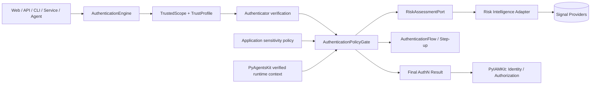
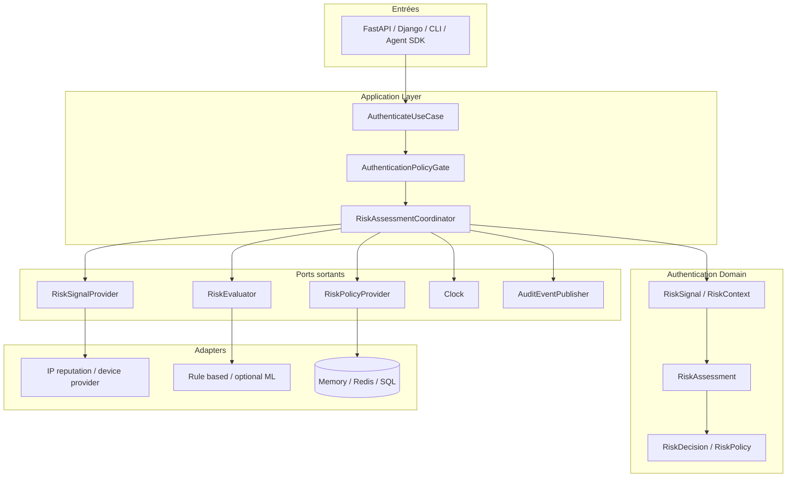
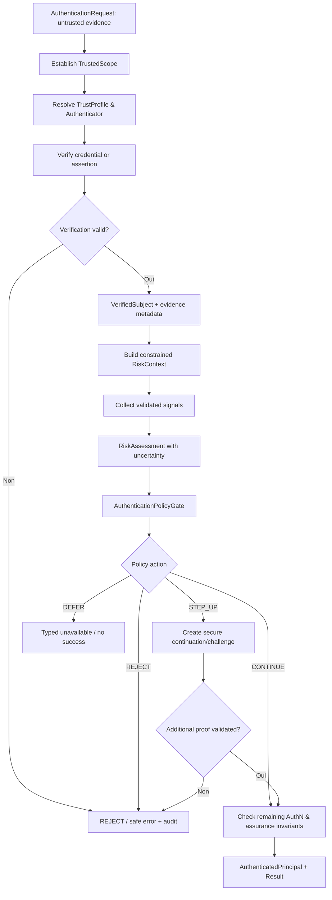
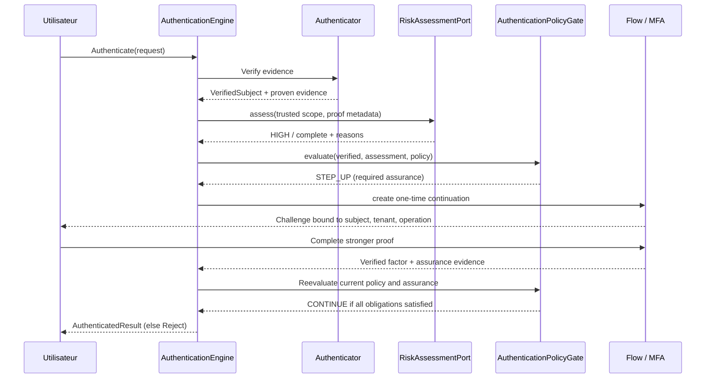
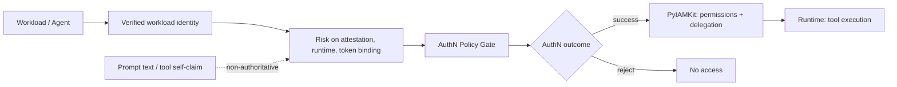
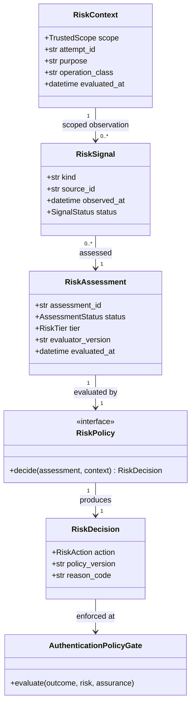
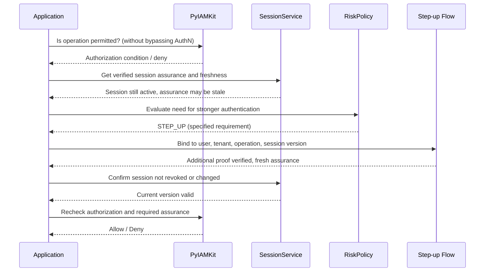
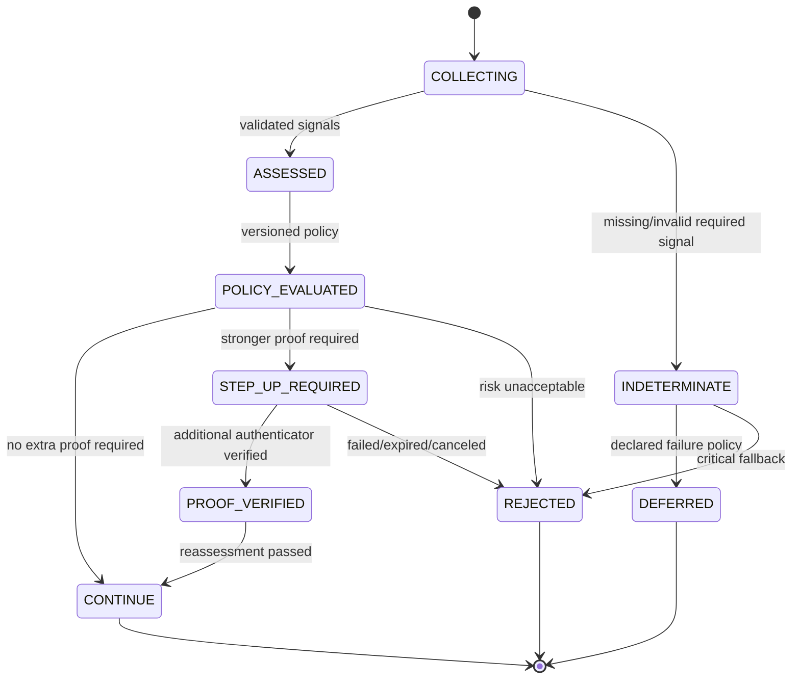
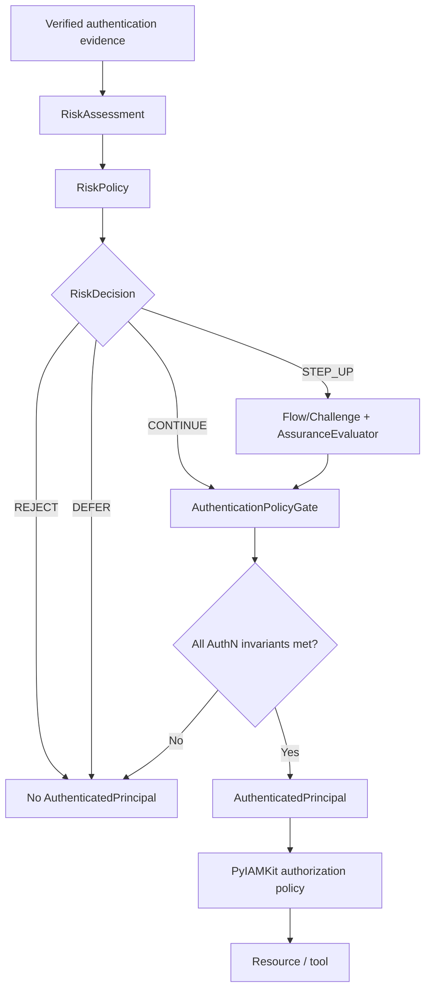

# 17_PYAUTHKIT_ADAPTIVE_AUTH_AND_RISK_MODEL

# PyAuthKit — Adaptive Authentication and Risk Model

> **Projet :** PyAuthKit — Authentication Engine for the Modern Python Ecosystem  
> **Document :** `17_PYAUTHKIT_ADAPTIVE_AUTH_AND_RISK_MODEL.md`  
> **Type :** spécification de domaine, modèle de confiance, architecture et qualification  
> **Statut :** `PROPOSED / DESIGN` — ne présume aucune fonctionnalité livrée  
> **Version documentaire :** 0.1.0 (proposition)  
> **Date :** 30 octobre 2026  
> **Langue :** français, vocabulaire technique et noms Python en anglais  
> **Domaine :** Authentication / Adaptive Authentication / Risk-Aware Policy  
> **Périmètre produit :** principalement POST-MVP ; interfaces préparatoires possibles au MVP  
> **Convention :** `PYAUTHKIT_SOFTWARE_DESIGN_LEARNING_CONVENTION.md`

> **Règle fondatrice :** un risque faible ne prouve aucune identité ; un risque élevé n'annule pas une vérification cryptographique déjà réalisée mais peut empêcher qu'elle soit acceptée comme authentification suffisante. La politique de risque **ne transforme jamais** une preuve invalide en authentification valide, ne crée pas de permission et ne proclame pas d'AAL sans preuve.

---

## Guide de lecture

- **Sections 0–11 :** contexte, vocabulaire, périmètre, frontières de confiance et architecture.
- **Sections 12–29 :** modèle de signaux, évaluation, politiques, décisions, assurance, sessions, agents et traitement des échecs.
- **Sections 30–39 :** contrats Python, algorithmes, diagrammes, propriétés transverses et préparation à l'implémentation.
- **Sections 40–48 :** registres traçables des exigences, invariants, menaces, tests, fitness functions et ADR.
- **Sections 49–56 :** fiches pédagogiques, qualification, roadmap, arbitrages, références et annexes.

Les classes, seuils, signatures, données d'exemple, codes d'erreur et configurations sont **des propositions**. La présence d'une figure, d'un test candidat ou d'un type Python ne démontre pas qu'un module existe dans une version installable. Les états `IMPLEMENTED`, `TESTED` et `QUALIFIED` exigent des preuves de dépôt et d'exécution.

---

## 0. Résumé exécutif

PyAuthKit doit accepter des preuves d'authentification émanant d'humains, applications, services, workloads, appareils et agents IA. Certaines tentatives présentent des conditions anormales ou des enjeux plus élevés : appareil nouveau, credential compromis, environnement d'exécution non attendu, changement de contexte, opération sensible ou signaux incohérents. Le moteur doit pouvoir **adapter les exigences d'authentification**, sans transformer l'analyse du risque en système IAM, fraude ou surveillance comportementale complet.

Le modèle recommandé sépare cinq opérations :

1. établir le **scope de confiance** à partir d'une source autoritative, jamais des claims présentés seuls ;
2. recueillir des **observations contextualisées**, avec origine, fiabilité, fraîcheur et finalité ;
3. produire une **évaluation de risque** explicite, y compris en présence d'incertitude ;
4. appliquer une **politique d'authentification** versionnée pour décider `CONTINUE`, `STEP_UP`, `REJECT` ou `DEFER` ;
5. laisser l'`AuthenticationPolicyGate` produire la décision AuthN finale seulement si la preuve cryptographique et l'assurance demandée sont satisfaites.

Ce modèle doit rester intégrable dans `AuthenticationEngine` sans le transformer en `RiskGodObject`. Les modèles de scoring, fournisseurs IP/device, données de réputation et éventuels outils ML sont des **adapters ou policy implementations**, non des dépendances essentielles du domaine.

---

## 1. Filiation documentaire et autorité

| Document | Autorité conservée | Apport spécifique de `17` |
|---|---|---|
| `00` — Expression du besoin | Adaptation, extensibilité et périmètre AuthN | Sous-domaine Adaptive Auth détaillé |
| `01` — Requirements | Exigences générales / SEC / NFR | Exigences spécialisées `RISK-REQ-*` |
| `02` — Vision / Principles | Séparation des préoccupations, DIP, simplicité | Règles d'évolution des policies |
| `03` — System Architecture | Couche application, domain, ports, adapters | Position du Risk Assessment et du Policy Gate |
| `04–06` — Domain Objects, Entities, ERD | Objets canoniques et ownership | Projections risk-specific, sans nouvelles tables obligatoires |
| `07` — Invariants / Business Rules | `AUTH-INV-*`, fail-closed et contrôle final | Invariants spécialisés `RISK-INV-*` |
| `08` — Commands, Queries, Use Cases | Orchestration applicative, CQRS sélectif | Evaluer risque et demander step-up |
| `09` — Authentication Engine | Pipeline et `AuthenticationPolicyGate` | Point d'insertion sans contourner vérification |
| `10` — Authenticator / Credential | Résultat de vérification et provenance | Signaux distincts des preuves de credential |
| `11` — Flow / Challenge | Continuation, single-use, concurrence | Exécution sûre de `STEP_UP` |
| `12` — MFA / Assurance | Facteurs, AAL, preuve et fraîcheur | Exigences d'assurance dérivées du risque |
| `13` — Session / Token | Session context, revoke, rotation | Risk refresh, re-auth et invalidation |
| `14` — Federation | Issuer, subject, `acr`/`amr`, FAL | Signaux fédérés contrôlés |
| `15` — WebAuthn | Origin, RP ID, UV/UP, passkeys | Options de step-up résistantes au phishing |
| `16` — Machine / Workload / Agent Auth | NHI, délégation, trust domains | Risque d'exécution non humaine |
| Convention pédagogique | Problem First, Pattern Second, Trust First | Design Learning Cards et preuves |

**Règle de compatibilité :** si une spécification précédente fixe déjà l'autorité sur un objet, `17` ne peut la transférer implicitement. Les décisions proposées dans `17` doivent être arbitrées via ADR avant stabilisation des contrats publics.

## 2. Références normatives et statut des sources

La présente spécification est guidée par les documents suivants, **sans en déduire une certification** :

- NIST **SP 800-63B-4**, édition finale juillet 2025, authentification, authenticator lifecycle et AAL ;
- NIST **SP 800-63-4**, édition finale juillet 2025, cadre général des identités numériques ;
- OWASP **Authentication Cheat Sheet**, réauthentification après événement à risque, contexte et fraude ;
- OWASP **Multifactor Authentication Cheat Sheet**, adaptation contextuelle et facteurs indépendants ;
- OWASP **ASVS 5.0**, notamment documentation des contrôles anti-automation/adaptive response ;
- OWASP **Session Management Cheat Sheet**, durée de vie et invalidation ;
- NIST **AI RMF 1.0**, uniquement si une architecture ML / data-driven est retenue, comme cadre de gestion des risques et gouvernance des modèles.

**Distinction normative :** NIST décrit des conditions de qualification AAL. Un `RiskTier=LOW` n'est ni un authenticator, ni un AAL ; `RiskTier=HIGH` n'entraîne pas automatiquement une requalification NIST. Les seuils du moteur, son scoring et ses actions par tier relèvent du **choix produit**. Les références URL, leur statut et leur portée figurent en section 55.

## 3. Problem Statement — la pression réelle

Une authentification correcte sur le plan cryptographique peut intervenir dans un contexte où elle est **insuffisante** pour satisfaire la politique applicable : mot de passe valide mais fuite de secret suspectée, session encore active mais action sensible, credential machine valide depuis un environnement non approuvé, compte récemment récupéré et enrollment d'un nouveau facteur.

Inversement, une preuve correctement authentifiée dans un contexte ordinaire ne justifie pas systématiquement un deuxième défi. L'approche adaptative cherche donc à améliorer la sécurité **sans friction arbitraire**.

Les principales tensions sont : disponibilité vs sûreté ; confidentialité vs télémétrie ; sensibilité vs faux positifs ; rapidité vs consultation de fournisseurs externes ; personnalisation vs surveillance ; facilité de récupération vs résistance à l'account takeover ; explicabilité vs non-divulgation de stratégies anti-fraude.

## 4. Vision produit, objectifs et non-objectifs

**Objectifs :** évaluer des indices de risque de sources contrôlées, construire un diagnostic tracé, composer des politiques remplaçables, demander un step-up approprié, échouer explicitement sur les situations incertaines et conserver un modèle multi-tenant agnostique des fournisseurs.

**Non-objectifs :** moteur de fraude universel, scoring bancaire, identification biométrique autonome, reconnaissance faciale, collecte de géolocalisation systématique, attribution de rôles ou permissions, ML obligatoire, annuaire de comptes, dispositif de surveillance comportementale et tout contrôle qui ignorerait l'accessibilité ou les contraintes de protection des données.

## 5. Périmètre par phase

| Capacité | Phase cible | Pourquoi |
|---|---|---|
| Points d'extension du gate, refus cohérent | MVP — prêt à étendre | Vérification Password/API Key/JWT sans dépendance au RiskEngine |
| Contrat `RiskSignal` / `RiskAssessment` stable | POST-MVP tranche A | Besoin d'un vocabulaire générique |
| `RuleBasedRiskEvaluator` + `RiskPolicy` | POST-MVP tranche A | Compréhensible, déterministe, testable |
| Step-up avec `AuthenticationFlow`/`Challenge` | POST-MVP tranche B | Dépend des documents `11` et `12` |
| Reevaluation de session et revocation | POST-MVP tranche C | Dépend du modèle `13` |
| Reputation IP, device intelligence externes | Intégration optionnelle | Fiabilité / privacy / contrat / disponibilité |
| Modèles statistiques ou ML | FUTURE, conditionnel | Seulement avec évaluation, jeux de données, monitoring et gouvernance |
| NHI / agent contextual risk | FUTURE, sélection ciblée | Dépend de `16`, des attestations et des politiques IAM |

L'architecture prépare la progression sans imposer au MVP un service réseau, Redis, une base SQL, un event broker ou un modèle ML.

## 6. Ubiquitous Language

| Terme | Signification dans PyAuthKit | À ne pas confondre |
|---|---|---|
| `RiskSignal` | Observation contextualisée, non autoritative à elle seule | `CredentialEvidence` |
| `SignalSource` | Origine et mode de collecte d'un signal | `TrustedIssuer` cryptographique |
| `SignalProvenance` | Origine, collecte, horodatage, intégrité, scope | Vérité absolue |
| `RiskContext` | Inputs de décision réduits et contextualisés | HTTP request brut |
| `RiskAssessment` | Evaluation du risque et de son incertitude | `AuthenticationResult` |
| `RiskTier` | Classification locale/configurée du risque | `AAL`, `IAL` ou `FAL` |
| `RiskDecision` | Résultat d'une politique d'adaptation | Décision AuthN finale |
| `RiskPolicy` | Règle gouvernant la réponse à un risque | `AuthorizationPolicy` IAM |
| `SignalConfidence` | Fiabilité de mesure/collecte, avec limites | Probabilité calibrée sans preuve |
| `RequiredAssurance` | Objectif d'assurance demandé pour un cas | Assurance obtenue |
| `StepUpRequirement` | Condition supplémentaire à prouver | Permission d'accéder à une ressource |
| `Unknown` | Donnée absente, invalide ou non concluante | `LOW_RISK` |
| `RiskIndicator` | Indice mis à disposition des policies | Un facteur MFA |
| `RiskEvent` | Événement de changement significatif du diagnostic | Evénement de credential vérifié |
| `Baseline` | Profil historique facultatif, daté et gouverné | Identité cryptographique |
| `SessionReassessment` | Nouvelle évaluation d'une session préexistante | Nouvelle authentification réussie |
| `NHITrustEvidence` | Attestation technique contrôlée du workload | Auto-description d'un agent |

## 7. Bounded Contexts et Truth Ownership

- **PyAuthKit / Authentication :** possède les contrats d'évaluation, les décisions d'authentification et les continuations `STEP_UP`; orchestre des signals via ports.
- **Risk Intelligence externe :** peut posséder bases de réputation, modèles, alertes et signaux ; PyAuthKit ne doit pas en copier silencieusement la vérité métier.
- **PyIAMKit / IAM & Authorization :** possède l'identité organisationnelle, les permissions, le contexte de ressource, les politiques d'accès et les décisions d'autorisation.
- **Application / Business :** connaît la sensibilité d'une opération et la nécessité d'un contrôle renforcé. Elle publie un besoin d'assurance selon son contrat, sans accorder elle-même un AAL.
- **PyAgentsKit / Runtime :** connaît l'agent, l'instance, les exécutions et les outils ; sa description n'est pas une preuve de confiance.
- **External IdP :** connaît sa politique propre d'authentification et sa preuve fédérée ; PyAuthKit l'interprète uniquement via le `FederationTrustProfile`.

L'appartenance d'un signal au domaine Authentication n'est **pas** une permission de collecter toutes les données possibles. Le propriétaire des données, le responsable du traitement et les durées de conservation devront être explicités au déploiement.

## 8. Context Map (C4 / DDD)



Les flèches décrivent **des responsabilités logiques** et non nécessairement des appels réseau. Le `RiskAssessmentPort` ne possède ni les credentials ni la décision finale d'authentification.

## 9. Trust Boundaries `RISK-TB-*`

| ID | Frontière | Règle |
|---|---|---|
| `RISK-TB-01` | Client → serveur | IP, device, headers, user agent et client-side scores sont non fiables par défaut |
| `RISK-TB-02` | Application → `TrustedScope` | Tenant/realm proviennent du host, route ou contexte IAM approuvé |
| `RISK-TB-03` | Provider externe → adapter | Provenance, canal et contrat vérifiés avant acceptation de l'observation |
| `RISK-TB-04` | Évaluateur → gate | L'évaluateur ne peut exprimer que le risque, pas authentifier |
| `RISK-TB-05` | Gate → Flow | Un `STEP_UP` crée une obligation prouvable, pas un succès partiel |
| `RISK-TB-06` | Flow → Session | Assurance, tenant, subject et opération doivent être liés et revérifiés |
| `RISK-TB-07` | Risk event → Audit | Minimisation, codes de raison et protection des données |
| `RISK-TB-08` | Agent prompt → Runtime | Un LLM ne peut pas déclarer son score, sa posture ou ses permissions |
| `RISK-TB-09` | Federation → risk | `acr`/`amr` sont interprétés après preuve et mapping contrôlé |
| `RISK-TB-10` | Configuration → évaluateur | Profiles, weights et seuils viennent d'une configuration gouvernée |

## 10. Architecture hexagonale, couches et dépendances



**Dependency Rule :** domaine et application ne doivent pas importer des SDK de fournisseurs de réputation, frameworks Web, bases de données ni modèles ML. Les implémentations `RiskEvaluator` doivent rester substituables sans changer l'`AuthenticationEngine`.

## 11. Pipeline d'intégration avec `AuthenticationEngine`



L'ordre conceptuel **n'interdit pas** une vérification défensive *pré-authentification* (throttling, bot mitigation, admission), mais cette vérification doit être clairement distinguée d'un `RiskAssessment` portant sur un sujet vérifié. Les métadonnées de preuve validée et le scope établi sont requis pour toute décision dépendant d'une identité réelle.

## 12. Catalogue des capacités et objets de domaine

| Objet ou service | Classification DDD candidate | Responsabilité | Owner |
|---|---|---|---|
| `RiskSignal` | Value Object | Observation typée, provenance et temporalité | AuthN contract |
| `RiskContext` | Value Object / DTO interne | Inputs limités, tenant et operation context | AuthN/application |
| `SignalProvenance` | Value Object | Source et garanties d'acquisition | AuthN contract |
| `RiskAssessment` | Value Object / résultat | Evaluation figée, status et raisons internes | AuthN |
| `RiskTier` | Enum / Value Object | Catégorie locale | AuthN |
| `RiskPolicy` | Domain Policy / port | Décision dépendant de l'Assessment | AuthN |
| `RiskDecision` | Value Object | Action, conditions et provenance de la policy | AuthN |
| `RiskPolicyVersion` | Value Object | Identité de configuration | Configuration |
| `RiskEvaluator` | Port / Strategy conditionnelle | Evaluer sans attribuer de principal | Application port |
| `RiskSignalProvider` | Port | Collecter les observations externes | Application port |
| `RiskAssessmentCoordinator` | Application Service | Orchestrer collecte et évaluation | Application |
| `RiskEvent` | Domain/Application Event selon signification | Fait de changement de diagnostic | AuthN |
| `RiskBaseline` | Donnée facultative | Comportement statistique si autorisé | External/conditional |
| `StepUpRequirement` | Value Object | Demander une assurance définie | AuthN/`12` |
| `AuthenticationChallenge` | Entity candidate | Poursuite sécurisé, one-time | `11` |
| `SessionRiskState` | Value Object / metadata versionnée | Etat de dernière réévaluation | `13` |
| `VerifiedNHIContext` | Value Object / référence | Identité technique attestée | `16` |

**Attention DDD :** un `RiskSignal` n'est pas une entité parce qu'il possède un `signal_id` de corrélation ; un `RiskAssessment` n'est pas un agrégat parce qu'il contient plusieurs observations. L'agrégat de stockage n'est requis que si l'application possède un cycle de vie et des invariants transactionnels spécifiques.

## 13. Classification des signaux de risque

| Famille | Exemple | Provenance contrôlée | Limites et biais |
|---|---|---|---|
| Réseau | IP connue d'abus, ASN, proxy | Gateway approuvée + provider | VPN, NAT, IP partagées, mobile roaming |
| Appareil | appareil déjà enrôlé, attestation de device | Enrollment vérifié / MDM | fingerprint changeant, spoofing |
| Usage | volume d'échecs, vélocité | Evénements de serveur | erreurs légitimes, bot amplification |
| Compromission | signal de secret exposé | Fournisseur approuvé, processus interne | faux positifs, délai de propagation |
| Session | session ancienne, changement de binding | Session service `13` | cookies volés, cache stale |
| Opération | transfert sensible, changement de facteur | Use case autoritatif | classification locale variable |
| Fédération | mode d'authentification déclaré par IdP | Claims vérifiés selon `14` | `acr`/`amr` non équivalents à AAL par défaut |
| NHI | trust domain, audience, identité SPIFFE | Attestation `16` | churn workloads, horloge et renouvellement |
| Agent | exécution inhabituelle, nouveau tool demandé | Runtime et IAM vérifiés | prompt injection, auto-déclaration |
| Contexte géographique | incohérence de région ou déplacement | Derivation contrôlée d'IP | VPN, localisation imprécise, accessibilité |

Signaux **déconseillés par défaut** : biométrie comportementale invasive, suivi inter-sites, caractéristiques sensibles, données de santé, surveillance continue sans besoin démontré. Leur usage exige justification, conformité, consentement ou autre fondement juridique selon contexte, et revue de biais.

## 14. `RiskSignal` : contrat de donnée

Un signal doit identifier a minima : `kind`, `value` sous forme maîtrisée, `observed_at`, `source`, `source_trust`, `scope`, `collection_method`, `status` et éventuellement `expires_at`. Une version de schéma permet aux adapters d'évoluer sans modifier la sémantique du domaine.

**Conventions :** aucune information d'identité ni aucun secret brut dans un nom de métrique ; ne pas conserver une IP complète par défaut si une catégorie ou pseudonymisation répond au besoin ; une localisation géographique approximative n'est pas une preuve de présence physique ; une empreinte d'appareil dérivée d'en-têtes HTTP ne vaut pas une attestation cryptographique.

| Attribut | Sens | Règle |
|---|---|---|
| `source_id` | Origine déclarée de l'observation | Résolution vers source autorisée |
| `signal_kind` | Vocabulaire de signal | Liste admise par policy |
| `observed_at` | Temps de l'observation | Comparer à clock approuvée |
| `received_at` | Temps de réception | N'implique pas fraîcheur de l'observation |
| `expires_at` | Fin de validité | Signal périmé non traité comme courant |
| `tenant_scope` | Périmètre de validité | Pas de cross-tenant implicite |
| `confidence` | Qualité de la mesure | Non assimilée à preuve d'identité |
| `integrity_status` | Intégrité transport/payload | Vérification selon provider |
| `collection_basis` | Finalité et base de traitement | Minimisation / transparence |

## 15. Provenance, fiabilité et fraîcheur

La source peut être `SERVER_OBSERVED`, `PROVIDER_VERIFIED`, `DEVICE_ATTESTED`, `FEDERATED_VERIFIED`, `CLIENT_REPORTED` ou `UNKNOWN`. Le type de source n'accorde pas automatiquement un niveau de confiance : ses garanties proviennent d'une **configuration autoritative** et d'une validation réalisée.

Ordre de traitement recommandé :

1. identifier le fournisseur configuré pour le `TrustedScope` ;
2. valider transport, source, signature ou canal d'administration si le contrat l'exige ;
3. contrôler schéma, dimensions, timestamp et TTL ;
4. vérifier l'absence de mismatch tenant/realm/subject/operation ;
5. classer `VALID`, `MISSING`, `STALE`, `INVALID`, `CONFLICTING` ou `UNAVAILABLE` ;
6. associer le diagnostic au `RiskAssessment` sans falsifier le signal.

Il n'existe **aucune** règle universelle de « TTL de signal de risque ». La validité dépend de sa volatilité, de la politique, du fournisseur et des risques du déploiement.

## 16. `RiskContext` : extraction contrôlée

Un `RiskContext` est une représentation **minimisée** de ce qui peut légitimement influer sur l'authentification. Il ne doit pas être une copie de l'ensemble des headers, cookies, claims, prompts et données utilisateur.

Entrées attendues : `trusted_scope`, `authentication_attempt_id`, `verified_subject` (si disponible), `authenticator_provenance`, `risk_purpose`, `operation_sensitivity` (déclarée par un service approuvé), `current_assurance` (vérifiée), `session_reference`, `request_observed_at`, `policy_profile_ref`.

**Invariant :** le nom du tenant, l'id du client, la sensibilité et l'identité du sujet **ne sont pas modifiables** par un fournisseur de signaux. Des attributs présentés par le client ne peuvent servir qu'à produire des observations limitées ou de la télémétrie, pas le scope effectif.

## 17. `RiskAssessment` : diagnostic distinct de la décision

```text
RiskAssessment
├── assessment_id
├── scope / purpose / subject_ref (pseudonymisé si possible)
├── status: COMPLETE | PARTIAL | INDETERMINATE | UNAVAILABLE
├── tier: LOW | ELEVATED | HIGH | CRITICAL | UNKNOWN
├── signals_used: references / classifications, not raw secrets
├── confidence: calibrated only when calibration evidence exists
├── reason_codes: INTERNAL; non-sensitive summaries
├── evaluator_id + evaluator_version
├── evaluated_at / expires_at
└── provenance / trace_reference
```

La distinction `status` / `tier` est essentielle : `status=UNAVAILABLE` ne doit pas être converti silencieusement en `tier=LOW`. Un score numérique facultatif n'est pas une probabilité calibrée sauf démonstration sur des données représentatives.

## 18. Risk Tiers — sémantique gouvernée, pas universelle

| Tier candidat | Sémantique descriptive | Réponse typique, *non automatique* |
|---|---|---|
| `LOW` | Aucun indicateur significatif selon la policy active et données suffisantes | Poursuivre vers le gate normal |
| `ELEVATED` | Une anomalie justifie une exigence renforcée | Step-up proportionné |
| `HIGH` | Indices convergents ou preuve de compromission | Step-up fort ou refus, selon policy |
| `CRITICAL` | Compromission confirmée ou condition interdite | Rejet / protection, avec justification |
| `UNKNOWN` | Signaux absents, contradictoires, périmés ou évaluation indéterminée | Traitement explicite, jamais `LOW` par défaut |

Les noms de tiers peuvent changer via ADR, mais leur sémantique et leurs transitions doivent rester versionnées. Il ne faut pas comparer directement des scores provenant de deux modèles ou tenants sans contrat de normalisation.

## 19. Moteur d'évaluation : rules, heuristics, ML (si justifié)

**Option A — règles déterministes** recommandée pour la première tranche : seuils configurés, conditions explicites, tests reproductibles, raison intelligible. **Option B — moteur externe spécialisé :** contractualisation des garanties et des pannes. **Option C — modèle ML :** uniquement si qualité des données, calibration, monitoring, vie privée, biais, drift et possibilités de rollback sont démontrés.

Le produit ne doit pas promettre la détection de fraude « intelligente » en se fondant sur de simples heuristiques. Les exigences réelles et les critères opérationnels doivent être définis à partir de scénarios et d'une politique de déploiement, sans inventer de score « industriel » universel.

## 20. Algorithme candidat de consolidation

```text
trusted context and verified evidence
  -> select applicable RiskProfile
  -> collect source-scoped signals (bounded deadline)
  -> validate provenance, freshness, scope and quality
  -> classify missing / invalid / conflicting separately
  -> evaluate declared rules or provider model
  -> return RiskAssessment (complete / partial / unavailable)
  -> evaluate RiskPolicy and required assurance
  -> CONTINUE | STEP_UP | REJECT | DEFER
  -> AuthenticationPolicyGate enforces final AuthN conditions
```

La déduplication doit être explicite : la répétition de **la même observation** depuis trois caches ne représente pas trois preuves indépendantes. Les signaux corrélés ne doivent pas être comptés comme trois sources séparées pour gonfler artificiellement la certitude.

## 21. `RiskPolicy` : contrat de décision

`RiskPolicy` prend un `RiskAssessment`, un `RiskContext` et les contraintes de `RequiredAssurance` publiées par le domaine. Elle retourne un `RiskDecision`, **sans effet de bord** sur l'identité, les permissions, la session ou les tokens.

| Action candidate | Effet autorisé | Effet interdit |
|---|---|---|
| `CONTINUE` | Poursuivre les contrôles du gate | Forcer le succès AuthN |
| `STEP_UP` | Demander un facteur/challenge adapté | Augmenter l'AAL immédiatement |
| `REJECT` | Refuser la poursuite | Divulguer le score ou le signal exploitable |
| `DEFER` | Réponse non définitive ou indisponibilité typée | Créer une session active sans preuve |

Pour des opérations sensibles, un `STEP_UP` peut être techniquement impossible : pas de facteur approprié, client incapable ou garantie requise non disponible. La politique doit prévoir `REJECT` ou un chemin de récupération explicitement approuvé ; jamais un downgrade silencieux.

## 22. Table de décision illustrative (NON-NORMATIVE)

| Condition | Conditions additionnelles | Action candidate | Justification |
|---|---|---|---|
| Vérification credential invalide | Tous les tiers | `REJECT` | Rien ne compense une preuve non valide |
| `COMPLETE` + `LOW` | Assurance de base déjà suffisante | `CONTINUE` | Sous réserve des autres policies |
| `COMPLETE` + `ELEVATED` | Factor enrollment et step-up possible | `STEP_UP` | Augmenter la résistance à l'usurpation |
| `COMPLETE` + `HIGH` | Opération critique | `REJECT` | Seuil de risque trop élevé selon policy candidate |
| `COMPLETE` + `HIGH` | Exigence explicitement prouvable | `STEP_UP` | Seulement si policy gouvernée l'autorise |
| `UNAVAILABLE` | Signal obligatoire pour opération critique | `DEFER` / `REJECT` | Fail-safe, pas allow implicite |
| `PARTIAL` | Données manquantes non critiques, policy le permet | `STEP_UP` | Condition déterminée explicitement |
| `UNKNOWN` | Aucune politique applicable | `REJECT` | Configuration absente : fail-closed |
| Compromission prouvée | Signal critique vérifié | `REJECT` + action de protection dédiée | Aucun facteur nouveau ne neutralise automatiquement une révocation |

Cette matrice illustre des *choix possibles*. Elle **n'établit pas** de seuil, comportement ou niveau d'assurance universel.

## 23. Step-up, MFA et assurance : relation avec `12`

Le tier de risque détermine **le besoin de preuve supplémentaire**, non le niveau d'assurance obtenu. Un `StepUpRequirement` peut exiger un authenticator résistant au phishing, la re-authentication récente, une user verification ou un authenticator déjà lié au sujet.

Le `AssuranceEvaluator` de `12` **qualifie** ensuite la preuve réellement obtenue selon un profil nommé et versionné. En particulier, SMS OTP n'est pas automatiquement phishing-resistant ; un appareil « connu » n'est pas un deuxième facteur ; un `acr` distant ne remplace pas un mapping fédéré contrôlé.



## 24. Sessions, refresh, réauthentification et révocation

L'évaluation initiale ne garantit pas que le risque restera inchangé pendant la session. Certaines opérations peuvent exiger une réévaluation lorsque des signaux pertinents changent ou lorsqu'un seuil temporel défini par la policy est dépassé.

- **Session active ≠ preuve récente :** les dates d'authentification et d'évaluation doivent rester séparées.
- **Reassessment ≠ login :** une évaluation de risque ne prolonge pas automatiquement une session.
- **Révocation :** action via le service `13` après autorité et cohérence transactionnelle déterminées.
- **JWT stateless :** un nouveau tier `HIGH` ne rend pas immédiatement inopérant un token non introspecté ; la topologie doit fournir un mécanisme d'invalidation/TTL adapté et prouvé.
- **Concurrency :** une session modifiée/revoquée durant l'évaluation exige une revalidation de version avant l'effet.
- **Eventual consistency :** définir l'intervalle maximal de propagation de chaque décision, le prouver et ne jamais promettre l'instantané sans architecture associée.

## 25. Federation : confiance dans `acr`, `amr` et IdP

- Interpréter `acr`, `amr`, `auth_time` uniquement depuis des assertions déjà vérifiées selon `14`.
- Aucun claim non vérifié ne peut augmenter l'assurance ni changer le `RiskTier` d'autorité.
- La correspondance `acr -> assurance` dépend d'un `FederationTrustProfile` contrôlé, de l'issuer et du contexte de fédération.
- La réputation ou le risque signalé par l'IdP peut être un **signal externe**, mais sa sémantique et sa fiabilité exigent un contrat distinct.
- Une incapacité de l'IdP à satisfaire un step-up demandé doit aboutir à une décision sûre (refus ou re-auth locale autorisée, selon le contrat), sans faux succès.

## 26. Machine, Workload et Agent Risk : relation avec `16`

Pour un workload ou agent, les signaux utiles peuvent inclure une identité SPIFFE vérifiée, un trust domain attendu, une audience correcte, l'état d'une attestation technique, un token éphémère, une signature sender-constrained, un environnement déclaré par un runtime administré et la conformité au mandat de délégation.

Ne **pas** transposer mécaniquement les signaux destinés à l'humain : une machine n'a pas de « nouvelle géographie » significative si elle utilise un egress proxy global ; une nouvelle instance éphémère n'est pas nécessairement suspecte ; un agent exécutant une action inédite n'est pas automatiquement malveillant.

**Règle capitale :** un modèle génératif, ses prompts, son reasoning, un champ JSON `trusted=true` ou son nom d'outil ne prouvent aucune propriété d'identité. L'autorisation d'une action est appliquée par PyIAMKit ou la ressource cible **après** authentification et vérification éventuelle d'une délégation.



## 27. Politique de disponibilité et dégradation contrôlée

L'indisponibilité peut être `PROVIDER_TIMEOUT`, `INTEGRITY_ERROR`, `POLICY_MISSING`, `PARTIAL_DATA`, `STALE_BASELINE`, `CIRCUIT_OPEN` ou `CLOCK_ERROR`. Le moteur ne doit pas confondre panne d'intelligence de risque et mot de passe erroné ; il doit néanmoins n'exposer au client qu'une erreur sûre, sans permettre la découverte de comptes.

**Deux modes candidats, explicitement configurés :**

1. `REQUIRED_RISK_CONTROL` : si un risque décisif ne peut pas être évalué, pas de succès ; tenter une alternative approuvée ou refuser.
2. `OPTIONAL_RISK_AUGMENTATION` : une erreur de l'évaluateur facultatif n'autorise pas à contourner l'authentification obligatoire ; poursuivre éventuellement selon une *policy de secours* pré-approuvée (par exemple step-up fort), enregistrée et testée.

Le système doit rester exploitable sous panne partielle : deadline globale, timeouts bornés, quotas, circuit breaker dans les adapters, repli explicite, alerting et absence de retry infini.

## 28. Privacy, minimisation, accessibilité et biais

- Collecter **le minimum nécessaire** à une finalité de protection explicite.
- Limiter par tenant la collecte, la conservation, les accès et les usages secondaires ; ne pas partager une baseline d'un tenant à l'autre sans base légale et contrat.
- Évaluer les faux positifs pour réseaux d'entreprise, VPN, pays, handicap, appareils accessibles, voyageurs, télétravail et environnements partagés.
- Éviter de pénaliser par défaut l'absence de biométrie, l'impossibilité de posséder un smartphone ou l'usage d'un navigateur atypique.
- Proposer des méthodes de step-up alternatives comparables lorsque les exigences d'assurance le permettent.
- Distinguer *raison interne* (réservée à l'audit contrôlé) et *message externe* (générique, utile et non révélateur).
- Définir des durées de conservation et une politique de purge ; un score ne doit pas devenir un profil personnel permanent sans justification.
- La conformité RGPD/ePrivacy dépend du contexte, de la base juridique et des pratiques réelles ; elle n'est pas déduite de cette spécification.

## 29. Temporalité, cohérence et versioning

Un résultat de risque peut dépendre d'une configuration, de signaux et d'un modèle qui changent. Une décision historique n'est donc explicable que si ses déterminants sont identifiables : `policy_id`, `policy_version`, `evaluator_version`, `signal_schema_version`, timestamps, scope et reason codes minimisés.

Il n'est **pas** nécessaire de sérialiser tous les signaux bruts pour expliquer une décision. Des références d'artefacts immuables et des catégories agrégées peuvent suffire sous un contrat explicite. La conservation d'un modèle n'assure pas sa reproductibilité sans les données, transformations et versions d'algorithme pertinentes.

**Règle de concurrence :** ne pas appliquer à une session ou un challenge une décision calculée pour une ancienne version si un changement critique (révocation, nouveau sujet, rotation) est intervenu entre l'évaluation et l'effet.

## 30. Modèle de domaine et relations (Mermaid)



**ERD :** aucune table SQL obligatoire. Si un assessment ou une baseline doit être persisté, la définition des règles de conservation, IDs, versions et ownership précède le schéma physique. Les `RiskSignal` bruts ne sont pas systématiquement conservés.

## 31. Contrats Python illustratifs — Value Objects

L'exemple suivant démontre des types et invariants de structure **sans collecte d'IP, cryptographie, exécution réseau ou évaluation réelle d'identité**. L'immutabilité Python facilite la conception ; elle ne garantit pas à elle seule l'intégrité ni l'authenticité de la donnée externe.

```python
from __future__ import annotations

from dataclasses import dataclass
from datetime import datetime
from enum import Enum
from typing import Literal


class SignalStatus(str, Enum):
    VALID = "valid"
    MISSING = "missing"
    STALE = "stale"
    INVALID = "invalid"
    CONFLICTING = "conflicting"
    UNAVAILABLE = "unavailable"


class AssessmentStatus(str, Enum):
    COMPLETE = "complete"
    PARTIAL = "partial"
    INDETERMINATE = "indeterminate"
    UNAVAILABLE = "unavailable"


class RiskTier(str, Enum):
    LOW = "low"
    ELEVATED = "elevated"
    HIGH = "high"
    CRITICAL = "critical"
    UNKNOWN = "unknown"


class RiskAction(str, Enum):
    CONTINUE = "continue"
    STEP_UP = "step_up"
    REJECT = "reject"
    DEFER = "defer"


@dataclass(frozen=True, slots=True)
class SignalProvenance:
    source_id: str
    collection_method: str
    schema_version: str
    integrity_checked: bool

    def __post_init__(self) -> None:
        if not self.source_id or not self.schema_version:
            raise ValueError("Signal provenance requires source and schema")


@dataclass(frozen=True, slots=True)
class RiskSignal:
    kind: str
    category: str
    status: SignalStatus
    observed_at: datetime
    provenance: SignalProvenance

    def __post_init__(self) -> None:
        if self.observed_at.tzinfo is None:
            raise ValueError("Signal timestamps must be timezone-aware")


@dataclass(frozen=True, slots=True)
class RiskAssessment:
    assessment_id: str
    status: AssessmentStatus
    tier: RiskTier
    evaluator_version: str
    reason_codes: tuple[str, ...]
    evaluated_at: datetime

    def __post_init__(self) -> None:
        if self.evaluated_at.tzinfo is None:
            raise ValueError("Assessment time must be timezone-aware")
        if self.status is AssessmentStatus.UNAVAILABLE and self.tier is RiskTier.LOW:
            raise ValueError("Unavailable assessment cannot imply low risk")


@dataclass(frozen=True, slots=True)
class RiskDecision:
    action: RiskAction
    policy_version: str
    reason_code: str
    required_assurance_profile: str | None = None

    def __post_init__(self) -> None:
        if self.action is RiskAction.STEP_UP and not self.required_assurance_profile:
            raise ValueError("Step-up must name its assurance requirement")


# Type-level illustration only. Construction of these objects is NOT
# authorization to trust unverified data or to authenticate a principal.
```

**Learning concepts :** Value Object, Explicit Modeling, immutabilité, discriminants, protection d'états invalides, mais aussi les limites du typage (aussi strict soit-il) aux frontières de confiance.

## 32. Ports et contracts Python illustratifs

```python
from __future__ import annotations

from dataclasses import dataclass
from typing import Protocol, Sequence


@dataclass(frozen=True)
class TrustedRiskScope:
    tenant_id: str
    realm_id: str
    purpose: str
    # Created only by a trusted host adapter, never from user claims alone.


@dataclass(frozen=True)
class RiskInputs:
    scope: TrustedRiskScope
    attempt_id: str
    verified_subject_ref: str
    operation_class: str


class RiskSignalProvider(Protocol):
    async def collect(self, inputs: RiskInputs) -> Sequence[RiskSignal]: ...


class RiskEvaluator(Protocol):
    async def assess(
        self, inputs: RiskInputs, signals: Sequence[RiskSignal]
    ) -> RiskAssessment: ...


class RiskPolicy(Protocol):
    def decide(
        self, assessment: RiskAssessment, inputs: RiskInputs
    ) -> RiskDecision: ...


class AuditPublisher(Protocol):
    async def publish_decision(self, decision: RiskDecision) -> None: ...


# These ports deliberately exclude SQL, HTTP, Redis, sklearn and provider SDKs.
# The contracts must be bound to real trusted scopes by the composition root.
```

### 32.1 Pourquoi ne pas appeler `RiskEvaluator` un GoF Strategy par réflexe ?

Le port peut cacher un évaluateur interchangeable, mais **Strategy** est réellement présent seulement si plusieurs comportements sont substituables derrière un contrat stable et si ce choix répond à une variation observée. Un simple module de règles (fonction pure) peut suffire dans la première tranche.

### 32.2 Contrats d'erreurs

Un adapter doit distinguer `InvalidSignalPayload`, `SignalProviderUnavailable`, `SignalExpired`, `PolicyNotFound`, `AmbiguousRiskProfile`, `RiskEvaluationTimeout`, `RiskAssessmentIndeterminate` et `AuditPersistenceFailed` (noms candidats). Aucune de ces erreurs n'est une preuve d'authentification échouée par credential, sauf mapping explicite au résultat public sûr.

## 33. Politique déterministe minimale et tests pédagogiques

Le modèle suivant **ne calcule pas le risque** : il applique à un `RiskAssessment` déjà reçu une règle illustrative, avec un traitement conservateur des erreurs. Il montre comment protéger la décision du gate contre un `UNKNOWN → CONTINUE` implicite.

```python
from __future__ import annotations

from dataclasses import dataclass
from enum import Enum


class Tier(str, Enum):
    LOW = "low"
    ELEVATED = "elevated"
    HIGH = "high"
    UNKNOWN = "unknown"


class Availability(str, Enum):
    COMPLETE = "complete"
    UNAVAILABLE = "unavailable"


class Action(str, Enum):
    CONTINUE = "continue"
    STEP_UP = "step_up"
    REJECT = "reject"


@dataclass(frozen=True)
class Assessment:
    tier: Tier
    availability: Availability


@dataclass(frozen=True)
class Decision:
    action: Action
    reason: str


def choose_action(assessment: Assessment) -> Decision:
    """Illustrative rule; not an authentication or authorization function."""
    if assessment.availability is Availability.UNAVAILABLE:
        return Decision(Action.REJECT, "required_risk_unavailable")
    if assessment.tier is Tier.UNKNOWN:
        return Decision(Action.REJECT, "risk_undetermined")
    if assessment.tier is Tier.HIGH:
        return Decision(Action.REJECT, "risk_high")
    if assessment.tier is Tier.ELEVATED:
        return Decision(Action.STEP_UP, "fresh_factor_required")
    return Decision(Action.CONTINUE, "risk_screen_passed")


def test_unavailable_does_not_pass() -> None:
    assessment = Assessment(Tier.LOW, Availability.UNAVAILABLE)
    assert choose_action(assessment).action is Action.REJECT


def test_step_up_is_not_success() -> None:
    assessment = Assessment(Tier.ELEVATED, Availability.COMPLETE)
    assert choose_action(assessment).action is Action.STEP_UP


# Even Action.CONTINUE must go through AuthenticationPolicyGate and
# does NOT itself create an AuthenticatedPrincipal.
```

Ces deux tests sont des **exemples pédagogiques**, pas une preuve de qualification de l'implémentation future. Les règles effectives doivent être versionnées, plus détaillées et adaptées aux risques réellement observés.

## 34. Séquences de référence et cas d'usage

### 34.1 UC-01 — Login password avec appareil inconnu

1. L'adapter HTTP construit le scope autoritatif et extrait les credentials.
2. Le password authenticator vérifie l'evidence selon `10`.
3. Le `RiskContextBuilder` reçoit un indicateur `device_not_recognized` **non équivalent** à une preuve d'appareil compromis.
4. L'évaluateur classe les signaux ; la policy choisit `STEP_UP` si le facteur requis est disponible.
5. `11` crée un challenge lié au sujet, tenant, client et flow ; `12` vérifie le facteur et l'assurance.
6. Le gate revérifie la situation et retourne un succès uniquement si toutes les obligations sont satisfaites.

### 34.2 UC-02 — Compte après récupération

Une authentification suivant un reset de secret peut exiger une réauthentification renforcée avant enrollment de nouveaux facteurs. La politique de récupération et son autorité restent distinctes de la policy de risque, et ne doivent pas donner à un attaquant la possibilité de changer de credential en se basant sur une simple position géographique.

### 34.3 UC-03 — Session ancienne, opération sensible

La session reste active pour des usages courants ; une opération sensible exige une preuve fraîche. **Autorisation de l'opération** reste conditionnée à PyIAMKit ; le step-up n'est qu'une condition d'authentification supplémentaire.



### 34.4 UC-04 — API Key valide, signe de fuite

Une API Key valide mais connue compromise doit être refusée selon la policy ; une méthode secondaire ne rend pas acceptable un credential explicitement révoqué. Le cycle de révocation et l'ownership du record restent régis par `10`.

### 34.5 UC-05 — Workload identity valide mais attestation inattendue

Contrôler attestation et trust domain selon `16`, refuser si la policy exige une provenance qui manque, conserver l'identité technique et ne pas attribuer une identité humaine aux workloads.

### 34.6 UC-06 — Agent IA demande un outil sensible

Le runtime présente une identité de workload et éventuellement une délégation vérifiable. RiskPolicy peut recommander une preuve plus fraîche ; PyIAMKit prend séparément la décision d'autoriser l'action. Aucun argument de fonction généré par le LLM ne peut modifier la sensibilité de la ressource ni le périmètre délégué.

### 34.7 UC-07 — Risk provider indisponible

Politique `REQUIRED_RISK_CONTROL` : action `DEFER` ou `REJECT`; aucune session ne doit être émise. Politique facultative : fallback versionné, explicitement approuvé, observable et testé, sans relâcher la vérification cryptographique ni les exigences d'assurance.

### 34.8 UC-08 — Plusieurs événements simultanés

Logout/révocation et step-up concurrent : priorité à la révocation effective ; une continuation attachée à la version d'une session révoquée doit être invalidée. Les conditions de concurrence exactes sont définies dans `11` et `13`.

## 35. Machine à états conceptuelle d'une décision adaptative



`CONTINUE` est un **état de la politique de risque**, jamais un état final `AUTHENTICATED`. Il faut préserver le discriminant des résultats du document `09`.

## 36. Résilience, performance et limites d'exécution

- **Budget global** : chaque collecte externe consomme le deadline du use case, ne prolonge pas arbitrairement l'authentification.
- **Timeouts** : explicites par adapter ; les échecs ne doivent pas être transformés en `LOW`.
- **Cache** : clés tenant/realm/subject-purpose/version ; TTL selon volatilité et source ; pas de cross-tenant ni de token brut.
- **Circuit breaker** : uniquement adapter ; après déclenchement, remonter un statut `UNAVAILABLE` visible de la policy.
- **Retry** : borné et contrôlé ; pas de boucle qui multiplie le coût d'un login malveillant.
- **Bulkheads** : séparer la capacité de calcul d'authentification de la saturation d'un service externe.
- **Rate limiting** : stratégie complémentaire, configurable et difficile à exploiter pour verrouiller massivement des comptes légitimes.
- **Scalabilité** : évaluer la cardinalité des signaux et éviter un historique comportemental global par défaut.
- **Observabilité** : métriques tenant pseudonymisées/agrégées, éviter les labels à cardinalité non bornée.

## 37. Audit, événements et explicabilité

Evénements candidats : `RiskAssessmentStarted`, `RiskSignalRejected`, `RiskAssessmentCompleted`, `RiskAssessmentUnavailable`, `RiskPolicyDecisionMade`, `StepUpRequired`, `StepUpCompleted`, `StepUpFailed`, `SessionRiskReevaluated`, `RiskPolicyVersionChanged`.

Le payload **doit éviter** credentials, tokens, PII inutile, adresse IP brute si non nécessaire et valeurs de signaux sensibles. Il peut comporter une référence d'attempt, un tenant pseudonymisé, le type d'action, les versions, une cause générique contrôlée, la latence et l'identifiant de corrélation.

**Ne pas** confondre journal d'audit et tableau de bord public : les raisons internes (`known_compromised_credential`, score, seuil exact) ne doivent pas faciliter l'évasion de détection. Les messages utilisateurs doivent être utiles (p. ex. « vérification supplémentaire requise ») sans exposer la logique détaillée.

## 38. Anti-patterns et pièges conceptuels

| Anti-pattern | Pourquoi c'est problématique | Alternative |
|---|---|---|
| `risk_score < x => login=True` | Confond risque et preuve cryptographique | Gate final avec verified evidence |
| `UNKNOWN = LOW` | Fail-open silencieux | Traitement explicite de l'indétermination |
| `trusted_device = MFA` | Dispositif reconnu ≠ second facteur | Facteurs validés selon `12` |
| `X-Forwarded-For` aveuglément accepté | Spoof de source IP | Trusted proxy configuration |
| `acr="aal3"` pris au pied de la lettre | Claim non vérifié ou mauvais mapping | FederationTrustProfile |
| `RiskGodObject` | Mélange transport, sécurité, AuthN, IAM et scoring | Ports + Domain Policy |
| `RiskProvider` retourne `AuthenticatedPrincipal` | Elévation de confiance injustifiée | Retour `RiskAssessment` uniquement |
| `LLM says risk=low` | Auto-assertion d'agent non fiable | Runtime evidence / provider vérifié |
| `ML mandatory` | Sur-ingénierie et coûts non justifiés | Règles déterministes initiales |
| `Policy thresholds hardcoded in ten places` | Divergence et audit impossible | Config versionnée à owner explicite |
| `geolocation => identity` | Faux sentiment de preuve, risques de biais | Risque contextuel faible fiabilité |
| `RiskDecision mutates Session` | Effets cachés et courses | Application service + version checks |
| `all events store raw IP/device` | Collecte disproportionnée | Minimisation et rétention bornée |
| `risk=high => automatically revoke all` | Peut causer déni de service massif | Politique de protection contextualisée |
| `risk evaluator ignores timeout` | Pannes cachées | Typed unavailable + deadline |
| `score is probability` | Mauvaise calibration | Score interne, calibration prouvée si revendiquée |

## 39. Modèle de scénarios et critères d'acceptation

| Scénario | Précondition | Comportement attendu |
|---|---|---|
| Credential invalide + risque LOW | Preuve invalide | Aucun succès |
| Password valide + device inconnu | Context validé, policy active | Challenge ou refus explicite |
| Credential révoqué + risque LOW | Révocation connue | Refus avant effet |
| Risk provider indisponible | Signal requis | Aucun bypass, erreur/fallback défini |
| IP réputée négativement mais NAT partagé | Signal incertain | Pas de vérité cryptographique implicite |
| JWT valide, mauvais tenant | Scope mismatch | Refus indépendamment du risque |
| Session en cours de révocation | Version changée pendant step-up | Pas de reactivation |
| OIDC `acr` non mappé | Provider vérifié, mapping absent | Pas d'AAL revendiqué |
| Agent avec délégation absente | Agent valide, action demandée | Pas d'autorisation implicite |
| Challenge consommé deux fois | Appels concurrents | Au plus un consommateur valide |
| Policy version non disponible | Sélection requise | Pas de fallback silencieux |
| Collecte interdite par policy privacy | Signal demandé | Echec contrôlé ou source alternative conforme |

## 40. Registre des exigences spécialisées `RISK-REQ-*`

Les 48 exigences qui suivent sont des **propositions spécialisées** à qualifier et prioriser, pas une extension rétroactive du MVP. Chaque entrée identifie une obligation observée, un comportement vérifiable et une phase. Les identifiants sont stables au sein de `17` et ne remplacent pas `FR-*`, `SEC-*` ou `AUTH-INV-*` du document `07`.

### 40.1 Exigences 01–12

| ID | Domaine | Exigence candidate | Acceptance evidence | Phase |
|---|---|---|---|---|
| `RISK-REQ-001` | Trust et authority | Scope tenant/realm fixé par host | Refuser tenant fourni seulement dans le payload | A |
| `RISK-REQ-002` | Trust et authority | Source de configuration gouvernée | Refuser policy choisie par client | A |
| `RISK-REQ-003` | Trust et authority | Seul un verified subject peut alimenter le profil lié au sujet | Refuser sujet non vérifié | A |
| `RISK-REQ-004` | Trust et authority | Risque distinct de credential evidence | Risk result ne peut certifier un mot de passe | A |
| `RISK-REQ-005` | Trust et authority | RiskDecision distinct de résultat AuthN | Action CONTINUE ne produit aucun principal | A |
| `RISK-REQ-006` | Trust et authority | Autorité IAM maintenue | Aucune permission créée par RiskPolicy | A |
| `RISK-REQ-007` | Signaux et provenance | Provenance obligatoire des signaux | Exiger source, schéma et statut | A |
| `RISK-REQ-008` | Signaux et provenance | Freshness évaluée par horloge de confiance | Périmé ne devient pas valide | A |
| `RISK-REQ-009` | Signaux et provenance | Scope de signal explicite | Refuser cross-tenant non autorisé | A |
| `RISK-REQ-010` | Signaux et provenance | Signal contradictoire représentable | Conflit distingué de faible risque | A |
| `RISK-REQ-011` | Signaux et provenance | Source non fiable explicitement classée | Header client ne s'auto-atteste pas | A |
| `RISK-REQ-012` | Signaux et provenance | Minimisation des données en entrée | Rejeter champs sans finalité approuvée | A |

### 40.2 Exigences 13–24

| ID | Domaine | Exigence candidate | Acceptance evidence | Phase |
|---|---|---|---|---|
| `RISK-REQ-013` | Evaluation | Assessment avec statut séparé du tier | UNAVAILABLE et LOW ne doivent pas coexister | A |
| `RISK-REQ-014` | Evaluation | Diagnostic reproductible à configuration figée | Reason codes et version conservés | A |
| `RISK-REQ-015` | Evaluation | Consolidation de signaux corrélés | Rejet du double comptage artificiel | A |
| `RISK-REQ-016` | Evaluation | Score numérique optionnel | Jamais probabilité sans calibration prouvée | C |
| `RISK-REQ-017` | Evaluation | Délais bornés pour évaluation | Timeout produit statut typé | A |
| `RISK-REQ-018` | Evaluation | Evaluation interchangeable | Port stable; adapter non structurant | A |
| `RISK-REQ-019` | Policies et décisions | Policy versionnée par scope | Identifier policy effective au moment de décision | A |
| `RISK-REQ-020` | Policies et décisions | Action discriminée | CONTINUE STEP_UP REJECT DEFER traités explicitement | A |
| `RISK-REQ-021` | Policies et décisions | Fallback explicite par scénario | Aucune autorisation silencieuse en panne | A |
| `RISK-REQ-022` | Policies et décisions | Refus si preuve cryptographique invalide | LOW n'annule pas le rejet credential | A |
| `RISK-REQ-023` | Policies et décisions | Risques critiques gouvernés | Compromission prouvée traitée par policy spécifique | A |
| `RISK-REQ-024` | Policies et décisions | Décision utilisable sans ML | Règle déterministe suffisante | A |

### 40.3 Exigences 25–36

| ID | Domaine | Exigence candidate | Acceptance evidence | Phase |
|---|---|---|---|---|
| `RISK-REQ-025` | Step-up et assurance | Step-up nommé et prouvable | Required assurance profile obligatoire | B |
| `RISK-REQ-026` | Step-up et assurance | Continuation liée au sujet et tenant | Empêcher substitution de sujet | B |
| `RISK-REQ-027` | Step-up et assurance | MFA évaluée selon preuve réelle | Tier de risque ne confère aucun AAL | B |
| `RISK-REQ-028` | Step-up et assurance | Frais d'authentification appliqués | Re-auth conditionnée à la fraîcheur requise | B |
| `RISK-REQ-029` | Step-up et assurance | Challenge à consommation unique | Une seule réussite sous concurrence | B |
| `RISK-REQ-030` | Step-up et assurance | Step-up impossible refusé sûrement | Pas de downgrade non déclaré | B |
| `RISK-REQ-031` | Session et temporalité | Session risk reassessment explicite | Déclencheur et source établis | C |
| `RISK-REQ-032` | Session et temporalité | Révocation non contournable | Session revokée ne réapparaît pas après score LOW | C |
| `RISK-REQ-033` | Session et temporalité | Réconciliation version de session | Refuser décision calculée sur état stale | C |
| `RISK-REQ-034` | Session et temporalité | JWT stateless: portée de révocation déclarée | N'annoncer instantané sans vérification | C |
| `RISK-REQ-035` | Session et temporalité | Risk evaluation ne prolonge pas session | Idle et absolute timeout inchangés | C |
| `RISK-REQ-036` | Session et temporalité | Changement de policy traçable | Liens de versions conservés | C |

### 40.4 Exigences 37–48

| ID | Domaine | Exigence candidate | Acceptance evidence | Phase |
|---|---|---|---|---|
| `RISK-REQ-037` | Fédération et NHI | acr et amr vérifiés avant scoring | Claims non vérifiés ignorés | C |
| `RISK-REQ-038` | Fédération et NHI | Trust domain workload vérifié | Ne pas croire identifiant auto-déclaré | C |
| `RISK-REQ-039` | Fédération et NHI | Risk NHI contextualisé | Ne pas appliquer les règles humaines par défaut | C |
| `RISK-REQ-040` | Fédération et NHI | Délégation agent vérifiée séparément | Agent authentifié ne vaut pas autorisé | C |
| `RISK-REQ-041` | Fédération et NHI | Tool scope issu du runtime et de IAM | Prompt ne choisit pas la sensibilité | C |
| `RISK-REQ-042` | Fédération et NHI | Séparation identité technique et humaine | Agent ne se fait pas passer pour user | C |
| `RISK-REQ-043` | Opérations et gouvernance | Audit des décisions sans secrets | Reason codes minimisés et versionnés | A |
| `RISK-REQ-044` | Opérations et gouvernance | Timeout et circuit breaker observables | UNAVAILABLE propagé à la policy | A |
| `RISK-REQ-045` | Opérations et gouvernance | Contrôle de la rétention | Purge et minimisation vérifiées | B |
| `RISK-REQ-046` | Opérations et gouvernance | Tests de faux positifs et accessibilité | Parcours alternatifs examinés | B |
| `RISK-REQ-047` | Opérations et gouvernance | Rollback d'une policy versionnée | Retour sûr à version qualifiée | B |
| `RISK-REQ-048` | Opérations et gouvernance | Aucune qualification sans preuves | CI tests et logs référencés | A |

**Phases :** `A` = rules/signal contracts, `B` = flow/MFA, `C` = sessions/NHI/ML éventuel. Les effets de toutes les exigences restent contrôlés par les invariants de `07` et la policy finale de `09`.

## 41. Registre des invariants `RISK-INV-*`

Un invariant est une propriété qui doit rester vraie dans son **scope**. Les tests associés devront couvrir le cas positif, la violation, les bornes temporelles et les situations concurrentes lorsque pertinentes.

### 41.1 Invariants 01–11

| ID | Catégorie | Invariant candidat | Propriété à tester |
|---|---|---|---|
| `RISK-INV-001` | Proof | Une preuve invalide ne devient pas valide sous risque LOW | Refus final avec credential invalide |
| `RISK-INV-002` | Proof | Risque LOW ne crée aucun AuthenticatedPrincipal | Gate final obligatoire |
| `RISK-INV-003` | Proof | RiskDecision ne contient pas de permission IAM | Contrat de données sans claim de rôle |
| `RISK-INV-004` | Proof | AAL évalué par assurance, pas score | Aucun upgrade AAL automatique |
| `RISK-INV-005` | Proof | Risk provider ne construit pas VerifiedSubject | Interfaces de ports isolées |
| `RISK-INV-006` | Proof | Pas de principal final sur STEP_UP pending | Résultat non final discriminé |
| `RISK-INV-007` | Trust | Scope effectif non choisi par l'appelant | Injecter tenant externe et refuser |
| `RISK-INV-008` | Trust | Policy effective sélectionnée par source gouvernée | Impossible de basculer policy depuis payload |
| `RISK-INV-009` | Trust | Provenance obligatoire avant usage de signal | Signal inconnu classé rejeté |
| `RISK-INV-010` | Trust | Claim acr/amr sans signature non autoritatif | Aucun AAL issu du claim brut |
| `RISK-INV-011` | Trust | Un header IP n'est pas trusted sans proxy approuvé | Header spoof traité comme non fiable |

### 41.2 Invariants 12–22

| ID | Catégorie | Invariant candidat | Propriété à tester |
|---|---|---|---|
| `RISK-INV-012` | Trust | NHI assertion ne vaut preuve qu'après vérification | Signed attestation validated |
| `RISK-INV-013` | Signals | `MISSING` n'est pas `LOW` | Status différent du tier |
| `RISK-INV-014` | Signals | `STALE` n'est pas `CURRENT` | Clock et TTL testés |
| `RISK-INV-015` | Signals | Signal d'un tenant ne migre pas dans un autre | Isolation dans store/cache |
| `RISK-INV-016` | Signals | Signal contradictoire conserve son diagnostic | Conflit observable et non masqué |
| `RISK-INV-017` | Signals | Signal dupliqué ne multiplie pas artificiellement la confiance | Déduplication testée |
| `RISK-INV-018` | Signals | Source indisponible ne crée pas une source fiable | Unavailable propagation |
| `RISK-INV-019` | Signals | Confidence sans calibration ne devient pas probabilité | API n'affiche pas proba non calibrée |
| `RISK-INV-020` | Signals | Horodatages timezone-aware obligatoires | Datetime naïf rejeté |
| `RISK-INV-021` | Policy | `UNKNOWN` ne choisit pas `CONTINUE` par défaut | Fallback explicite |
| `RISK-INV-022` | Policy | `STEP_UP` exige requirement traçable | Assurance profile present |

### 41.3 Invariants 23–33

| ID | Catégorie | Invariant candidat | Propriété à tester |
|---|---|---|---|
| `RISK-INV-023` | Policy | `REJECT` ne fuit pas le signal brut | Public errors scrubbed |
| `RISK-INV-024` | Policy | Absence de profil required risque provoque échec sûr | Missing policy test |
| `RISK-INV-025` | Policy | Une policy versionnée produit un résultat interprétable | Policy id/version in audit |
| `RISK-INV-026` | Policy | Aucune policy n'annule la révocation d'un credential | Revoke wins |
| `RISK-INV-027` | Policy | Un step-up impossible ne devient pas succès | No downgrade |
| `RISK-INV-028` | Policy | Des quotas dépassés ne désactivent pas les contrôles obligatoires | Fail-safe under load |
| `RISK-INV-029` | Session | Une session révoquée ne peut être réactivée par réévaluation | Stale CAS rejection |
| `RISK-INV-030` | Session | Risk assessment ne prolonge pas TTL session | No renewal side effect |
| `RISK-INV-031` | Session | Step-up conserve lien subject tenant session et operation | Context binding |
| `RISK-INV-032` | Session | Challenge consommé n'est pas rejouable | Atomic use once |
| `RISK-INV-033` | Session | Changement de version de session invalide décision stale | Version check before effect |

### 41.4 Invariants 34–41

| ID | Catégorie | Invariant candidat | Propriété à tester |
|---|---|---|---|
| `RISK-INV-034` | Session | Un JWT stateless ne porte pas révocation instantanée sans mécanisme | Explicit deployment contract |
| `RISK-INV-035` | NHI | Agent authentifié n'est pas autorisé par la seule AuthN | IAM enforced separately |
| `RISK-INV-036` | NHI | Prompt et tool arguments ne sont jamais des sources d'autorité | Inputs rejected as trust |
| `RISK-INV-037` | NHI | Subject et actor d'une délégation restent distincts | Verified grant required |
| `RISK-INV-038` | Ops | Aucun credential secret ou token brut dans audit risk | Redaction and sampling tests |
| `RISK-INV-039` | Ops | Aucun cache ne mélange tenant/purpose/policy version | Cache isolation test |
| `RISK-INV-040` | Ops | Un score historisé conserve sa version de méthode | Versioned reference |
| `RISK-INV-041` | Ops | Privacy constraints s'appliquent aussi à l'alerte | No unauthorized secondary use |

## 42. Registre de menaces `RISK-THR-*`

Un risque de sécurité n'est pas la même chose qu'un tier de risque métier. Ce catalogue analyse les attaques dirigées **contre le mécanisme adaptatif lui-même** et les réponses proposées. L'évaluation de criticité demeure contextuelle.

| ID | Surface | Menace | Conséquence | Contrôle candidat |
|---|---|---|---|---|
| `RISK-THR-001` | Trust | Client spoof IP/header | Faux signal de localisation ou réputation | Configuration trusted proxy + normalisation serveur |
| `RISK-THR-002` | Trust | Fake known device cookie | Bypass du step-up | Cookie non authentifiant; binding vérifié |
| `RISK-THR-003` | Trust | Tenant context injection | Contournement de policy inter-tenant | TrustedScope host-bound |
| `RISK-THR-004` | Trust | Provider response forgery | Signal favorable injecté | Intégrité du provider et schéma |
| `RISK-THR-005` | Trust | Forged federated acr/amr | AAL surévalué | Validation federation et mapping contrôlé |
| `RISK-THR-006` | Trust | Agent self-attestation | Tool utilisé au nom d'un faux sujet | Runtime proof + IAM |
| `RISK-THR-007` | Signals | Signal replay | Ancienne observation favorable réutilisée | TTL et timestamp validation |
| `RISK-THR-008` | Signals | Clock skew abuse | Fraîcheur illusoire | Horloge serveur + tolerances explicites |
| `RISK-THR-009` | Signals | Signal poisoning | Baseline modifiée par attaquant | Governance, robust training, anomaly checks |
| `RISK-THR-010` | Signals | Missing data masking | Classification LOW sur données partielles | Status distinct et fallback explicite |
| `RISK-THR-011` | Signals | Correlated signal inflation | Risque artificiellement trop certain | Déduplication et corrélation |
| `RISK-THR-012` | Signals | Leaked high-sensitivity telemetry | Profilage/PII exposés | Minimisation et accès contrôlés |
| `RISK-THR-013` | Policy | Model or rule downgrade | Nouveaux seuils permissifs | Approval/versioning + rollback |
| `RISK-THR-014` | Policy | Fail-open on timeout | Risk unavailable becomes allow | Typed error + fail-safe |
| `RISK-THR-015` | Policy | Account enumeration | Erreurs révèlent présence de compte | Public response neutralization |
| `RISK-THR-016` | Policy | Lockout amplification | Malveillant déclenche refuse massif | Rate limits, protected recovery |
| `RISK-THR-017` | Policy | Threshold probing | Attaquant déduit les seuils exacts | Reason-code sanitization + monitoring |
| `RISK-THR-018` | Policy | Unsafe ML model change | Drift et biais non détectés | Approval, calibration, evaluation, rollback |
| `RISK-THR-019` | Session | Session race with revocation | Reopened token/session after reject | CAS/version guard |
| `RISK-THR-020` | Session | Challenge replay | MFA step-up consommé deux fois | Atomic one-time consumption |
| `RISK-THR-021` | Session | Step-up session binding swap | Authenticator validé sur autre contexte | Bind tenant subject operation |
| `RISK-THR-022` | Session | JWT revoke promise mismatch | Ancien bearer reste valide | Introspection/short TTL/status proof |
| `RISK-THR-023` | Ops | Risk service denial-of-service | Réseau saturé bloque tout login | Deadlines, bulkhead, circuit breaker |
| `RISK-THR-024` | Ops | Logs with secrets or raw tokens | Fuite d'identités et comptes | Redaction, retention controls |

## 43. Plan de qualification `RISK-TST-*`

Les tests ci-dessous sont des **candidats à implémenter** : pas de résultats de CI ou de benchmark revendiqués. Pour chaque test, conserver le jeu d'entrée, la version de policy, le résultat attendu, le commit, l'environnement, la preuve d'exécution et la décision d'acceptation. Pour les tests adversariaux, les signaux simulés doivent passer par les vrais points de frontière à qualifier (pas seulement par des mocks du gate).

### 43.1 Confiance / scope (`001–010`)

| ID | Scénario à exécuter | Attendu vérifiable |
|---|---|---|
| `RISK-TST-001` | Tenant uniquement dans body client | Pas de TrustedScope sélectionné |
| `RISK-TST-002` | Tenant différent entre host et request | Rejet avec cause interne stable |
| `RISK-TST-003` | Realm ambigu sur route | Refus de résolution |
| `RISK-TST-004` | Risk policy choisie par utilisateur | Config ignorée/refusée |
| `RISK-TST-005` | Claim principal non vérifié | Aucune policy subject-bound activée |
| `RISK-TST-006` | Preuve password incorrecte avec tier LOW | Aucun résultat AUTHENTICATED |
| `RISK-TST-007` | RiskPolicy renvoie CONTINUE sans VerifiedSubject | Gate final refuse |
| `RISK-TST-008` | AuthN évaluée sur autre tenant | Aucun token ni session |
| `RISK-TST-009` | Fake trusted proxy header | IP non considérée authoritative |
| `RISK-TST-010` | Source de risque non enregistrée | Signal rejeté |

### 43.2 Signal provenance (`011–020`)

| ID | Scénario à exécuter | Attendu vérifiable |
|---|---|---|
| `RISK-TST-011` | Provider signé avec configuration attendue | Signal admis sous contrôle |
| `RISK-TST-012` | Provider avec signature invalide | Signal INVALID |
| `RISK-TST-013` | Transport non conforme au profil | Signal non retenu |
| `RISK-TST-014` | Signal sans schema version | Rejet ou invalidation |
| `RISK-TST-015` | Signal envoyé pour autre tenant | Rejet au collecteur |
| `RISK-TST-016` | Signal expiré exactement à valid_to | STALE selon borne déclarée |
| `RISK-TST-017` | Signal futur au-delà de tolérance | INVALID |
| `RISK-TST-018` | Deux valeurs contradictoires même source | CONFLICTING explicite |
| `RISK-TST-019` | Trois copies même observation | Une contribution logique |
| `RISK-TST-020` | Perte de source lors du pipeline | UNAVAILABLE, pas LOW |

### 43.3 Évaluation et score (`021–030`)

| ID | Scénario à exécuter | Attendu vérifiable |
|---|---|---|
| `RISK-TST-021` | Règles avec inputs identiques | Décision logique identique avec versions figées |
| `RISK-TST-022` | Input manquant requis | PARTIAL ou INDETERMINATE |
| `RISK-TST-023` | Input optionnel absent | Application de règle définie sans invention |
| `RISK-TST-024` | Evaluator timeout | UNAVAILABLE typé |
| `RISK-TST-025` | Evaluator crashe | Erreur sûre et sans succès |
| `RISK-TST-026` | Tier LOW avec status UNAVAILABLE | Objet invalide ou rejet du gate |
| `RISK-TST-027` | Score non calibré | Aucune exposition en probabilité |
| `RISK-TST-028` | Reason code non reconnu | Diagnostic sûr sans leak |
| `RISK-TST-029` | Model version absente | Indeterminate/fail-safe |
| `RISK-TST-030` | Deux signaux corrélés | Aucun double comptage de certitude |

### 43.4 Décision policy (`031–040`)

| ID | Scénario à exécuter | Attendu vérifiable |
|---|---|---|
| `RISK-TST-031` | LOW valide mais policy d'assurance insuffisante | STEP_UP ou REJECT |
| `RISK-TST-032` | ELEVATED avec policy step-up | STEP_UP avec profil nommé |
| `RISK-TST-033` | HIGH et refus configuré | REJECT |
| `RISK-TST-034` | CRITICAL avec révocation connue | REJECT + event candidat |
| `RISK-TST-035` | UNKNOWN avec contrôle requis | Jamais CONTINUE implicite |
| `RISK-TST-036` | Policy manquante | Pas de fallback non déclaré |
| `RISK-TST-037` | Policy version ambiguë | Fail-closed |
| `RISK-TST-038` | Policy de secours approuvée | Action seulement selon version déclarée |
| `RISK-TST-039` | Decision sans policy_version | Rejet à la frontière d'intégration |
| `RISK-TST-040` | RiskDecision STEP_UP sans requirement | Modèle invalide |

### 43.5 MFA et challenge (`041–050`)

| ID | Scénario à exécuter | Attendu vérifiable |
|---|---|---|
| `RISK-TST-041` | Challenge step-up lié à mauvaise session | Refus de continuation |
| `RISK-TST-042` | Challenge lié à autre tenant | Refus |
| `RISK-TST-043` | Challenge expiré | Pas de succès |
| `RISK-TST-044` | Challenge déjà consommé | Replay rejeté |
| `RISK-TST-045` | MFA OTP non vérifié | AAL inchangé |
| `RISK-TST-046` | MFA faux nombre de facteurs | Assurance non surévaluée |
| `RISK-TST-047` | Passkey phishing resistant correctement prouvée | Profil d'assurance évalué selon policy |
| `RISK-TST-048` | SMS OTP prétendu phishing-resistant | Qualification refusée |
| `RISK-TST-049` | Facteur requis indisponible | Refus ou recovery autorisé, jamais downgrade |
| `RISK-TST-050` | Deux complétions concurrentes | Au plus une consommation |

### 43.6 Sessions et tokens (`051–060`)

| ID | Scénario à exécuter | Attendu vérifiable |
|---|---|---|
| `RISK-TST-051` | Session active mais proof ancien | Step-up demandé si fraîcheur requise |
| `RISK-TST-052` | Reassessment sur session expirée | Pas de réactivation |
| `RISK-TST-053` | Reassessment concurrent avec logout | Logout gagne |
| `RISK-TST-054` | Revocation pendant risk eval | Version stale rejetée |
| `RISK-TST-055` | Risk tier LOW après compromise | Revocation maintenue |
| `RISK-TST-056` | Risk assessment sans action | TTL session non modifié |
| `RISK-TST-057` | JWT stateless encore vivant après event | Limitations déclarées et testées |
| `RISK-TST-058` | Cache de risque périmé | Pas de signal actif |
| `RISK-TST-059` | Cross-tenant session cache lookup | Aucun partage |
| `RISK-TST-060` | Step-up effectue rotation si contrat requis | Ancien handle invalide |

### 43.7 Federation / NHI (`061–070`)

| ID | Scénario à exécuter | Attendu vérifiable |
|---|---|---|
| `RISK-TST-061` | acr claim non signé | Aucune assurance validée |
| `RISK-TST-062` | IdP issuer non approuvé | Rejet |
| `RISK-TST-063` | amr inconnu du trust profile | Mapping non inventé |
| `RISK-TST-064` | Service SPIFFE autre trust domain | Rejet selon profile |
| `RISK-TST-065` | Kubernetes SA token mauvaise audience | Refus |
| `RISK-TST-066` | Agent prompt says trusted=true | Ignoré comme preuve |
| `RISK-TST-067` | Agent avec mandat expiré | Aucun accès délégué |
| `RISK-TST-068` | Agent cherche outil hors scope | IAM refuse même AuthN valide |
| `RISK-TST-069` | Agent instance éphémère nouvelle | Signal évalué selon NHI, pas règle humaine |
| `RISK-TST-070` | mTLS binding présenté sans preuve de clé | Ne pas marquer sender constrained |

### 43.8 Privacy / UX (`071–080`)

| ID | Scénario à exécuter | Attendu vérifiable |
|---|---|---|
| `RISK-TST-071` | Signal facultatif sans base de traitement | Non collecté |
| `RISK-TST-072` | IP brute dans audit alors qu'interdite | Payload rejeté/redacted |
| `RISK-TST-073` | Token brut dans trace | Redaction effective |
| `RISK-TST-074` | Signal biométrique non nécessaire | Collecteur ne l'exige pas |
| `RISK-TST-075` | Réaction VPN entreprise légitime | Examen des faux positifs et alternatives |
| `RISK-TST-076` | Authentification sans smartphone | Alternative d'assurance si prévue |
| `RISK-TST-077` | Signal géographique imprécis | Pas de preuve d'emplacement |
| `RISK-TST-078` | User-facing reason exposing exact score | Reponse neutralisée |
| `RISK-TST-079` | Retention window terminée | Donnée purgée |
| `RISK-TST-080` | Tenant exige région de stockage | Adapter non conforme refusé |

### 43.9 Operations / resilience (`081–090`)

| ID | Scénario à exécuter | Attendu vérifiable |
|---|---|---|
| `RISK-TST-081` | Circuit breaker open | UNAVAILABLE propagé |
| `RISK-TST-082` | Timeout de collecte > deadline | Opération stoppée sans bypass |
| `RISK-TST-083` | Provider retourne malformed JSON | INVALID, pas crash ouvert |
| `RISK-TST-084` | Audit requis mais indisponible | Exécution suit policy d'audit fail-safe |
| `RISK-TST-085` | Policy rolled back | Version antérieure explicable |
| `RISK-TST-086` | Règle updated pendant requête | Snapshot stable ou revalidation |
| `RISK-TST-087` | Charge élevée / rate limiting | Ne désactive pas required checks |
| `RISK-TST-088` | Réponse cache d'un autre scope | Cache miss ou rejet |
| `RISK-TST-089` | Erreur client neutre | Pas d'énumération |
| `RISK-TST-090` | Trace avec cause interne stable | Audit corrélable sans secrets |

### 43.10 Architecture / propriété (`091–100`)

| ID | Scénario à exécuter | Attendu vérifiable |
|---|---|---|
| `RISK-TST-091` | Domain importe FastAPI | Fitness test échoue |
| `RISK-TST-092` | Domain importe SDK RiskProvider | Fitness test échoue |
| `RISK-TST-093` | Adapter confond signal et evidence | Contract test échoue |
| `RISK-TST-094` | RiskPolicy mute session | Architecture contract échoue |
| `RISK-TST-095` | Evaluator créé un principal | Contrat de port l'interdit |
| `RISK-TST-096` | Sequence de politiques modifie ordre trust | Architecture test échoue |
| `RISK-TST-097` | Deux déploiements de RiskEvaluator conformes | Contract tests identiques |
| `RISK-TST-098` | Propriété no low on unavailable | Property-based test passe |
| `RISK-TST-099` | Variation de policy à version constante | Reproductibilité doit être analysée |
| `RISK-TST-100` | Aucune preuve d'implémentation réelle | Statut reste PROPOSED |

**Compléments transversaux :** tester la stabilité des codes de diagnostic, les transitions de machine à états, les bornes `valid_from / valid_to`, les interleavings concurrents, les retards de cache et les variations d'horloge. Les tests de sécurité ne doivent pas se limiter à la syntaxe Python ni à l'exécution d'exemples isolés.

## 44. Architecture Fitness Functions `RISK-FIT-*`

Une fitness function vérifie une propriété architecturale et non la simple présence d'un pattern dans une docstring.

| ID | Règle d’architecture | Moyen de preuve |
|---|---|---|
| `RISK-FIT-001` | Domain n'importe aucune dépendance HTTP/Web | Import graph |
| `RISK-FIT-002` | Domain n'importe aucun SDK de reputation provider | Import graph |
| `RISK-FIT-003` | Application ne dépend pas d'un ORM concret | Import graph |
| `RISK-FIT-004` | RiskEvaluator ne retourne pas AuthenticatedPrincipal | Type/contract checker |
| `RISK-FIT-005` | RiskPolicy ne mute aucune session | Unit + architectural contract |
| `RISK-FIT-006` | RiskDecision exige un identifiant de policy | Domain invariant |
| `RISK-FIT-007` | Aucune API publique n'expose score interne brut par défaut | Contract / snapshot |
| `RISK-FIT-008` | Tous les signals possèdent source + statut | Schema tests |
| `RISK-FIT-009` | No UNKNOWN-to-LOW path | Property test |
| `RISK-FIT-010` | No invalid-proof-to-authenticated path | Model/property test |
| `RISK-FIT-011` | Pas de dépendance PyIAMKit obligatoire dans le core | Packaging/import test |
| `RISK-FIT-012` | Saisie d'un tenant userland non autoritative | Adapter integration tests |
| `RISK-FIT-013` | Deux implementations d'Evaluator respectent un contrat commun | Port contract suite |
| `RISK-FIT-014` | Pas de secrets ni tokens bruts dans audit | Logging tests |
| `RISK-FIT-015` | Les examples Python purs sont compilables | AST compile |
| `RISK-FIT-016` | L'implementation de step-up passe par flow du document 11 | Dependency / integration test |

## 45. Décisions ouvertes et ADR `RISK-DEC-*`

Aucune de ces décisions n'est arbitrée par la simple publication du présent document. L'ADR doit mentionner contexte, forces, hypothèses, décision, alternatives, coût, impacts security/privacy, preuve et migration.

| ID | Domaine | Décision à arbitrer | Trade-off principal |
|---|---|---|---|
| `RISK-DEC-001` | Boundary | RiskAssessment avant ou après authenticator selon use case? | Contrôles pré-auth séparés du sujet vérifié |
| `RISK-DEC-002` | Policy | Niveaux de risque publics ou privés? | Eviter une taxonomie rigide universelle |
| `RISK-DEC-003` | Policy | Liste d'actions exactes de RiskDecision? | Compatibilité des clients et flows |
| `RISK-DEC-004` | Signals | Modèle de provenance normalisé? | Coût de mapping vs audit |
| `RISK-DEC-005` | Signals | Confidence qualitative ou quantitative? | Calibration et UX |
| `RISK-DEC-006` | Signals | Quelles sources activées par défaut? | Privacy et coût |
| `RISK-DEC-007` | Signals | Politique de freshness par catégorie? | Horloge, TTL, cache |
| `RISK-DEC-008` | Data | Baselines individuelles autorisées? | Minimisation et information |
| `RISK-DEC-009` | Data | Stockage de signaux bruts ou fingerprints? | Conformité et traçabilité |
| `RISK-DEC-010` | ML | Règles seulement ou modèle externe optionnel? | Simplicité et monitoring |
| `RISK-DEC-011` | Policy | Fallback selon classe d'opération? | Disponibilité vs risque |
| `RISK-DEC-012` | Policy | Custom policies tenant-level? | Isolement et gouvernance |
| `RISK-DEC-013` | Flow | Emplacement exact du step-up coordinator? | Couplage avec document 11 |
| `RISK-DEC-014` | Assurance | RequiredAssurance comme VO ou référence? | Responsabilité document 12 |
| `RISK-DEC-015` | Session | Réévaluation synchrone, événementielle ou hybride? | Charge et cohérence |
| `RISK-DEC-016` | Session | Quels mécanismes de révocation distribuée? | Garanties réelles du doc 13 |
| `RISK-DEC-017` | Audit | Audit obligatoire ou best effort selon action? | Failure policy explicite |
| `RISK-DEC-018` | Privacy | Quelles durées de rétention et accès? | Protection des données |
| `RISK-DEC-019` | UX | Quelles alternatives accessibilité au step-up? | Assurance vs inclusion |
| `RISK-DEC-020` | NHI | Signaux autorisés par classe de workload? | Ne pas dupliquer rules humaines |
| `RISK-DEC-021` | Agent | Quelle frontière de confiance avec PyAgentsKit? | Provenance runtime approuvée |
| `RISK-DEC-022` | Operations | Schema/versioning des reason codes? | Audit et API stable |
| `RISK-DEC-023` | Testing | Quel référentiel de calibration si ML? | Mesures sans biais |
| `RISK-DEC-024` | Governance | Qui approuve changements policy par tenant? | Change control et sécurité |

## 46. Matrice de traçabilité transverse

| Sous-domaine | Exigences `17` | Invariants `17` | Tests `17` | Autorité voisine |
|---|---|---|---|---|
| Trust boundary | `001–006` | `001–012` | `001–010` | `07`, `09`, `10` |
| Signal provenance | `007–012` | `013–020` | `011–020` | `03`, `07` |
| Risk evaluation | `013–018` | `013–020` | `021–030` | `09` |
| Policy decision | `019–024` | `021–028` | `031–040` | `09`, `07` |
| MFA / Step-up | `025–030` | `021–033` | `041–050` | `11`, `12` |
| Session / tokens | `031–036` | `029–034` | `051–060` | `13` |
| Federation / NHI | `037–042` | `035–037` | `061–070` | `14`, `16` |
| Privacy / UX | `043–048` | `038–041` | `071–080` | Projet / déploiement |
| Operations / resilience | `043–048` | `038–041` | `081–090` | `03`, `21` à venir |
| Architecture & qualification | Toutes | Toutes | `091–100` | `18`, `20`, `26` à venir |

**Note :** les intervalles peuvent se recouper lorsqu'une règle transversale protège plusieurs domaines ; une décision ne remplace pas le test correspondant. Chaque ID spécialisé doit être relié à l'ID parent exact au moment de l'implémentation et de la préparation d'une release.

## 47. Scénarios bout-en-bout et portes de qualification

| Gate candidat | Entrée | Sortie attendue | Preuve minimale |
|---|---|---|---|
| A — Domain-only | RiskSignal et RiskAssessment structurés | Contrat typé, statut d'incertitude conservé | Unit + property + import tests |
| B — Rule policy | Signal complet ou indéterminé | CONTINUE/STEP_UP/REJECT/DEFER selon policy | Test table et versioning |
| C — Engine integration | Credential valide/invalide + assessment | Aucun auth success avant policy finale | Integration + negatives |
| D — Flow step-up | Password + TOTP/WebAuthn | Challenge one-time et assurance vérifiée | Concurrency et flow tests |
| E — Session reassessment | Session active et changement de risque | Version/revoke/refresh corrects | Integration DB/cache + race |
| F — Federation/NHI | ID Token, SPIFFE, agent delegation | Identity et mandates distincts | Real provider sandbox tests |
| G — Security readiness | Signaux trompeurs, pannes et attaques | Erreurs sûres, métriques, audit minimal | Adversarial suite + threat review |
| H — Operational qualification | Load, timeout et configuration versionnée | SLO & rollback mesurés | Benchmarks + incident drills |

Aucune porte ne peut recevoir le statut `QUALIFIED` sans référencer une suite exécutée, les versions exactes des artefacts, un commit et une décision de revue.

## 48. Diagramme de traçabilité entre décision, assurance et autorisation



Le diagramme révèle trois autorités distinctes : `risk evaluation`, `authentication decision`, `authorization decision`. Elles ne doivent pas être fusionnées sous une notion unique et vague de « confiance ».

## 49. Design Learning Cards — Problem First, Pattern Second

Conformément à la convention PyAuthKit, les noms du code expriment une **responsabilité naturelle**. Une fiche explique d'abord la pression de conception, puis seulement les concepts nécessaires. Les exemples décrivent des **candidats** et non des classes déjà présentes dans le dépôt.

### 49.1 `DLC-RISK-01` — `RiskSignal`

- **Domain Problem :** Une IP ou une posture appareil est une observation non vérifiée d’identité.
- **Role / DDD :** Value Object; explicit provenance.
- **Principles :** Explicit Modeling / SoC.
- **Pattern (si justifié) :** Aucun GoF requis.
- **Python Mechanism :** frozen dataclass.
- **Preuve de test :** Reject stale/missing/tenant mismatch.
- **Alternative simple :** fonction typée sans nouvelle hiérarchie d'objets si elle satisfait déjà les invariants.
- **Trade-off :** plus d'abstractions améliorent parfois la substitution, mais augmentent les contrats à maintenir et tester.

### 49.2 `DLC-RISK-02` — `SignalProvenance`

- **Domain Problem :** Les fournisseurs hétérogènes annoncent des degrés de garantie différents.
- **Role / DDD :** Value Object / boundary.
- **Principles :** Information Hiding / Trust First.
- **Pattern (si justifié) :** Adapter si formats externes.
- **Python Mechanism :** Protocol + validated dataclass.
- **Preuve de test :** Spoofed provider and clock tests.
- **Alternative simple :** fonction typée sans nouvelle hiérarchie d'objets si elle satisfait déjà les invariants.
- **Trade-off :** plus d'abstractions améliorent parfois la substitution, mais augmentent les contrats à maintenir et tester.

### 49.3 `DLC-RISK-03` — `RiskContextBuilder`

- **Domain Problem :** Eviter de transmettre tout le HTTP Request au domaine.
- **Role / DDD :** Application service.
- **Principles :** SRP / Data Minimization.
- **Pattern (si justifié) :** Adapter inbound.
- **Python Mechanism :** pure mapping function.
- **Preuve de test :** Header spoof and tenant injection.
- **Alternative simple :** fonction typée sans nouvelle hiérarchie d'objets si elle satisfait déjà les invariants.
- **Trade-off :** plus d'abstractions améliorent parfois la substitution, mais augmentent les contrats à maintenir et tester.

### 49.4 `DLC-RISK-04` — `RiskEvaluator`

- **Domain Problem :** Plusieurs modes de calcul peuvent devenir interchangeables.
- **Role / DDD :** Port.
- **Principles :** DIP / OCP / KISS.
- **Pattern (si justifié) :** Strategy seulement si vraie variation.
- **Python Mechanism :** typing.Protocol.
- **Preuve de test :** Port contract across implementations.
- **Alternative simple :** fonction typée sans nouvelle hiérarchie d'objets si elle satisfait déjà les invariants.
- **Trade-off :** plus d'abstractions améliorent parfois la substitution, mais augmentent les contrats à maintenir et tester.

### 49.5 `DLC-RISK-05` — `RuleBasedRiskEvaluator`

- **Domain Problem :** Une première politique doit rester explicable et testable.
- **Role / DDD :** Domain service candidat.
- **Principles :** KISS / Determinism.
- **Pattern (si justifié) :** Policy Object, no required GoF.
- **Python Mechanism :** pure functions / mapping.
- **Preuve de test :** Same inputs same version same decision.
- **Alternative simple :** fonction typée sans nouvelle hiérarchie d'objets si elle satisfait déjà les invariants.
- **Trade-off :** plus d'abstractions améliorent parfois la substitution, mais augmentent les contrats à maintenir et tester.

### 49.6 `DLC-RISK-06` — `RiskAssessment`

- **Domain Problem :** Un diagnostic peut être incomplet sans signifier risque faible.
- **Role / DDD :** Value Object / result.
- **Principles :** Invalid States Unrepresentable.
- **Pattern (si justifié) :** Result Object.
- **Python Mechanism :** Enum + frozen dataclass.
- **Preuve de test :** Unavailable cannot be low.
- **Alternative simple :** fonction typée sans nouvelle hiérarchie d'objets si elle satisfait déjà les invariants.
- **Trade-off :** plus d'abstractions améliorent parfois la substitution, mais augmentent les contrats à maintenir et tester.

### 49.7 `DLC-RISK-07` — `RiskPolicy`

- **Domain Problem :** La réponse au risque dépend de la finalité et des obligations.
- **Role / DDD :** Domain Policy.
- **Principles :** OCP / DIP / Fail-Closed.
- **Pattern (si justifié) :** Strategy si policies substituables.
- **Python Mechanism :** Protocol or pure function.
- **Preuve de test :** Table-driven policy tests.
- **Alternative simple :** fonction typée sans nouvelle hiérarchie d'objets si elle satisfait déjà les invariants.
- **Trade-off :** plus d'abstractions améliorent parfois la substitution, mais augmentent les contrats à maintenir et tester.

### 49.8 `DLC-RISK-08` — `StepUpRequirement`

- **Domain Problem :** Demander une authentification plus forte sans créer de permission.
- **Role / DDD :** Value Object.
- **Principles :** SoC / Contract-First.
- **Pattern (si justifié) :** No GoF required.
- **Python Mechanism :** dataclass + enums.
- **Preuve de test :** AAL not granted before verification.
- **Alternative simple :** fonction typée sans nouvelle hiérarchie d'objets si elle satisfait déjà les invariants.
- **Trade-off :** plus d'abstractions améliorent parfois la substitution, mais augmentent les contrats à maintenir et tester.

### 49.9 `DLC-RISK-09` — `SessionRiskReassessment`

- **Domain Problem :** Le risque change pendant que la session demeure active.
- **Role / DDD :** Application service.
- **Principles :** Concurrency / Consistency.
- **Pattern (si justifié) :** State Machine not necessarily GoF State.
- **Python Mechanism :** version checks / CAS.
- **Preuve de test :** Logout wins under race.
- **Alternative simple :** fonction typée sans nouvelle hiérarchie d'objets si elle satisfait déjà les invariants.
- **Trade-off :** plus d'abstractions améliorent parfois la substitution, mais augmentent les contrats à maintenir et tester.

### 49.10 `DLC-RISK-10` — `FederatedRiskSignalAdapter`

- **Domain Problem :** Un IdP apporte une donnée interprétable mais non absolue.
- **Role / DDD :** Adapter / ACL candidat.
- **Principles :** DIP / Information Hiding.
- **Pattern (si justifié) :** Adapter.
- **Python Mechanism :** Protocol + mapping.
- **Preuve de test :** Untrusted acr not mapped.
- **Alternative simple :** fonction typée sans nouvelle hiérarchie d'objets si elle satisfait déjà les invariants.
- **Trade-off :** plus d'abstractions améliorent parfois la substitution, mais augmentent les contrats à maintenir et tester.

### 49.11 `DLC-RISK-11` — `WorkloadRiskContext`

- **Domain Problem :** Une identité de workload ne doit pas hériter des heuristiques humaines.
- **Role / DDD :** Value Object.
- **Principles :** Context separation / SRP.
- **Pattern (si justifié) :** No GoF required.
- **Python Mechanism :** immutable context type.
- **Preuve de test :** Trust-domain and audience checks.
- **Alternative simple :** fonction typée sans nouvelle hiérarchie d'objets si elle satisfait déjà les invariants.
- **Trade-off :** plus d'abstractions améliorent parfois la substitution, mais augmentent les contrats à maintenir et tester.

### 49.12 `DLC-RISK-12` — `RiskAuditEvent`

- **Domain Problem :** La décision doit rester explicable sans exposer les secrets.
- **Role / DDD :** Domain or application event, according to ownership.
- **Principles :** Privacy by Design / Auditability.
- **Pattern (si justifié) :** Domain Event ≠ Observer.
- **Python Mechanism :** typed event + redaction.
- **Preuve de test :** No raw token / low-cardinality logs.
- **Alternative simple :** fonction typée sans nouvelle hiérarchie d'objets si elle satisfait déjà les invariants.
- **Trade-off :** plus d'abstractions améliorent parfois la substitution, mais augmentent les contrats à maintenir et tester.

## 50. Definition of Ready / Definition of Done

### 50.1 Definition of Ready pour une nouvelle policy

- [ ] Cas de menace et finalité identifiés ; trust owner et scope connus.
- [ ] Contrat de signaux, provenance, fraîcheur et source autorisée définis.
- [ ] Effet en `COMPLETE`, `PARTIAL`, `UNKNOWN` et `UNAVAILABLE` spécifié.
- [ ] Alternatives aux step-up proposées si le contexte l'exige.
- [ ] Règles d'isolation multi-tenant, minimisation et rétention déterminées.
- [ ] Contrats de versioning, erreurs, audit et sécurité acceptés.
- [ ] Critères de test et références aux invariants `RISK-INV-*` liés.

### 50.2 Definition of Done pour une policy implémentée

- [ ] Domain model, ports et adapters implémentés sans framework leakage.
- [ ] Tests positifs, négatifs, limites et property tests passés.
- [ ] Aucun chemin implicitement permissif sur signal inconnu ou indisponible.
- [ ] Tests de concurrence, de révocation et de step-up réalisés si concernés.
- [ ] Signaux de compromission et faux positifs évalués dans contexte représentatif.
- [ ] Trace/audit sans secrets et messages publics non révélateurs vérifiés.
- [ ] Configuration versionnée et procédure de rollback testées.
- [ ] Performance et résilience mesurées sous charge réaliste.
- [ ] Documentation de sécurité, ADR, risques résiduels et éventuelles dérogations publiés.
- [ ] Exact SHA, version, suite et résultat d'exécution attachés avant toute déclaration `QUALIFIED`.

## 51. Roadmap d'implémentation proposée

| Slice | Livrable principal | Ne pas faire dans cette tranche | Exit criteria |
|---|---|---|---|
| `A0` — Trust seam | `RiskAssessmentPort` facultatif, pas de runtime externe imposé | Aucun scoring obligatoire dans MVP | Contrat gate conservateur |
| `A1` — Risk vocabulary | VO signaux, provenance, assessment et decisions | Pas de base SQL de risque par objet | Invariants et tests de type |
| `A2` — Rules first | `RuleBasedRiskEvaluator`, policy versionnée | Pas de ML ni provider lock-in | Tests table + unknown handling |
| `B1` — Step-up | Binding au flow et assurance `11`/`12` | Pas de session auto-créée | Race / replay tests |
| `C1` — Session | Reevaluation, CAS et révocation via `13` | Pas de promesse instantanée sur JWT stateless | Integration DB/cache |
| `C2` — External signals | Reputation et device providers optionnels | Pas de collecte systématique de PII | Security/privacy review |
| `D1` — Federation/NHI | Risk on OIDC et workload attestation | Pas d'agent self-attestation | Contrats `14`/`16` |
| `D2` — Advanced models | ML avec gouvernance, *si* gain prouvé | Pas de modèle opaque non testé | Calibration, drift, rollback, bias review |

Cette trajectoire n'est **pas** une roadmap de release publique ni la preuve que les étapes sont déjà livrées.

## 52. Livrables complémentaires et responsabilités

- `18_PYAUTHKIT_PORTS_ADAPTERS_AND_PLUGIN_ARCHITECTURE.md` : normes de ports et adaptateurs pour SignalProvider, Evaluator, PolicyProvider.
- `19_PYAUTHKIT_STORAGE_AND_PERSISTENCE_ARCHITECTURE.md` : décisions sur snapshots, baselines, cache et rétention des signal refs.
- `20_PYAUTHKIT_SECURITY_THREAT_MODEL.md` : analyse transversale des attaques contre les policy engines, token/session et agent tool invocation.
- `21_PYAUTHKIT_AUDIT_EVENTS_AND_OBSERVABILITY.md` : schémas d'événements, redaction, latences, métriques et alerting.
- `22_PYAUTHKIT_FRAMEWORK_INTEGRATIONS.md` : capture sûre du contexte derrière proxies et frameworks.
- `23_PYAUTHKIT_PYIAMKIT_INTEGRATION_CONTRACT.md` : sensibilité opérationnelle, exigences d'assurance vs permissions.
- `24_PYAUTHKIT_PUBLIC_API_AND_SDK_DESIGN.md` : API publique cohérente sans exposer un score exploitable.
- `25_PYAUTHKIT_CONFIGURATION_MODEL.md` : choix tenant/purpose, policy versions, fallback et gouvernance.
- `26_PYAUTHKIT_TESTING_AND_QUALIFICATION_STRATEGY.md` : tests adversariaux, performance, bias, privacy et preuves.
- `27–28` : roadmap et bootstrap sans sur-ingénierie.

## 53. Règles de gouvernance et statut des preuves

| Statut | Sens autorisé | Preuve requise |
|---|---|---|
| `CONCEPTUAL` | Idée et vocabulaire | Document contrôlé |
| `SPECIFIED` | Contrat et tests attendus | Spec validée et ADR requis |
| `IMPLEMENTED` | Code intégré | SHA + revue |
| `TESTED` | Tests réellement passés | Commande, logs et environnement |
| `QUALIFIED` | Critères de qualification satisfaits | Suite complète, rapports et sign-off |
| `RELEASED` | Artefact réellement publié | Tag, hash, artefact, CI et publication vérifiés |

Ne jamais transformer les références NIST/OWASP en déclaration `NIST compliant`, `OWASP certified` ou `AAL3-certified` sans démarche, scope, tests et preuves applicables.

## 54. North Star et synthèse

> **PyAuthKit doit adapter la preuve exigée au risque constaté, sans jamais confondre le risque avec une preuve d'identité, un niveau d'assurance ou une permission d'accès.**

La qualité de ce sous-domaine repose sur six propriétés : `trust-aware`, `explainable`, `secure-by-default`, `composable`, `privacy-conscious` et `verifiable`. La première version doit privilégier des règles courtes, testables et auditables ; les algorithmes avancés n'ont leur place que si les pressions réelles justifient leur coût.

## 55. Références vérifiées et portée

| Référence | URL | Usage dans `17` |
|---|---|---|
| NIST SP 800-63B-4 (final, 2025) | https://csrc.nist.gov/pubs/sp/800/63/B/4/final | Authenticators, AAL, reauth, risque contextuel |
| NIST SP 800-63-4 (final, 2025) | https://csrc.nist.gov/pubs/sp/800/63/4/final | Contexte d'identité numérique |
| NIST online 800-63-4 | https://pages.nist.gov/800-63-4/sp800-63b.html | Exigences détaillées, limiter les tentatives |
| OWASP Authentication Cheat Sheet | https://cheatsheetseries.owasp.org/cheatsheets/Authentication_Cheat_Sheet.html | Adaptive auth et événements à risque |
| OWASP MFA Cheat Sheet | https://cheatsheetseries.owasp.org/cheatsheets/Multifactor_Authentication_Cheat_Sheet.html | Signaux et facteur MFA |
| OWASP Session Management Cheat Sheet | https://cheatsheetseries.owasp.org/cheatsheets/Session_Management_Cheat_Sheet.html | Session lifecycle et réauthentification |
| OWASP ASVS 5.0 Authentication | https://github.com/OWASP/ASVS/blob/master/5.0/en/0x15-V6-Authentication.md | Controls, documentation et anti-automation |
| NIST AI RMF 1.0 (2023) | https://www.nist.gov/publications/artificial-intelligence-risk-management-framework-ai-rmf-10 | Gouvernance de modèles ML si retenus |

**État au 30 octobre 2026 :** les publications NIST SP 800-63-4 et 800-63B-4 sont finales ; le NIST AI RMF 1.0 existe et fait l'objet d'une démarche de révision, à ne pas confondre avec un standard obligatoire d'authentification. Les liens indiquent les sources publiques, sans certifier le logiciel.

## 56. Conclusion

Cette spécification installe le modèle de décision adaptative comme **capacité sous contrôle**, pas comme une fonction omnisciente. Le résultat est orienté vers une bibliothèque Python de sécurité qui peut fonctionner seule, accueillir des évaluateurs externes et respecter la séparation des responsabilités avec PyIAMKit, PyAgentsKit et les applications clientes.

Les décisions encore ouvertes doivent être conservées comme telles. L'étape documentaire suivante est **`18_PYAUTHKIT_PORTS_ADAPTERS_AND_PLUGIN_ARCHITECTURE.md`**.

---

# Annexes

## Annexe A — Exemple de profil déclaratif indicatif (non déployable tel quel)

```yaml
# EXAMPLE ONLY — values and action mapping require a product ADR.
risk_profile:
  id: "tenant-default-login"
  version: "0.1-draft"
  scope_selector: "trusted-host-configuration-only"
  purpose: "login"
  required_signals:
    - "server_observed_attempt_rate"
    - "verified_credential_compromise_status"
  optional_signals:
    - "device_recognition_state"
  evaluator: "rule_based"
  on_unavailable: "defer"
  on_unknown: "step_up_if_preapproved_else_reject"
  policy_owner: "security-review-required"
  note: "no numeric thresholds or claimed AAL are prescribed here"
```

## Annexe B — Distinctions de vocabulaire

```text
RiskSignal != AuthenticationFactor
RiskAssessment != AuthenticationResult
RiskTier != AAL
RiskPolicy != AuthorizationPolicy
RiskAction.CONTINUE != Authenticated
Device fingerprint != verified device attestation
Unverified acr/amr != verified assurance
Agent prompt != delegated authority
Session risk refresh != session authentication renewal
Risk model version != historical replay guarantee
```

## Annexe C — Checklist de revue Security / Privacy / UX

- [ ] Données et finalité minimisées, ownership établi.
- [ ] Source et confiance de chaque signal démontrables.
- [ ] Signaux manquants, périmés et contradictoires représentables.
- [ ] Policies de fallback explicites par tenant/purpose.
- [ ] Scoring non assimilé à une preuve ni à un AAL.
- [ ] Aucun succès AuthN avant preuve et policy gate final.
- [ ] Continuer n'émet pas de session ni de token.
- [ ] Step-up correctement lié au challenge et protégé contre le rejeu.
- [ ] JWT stateless et propagations de révocation documentés honnêtement.
- [ ] Erreurs publiques neutres, logs minimisés.
- [ ] Faux positifs, parcours alternatifs et accessibilité examinés.
- [ ] Timeouts, charge, cache et modes de dégradation testés.
- [ ] Gouvernance et versioning de policy définis.
- [ ] Tests exécutés et preuves associées avant qualification.

## Annexe D — Exercice pédagogique — réduire le cargo cult

1. Implémenter la policy minimale sous forme de fonction pure.
2. Ajouter un signal de source externe et montrer la frontière qui n'était pas nécessaire au départ.
3. Justifier l'introduction éventuelle de `RiskSignalProvider(Protocol)` plutôt qu'une classe abstraite générique.
4. Vérifier que `Unknown` ne devient jamais `Low` par défaut.
5. Montrer qu'un `RiskDecision.CONTINUE` ne doit pas appeler directement `AuthenticatedPrincipal(...)`.
6. Introduire un changement de policy versionnée et tester l'explicabilité.
7. Tester un `STEP_UP` expiré et un logout concurrent.
8. Revenir au modèle le plus simple satisfaisant les vrais invariants.

## Annexe E — Glossaire des preuves et de la non-preuve

Une **preuve de conception** est un document et une justification. Une **preuve d'exécution** est une observation reproductible de code testé. Une **preuve de sécurité** implique aussi la couverture des scénarios négatifs et adversariaux pertinents. Une **preuve de conformité** exige l'applicabilité des exigences normatives et une évaluation de contrôle ; elle ne résulte ni d'un diagramme ni d'une certification imaginaire.

