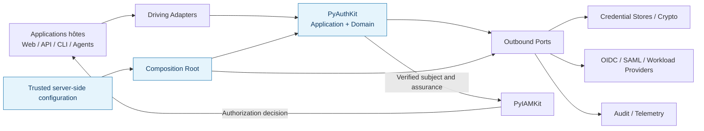
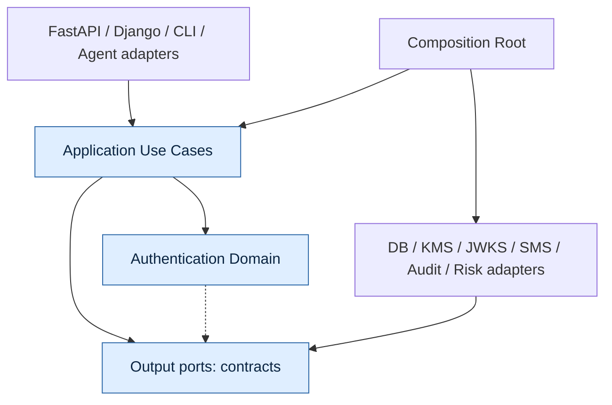
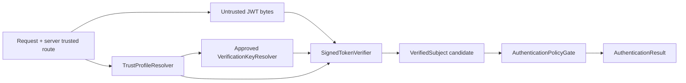
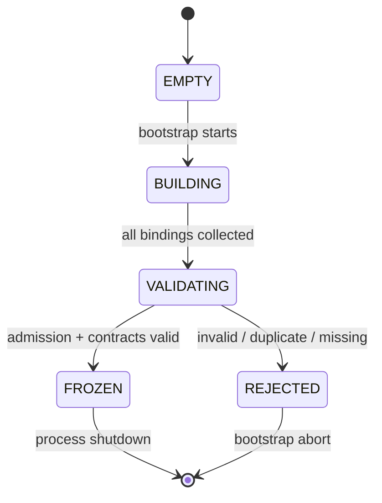
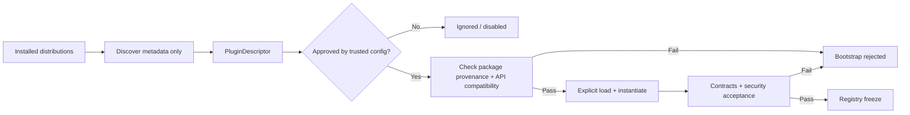
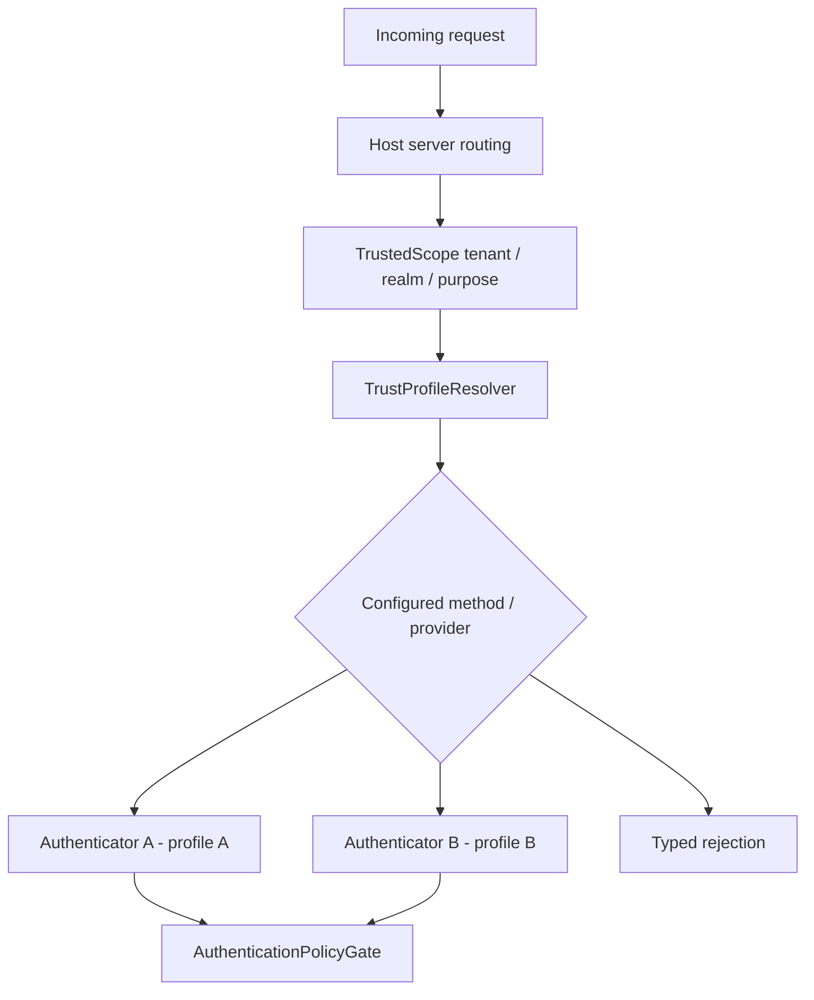
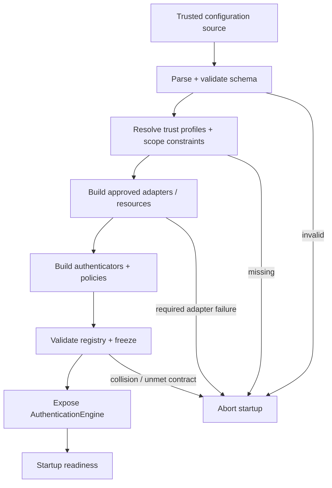

# 18_PYAUTHKIT_PORTS_ADAPTERS_AND_PLUGIN_ARCHITECTURE

# PyAuthKit — Ports, Adapters and Plugin Architecture

> **Projet :** PyAuthKit — Authentication Engine for the Modern Python Ecosystem  
> **Document :** `18_PYAUTHKIT_PORTS_ADAPTERS_AND_PLUGIN_ARCHITECTURE.md`  
> **Type :** Spécification architecturale détaillée, conventions de conception et qualification  
> **Version documentaire :** `0.1.0` — proposition  
> **Date de rédaction :** 30 octobre 2026  
> **Statut :** `PROPOSED / DESIGN` — aucune implémentation, compatibilité binaire ni qualification de plugin n'est présumée  
> **Architecture :** Hexagonal / Ports & Adapters, Clean Architecture, DDD pragmatique  
> **Priorité :** MVP Password / API Key / JWT ; extensions post-MVP explicites  
> **Règle :** *Problem First · Trust First · Pattern Second · Evidence Before Claim*

---

## Guide de lecture

| Lecture | Sections | Finalité |
|---|---|---|
| Vision, frontières, cartographie | 0–11 | Comprendre la raison d'être des ports et l'ownership des décisions |
| Contrats et comportements | 12–26 | Définir interfaces, résolution, registry, plugins et composition |
| Sécurité, runtime, exploitation | 27–37 | Gérer confiance, échecs, concurrence, supply chain et packaging |
| Exemples, qualité, gouvernance | 38–49 | Voir des modèles Python, des tests, une traçabilité et des arbitrages |
| Annexes | A–E | Glossaire, inventaire, checklists, références et journal |

**Convention de statut :** `EXISTING SPEC` signifie « déjà spécifié dans un document précédent », pas « codé ». `PROPOSED` signifie choix de conception à arbitrer ; `CONDITIONAL` dépend d'un besoin ou d'un ADR ; `POST-MVP` n'entre pas de facto dans la première release. Les noms Python sont **candidats**, même lorsqu'ils paraissent naturels.

## 0. Résumé exécutif

PyAuthKit est une bibliothèque d'authentification **réutilisable, agnostique des frameworks et des fournisseurs**. Sa sécurité exige que les politiques de confiance, l'orchestration des preuves et les règles du domaine n'aient aucune dépendance sur un ORM, un framework Web, un SDK cloud, Redis ou un provider d'identité spécifique.

La solution proposée repose sur quatre distinctions :

1. **Port :** contrat de collaboration défini du côté du besoin, sans transporter les types natifs d'un fournisseur.
2. **Adapter :** traduction d'un contrat vers un environnement réel (HTTP, store, KMS, IdP, observabilité, etc.).
3. **Plugin :** unité optionnelle de distribution et de composition fournissant un adapter, un authenticator ou un ensemble de capacités, sous un contrat approuvé.
4. **Registry :** catalogue contrôlé des implémentations **déjà approuvées et instanciées**. La découverte d'un package installé n'accorde ni confiance, ni droit de participer au traitement.

La décision de confiance vient d'une configuration serveur autoritative, liée à `TrustedScope` / `TrustProfile`, et non d'un JWT, d'un `kid`, d'un `issuer`, d'un nom de plugin ou d'un champ client non vérifié.

**North Star :** permettre à l'intégrateur de remplacer des implémentations sans changer le moteur, tout en rendant **impossible par défaut** l'activation silencieuse d'un provider ou une sélection cross-tenant. La sécurité se vérifie par tests de contrat, de frontière, de concurrence et d'intégration — pas par la présence du mot « hexagonal » dans le README.

## 1. Filiation documentaire et autorité

| Source interne | Élément repris | Portée de `18` |
|---|---|---|
| `00_PYAUTHKIT_EXPRESSION_DU_BESOIN.md` | Modularité, agnosticisme, plugins, PyIAMKit | Déclinaison technique |
| `01_PYAUTHKIT_REQUIREMENTS_ANALYSIS.md` | FR, NFR, SEC, ARC, INT, ACC | Traçabilité des contraintes |
| `02_PYAUTHKIT_PRODUCT_VISION_AND_ARCHITECTURE_PRINCIPLES.md` | DIP, OCP, KISS, YAGNI, composition | Justifications et compromis |
| `03_PYAUTHKIT_SYSTEM_ARCHITECTURE.md` | `PORT-IN-*`, `PORT-OUT-*`, Composition Root | **Nomenclature de référence** des ports initiaux |
| `04–06` | Objets du domaine, relations, frontières d'agrégats | Éviter les ports CRUD artificiels |
| `07_PYAUTHKIT_DOMAIN_INVARIANTS_AND_BUSINESS_RULES.md` | Fail-closed, trust, temporalité, scopes | Contrats de sécurité des ports |
| `08_PYAUTHKIT_COMMANDS_QUERIES_AND_USE_CASES.md` | Commands, Queries, orchestration, DTO | Frontière Application |
| `09_PYAUTHKIT_AUTHENTICATION_ENGINE_MODEL.md` | Engine, Registry, PolicyGate, ResultNormalizer | Contrats des collaborateurs du moteur |
| `10_PYAUTHKIT_AUTHENTICATOR_AND_CREDENTIAL_MODEL.md` | Authenticator, credentials, stores, crypto | Adaptateurs MVP |
| `11–13` | Flows, MFA, sessions, tokens | Ports post-MVP et atomicité |
| `14–15` | OIDC/SAML, WebAuthn | Adapters de protocole |
| `16` | Machine, workload, agent, délégation | Attestations et isolation |
| `17` | RiskSignalProvider, RiskEvaluator, RiskPolicy | Plugins de signaux et politiques |
| `PYAUTHKIT_SOFTWARE_DESIGN_LEARNING_CONVENTION.md` | Problème avant pattern, design learning cards | Méthode transversale obligatoire |

**Règle d'autorité :** `18` spécifie *comment intégrer et composer*. Il ne redéfinit pas la sémantique cryptographique de `10`, les règles de continuation de `11`, les niveaux d'assurance de `12`, ni la fédération de `14`. En cas de conflit, créer un ADR et modifier les documents concernés, plutôt que corriger silencieusement les contrats antérieurs.

## 2. Problem Statement : pourquoi ces abstractions ?

### 2.1 Problèmes observables

- Une application FastAPI souhaite vérifier des credentials stockés dans PostgreSQL ; une application Django possède déjà son propre modèle utilisateur.
- Un autre intégrateur vérifie des API Keys dans un store distant, sans importer SQLAlchemy.
- Un service doit valider des JWT à partir de clés approuvées et empêcher qu'un header non fiable choisisse une URL JWKS.
- Un agent IA authentifié peut disposer d'un workload identity, sans disposer d'une autorisation de délégation utilisateur.
- Des fournisseurs OIDC, des certificats, des passkeys et des signaux de risque sont ajoutés à des rythmes différents.
- Des organisations hébergées sur le même processus utilisent des realms, méthodes, profils de confiance et politiques distincts.

### 2.2 Forces de conception

**Variabilité réelle** des frameworks, providers, stores et mécanismes ; **cohérence forte** du domaine d'authentification ; **faible couplage** au runtime de l'hôte ; **visibilité des dépendances** ; **réduction de la surface d'exécution** du code tiers ; **contrats testables** ; **compatibilité entre versions**.

### 2.3 Solution minimale à comparer

Pour un seul mécanisme et un seul stockage, une fonction bien testée peut suffire. Dès que deux environnements ou providers authentiques doivent être substituables, un port minimal et un adapter deviennent économiquement justifiables. **Ne pas créer un port pour chaque méthode privée ou pour chaque table.**

## 3. Objectifs, non-objectifs et contraintes

### 3.1 Objectifs

1. Isoler le core des frameworks, SDK, transports, caches et persistences.
2. Fournir des interfaces étroites, typées, faciles à simuler et qualifier.
3. Rendre l'activation d'un plugin **explicitement approuvée**, vérifiable et auditable.
4. Garantir résolution déterministe, absence de fallback non autorisé, séparation tenant/realm.
5. Composer l'engine au bootstrap sous contrôle d'une configuration approuvée.
6. Supporter une évolution progressive vers MFA, fédération, workloads et risque.
7. Établir des contrats de stabilité, versions et tests de substituabilité.

### 3.2 Non-objectifs

- Construire un conteneur d'injection de dépendances universel.
- Autoriser l'exécution de plugins Python arbitraires dans un bac à sable imaginaire.
- Inventer un marketplace de plugins, un protocole RPC ou un microservice obligatoire.
- Découvrir automatiquement des packages sur Internet ou les installer en cours de requête.
- Déplacer l'autorisation IAM, le provisioning ou l'ownership des utilisateurs dans PyAuthKit.
- Transformer tous les objets DDD en services ou bases de données.
- Affirmer qu'un `Protocol` Python suffit à prouver qu'un provider est sûr.

### 3.3 Contraintes obligatoires

`SECURITY_BY_DEFAULT`, `FAIL_CLOSED`, `TENANT_ISOLATION`, `NO_SECRET_LOGGING`, `NO_UNVERIFIED_TRUST`, `EXPLICIT_DEPENDENCIES`, `SMALL_CORE`, `AUDITABLE_COMPOSITION`, `NO_UNBOUNDED_NETWORK_FETCH`.

## 4. Périmètre et priorisation

| Phase | Capacités | Statut de ce document |
|---|---|---|
| MVP | Engine, AuthenticatorRegistry, Password, API Key, JWT, trusted scope, profils, crypto ports, event sink, clock, guard | `DESIGN / PRIORITY P0` |
| MVP | Composition manuelle explicite, fakes de tests, plugins installés mais non activés par défaut | `DESIGN / PRIORITY P0` |
| MVP conditionnel | Entry points PyPA, manifest et vérification d'admission | `DESIGN / P1`, optionnels si wiring statique suffit |
| Post-MVP | OIDC/SAML, WebAuthn, MFA, flows/challenges, session/token stores | À intégrer lorsque les documents 11–15 deviennent implémentables |
| Post-MVP | SPIFFE, mTLS, cloud federation, token exchange, agent delegation | Selon `16` et ADR sécurité |
| Post-MVP | RiskSignalProvider, RiskEvaluator, RiskPolicy plugins | Selon `17` et gouvernance de risque |
| Prospectif | Hot reload, isolated process plugins, marketplace, remote adapter protocol | **Non requis** ; décision séparée |

## 5. Langage ubiquitaire et concepts à ne pas confondre

| Mot | Sens précis | Ce qu'il n'est pas |
|---|---|---|
| `Port` | Contrat requis par le core / l'application | End-point TCP, classe abstraite obligatoire |
| `Driving Adapter` | Adapte des entrées clientes vers les use cases | Propriétaire de la décision AuthN |
| `Driven Adapter` | Fournit une capacité externe au core | Définition de la policy métier |
| `Authenticator` | Vérifie une famille de preuves et produit un outcome interne | `AuthenticationResult` final |
| `AuthenticatorRegistry` | Résout une implémentation approuvée par sélecteur autorisé | Discovery automatique des paquets installés |
| `PluginDescriptor` | Métadonnées sur une extension candidate | Preuve de sécurité, preuve d'identité |
| `PluginAdmission` | Décision d'activation à partir d'une policy serveur | Auto-approbation par nom ou manifest |
| `TrustProfile` | Contrainte autoritative de vérification et de source de clés | Claim `iss` lue sans vérification |
| `CredentialResolver` | Résout une référence/scoped record | Magasin universel des utilisateurs |
| `Protocol` | Contrat de typage structurel Python | Validation des garanties cryptographiques |
| `Factory` | Construit une implémentation/configuration | Synonyme de tout constructeur |
| `Composition Root` | Assemble et valide le graphe de dépendances | Runtime global mutable / service locator |
| `Adapter` (GoF) | Adapte deux interfaces incompatibles | Tous les ports, plugins ou services |
| `Domain Policy` | Porte une décision AuthN ou risque | Option de framework cachée |
| `Authentication` | Établit l'identité sur des preuves vérifiées | Autorisation, provisioning ou délégation accordée |

## 6. Bounded Contexts, ownership et intégrations

| Context / système | Autorité | Collaboration permise |
|---|---|---|
| `PyAuthKit / Authentication` | Vérification, verdict, facteurs, assurance AuthN, événements AuthN | Publie identité vérifiée, contexte, provenance et niveau d'assurance qualifié |
| `PyIAMKit / Identity & Access` | Identités gérées, rôles, permissions, politiques d'accès, organisations | Reçoit AuthN qualifiée et décide de l'autorisation |
| Application hôte | Request context, trusted routing, transaction, déploiement, composition | Sélectionne les adapters et établit les scopes fiables |
| IdP / Provider externe | Assertions émises selon son contrat | Données **non fiables tant que non vérifiées** |
| KMS, HSM, DB, Redis | Services techniques | Opérations à travers ports approuvés |
| PyAgentsKit / Runtime | Execution context, outils, cycle de vie des agents | Consomme identité AuthN + mandat vérifié + autorisation IAM |

**Truth ownership :** le provider externe peut attester un sujet dans une fédération autorisée ; il ne devient jamais propriétaire des permissions locales. Le secret présenté est une **preuve candidate** ; même le `VerifiedSubject` n'autorise aucune action par lui-même.

## 7. Carte C4 — contexte et frontière de confiance



**Interprétation :** les flèches expriment collaborations et construction logique, **pas** nécessairement des imports de modules. Les adapters et le bootstrap peuvent connaître le core ; le core ne connaît pas les implémentations concrètes.

## 8. Architecture hexagonale et règle de dépendance



### 8.1 Imports autorisés

```text
interfaces / integrations     ──► application / public contracts
application                   ──► domain + ports
adapters                      ──► ports + domaine contractuel (si nécessaire)
composition_root              ──► application + adapters + config

domain                        -X-> application / adapters / frameworks
application                   -X-> adapters concrets / SDK cloud / ORM
```

### 8.2 Règle stricte

L'orientation hexagonale est **une propriété de dépendances et de responsabilités**, pas une prescription de dossiers obligatoires. Un petit port de 1–2 méthodes est souvent préférable à un paquet `interfaces` contenant 40 abstractions indépendamment du besoin.

## 9. Ports entrants (Driving Ports)

La liste ci-dessous reprend la nomenclature candidate de `03`, section 8.1.

| ID source | Contrat / rôle | Opérations candidates | Exposition |
|---|---|---|---|
| `PORT-IN-01` | `AuthenticationEngine` | `authenticate(request) → AuthenticationResult` | **MVP**, façade |
| `PORT-IN-02` | `AuthenticatorRegistry` | `register(...)` au bootstrap, `resolve(...)` runtime | Interne/bootstrap, à ne pas rendre administrable publiquement |
| `PORT-IN-03` | `AuthenticationCapabilities` | `supported_methods(scope)` | Diagnostic filtré/optionnel |
| `PORT-IN-04` | `AuthenticationInspection` | `inspect_configured_methods()` | Exploitation très contrôlée, conditionnel |

`PORT-IN-02..04` décrivent des responsabilités, pas forcément des classes `Protocol` différentes. Le résultat d'un diagnostic public ne révèle ni identifiants de clés, ni issuers internes, ni topologie sensible.

## 10. Ports sortants MVP — nomenclature héritée de `03`

| ID source | Port / capacité | Règle centrale |
|---|---|---|
| `PORT-OUT-01` | `PasswordCredentialResolver` | Résoudre uniquement dans un `TrustedScope`; aucun secret brut en persistence |
| `PORT-OUT-02` | `PasswordVerifier` | KDF éprouvé, paramètres approuvés, vérification bornée |
| `PORT-OUT-03` | `ApiKeyCredentialResolver` | Lookup non secret, statut, tenant, version |
| `PORT-OUT-04` | `ApiKeyVerifier` | Comparaison sûre de la preuve dérivée |
| `PORT-OUT-05` | `TrustProfileResolver` | Issuer/audience/méthode/algorithmes depuis configuration fiable |
| `PORT-OUT-06` | `VerificationKeyResolver` | Clés **approuvées**, sources réseau bornées, jamais `jku` arbitraire |
| `PORT-OUT-07` | `SignedTokenVerifier` | Signature, claims et validation selon profil autoritatif |
| `PORT-OUT-08` | `AuthenticationEventSink` | Données minimales ; garantie d'échec audit explicitée |
| `PORT-OUT-09` | `Clock` | Temps injecté, testable, pas de `now()` caché dans chaque objet |
| `PORT-OUT-10` | `AttemptGuard` | Rate limiting / lockout / abuse signal, comportement fail-closed selon policy |

**Compatibilité :** ces noms sont issus de `03`, mais la forme exacte des méthodes sera décidée par `24` et les specs spécialisées. `18` ne constitue pas une modification de `PORT-OUT-01..10`.

## 11. Ports transverses et prospectifs

| Capacité | Contrat candidat | Source de vérité | Phase |
|---|---|---|---|
| Sessions | `SessionStore`, `SessionRevocationPort` | `13` | POST-MVP |
| Refresh rotation | `RefreshTokenFamilyStore` avec CAS | `13` | POST-MVP |
| Challenges | `ChallengeStore`, `ChallengeConsumptionPort` | `11` | POST-MVP |
| Assurance / MFA | `FactorVerifier`, `EnrollmentStore` | `12` | POST-MVP |
| OIDC/SAML | `FederationMetadataProvider`, `AssertionVerifier`, `FederationStateStore` | `14` | POST-MVP |
| WebAuthn | `WebAuthnCredentialStore`, `CeremonyStateStore`, `AssertionVerifier` spécialisé | `15` | POST-MVP |
| Workload/NHI | `WorkloadAttestationVerifier`, `CertificateChainVerifier` | `16` | POST-MVP |
| Delegation | `DelegationProofVerifier`, `TokenExchangeProvider` | `16` | POST-MVP |
| Risk | `RiskSignalProvider`, `RiskEvaluator`, `RiskPolicy` | `17` | POST-MVP |
| Secrets / crypto | `KeyProvider`, `CryptoBackend`, `SecretResolver` (si nécessaires) | `10`, `19`, `20` | CONDITIONNEL |
| Notifications | `ChallengeDelivery` / notifications | `11`, `12` | POST-MVP |
| Observabilité | `AuditSink`, `MetricsSink`, `Tracer` (granularité à décider) | `21` | CONDITIONNEL |

**Anti-YAGNI :** la simple existence de cette liste ne déclenche pas leur création dans le MVP. Certains ports pourraient être regroupés si leurs garanties, responsabilités et cycle de vie coïncident réellement ; le rapprochement devra être justifié par ADR.

## 12. Taxonomie des contrats : ports, strategies, policies et repositories

**Ports de ressource :** abstractions d'IO ou de fonctions externes (`CredentialResolver`, `Clock`, `VerificationKeyResolver`).  
**Policies de domaine :** décisions de confiance et sécurité (`AuthenticationPolicy`, `RiskPolicy`), généralement pures ou isolées des effets.  
**Strategies :** implémentations réellement substituables d'une variation (`Authenticator` lorsque plusieurs méthodes sont activées).  
**Repositories :** abstractions de persistence des agrégats dont PyAuthKit possède le cycle de vie, **pas** un CRUD universel pour toutes les données.  
**Adapters :** ponts concrets implémentant ports pour infrastructure, protocoles ou frameworks.

Un `Authenticator` peut être simultanément une **stratégie métier** et une implémentation injectable, mais pas nécessairement un « plugin ». Un plugin peut apporter un adapter et des dépendances, mais il ne devrait pas posséder une règle de décision finale qu'il peut modifier hors du `AuthenticationPolicyGate`.

## 13. Contrats généraux des ports (cross-cutting)

| Propriété | Obligation |
|---|---|
| Identité de la requête | `attempt_id` / `correlation_id` distincts des secrets |
| Scope | `tenant`, `realm`, `purpose`, `profile` résolus côté serveur |
| Temporalité | `deadline`, `observed_at`, `expires_at` selon contrat ; `Clock` injectée |
| Réponse | Type défini, y compris indisponibilité, rejet, ambiguïté et timeout |
| Erreurs | Pas de fuite de détails secrets vers le client ; diagnostic interne structuré |
| Idempotence | Obligatoire lorsqu'un effet non réversible ou une consommation unique est en jeu |
| Concurrence | Aucune variable mutable globale dépendant de l'utilisateur courant |
| Privacy | Données minimales, logs structurés, redaction, retention maîtrisée |
| Compatibilité | Tests de substituabilité entre fake, adapter local, adapter distant |
| Sécurité | Le port ne convertit jamais par défaut `UNKNOWN` ou `ERROR` en `SUCCESS` |

### 13.1 Erreurs fonctionnelles vs indisponibilités techniques

`CredentialNotFound` est un fait de résolution scoped, `CredentialInvalid` un verdict de vérification, `CredentialStoreUnavailable` un défaut d'infrastructure. Leur exposition côté client peut être volontairement uniformisée pour éviter l'énumération, **tout en conservant des diagnostics internes typés et non sensibles**.

### 13.2 Quand exiger du sync / async ?

Le core peut offrir une API async pour les IO ; un port CPU-bound doit pouvoir déléguer explicitement sans bloquer l'event loop. Ne pas masquer un SDK synchrone bloquant dans une méthode `async def`; l'adapter doit expliciter la stratégie d'exécution et la limite de concurrence. L'existence éventuelle d'une façade sync est une décision du document `24`.

## 14. Contrats spécialisés — Password

```text
User-claimed handle + trusted scope
            ↓
PasswordCredentialResolver
            ↓ (hash, algorithm, policy version, status)
PasswordVerifier
            ↓ (verdict evidence only)
AuthenticationPolicyGate
            ↓
AuthenticationResult
```

- `resolver` ne retourne jamais le mot de passe brut ; il peut ne pas posséder d'Entity locale si l'hôte gère les comptes.
- `verifier` utilise un algorithme et des paramètres approuvés, non un code utilisateur arbitraire.
- Le workflow de migration de hash n'autorise pas une mise à jour non atomique ou hors contexte ; un éventuel port `PasswordRehashWriter` est **conditionnel**.
- Les échecs de résolution et vérification ne doivent pas révéler l'existence d'un compte.
- Anti-pattern : `PasswordAuthenticator` instancie directement `DjangoUser.objects` ou importe `sqlalchemy`.

## 15. Contrats spécialisés — API Key

`ApiKeyCredentialResolver` travaille sur un préfixe ou identifiant de lookup non secret et un scope de confiance ; `ApiKeyVerifier` valide la preuve contre une représentation sûre. Les clés créées ne doivent pas être retrouvables en clair dans les logs, l'ORM, l'exception ou le cache.

**Invariants à protéger :** tenant binding ; statut `ACTIVE` au moment de la validation ; gestion de rotation/version ; refus sur révocation ; absence de fallback vers une clé d'un tenant voisin ; invalidation de cache selon les garanties contractuelles. Les décisions d'autorisation sur les scopes restent séparées du succès AuthN.

## 16. Contrats spécialisés — JWT entrant



**Règle absolue :** aucune URL `jku`/`x5u`, aucun `issuer`, aucun `audience`, aucun `alg` ou `kid` ne peut imposer seul un profil de confiance ni déclencher un téléchargement arbitraire. Les indices non vérifiés peuvent seulement sélectionner **dans une liste bornée, déjà approuvée par le profil du contexte**.

La validation des JWT entrants (document `10`) est distincte de l'émission/rotation des tokens sortants (`13`) et de l'interprétation des `ID Token` fédérés (`14`). Trois rôles, donc des contrats distincts lorsque les contraintes diffèrent.

## 17. Registry : responsabilité et modèle de sélection

L'`AuthenticatorRegistry` présente une API de composition explicite au bootstrap, puis un **snapshot immuable** des authenticators autorisés. La requête fournit au plus une indication de méthode ; **le `TrustedScope` serveur filtre les méthodes admises**.

| Input | Trust level | Usage autorisé |
|---|---|---|
| `method` client | Untrusted | Candidate de sélection, jamais activation |
| `TrustedScope` | Server-authoritative si construit correctement | Tenant, realm, purpose |
| `TrustProfile` | Server-approved | Méthodes, issuers, audience, algorithmes, backend |
| `PluginDescriptor` | Metadata from installed distribution | Inventaire, *pas* exécution |
| `ApprovedPluginBinding` | Trusted bootstrap decision | Autorise loading/wiring |
| `Authenticator` instance | Trusted after admission + contract verification | Verification inside profile scope |

**Résolution cible :** `(TrustedScope, approved method/profile, configured registry generation) → unique Authenticator or typed failure`. `first()`/`latest()`/« try every authenticator until one accepts » sont interdits comme solutions silencieuses à une ambiguïté.

## 18. Cycle de vie du Registry



`EMPTY`, `BUILDING`, `VALIDATING`, `FROZEN`, `REJECTED` désignent des **états du processus de construction**, pas une obligation d'appliquer le GoF State Pattern. Un `dict` interne non partagé puis un `MappingProxyType`/mapping immuable peut suffire.

### 18.1 Collision handling

Deux authenticators avec même `(realm, method, variant)` doivent provoquer un `DuplicateAuthenticatorBinding` au bootstrap, sauf politique de priorité explicitement documentée (déconseillée au MVP). Une collision de package entry point ne doit jamais être résolue par « last registered wins ».

### 18.2 Capabilities

Un authenticator déclare ses capacités, mais la déclaration n'est pas preuve de conformité : `supports('jwt')` ne prouve pas que la signature, l'expiration, l'audience et la provenance sont effectivement vérifiées. Les contract tests doivent exercer ces garanties.

## 19. Plugin : définition, rôle et granularité

Un plugin est une **extension installable et activable** apportant une ou plusieurs implémentations sous contrat. Des plugins distincts peuvent fournir :

- `Authenticator` supplémentaire ;
- `CredentialResolver` ou store adapter ;
- `VerificationKeyResolver` ou crypto backend validé ;
- `FederationProviderAdapter` ;
- `RiskSignalProvider` ;
- `AuditEventSink` ;
- framework integration ;
- `WorkloadAttestationVerifier`.

La granularité suit la responsabilité et le modèle de déploiement. **Un plugin n'est pas un nouveau bounded context** ; il ne devient pas propriétaire de l'identité globale ni du résultat final AuthN.

## 20. Discovery, admission, activation : trois états distincts



1. **Installed** : une distribution est présente dans l'environnement Python.
2. **Discovered** : ses métadonnées `entry_points` peuvent être énumérées ; aucun import du module plugin n'est nécessaire à ce stade.
3. **Approved** : l'administrateur du déploiement, via configuration fiable, autorise une distribution/version/capability donnée.
4. **Loaded** : le code Python est importé ; il a déjà les privilèges du processus (danger majeur).
5. **Configured** : les secrets et références sont fournis via ports sécurisés.
6. **Validated** : contrat, configuration et exigences de sécurité sont vérifiés ; les tests profonds ont lieu en CI avant production.
7. **Active** : le plugin est inclus dans un registry immuable.

**Précision critique :** une métadonnée `entry point`, une signature de package ou un allowlist ne rendent **pas** un plugin Python sûr. Dès son import, son code peut exécuter des effets de bord avec les privilèges du processus. Si l'extension est réellement non fiable, utiliser une isolation de processus ou une architecture de service dédiée avec des politiques OS/réseau, elle-même qualifiée ; ne pas présenter un import Python comme sandbox.

## 21. Stratégies de discovery et décisions YAGNI

| Mécanisme | Avantage | Inconvénient | Recommandation |
|---|---|---|---|
| Wiring explicite Python | Simple, inspectable, minimal | Application doit importer ses composants | **MVP par défaut** |
| `importlib.metadata.entry_points` | Découverte inter-distributions standardisée | Activation à gouverner, collision, supply chain | Option contrôlée `P1` |
| Détection par nom de module | Facile à prototyper | Collisions, import involontaire, confiance implicite | Rejeté par défaut |
| Scan d'un répertoire de scripts | Apparente extensibilité | Exécution arbitraire, provenance faible | Rejeté |
| Remote plugin registry/marketplace | Distribution à grande échelle | Attaques supply chain, complexité | Hors scope initial |
| Process-isolated adapters | Frontière OS plus forte | IPC, latency, ops, protocole | Conditionnel après analyse de menace |

La spécification PyPA définit les entry points comme **métadonnées de distribution pour exposer des composants**. Elle ne définit ni admission de sécurité ni confinement. Références : https://packaging.python.org/en/latest/specifications/entry-points/ et https://packaging.python.org/en/latest/guides/creating-and-discovering-plugins/.

## 22. Plugin Descriptor, Manifest et Admission

Un manifest supplémentaire peut être utile si PyAuthKit a besoin de plus que les champs PyPA `(group, name, value)`. Son format reste **proposé** :

```yaml
# Example only; not an accepted production schema.
plugin_id: org.example.pyauthkit.jwt-keys
version: 0.2.0
api_contract: '>=0.1,<0.2'
capabilities:
  - verification_key_resolver
supported_methods:
  - jwt
entry_point_name: approved_jwks_resolver
requires_network: true
requires_secrets:
  - jwks_transport_credentials
security_profile: review-required
```

**Important :** `security_profile`, `requires_secrets` et les capacités sont des **déclarations non autoritatives**. Un manifeste ne donne pas le droit d'accéder à des secrets ; c'est la politique d'admission serveur qui limite les capacités, le réseau, la configuration et l'usage.

| Contrôle d'admission | Exigence |
|---|---|
| Identité | Distribution normalisée, provenance, version, nom d'entry point exact |
| Intégrité | Artefact pin et vérification de hash/provenance à la construction/déploiement |
| Compatibilité | Contrat API compatible, Python/runtime supportés selon matrice publiée |
| Capabilities | Sous-ensemble de celles autorisées par le déploiement |
| Tenant | Binding global ou scoped sans auto-expansion entre tenants |
| Dependencies | Dépendances déclarées, versions évaluées, pas d'import optionnel caché |
| Network | Egress explicite, allowlist d'hôtes, timeouts, SSRF controls |
| Secrets | Injection par référence, pas de logs, pas de hardcode |
| Audit | Trace d'admission/version/fingerprint sans secrets |
| Dégradation | Échec bloquant si obligatoire ; plugin optionnel désactivé explicitement |

## 23. API plugin et contrat de compatibilité

L'interface de construction pourrait être un callable exposé par un entry point qui reçoit un **contexte limité au besoin** : configuration validée non secrète, références vers ports nécessaires, et un identifiant de génération. Le contrat ne doit pas donner l'instance entière de l'application hôte ni un service locator avec toutes les dépendances.

```text
PluginFactory(config, narrowly_scoped_dependencies)
        -> Authenticator | Resolver | Sink | Provider
```

Les signatures et noms sont illustratifs. La compatibilité couvre :

- version de la **surface de contrat**, distincte de la version interne du plugin ;
- variabilité des champs input/output et des erreurs ;
- cancel / timeout / concurrency behavior ;
- sémantique de security claims, pas uniquement type hints ;
- comportement de composants absents / indisponibles ;
- non régression après mise à niveau du moteur.

Un changement de forme `Protocol` reste potentiellement breaking même si Python l'accepte dynamiquement. L'API publique sera stabilisée dans `24` ; la politique de versioning dans `27/28`.

## 24. Isolation multi-tenant et routage de providers



**Invariants :**

- un scope tenant ne peut provenir uniquement d'un champ `tenant_id` arbitraire du payload ;
- `provider_id` client ne peut élargir le catalogue de providers approuvés ;
- la résolution est unique ou échoue ;
- les caches incluent les dimensions utiles de tenant/realm/profile/version ;
- la configuration scoped ne fuit pas les capacités d'un tenant voisin ;
- une extension « global plugin » ne reçoit pas automatiquement toutes les credentials et secrets des tenants ;
- une erreur de binding ne provoque aucun fallback vers le profil d'un autre tenant.

## 25. Composition Root et bootstrap sûr



### 25.1 Étapes recommandées

1. Charger **des sources contrôlées** (et non des headers/token claims).
2. Parser et valider les types, champs critiques, seuils et versions.
3. Résoudre les `TrustedScope` / `TrustProfile` autorisés, issuer, audiences, algorithmes, endpoints et clés approuvées.
4. Appliquer la policy d'admission de plugins.
5. Instancier les adapters et ports explicitement configurés ; établir deadlines et politiques de retry.
6. Construire les authenticators MVP puis les policies et sinks nécessaires.
7. Vérifier unicité des routes et conformité statique/contractuelle des bindings.
8. Geler un registry par génération ; publier seulement un engine cohérent.
9. Exposer diagnostics de readiness minimisés ; ne pas dumper la configuration ou les secrets.
10. Pour toute erreur critique : démarrage refusé, sans moteur partiellement initialisé.

### 25.2 Pourquoi pas un `create_default_engine()` magique ?

Des defaults utiles peuvent simplifier le développement, mais ils ne doivent **jamais deviner** les issuers, audiences, algorithmes de signature, secrets ou stockage de credentials de production. Une factory explicite avec dépendances requises est préférable à une configuration d'authentification implicitement permissive.

## 26. Lifecycle, configuration snapshots et hot reload

La composition initiale peut rester immuable pendant toute la vie du processus. Si une rotation de clés ou de configuration exige du reloading :

1. construire une **nouvelle génération** entièrement validée ;
2. publier atomiquement son pointeur auprès des nouvelles requêtes ;
3. laisser les requêtes en cours terminer avec leur génération, dans les limites des deadlines ;
4. conserver une traçabilité de `configuration_generation` ;
5. retirer l'ancienne génération avec fermeture des ressources contrôlée ;
6. refuser toute version nouvelle incomplète, sans mutation partielle du registry courant.

Ce schéma n'implique ni hot reload MVP ni « snapshot d'authentification » métier permanent. Une configuration de runtime n'est pas automatiquement un artefact de preuve historique ; la provenance doit être conservée selon les politiques d'audit et de rétention applicables.

## 27. Trust Boundaries et contrôle des privilèges

| ID | Frontière | Entrée non fiable ou danger | Contrôle attendu |
|---|---|---|---|
| `EXT-TB-01` | Transport → Driving Adapter | Headers, cookies, payload, path | Normalisation, taille bornée, scope dérivé de sources autoritatives |
| `EXT-TB-02` | Driving Adapter → Application | DTO non vérifié | Validation de format distincte de preuve d'identité |
| `EXT-TB-03` | Application → Authenticator | Sélecteur de méthode | Filtrage par `TrustProfile` et registry approuvé |
| `EXT-TB-04` | Authenticator → CredentialResolver | Identifiants revendiqués | Scoped lookup, politique d'énumération, status et version |
| `EXT-TB-05` | JWT → VerificationKeyResolver | `kid`, `alg`, `jku`, `iss` | Liste bornée de clés/algorithmes/sources **préautorisées** |
| `EXT-TB-06` | Plugin metadata → Process | Package installé et `entry_point` | Admission explicite avant import/instanciation |
| `EXT-TB-07` | Plugin code → Secrets/Network | Code exécutable avec privilèges du processus | Trusted deployment, permissions minimales, egress, isolation si exigée |
| `EXT-TB-08` | Adapter → Core Domain | Types ORM/SDK, JSON vendor-specific | Mapping vers Value Objects/Outcome contrôlés |
| `EXT-TB-09` | AuthN → IAM | Claims, assurance, provenance | Contrat publié ; IAM décide les permissions |
| `EXT-TB-10` | Runtime → Audit/Observability | Exceptions, payloads, correlation | Data minimization et failure policy explicite |
| `EXT-TB-11` | Tenant A → Tenant B | Cache, scope, registry, retries | Clé contextuelle complète et tests cross-tenant |
| `EXT-TB-12` | Agent / Workload → User Delegation | `act`/`sub` ou certificat technique | Vérification indépendante du mandat et IAM policy |

### 27.1 Invariant de non-escalade

Aucun adapter ni plugin ne doit : (a) élever directement un `VerifiedSubject` en `AuthenticatedPrincipal` final, (b) assigner un niveau AAL non vérifié, (c) accorder une permission IAM, (d) choisir arbitrairement un nouveau profil d'approbation. L'orchestrateur et le `AuthenticationPolicyGate` restent responsables du verdict final conformément à `09` et `12`.

### 27.2 Risque des fakes en sécurité

Un fake compatible avec `Protocol` ne prouve rien sur les algorithmes, clés, certificats ou timings ; il sert uniquement à tester les orchestrations et cas d'échec. Toute implémentation cryptographique de production exige des tests adaptés, une bibliothèque éprouvée et une revue de configuration.

## 28. Sécurité des plugins et supply chain

**Classification :** composant **trusted at deployment** ou **untrusted**. La seconde catégorie **ne doit pas** être importée dans le processus d'authentification avec ses privilèges normaux.

### 28.1 Menaces principales

- Typosquatting ou confusion de nom de distribution / entry point.
- Dépendance transitive compromise, update non reproductible, build corrompu.
- Effets de bord à l'import (`import-time side effect`).
- Secrets exfiltrés par log, webhook, DNS ou appel HTTPS.
- SSRF via résolution JWKS, IdP discovery ou endpoint de plugin non borné.
- Remplacement silencieux de l'authenticator ou de l'ordre de résolution.
- Provider déclarant des assurances ou capabilities qu'il ne prouve pas.
- Import global de variables, caches partagés entre tenants.
- Package incompatible entraînant une panne ou un succès de repli.
- Déni de service par boucle, allocations massives, bloqueurs IO ou exceptions.
- Contournement des journaux d'audit ou suppression des traces de refus.
- Abus d'un mécanisme de registration pour modifier la configuration en cours de requête.

### 28.2 Défenses de déploiement

1. Provenance et revue des packages admis ; verrouillage/pinning des versions et hashes lorsque faisable.
2. Préparation de la liste d'admission **au build/deploy**, pas depuis une requête.
3. CI incluant SCA, dépendances transitives, vérification des licences et des artefacts.
4. Installation depuis des index approuvés, sans `pip install` côté requête.
5. Politique egress/réseau explicite, notamment pour metadata/JWKS.
6. Permissions OS et accès secrets minimisés pour l'application entière.
7. Interface de plugin limitée, erreurs filtrées, diagnostics corrélés.
8. Rotation et révocation de la configuration approuvée sans fallback permissif.
9. Inventaire auditable de la génération, distribution, version, capacités et source d'installation.
10. Revues sécurité spécifiques avant activation d'un nouveau plugin d'authentification.

**Limite déclarée :** ces mesures réduisent le risque mais n'isolent pas un plugin malveillant importé dans le même interpréteur. Un sandbox exige une vraie frontière d'exécution indépendante et des contraintes OS, réseau et protocole testées.

## 29. Fail-closed, politiques de panne et propagation des erreurs

| Incident | Réponse de sécurité | Visibilité externe |
|---|---|---|
| Aucun authenticator pour méthode autorisée | `METHOD_UNAVAILABLE` / rejet | Échec neutre, pas de fallback |
| Conflit dans registry | **Refus de bootstrap** | Readiness indisponible |
| Plugin non approuvé | Non chargé ; refus si exigé par config | Pas de détail du package exposé |
| Credential store indisponible | `DEPENDENCY_UNAVAILABLE` / fail-closed | Réponse neutre selon transport |
| JWKS non résolues / clé inconnue | Pas de vérification/acceptation | Refus/indisponibilité typée |
| Verifier timeout | Rejet de finalisation de succès | Timeout normalisé |
| Méthode plus faible disponible | **Pas de downgrade automatique** | Policy explicitement exigée |
| Audit sink obligatoire indisponible | Opération non finalisée si politique d'audit durable le requiert | Erreur contrôlée |
| Audit best-effort indisponible | Résultat selon politique approuvée + signal de dégradation | Pas de token ou secret journalisé |
| Metadata provider contradictoire | Rejet / quarantaine du binding | Diagnostic interne |
| `CancelledError` / cancellation | Annuler/fermer resources correctement, pas de side effects non contrôlés | Pas de succès fabriqué |
| Mauvais tenant/realm | Refus sans récupération hors scope | Échec neutre |

La politique d'audit doit préciser à quel instant l'événement est considéré durable et si la finalisation du succès requiert cette durabilité. Pour des opérations multi-écritures, les patterns `Unit of Work`/Outbox peuvent être pertinents **uniquement lorsque l'atomicité est réellement nécessaire et réalisable**.

### 29.1 Exceptions typées (noms candidats)

```text
PluginNotApproved
PluginContractMismatch
PluginLoadFailed
PluginConfigurationInvalid
DuplicateAuthenticatorBinding
AuthenticatorNotFound
TrustProfileNotFound
AmbiguousTrustProfile
ProviderUnavailable
CredentialResolutionFailed
VerificationTimedOut
AuditDeliveryFailed
```

Ces classes ne constituent pas une nouvelle API publique garantie. Leurs détails internes ne doivent jamais propager la configuration secrète, les credentials soumis ni le contenu brut d'un JWT ou d'une assertion.

## 30. Timeouts, retry, backpressure et resource ownership

### 30.1 Deadlines

Les retries sans borne sont interdits. La deadline **d'une tentative AuthN** couvre le budget total orchestration + IO + crypto + policies. Chaque port peut disposer d'un budget inférieur ; aucun adapter ne prolonge silencieusement la deadline globale.

### 30.2 Retry

- Lecture idempotente de métadonnées approuvées : retries bornés possibles, selon profil.
- Vérification de secret locale : pas de retry automatique sur preuve invalide.
- Consommation d'un challenge / rotation refresh : jamais de retry non idempotent sans clé/version/CAS.
- Echec d'audit : politique déclarée, pas de duplication non contrôlée.
- Panne d'un plugin : pas de « essayer le prochain authenticator » si les profils ne l'autorisent pas explicitement.

### 30.3 Ressources

Les adapters réseau et DB ont des connexions/pools propres, fermés à la fin du processus ou de la génération. L'engine n'effectue pas lui-même de `close()` sur chaque requête si ce n'est pas son ownership. Si un plugin ouvre un client HTTP, sa factory/adapter doit exposer une stratégie de fermeture/cleanup appropriée.

### 30.4 Concurrence

Les instances peuvent être réutilisées entre requêtes **uniquement si elles sont réentrantes** ou si la composition assure une isolation appropriée. Les infos `tenant_id`, `current_principal`, `challenge_code`, `presented_secret` ne doivent jamais être enregistrées dans des attributs mutables partagés.

## 31. Stratégies de cache et cohérence

Le cache est un **détail d'adapter**, pas un moyen d'effacer les invariants du domaine.

| Cache candidat | Risque | Contrôle |
|---|---|---|
| Credential lookup | Acceptation après révocation | TTL/version + invalidation selon contrat |
| TrustProfile | Ancien issuer/method autorisé | Generation pinning et refresh contrôlé |
| JWKS | Clé retirée encore utilisée | TTL et révocation effective documentés |
| RiskSignal | Signal périmé traité comme faible risque | Horodatage, provenance et TTL de policy |
| Session/Token revocation | Révocation non propagée | Consistency model et tests multi-node |
| Plugin metadata | Mauvaise distribution liée au nom | Cache propre à génération, hash, version |

### 31.1 Règle de cache key

Les clés doivent incorporer **toutes les dimensions qui influent sur la résolution** : scope tenant, realm, profile, type, version de config et référence de ressource pertinente. Une clé `user_id` ou `kid` seule est insuffisante si plusieurs tenants ou issuers coexistent.

## 32. Observabilité, audit, diagnosabilité et confidentialité

**Événements minimaux proposés :** `PluginDiscovered`, `PluginApproved`, `PluginRejected`, `PluginActivated`, `PluginLoadFailed`, `RegistryFrozen`, `AuthenticatorResolved`, `AdapterUnavailable`, `TrustProfileResolutionFailed`, `AuthenticationRejected`, `AuthenticationCompleted`.

> **Ces noms sont des candidats d'événements techniques.** Ils ne remplacent pas automatiquement les `AuthenticationEvent` métier définis dans les documents `04/07/21`. Un `PluginActivated` ne prouve pas qu'un authenticator est sécurisé.

### 32.1 Champs sûrs

`event_type`, `timestamp`, `attempt_id`, `correlation_id`, `generation_id`, `plugin_id` admis, `scope_ref` pseudonymisé si pertinent, `method` non sensible, `status_code`, `duration_bucket`, `provider_class`, `exception_class`, `policy_version`, `source_version`. Minimiser tenant et subject identifiers selon les règles de confidentialité applicables.

### 32.2 Champs à exclure par défaut

Mot de passe, API key complète, Bearer/refresh token brut, secret TOTP, assertion SAML brute, code OAuth, clé privée, cookie de session, `Authorization` header, matériau de déchiffrement, PII détaillée ou configuration brute.

### 32.3 Métriques exploitables

- taux de démarrages refusés par classe d'erreur ;
- plugin admission failures / incompatible contract ;
- latence par port sans dimension utilisateur ni secret ;
- timeouts et indisponibilité externe ;
- nombre de bindings actifs **sans** lister leurs clés ;
- taux de réponses `CHALLENGE_REQUIRED`, `REJECT`, `UNAVAILABLE` sans cardinalité excessive ;
- anomalies de cache, rate limiting et revocation propagation.

Un système d'observabilité doit rester **optionnel pour le core** ; sa politique d'indisponibilité est explicitement gouvernée. L'audit obligatoire, lui, est une exigence du cas d'usage, pas une simple métrique best-effort.

## 33. Packaging, extras et modularité du codebase

### 33.1 Découpage candidat (non implémenté)

```text
src/pyauthkit/
├── domain/
│   ├── identity.py
│   ├── credentials.py
│   ├── trust.py
│   └── results.py
├── application/
│   ├── authenticate.py
│   ├── policies.py
│   └── orchestration.py
├── ports/
│   ├── credentials.py
│   ├── crypto.py
│   ├── trust.py
│   ├── events.py
│   └── clock.py
├── authenticators/
│   ├── password.py
│   ├── api_key.py
│   └── jwt.py
├── plugins/
│   ├── descriptor.py
│   ├── admission.py
│   ├── discovery.py
│   └── registry.py
├── adapters/
│   ├── memory.py                  # testing only
│   └── ...                       # approved optional integrations
├── integrations/
│   ├── fastapi.py                # conditional
│   ├── django.py                 # conditional
│   └── iam.py                    # conditional
└── bootstrap/
    └── composition.py
```

**Attention :** `domain`, `application`, `ports`, `plugins` sont des frontières **logiques** ; le nombre final de modules est libre. Le domaine ne doit pas importer `plugins.discovery`, `sqlalchemy`, `fastapi` ou les SDK cloud.

### 33.2 Extras vs packages externes

| Option | Bon cas d'usage | Coût |
|---|---|---|
| `pyauthkit[fastapi]` | Adapter léger lié à la version du core | Forte coordination des versions |
| `pyauthkit[django]` | Intégration framework | Couplage au packaging central |
| `pyauthkit[oidc]` | Dépendances de protocole spécialisées | Surface d'installation accrue |
| `pyauthkit-provider-*` | Provider évoluant indépendamment | Gouvernance des plugins et compatibilité |
| Core + explicit Python wiring | MVP et tests | Plus d'initialisation dans l'hôte |

Les noms sont **proposés**, non des packages PyPI existants ni des commandes d'installation garanties. Le choix final doit préserver la possibilité d'installer/importer le core sans FastAPI, Django, PyIAMKit ou SDK provider.

## 34. Pattern catalog — preuves, alternatives et coûts

| Concept | Où réellement justifié | Preuve observable | Alternative simple | Coût |
|---|---|---|---|---|
| **Hexagonal Architecture** | Core indépendant de DB/Web/SDK | Import tests, adapters substituables | Fonction avec dépendances injectées | Modules/indirection |
| **Adapter (GoF)** | Provider SDK → port canonique | Conversion sans types vendor dans Domain | Mapping function | Traduction à maintenir |
| **Strategy** | Multiple authenticators sous contrat commun | Sélection explicite et substituabilité | `if/elif` sur petite liste fermée | N interfaces/tests |
| **Factory Method** | Assemblage de providers aux dépendances variables | Construction centralisée pour une famille réelle | Constructeur explicite | Complexité de bootstrap |
| **Abstract Factory** | Packs cohérents de multiples interfaces | Plusieurs familles de produits liées | Quelques fonctions de construction | Forte indirection |
| **Registry** (pattern applicatif) | Méthodes activées dynamiquement au bootstrap | Unicité, lookup, freeze, version | `dict` construit à la main | Lifecycle |
| **Repository (DDD)** | Aggregate local à persister et récupérer | Contrat d'aggregate + tests | Resolver orienté query | Persistance abstraite |
| **Facade** | Entrée unique `AuthenticationEngine` | Consommateur ignorant orchestration interne | Fonction/use case | Risque God Object |
| **Dependency Injection** | Wiring explicite | Mocks/fakes et composition testés | Arguments de fonctions | Sur-abstraction possible |
| **Domain Event** | Fait AuthN significatif déjà accompli | Payload immutable et testable | Callback ciblé | Delivery/audit semantics |
| **Observer (GoF)** | Abonnés locaux réellement indépendants | Multiples observers détachés | Appel direct ou callback | Propagation d'erreurs |
| **State Machine** | Cycle de plugin/flow/session | Transitions et guards | Enum + validation | Tests d'état |
| **State (GoF)** | Comportements réellement polymorphes selon état | Objets d'état substituables | Enum + `match` | Classes supplémentaires |
| **Chain of Responsibility** | Pipeline de contrôles recomposable si besoin | Ordre et short-circuit stables | Séquence explicite d'appels | Debug/couplage caché |
| **Microkernel** | Écosystème de plugins autonome à maturité | APIs de plugin stables et gouvernées | Core + extras explicites | Gouvernance élevée |

**La présence de `PluginRegistry` ne démontre pas une architecture Microkernel complète.** Ne pas baptiser un `Protocol` « Abstract Factory » uniquement parce qu'il construit un objet. Les patterns nomment des solutions à un problème observé ; ils n'imposent aucun inventaire GoF.

## 35. Anti-patterns et pièges de conception

| Anti-pattern | Pourquoi dangereux | Remédiation |
|---|---|---|
| `GenericAuthManager` central | Mélange sécurité, providers, DB et autorisation | Policies/domain + ports + orchestrator |
| `if provider == "x"` dans tout le code | Logique de variation dupliquée | Selection bornée + adapter/strategy si justifié |
| Plugin auto-loaded depuis tout le virtualenv | Exécution arbitraire, confiance implicite | Allowlist et admission préalable |
| `kid`/`jku` contrôlant URL JWKS | SSRF, substitution de clés | TrustProfile + key sources approuvées |
| Secret dans `repr` de DTO ou log | Fuite durable | Redaction par construction, tests de scan |
| Service locator partagé | Dépendances cachées, fuite cross-tenant | Injection explicite à scope étroit |
| Registry mutable après startup | Race conditions et hijack de route | Freeze/snapshot/atomic swap |
| `fallback` crypto permissif | Réduction de l'assurance | Fail-closed, alternatives explicitement approuvées |
| Framework/ORM importé dans `domain` | Core non portable | Inversion de dépendance et architecture tests |
| `Protocol` comme certification | Fausses garanties de sécurité | Contract tests + intégration + security review |
| Cache cross-tenant | Identité ou clé du mauvais realm | Scope complet, tests de séparation |
| « Un plugin = un microservice » | Architecture astronautique | Process local fiable si suffisant |
| « Tout a un Repository » | CRUD artificiel | Ports orientés cas d'usage |
| Echec d'IO = credential invalide | Diagnostics incorrects et biais de sécurité | Typage des erreurs + exposition neutre |
| Hot reload modifiant le registry en place | Requêtes partiellement reconfigurées | Generation swap |
| Plugin sandbox déclaré sans isolation | Risque d'exécution de code hostile | Isolation OS/process et protocole si exigés |
| Tests uniquement sur fake | Cryptographie non qualifiée | Vecteurs, adversarial, conformance et integration |

## 36. Intégrations spécialisées et frontières de compétence

### 36.1 FastAPI, Django et Flask

Le driving adapter convertit des requêtes HTTP/framework en DTO applicatifs, établit une provenance de scope selon la configuration d'hébergement et mappe les erreurs vers des réponses HTTP minimisées. Il ne choisit pas silencieusement un provider à partir de `request.headers['X-Provider']` ni n'accorde des permissions.

### 36.2 PyIAMKit

L'adapter d'intégration reçoit un `AuthenticatedPrincipal` réellement établi, des claims validées et un niveau d'assurance qualifié. Il transmet les références et preuves nécessaires sans provoquer de provisioning implicite. La décision RBAC/ABAC/policy et le lien identitaire définitif appartiennent à PyIAMKit (`23`).

### 36.3 OIDC/SAML

Provider SDK et metadata reader sont des détails de l'adapter. `state`, `nonce`, PKCE, validation de signature et provenance de l'issuer restent **obligatoires selon le protocole** et ne peuvent pas être remplacés par une simple déclaration de capabilities. Le contrôle du routing sur metadata/issuers est central (`14`).

### 36.4 WebAuthn

Le parsing des réponses du navigateur et la vérification des assertions nécessitent des librairies spécialisées et des tests cryptographiques (`15`). La consommation atomique du challenge et le stockage credential sont des ports applicatifs dédiés ; le plugin n'a pas le droit de bypasser ces transitions.

### 36.5 Machine, workloads et agents

Les adapters SPIFFE/SPIRE, cloud identity, Kubernetes ou JWT-SVID vérifient leur attestation sous un trust profile explicite. L'identité technique peut être un préalable à un Token Exchange ; elle **n'est pas une délégation utilisateur** ni une permission IAM (`16`).

### 36.6 RiskSignalProvider

La collecte de signaux de risque n'établit jamais une identité. Les signaux manquants, périmés et non fiables ne deviennent pas des observations de risque faible. `RiskPolicy` est appliquée par la voie de confiance définie dans `17`, non par l'adapter fournisseur.

## 37. Déploiement, modes et limites d'exploitation

| Mode | Core | Adapters | Contrat supplémentaire |
|---|---|---|---|
| Bibliothèque in-process | Même processus que l'application | Ports locaux/distants au choix | Pas de serveur imposé |
| Application Web / API | Même processus, driving framework adapter | Credential/crypto/event adapters | Deadline, sessions, erreurs HTTP maîtrisées |
| CLI / Batch | API Python | Stores ou services | Gestion des secrets non interactive |
| Agents / Workloads | Application/Runtime | Identity attestation, delegation | AuthN ≠ authorization ≠ agent actuation |
| Microservices | Chaque service compose son engine, ou service auth explicite si justifié | Ports partagés et identité distribuée | Consistency/revocation/audit testés |
| Plugin process-isolated | Core central + IPC adapter | Process séparé sous policy OS | Protocole et modèle de sécurité additionnels |

Aucune topologie n'est considérée sûre seulement parce qu'elle figure dans cette table. Pour le MVP, privilégier la bibliothèque locale et ses ports explicites.

## 38. Exemples Python de référence : contrats, registry et admission

### 38.1 Exemple A — `Protocol` minimal, types et dépendances explicites

Cet exemple est **autonome et exécutable comme illustration de typage**, mais ne vérifie aucun credential réel et ne constitue pas une implémentation du moteur.

```python
from __future__ import annotations

from dataclasses import dataclass
from enum import Enum
from typing import Protocol


class AuthStatus(str, Enum):
    VERIFIED = "verified"
    REJECTED = "rejected"
    UNAVAILABLE = "unavailable"


@dataclass(frozen=True)
class TrustedScope:
    tenant_id: str
    realm_id: str
    purpose: str


@dataclass(frozen=True)
class VerificationInput:
    scope: TrustedScope
    method: str
    evidence_ref: str  # Deliberately not a real credential value.


@dataclass(frozen=True)
class VerificationOutcome:
    status: AuthStatus
    verified_subject_ref: str | None = None


class Authenticator(Protocol):
    method: str

    async def verify(self, value: VerificationInput) -> VerificationOutcome:
        ...


class AuditSink(Protocol):
    async def emit(self, event_type: str, correlation_id: str) -> None:
        ...


# NOTE: An Authenticator only returns a candidate outcome.
# A trusted AuthenticationPolicyGate must still make the final decision.
```

La `VerificationInput.evidence_ref` est une **référence pédagogique**, pas un schéma pour transporter un password ou une API key. Dans le produit réel, le secret doit passer par un chemin sûr et de durée de vie contrôlée, sans `repr` ou log involontaire.

### 38.2 Exemple B — registry explicite, collisions et freeze

```python
from __future__ import annotations

from dataclasses import dataclass
from types import MappingProxyType
from typing import Mapping, Protocol


class AuthenticationBackend(Protocol):
    async def verify(self, attempt_id: str) -> bool: ...


@dataclass(frozen=True)
class BindingKey:
    realm: str
    method: str


class RegistryBuilder:
    def __init__(self) -> None:
        self._entries: dict[BindingKey, AuthenticationBackend] = {}
        self._frozen = False

    def register(self, key: BindingKey, backend: AuthenticationBackend) -> None:
        if self._frozen:
            raise RuntimeError("registry_already_frozen")
        if key in self._entries:
            raise ValueError("duplicate_authenticator_binding")
        self._entries[key] = backend

    def freeze(self) -> Mapping[BindingKey, AuthenticationBackend]:
        self._frozen = True
        return MappingProxyType(dict(self._entries))


# Educational invariant: the caller must first establish a trusted realm.
# The returned mapping is immutable; backends still need concurrency review.
```

Une `MappingProxyType` ne protège **que le mapping**, pas les objets qu'il contient, ni leurs ressources, ni les secrets accessibles. La construction d'un `BindingKey` doit donc être guidée par des valeurs autoritatives, et non par un header utilisateur seul.

### 38.3 Exemple C — discovery **sans activation** (métadonnées PyPA)

```python
from __future__ import annotations

from dataclasses import dataclass
from importlib.metadata import entry_points


PLUGIN_GROUP = "pyauthkit.authenticators"  # Candidate group name.


@dataclass(frozen=True)
class PluginCandidate:
    name: str
    object_ref: str
    distribution_name: str | None


def discover_metadata() -> tuple[PluginCandidate, ...]:
    result: list[PluginCandidate] = []
    for ep in entry_points(group=PLUGIN_GROUP):
        dist_name = ep.dist.metadata.get("Name") if ep.dist else None
        result.append(PluginCandidate(ep.name, ep.value, dist_name))
    return tuple(sorted(result, key=lambda x: (x.name, x.distribution_name or "")))


# This function NEVER calls ep.load().
# Metadata enumeration is not a security admission decision.
```

Le nom de groupe `pyauthkit.authenticators` est une **proposition**, pas une interface publiée. Le code tient compte de l'API `entry_points(group=...)` de la bibliothèque standard moderne ; la matrice Python supportée sera fixée dans le packaging. Voir : https://docs.python.org/3/library/importlib.metadata.html.

### 38.4 Exemple D — admission exacte avant chargement (esquisse)

```python
from __future__ import annotations

from dataclasses import dataclass
from importlib.metadata import EntryPoint


@dataclass(frozen=True)
class ApprovedBinding:
    group: str
    name: str
    object_ref: str
    distribution_name: str


def load_approved(ep: EntryPoint, approved: ApprovedBinding) -> object:
    """Illustrate strict metadata matching, NOT safe sandboxing."""
    dist_name = ep.dist.metadata.get("Name") if ep.dist else None
    if (ep.group, ep.name, ep.value, dist_name) != (
        approved.group,
        approved.name,
        approved.object_ref,
        approved.distribution_name,
    ):
        raise PermissionError("plugin_binding_not_approved")
    # Production must additionally validate pinned distribution/version,
    # artifact provenance, compatibility and deployment security policy.
    return ep.load()  # Executes installed Python code with process privileges.
```

**Avertissement :** cet exemple montre un **contrôle minimal illustratif, insuffisant pour la production** : il n'assure ni l'intégrité d'une distribution, ni la compatibilité de la version, ni son confinement. Il n'est pas un « secure plugin loader » et ne doit pas être utilisé seul.

### 38.5 Exemple E — tests pédagogiques pour les invariants de registry

```python
from types import MappingProxyType


def test_duplicate_binding_is_rejected() -> None:
    registry = {("realm-a", "password"): "approved-backend"}
    key = ("realm-a", "password")
    assert key in registry
    try:
        if key in registry:
            raise ValueError("duplicate")
    except ValueError as exc:
        assert str(exc) == "duplicate"
    else:
        raise AssertionError("duplicate registration must fail")


def test_frozen_mapping_rejects_mutation() -> None:
    frozen = MappingProxyType({("realm-a", "jwt"): "approved"})
    try:
        frozen[("realm-b", "jwt")] = "unapproved"
    except TypeError:
        pass
    else:
        raise AssertionError("mapping must be frozen")


# Tests only illustrate structural properties, not real AuthN security.
```

Les snippets servent à la **pédagogie du design**. Ils ne sont ni un package prêt à importer ni une implémentation de primitives cryptographiques ; leur qualité d'exécution ne vaut pas qualification d'un authenticator.

## 39. Registre des exigences spécialisées `EXT-REQ-*`

Les **48 exigences candidates** sont atomiques autant que possible et accompagnées d’une priorité, avec preuve de qualification attendue dans `EXT-TST-*`. `P0` correspond à la conception du MVP ; `P1` à son durcissement/packaging ; `P2` aux extensions. La spécification ne prouve pas leur réalisation.

| ID | Priorité | Exigence vérifiable | Référence interne |
|---|---|---|---|

| `EXT-REQ-001` | P0 | Core importable sans FastAPI, Django, PyIAMKit ou SDK cloud | 03/ARC |
| `EXT-REQ-002` | P0 | Le domaine ne dépend d’aucun adapter concret | 02/03 |
| `EXT-REQ-003` | P0 | Chaque port exprime une responsabilité observable, non un CRUD arbitraire | 02/08 |
| `EXT-REQ-004` | P0 | Les exceptions d’adapters sont normalisées sans fuite de secrets | 07/09 |
| `EXT-REQ-005` | P0 | Le scope fiable est construit hors des champs client non vérifiés | 03/07 |
| `EXT-REQ-006` | P0 | Résolution unique des authenticators après filtrage du TrustProfile | 09/10 |
| `EXT-REQ-007` | P0 | Collision dans le registry refuse le bootstrap | 03/09 |
| `EXT-REQ-008` | P0 | Aucune registration pendant une requête sur un registry actif | 03/09 |
| `EXT-REQ-009` | P0 | Les méthodes désactivées ne peuvent pas être activées par un selector client | 07/09 |
| `EXT-REQ-010` | P0 | Aucun fallback cryptographique ou de profil de confiance silencieux | 07/10 |
| `EXT-REQ-011` | P0 | CredentialResolver isole strictement tenant/realm | 03/10 |
| `EXT-REQ-012` | P0 | PasswordVerifier utilise un backend cryptographique approuvé | 10 |
| `EXT-REQ-013` | P0 | ApiKeyVerifier refuse clé inconnue, révoquée ou hors scope | 10 |
| `EXT-REQ-014` | P0 | JWT verifier refuse algorithme et source de clés non approuvés | 10/14 |
| `EXT-REQ-015` | P0 | VerificationKeyResolver n’effectue aucun fetch arbitraire depuis jku/x5u | 10/14 |
| `EXT-REQ-016` | P0 | AuthenticatorOutcome ne suffit jamais à finaliser le succès AuthN | 09 |
| `EXT-REQ-017` | P0 | AuthenticationPolicyGate conserve la décision finale | 09/12/17 |
| `EXT-REQ-018` | P0 | Un échec de port obligatoire ne produit pas de principal authentifié | 07/09 |
| `EXT-REQ-019` | P0 | Le budget de timeout est borné par une deadline globale | 09 |
| `EXT-REQ-020` | P0 | Les secrets et tokens bruts sont exclus des logs, erreurs et repr | 07/10/21 |
| `EXT-REQ-021` | P0 | La composition root valide les ressources obligatoires au startup | 03/09 |
| `EXT-REQ-022` | P0 | La composition expose un engine cohérent ou refuse le démarrage | 03/09 |
| `EXT-REQ-023` | P0 | La configuration des trust profiles est autoritative et explicite | 03/09/10 |
| `EXT-REQ-024` | P0 | Une implémentation peut être remplacée par un fake de contrat | 03/26 |
| `EXT-REQ-025` | P1 | L’inventaire des plugins installés n’exécute pas leur code | PyPA |
| `EXT-REQ-026` | P1 | L’admission des plugins précède tout chargement dynamique | 03/20 |
| `EXT-REQ-027` | P1 | Seules les distributions et versions approuvées peuvent être activées | Supply chain |
| `EXT-REQ-028` | P1 | Un mismatch de version/contrat de plugin refuse la composition | 20/24 |
| `EXT-REQ-029` | P1 | Un manifest de plugin ne s’accorde aucun privilège lui-même | Trust model |
| `EXT-REQ-030` | P1 | La provenance de distribution/artefact est conservée en audit | Supply chain |
| `EXT-REQ-031` | P1 | Le registry expose une génération immuable et traçable | 09/21 |
| `EXT-REQ-032` | P1 | Le diagnostic de capabilities est filtré selon le scope appelant | 03 |
| `EXT-REQ-033` | P1 | L’activation d’une méthode nécessite configuration explicite | 03/09 |
| `EXT-REQ-034` | P1 | Les adapters synchrones bloquants ont une stratégie async explicite | 09/24 |
| `EXT-REQ-035` | P1 | L’ownership de fermeture des ressources est documenté | Runtime |
| `EXT-REQ-036` | P1 | La redaction s’applique aux exceptions import/load des plugins | 21 |
| `EXT-REQ-037` | P1 | L’egress réseau des resolvers est borné et approuvé | 10/14/20 |
| `EXT-REQ-038` | P1 | Les caches sont versionnés et scopes tenant/realm/profile | 13/17/19 |
| `EXT-REQ-039` | P1 | Les contract tests s’appliquent aux implémentations réelles | 26 |
| `EXT-REQ-040` | P1 | L’installation du core reste indépendante des extras optionnels | 03/24 |
| `EXT-REQ-041` | P2 | Les extensions MFA/flow protègent la consommation unique des challenges | 11/12 |
| `EXT-REQ-042` | P2 | La rotation refresh exige atomicité et détection de rejeu | 13 |
| `EXT-REQ-043` | P2 | Les adapters OIDC/SAML appliquent leurs validations protocolaires | 14 |
| `EXT-REQ-044` | P2 | WebAuthn vérifie origine, RP ID, challenge, signature et flags | 15 |
| `EXT-REQ-045` | P2 | Les attestations workload sont vérifiées par profil autorisé | 16 |
| `EXT-REQ-046` | P2 | La délégation d’agent reste distincte de l’authentification | 16/23 |
| `EXT-REQ-047` | P2 | Les RiskSignalProviders n’élèvent jamais directement la confiance | 17 |
| `EXT-REQ-048` | P2 | Un éventuel hot reload publie des générations complètes atomiquement | Runtime |


## 40. Registre des invariants `EXT-INV-*`

Un invariant décrit une propriété qui doit être maintenue **sur tous les chemins d’exécution dans son périmètre**, indépendamment du framework, de la distribution et du fournisseur choisi. Les comportements indiqués sont des **réponses candidates** à figer dans les contrats détaillés.

| ID | Périmètre | Invariant / propriété | En cas de violation |
|---|---|---|---|

| `EXT-INV-001` | TrustedScope | Aucun scope de confiance n’est déduit d’un simple claim client | Rejet / config missing |
| `EXT-INV-002` | Registry | Une clé de binding active désigne au plus un authenticator | Bootstrap abort |
| `EXT-INV-003` | Registry | Aucune écriture après freeze de la génération | Refus registration |
| `EXT-INV-004` | Registry | Une méthode absente n’entraîne pas d’essai de toutes les autres | Method unavailable |
| `EXT-INV-005` | Registry | L’activation d’une méthode dépend du profil autoritatif | Rejet |
| `EXT-INV-006` | Plugin | Discovered ne signifie jamais Approved | Non chargé |
| `EXT-INV-007` | Plugin | Approved ne signifie pas Verified Evidence ou Safe Code | Pas de verdict AuthN |
| `EXT-INV-008` | Plugin | Une erreur d’admission d’un composant requis bloque le startup | Bootstrap abort |
| `EXT-INV-009` | Plugin | Aucun code non approuvé importé via le loader dynamique | Abort before load |
| `EXT-INV-010` | Plugin | Un manifest ne peut pas élargir ses propres permissions | Refus capability |
| `EXT-INV-011` | Adapter | Les types natifs de SDK/ORM ne traversent pas le Domain boundary | Contract error |
| `EXT-INV-012` | Adapter | Aucun adapter ne crée directement un AuthenticationResult de succès | Gate required |
| `EXT-INV-013` | Password | Le resolver ne renvoie jamais de secret en clair | Refus/log redaction |
| `EXT-INV-014` | Password | Le choix du hash verifier est approuvé par config | Refus alg inconnu |
| `EXT-INV-015` | API Key | Un record révoqué ne peut pas être accepté | Rejected |
| `EXT-INV-016` | API Key | Le lookup et la preuve restent liés au même tenant | Rejected |
| `EXT-INV-017` | JWT | Aucun algorithme non approuvé dans le TrustProfile n’est accepté | Rejected |
| `EXT-INV-018` | JWT | Le header JWT ne déclenche pas de récupération réseau arbitraire | No unapproved IO |
| `EXT-INV-019` | JWT | Une clé valide d’un issuer différent ne valide pas le token | Rejected |
| `EXT-INV-020` | Result | Un AuthenticatorOutcome positif n’est pas une autorisation | Gate/IAM separate |
| `EXT-INV-021` | Result | Une erreur de port ne devient pas un résultat AUTHENTICATED | Unavailable/rejected |
| `EXT-INV-022` | Failure | Un timeout ou cancel ne produit pas de principal final | No success |
| `EXT-INV-023` | Concurrency | Deux requêtes ne partagent pas le secret ou le principal courant | Isolation |
| `EXT-INV-024` | Tenant | Cache key et registry routing conservent realm/tenant/profile | No cross-tenant leak |
| `EXT-INV-025` | Audit | Les événements n’incluent jamais de secret ou token brut | Redaction |
| `EXT-INV-026` | Audit | La politique d’audit obligatoire gouverne le commit du succès | Fail according policy |
| `EXT-INV-027` | Packaging | Le core n’importe pas d’extras optionnels au chargement | Imports pass |
| `EXT-INV-028` | Configuration | Une config invalide ne produit pas de moteur partiel | Abort |
| `EXT-INV-029` | Configuration | Une génération active reste cohérente pendant une tentative | Pinned generation |
| `EXT-INV-030` | Risk | Un RiskSignal manquant ou invalide ne devient pas LOW implicitement | Unknown/defer/reject |
| `EXT-INV-031` | MFA | L’adapter ne peut pas attribuer AAL2/AAL3 de sa seule déclaration | Assurance assessment |
| `EXT-INV-032` | Challenge | Un challenge consommé n’est pas consommé à nouveau | CAS/atomic reject |
| `EXT-INV-033` | Session | Une révocation ne devient pas silencieusement valide via cache | Consistency rules |
| `EXT-INV-034` | Workload | Une identité workload n’implique pas une délégation utilisateur | Delegation verification |
| `EXT-INV-035` | IAM | Authentification réussie ne signifie pas permission accordée | IAM decision |
| `EXT-INV-036` | Runtime | Les retries d’effets non idempotents sont protégés | Idempotency/CAS |
| `EXT-INV-037` | Network | Aucun endpoint non approuvé n’est contacté via un plugin | Egress policy |
| `EXT-INV-038` | Supply chain | Un package non approuvé n’est pas activé car simplement installé | No loading |
| `EXT-INV-039` | Errors | Les erreurs publiques n’énumèrent pas les comptes et credentials | Safe mapping |
| `EXT-INV-040` | Security | Une fonctionnalité activée exige les ports et tests qui protègent ses invariants | Readiness denied |


## 41. Menaces et contre-mesures `EXT-THR-*`

La liste oriente la revue de sécurité du document `20`. La **gravité, l’exploitabilité et la probabilité** restent à évaluer selon un modèle de menace réel ; cette table n’attribue pas de score arbitraire.

| ID | Menace | Scénario / impact | Contre-mesure candidate |
|---|---|---|---|

| `EXT-THR-001` | Plugin typosquatting | Distribution malveillante au nom voisin | Pin distribution/provenance + review |
| `EXT-THR-002` | Entry point collision | Nom de méthode ambigu | Admission exacte + collision abort |
| `EXT-THR-003` | Import-time execution | Plugin exfiltre secrets au chargement | Trusted distribution ou isolation de processus |
| `EXT-THR-004` | Dependency confusion | Dépendance transitivement substituée | Index approuvé + lock/hashes |
| `EXT-THR-005` | Runtime registry tampering | Remplacement d’une méthode en production | Freeze + génération immutable |
| `EXT-THR-006` | Header-based routing | Untrusted tenant/provider contrôle le trust profile | TrustedScope serveur + allowlist |
| `EXT-THR-007` | JWT jku SSRF | Clé distante choisie par un token | Approved key sources only |
| `EXT-THR-008` | Algorithm confusion | Token accepte alg non attendu | Explicit algorithms/type/profile |
| `EXT-THR-009` | Cross-tenant cache | Identité ou record du mauvais tenant | Scoped keys + multi-tenant tests |
| `EXT-THR-010` | Silent downgrade | Panne d’un verifier -> méthode plus faible | Fail-closed; no implicit fallback |
| `EXT-THR-011` | Credential logging | Secrets dans logs/tracebacks | Redaction tests |
| `EXT-THR-012` | Unbounded network | Plugin fait des appels arbitraires | Egress, budget, endpoint allowlist |
| `EXT-THR-013` | Plugin DoS | Blocking I/O ou allocations non bornées | Deadline, resource limits, isolation if needed |
| `EXT-THR-014` | Unversioned adapters | Contrat cassé après upgrade | Contract version tests and CI |
| `EXT-THR-015` | Fake-based false security | Port mocké masque une crypto incorrecte | Real backend vectors/negative tests |
| `EXT-THR-016` | Policy bypass | Adapter retourne directement AUTHENTICATED | Gate ownership and architecture tests |
| `EXT-THR-017` | Unauthorized delegation | Agent authentifié agit pour utilisateur | Mandate verification + IAM |
| `EXT-THR-018` | Audit bypass | Event dropped while marking success | Explicit mandatory audit policy |
| `EXT-THR-019` | Challenge replay | Adapter consomme deux fois un challenge | Atomic consume with CAS |
| `EXT-THR-020` | Stale revocation | Cache accepte session/clé révoquée | Consistency and invalidation guarantees |
| `EXT-THR-021` | Secrets in manifest | Manifest versionné contient token/secret | Secret references + scanning |
| `EXT-THR-022` | Hot reload race | Mélange générations au milieu d’une requête | Atomic publish + pin |
| `EXT-THR-023` | Risk source spoofing | Plugin de signaux marque LOW sans provenance | Source validation + UNKNOWN semantics |
| `EXT-THR-024` | Overprivileged plugin | Accès KMS global quand seul 1 tenant est requis | Least-privilege dependencies + split process |


## 42. Plan de qualification `EXT-TST-*`

Les **72 tests proposés** complètent les tests `FIT-*` de `03`, `ENG-TST-*` de `09` et les suites spécialisées `10–17`. Certains tests d’intégration nécessiteront une sandbox, un DB/cache temporaire ou un vrai backend cryptographique ; les fakes seuls ne suffisent pas.

| ID | Famille | Test / stimulus | Attendu |
|---|---|---|---|

| `EXT-TST-001` | Architecture / dependencies | Core import only — Importer le core sans FastAPI/Django/ORM | Import réussi |

| `EXT-TST-002` | Architecture / dependencies | Domain layering — Scanner imports du domain | Aucun import infra |

| `EXT-TST-003` | Architecture / dependencies | Application layering — Scanner imports application | Aucun adapter concret |

| `EXT-TST-004` | Architecture / dependencies | PyIAMKit optional — Désinstaller PyIAMKit | Core importe toujours |

| `EXT-TST-005` | Architecture / dependencies | Cloud optional — Sans boto3/Azure SDK/GCP | Core importe toujours |

| `EXT-TST-006` | Architecture / dependencies | Factory substitution — Remplacer adapter par fake de contrat | Use case inchangé |

| `EXT-TST-007` | Architecture / dependencies | Port granularity — Inspecter interfaces et cas d’usage | Pas de CRUD générique sans ownership |

| `EXT-TST-008` | Architecture / dependencies | No service locator — Analyser dépendances du core | Dépendances visibles |

| `EXT-TST-009` | Architecture / dependencies | No provider types — Injecter un type SDK dans port | Traduction/refus dans adapter |

| `EXT-TST-010` | Architecture / dependencies | Smoke packaging — Installer core minimal dans env vierge | Pas d’extras requis |

| `EXT-TST-011` | Registry and composition | Duplicate binding — Enregistrer deux méthodes identiques même scope | Bootstrap refusé |

| `EXT-TST-012` | Registry and composition | Frozen registry — Ajouter binding après freeze | Refus |

| `EXT-TST-013` | Registry and composition | Unknown method — Demander méthode absente | Erreur typée, pas de fallback |

| `EXT-TST-014` | Registry and composition | Disabled method — Demander méthode non autorisée au tenant | Refus |

| `EXT-TST-015` | Registry and composition | Partial bootstrap — Retirer un port obligatoire | Startup refusé |

| `EXT-TST-016` | Registry and composition | Bad TrustProfile — Issuer/audience obligatoire absente | Startup refusé |

| `EXT-TST-017` | Registry and composition | Ambiguous scope — Deux profils de même priorité applicables | Rejet ambiguïté |

| `EXT-TST-018` | Registry and composition | Concurrent reads — Résoudre 1000 requêtes simultanées | Mapping stable |

| `EXT-TST-019` | Registry and composition | Capability filter — Inspecter depuis tenant restreint | Pas de fuite méthode autre tenant |

| `EXT-TST-020` | Registry and composition | Generation pinning — Changer config en cours de requête | Requête utilise génération unique |

| `EXT-TST-021` | Plugin security and distribution | Metadata-only scan — Découvrir entry points avec module piégé | Aucun import du module |

| `EXT-TST-022` | Plugin security and distribution | Not allowlisted — Package installé non approuvé | Non chargé |

| `EXT-TST-023` | Plugin security and distribution | Wrong object ref — Entry point différent de celui autorisé | Refus loading |

| `EXT-TST-024` | Plugin security and distribution | Wrong distribution — Même entry point autre distribution | Refus |

| `EXT-TST-025` | Plugin security and distribution | Wrong version — Version hors contrainte approuvée | Refus |

| `EXT-TST-026` | Plugin security and distribution | Name collision — Deux distributions même nom de plugin | Refus ambiguïté |

| `EXT-TST-027` | Plugin security and distribution | Manifest overclaim — Déclarer capability supplémentaire | Refus/ignoré |

| `EXT-TST-028` | Plugin security and distribution | Contract missing — Plugin sans méthode requise | Refus admission |

| `EXT-TST-029` | Plugin security and distribution | Import exception — Plugin lève pendant le chargement | Pas de moteur partiel |

| `EXT-TST-030` | Plugin security and distribution | Plugin cleanup — Startup valide puis shutdown | Resources closes |

| `EXT-TST-031` | Plugin security and distribution | No runtime install — Simuler demande de pip install depuis requête | Opération impossible |

| `EXT-TST-032` | Plugin security and distribution | Plugin egress — Provider tente URL externe non approuvée | Bloqué |

| `EXT-TST-033` | Trust and crypto boundaries | Client tenant spoof — Payload annonce tenant voisin | Rejet |

| `EXT-TST-034` | Trust and crypto boundaries | Client provider spoof — Header annonce provider interdit | Rejet |

| `EXT-TST-035` | Trust and crypto boundaries | Password store missing — CredentialResolver indisponible | Jamais succès |

| `EXT-TST-036` | Trust and crypto boundaries | Password verifier invalid — Mot de passe erroné | Rejet neutre |

| `EXT-TST-037` | Trust and crypto boundaries | API key revoked — Record révoqué mais dans cache | Rejet selon garantie |

| `EXT-TST-038` | Trust and crypto boundaries | API key cross-tenant — Clé du tenant A dans B | Rejet |

| `EXT-TST-039` | Trust and crypto boundaries | JWT alg none — Token alg absent/non approuvé | Rejet |

| `EXT-TST-040` | Trust and crypto boundaries | JWT jku hostile — Token fournit URL externe | Aucun fetch non approuvé |

| `EXT-TST-041` | Trust and crypto boundaries | JWT wrong issuer — Signature valide mais issuer hors profil | Rejet |

| `EXT-TST-042` | Trust and crypto boundaries | JWT wrong audience — Audience externe à la route | Rejet |

| `EXT-TST-043` | Trust and crypto boundaries | JWT kid confusion — Même kid sur autre issuer | Aucune confusion de clé |

| `EXT-TST-044` | Trust and crypto boundaries | JWKS unavailable — Provider de clés tombe | Pas de succès |

| `EXT-TST-045` | Trust and crypto boundaries | Positive outcome only — Authenticator retourne VERIFIED | Gate toujours requis |

| `EXT-TST-046` | Trust and crypto boundaries | IAM decision separated — AuthN valide sans permission | Aucune autorisation implicite |

| `EXT-TST-047` | Runtime and reliability | Timeout — Adapter dépasse deadline | Résultat non authentifié |

| `EXT-TST-048` | Runtime and reliability | Cancellation — Annuler requête pendant IO | No fabricated success |

| `EXT-TST-049` | Runtime and reliability | Retry read — Panne transitoire metadata | Retry borné si autorisé |

| `EXT-TST-050` | Runtime and reliability | No retry non-idempotent — Challenge consume timeout | Pas de double consommation |

| `EXT-TST-051` | Runtime and reliability | Cross-request state — Deux secrets simultanés | Pas de mélange |

| `EXT-TST-052` | Runtime and reliability | Cache realm key — Même ID dans deux realms | Aucun cache bleed |

| `EXT-TST-053` | Runtime and reliability | Hot reload bad generation — Nouveau profil invalide | Ancienne génération cohérente |

| `EXT-TST-054` | Runtime and reliability | Session revocation — Token/session révoqué | Politique d’invalidation effective |

| `EXT-TST-055` | Runtime and reliability | Audit mandatory down — Sink requis indisponible | Politique de succès refuse |

| `EXT-TST-056` | Runtime and reliability | Audit best effort down — Sink facultatif indisponible | Dégradation annoncée sans fuite |

| `EXT-TST-057` | Post-MVP specialized | Challenge replay — Même challenge consommé deux fois | Seul premier gagne |

| `EXT-TST-058` | Post-MVP specialized | MFA assurance spoof — Provider prétend AAL3 sans preuves | Refus élévation |

| `EXT-TST-059` | Post-MVP specialized | OIDC metadata redirect — Discovery vers hôte non autorisé | Refus / pas de fetch |

| `EXT-TST-060` | Post-MVP specialized | SAML unsafe assertion — Signature non vérifiée | Rejet |

| `EXT-TST-061` | Post-MVP specialized | WebAuthn RP mismatch — RP ID / origin inattendu | Rejet |

| `EXT-TST-062` | Post-MVP specialized | Workload attestation unknown — Issuer SPIFFE non approuvé | Rejet |

| `EXT-TST-063` | Post-MVP specialized | Delegation actor mismatch — Actor hors mandat | Rejet |

| `EXT-TST-064` | Post-MVP specialized | Risk signals missing — Signal obligatoire absent | UNKNOWN/DEFER/REJECT |

| `EXT-TST-065` | Observability and governance | Password redaction — Log de succès/échec avec secret | Aucun secret présent |

| `EXT-TST-066` | Observability and governance | JWT redaction — Exception de token malformé | Pas de JWT brut |

| `EXT-TST-067` | Observability and governance | Plugin inventory — Inspecter trace de composition | Version/generation sans secret |

| `EXT-TST-068` | Observability and governance | Metrics cardinality — 1000 users/attempts distincts | Pas de label utilisateur |

| `EXT-TST-069` | Observability and governance | Public error neutrality — Credential absent vs incorrect | Message externe neutre |

| `EXT-TST-070` | Observability and governance | Contract test matrix — Même suite sur 2 adapters | Comportement équivalent |

| `EXT-TST-071` | Observability and governance | Supply chain evidence — Nouvelle distribution de plugin | Artefact/review traçables |

| `EXT-TST-072` | Observability and governance | Security regression — Retirer une garantie de port | CI échoue |

### 42.1 Niveaux de preuve

| Niveau | Preuve | Ne démontre pas |
|---|---|---|
| **L0** | Contrat Markdown, diagramme, type hints | Fonctionnalité implémentée |
| **L1** | Test pédagogique / fake | Robustesse cryptographique |
| **L2** | Contract tests des adapters réels | Résistance complète aux attaques |
| **L3** | Security regression, vecteurs négatifs, tests de charge | Certification normative formelle |
| **L4** | CI exact commit, revues, artefacts, provenance, déploiement qualifié | Conformité universelle tous contextes |

### 42.2 Test négatif obligatoire

Pour toute nouvelle capability : **entrée invalide, contexte manquant, contradiction de profil, provider indisponible, timeout, cancellation, cross-tenant, contamination de logs, concurrence et rollback/retry si état mutable**. Le test positif seul est insuffisant.

## 43. Architecture Fitness Functions `EXT-FIT-*`

| ID | Fitness Function | Contrôle automatisable |
|---|---|---|

| `EXT-FIT-001` | Import du core sans extras | `python -c "import pyauthkit"` en environnement minimal |
| `EXT-FIT-002` | Domaine pur | Aucun import Django/FastAPI/SQLAlchemy/Redis/cloud dans `domain` |
| `EXT-FIT-003` | Application indépendante | Aucun import de `adapters.*` depuis application |
| `EXT-FIT-004` | Registry immutable | Les bindings actifs ne peuvent pas être ajoutés/modifiés |
| `EXT-FIT-005` | Strict trust routing | Méthodes et issuers sont résolus par profil autoritatif |
| `EXT-FIT-006` | No ambient plugin execution | Découverte des métadonnées sans import des modules |
| `EXT-FIT-007` | Version/policy admission | Un plugin non approuvé/obsolète est refusé |
| `EXT-FIT-008` | Adapter substitution | Même contract suite pour fake et réel |
| `EXT-FIT-009` | Secret-free logs | Scanner logs/tracebacks/metrics sans secrets |
| `EXT-FIT-010` | Fail-closed on outage | Panne required port => jamais de succès |
| `EXT-FIT-011` | Tenant isolation | Aucun credential/cache/profil du tenant voisin |
| `EXT-FIT-012` | No verifier bypass | L’engine exige toujours le gate |
| `EXT-FIT-013` | Bounded resource use | Timeouts/retries et cancellation testés |
| `EXT-FIT-014` | Explicit ownership | Adapters et pools fermés au bon lifecycle |
| `EXT-FIT-015` | No IAM shortcut | AuthN ne génère pas une permission |
| `EXT-FIT-016` | Reproducible plugin inventory | Génération, versions et artefacts traçables |


Une fitness function mesure une propriété de structure ou de comportement architectural. Elle doit devenir un test **exécutable en CI** pour constituer une preuve ; le simple tableau ne la réalise pas.

## 44. Scénarios d’acceptation bout-en-bout `EXT-SC-*`

| ID | Parcours | Préconditions | Critère d’acceptation |
|---|---|---|---|

| `EXT-SC-001` | Password via FastAPI | Adapter HTTP + TrustedScope hôte + password resolver | Authentification uniquement après gate |
| `EXT-SC-002` | API Key via CLI | Même engine, autre driving adapter | Résultat scoped sans serveur requis |
| `EXT-SC-003` | JWT multi-issuer | Profiles distincts, kid identique | Issuer et scope déterminent le keyring |
| `EXT-SC-004` | Deux tenants / même process | Bindings distincts par realm | Aucune fuite cross-tenant |
| `EXT-SC-005` | Provider OIDC ajouté | Adapter + activation approuvée | Nouveau flow sans modifier noyau |
| `EXT-SC-006` | Plugin non approuvé présent | Distribution installée mais non allowlisted | Jamais de module chargé |
| `EXT-SC-007` | Plugin requis incompatible | Version/contract mismatch | Démarrage refusé |
| `EXT-SC-008` | Un backend temporairement indisponible | Erreur contrôlée + délai borné | Aucune preuve d’identité fabriquée |
| `EXT-SC-009` | Évolution de registry | Nouvelle génération validée séparément | Requêtes in-flight cohérentes |
| `EXT-SC-010` | Agent NHI + délégation | Attestation workload valide, mandat absent | Identité technique reconnue, action utilisateur refusée |
| `EXT-SC-011` | RiskSignalProvider absent | Signal obligatoire manquant | UNKNOWN ou refus selon policy, pas LOW |
| `EXT-SC-012` | Audit requis en panne | Policy d’audit durable explicite | Aucun succès finalisé à tort |


## 45. Décisions ouvertes et ADR `EXT-DEC-*`

Les **24 décisions ci-dessous restent ouvertes**. Le pré-choix fournit une direction de conception et **ne vaut pas ADR accepté**. Chaque décision structurante doit préciser problème, contraintes de confiance, alternative simple, coût, impacts de migration et preuves exigées.

| ID | Décision à arbitrer | Direction candidate / question |
|---|---|---|

| `EXT-DEC-001` | Port Python: Protocol vs ABC / functions | Protocol minimal recommandé ; vérifier alternatives et LSP |
| `EXT-DEC-002` | API synchrone et/ou asynchrone | Async-first à confirmer dans 24 |
| `EXT-DEC-003` | Minimal core dependency graph | Crypto libraries, Python version support, OS matrix |
| `EXT-DEC-004` | Repository vs resolver de credential | Utiliser selon ownership du lifecycle |
| `EXT-DEC-005` | Registry key composition | Realm, method, variant, profile generation |
| `EXT-DEC-006` | Registry freeze semantics | Immutability et read-only capabilities |
| `EXT-DEC-007` | Runtime method fallback | Rejet par défaut, downgrade explicite éventuel |
| `EXT-DEC-008` | TrustedScope construction | Responsabilité des driving adapters hôtes |
| `EXT-DEC-009` | TrustProfile resolver ownership | Config authoritatively loaded and versioned |
| `EXT-DEC-010` | Entry point discovery au MVP | Manuel recommandé ; discovery P1 |
| `EXT-DEC-011` | Plugin group and naming convention | `pyauthkit.authenticators` candidat |
| `EXT-DEC-012` | Plugin compatibility and version policy | Contract API vs distribution version |
| `EXT-DEC-013` | Admission and provenance checks | Allowlist + build pipeline + restrictions |
| `EXT-DEC-014` | Plugin factory contract | Context limité, safe dependencies et cleanup |
| `EXT-DEC-015` | Third-party isolation | In-process trusted ou process-isolated explicit |
| `EXT-DEC-016` | Plugin configuration schema | Strict validated schema, reject unknown critical fields |
| `EXT-DEC-017` | Multi-tenant registry isolation | Shared immutable registry ou per-tenant binding |
| `EXT-DEC-018` | Reload and rotation strategy | Cold restart vs atomic generation swap |
| `EXT-DEC-019` | Crypto backend boundaries | Ports vs direct vetted cryptographic library |
| `EXT-DEC-020` | Audit mandatory delivery policy | Fail-closed, outbox ou best-effort par use case |
| `EXT-DEC-021` | Error and HTTP mapping | Safe public taxonomy and internal diagnostics |
| `EXT-DEC-022` | Packaging extras vs separate distributions | Optional adapters, dependency governance |
| `EXT-DEC-023` | Monitoring adapters and metric labels | Minimal telemetry vs mandatory audit |
| `EXT-DEC-024` | Port contract qualification threshold | Required security vectors, conformance, evidence |


## 46. Design Learning Cards — Problem First, Trust First, Pattern Second

Ces **12 fiches synthétiques** suivent la convention fondatrice. Une fiche exhaustive peut être extraite ultérieurement dans `docs/design-learning/` ; les noms représentent les responsabilités naturelles, pas le nom du pattern.

| Objet naturel | Problème / variation | Décision de design | Principe | Pattern ou rôle | Python | Preuve |
|---|---|---|---|---|---|---|

| `PasswordCredentialResolver` | Plusieurs stockages d’utilisateurs et répertoires | Port de résolution scoped et étroit | DIP / SoC | Port/Adapter (Repository seulement si ownership local) | Protocol + async resolver | Contract tests + anti-enumeration |
| `PasswordVerifier` | KDF interchangeable sans bricoler crypto dans l’engine | Vérification spécialisée isolée | SRP / Dependency Inversion | Adapter ; Strategy si variations réellement substituables | Protocol / library wrapper | Vectors + timing review + error mapping |
| `ApiKeyCredentialResolver` | Index de clés et révocation multi-tenant | Séparation lookup identifier / secret verification | Information Hiding / Fail-closed | Adapter / resolver | Protocol + scoped key | Revoked, unknown, cross-tenant |
| `VerificationKeyResolver` | Clés JWT d’issuer externe et SSRF | TrustProfile préalable à la résolution | Least Privilege / Trust First | Adapter | Approved key-source config | jku hostile, wrong issuer, key rotation |
| `AuthenticatorRegistry` | Plusieurs méthodes sans if/elif dispersés | Mapping approuvé gelé au bootstrap | OCP / KISS | Registry / composition ; non GoF obligatoire | dict + MappingProxyType | Duplicate, unknown, frozen, concurrent |
| `PluginAdmission` | Une distribution installée ne doit pas s’auto-activer | Contrôle d’admission distinct du loader | Separation of Concerns / Fail-closed | Policy + guard (pas preuve de sandbox) | Immutable metadata + decision | Discovered not loaded, wrong version |
| `EntryPointDiscovery` | Découverte inter-distributions sans imports forcés | Métadonnées seulement | KISS / Information Hiding | Adapter PyPA ; pas Microkernel automatique | importlib.metadata | No import-time side effects during scan |
| `CompositionRoot` | Assemblage sécurisé des dependencies | Wiring explicite et validation pré-startup | DIP / Explicit Dependencies | Composition Root | Factories simples | Partial build abort, no implicit defaults |
| `AuthenticationEventSink` | Auditer sans coupler core à Kafka/HTTP | Port avec delivery policy définie | SRP / SoC | Port/Adapter, Outbox si nécessaire | Protocol + structured events | Redaction, audit failure policy |
| `FederationProviderAdapter` | OIDC/SAML différents sous contrat AuthN | Validation protocol-specific puis mapping canonique | SoC / Trust First | Adapter / ACL | Typed response mapping | Signature, nonce/state, replay, issuer |
| `RiskSignalProvider` | Sources de risque variables et parfois trompeuses | Collecte distincte de la décision | DIP / Fail-closed | Strategy si substituable ; Provider port | Protocol + provenance | Missing/stale not LOW |
| `WorkloadAttestationVerifier` | SPIFFE/Kubernetes/cloud fédérés | Verifier selon profil autoritatif | Trust First / SoC | Adapter ; Port | Protocol + evidence type | Wrong trust domain, no delegation |


### 46.1 Exemple de raisonnement comparatif

**Solution initiale simple :** `password_verifier` injecté comme fonction unique. **Pression observée :** authenticator Password, API Key et JWT doivent évoluer séparément. **Évolution utile :** un `Authenticator` contractuel et un registry approuvé. **Alternative à ne pas choisir prématurément :** écrire un plugin manager global qui charge tout le virtualenv. **Preuves :** résolution bornée, substitutions contractuelles, no bypass, invalid credentials et tests multi-tenant.

### 46.2 Concepts à ne pas assimiler

`Entry point metadata ≠ secure plugin loader` ; `Registry ≠ Service Locator` ; `Strategy ≠ Policy` ; `Provider ≠ Verified Subject` ; `Port ≠ Network Port` ; `Plugin Activated ≠ Plugin Trusted Forever` ; `DI ≠ DIP` ; `In-memory fake ≠ production security` ; `State Machine ≠ GoF State` ; `Authentication ≠ Authorization`.

## 47. Matrice de traçabilité et couverture des documents

| Domaine | Sources | Exigences / invariants de `18` | Tests cibles |
|---|---|---|---|

| Trust/routing/registry | `03`, `07`, `09`, `10` | `EXT-REQ-005..010`, `EXT-INV-001..005` | `EXT-TST-011..020` |
| Password / API Key / JWT | `09`, `10`, `14` | `EXT-REQ-011..017`, `EXT-INV-013..020` | `EXT-TST-033..046` |
| Security/failure | `07`, `09`, `20` | `EXT-REQ-018..024`, `EXT-INV-021..026` | `EXT-TST-047..056` |
| Plugins/discovery/admission | `03`, convention, `24` | `EXT-REQ-025..033`, `EXT-INV-006..010` | `EXT-TST-021..032` |
| Async/storage/runtime | `09`, `11`, `13`, `19` | `EXT-REQ-034..040`, `EXT-INV-023..029` | `EXT-TST-047..056` |
| Extensions trust protocols | `11–17` | `EXT-REQ-041..048`, `EXT-INV-030..035` | `EXT-TST-057..064` |
| Audit, maintainability, CI | `21`, `26`, `27`, `28` | `EXT-REQ-019..024`, `EXT-FIT-001..016` | `EXT-TST-065..072` |


**Note :** les plages de tests désignent le groupe cible et non une correspondance stricte un-à-un. Toute requirement P0 doit recevoir une traçabilité précise lors de l’implémentation des scénarios pytest, sous `26`.

## 48. Definition of Ready / Definition of Done

### 48.1 Definition of Ready — nouveau Port

- [ ] Problème observable et owner identifiés ; domaine vs infrastructure distingués.
- [ ] Contrat minimal, erreurs, scope, temporalité et concurrence décrits.
- [ ] Un cas concret et au moins une alternative plus simple étudiés.
- [ ] Traces et risques de secrets clarifiés.
- [ ] Stratégie de test de substituabilité rédigée.

### 48.2 Definition of Done — nouveau Adapter

- [ ] Aucune fuite de types SDK/ORM dans le domain.
- [ ] Implémentation et contract tests sur backend réel.
- [ ] Echec, timeout, cancel, retry et fermeture testés selon besoin.
- [ ] Scopes tenant/realm et sources de confiance testés.
- [ ] Secrets absents des logs, métriques et exceptions.
- [ ] Intégration de packaging, version Python et docs vérifiée.

### 48.3 Definition of Done — nouveau Plugin

- [ ] Distribution/source/versions approuvées et artefact traçable.
- [ ] Entry point et capability exacts déclarés.
- [ ] Admission distincte de discovery et loading.
- [ ] Construction sans privilèges additionnels implicites.
- [ ] Compatibilité du contrat et tests de sécurité spécialisés.
- [ ] Aucune activation automatique depuis la présence dans le virtualenv.
- [ ] Observabilité et revocation/deactivation gouvernées.
- [ ] Status `IMPLEMENTED/TESTED/QUALIFIED` avec preuves exactes, pas simples assertions.

### 48.4 Definition of Done — architecture globale

- [ ] Fitness Functions P0 en CI et dépendances internes conformes.
- [ ] Pas de méthode silencieusement permissive sous panne.
- [ ] Matrice d’intégration Password/API Key/JWT et plugins testés.
- [ ] Bootstrap déterministe reproductible.
- [ ] Audit et provenance des versions de plugins.
- [ ] ADR essentiels acceptés, document 24 réconcilié, roadmap de 27 actualisée.

## 49. Trajectoire d’implémentation, décision recommandée et suite

### 49.1 Ordre proposé (non statut d’implémentation)

1. **Pure Python core** : ports MVP, use case, types de résultat, fake clock et outcomes ; tester les frontières.
2. **Composition manuelle** : construire Password/API Key/JWT avec des resolvers et verifiers approuvés, puis registry gelé.
3. **Adapters réels** : vérification de secrets et tokens avec backends éprouvés, stockage hôte et event sink.
4. **Security qualification** : tests de refus, isolation, cryptographie, absence de secrets et concurrence.
5. **Packaging et extras** : installation core-only, suites de compatibilité et versioning.
6. **Discovery optionnelle** : proposer entry points seulement si la pression réelle de multi-distributions le justifie.
7. **Extensions** : sessions, federation, passkeys, NHI, risques selon les specs `11–17`.
8. **Evidence** : exact commit, tests exécutés, artefacts et provenance avant tout statut stable.

### 49.2 Recommandation d’architecture

**Retenir un cœur Ports & Adapters, une composition explicite, un registry immuable, des authenticators qualifiés individuellement et une activation des plugins uniquement sur admission de déploiement.** Garder les entry points optionnels au MVP et réserver le process isolation/hot reload aux scénarios dont les risques ou besoins opérationnels sont réellement démontrés.

### 49.3 Prochain document

`19_PYAUTHKIT_STORAGE_AND_PERSISTENCE_ARCHITECTURE.md` devra détailler les ownership des stores, les repositories conditionnels, les modèles d’accès, les caches, les transactions, les indexes, les backends SQL/Redis/NoSQL et les contraintes de révocation/isolation posées ici. Les documents `20–28` formaliseront ensuite sécurité, audit, intégrations, API publique, configuration, qualification et roadmap.

# Annexes

## Annexe A — Glossaire condensé

| Terme | Définition de travail |
|---|---|
| **ACL / Anti-Corruption Layer** | Traduit un modèle externe dans le langage canonique du bounded context. |
| **CAS** | Compare-and-swap, primitive conditionnelle pour garantir une transition atomique. |
| **Composition Root** | Point d’assemblage des dépendances, contrôlé par le déploiement. |
| **Entry point** | Métadonnée de distribution Python référençant un composant importable. |
| **Fail-closed** | Rejeter/non finaliser lorsque la sécurité requise ne peut être démontrée. |
| **Generation** | Version logique immuable d’une configuration et de ses bindings. |
| **Port** | Contrat de collaboration exprimant un besoin interne. |
| **Plugin** | Unité d’extension distribuée et activée explicitement. |
| **Registry** | Table de résolution des implémentations approuvées. |
| **TrustProfile** | Configuration fiable des preuves, issuers, audiences, méthodes, clés, algorithmes. |
| **TrustedScope** | Périmètre hôte autoritatif tenant/realm/purpose. |
| **VerifiedSubject** | Sujet attesté après vérification selon un profil approuvé. |

## Annexe B — Exemple de checklist PR Architecture/Security

```text
[ ] Real problem identified; no cargo-cult pattern
[ ] Bounded context / authority / trust boundary documented
[ ] Core does not import external framework or SDK
[ ] Protocol has minimal methods with typed failure semantics
[ ] Scope and issuer/key provenance are server-authoritative
[ ] No implicit provider activation or downgrade
[ ] Plugin dependency provenance and versions reviewed
[ ] Failure + timeout + cancellation + multi-tenant tests
[ ] Secrets excluded from repr/logs/tracebacks/metrics
[ ] Adapter contract + integration tests run on real backend
[ ] ADR and docs updated; status backed by CI/commit
```

## Annexe C — Anti-patterns de nommage et noms naturels

| À éviter | Préférer selon responsabilité | Raison |
|---|---|---|
| `StrategyPatternImpl` | `PasswordAuthenticator` | Le code nomme le domaine |
| `GenericPluginManager` | `PluginAdmissionPolicy` / `PluginDiscovery` | Distinguer admission et découverte |
| `RepositoryImpl` | `SqlCredentialResolver` | Implémentation concrète parlante |
| `GlobalServiceLocator` | `CompositionRoot` + dépendances explicites | Pas d’accès ambiant |
| `SafeJWTVerifier` | `SignedTokenVerifier` + preuve de conformité | Un nom ne certifie rien |
| `AuthEverythingService` | `AuthenticationEngine` + ports | SRP et frontières |
| `TokenAuthPolicy` | `TrustProfile` / `TokenValidationPolicy` selon rôle | Précision des règles |

## Annexe D — Références documentaires et externes

### Références internes

```text
00_PYAUTHKIT_EXPRESSION_DU_BESOIN.md
01_PYAUTHKIT_REQUIREMENTS_ANALYSIS.md
02_PYAUTHKIT_PRODUCT_VISION_AND_ARCHITECTURE_PRINCIPLES.md
03_PYAUTHKIT_SYSTEM_ARCHITECTURE.md
04_PYAUTHKIT_DOMAIN_OBJECTS.md
05_PYAUTHKIT_ENTITIES_AND_VALUE_OBJECTS.md
06_PYAUTHKIT_DOMAIN_RELATIONSHIPS_AND_ERD.md
07_PYAUTHKIT_DOMAIN_INVARIANTS_AND_BUSINESS_RULES.md
08_PYAUTHKIT_COMMANDS_QUERIES_AND_USE_CASES.md
09_PYAUTHKIT_AUTHENTICATION_ENGINE_MODEL.md
10_PYAUTHKIT_AUTHENTICATOR_AND_CREDENTIAL_MODEL.md
11_PYAUTHKIT_AUTHENTICATION_FLOW_AND_CHALLENGE_MODEL.md
12_PYAUTHKIT_MFA_AND_ASSURANCE_MODEL.md
13_PYAUTHKIT_SESSION_AND_TOKEN_MODEL.md
14_PYAUTHKIT_FEDERATION_OIDC_OAUTH_SAML_MODEL.md
15_PYAUTHKIT_WEBAUTHN_PASSKEY_AND_PASSWORDLESS_MODEL.md
16_PYAUTHKIT_MACHINE_WORKLOAD_AND_AGENT_AUTH_MODEL.md
17_PYAUTHKIT_ADAPTIVE_AUTH_AND_RISK_MODEL.md
PYAUTHKIT_SOFTWARE_DESIGN_LEARNING_CONVENTION.md
```

### Références externes — portée limitée à l’extension/packaging

- [PyPA — Entry points specification](https://packaging.python.org/en/latest/specifications/entry-points/) : group, name, object reference, métadonnées et collisions.
- [PyPA — Creating and discovering plugins](https://packaging.python.org/en/latest/guides/creating-and-discovering-plugins/) : mécanisme de découverte par métadonnées.
- [Python Standard Library — `importlib.metadata`](https://docs.python.org/3/library/importlib.metadata.html) : `entry_points(group=...)` et `EntryPoint.load()`.
- [Python typing — `Protocol`](https://docs.python.org/3/library/typing.html#typing.Protocol) : structural subtyping, distinct de la sécurité runtime.
- [OWASP — Software Supply Chain Security Cheat Sheet](https://cheatsheetseries.owasp.org/cheatsheets/Software_Supply_Chain_Security_Cheat_Sheet.html) : réduction du risque lié aux dépendances.
- Pour JWT, fédération, WebAuthn et assurance, consulter les référentiels normatifs déjà recensés dans `10`, `12`, `14` et `15` ; `18` ne réémet pas leurs exigences normatives détaillées.

**Portée :** les références PyPA justifient le **mécanisme technique** des entry points ; elles ne certifient ni la politique de sécurité de PyAuthKit, ni une garantie de sandbox. Toute assertion de conformité à une norme AuthN nécessite preuves et tests pertinents.

## Annexe E — Gouvernance, preuves et historique

| Version | Date | Changement | Statut |
|---|---|---|---|
| `0.1.0` | `2026-10-30` | Création de la spécification des ports, adapters, registry, plugins et qualification | `PROPOSED / DESIGN` |

**Échelle de statut :** `CONCEPTUAL` → `SPECIFIED` → `IMPLEMENTED` → `TESTED` → `QUALIFIED` → `PUBLISHED`. Ce document est uniquement **SPECIFIED/PROPOSED** ; aucun commit GitHub, résultat de CI, artefact PyPI, attestation de supply chain ou preuve de production n’est déclaré.

**Règle finale :** *Un port exprime une dépendance ; un adapter la satisfait ; un plugin peut distribuer cette implémentation ; le bootstrap décide si elle peut participer au système ; les preuves et tests démontrent ce qu’elle garantit réellement.*
