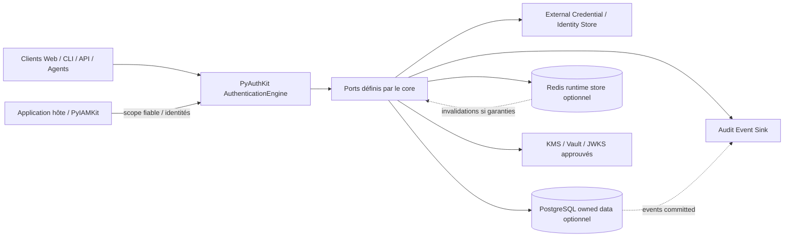
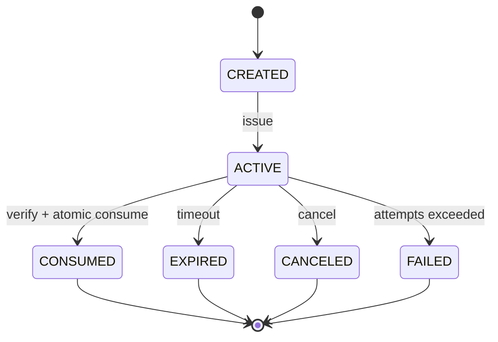
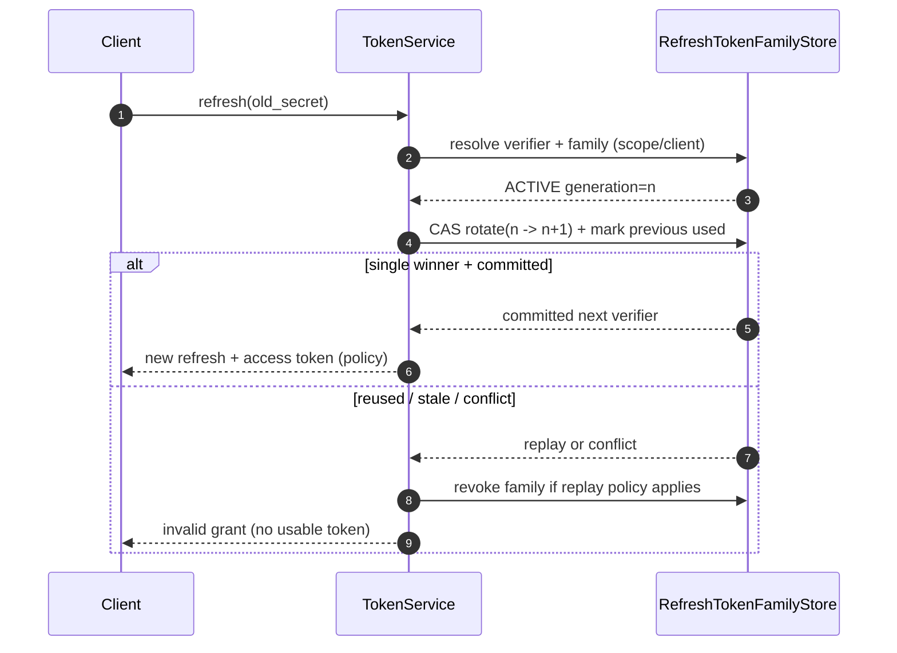
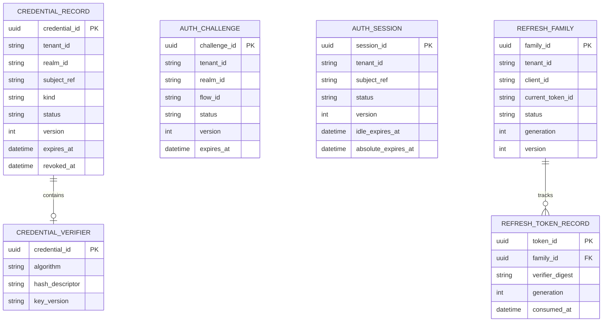
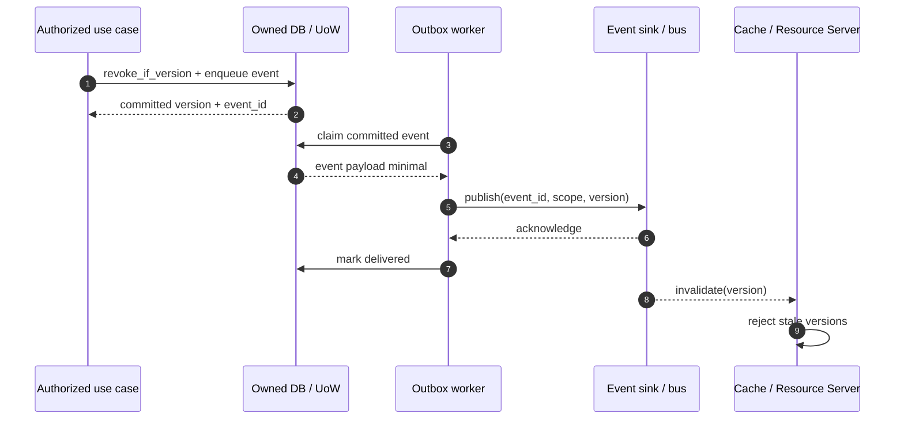
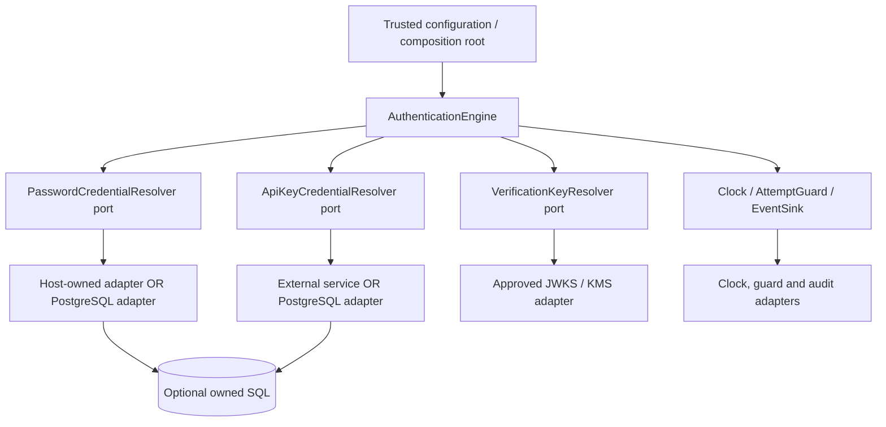

# 19_PYAUTHKIT_STORAGE_AND_PERSISTENCE_ARCHITECTURE

# PyAuthKit — Storage and Persistence Architecture

> **Projet :** PyAuthKit — Authentication Engine for the Modern Python Ecosystem  
> **Document :** `19_PYAUTHKIT_STORAGE_AND_PERSISTENCE_ARCHITECTURE.md`  
> **Type :** Spécification architecturale détaillée, sécurité des données et qualification  
> **Version documentaire :** `0.1.0` — proposition  
> **Date :** 30 octobre 2026  
> **Statut :** `PROPOSED / DESIGN` — aucune base installée, aucune transaction qualifiée ni migration exécutée n'est présumée  
> **Priorité :** MVP Password / API Key / validation JWT ; stockage de sessions et de flows en extensions contrôlées  
> **Architecture :** Hexagonal / Ports & Adapters, DDD pragmatique, sécurité et cohérence explicites  
> **Convention :** *Problem First · Trust First · Invariant Before Schema · Pattern If Needed · Evidence Before Claim*

---

## Guide de lecture

| Parcours | Sections | Résultat |
|---|---|---|
| Cadrage et ownership | 0–10 | Frontières, données possédées, typologie des stores |
| Contrats par capacité | 11–23 | Password, API Key, JWT, sessions, challenges, refresh tokens |
| Données et opérations | 24–36 | ERD, SQL, Redis, atomicité, migration, restauration, confidentialité |
| Exemples et exploitation | 37–43 | Python pur, transactions, observabilité, intégrations, comparaison |
| Gouvernance et qualification | 44–54 | Exigences, invariants, menaces, tests, ADR, learning cards et DoD |
| Annexes | A–E | Glossaire, matrice de provenance, checklist, références, journal |

**Statuts :** `EXISTING SPEC` désigne un contrat déjà décrit dans la documentation de PyAuthKit, et **ne signifie pas implémenté** ; `PROPOSED` désigne une décision candidate ; `CONDITIONAL` signifie dépendant d'un choix produit ; `POST-MVP` indique hors périmètre de la première livraison. Les identifiants `STORE-*` sont introduits dans ce document et ne remplacent pas les `AUTH-*`, `REL-*`, `ENG-*` ou `PORT-*` existants.

---

## 0. Résumé exécutif

**PyAuthKit n'a pas besoin de posséder une base de données pour exister comme moteur d'authentification.** Il a besoin de **preuves et d'états correctement résolus sous une autorité de confiance**. Le stockage permanent n'est requis que lorsque le déploiement lui confie explicitement des cycles de vie : credentials locaux, compteurs, challenges, sessions, familles de refresh tokens, révocations, ou journaux d'audit.

Trois régimes doivent rester distincts :

1. **Store externe / non possédé :** PyIAMKit, Django, un annuaire, un IdP ou un vault conserve les objets. PyAuthKit utilise un port de lecture ou de vérification et ne prétend pas maîtriser leurs mutations.
2. **Store possédé par PyAuthKit :** il crée ou maintient une donnée qui a des invariants et une durée de vie (p. ex. `CredentialRecord`, challenge à usage unique, session, famille de tokens). Le repository et les transactions doivent alors garantir ces invariants.
3. **Cache / projection :** réplication dérivée d'une source autoritative, jamais une deuxième vérité silencieuse. Son indisponibilité, son retard et son invalidation ont un contrat explicite.

**Décision candidate :** Python pur pour le core ; `Protocol` de portée réduite ; adaptateurs in-memory pour apprendre et tester ; PostgreSQL pour une persistance durable si PyAuthKit possède l'état ; Redis uniquement pour les usages dont les garanties de volatilité, atomicité, failover et RPO/RTO sont acceptables. Ni PostgreSQL ni Redis ne sont des dépendances obligatoires du moteur.

La clé de la sûreté n'est pas le choix de la base mais le contrat : **quelles données sont autoritatives, qui peut les lire ou modifier, avec quelle isolation, quelle transaction, quelle cohérence temporelle et quelle preuve en cas de panne ?**

## 1. Filiation documentaire et autorité

| Source interne | Ce que `19` reprend | Ce que `19` ne redéfinit pas |
|---|---|---|
| `00`, `01` | Agnosticisme, exigences de sécurité et exigences de stockage | Vision produit et exigences de haut niveau |
| `02`, `03` | Dependency Rule, Ports & Adapters, trusted entry, composants | Architecture d'ensemble et noms publics définitifs |
| `04`, `05`, `06` | 48 objets de domaine, ownership conditionnel, ERD A–D | Toute Entity supposée table SQL |
| `07` | Invariants, fail-closed, cross-tenant, transitions terminales | Sens métier de chaque invariant |
| `08`, `09` | Use cases, Engine, PolicyGate, `TrustedScope` | Définition du résultat d'authentification |
| `10` | Password/API Key/JWT, `CredentialRecord`, crypto ports | Algorithmes cryptographiques ou politique JWT |
| `11`, `12` | Challenge single-use, flow, MFA, assurance | Niveau AAL ou algorithme de facteur |
| `13` | SessionStore, refresh family, rotation/replay, révocation | Contrats de token et politiques temporelles |
| `14`, `15` | Federation state, WebAuthn counters, credentials publics | Protocoles OIDC/SAML/WebAuthn |
| `16`, `17` | Identités de workloads, signaux de risque et provenance | Délégation ou décision finale de risque |
| `18` | `PORT-OUT-01..10`, admission des adapters, composition root | Architecture des plugins et discovery |
| Convention Software Design | Justifications, alternatives, tests, ADR, noms naturels | Catalogue exhaustif des classes canoniques |

**En cas de divergence :** identifier `CURRENT`, `TARGET`, `GAP`, `DECISION` ; soumettre un ADR ; mettre à jour la source propriétaire. Une représentation de persistence de `19` ne devient pas la vérité canonique du domaine.

## 2. Problème métier et pression de conception

Une authentification peut se dérouler entre un client et un moteur qui vérifie un password stocké dans un système externe. D'autres cas requièrent d'inscrire un credential, de révoquer une API Key, de consommer un challenge une seule fois, de conserver l'assurance d'une session ou de détecter le rejeu d'un refresh token. Ces besoins sont **sémantiquement différents** : une lecture de hash ne requiert pas la même transaction qu'une rotation de refresh token.

**Pressions :** latence de vérification, plusieurs frameworks, hétérogénéité des magasins, concurrence, isolation tenant/realm, secret leakage, durabilité, perte de nœud, cohérence du cache, migration, historique et contraintes de conservation.

**Anti-solution :** `AuthDatabase` avec méthodes CRUD génériques qui gèrent en vrac users, passwords, sessions, tokens, logs et policies, rendant impossible l'expression des garanties propres à chaque opération.

## 3. Objectifs et non-objectifs

### 3.1 Objectifs

- Exprimer explicitement qui possède chaque donnée et sa source de vérité.
- Définir des ports étroits de résolution, lecture, écriture et transition atomique.
- Préserver les garanties `tenant/realm/subject/client/purpose` sur chaque accès.
- Protéger secrets, historiques et sauvegardes selon leur sensibilité.
- Empêcher un résultat « succès » si la persistance nécessaire à la sûreté a échoué.
- Qualifier concurrence, retries, crash/restart, réplication, cache et reprise après sinistre.
- Découpler stratégie de persistance et domaine ; éviter la sur-ingénierie dans le MVP.

### 3.2 Non-objectifs

- Imposer un `User`/`Organization` SQL sous contrôle PyAuthKit.
- Construire un ORM, un SQL builder, un cluster Redis ou un système IAM complet.
- Présumer que JWT entrant exige un `TokenStore`, ou que password authentication crée une session.
- Garantir la révocation instantanée d'un access JWT autonome sans contrôle externe.
- Garantir une transaction ACID entre Redis, PostgreSQL et un IdP distant sans protocole explicite.
- Stocker passwords en clair, refresh tokens bearer réutilisables, clés privées ou événements sensibles dans les logs.
- Confondre chiffrement au repos, hashing, HMAC, signatures et contrôle d'accès.

## 4. Périmètre et profils de déploiement

| Profil | Ownership | Besoin de persistence PyAuthKit | Proposition |
|---|---|---|---|
| **P0 — External-owned MVP** | IdP / IAM / application propriétaire | **Aucune table obligatoire** | Ports `PasswordCredentialResolver`, `ApiKeyCredentialResolver`, `VerificationKeyResolver` et mocks de contrat |
| **P1 — Local credential owner** | PyAuthKit pour `CredentialRecord` | Oui, durable et révocable | PostgreSQL (candidat), KDF/verifier externes, migrations versionnées |
| **P2 — Flows/challenges** | PyAuthKit pour challenges en cours | Oui, stockage à usage unique | SQL transactionnel ou Redis atomique sous RPO/failover acceptés |
| **P3 — Sessions stateful** | PyAuthKit pour sessions | Oui, cache possible | Store autoritatif explicite, TTL et révocation cohérents |
| **P4 — Refresh token family** | Issuer / AS dont PyAuthKit fait partie *si adopté* | Oui, transaction forte | Store transactionnel avec CAS, unicité et replay lineage |
| **P5 — Federation/WebAuthn** | Dépend du protocole et de l'hôte | État de corrélation / credentials publics selon ownership | Ports spécialisés, binding et consommation atomique |
| **P6 — External risk + audit** | Risk provider ou audit service externe | Event sink / cache conditionnel | Retention, privacy et garantie de livraison propres |

**MVP ne veut pas dire** mettre en production un `InMemoryStore` non durable ni prétendre aux garanties post-MVP sans qualification. Une démonstration Python en mémoire ne fournit pas de persistance ou de révocation distribué.

## 5. Langage ubiquitaire et distinctions fondamentales

| Terme | Sens précis | Ne pas confondre |
|---|---|---|
| `Credential` | Moyen/preuve pouvant servir à s'authentifier | `CredentialRecord`, qui est l'enregistrement possédé |
| `CredentialReference` | Référence opaque situant une preuve | Mot de passe, API key brute |
| `CredentialRecord` | Cycle de vie, statut et matière de vérification, si owned | Identity/Principal de PyIAMKit |
| `VerificationMaterial` | Données permettant de vérifier une preuve | Secret présenté par le client |
| `Session` | Continuité authentifiée et contexte d'assurance | AuthenticationAttempt, access token |
| `SessionHandle` | Bearer opaque présenté par un client | Simple identifiant SQL public |
| `RefreshTokenFamily` | Lignée ordonnée de refresh tokens et état de révocation | Access token JWT |
| `Challenge` | Preuve demandée, bornée et consommable | Session ou facteur complet |
| `Store` | Contrat opérationnel de données | Backend nécessairement SQL |
| `Repository` | Persistance d'un aggregate possédé | CRUD générique de toute donnée |
| `Cache` | Vue dérivée selon un contrat de fraîcheur | Source autoritative de révocation |
| `UoW` | Frontière d'atomicité/transaction | Transaction distribuée magique |
| `CAS` | Compare-And-Swap conditionnel | Lecture puis écriture sans verrou |
| `Tombstone` | Marqueur durable de retrait/invalidité | Simple suppression sans provenance |
| `RPO` / `RTO` | Perte de données tolérée / temps de reprise | Garantie automatique de sécurité |
| `Tenant` / `Realm` | Scope imposé par autorité serveur | Champ libre de la requête |

## 6. Bounded Contexts et Truth Ownership

| Information | Autorité normale | PyAuthKit peut posséder ? | Limite |
|---|---|---|---|
| Personne, organisation, rôles, groupes, permission | PyIAMKit / application hôte | Non, hors contrat explicite | Pas de tables « Users » implicites |
| `TrustedScope` / `TrustProfile` | Configuration serveur gouvernée | Oui pour snapshot d'exécution contrôlé | Jamais trust depuis input brut |
| Password hash | Service de credential ou application hôte | Oui si enrollment/rotation lui sont confiés | Un KDF approuvé, aucun plaintext |
| API Key verifier + statut | Issuer/owner d'API Keys | Oui selon profil | Lookup situé et révocation cohérente |
| Clés JWT de vérification | Trust anchor/KMS/JWKS approuvé | Cache oui, trust origin non | Pas de `jku` / URL depuis token non fiable |
| `AuthenticationResult` | Moteur après policy | Résultat éphémère, audit éventuel | Pas de persistance nécessaire par défaut |
| Challenge / flow | Propriétaire du flow | Oui si orchestration stateful | One-time, TTL, binding |
| Session | Application hôte ou PyAuthKit | Oui si session owner | AAL hérité des preuves, pas de hausse silencieuse |
| Famille refresh tokens | OAuth Authorization Server | Oui **si** PyAuthKit assume ce rôle | Pas de rotation partagée sans transaction |
| Audit événementiel | Système de journalisation gouverné | Transport ou outbox, pas vérité identité | Minimisation et retention |

**Règle :** `TrustOwnership` et `PersistenceOwnership` sont deux dimensions distinctes. Un adapter peut stocker les données dans une DB partagée sans devenir autoritatif pour le `principal` ou la politique IAM.

## 7. Context map et architecture de référence



**Direction des imports :** adapters `→` ports `→` application/domain. **Direction des appels runtime :** engine `→` ports `→` adapters concrets. Le diagramme ne suppose pas que tous les composants soient installés ni activés.

## 8. Trust boundaries et défense par couches

| Frontière | Risque | Garde requise |
|---|---|---|
| `TB-STORE-01` Client → Engine | Scope choisi arbitrairement | `TrustedEntryContext` résolu côté hôte |
| `TB-STORE-02` Engine → CredentialStore | Recherche cross-tenant | Clé composite et contrôle du scope à chaque méthode |
| `TB-STORE-03` Engine → JWT key cache | Clé/issuer venant du token | Trust profile autoritatif, cache key profilée |
| `TB-STORE-04` Store → cache | Réactivation après révocation | Invalidation/versioning, deny on ambiguity |
| `TB-STORE-05` Auth Service → DB | SQL injection, permissions excessives | Paramètres liés, rôle minimal, RLS défense en profondeur |
| `TB-STORE-06` DB → backup/replica | Exfiltration et rétention durable | Chiffrement, contrôle d'accès, inventaire et purge |
| `TB-STORE-07` Challenge → consommation | Deux vérifications gagnantes | Mutation atomique durable, résultat unique |
| `TB-STORE-08` Refresh family → nouveau token | Double rotation / replay | CAS + lineage + invalidation en transaction |
| `TB-STORE-09` Plugins → persistence | Code non fiable, escalade | Admission, périmètre de permissions et isolation si nécessaire |
| `TB-STORE-10` Outbox → event sink | Événement manquant ou secret divulgué | Écriture atomique/outbox si contractuellement requise, payload minimisé |

**Fail-closed :** une panne du store autoritatif n'est jamais « credential absent donc accepté », ni « session introuvable donc nouvelle session automatique ». Le code d'erreur externe peut masquer la cause, mais le diagnostic interne la préserve.

## 9. Principes de conception appliqués

- **SRP** : le resolver lit un credential situé ; le verifier valide sa preuve ; la policy prend une décision ; la transaction protège une transition.
- **DIP** : core indépendant de Redis, SQLAlchemy, Django, boto3, HTTP, vault SDK.
- **OCP** : nouveaux adapters sous mêmes contrats, sans modifier le noyau.
- **ISP** : `ChallengeConsumer` n'a pas à gérer `list_users()`.
- **SoC / Information Hiding** : la version CAS et les secrets dérivés ne sont pas exposés dans les DTO publics.
- **KISS/YAGNI** : pas de `UnitOfWork` abstrait si aucune écriture atomique multi-objet ne l'exige ; pas de second cache sans bénéfice mesuré.
- **Domain-First** : nommer `consume_challenge()` plutôt que `update_record_status()` lorsqu'il s'agit d'une règle one-time.
- **Evidence Before Claim** : des `Protocol` et des tests in-memory ne prouvent pas la sécurité de PostgreSQL ou de Redis.

## 10. Taxonomie des stores et des garanties

| Store candidat | Port associé | Donnée | Cohérence requise | Durabilité | Phase |
|---|---|---|---|---|---|
| `PasswordCredentialResolver` | `PORT-OUT-01` | Hash/verifier + statut | Lecture autoritative et scope | Selon owner | MVP |
| `ApiKeyCredentialResolver` | `PORT-OUT-03` | API key verifier + policy | Révocation visible selon contrat | Selon owner | MVP |
| `VerificationKeyResolver` | `PORT-OUT-06` | Clé publique / profil | Config approuvée, cache borné | Non, si re-fetch sûr | MVP |
| `AttemptGuard` | `PORT-OUT-10` | Compteurs et seuils | Atomicité, résistance au bypass | Dépend menace | MVP |
| `ChallengeStore` | Port `11` | Challenge, nonce, binding | **Single winner** | Selon garantie du flow | POST-MVP |
| `SessionStore` | Port `13` | Session, handle verifier, assurance | CAS et révocation | Si propriétaire | POST-MVP |
| `RefreshTokenFamilyStore` | Port `13` | Lignée et statut | Transaction atomique | Haute si issuer | POST-MVP |
| `WebAuthnCredentialStore` | Port `15` | Clé publique, compteur, metadata | Update conditionnel | Oui si owned | POST-MVP |
| `FederationStateStore` | Port `14` | state/nonce/PKCE context | One-time et expiration | Selon transaction | POST-MVP |
| `AuthenticationEventSink` | `PORT-OUT-08` | Audits minimisés | Politique de livraison définie | Si preuve requise | MVP / CONDITIONNEL |

**Aucune** de ces abstractions ne doit être un alias de `dict[str, Any]` global sans typage de scope, de résultat ni de sûreté.

## 11. Contrats transversaux des opérations de stockage

Chaque opération doit rendre explicites : `trusted_scope`, `principal_ref` ou `subject` quand nécessaire, `record_id`, `expected_version`, `now`/clock, `deadline`, `trace_id` non secret, `purpose`, et une **sémantique de réponse**.

| Résultat | Signification | Traitement |
|---|---|---|
| `FOUND` | Enregistrement dans le bon scope, version cohérente | Poursuivre la vérification |
| `NOT_FOUND` | Absence vérifiée sous scope autoritatif | Rejet neutre côté client |
| `EXPIRED` | Expiration connue | Ne pas prolonger automatiquement |
| `REVOKED` | Retrait confirmé | Refus terminal pour ce credential/handle |
| `CONFLICT` | CAS ou uniqueness a échoué | Retry borné si safe, sinon refus |
| `AMBIGUOUS` | Plusieurs enregistrements acceptables | Fail-closed ; anomalie de données |
| `UNAVAILABLE` | Store indisponible / timeout | Indétermination interne, jamais succès |
| `CORRUPT` | Contrôle d'intégrité/schema invalide | Quarantaine, alerte, refus |
| `FORBIDDEN_SCOPE` | Cross-tenant / droits insuffisants | Refus et audit sécurisé |

**Erreur client** et **diagnostic interne** sont distincts. Une exception SQL/Redis ne doit ni traverser l'API publique ni être convertie en une authentification validée.

## 12. `CredentialRecord` : ownership et cycle de vie

Une `CredentialRecord` est une Entity possédée seulement si PyAuthKit gère réellement sa création, son activation, sa rotation ou sa révocation. Sinon, un **resolver** lit un enregistrement externe et retourne une représentation canonique minimale.

**Attributs candidats** : `credential_id`, `owner_subject_ref`, `scope_id`, `kind`, `status`, `version`, `created_at`, `expires_at`, `revoked_at`, `verification_material_ref`, `policy_version`, `provenance`. Les valeurs peuvent être anonymisées ou externalisées selon le propriétaire.

**Transitions autorisées sous contrat** : `PENDING → ACTIVE`, `ACTIVE → ROTATED/REVOKED/EXPIRED`, `ROTATED → REVOKED/EXPIRED`. Une opération `activate()` ne ressuscite pas une `REVOKED` dans la même identité de record.

**Invariants** : owner/scope non modifiables par un input non fiable ; statut terminal au rejet ; version monotone ; toute mutation d'un credential important rend le cache obsolète ou exige un contrôle autoritatif.

## 13. Password : secrets dérivés et migration de KDF

1. Ne jamais persister le mot de passe présenté, ni un log, ni un event, ni un snapshot pouvant le reconstituer.
2. Utiliser une implémentation éprouvée de hash de mot de passe lent et paramétré (Argon2id candidat, alternatives gouvernées). Un **salt unique** par password fait partie du format de vérification.
3. Stocker les paramètres/identifiants d'algorithme et version nécessaires à la vérification/migration ; ne pas inférer de paramètres implicites périmés.
4. Un **pepper** éventuel réside hors de la DB des hashes (KMS/HSM/Vault) ; rotation et perte de pepper exigent un plan explicite.
5. `rehash_on_login` est un **changement conditionnel après vérification correcte** ; utiliser une mise à jour CAS pour éviter d'écraser un mot de passe révoqué/changé simultanément.
6. Une migration réversible de KDF ne signifie **pas** déchiffrer un ancien hash ; prévoir compatibilité transitoire puis rehash/reenrollment.
7. La recherche d'identité absente ne doit pas rendre triviale la différence de temps ou d'erreur permettant l'énumération ; l'anti-bruteforce est une responsabilité complémentaire.

**Contrat d'upgrade proposé :** `try_upgrade_hash(scope, credential_id, expected_version, new_hash_descriptor)` échoue sans effet si version/statut a changé. Une panne d'upgrade ne doit pas invalider une authentification déjà correctement vérifiée *si et seulement si* la policy autorise ce comportement et enregistre l'incident ; aucune promotion de vérification invalide.

## 14. API Keys : émission, lookup et révocation

Une API Key haute entropie doit être présentée au maximum pendant l'émission, puis stockée côté serveur sous forme d'un **verifier** et d'un identifiant de lookup non secret. Proposition : `(public_key_id, secret_random)` dans le bearer, table scoped sur `tenant/realm/public_key_id` et comparaison de dérivé secret avec primitive sûre.

- Un `SHA-256` ou `HMAC` peut suffire pour un secret réellement aléatoire à forte entropie ; cela **ne s'applique jamais** à un mot de passe humain.
- Une clé API comprend un **lifecycle propre** et une politique d'usage, mais **la portée d'accès finale reste évaluée par PyIAMKit / Resource Server**.
- Les préfixes de key servent éventuellement à l'ergonomie, jamais à garantir la confidentialité.
- L'unicité du lookup est limitée par `(scope, key_id)`, et non `key_id` global si ce dernier n'est pas conçu globalement unique.
- La révocation nécessite une visibilité définie pour tous les nœuds ; si l'on ne peut pas la prouver avec un cache, relire la source autoritative.
- Les périodes de rotation dual-key doivent être **bornées, explicites et auditables**, sans conserver une ancienne clé valide sans échéance.

## 15. Vérification JWT entrante et caches de clés

Valider un JWT entrant ne présuppose **aucune table de token**. Un JWT est signé puis vérifié selon un `TrustProfile` autoritatif : issuer, audience, algorithmes admis, clés, contrôle temporel, éventuelle typologie.

**Cache JWKS / clé :** la clé de cache inclut `trust_profile_id`, `issuer approuvé`, `key_set_version`/source, et `kid` dans un espace de noms contrôlé. Le `kid` sert à sélectionner **parmi** les clés du fournisseur déjà approuvé ; il ne peut pas lui-même choisir une URL ou un issuer.

**Pannes et rotation :** TTL borné, invalidation sur compromission, politique de stale-data distincte de la policy d'acceptation. Ne pas transformer une erreur réseau en acceptation d'une signature inconnue. Pour les JWT autonomes déjà émis, un changement du store ne provoque pas nécessairement un rejet immédiat chez tous les validateurs.

**Persistences distinctes :** `trusted_profiles` versionnés peuvent appartenir au déploiement, un cache de `JWKS` à l'adapter, et un `revocation ledger` éventuel à l'issuer — ne pas fusionner ces contrats.

## 16. `AttemptGuard` et compteurs anti-abus

La limitation des tentatives protège le système contre les essais massifs, mais ne constitue pas une preuve d'identité.

**Dimensionnement de la clé :** `trusted_scope + operation_kind + stable_account_ref? + origin_bucket?`. Les identifiants IP et user-agent sont des signaux imparfaits ; ils ne doivent ni remplacer le scope fiable, ni permettre de contourner le seuil par un simple changement de contexte client.

**Atomicité :** `increment_and_decide` comme opération indivisible sous le contrat choisi ; éviter `GET → +1 → SET` concurrent. Si le guard indisponible, préciser une policy par méthode et risque : échec fermé, limitation de capacité, ou dégradation **explicitement approuvée**, jamais un fallback silencieux vers « tout autoriser ».

**Rétention :** TTL borné des compteurs et réduction des données personnelles. Un reset ne doit pas être déclenché par la simple vérification d'une preuve non fiable.

## 17. `ChallengeStore` : consommation unique et binding

`Challenge` est potentiellement un Aggregate Root pour `11`. Ses champs : `challenge_id`, `flow_id`, `tenant/realm`, `purpose`, `method`, `subject_ref`, `nonce_verifier`, `expires_at`, `attempt_count`, `state`, `version` et policy snapshot si nécessaire.

**Règle de succès :** la transition `ACTIVE → CONSUMED` doit vérifier `ACTIVE`, `expires_at > now`, binding intact, preuve cryptographique et `expected_version` dans une **frontière atomique**. L'utilisation simultanée de la même preuve ne peut valider qu'une seule transition de consommation.



**Redis nuance :** un script atomique peut éviter deux gagnants sur **une instance primaire** ; il ne prouve pas à lui seul l'absence de réapparition d'un état ancien après perte de données, failover ou restauration. Si cette garantie est obligatoire, choisir une source transactionnelle durable ou concevoir une réconciliation qui refuse les défis incertains.

**Nuance TOTP :** consommation d'un challenge ne prouve pas la non-réutilisation du même OTP dans une autre cérémonie ; un contrôle spécifique du facteur est nécessaire.

## 18. `SessionStore` : état, handles et assurance

Une session n'est ni un bearer secret nu ni un succès de JWT entrant. Son contrat inclut au minimum : `session_id` interne, `trusted_scope`, `principal_ref` vérifié, `client_id`, `created_at`, `idle_expires_at`, `overall_expires_at`, `last_seen_at`, `status`, `version`, `assurance_provenance`, `revoked_at` et `handle_verifier` ou référence de secret.

**Session handle recommandé :** token aléatoire imprévisible ; peut être séparé en identifiant de lookup et secret. Ne jamais traiter le seul identifiant de DB comme preuve de possession. Le hash/verifier du secret à entropie élevée protège contre une lecture de DB qui permettrait de rejouer des sessions brutes.

**Opérations métier plutôt que CRUD :** `create_from_verified_auth`, `validate_handle`, `touch_if_version`, `revoke_if_version`, `rotate_handle`, `list_active_for_principal` (usage d'administration autorisé, filtré).

**Concurrence :** `touch()` ne peut pas réactiver une session révoquée, et `rotate_handle()` invalide l'ancienne preuve selon un contrat explicite. `last_seen_at` peut être mis à jour de manière échantillonnée **à condition** que la politique d'inactivité en tienne compte de façon conservatrice.

**Assurance :** la persistance d'une session conserve la provenance MFA et la fraîcheur ; une lecture, un refresh token ou une rotation de cookie ne permet jamais une élévation AAL à elle seule.

## 19. Familles de refresh tokens et anti-rejeu

Ce modèle ne devient applicable que si PyAuthKit, seul ou comme partie d'un Authorization Server, **possède** réellement l'émission et la rotation de refresh tokens. Il ne doit pas être ajouté à un moteur de validation JWT par réflexe.

Une famille représente un grant et une chaîne de verifiers : `(family_id, client_binding, subject_ref, scope/audience, current_token_id, generation, status, version, issued_at, absolute_expires_at, revoked_at)`. Les tokens précédents restent **identifiables pour détecter le rejeu**, sans être utilisables.



**Crash window critique :** si le store commit la rotation mais la réponse est perdue, le client peut réessayer l'ancien token. Ne pas redonner aveuglément le secret nouveau ; définir la politique de réponse, éventuel *idempotency window* très étroit sous binding strict, ou forcer une nouvelle autorisation. Un retry concurrent légitime ne doit pas être classé automatiquement comme attaque sans contrat d'arbitrage, mais il ne peut recevoir **deux** descendants actifs.

**RFC 9700 :** pour les clients publics, émettre un refresh token impose rotation avec détection du rejeu **ou** mécanisme de sender-constraining. Une transaction locale ne suffit pas à satisfaire toute la sécurité du profil OAuth.

## 20. Révocation, tombstones et cohérence

| Objet | Révocation autoritative | Cache/replica | Limite |
|---|---|---|---|
| Credential local | Transition terminale et version dans owner store | Invalider ou relire | Propagation mesurée |
| Session stateful | Store de session | Revalidation au bon instant | Répliques décalées refusées si état incertain |
| Refresh family | Transaction family | Ne jamais accepter depuis stale cache | Access JWT déjà délivrés peuvent survivre |
| Access JWT autonome | AS / keys / RS policy | Revocation list/introspection si conçue | Pas d'effet magique sur tous les validateurs |
| Challenge | Transition consumed/expired | Pas de lecture stale pour gagner | Perte d'état dangereuse |
| API Key | Owner/issuer | Cache versionné et durée bornée | Latence de révocation à qualifier |

Un **tombstone** aide à empêcher qu'un ancien événement/backup réactive un état. Sa conservation doit couvrir le risque de rejeu et les échéances de validité ; ne jamais le purger sur la seule base de la suppression d'un record si des artefacts encore acceptables existent.

## 21. Caches : admissibilité, clés et invalidation

**Cache positif :** dangereux si l'objet peut être révoqué avant son TTL. **Cache négatif :** peut empêcher de voir un credential nouvellement enregistré ou encourager une différence temporelle exploitable. Les deux modes exigent un contrat.

Une cache key doit inclure tous les déterminants nécessaires, par exemple :

```text
pyauthkit:{environment}:{tenant}:{realm}:{trust_profile_version}:
         {credential_kind}:{purpose}:{stable_public_reference}:{record_version?}
```

**Important :** la présence d'un tenant dans une clé Redis n'est pas une barrière de sécurité ; l'authentification, les ACL, la séparation de namespaces, le filtrage applicatif et les tests de non-fuite restent obligatoires. Les noms de clé et leurs valeurs ne doivent pas exposer des credentials.

Stratégies candidates : cache-aside avec source autoritative ; invalidation par version et publication d'événement ; TTL conservateur ; *deny on stale* pour challenge, sessions critiques et refresh ; mécanisme de revocation check approprié aux JWT ; pas de `stale-while-revalidate` pour un secret ou état de révocation critique sans modèle explicite.

## 22. Clocks, TTL et temporalité

- **Clock injectée** (`PORT-OUT-09`) pour la logique et les tests ; sur DB, définir quelle horloge fait foi pour une transaction.
- Un TTL Redis est une **politique de suppression**, pas la preuve complète que `expires_at` a été contrôlé.
- Pour chaque record, documenter `created_at`, `expires_at`, `revoked_at`, `last_seen_at`, éventuellement `effective_from/to` et `policy_version`.
- Les timestamps sont en UTC et timezone-aware à la frontière Python ; le domaine ne doit pas mélanger des datetimes naive/aware.
- Les dates d'expiration ont une sémantique explicite, recommandée : `now >= expires_at → invalide`.
- Une réplication ou un host à horloge divergente ne doit pas prolonger une validité sensible ; surveiller les écarts et rejeter si l'incertitude excède le contrat.
- Une suppression physique peut être asynchrone **après** l'invalidation logique ; ne pas confondre purge et révocation.

## 23. Idempotence et clés d'opération

Les commandes à effet (`issue_credential`, `consume_challenge`, `create_session`, `rotate_refresh`, `revoke_session`) déclarent leurs garanties d'idempotence, y compris après timeout côté client.

Une `idempotency_key` est située par `(trusted_scope, operation, caller, key)` et associée à une empreinte canonique de la requête **sans secrets bruts**. La même clé avec une requête différente retourne un conflit et ne produit pas un nouvel effet. Les enregistrements d'idempotence ont un TTL ou une retention adaptés à la fenêtre de rejeu.

Ne pas promettre *exactly once* end-to-end avec une simple clé : un réseau peut dupliquer les messages et une erreur se produire après commit. Préférer **at-least-once delivery + idempotent effects**, sous une frontière transactionnelle explicitement prouvée.

## 24. Transactions, Unit of Work et frontières d'agrégats

**Atomicité locale :** une transaction SQL protège plusieurs mutations dans **la même DB transactionnelle**, pas un appel au KMS, une notification email ou une publication Kafka non coordonnée.

| Transition | Unité atomique candidate | Effet hors transaction |
|---|---|---|
| Revoke API key | `credential_status + version + tombstone + outbox` | Invalidation distribuée / delivery |
| Consume challenge | `check active+binding+deadline + mark consumed + result intent` | Event et émission facultative |
| Rotate refresh | `current verifier + lineage + next verifier + family version` | Réponse au client et access token |
| Create session | `session state + handle verifier + outbox` | Cookie délivré après commit |
| Re-enroll passkey | `verified enrollment binding + credential uniqueness` | Notification / device sync externe |

**Unit of Work** est justifié lorsque plusieurs agrégats/écritures doivent être coordonnés dans un même mécanisme transactionnel. Une fonction SQL atomique simple peut suffire autrement. Les mutations inter-contextes utilisent contrats, outbox/inbox ou sagas selon les risques, sans faire semblant d'obtenir ACID global.

## 25. Concurrence : CAS, isolation et échecs

**Propriété de sûreté :** deux appels simultanés ne peuvent tous deux obtenir un succès sur une opération décrite comme single-use.

Choix concrets à qualifier : `UPDATE ... WHERE version = expected AND state='ACTIVE' ... RETURNING ...`, contrainte unique, `SELECT FOR UPDATE` avec contrôle d'état sous transaction, ou script Redis atomique lorsque la durabilité et le failover ne compromettent pas le modèle.

**L'isolation SQL ne résout pas tout** : read-committed, repeatable-read et serializable ont des comportements distincts sur les transactions concurrentes ; le code doit gérer deadlock, serialization failure et retries **bornés** d'opérations idempotentes.

**Crash/partition** : préciser si une réponse « succès » est autorisée avant durabilité effective ; si non, garantir le point de commit, et documenter les limites du backend et des réplications asynchrones.

## 26. Choix des backends : matrice de décision

| Technologie | Avantage | Limite critique | Décision candidate |
|---|---|---|---|
| **In-memory** | Tests, démonstrations, zéro IO | Process-local, perte au restart, concurrence multi-process absente | Tests uniquement ou démo isolée |
| **PostgreSQL** | Transactions, contraintes, version, indexes, sauvegardes | Ops/migrations, latence réseau, gestion des locks | Candidat durable owned-state |
| **SQLite** | Embarqué, tests d'intégration, simplicité | Concurrence/locking et topologie distincts de prod | Tests locaux ; qualifier avant prod |
| **Redis** | TTL et opérations atomiques rapides, performance | Durabilité/failover/replication configuration-dependent | Cache ou ephemeral state selon risque |
| **Django/SQLAlchemy store hôte** | Réutilisation infrastructure existante | Fuite de framework, owner non PyAuthKit | Adapter explicite, pas dépendance core |
| **External IdP / vault / KMS** | Autorité établie et rotation externalisée | Latence, réseau, SLA fournisseur | Ports et policy de panne explicites |

**Aucune préférence ne vaut mesure.** Le choix final exige données, débit, disponibilité, RPO/RTO, opérations de retrait et limites de confiance documentées.

## 27. PostgreSQL : schémas, contrôles et RLS

PostgreSQL peut être utilisé comme store d'état dont PyAuthKit est propriétaire, à condition de définir rôles SQL, schémas, transactions, migrations et sauvegardes.

**Isolation applicative** : chaque requête utilise un `tenant_id` résolu depuis le trusted entry, et non lu aveuglément dans un header. Les contraintes d'unicité et les foreign keys de portée tenant sont préférées à des clés/relations globales pouvant relier deux organisations.

**RLS est une défense additionnelle** : `ENABLE ROW LEVEL SECURITY` ne protège pas automatiquement le propriétaire de table, les superusers ou un rôle `BYPASSRLS` ; envisager `FORCE ROW LEVEL SECURITY`, rôle runtime non-owner, `SET LOCAL` dans une transaction, tests par rôles. La connexion poolée doit remettre le scope à zéro entre requêtes.

**Transaction de migration :** les évolutions de schema doivent être testées avec une application précédente et suivante ; éviter un `DROP COLUMN` immédiatement après déploiement. **Password hash** et clés privées ne doivent jamais être créés dans les logs de migration ou fixtures publiques.

## 28. Redis : quand l'atomicité locale ne suffit pas

Redis `MULTI/EXEC`, `WATCH` ou scripts peuvent réaliser des transitions atomiques sur le primaire, mais **ne fournissent pas les mêmes garanties transactionnelles et de rollback qu'une DB relationnelle**. En particulier, Redis ne prend pas en charge un rollback général des transactions après exécution.

**Durabilité :** RDB et AOF ont des garanties et coûts différents. La configuration AOF `appendfsync everysec` peut perdre des écritures récentes lors d'un incident ; une réplication/failover peut également affecter les garanties observables. Pour un `ChallengeStore` critical single-use, la perte d'un `CONSUMED` peut recréer une fenêtre de rejeu ; cette possibilité doit être acceptée explicitement ou éliminée par un store/architecture plus fort.

**Use cases raisonnables sous garanties documentées** : counters avec TTL, caches non autoritatifs, état de challenge à durée de vie limitée **si** son RPO, la sensibilité et les alternatives sont évalués. **À éviter par défaut** : utiliser un Redis volatile comme unique source autoritative de révocation persistante ou de lignée refresh token sans essais de crash/failover et décision de risque.

## 29. ERD : modèle conditionnel, pas projection mécanique du domaine

Trois vues à conserver : domaine sémantique, flux de confiance, persistence logique. Les objets `AuthenticationRequest`, `Authenticator`, `RiskPolicy`, `TrustProfile` ou `AuthenticationResult` ne deviennent pas des tables uniquement parce qu'ils apparaissent dans UML.



**ERD illustrative :** les entités ci-dessus appartiennent à **des profils distincts** ; rien n'oblige à les déployer dans la même DB. `principal_ref` est une référence externe possible, **pas une FK vers une table PyAuthKit `User`**. Les relations de session avec refresh family, client et principal seront précisées seulement si l'Authorization Server est propriétaire.

## 30. Schéma SQL illustratif et contraintes d'intégrité

Exemple PostgreSQL **pédagogique non exécutable tel quel en production**, volontairement limité à un profile `CredentialRecord` possédé localement. Le DDL exact doit être validé par une migration et par les tests d'isolation et de performance du déploiement.

```sql
CREATE TABLE auth_credential_record (
    tenant_id          text        NOT NULL,
    realm_id           text        NOT NULL,
    credential_id      uuid        NOT NULL,
    subject_ref        text        NOT NULL,
    credential_kind    text        NOT NULL,
    status             text        NOT NULL
                                  CHECK (status IN ('PENDING', 'ACTIVE', 'ROTATED', 'REVOKED', 'EXPIRED')),
    verifier_descriptor bytea,
    version            bigint      NOT NULL DEFAULT 0 CHECK (version >= 0),
    created_at         timestamptz NOT NULL,
    expires_at         timestamptz,
    revoked_at         timestamptz,
    PRIMARY KEY (tenant_id, realm_id, credential_id),
    CHECK (expires_at IS NULL OR expires_at > created_at),
    CHECK (status <> 'REVOKED' OR revoked_at IS NOT NULL)
);

CREATE INDEX auth_credential_subject_idx
    ON auth_credential_record (tenant_id, realm_id, subject_ref, credential_kind);

ALTER TABLE auth_credential_record ENABLE ROW LEVEL SECURITY;
ALTER TABLE auth_credential_record FORCE ROW LEVEL SECURITY;

-- The runtime role must be a non-owner, non-superuser without BYPASSRLS.
-- app.tenant_id and app.realm_id must be SET LOCAL by a trusted transaction wrapper.
CREATE POLICY credential_scope_policy ON auth_credential_record
USING (
    tenant_id = current_setting('app.tenant_id', true)
    AND realm_id = current_setting('app.realm_id', true)
)
WITH CHECK (
    tenant_id = current_setting('app.tenant_id', true)
    AND realm_id = current_setting('app.realm_id', true)
);
```

**Avertissements :**

- `verifier_descriptor` ne contient **jamais** un mot de passe ou API Key brut ; la représentation et son chiffrement éventuel sont régis par `10`.
- La `CHECK` sur status/revoked_at ne suffit pas à empêcher une transition `REVOKED→ACTIVE`. C'est une règle de mutation contrôlée par l'opération/trigger/privileges, avec test de concurrence.
- Un RLS fondé sur `current_setting` doit être éprouvé avec un rôle runtime, des prepared statements, le pool, les fonctions `SECURITY DEFINER`, les opérations d'administration et les migrations.
- Les migrations et fonctions DBA peuvent nécessiter des privilèges de contournement ; ces rôles doivent être séparés, surveillés et non utilisés par l'application.
- Les FK inter-tenant, si ajoutées, doivent porter la **même portée composite**. Une FK sur `credential_id` seul peut introduire un chemin dangereux.

## 31. Mutation SQL atomique et points de commit

Une transition de révocation candidate, sous autorité d'une requête déjà validée :

```sql
UPDATE auth_credential_record
   SET status = 'REVOKED',
       revoked_at = :now,
       version = version + 1
 WHERE tenant_id = :trusted_tenant
   AND realm_id = :trusted_realm
   AND credential_id = :credential_id
   AND status = 'ACTIVE'
   AND version = :expected_version
RETURNING credential_id, version, revoked_at;
```

- **1 ligne modifiée :** transition gagnante, pas encore « globalement visible » avant commit et propagation prévues.
- **0 ligne :** distinguer `NOT_FOUND`, `ALREADY_REVOKED`, `EXPIRED`, `CONFLICT` **via une lecture autoritative située**, sans exposer de détails d'existence au client.
- **Erreur au commit :** aucune confirmation externe de révocation ne doit être envoyée sans résultat transactionnel connu ; si résultat incertain, réinterroger et réconcilier.
- **Outbox critique :** enregistrer l'événement minimal **dans la même transaction** ; publier seulement après commit via un worker idempotent.

Les méthodes de repository ne doivent pas renvoyer `True` avant d'avoir atteint la garantie de commit promise par le backend.

## 32. Migrations et évolution du modèle

### 32.1 Expand → Migrate → Contract

```text
1. EXPAND  : colonnes/indices compatibles, nouveaux lecteurs acceptent ancien et nouveau
2. MIGRATE : backfill borné, contrôlé, reprenable, sans sortir de données sensibles
3. SWITCH  : nouvelles écritures + contrôles, monitoring des différences
4. CONTRACT: suppression du legacy seulement après qualification et rollback planifié
```

**Chaque migration documente :** version source et cible, compatibility window, migrations online/offline, locks, volumétrie, durée de rollback, données sensibles traversées, isolation, checksums/consistency queries, journal des erreurs et plan de restauration.

### 32.2 Cas spécifiques

- **Password KDF :** migration par vérification réussie et remplacement CAS, pas conversion magique de hash.
- **API Key format :** compatibilité bornée des identifiants, jamais réémission de secret depuis un verifier.
- **Session schema :** migration qui préserve les deadlines et les états terminaux ; sinon invalidation contrôlée de sessions.
- **Refresh lineage :** impossibilité de recréer une lignée fiable à partir d'un unique token courant sans preuves historiques ; préférer nouveau grant.
- **Key rotation :** version de key de chiffrement, déchiffrement contrôlé, re-encryption vérifiée ; garder le vieux matériau sous protections limitées seulement pendant transition.
- **Tenant migration :** ne pas déplacer un `subject_ref` sans revalider les mappings IAM et les restrictions de portée.

## 33. Backup, restauration et tests de reconstruction

Un backup de credentials est hautement sensible même s'il ne contient que des hashes ; les dumps de sessions et verifiers peuvent permettre une usurpation selon leur format.

| Contrôle | Exigence candidate |
|---|---|
| Backup | Chiffré, accès limité, stockage distinct, classification et logs d'accès |
| Restauration | Exercice reproductible, point de reprise connu, environnement isolé |
| Intégrité | Vérification d'empreinte + version de schéma et référentiel des clés |
| RPO/RTO | Chiffrés **par profil**, arbitrés avec le risque de rejeu et la disponibilité |
| Secret recovery | KMS/pepper et clés de DB restaurables selon procédure gouvernée |
| Restauration ancienne | **Ne jamais** ressusciter un credential/session/challenge révoqué sans réconciliation |
| Retention | Durées définies selon finalité, base légale et minimisation |
| Purge | Effacement des versions anciennes et backups selon cycle réaliste et politique |

**Risque majeur :** restaurer un backup plus ancien que des événements de révocation. Sans un registre autoritatif de tombstones ou procédure de revalidation, cette restauration peut rouvrir des credentials ou sessions invalidés. Une restauration techniquement réussie n'est donc **pas** une reprise de sécurité qualifiée.

## 34. Disaster Recovery, failover et partition réseau

**Scénarios :** chute du primary DB ; indisponibilité d'une réplique ; perte Redis sans AOF ; partition régionale ; divergence de cache ; perte d'accès KMS ; panne d'audit sink ; reprise après rotation de refresh token non confirmée côté client.

Pour chaque scénario, définir :

1. **Objet sensible :** credential, challenge, session, token family, key cache, attempt guard.
2. **Garantie :** disponibilité prioritaire ou sécurité non négociable (`single-use`, `revoked remains revoked`).
3. **Policy pendant panne :** reject, defer, degraded mode limité ; autorité qui l'a approuvée.
4. **Mode retour :** lecture primaire, reconstruction, réconciliation, vidage cache, maintien des revocations.
5. **Preuve :** chaos/fault-injection test + logs d'état + point de commit + résultat attendu.

Une architecture multi-région active-active exige une décision de cohérence pour chaque agrégat, plutôt qu'un drapeau `high_availability=true`. Les garanties de consensus, fencing et ownership de la mutation deviennent essentielles aux tokens single-use.

## 35. Chiffrement, KMS, secrets et clés

**Hash vs chiffrement :** les passwords sont hashés avec KDF adapté ; les secrets aléatoires de bearer sont stockés comme verifier si possible ; les données de profil/chiffrement réversible emploient KMS/AEAD si besoin de confidentialité ; les clés privées restent idéalement dans un HSM/KMS et ne transitent pas en clair par les objets de domaine.

**Encryption at rest ne remplace pas** : autorisation en lecture/écriture, TLS, segmentation des droits, contrôle des exports/backup, prévention SQL injection, audit et minimisation. Un compte DBA ou un plugin puissant peut exposer la donnée déjà déchiffrée.

**Envelope encryption candidat :** `ciphertext + encrypted_data_key + key_id + algorithm + associated_data` ; l'Associated Data inclut idéalement l'identité logique et le scope afin de détecter une copie cross-tenant. Rotation et key revocation ont leurs propres impacts sur récupération et disponibilité.

**Pas de secret dans** les exceptions, logs, traces, métriques, URL, snapshots de tests, migrations, event payloads, fichiers de configuration et tickets d'incident.

## 36. Multi-tenant : clés, contraintes et rôles d'accès

- **Portée composée** `(tenant, realm, purpose, ...)` sur chaque lookup, mutation, index de cache, audit et transaction.
- **Pas de `tenant_id` libre** venant du DTO public ; le `TrustedScope` est établi avant invocation du repository.
- **RLS n'est pas une preuve suffisante** : tester cross-tenant sur les rôles runtime, y compris SELECT/UPDATE/DELETE, indexes, unique conflicts, pagination et callbacks de plugins.
- **Pas de sharing de connexion contaminé** : `SET LOCAL` et transaction boundary garantissent remise à zéro de la variable de scope.
- **Isolation cryptographique** : choix d'une clé par tenant/realm si risque et coût justifient, sinon partage gouverné et threat model explicite.
- **Exports/migrations** : filtrage par scope, mécanisme d'autorisation supérieur et journaux d'accès admin.
- **Tombstones** : doivent conserver le scope d'origine ; une restauration cross-tenant ne doit pas réinterpréter un credential.

## 37. Architecture événementielle, audit et outbox

**Domain Event ≠ message Kafka.** Le fait métier `CredentialRevoked` exprime une mutation du propriétaire de credential. Sa propagation peut être asynchrone ; le consommateur doit supporter duplications, retard et reordering.



**Outbox** est pertinente si perte d'événement rend la sécurité inacceptable ; sinon un event sink best effort peut être envisagé selon une policy explicitée. **Ne jamais** confondre l'ACK d'un bus avec la convergence de tous les validateurs. Conserver une capacité de réparation/replay et la métrique `revocation_propagation_lag`.

## 38. Runtime, performance et capacity planning

### 38.1 Profils de charge candidats

| Charge | Risque dominant | Budget à mesurer |
|---|---|---|
| Password verification | KDF CPU/mémoire, exhaustion | P95/P99, concurrence, coût mémoire |
| API Key lookup | Index et latence DB/cache | Reads/sec, hot keys, propagation revoke |
| JWT verification | Cache clés, crypto CPU | Refresh JWKS, invalidation et latence |
| Challenge consumption | contention, retries | Taux de conflits, single-winner, failover |
| Session validation | hot reads, touch writes | Expiration et load spikes |
| Refresh rotation | locks et replay diagnostics | P99 mutation, rollbacks, lineage integrity |
| Audit outbox | backpressure | backlog, lag, at-least-once duplications |

**Optimiser après mesure** : indexation, batching contrôlé, pool de connexions, partitionnement par scope, KDF worker limits. Ne pas sacrifier isolation, revocation ou single-use pour abaisser artificiellement un P99.

### 38.2 Circuit breaking et retry

Lire une clé publique peut accepter un retry borné sur réseau si aucune élévation de confiance ; réessayer aveuglément une émission de credential, une rotation de token ou une consommation single-use peut provoquer un effet non souhaité. Les retries requièrent idempotence, deadline et identification du point de commit.

## 39. Observabilité et confidentialité des stores

**Événements internes candidats :** `CredentialLookupFailed`, `CredentialRevoked`, `ChallengeConsumed`, `ChallengeReplayRejected`, `SessionRevoked`, `RefreshTokenReuseDetected`, `StoreUnavailable`, `StoreConflict`, `CacheStaleRejected`, `MigrationCompleted`, `RestoreReconciliationFailed`.

**Champs sûrs sous revue :** event type, code de raison non sensible, timestamp, reference opaque et pseudonymisée, trust scope réduit/contrôlé, version de policy, correlation ID, backend class, résultat. **Champs interdits** : mot de passe, API Key, cookie, bearer token, refresh secret, private key, code OTP, assertion brute, query SQL avec paramètres secrets.

**Métriques :** taux de `store_unavailable`, conflit CAS, `challenge_double_accept` (objectif zéro), tentatives d'accès cross-tenant, cache invalidation lag, outbox delivery lag, replay detection, backup restore success, schema-version mismatch. La collecte ne prouve pas l'exactitude ; chaque métrique a une source de vérité et une convention de sampling.

## 40. Contrats Python purs — types et résultats

**Exemple 100 % pédagogique, sans implémentation cryptographique.** Les chaînes `ScopeId` ne sont pas une autorité par leur seul type ; elles doivent provenir d'un contexte établi par la composition root et la couche d'entrée. Les handles ne doivent pas être journalisés.

```python
from __future__ import annotations
from dataclasses import dataclass
from datetime import datetime
from enum import Enum
from typing import Protocol
from uuid import UUID


@dataclass(frozen=True)
class TrustedStoreScope:
    tenant_id: str
    realm_id: str
    purpose: str
    # Instances must be built only by trusted application composition.


class StoreStatus(str, Enum):
    FOUND = "found"
    NOT_FOUND = "not_found"
    REVOKED = "revoked"
    EXPIRED = "expired"
    CONFLICT = "conflict"
    UNAVAILABLE = "unavailable"


@dataclass(frozen=True)
class CredentialSnapshot:
    credential_id: UUID
    subject_ref: str
    status: str
    version: int
    verifier_descriptor: bytes  # Derived value, never a raw secret.


@dataclass(frozen=True)
class CredentialLookup:
    status: StoreStatus
    record: CredentialSnapshot | None = None


class PasswordCredentialResolver(Protocol):
    async def resolve(
        self, scope: TrustedStoreScope, subject_ref: str
    ) -> CredentialLookup: ...


class CredentialRevocationPort(Protocol):
    async def revoke_if_version(
        self,
        scope: TrustedStoreScope,
        credential_id: UUID,
        expected_version: int,
        now: datetime,
    ) -> StoreStatus: ...
```

**Limite de l'exemple :** une `CredentialSnapshot` doit être construite par l'adapter autoritatif après vérification du scope ; l'exemple ne valide ni SQL, ni format du hash, ni droit de révocation. `UNAVAILABLE` serait en pratique plutôt un type d'erreur dédié si l'API publique ne doit pas l'exposer dans un résultat ordinaire.

## 41. Concurrence Python — un gagnant, pas un `dict` partagé

Un port de challenge doit exposer une opération atomique, non une paire `get()/save()`.

```python
from dataclasses import dataclass
from datetime import datetime
from enum import Enum
from typing import Protocol
from uuid import UUID


class ConsumptionStatus(str, Enum):
    CONSUMED = "consumed"
    CONFLICT = "conflict"
    EXPIRED = "expired"
    NOT_FOUND = "not_found"


@dataclass(frozen=True)
class ChallengeConsumeCommand:
    challenge_id: UUID
    tenant_id: str       # Must come from the trusted scope, not user input.
    expected_version: int
    now: datetime
    verified_proof_ref: str  # Issued by a trusted verifier; NOT raw OTP.


class ChallengeConsumptionPort(Protocol):
    async def consume_verified(
        self, command: ChallengeConsumeCommand
    ) -> ConsumptionStatus: ...
```

**Important :** la présence de `verified_proof_ref` ne garantit aucune preuve : le vrai use case doit authentifier sa provenance, associer la preuve au challenge et à son contexte, puis transmettre à un adapter capable de faire le contrôle ET la mutation dans une fenêtre d'atomicité conforme. Pour certaines méthodes, la vérification cryptographique et la consommation ne peuvent pas résider dans une transaction DB unique : définir un protocole à deux phases sûr, une réservation temporaire ou un vérificateur idempotent, et qualifier les crash windows.

## 42. Composition Root et adapters concrets



**Rules :**

- La composition root ne charge que des plugins approuvés (`18`) et lie explicitement les secrets de connexion et scopes.
- Un adapter de production doit être isolable par droits/credentials techniques, pas seulement par un `Protocol`.
- Les fakes et `InMemoryAdapter` sont destinés aux tests et démonstrations, sauf ADR de risque acceptant un usage spécifique très restreint.
- Le core ne connaît ni DSN, ni Redis URL, ni ORM model ; il reçoit des contrats.
- Les intégrations `Django`, `FastAPI`, `Flask` choisissent le store *de l'hôte* ou le store owned par configuration, sans synchroniser deux autorités d'identité.

## 43. Modèles de consistency et alternatives d'architecture

| Problème | Solution la plus simple | Quand renforcer | Pattern réellement justifié |
|---|---|---|---|
| Hash password hôte | `CredentialResolver` externe | Deux sources remplaçables | Port/Adapter |
| Révoquer credential owned | `UPDATE ... WHERE version` | Audit transactionnel couplé | Repository + UoW/Outbox si requis |
| Challenge one-time | Transaction unique | Multi-région/failover exige plus | CAS / fencing / coordination |
| Refresh family | Transaction SQL locale | Reprise après crash/plusieurs AS | Aggregate + lineage + idempotence |
| Session hosted Django | Port session hôte | Portabilité entre frameworks | Adapter ciblé, pas second session service |
| Cache JWKS | TTL borné et trust profile | Rotation intense + revocation | Cache-aside avec invalidation contrôlée |
| Audit facultatif | Event sink best effort | Perte interdite | Outbox si publication doit être fiable |
| Multi-tenant | Scope contrôlé + requêtes filtrées | Risque cross-tenant accru | RLS et tests de défense en profondeur |

**Ne pas confondre :** `Repository` DDD et DAO générique ; `UnitOfWork` et `transaction.atomic()` ; `CAS` et lecture/écriture non atomique ; `at-least-once event` et `Event Sourcing` ; `cache` et source de vérité ; `TTL` et validité métier ; `encrypted` et sécurisé.

## 44. Threat Model — registre `STORE-THR-*`


Chaque menace est un **scénario de risque à qualifier**, non une vulnérabilité constatée du dépôt. Les mécanismes cités doivent être éprouvés avec le backend cible.


| ID | Menace | Mode de défaillance | Réponse de conception |
|---|---|---|---|

| `STORE-THR-001` | Cross-tenant credential lookup | A foreign realm returns a credential | Scope composite and negative contract tests |

| `STORE-THR-002` | Stale cache after revocation | Old verifier remains valid | Version gate or primary lookup, bounded propagation |

| `STORE-THR-003` | Redis failover replay | Consumed challenge reappears | Durability/fencing or reject uncertain challenges |

| `STORE-THR-004` | Refresh family fork | Concurrent refresh creates two descendants | CAS plus lineage uniqueness |

| `STORE-THR-005` | Refresh replay undetected | Invalidated token reused | Preserve lineage and revoke active family by policy |

| `STORE-THR-006` | Session fixation | Handle predictable or unchanged on privilege transition | CSPRNG handle and rotation policy |

| `STORE-THR-007` | Bearer exfiltration from DB | Raw session/refresh token leaked via dump | Store one-way verifier for high-entropy token |

| `STORE-THR-008` | Password database disclosure | Offline attack on weak password hash | Argon2id/approved KDF with unique salt |

| `STORE-THR-009` | Pepper leakage or loss | Shared secret co-located or unrecoverable | Separate KMS/Vault and recovery plan |

| `STORE-THR-010` | JWKS cache confusion | Attacker chooses issuer/key by token header | Trust profile keyed by trusted scope |

| `STORE-THR-011` | Algorithm downgrade | Stored metadata accepts weak algorithm | Algorithm allowlist/version policy |

| `STORE-THR-012` | RLS bypass | DB owner/BYPASSRLS bypasses tenant filter | Non-owner runtime role and FORCE RLS tests |

| `STORE-THR-013` | Connection pool contamination | Tenant settings persist across reused connection | Transaction-local scope and reset tests |

| `STORE-THR-014` | Backup resurrection | Restored DB loses revocation | Tombstone reconciliation and restore safety gate |

| `STORE-THR-015` | SQL injection | Unsafe dynamic statement or log | Bound parameters and SQL access controls |

| `STORE-THR-016` | Audit payload leak | Secrets exposed through events/traces | Allowlisted redacted event schema |

| `STORE-THR-017` | KMS outage | Unwrap fails and fallback uses plaintext | Fail-closed with key availability policy |

| `STORE-THR-018` | Cache poisoning | Untrusted key overwrites trusted scope | Namespaced keys and authenticated producers |

| `STORE-THR-019` | Unexpected retry after commit | Duplicate issuance or consumption | Idempotency and commit-state reconciliation |

| `STORE-THR-020` | Schema version mismatch | Old service misreads new data | Compatibility matrix and safe migration |

| `STORE-THR-021` | Session AAL inflation | Touch/refresh silently elevates assurance | Assurance provenance and policy gate |

| `STORE-THR-022` | Challenge/flow rebinding | Proof from wrong tenant/client/operation | Context binding and atomic consumption |

| `STORE-THR-023` | Outbox delivery gap | Critical revoke event never reaches consumers | Transactional outbox plus repair/lag monitoring |

| `STORE-THR-024` | Insider bulk export | Credential hashes and verifiers copied | Least privilege, export controls, monitored access |


## 45. Registre d’exigences spécialisées `STORE-REQ-*`


Règle de lecture : toutes les exigences ci-dessous sont **spécifiées pour qualification**, non déclarées implémentées ; le niveau `ALL` concerne tout profil applicable, `OWNED` un état possédé localement.


| ID | Exigence | Phase / condition | Preuve attendue |
|---|---|---|---|

| `STORE-REQ-001` | Each persistent record is scoped by trusted tenant and realm | `MVP` | Scope-bound lookups and writes |

| `STORE-REQ-002` | No mandatory PyAuthKit database in external-owner MVP | `MVP` | Engine runs with external resolver fakes |

| `STORE-REQ-003` | Repository operations return typed statuses including unavailable | `MVP` | No false success on store outage |

| `STORE-REQ-004` | Password raw evidence is never persisted or logged | `MVP` | Instrumented secret-scan test |

| `STORE-REQ-005` | Password hash uses approved adaptive KDF and unique salt | `MVP` | Verifier integration vectors |

| `STORE-REQ-006` | Password KDF upgrade uses version-checked mutation | `CONDITIONAL` | Concurrent password reset wins |

| `STORE-REQ-007` | Pepper is kept outside password database if used | `CONDITIONAL` | Separated secret store configuration |

| `STORE-REQ-008` | API key lookup identifier is not sufficient authentication | `MVP` | ID-only attempt rejected |

| `STORE-REQ-009` | API key verifier is derived from high-entropy secret | `MVP` | Dump cannot replay bearer value |

| `STORE-REQ-010` | API key revocation checks authoritative state | `MVP` | Post-revoke request denied |

| `STORE-REQ-011` | JWT trust keys derive only from server-approved profile | `MVP` | Injected jku ignored |

| `STORE-REQ-012` | JWKS cache keys include approved issuer and profile | `MVP` | Cross-issuer collision test |

| `STORE-REQ-013` | AttemptGuard counter update is atomic under concurrency | `MVP` | Parallel requests cannot bypass configured limit |

| `STORE-REQ-014` | Every stateful store has explicit owner and data classification | `ALL` | Ownership register reviewed |

| `STORE-REQ-015` | Every read and write enforces scope and purpose | `ALL` | Cross-tenant negative test |

| `STORE-REQ-016` | Every sensitive write has defined commit semantics | `ALL` | Failure before/after commit tested |

| `STORE-REQ-017` | Idempotent effects bind key to request fingerprint and scope | `ALL` | Key reused with changed intent rejected |

| `STORE-REQ-018` | Retry policy is bounded and aware of commit uncertainty | `ALL` | Fault injection test |

| `STORE-REQ-019` | Expiration checks a business timestamp, not only physical TTL | `ALL` | TTL removed but expired record denied |

| `STORE-REQ-020` | Clock comparisons use aware UTC timestamps | `ALL` | Boundary expiration tests |

| `STORE-REQ-021` | Cache never promotes unverified data to trusted subject | `ALL` | Cache poisoning test |

| `STORE-REQ-022` | Cache staleness is rejected for critical revocation state | `ALL` | Failover with stale replica test |

| `STORE-REQ-023` | Secrets are excluded from events, logs, metrics and exception messages | `ALL` | Automated redaction tests |

| `STORE-REQ-024` | Secrets at rest are protected according to their type | `ALL` | Threat-driven verifier/encryption tests |

| `STORE-REQ-025` | Runtime DB roles follow least privilege | `OWNED` | Privilege audit and denied writes |

| `STORE-REQ-026` | Tenant RLS is tested with actual runtime roles | `OWNED` | Owner and bypass-role checks |

| `STORE-REQ-027` | Migration includes expand/migrate/contract and rollback strategy | `OWNED` | N/N-1 compatibility test |

| `STORE-REQ-028` | Backups are encrypted and restoration is qualified | `OWNED` | Restore exercise report |

| `STORE-REQ-029` | Restores reconcile tombstones and revoked state | `OWNED` | Old backup cannot resurrect credential |

| `STORE-REQ-030` | Challenge consumption has exactly one successful winner | `POST-MVP` | Parallel consume test |

| `STORE-REQ-031` | Challenge expiry and binding are rechecked on consume | `POST-MVP` | Wrong context/expired denied |

| `STORE-REQ-032` | Challenge store durability matches replay threat model | `POST-MVP` | Crash and failover exercise |

| `STORE-REQ-033` | Sessions verify a secret handle, never a DB ID alone | `POST-MVP` | ID-only denial test |

| `STORE-REQ-034` | Session revoke is terminal under concurrent touch | `POST-MVP` | Revoke/touch race test |

| `STORE-REQ-035` | Session assurance provenance is persisted without promotion | `POST-MVP` | Refresh cannot increase AAL |

| `STORE-REQ-036` | Session inactivity and absolute timeout are enforced | `POST-MVP` | Boundary time test |

| `STORE-REQ-037` | Refresh token verifier never stores bearer secret in plaintext | `POST-MVP` | Store read-only disclosure simulation |

| `STORE-REQ-038` | Refresh rotation retains family linkage and prior-use markers | `POST-MVP` | Old token replay detected |

| `STORE-REQ-039` | Refresh rotation creates no more than one active descendant | `POST-MVP` | CAS concurrent test |

| `STORE-REQ-040` | Replay policy can invalidate an active refresh family | `POST-MVP` | Reuse then denied refresh |

| `STORE-REQ-041` | Federation state and nonce are purpose-bound and single-use | `POST-MVP` | Cross-flow substitution rejected |

| `STORE-REQ-042` | WebAuthn credential updates are scoped and version checked | `POST-MVP` | Counter/credential collision test |

| `STORE-REQ-043` | Machine credentials and workload attestations have owner provenance | `POST-MVP` | Issuer/scope substitution rejected |

| `STORE-REQ-044` | Audit event delivery model explicitly defines best-effort or guaranteed | `ALL` | Outbox contract test |

| `STORE-REQ-045` | Critical event publication does not precede local commit | `OWNED` | Rollback publishes nothing |

| `STORE-REQ-046` | Reconciliation after cache/failover detects stale accepted state | `ALL` | Injected lag test |

| `STORE-REQ-047` | Deployment records the storage version and migration state | `OWNED` | Startup refuses incompatible schema |

| `STORE-REQ-048` | No implementation or compliance claim without execution evidence | `ALL` | CI/ADR qualification gate |


## 46. Registre d’invariants `STORE-INV-*`


L’invariant exprime une **propriété de sécurité** ; les tests sont des témoins de son respect dans un périmètre et une topologie définis. Une table SQL ne suffit pas à le prouver.


| ID | Invariant métier / sécurité |
|---|---|

| `STORE-INV-001` | Unknown scope cannot be used for credential resolution |

| `STORE-INV-002` | Client-provided tenant never becomes trusted by type coercion |

| `STORE-INV-003` | A credential cannot be authenticated by lookup ID alone |

| `STORE-INV-004` | Password evidence is never stored in plaintext |

| `STORE-INV-005` | Password verifier is not reversible into the password |

| `STORE-INV-006` | A revoked credential never becomes active under same identity |

| `STORE-INV-007` | A stale update cannot overwrite a newer credential version |

| `STORE-INV-008` | JWT kid cannot select a new unapproved issuer |

| `STORE-INV-009` | Verification key cache cannot cross trust profile boundary |

| `STORE-INV-010` | An unavailable credential store never yields authenticated success |

| `STORE-INV-011` | An ambiguous credential lookup is rejected |

| `STORE-INV-012` | A local cache cannot override an authoritative revoked state |

| `STORE-INV-013` | A returned secret verifier never becomes an API public field |

| `STORE-INV-014` | An API key lookup outside its trusted realm is rejected |

| `STORE-INV-015` | An expired credential is rejected even before TTL cleanup |

| `STORE-INV-016` | Every state mutation has a defined commit point |

| `STORE-INV-017` | A timeout after commit never automatically repeats a non-idempotent effect |

| `STORE-INV-018` | An idempotency key for a different request is rejected |

| `STORE-INV-019` | A challenge cannot be consumed twice successfully |

| `STORE-INV-020` | Expired challenge can never be newly consumed |

| `STORE-INV-021` | Consumed challenge never returns to active |

| `STORE-INV-022` | Challenge proof must match purpose, scope, flow and client |

| `STORE-INV-023` | A lost Redis consumed state is a failure of single-use guarantees unless mitigated |

| `STORE-INV-024` | A session handle lookup ID without its secret cannot authenticate |

| `STORE-INV-025` | A revoked session cannot be reopened by touch |

| `STORE-INV-026` | A session cannot survive beyond absolute expiry |

| `STORE-INV-027` | Refreshing a session does not elevate its AAL |

| `STORE-INV-028` | Session AAL cannot exceed verified evidence provenance |

| `STORE-INV-029` | A refresh token family cannot have two current active descendants |

| `STORE-INV-030` | Reusing an invalidated refresh token triggers defined replay handling |

| `STORE-INV-031` | A refresh family revoked due to replay cannot be refreshed again |

| `STORE-INV-032` | A bearer refresh token is not persisted in plaintext where verifier storage is applicable |

| `STORE-INV-033` | A restored backup may not resurrect revoked credentials/sessions |

| `STORE-INV-034` | A cross-tenant SQL operation must be denied under runtime identity |

| `STORE-INV-035` | A cache entry for one realm cannot resolve another realm |

| `STORE-INV-036` | A database pool cannot retain trusted scope from prior request |

| `STORE-INV-037` | An outbox event about revoke cannot precede transaction commit |

| `STORE-INV-038` | An event payload contains no raw authentication secret |

| `STORE-INV-039` | An internal store error must not expose a secret to a public client |

| `STORE-INV-040` | A migration must not silently reinterpret historic assurance states |

| `STORE-INV-041` | A challenge result may not be marked successful without verified proof |

| `STORE-INV-042` | A production safety claim requires tests on the actual persistence backend |


## 47. Plan de qualification `STORE-TST-*`


**Statut de toutes les lignes :** `PLANNED`, et non `PASSED`. Les tests devront être exécutés au minimum contre un fake de contrat **et**, pour les propriétés de persistance ou concurrence, contre les vrais backends et topologies retenus.


| ID | Groupe | Cas de test |
|---|---|---|

| `STORE-TST-001` | Scope / trust | Missing trusted scope refuses read |

| `STORE-TST-002` | Scope / trust | Client tenant injection cannot select store scope |

| `STORE-TST-003` | Scope / trust | Realm collision returns no credential |

| `STORE-TST-004` | Scope / trust | Same public ID in two tenants resolves independently |

| `STORE-TST-005` | Scope / trust | Cross-tenant update is rejected |

| `STORE-TST-006` | Scope / trust | JWT key cache is partitioned by issuer and profile |

| `STORE-TST-007` | Scope / trust | Purpose mismatch denies credential |

| `STORE-TST-008` | Scope / trust | Foreign principal reference does not produce trusted subject |

| `STORE-TST-009` | Password / credentials | No plaintext password appears in SQL fixture |

| `STORE-TST-010` | Password / credentials | Hash descriptor includes approved KDF parameters |

| `STORE-TST-011` | Password / credentials | Unique salt generated for independent passwords |

| `STORE-TST-012` | Password / credentials | Known good password verifies |

| `STORE-TST-013` | Password / credentials | Wrong password is denied |

| `STORE-TST-014` | Password / credentials | Concurrent reset defeats stale rehash CAS |

| `STORE-TST-015` | Password / credentials | Revoked password cannot be reactivated |

| `STORE-TST-016` | Password / credentials | Pepper outage never falls back to empty pepper |

| `STORE-TST-017` | API key / JWT | API key public ID without secret is denied |

| `STORE-TST-018` | API key / JWT | API key digest comparison accepts correct random secret |

| `STORE-TST-019` | API key / JWT | API key revoked while cache hot is denied |

| `STORE-TST-020` | API key / JWT | Two tenants sharing key prefix remain isolated |

| `STORE-TST-021` | API key / JWT | JWT with untrusted jku does not fetch arbitrary endpoint |

| `STORE-TST-022` | API key / JWT | JWT with wrong issuer is rejected |

| `STORE-TST-023` | API key / JWT | JWKS cache poison for other tenant has no effect |

| `STORE-TST-024` | API key / JWT | Untrusted alg is not accepted after key rotation |

| `STORE-TST-025` | Challenges / flow | Two concurrent valid challenge consumers yield exactly one success |

| `STORE-TST-026` | Challenges / flow | Consumed challenge replay is rejected |

| `STORE-TST-027` | Challenges / flow | Expired challenge is denied at boundary timestamp |

| `STORE-TST-028` | Challenges / flow | Canceled challenge cannot be consumed |

| `STORE-TST-029` | Challenges / flow | Challenge wrong flow is rejected |

| `STORE-TST-030` | Challenges / flow | Challenge wrong client binding is rejected |

| `STORE-TST-031` | Challenges / flow | Crash after consume does not permit new accept |

| `STORE-TST-032` | Challenges / flow | TOTP reuse across flows is blocked by factor-specific rule |

| `STORE-TST-033` | Sessions | Session ID without bearer verifier is denied |

| `STORE-TST-034` | Sessions | Session with wrong handle verifier is denied |

| `STORE-TST-035` | Sessions | Session revoke racing touch remains revoked |

| `STORE-TST-036` | Sessions | Session idle timeout enforced |

| `STORE-TST-037` | Sessions | Session absolute timeout enforced |

| `STORE-TST-038` | Sessions | Session handle rotation invalidates old handle |

| `STORE-TST-039` | Sessions | Session AAL unchanged after touch |

| `STORE-TST-040` | Sessions | New session requires final authenticated principal |

| `STORE-TST-041` | Refresh families | Parallel refresh produces one active descendant |

| `STORE-TST-042` | Refresh families | Replayed old refresh token is detected |

| `STORE-TST-043` | Refresh families | Replay revokes active family per policy |

| `STORE-TST-044` | Refresh families | Refresh token wrong client binding denied |

| `STORE-TST-045` | Refresh families | Refresh token wrong audience/scope denied |

| `STORE-TST-046` | Refresh families | Crash after rotation response loss is reconciled |

| `STORE-TST-047` | Refresh families | Generation monotonic after rotation |

| `STORE-TST-048` | Refresh families | Family revoked cannot issue new token |

| `STORE-TST-049` | Atomicity / consistency | CAS conflict returns typed conflict |

| `STORE-TST-050` | Atomicity / consistency | Transaction rollback leaves original record intact |

| `STORE-TST-051` | Atomicity / consistency | Commit uncertainty never returns success prematurely |

| `STORE-TST-052` | Atomicity / consistency | Outbox not written on aborted transaction |

| `STORE-TST-053` | Atomicity / consistency | Outbox dedupe survives duplicate delivery |

| `STORE-TST-054` | Atomicity / consistency | Read replica stale revoke triggers deny or primary recheck |

| `STORE-TST-055` | Atomicity / consistency | Redis failover scenario matches declared RPO |

| `STORE-TST-056` | Atomicity / consistency | Two writers on same record cannot lose version |

| `STORE-TST-057` | SQL/RLS | Runtime role cannot bypass RLS |

| `STORE-TST-058` | SQL/RLS | Tenant scope reset across connection pooling |

| `STORE-TST-059` | SQL/RLS | Row owner bypass configuration detected |

| `STORE-TST-060` | SQL/RLS | RLS wrong tenant SELECT returns none |

| `STORE-TST-061` | SQL/RLS | RLS wrong tenant UPDATE changes no rows |

| `STORE-TST-062` | SQL/RLS | DB role cannot read administrative secret columns |

| `STORE-TST-063` | SQL/RLS | Composite uniqueness prevents tenant cross-binding |

| `STORE-TST-064` | SQL/RLS | Injection string is treated as bound value |

| `STORE-TST-065` | Redis/cache | Attempt counter atomic under contention |

| `STORE-TST-066` | Redis/cache | Expired TTL key does not imply valid proof |

| `STORE-TST-067` | Redis/cache | Cache positive entry invalidated after revoke |

| `STORE-TST-068` | Redis/cache | Cache negative entry respects freshness |

| `STORE-TST-069` | Redis/cache | Cache key includes trust profile |

| `STORE-TST-070` | Redis/cache | Redis restart with declared AOF verifies accepted-loss budget |

| `STORE-TST-071` | Redis/cache | Cache poisoning is rejected |

| `STORE-TST-072` | Redis/cache | Store outage does not become permissive fallback |

| `STORE-TST-073` | Backup/migration | Backup contents encrypted and access controlled |

| `STORE-TST-074` | Backup/migration | Old backup restore cannot resurrect revoke |

| `STORE-TST-075` | Backup/migration | RPO measured under simulated outage |

| `STORE-TST-076` | Backup/migration | RTO measured through restore exercise |

| `STORE-TST-077` | Backup/migration | N and N-1 code versions read expanded schema |

| `STORE-TST-078` | Backup/migration | Backfill idempotent after interruption |

| `STORE-TST-079` | Backup/migration | Legacy password hash migration uses CAS |

| `STORE-TST-080` | Backup/migration | Schema mismatch blocks unsafe startup |

| `STORE-TST-081` | Audit/privacy | No bearer value in logs |

| `STORE-TST-082` | Audit/privacy | No password in trace span |

| `STORE-TST-083` | Audit/privacy | No OTP in event payload |

| `STORE-TST-084` | Audit/privacy | Error response conceals user existence |

| `STORE-TST-085` | Audit/privacy | Revocation produces required minimal audit event |

| `STORE-TST-086` | Audit/privacy | Audit sink outage follows declared policy |

| `STORE-TST-087` | Audit/privacy | Tenant filters apply to audit export |

| `STORE-TST-088` | Audit/privacy | Retention purge removes expired data within contract |

| `STORE-TST-089` | Quality/architecture | Domain does not import SQLAlchemy |

| `STORE-TST-090` | Quality/architecture | Domain does not import Redis client |

| `STORE-TST-091` | Quality/architecture | Domain does not import Django ORM |

| `STORE-TST-092` | Quality/architecture | Adapters satisfy port contract suite |

| `STORE-TST-093` | Quality/architecture | In-memory fake does not count as durability proof |

| `STORE-TST-094` | Quality/architecture | Every sensitive operation has failure test |

| `STORE-TST-095` | Quality/architecture | CI stores backend/environment/test evidence |

| `STORE-TST-096` | Quality/architecture | No storage-adapter plugin activates without admission |


### 47.1 Qualification multi-niveaux


| Niveau | Usage | Ne suffit pas pour |
|---|---|---|
| **Pure domain** | Valeurs, transitions, invariants locaux | Transaction ACID et failover |
| **Port contract** | Substitution des adapters et statuts | Conformité sécurité backend |
| **Integration** | SQL/Redis réels, permissions, migrations | Indisponibilité régionale |
| **Concurrency** | N workers/processes, CAS, locks | Crash recovery sans fault injection |
| **Chaos / DR** | Crash, replica lag, Redis failover, restore | Conformité juridique |
| **Security** | RLS, log leaks, injection, pentest | Certification de conformité |


### 47.2 Evidence record minimal


Conserver : `test_id`, code commit, version backend, version schema, fixture, clock policy, topology, configuration de durabilité, nombre de workers, logs minimisés, expected/observed, statut, reviewer, date. Un test Python isolé sans DB n’est pas une preuve de révocation distribuée.


## 48. Architecture Fitness Functions `STORE-FIT-*`


| ID | Règle automatisable ou revue récurrente |
|---|---|

| `STORE-FIT-001` | domain modules import no redis/psycopg/sqlalchemy/django ORM |

| `STORE-FIT-002` | application orchestrators consume ports, not database sessions directly |

| `STORE-FIT-003` | plugins/adapters never update unowned identity tables |

| `STORE-FIT-004` | all sensitive repository methods require trusted scope |

| `STORE-FIT-005` | no API accepts raw tenant as proof of authority |

| `STORE-FIT-006` | no new storage table without identified lifecycle owner |

| `STORE-FIT-007` | raw bearer values never appear in SQL/debug/log payloads |

| `STORE-FIT-008` | migration CI validates N-1/N compatibility where promised |

| `STORE-FIT-009` | all single-use methods have an atomic backend contract test |

| `STORE-FIT-010` | refresh-token family methods have concurrency and replay tests |

| `STORE-FIT-011` | RLS is exercised using runtime role, not superuser |

| `STORE-FIT-012` | Redis backend durability claims require failover evidence |

| `STORE-FIT-013` | cache keys are tenant/realm/trust-profile namespaced |

| `STORE-FIT-014` | critical reads reject stale revoked states |

| `STORE-FIT-015` | errors distinguish unavailable vs invalid without user enumeration |

| `STORE-FIT-016` | outbox events are committed atomically where guaranteed |

| `STORE-FIT-017` | client SDK does not import internal persistence adapters by default |

| `STORE-FIT-018` | release notes link exact backend test run and schema version |


## 49. Design Learning Cards — douze cas concrets


Ces fiches appliquent la convention `PYAUTHKIT_SOFTWARE_DESIGN_LEARNING_CONVENTION.md` : **problème → contrainte → concept → solution minimale → preuve**. Aucun pattern n’est utilisé pour la seule démonstration.


### 49.1 `PasswordCredentialResolver`


- **Problème réel :** Un framework hôte possède les hashes ; PyAuthKit doit les vérifier sans ORM.

- **Rôle / invariant :** Ownership externe ; invariants de scope et absence de plaintext.

- **Concepts appliqués :** DIP, ISP, Ports & Adapters, aucun Repository owned requis.

- **Alternative à éviter / coût :** Importer directement un modèle Django dans le core.

- **Preuve attendue :** Tests de contrat sur deux adapters + cross-tenant.


### 49.2 `CredentialRecord`


- **Problème réel :** La révocation locale doit survivre aux retries et aux changements de backend.

- **Rôle / invariant :** Entity/aggregate candidat si PyAuthKit est owner ; statut et version.

- **Concepts appliqués :** Encapsulation, CAS, Repository si aggregate réellement possédé.

- **Alternative à éviter / coût :** Classe CRUD sans invariant ou passage forcé par une User table.

- **Preuve attendue :** Revoke terminal + concurrent stale update.


### 49.3 `PasswordHashUpgrade`


- **Problème réel :** Le hash ancien reste vérifiable tout en migrant les paramètres.

- **Rôle / invariant :** Changement conditionnel du matériel de vérification après succès.

- **Concepts appliqués :** KISS, CAS, stratégie KDF si plusieurs algorithmes coexistent.

- **Alternative à éviter / coût :** Réécrire le hash sans version ou convertir plaintext supposé.

- **Preuve attendue :** Concurrent reset and rehash conflict.


### 49.4 `ApiKeyCredentialResolver`


- **Problème réel :** Lookup doit être rapide sans stocker un secret bearer réutilisable.

- **Rôle / invariant :** Identifiant non secret + verifier + scope et statut.

- **Concepts appliqués :** DIP, Information Hiding, Value Object pour référence.

- **Alternative à éviter / coût :** Utiliser le key_id seul comme authentification.

- **Preuve attendue :** Dump-only attack / revoke while cache hot.


### 49.5 `VerificationKeyResolver`


- **Problème réel :** Plusieurs issuers ont des clés parfois identifiées par le même kid.

- **Rôle / invariant :** Cache sous trust profile approuvé ; clé publique.

- **Concepts appliqués :** Adapter, Composition, trust boundary.

- **Alternative à éviter / coût :** Construire une URL depuis header JWT jku.

- **Preuve attendue :** Cross-issuer key collision and injected URL.


### 49.6 `AttemptGuard`


- **Problème réel :** Plusieurs workers tentent d’incrémenter un même compteur.

- **Rôle / invariant :** Opération atomique + politique de panne.

- **Concepts appliqués :** Atomic operation, strategy only if alternative real.

- **Alternative à éviter / coût :** GET/increment/SET séparés ; cache indisponible = autoriser.

- **Preuve attendue :** Concurrent limit enforcement / outage.


### 49.7 `AuthenticationChallenge`


- **Problème réel :** Un défi peut être présenté deux fois en parallèle.

- **Rôle / invariant :** Aggregate candidat ; terminal states and single-use.

- **Concepts appliqués :** DDD aggregate, CAS, state machine (not GoF State by default).

- **Alternative à éviter / coût :** `get` puis `save` non atomiques.

- **Preuve attendue :** Single winner + crash recovery.


### 49.8 `AuthenticationSession`


- **Problème réel :** La session est révoquée pendant un refresh/touch.

- **Rôle / invariant :** Aggregate candidat si owned ; bearer verifier and provenance AAL.

- **Concepts appliqués :** Optimistic concurrency, value objects, Repository.

- **Alternative à éviter / coût :** Dériver AAL du token refresh ou de la présence d’un cookie.

- **Preuve attendue :** Revoke racing touch + no AAL inflation.


### 49.9 `RefreshTokenFamily`


- **Problème réel :** La rotation concurrente ne doit pas produire deux descendants actifs.

- **Rôle / invariant :** Aggregate root candidat, lineage et replay semantics.

- **Concepts appliqués :** Aggregate, Unit of Work, CAS/idempotency.

- **Alternative à éviter / coût :** Émettre avant commit ou conserver plaintext dans DB.

- **Preuve attendue :** Parallel refresh + stale/replay + response lost.


### 49.10 `TenantScopedPersistence`


- **Problème réel :** Un service multi-tenant partage une même base.

- **Rôle / invariant :** TrustScope gouverné, requêtes et RLS defense-in-depth.

- **Concepts appliqués :** SoC, DIP, explicit context; aucun GoF obligatoire.

- **Alternative à éviter / coût :** Se reposer uniquement sur préfixes Redis ou claims client.

- **Preuve attendue :** RLS runtime role and pooled-connection contamination.


### 49.11 `CredentialRevocationOutbox`


- **Problème réel :** La révocation DB réussit mais le bus est indisponible.

- **Rôle / invariant :** Owner event et obligation de propagation selon SLA.

- **Concepts appliqués :** Transactional Outbox lorsque garantie requise.

- **Alternative à éviter / coût :** Émettre événement avant commit ou confondre ACK et convergence.

- **Preuve attendue :** Rollback no event + replay and lag.


### 49.12 `StorageRecoveryPlan`


- **Problème réel :** La reprise d’un backup ancien pourrait réactiver un secret.

- **Rôle / invariant :** Tombstones, RPO/RTO et restauration gouvernée.

- **Concepts appliqués :** Defense in depth, deterministic reconciliation, auditability.

- **Alternative à éviter / coût :** Déclarer disaster recovery OK parce que DB redémarre.

- **Preuve attendue :** Restore old backup + revoked state remains denied.


## 50. Décisions ouvertes et ADR `STORE-DEC-*`


Une décision candidate n’est **pas** adoptée. Les choix irréversibles ou structurants doivent passer par un ADR documentant contexte, contraintes, alternatives, sécurité, conséquences et plan de migration.


| ID | Arbitrage | Alternatives / enjeu | Priorité |
|---|---|---|---|

| `STORE-DEC-001` | Owner of credentials for each integration | External host vs PyAuthKit owned | `P0` |

| `STORE-DEC-002` | Supported owned DB backends at v0.1 | PostgreSQL only vs adapter contract | `P0` |

| `STORE-DEC-003` | Credential KDF parameters and migration triggers | Security profile vs deployment tuned | `P0` |

| `STORE-DEC-004` | API key secret verifier derivation | SHA-256 vs HMAC and pepper key control | `P0` |

| `STORE-DEC-005` | Credential/revoke cache permission | No positive cache vs bounded versioned cache | `P0` |

| `STORE-DEC-006` | AttemptGuard outage behavior | Deny vs controlled degradation | `P0` |

| `STORE-DEC-007` | Credential status transition enforcement | Application CAS vs DB trigger | `P1` |

| `STORE-DEC-008` | RLS policy and DB roles | Tenant-level RLS + FORCE vs isolated DB | `P1` |

| `STORE-DEC-009` | Tenant/realm representation | Composite columns vs compound scope ID | `P1` |

| `STORE-DEC-010` | Challenge store backend | PostgreSQL vs Redis under failover constraints | `P1` |

| `STORE-DEC-011` | Challenge atomic verified consumption | Transaction protocol / reservation / verifier integration | `P1` |

| `STORE-DEC-012` | Session ownership for each framework | Host session vs PyAuthKit stateful | `P1` |

| `STORE-DEC-013` | Session handle verifier representation | ID+random secret, hash algorithm and rotation | `P1` |

| `STORE-DEC-014` | Session idle touch sampling | Exact vs conservative sampled writes | `P1` |

| `STORE-DEC-015` | Refresh token issuer role | Standalone AS vs external provider | `P1` |

| `STORE-DEC-016` | Refresh family storage | Transactional SQL vs specialized state store | `P1` |

| `STORE-DEC-017` | Refresh crash/retry behavior | Deny vs narrowly bounded idempotent recovery | `P1` |

| `STORE-DEC-018` | Revocation propagation model | Introspection vs version check vs events | `P1` |

| `STORE-DEC-019` | Cache metadata and stale policy | TTL, version, invalidation and RPO | `P1` |

| `STORE-DEC-020` | Outbox vs best-effort audit | Data criticality and failure policy | `P1` |

| `STORE-DEC-021` | Encryption keys and pepper custody | KMS/HSM/Vault selection and rotation | `P1` |

| `STORE-DEC-022` | Backup retention and RPO/RTO | Per data class and legal basis | `P1` |

| `STORE-DEC-023` | Online migration strategy | Dual schema and cutover contract | `P2` |

| `STORE-DEC-024` | Regional topology and fencing | Single-writer vs multi-region coordination | `P2` |


## 51. Traçabilité documentaire et frontières de responsabilité

| Sujet | Référence canonique | Apport de `19` | Documents dépendants |
|---|---|---|---|
| Contrats de ports | `03`, `18` | Granularité des stores, garanties opérationnelles | `24`, `25` |
| Credentials | `10` | Résolution, storage verifiers, lifecycle, CAS | `20` |
| Challenges | `11` | Atomic consumption, durability, replay | `26` |
| MFA/AAL | `12` | Stockage de provenance, no AAL inflation | `26` |
| Sessions et refresh | `13` | Store, rotate, revoke, family lineage | `26` |
| Fédération et passkeys | `14`, `15` | Nonces/state/credential counters | `20`, `22` |
| Agents/workloads | `16` | Scope/attestation, delegated token safety | `23` |
| Risque | `17` | Provenance, TTL, risk store boundary | `21` |
| Sécurité du système | `07`, `20` | Threats et contrôles de persistence | `20` |
| Observabilité | `21` | Event sink, outbox, logs, privacy | `21` |
| Qualification | `26` | Test registry, DR, fitness functions | `26` |

**Exemples de traçabilité :**

- `STORE-REQ-030` ↔ `STORE-INV-019..023` ↔ `STORE-TST-025..032` ↔ `11` ↔ décisions `STORE-DEC-010..011`.
- `STORE-REQ-033..036` ↔ `STORE-INV-024..028` ↔ `STORE-TST-033..040` ↔ `13`.
- `STORE-REQ-037..040` ↔ `STORE-INV-029..032` ↔ `STORE-TST-041..048` ↔ `13`.
- `STORE-REQ-025..029` ↔ `STORE-TST-057..064`, `073..080` ↔ `20` et `26`.

**Attention :** ces liens sont des axes de qualification proposés ; la matrice finale devra être produite et revue à partir de l’inventaire exact des tests réalisés et de leurs commits.

## 52. Roadmap d'implémentation conditionnelle

| Étape | Périmètre | Conditions d'entrée | Critères de sortie |
|---|---|---|---|
| **M0 — Contract kernel** | Ports existants, scopes, fake adapters, clock, erreurs | Documents `09`, `10`, `18` alignés | Contract tests et architecture test |
| **M1 — MVP external-owned** | Password/API Key/JWT sans DB locale imposée | Trust profiles + crypto adapters approuvés | Résultats P0 et fail-closed testés |
| **M2 — Owned credentials** | CredentialRecord + migrations et revocation | ADR ownership + backend retenu | SQL transaction + RLS + restore tests |
| **M3 — Flow/challenge** | Single-use, TTL, flow binding | Document `11` accepté, backend décidé | Concurrent single-winner + crash/failover |
| **M4 — Stateful sessions** | Session handles, AAL provenance, revoke | `13` et session ownership arbitrés | Idle/absolute timeout + revoke race |
| **M5 — Refresh token families** | CAS rotate, replay detection, tombstones | Authorization Server responsibility acceptée | Concurrency/crash/replay evidence |
| **M6 — Operational hardening** | RPO/RTO, migrations, outbox, monitoring | Profils de stockage stables | DR exercise, SLOs, threat review |

La séquence est une **roadmap proposée**, pas une release réellement publiée. Son arbitrage final appartient à `27_PYAUTHKIT_IMPLEMENTATION_ROADMAP.md` et au bootstrap `28`.

## 53. Definition of Ready / Definition of Done

### 53.1 Ready pour un nouvel adapter de store

- [ ] Source de vérité et propriétaire du lifecycle identifiés.
- [ ] Port existant ou nouveau port justifié par une variation réelle.
- [ ] Sens de chaque résultat/erreur défini.
- [ ] Trusted scope, tenant/realm, purpose, client et méthode pris en compte.
- [ ] Données personnelles/secrets classifiés ; retention et purge établies.
- [ ] Couplage sync/async, deadline, retry et commit point documentés.
- [ ] Cache, consistency et RPO/RTO exprimés lorsque pertinent.
- [ ] Cas négatifs et concurrence identifiés.

### 53.2 Done pour la qualification

- [ ] Code et tests référencés par commit exact.
- [ ] Contrats appliqués à l'adapter et à un fake de tests.
- [ ] Backend réel testé avec sa version et sa configuration.
- [ ] Transaction / CAS / durabilité démontrées pour les invariants critiques.
- [ ] Contrôles multi-tenant, RLS et privilèges vérifiés avec les rôles runtime.
- [ ] Sauvegarde, restauration et tombstone reconciliation éprouvées si owned.
- [ ] Aucun secret dans les diagnostics et artefacts de CI.
- [ ] Benchmarks sous environnement identifié et objectifs acceptés.
- [ ] ADR/Design Learning Card mis à jour si le pattern a réellement émergé.
- [ ] Statut `QUALIFIED` uniquement après preuve ; conformité externe non présumée.

## 54. Références, standards et périmètre de conformité

Les sources ci-dessous constituent des **repères de conception** consultés au 30 octobre 2026. Elles ne prouvent ni conformité produit, ni que chaque recommandation s'applique sans condition au système cible.

| Source | Sujet | URL |
|---|---|---|
| RFC 9700, OAuth 2.0 Security BCP (janvier 2025) | Refresh token protection, replay, sender-constraining | https://www.rfc-editor.org/rfc/rfc9700 |
| RFC 7009, OAuth 2.0 Token Revocation | Révocation à l'Authorization Server | https://www.rfc-editor.org/rfc/rfc7009 |
| OWASP Session Management Cheat Sheet | Session ID, expiration, secret storage | https://cheatsheetseries.owasp.org/cheatsheets/Session_Management_Cheat_Sheet.html |
| OWASP Password Storage Cheat Sheet | Hash KDF, salt, pepper, tuning | https://cheatsheetseries.owasp.org/cheatsheets/Password_Storage_Cheat_Sheet.html |
| NIST SP 800-63B-4 (final, juillet 2025) | Authenticator management et sessions | https://pages.nist.gov/800-63-4/sp800-63b.html |
| PostgreSQL Documentation — RLS | Row-level security, owner bypass, FORCE | https://www.postgresql.org/docs/18/ddl-rowsecurity.html |
| PostgreSQL Documentation — Transactions | Isolation et concurrency | https://www.postgresql.org/docs/18/transaction-iso.html |
| Redis Documentation — Transactions | MULTI/EXEC/WATCH, rollback limitations | https://redis.io/docs/latest/develop/using-commands/transactions/ |
| Redis Documentation — Persistence | RDB/AOF et fsync/durability | https://redis.io/docs/latest/management/persistence/ |

**Séparation de preuve :** recommandations OWASP/NIST/RFC → conception proposée ; tests de backend/CI → fonctionnement prouvé dans un environnement ; audit indépendant → éventuelle évaluation de conformité, seulement si réellement réalisé.

---

# Annex A — Vocabulaire contrôlé et identifiants

| Famille | Rôle | Statut |
|---|---|---|
| `STORE-THR-*` | Menaces de persistence | Proposées |
| `STORE-REQ-*` | Exigences spécialisées | Spécifiées, non implémentées |
| `STORE-INV-*` | Invariants de stockage | À prouver |
| `STORE-TST-*` | Scénarios de qualification | Planifiés |
| `STORE-FIT-*` | Architecture Fitness Functions | À automatiser |
| `STORE-DEC-*` | Décisions d'architecture | À arbitrer |
| `PORT-OUT-01..10` | Ports d'origine `03`/`18` | Ne pas renuméroter |

# Annex B — Matrice rapide des sources de vérité

```text
Identity / Roles / Permissions       → PyIAMKit / Host
TrustProfile / TrustedScope           → Trusted configuration
Password / API Key records            → Credential Owner (host OR PyAuthKit)
Incoming JWT verification keys        → Approved issuer / key provider
Authentication result                 → Engine (ephemeral decision)
Challenge / flow state                → Flow owner (if stateful)
Session / refresh family              → Session or AS owner (if adopted)
Audit trail                           → Event sink or owned audit pipeline
Cache                                  → Derived only, never implicit authority
```

# Annex C — Revue opérationnelle d'incident

1. Identifier la source autoritative et son point de commit connu.
2. Déterminer si des records révoqués ont pu réapparaître (restore/failover).
3. Bloquer les validations dont la fraîcheur n'est plus démontrable.
4. Réconcilier les versions, tombstones et états des token families.
5. Purger les caches non fiables et rétablir les clés approuvées.
6. Rejouer l'outbox idempotemment, puis mesurer le lag restant.
7. Produire des traces minimisées sans divulguer de secrets.
8. Tester les scénarios d'attaque pertinents avant reprise complète.
9. Documenter le RPO réellement observé, même s'il dépasse la cible.
10. Mettre à jour l'ADR, la politique de panne et les tests de régression.

# Annex D — Anti-patterns de persistance

- `UserRepository` universel répliquant PyIAMKit dans PyAuthKit.
- Une table par Value Object, par DTO, par méthode d'authentification.
- `AuthDatabaseManager` détenant SQL, policies, cryptographie et autorisation.
- `Cache.get()` considéré comme preuve de révocation actualisée.
- Header JWT `kid` ou `jku` servant d'autorité pour la récupération de clé.
- API Key ou session handle stocké en clair et réutilisable après vol de DB.
- `SessionId` SQL traité comme bearer secret.
- Un `GET` puis un `SET` pour une action single-use.
- Double écriture PostgreSQL + Redis revendiquée atomique sans protocole.
- TTL Redis considéré équivalent à expiration métier.
- `FORCE RLS` réputé suffisant avec un runtime superuser.
- Backup restauré sans réconciliation des révocations postérieures.
- Émission des tokens avant commit de leur lignée de refresh.
- Comparaison de deux timestamps sans horloge/marge documentée.
- `PatternDrivenRepository` créé uniquement pour illustrer le design.

# Annex E — Journal de rédaction et portée documentaire

| Version | Date | Révision |
|---|---|---|
| `0.1.0` | 2026-10-30 | Première spécification de persistence : ownership, stores, cohérence, sécurité, SQL/Redis, tests, ADR et convention d'apprentissage |

**North Star :** *Persist only what PyAuthKit owns; trust only what the system can verify; commit only what it can prove; and never let stale state resurrect revoked access.*


