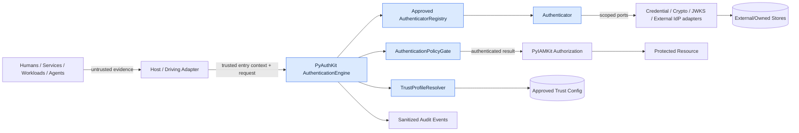
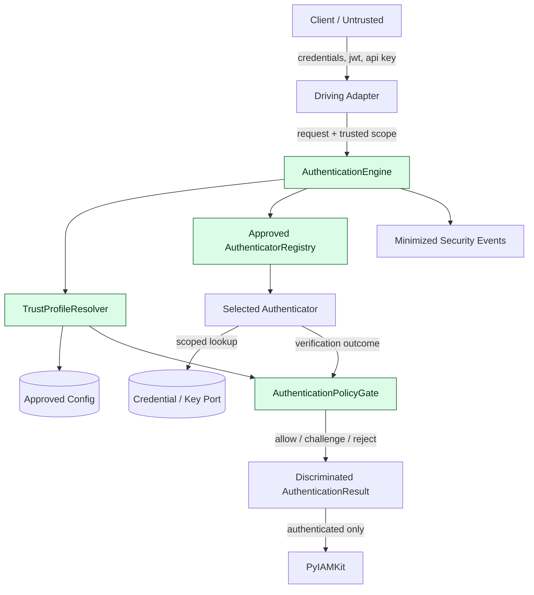
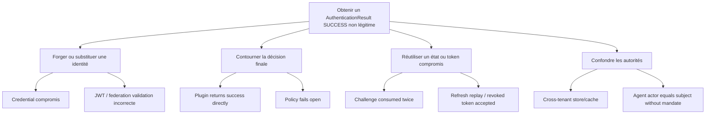
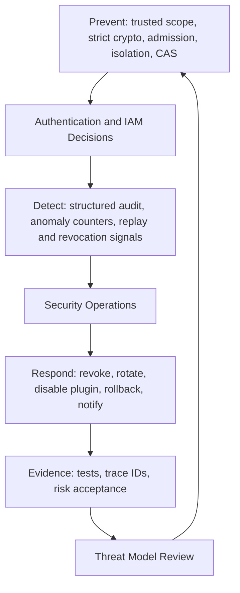

# 20_PYAUTHKIT_SECURITY_THREAT_MODEL

# PyAuthKit — Security Threat Model

> **Projet :** PyAuthKit — Authentication Engine for the Modern Python Ecosystem  
> **Document :** `20_PYAUTHKIT_SECURITY_THREAT_MODEL.md`  
> **Type :** Modèle de menaces, analyse de sécurité, architecture de contrôles et plan de qualification  
> **Version documentaire :** `0.1.0`  
> **Date :** 2026-10-31  
> **Statut :** **PROPOSED / DESIGN — menaces et contrôles candidats, non qualifiés en production**  
> **Langue :** Français ; identifiants, contrats et termes techniques en anglais  
> **Références internes :** `00`–`19`, en particulier `07`, `09`–`19` et `PYAUTHKIT_SOFTWARE_DESIGN_LEARNING_CONVENTION.md`  
> **Documents suivants :** `21_PYAUTHKIT_AUDIT_EVENTS_AND_OBSERVABILITY.md`, `26_PYAUTHKIT_TESTING_AND_QUALIFICATION_STRATEGY.md`

---

## Guide de lecture

Ce document est un **modèle de menace de référence**, non un rapport d'audit. Il présente la cible, les hypothèses, les chemins d'attaque crédibles, les contrôles candidats et les preuves à obtenir. Les tableaux portant les identifiants `SEC20-*` constituent des **registres propres au document 20** ; ils n'écrasent pas les identifiants des documents précédents.

- **MVP :** `AuthenticationEngine`, Password, API Key, vérification de JWT entrants, `TrustProfileResolver`, `AuthenticatorRegistry`, `AuthenticationPolicyGate`, résultats typés et observabilité minimale.
- **POST-MVP :** MFA, WebAuthn, flows/challenges persistés, sessions/refresh tokens, fédération, workloads, agents et risk-based authentication.
- **CONDITIONNEL :** serveur OAuth/token issuer, stockage local de credentials, environnement multi-tenant, exécution de plugins tiers, Redis, PostgreSQL, services distribués.
- **STATUS :** `PROPOSED`, `ACCEPTED` (ADR), `IMPLEMENTED`, `TESTED`, `QUALIFIED`, `DEPLOYED` ; chaque progression requiert des références de preuve. Ici, tous les contrôles restent `PROPOSED` sauf source contraire vérifiée.
- **Normatif / produit :** les normes externes décrivent les exigences de leur périmètre ; les exigences `SEC20-REQ-*` sont des **propositions de produit** à arbitrer, et non une copie normative.

**North Star :** aucune entrée non fiable, aucun code plugin, aucun cache et aucune valeur déclarative d'assurance ne doivent pouvoir court-circuiter une vérification de preuve et une politique d'authentification autoritative.

## 0. Résumé exécutif

PyAuthKit est destiné à authentifier des humains, services, workloads, appareils et agents à travers plusieurs méthodes, sans absorber l'Identity & Access Management de PyIAMKit. Cette position en fait un composant particulièrement sensible : une vulnérabilité dans le noyau, dans un provider ou dans le câblage des ports peut transformer une preuve invalide en identité authentifiée, compromettre des credentials, contourner une séparation tenant ou rendre impossible une révocation.

Le modèle propose une méthode continue :

```text
BUSINESS / TRUST PROBLEM
    ↓
SYSTEM & ASSET INVENTORY
    ↓
DATA FLOWS + TRUST BOUNDARIES
    ↓
THREAT ACTORS + STRIDE + ABUSE CASES
    ↓
RISK & SECURITY INVARIANTS
    ↓
DEFENSE-IN-DEPTH CONTROLS
    ↓
NEGATIVE / CONTRACT / INTEGRATION / CHAOS TESTS
    ↓
EVIDENCE + RESIDUAL RISK + ADR
    ↓
REVIEW AFTER EVERY ARCHITECTURAL CHANGE
```

Quatre distinctions gouvernent l'ensemble :

1. **`ClaimedIdentity` ≠ `VerifiedSubject` ≠ `AuthenticatedPrincipal`.** Le succès final passe par `AuthenticationPolicyGate`.
2. **Authentication ≠ Authorization ≠ Delegation.** PyIAMKit décide les permissions ; un agent authentifié ne reçoit pas automatiquement mandat d'agir pour un utilisateur.
3. **Security specification ≠ execution evidence.** Les diagrammes, annotations de types et tests candidats ne prouvent aucune résistance réelle.
4. **Plugin discovery ≠ plugin admission ≠ sandbox.** Le code Python importé hérite normalement des privilèges du processus ; un registry n'est pas une frontière d'isolation.

## 1. Filiation documentaire et hiérarchie d'autorité

| Source | Autorité dans le document 20 |
|---|---|
| `00`, `01` | Expression du besoin, exigences et priorités produit |
| `02`, `03` | Vision, séparation PyAuthKit/PyIAMKit, couches et trust boundaries |
| `04`, `05`, `06` | Vocabulaire, objets, relations, frontières d'agrégats candidats |
| `07` | Invariants et règles métier déjà proposés ; référence pour tests de non-régression |
| `08`, `09` | Cas d'usage, orchestration, `AuthenticationPolicyGate` et verdicts |
| `10` | Password, API Key, JWT entrant et règles de vérification |
| `11`, `12`, `13` | Flow/Challenge, MFA/AAL, sessions, rotation et révocation |
| `14`, `15`, `16`, `17` | Fédération, WebAuthn, identités non humaines, risques adaptatifs |
| `18`, `19` | Extensibilité/registry et persistance/atomicité/durabilité |
| Software Design & Learning Convention | Problem First, Trust First, Pattern Second ; preuves, ADR, noms naturels |
| NIST / OWASP / IETF / W3C | Référentiels externes selon leurs périmètres respectifs |

**Règle de divergence :** si un terme de domaine ou un contrat est différent dans une source canonique précédente, documenter `CURRENT`, `TARGET`, `GAP`, `ADR` avant de renommer ou reclassifier. Ce threat model identifie les risques, **pas** des Entities ou des capacités nouvelles par simple convention de diagramme.

## 2. Problème de sécurité et objectifs

La question n'est pas seulement « peut-on valider un mot de passe ou une signature ? », mais :

> Peut-on démontrer que toute décision d'authentification provient d'une preuve cryptographique ou d'une vérification autorisée, située dans un `TrustedScope`, appliquée à un profil de confiance déterministe, malgré des erreurs, des retries, des composants compromis et des modifications de configuration ?

Objectifs proposés : confidentialité des secrets, intégrité de la décision, authenticité et provenance des identités, résistance au rejeu, révocation sous garanties explicites, disponibilité bornée, isolation tenant/realm, audit sans divulgation, résilience opérationnelle et capacité de qualification.

Le modèle n'affirme pas : certification FIDO, SOC 2, conformité NIST globale, absence de vulnérabilités, isolation d'un plugin dans le même processus, ou disponibilité universelle de la révocation instantanée.

## 3. Périmètre et profil d'exposition

| Zone | MVP | Après MVP / conditionnel | Précision |
|---|---|---|---|
| Authentication Engine + Policy Gate | Oui | — | Chemin critique de décision |
| Password/API Key/JWT entrant | Oui | — | Preuve primaire, contrôle du scope |
| Authenticator Registry et composition root | Oui | Plugins approuvés | Admission avant import |
| Credential ownership | Optionnel | SQL/KMS/rotations | Le MVP n'impose aucune table |
| Challenges, MFA, WebAuthn | Non | Oui | Usage unique, assurance, origine/RP ID |
| Sessions, tokens émis, refresh families | Non | Oui | Statefulness et révocation sous contrat |
| OIDC/SAML, Social Login | Non | Oui | Validation d'assertions et identity linking |
| Agents, workloads, mTLS/SPIFFE | Non | Oui | Identité technique ≠ délégation |
| Risk-adaptive authentication | Non | Oui | Évaluation du risque ≠ preuve |
| Observabilité, gestion des erreurs | Minimum sûr | Système complet | Pas de fuite de credentials |
| Authorization (RBAC, ABAC, permissions) | Hors périmètre | PyIAMKit | Un échec IAM ne doit jamais devenir allow |

**Hypothèse d'environnement :** une application hôte utilise PyAuthKit comme bibliothèque ou composant, éventuellement dans un service partagé. Les frontières réelles diffèrent selon ce déploiement. Chaque intégration doit construire **son propre DFD déployé**, au-delà de la carte générique de ce document.

## 4. Ubiquitous Language de sécurité

| Terme | Définition opératoire | Piège à éviter |
|---|---|---|
| `PresentedEvidence` | Preuve présentée, encore non fiable | L'utiliser comme sujet vérifié |
| `ClaimedIdentity` | Identité annoncée sans attestation suffisante | Confondre `email` et preuve |
| `VerifiedSubject` | Sujet issu d'une vérification et de son trust profile | Le construire à partir d'un DTO arbitraire |
| `AuthenticatedPrincipal` | Verdict d'authentification final soumis aux politiques | Le laisser créer par un plugin |
| `TrustedScope` | Tenant/realm/purpose établis par l'hôte autoritatif | Le dériver uniquement d'un header client |
| `TrustProfile` | Ensemble gouverné de clés, issuer, audiences et méthodes | Laisser le JWT sélectionner sa propre autorité |
| `AuthenticatorOutcome` | Résultat de vérification d'un mécanisme | Le traiter comme un succès global |
| `AuthenticationResult` | Résultat public discriminé et normalisé | Retourner `principal` sur `REJECT` ou `CHALLENGE` |
| `FactorVerification` | Preuve de facteur avec contexte, provenance et temps | Additionner des facteurs non indépendants |
| `RiskSignal` | Observation contextuelle avec source et fraîcheur | Considérer `LOW` comme identité prouvée |
| `Challenge` | Épreuve située, limitée, consommable | Confondre validation et consommation atomique |
| `RefreshTokenFamily` | Lignée et statut des refresh tokens | Réutiliser après rotation sans détection |
| `DelegationEvidence` | Mandat présenté ou assertion d'acteur | Autoriser une action sur la seule identité de l'agent |
| `SecurityEvent` | Fait de sécurité observé et minimisé | Journaliser token, secret ou preuve brute |
| `Trust Boundary` | Passage entre domaines de confiance différents | Assimiler port à isolation de processus |
| `Control` | Mesure empêchant, détectant ou limitant un risque | Affirmer qu'une interface implique le contrôle |
| `Residual Risk` | Risque restant après contrôles éprouvés | Marquer « résolu » sans preuve ou décision de risque |

## 5. Architecture de sécurité — vues C4 / DDD



L'`AuthenticationEngine` orchestre ; les authenticators vérifient ; le `AuthenticationPolicyGate` évalue la politique finale. La résolution du trust profile précède la sélection de clés/protocoles et la confiance dans les claims. Les adapters techniques peuvent être remplaçables **sans** recevoir l'autorité de choisir arbitrairement la politique du système.

## 6. Inventaire des actifs critiques (`SEC20-ASSET-*`)

| ID | Actif | Confidentialité | Intégrité | Disponibilité | Truth owner / custodian |
|---|---|---|---|---|---|
| `SEC20-ASSET-01` | Secrets de mot de passe présentés | Critique | Haute | Moyenne | Éphémère, request boundary |
| `SEC20-ASSET-02` | Password verifiers / salts / peppers | Haute | Critique | Haute | Credential owner / KMS |
| `SEC20-ASSET-03` | API keys et hashes/verifiers | Critique | Critique | Haute | Credential owner |
| `SEC20-ASSET-04` | Clés privées / KMS/HSM / signing keys | Critique | Critique | Haute | Key authority |
| `SEC20-ASSET-05` | Trust profiles, issuer/audience/key allowlists | Moyenne | Critique | Critique | Trusted configuration owner |
| `SEC20-ASSET-06` | `AuthenticatorRegistry` approuvé | Moyenne | Critique | Haute | Composition root |
| `SEC20-ASSET-07` | `VerifiedSubject` et claims normalisés | Haute selon attributs | Critique | Haute | AuthN result authority |
| `SEC20-ASSET-08` | Sessions / cookies / access & refresh tokens | Critique | Critique | Haute | Session/token owner |
| `SEC20-ASSET-09` | Challenges / continuation handles | Haute | Critique | Haute | Flow owner |
| `SEC20-ASSET-10` | Credentials WebAuthn publics / bindings | Moyenne | Critique | Haute | RP credential owner |
| `SEC20-ASSET-11` | Federation state/nonce/PKCE, SAML correlation | Haute | Critique | Haute | Federation flow owner |
| `SEC20-ASSET-12` | Tenant, realm, purpose, environment bindings | Haute | Critique | Haute | Trusted host/config owner |
| `SEC20-ASSET-13` | Workload attestation, agent identity, delegation | Haute | Critique | Haute | Trust issuer + PyIAMKit policy |
| `SEC20-ASSET-14` | Risk signals, policies et assurance provenance | Haute | Haute | Haute | Risk provider + AuthN policy |
| `SEC20-ASSET-15` | Audit events, traces et correlation IDs | Haute | Haute | Haute | Security telemetry owner |
| `SEC20-ASSET-16` | Plugin packages, lockfiles, SBOM, releases | Moyenne | Critique | Haute | Software supply-chain owner |
| `SEC20-ASSET-17` | DB, cache, backups, replicas, revocation state | Critique | Critique | Critique | Store owner |
| `SEC20-ASSET-18` | Administrative/bootstrap configuration | Haute | Critique | Critique | Platform/operator |

**Règle :** un actif se classe par son **effet si compromis**, pas seulement par le champ contenant sa représentation. Un token n'est pas « sûr » parce que sa chaîne est opaque ; un hash de mot de passe reste sensible ; une clé publique de vérification peut être hautement critique pour l'intégrité si sa provenance n'est pas protégée.

## 7. Adversaires, capacités et motivation

- **Attaquant Internet non authentifié :** credentials volés, requêtes forgées, brute force, exploitation des erreurs et des limites.
- **Utilisateur authentifié malveillant :** accès horizontal/cross-tenant, session fixation, usurpation par account linking.
- **Développeur intégrateur imprudent :** mauvaise composition root, `debug=True`, adapter permissif, secrets exposés.
- **Fournisseur externe ou IdP compromis :** claims/signatures avec portée abusée, metadata/JWKS remplacés, webhooks falsifiés.
- **Plugin/package compromis :** code à l'import, exfiltration, altération de registry, contournement de policy.
- **Administrateur/compte d'exploitation compromis :** mutation de trust profiles, injection de secrets, désactivation d'audit.
- **Attaquant disposant de réseau ou de cache :** interception/partition, délai de propagation de révocation, replay en failover.
- **Workload/agent IA compromis :** credential technique valide, mais tentative de délégation ou d'accès non autorisé.

Les hypothèses de compétences (présence réseau, exécution de code, accès opérateur) devront être précisées pour chaque menace afin d'éviter une notation du risque déconnectée de l'environnement.

## 8. Hypothèses, dépendances et limites explicites

- TLS est terminé et configuré de manière sûre par le déploiement hôte ; PyAuthKit ne remplace pas la sécurité du reverse proxy.
- `TrustedScope` est issu d'une **entrée autoritative**, pas d'une valeur que l'appelant arbitraire peut forger.
- Les sources de clés, algorithmes et issuers sont préapprouvées et versionnées.
- Les bibliothèques cryptographiques spécialisées sont évaluées et maintenues ; aucun algorithme cryptographique maison n'est requis.
- Le système hôte protège ses clés, secrets, rôles d'accès et variables d'environnement.
- Les garanties de cluster, KMS, bases de données, IdP, cache et pipeline de distribution doivent être qualifiées séparément.
- L'horloge système fiable, son synchronisme et sa politique de tolérance font partie des préconditions de vérification temporelle.
- Un composant Python importé dans un processus partagé **n'est pas isolé** par un `Protocol` ou par des `entry_points`.
- Les API d'administration, pages de login et gestion d'identités peuvent appartenir à l'application ou PyIAMKit ; leur exposition ne doit pas être inventée dans PyAuthKit.

## 9. Frontières de confiance (`SEC20-TB-*`)

| ID | Source → destination | Nature de la frontière | Menace dominante | Validation minimale |
|---|---|---|---|---|
| `SEC20-TB-01` | Réseau → host adapter | Données client non fiables | Spoofing, injection, DoS | taille, parsing, content-type, rate limiting |
| `SEC20-TB-02` | Host adapter → `TrustedScope` | Passage revendication → autorité | tenant/realm spoofing | mapping autoritatif serveur |
| `SEC20-TB-03` | DTO → application | Format → sémantique | unsafe defaults | validation, erreurs typées |
| `SEC20-TB-04` | Request → registry | Méthode déclarée → authenticator approuvé | downgrade/confusion | méthode admise par trust profile |
| `SEC20-TB-05` | Authenticator → credential store | Identité revendiquée → scoped lookup | cross-tenant / enumeration | tuple composite de scope |
| `SEC20-TB-06` | JWT header/claims → key resolver | Donnée token → clés | alg/kid/jku/iss confusion | whitelist issue du trust profile |
| `SEC20-TB-07` | Proof verification → `VerifiedSubject` | Preuve → fait de sécurité | result forging | constructeur/factory interne sous autorité |
| `SEC20-TB-08` | Outcome → Policy Gate | Vérification → décision | bypass de policy | évaluation finale obligatoire |
| `SEC20-TB-09` | AuthN → IAM | Identité → droits | privilege elevation | contrat authentifié + contrôle IAM |
| `SEC20-TB-10` | Flow → Challenge Store | Vérification → mutation unique | replay/race | consume atomique, binding |
| `SEC20-TB-11` | Session/Token → store/cache | État → cache cohérent | stale allow | version/revocation validation |
| `SEC20-TB-12` | IdP/metadata → federation adapter | Claims externes → identité | mix-up, substitution | issuer, audience, assertion validation |
| `SEC20-TB-13` | Browser → WebAuthn RP | Assertion → RP verified | origin/RP mismatch | challenge, RP ID, UV/UP, signature |
| `SEC20-TB-14` | Workload/agent → verifier | Token/cert → identity | actor/subject confusion | attestation + trust domain |
| `SEC20-TB-15` | Delegation → PyIAMKit | Mandat revendiqué → permission | confused deputy | actor, subject, scope, audience, expiration |
| `SEC20-TB-16` | Plugin metadata → process import | Package → exécution | RCE/supply-chain | approval, provenance, pinned hashes |
| `SEC20-TB-17` | Adapter → domain | Types externes → valeur canonique | data/model leakage | ACL, mapping, normalisation |
| `SEC20-TB-18` | App → audit/log sink | Contexte/exception → traces | secret disclosure | minimisation/redaction |
| `SEC20-TB-19` | DB/cache → replica/backup | État autoritatif → copie | exfiltration/stale writes | chiffrement, ACL, restore tests |
| `SEC20-TB-20` | Admin → config/deployment | Configuration → trust authority | trust-profile injection | review, signed/declarative change, rollout |

**Le trust boundary est une frontière de pouvoir**, pas seulement une flèche. Une interface `Protocol` structure le code mais ne garantit ni une transaction, ni un réseau sûr, ni la vérification d'une identité.

## 10. DFD — chemin MVP et changements de niveau de confiance



**Séquence de sûreté obligatoire :** (1) entrée et scope validés, (2) profil autoritatif résolu, (3) authenticator approuvé sélectionné, (4) preuve vérifiée, (5) policy finale appliquée, (6) résultat discriminé créé, (7) événement de sécurité minimisé. Un ordre différent doit faire l'objet d'un ADR et de preuves équivalentes ou supérieures.

## 11. STRIDE : méthode de classification

| Catégorie | Question | Exemple PyAuthKit |
|---|---|---|
| **S — Spoofing** | Qui se fait passer pour qui ? | JWT d'un autre issuer accepté |
| **T — Tampering** | Quel état ou quelle donnée peut être modifié ? | Trust profile ou challenge altéré |
| **R — Repudiation** | Quel fait peut être nié faute de preuve ? | Révocation sans event attribuable |
| **I — Information Disclosure** | Quelles données confidentielles peuvent fuiter ? | API key dans les logs |
| **D — Denial of Service** | Qu'est-ce qui peut être épuisé ou bloqué ? | CPU Argon2, JWKS ou IdP en cascade |
| **E — Elevation of Privilege** | Quelle autorité supérieure pourrait être obtenue ? | Plugin contourne Policy Gate / agent s'auto-délègue |

STRIDE est **une méthode de recherche**, pas une liste exhaustive d'attaques ni une métrique de gravité. Pour chaque DFD, analyser flux, processus, data stores, acteurs et frontières selon les catégories pertinentes. Compléter par des abuse cases, des tests inter-tenant et une revue des protocoles cryptographiques spécifiques.

## 12. Modèle de risque local — proposition, non score universel

### 12.1 Impact

| Niveau | Sens local proposé |
|---|---|
| `I1 — Minor` | Diagnostic trompeur, gêne locale sans contournement |
| `I2 — Moderate` | Indisponibilité limitée ou données peu sensibles exposées |
| `I3 — Major` | Perte de service significative, fuite de données, fenêtre de révocation |
| `I4 — Critical` | Usurpation de principal, cross-tenant, clé de signature compromise, contournement IAM |

### 12.2 Plausibilité

| Niveau | Sens local proposé |
|---|---|
| `L1 — Constrained` | Plusieurs préconditions exigeantes, contrôles solides déjà prouvés |
| `L2 — Possible` | Accès ou condition réaliste selon le déploiement |
| `L3 — Likely` | Interface exposée, motif d'attaque courant, contrôles non démontrés |
| `L4 — Elevated` | Surface large, dépendances fragiles ou exploitation fortement facilitée |

**Score facultatif** `R = I × L` (1 à 16) : 1–3 `LOW`, 4–7 `MODERATE`, 8–11 `HIGH`, 12–16 `CRITICAL`. Seuils **illustratifs**, à valider par l'owner du produit ; ne pas confondre avec le `RiskLevel` du moteur de connexion `17`. Le risque intrinsèque ne doit pas être automatiquement réduit parce qu'un contrôle est seulement décrit. Une note résiduelle suppose une **preuve de contrôle, un scope de déploiement et une décision de risque**.

### 12.3 Règle de priorité

- `P0/STOP` : risque critique d'usurpation, cross-tenant, fuite de clés critiques ou bypass de policy non contrôlé.
- `P1/BLOCK RELEASE` : replay significatif, élévation de privilèges, indisponibilité systémique d'un flux critique.
- `P2/TIMEBOX` : défaut mitigable avec compensating controls et owner identifié.
- `P3/BACKLOG` : amélioration démontrablement sans impact sur les invariants vitaux.

## 13. Attack trees et objectifs adverses



Ce diagramme est une **taxonomie défensive d'échecs** : il n'est pas un playbook d'exploitation. Les chemins doivent être testés par des fixtures et un environnement maîtrisé, sans réutilisation de credentials réels.

## 14. Règles de sécurité transverses non négociables

1. `UNKNOWN`, `AMBIGUOUS`, `UNVERIFIED`, `EXPIRED` et `REVOKED` ne sont jamais convertis implicitement en `AUTHENTICATED`.
2. Aucun input client ne choisit seul le tenant, issuer, key source, verifier, trust profile ou rôle IAM.
3. Une preuve validée dans un realm n'est pas valide automatiquement dans un autre.
4. Aucune fallback chain ne « tente tous les authenticators jusqu'au premier succès » sans policy explicite.
5. Une exception de provider, cache ou KMS ne produit jamais un résultat de succès.
6. Aucun `AuthenticationResult.SUCCESS` n'expose une identité sans preuve vérifiée et décision finale autorisée.
7. Aucun échec, refus ou challenge ne transporte un principal final authentifié.
8. Un claim d'assurance ou de délégation ne s'auto-valide pas.
9. Les secrets ne doivent jamais être inclus dans logs, traces, analytics ou exceptions publiques.
10. Les transitions à usage unique doivent rester atomiques sous concurrence et selon les garanties de reprise définies.
11. La révocation ne doit pas être annoncée plus forte que ce que permettent stores, caches, TTL et réseau.
12. Toute évolution de trust profile, plugin approuvé ou clé critique est traçable et soumise à contrôle de changement.

## 15. Noyau AuthenticationEngine et Policy Gate

**Menace clé :** un composant intermédiaire déclare un `AuthenticatorOutcome.SUCCESS` sans appliquer les règles de tenant, assurance, méthode et contexte. **Contrôle :** deux contrats distincts : vérification de preuve par l'authenticator ; décision finale par le `AuthenticationPolicyGate` après résolution du trust profile et provenance. **Tests :** un faux authenticator « toujours positif » ne doit pas créer un succès final si la policy refuse ; plugin rejeté ; identité de tenant B sous scope A ; clock invalide ; exception puis fallback.

**Risque de typage :** `@dataclass(frozen=True)` n'atteste pas une vérification réelle. Définir des factories internes, réduire les constructeurs exposés et tester le chemin de création. Les frontières de processus et ports restent l'élément décisif pour l'autorité.

## 16. Password Authentication

- Stocker des verifiers issus d'un KDF approprié (p. ex. Argon2id selon politique déployée), avec paramètres et schéma de migration versionnés ; aucun mot de passe en clair persistant.
- Utiliser un résultat neutre face aux comptes inexistants, gérer le coût CPU/mémoire des vérifications et contrôler l'énumération.
- Implémenter un `AttemptGuard` ou équivalent **scopé, borné et résilient** ; ne pas confondre rate limiting avec protection complète contre credential stuffing.
- Ne pas laisser la présence d'un enregistrement de hash être une preuve de compte actif, autorisé ou sous bon tenant.
- Prévoir le risque de reset/recovery appartenant à l'hôte ; pas d'exemption silencieuse des contrôles lors d'une migration KDF.

**Incident candidat :** vol d'une base de verifiers ; réponse attendue : évaluation des paramètres, limitation des dommages, réinitialisation ciblée selon protocole incident, détection d'abus et communication proportionnée.

## 17. API Keys

- Les clés présentées sont des secrets ; n'enregistrer qu'un verifier/scoped identifier compatible avec l'architecture adoptée.
- Un préfixe/public identifier ne constitue jamais une preuve ; vérifier la partie secrète avec primitives sûres.
- Liaison tenant, service, audience/use-case, statut et expiration **avant** acceptation.
- Rotation sans fenêtre d'autorité excessive, révocation authoritative et caches invalidables avec version/génération.
- Éviter de reprendre les permissions d'un utilisateur sur une clé de service : c'est une décision IAM distincte.

**Test de rupture :** clé valide appartenant à A soumise dans B → rejet, même si le lookup global trouverait une correspondance.

## 18. JWT entrants, JOSE et résolution de clés

- `alg` doit être explicitement accepté par un profil de confiance résolu **hors du token** ; refuser les algorithmes inattendus et confusions symmetric/asymmetric.
- `iss`, `aud`, `exp`, `nbf`, éventuellement `iat`, `typ` et autres contraintes sont vérifiés selon la classe de jeton et son application ; aucune claim ne décide de sa propre règle d'acceptation.
- `kid` n'est qu'un indice dans un jeu de clés autorisé ; aucun `jku`, `x5u` ou URL libre ne peut déclencher un fetch arbitraire.
- Les JWKS distants sont limités par hôte, allowlist, timeout, taille, cache scindé par issuer/profile/tenant et politique de rotation.
- Une JWT **authentifiée** peut rester inadaptée à l'usage requis (ex. access token présenté comme ID token, mauvais audience ou purpose).
- Validation d'un JWT entrant ≠ émission d'un jeton de session/access par PyAuthKit ; ces responsabilités ont des modèles distincts (`13`, `14`).

**Références :** RFC 8725, RFC 7519 et spécifications de profil d'application.

## 19. Flows, challenges et continuations

- Un challenge porte `scope`, `purpose`, `subject_binding`, nonce/aléa, `expires_at`, état et tentative/lignée si nécessaire.
- Sa validation n'est pas sa consommation : le passage à `CONSUMED` doit être atomique avec la décision qui l'exploite ou garantir équivalence via protocole explicitement qualifié.
- Deux requêtes concurrentes ne peuvent consommer le même challenge avec succès ; les retries sont idempotents seulement selon contrat.
- Un `ContinuationHandle` doit être opaque, borné, lié au contexte et non interprétable comme une permission.
- Annulation, expiration, reset de flow ou changement tenant invalident les preuves de continuité concernées.
- Pour TOTP, consommation unique du challenge ne remplace pas les contrôles propres au facteur (fenêtre, replay de code, device/seed et comptage).

## 20. MFA, Assurance et WebAuthn

- Les authentifications multi-étapes ne sont pas automatiquement AAL2 ou AAL3 ; évaluer la composition réelle des facteurs, leur indépendance et les propriétés cryptographiques.
- La résistance au phishing et la vérification de l'utilisateur dépendent de preuves/métadonnées réellement vérifiées, pas d'un booléen de client.
- Pour WebAuthn : challenge, `rpIdHash`, Origin, type de cérémonie, signature, `UP`, `UV` selon policy, credential binding et compteur lorsque pertinent.
- Une passkey synchronisable ne prouve pas à elle seule le niveau AAL3 ; ne pas confondre attestation, user verification, device binding et résistance au phishing.
- La récupération de compte est une nouvelle surface d'usurpation : refuser tout enrollment sans preuve suffisante et binding au bon compte.
- Le step-up doit être lié à la transaction/ressource/scope et respecter la fraîcheur définie par la policy ; il n'octroie pas une permission IAM.

## 21. Sessions, access tokens et refresh tokens

- Empêcher session fixation/hijacking par rotation appropriée et binding exploitable, selon modèle web ou API.
- Cookies en environnement navigateur : `Secure`, `HttpOnly`, `SameSite` selon flux/menaces, CSRF défendu lorsque nécessaire ; aucun cookie ne peut résoudre seul une décision IAM.
- Les access tokens autonomes peuvent rester valides jusqu'à `exp` malgré une révocation ailleurs ; documenter introspection, denylist/version/TTL ou contrainte sender-constrained.
- Les refresh tokens de clients publics utilisent rotation ou sender-constraining selon RFC 9700 ; une famille compromise doit être traitée selon une politique de replay explicite.
- Les changements d'AAL, de contexte, de session et de preuve doivent être traçables ; ne pas appliquer rétroactivement un nouveau niveau d'assurance non vérifié.
- Collision de refresh concurrent : un seul gagnant atomique, pas deux refresh tokens descendants acceptés indépendamment.

## 22. Fédération OIDC, OAuth 2.0 et SAML 2.0

- OAuth délègue l'accès ; l'authentification fédérée utilise une assertion/garantie appropriée (OIDC/SAML), pas un simple access token arbitraire.
- OIDC : Authorization Code + PKCE dans les contextes appropriés ; `state`, `nonce` si requis, corrélation à l'initiateur et validation stricte des issuer/audience/signature.
- SAML : vérification XMLDSig, protection contre XML Signature Wrapping, strict bindings `Destination`, `Recipient`, `InResponseTo`, audience, temps et subject confirmation.
- L'identité fédérée est composée d'une autorité/issuer et d'un subject dans le scope ; `email` seul ne permet pas un account linking automatique sûr.
- Discovery et metadata sont obtenus depuis des endpoints approuvés, avec protections contre SSRF et substitution de certificats.
- Le SSO distant et la session locale ont des propriétaires, expirations et mécanismes de logout distincts.

**Références :** OpenID Connect Core, RFC 9700, RFC 10017 (clients navigateur), OASIS SAML 2.0 et NIST SP 800-63C-4.

## 23. Machines, workloads, agents et délégation

- Vérifier le workload token/certificat dans le bon trust domain, issuer, audience, namespace et contexte d'exécution.
- Distinguer identité logique `ServicePrincipal` et instance de workload ; un Pod/Run non lié ne peut usurper le service.
- mTLS/X.509 : vérifier chaîne, usages, nom attendu et politique de confiance ; une connexion TLS ne suffit pas à prouver un rôle métier.
- `AgentPrincipal` authentifié ≠ `VerifiedDelegation` ; token exchange (`act`/`sub`) et contrôle PyIAMKit nécessitent scope, audience, mandat, temporalité et chaîne d'acteurs.
- Un prompt/instruction d'agent ne crée pas une autorité IAM ; les appels à outils doivent revalider les droits à la ressource.
- Les logs doivent préserver l'identité de l'agent, de l'instance et du sujet délégant sans confondre ni divulguer les tokens.

## 24. Authentification adaptative et signaux de risque

- Un score faible n'est pas une preuve d'identité ; un signal fort peut renforcer/refuser, pas remplacer la vérification.
- Toute source de signal a provenance, fraîcheur, scope, qualité et version des règles ; `missing`, `stale` et `unknown` sont distincts de `low`.
- Rendre les décisions `CONTINUE`, `STEP_UP`, `REJECT`, `DEFER` compréhensibles et bornées ; le résultat final passe toujours par le Policy Gate.
- Limiter les possibilités de manipulation par signaux auto-déclarés (device claims, IP ou user agent) ; distinguer signal utile et vérité autoritative.
- Prévoir les pannes des fournisseurs de risk intelligence : pas d'upgrade implicite vers `ALLOW`.
- Minimiser la collecte comportementale et tester les risques de biais et d'accessibilité de MFA.

## 25. Plugins, registry et supply chain

- Découverte `importlib.metadata` = métadonnées ; elle ne vaut ni approbation ni permission d'importer.
- Utiliser manifest/version/API contract/pinning/provenance/allowlist et revue de sécurité avant activation.
- Un plugin tiers importé **partage les privilèges du processus** ; le `Protocol` n'est pas une sandbox. Si l'adversaire peut modifier le plugin, exiger une isolation de processus/service ou refuser l'exécution.
- Empêcher le registry de changer à chaud en requête ; snapshot approuvé et config versionnée, rotations contrôlées.
- Restreindre secrets et egress ; ne pas fournir des credentials globaux à un plugin qui n'en a pas besoin.
- Analyser les dépendances transitives, la reproductibilité et les effets de bord à l'import ; disposer d'une procédure de désactivation/rollback.

## 26. Persistance, stores, cache et concurrence

- Le MVP **P0** peut n'avoir aucune base PyAuthKit ; les profils **P1–P6** de `19` ajoutent des actifs et menaces spécifiques.
- Repository port ≠ contrôle transactionnel : les invariants d'unicité exigent des preuves côté backend (CAS, transaction, contrainte unique, etc.).
- Les clés cache incluent tous les scopes autoritatifs et versions nécessaires ; aucune réponse tenant A ne doit alimenter une décision B.
- Redis peut fournir des opérations atomiques sur un primaire sans garantir la même durabilité qu'une base ACID ; crash/failover peut faire réapparaître un challenge consommé si le système a perdu l'écriture.
- PostgreSQL RLS est une défense en profondeur : vérifier propriétaire de table, superuser, `BYPASSRLS`, rôles runtime, pooling et `SET LOCAL`.
- Les backups, replicas, exports et restores sont des surfaces de divulgation et de rollback de révocation.
- Tester explicitement la restauration d'une version cohérente des données et des clés, sans réactiver par accident des secrets révoqués.

## 27. Secrets, clés et cryptographie

- Un `SecretRef` n'est pas le secret ; les clés privées et peppers doivent être conservés sous une autorité de clés/KMS avec accès minimal.
- Algorithmes acceptés, tailles, suites et rotation sont **des paramètres d'un profil de sécurité versionné**, pas des constantes universelles enfouies dans un composant.
- Définir la rotation normale, la révocation d'urgence, le key rollover et la conservation des clés publiques pour les tokens encore valides.
- Utiliser CSPRNG pour les secrets et nonce/challenges ; séparer les usages des clés (signature, chiffrement, MAC) lorsque requis.
- Refuser les clés par défaut et les modes crypto permissifs en production ; ne pas « tester » les primitives en les réimplémentant maison.
- Les erreurs KMS/HSM doivent mener à un échec explicite, une file/attente bornée si prévue, ou un refus ; jamais à une clé de substitution non approuvée.

## 28. Runtime, réseau, disponibilité et resource exhaustion

- Timeouts, deadlines et budgets mémoire/CPU/IO explicites pour KDF, JSON/XML parsers, JWKS, discovery, DB et plugins.
- Retrys bornés pour opérations idempotentes seulement ; ne pas répéter silencieusement un token exchange, challenge consumption ou refresh rotation sans contrat.
- Circuit breaker et backpressure protègent la disponibilité mais ne peuvent transformer `ERROR` en `SUCCESS`.
- Les limites doivent considérer la concurrence multi-tenant et le noisy neighbor ; les quotas globaux ne remplacent pas les budgets par tenant.
- Tester cancellation, timeout avant/après commit, partielles de réseau, clock skew et failover.
- Réduire les erreurs différenciées qui permettent enumeration et la précision de timings sensibles sans supprimer le diagnostic serveur utile.

## 29. Observabilité, confidentialité et attribution

- Ne jamais logguer mot de passe, API key, bearer token, refresh token, TOTP seed, challenge secret ou assertion non minimisée.
- Corréler tentative, scope, authenticator, policy decision, reason code, versions et événement de révocation au moyen d'identifiants non secrets.
- Une télémétrie perdue ne doit pas effacer la distinction entre résultat d'authentification et preuve d'audit : déclarer politique d'échec de l'audit critique.
- Normaliser les erreurs externes, protéger les endpoints de logs/metrics/traces et appliquer rétention/purge selon purpose.
- Les événements à haute valeur probatoire peuvent nécessiter intégrité, accès restreint et stockage durable ; **tamper evident ≠ tamper proof**.
- Les obligations légales, RGPD et conservation doivent être évaluées par le responsable du traitement et les opérateurs, non revendiquées automatiquement par la bibliothèque.

## 30. Isolation multi-tenant et administration

- La déduction du tenant doit être autoritative, cohérente avec les identités et impossible à choisir par une simple entrée non fiable.
- Les stores, caches, registries, policies, events et clés cryptographiques doivent prendre en compte tenant/realm/purpose/env dans leurs contrats si applicables.
- Les quotas, pools et workers partagés sont eux-mêmes des canaux de fuite/DoS ; tester les frontières même pour une instance en mémoire.
- Les migrations et scripts d'administration ne doivent pas court-circuiter silencieusement les contraintes tenant.
- Toute modification de configuration de confiance a auteur, justification, revue, fenêtre d'effet et plan de rollback.
- L'isolation n'est ni donnée par des UUID, ni prouvée par RLS seul, ni suffisante sans validation au Policy Gate.

## 31. Privacy, compliance et classification de données

Classer séparément les secrets d'authentification, identifiants, données de contexte (IP, device), attributs d'assurance, audit et données de risque. Définir minimisation, finalité, séparation logique, chiffrement, rétention, transfert tiers, droit d'accès et effacement compatible avec les exigences applicables. **Aucune conclusion « RGPD compliant », « SOC 2 compliant » ou « NIST certified » ne découle de la présence de cette section.** Un audit et des preuves de déploiement seront requis selon le régime concerné.

## 32. Référentiels d'évaluation et niveaux de preuve

| Référentiel | Utilisation proposée | Limite |
|---|---|---|
| OWASP ASVS **5.0.0** (2025) | Baseline de contrôles pour les interfaces web/API de l'hôte | Ne certifie pas seul la bibliothèque |
| OWASP Cheat Sheets | Password, MFA, session, JWT, secrets, logging | Recommandations à contextualiser |
| NIST SP 800-63B-4 | Authenticator management, AAL, reauthentication | AAL évalué sur le processus réel |
| NIST SP 800-63C-4 | Fédération, assertions, FAL | FAL ≠ AAL ; IdP/RP et contrats réels |
| NIST SP 800-218 SSDF 1.1 | Cycle de développement sécurisé, vuln management | Pratiques de processus, pas résultat d'audit |
| RFC 8725 | JWT verification BCP | Compléter par profil JOSE / application |
| RFC 9700 | Sécurité OAuth, clients, rotation | Implémentation dépend du rôle AS/Client/RS |
| RFC 10017 (août 2026) | Menaces et bonnes pratiques OAuth pour navigateurs | Concerne les applications navigateur concernées |
| W3C WebAuthn L3 | Enregistrement/assertions FIDO/WebAuthn | Tests de conformité et implémentation nécessaires |
| STRIDE / MITRE ATT&CK | Recherche de menaces, détection/adversarial analysis | N'est pas une preuve de résistance |

Ce tableau est une **correspondance thématique**. Les identifiants précis de contrôle OWASP/ASVS et les obligations réglementaires doivent être associés dans une matrice de contrôle dédiée au moment où les profils de produit et de déploiement sont fixés ; ne pas en inventer.

## 33. Registre de menaces candidates `SEC20-THR-*`

Les menaces sont formulées comme **conditions d'échec testables**. Leur impact/plausibilité est une **hypothèse initiale**, non un score validé par des incidents ni un risque résiduel. Les codes STRIDE peuvent se cumuler ; le tableau donne la famille dominante. `M` = MVP, `E` = extension, `C` = conditionnel. Les contrôles associés figurent dans le registre `SEC20-REQ-*` et les tests `SEC20-TST-*`.

| ID | Phase | STRIDE | Menace / effet | I/L | Priorité initiale | Défense candidate |
|---|---|---|---|---|---|---|
| `SEC20-THR-001` | M | S | Fausse identité privilégiée issue de données client | 4/3 | P0 | Scope autoritatif ; provenance vérifiée |
| `SEC20-THR-002` | M | E | `AuthenticatorOutcome` accepté comme verdict final | 4/3 | P0 | `AuthenticationPolicyGate` obligatoire |
| `SEC20-THR-003` | M | S | JWT signé par mauvais issuer accepté | 4/3 | P0 | `TrustProfile` issuer/audience strict |
| `SEC20-THR-004` | M | T | JWT `alg` ou key source déduit d'entrée token | 4/3 | P0 | Allowlists crypto côté serveur |
| `SEC20-THR-005` | M | S | API key d'un tenant utilisée dans un autre | 4/3 | P0 | Scoped lookup + policy isolation |
| `SEC20-THR-006` | M | I | Password/API key/refresh JWT exposé dans logs | 4/3 | P0 | Minimisation/redaction + tests |
| `SEC20-THR-007` | M | D | CPU/Mémoire épuisé par Password KDF | 3/3 | P1 | Quotas, guard, budget, backpressure |
| `SEC20-THR-008` | M | S | Credential stuffing avec compte non protégé | 3/3 | P1 | Rate limits + monitoring + MFA futur |
| `SEC20-THR-009` | M | I | Enumération des comptes via erreurs/latence | 3/3 | P1 | Diagnostics neutres et timings revus |
| `SEC20-THR-010` | M | T | Config trust profile remplacée non autorisée | 4/2 | P0 | Control plane restreint, revue et version |
| `SEC20-THR-011` | M | E | Registry charge authenticator non approuvé | 4/3 | P0 | Admission explicite + freeze |
| `SEC20-THR-012` | M | D | Panne de JWKS provoque fallback permissif | 4/2 | P0 | Fail-closed, cache et timeout bornés |
| `SEC20-THR-013` | M | T | Key cache mélangé entre profiles/tenants | 4/2 | P0 | Namespaced keys + tests cross-tenant |
| `SEC20-THR-014` | M | E | Exception de provider transformée en succès | 4/3 | P0 | Erreurs typées, résultat discriminé |
| `SEC20-THR-015` | M | R | Succès refusé/non journalisé sans attribution | 3/2 | P1 | Security events minimisés, integrity policy |
| `SEC20-THR-016` | M | D | Retry infini sur provider externe | 3/3 | P1 | Deadline, retry budget, circuit breaker |
| `SEC20-THR-017` | E | S | MFA frauduleusement attribué par claim `amr` | 4/3 | P0 | Assurance provenance et trust mapping |
| `SEC20-THR-018` | E | E | Step-up contourné pour opération sensible | 4/3 | P0 | Transaction binding et IAM check |
| `SEC20-THR-019` | E | S | Rejeu d'un challenge consommé | 4/3 | P0 | CAS transactionnel et durabilité |
| `SEC20-THR-020` | E | T | Continuation handle lié au mauvais flow | 4/3 | P0 | Tenant/subject/purpose/flow binding |
| `SEC20-THR-021` | E | D | Challenge saturé par tentatives parallèles | 3/3 | P1 | Limites et consume atomique |
| `SEC20-THR-022` | E | S | WebAuthn assertion hors RP ID / origin | 4/2 | P0 | RP ID, Origin, challenge, signature |
| `SEC20-THR-023` | E | E | Passkey enrollment sur un autre compte | 4/2 | P0 | Enrollment authority + binding |
| `SEC20-THR-024` | E | T | Compteur WebAuthn traité comme certitude universelle | 3/2 | P1 | Règles contextualisées, clone signals |
| `SEC20-THR-025` | E | S | Account takeover par OIDC mix-up | 4/3 | P0 | State, PKCE, issuer binding |
| `SEC20-THR-026` | E | S | SAML XML Signature Wrapping | 4/2 | P0 | Validation structurale et XMLDSig |
| `SEC20-THR-027` | E | E | Account linking uniquement par email | 4/3 | P0 | Verified issuer+subject + policy IAM |
| `SEC20-THR-028` | E | I | OIDC discovery utilisée pour SSRF | 3/3 | P1 | Allowlist URL et egress control |
| `SEC20-THR-029` | E | S | Session fixation/hijack après login | 4/3 | P0 | Session rotation, cookie/session defenses |
| `SEC20-THR-030` | E | E | Access token périmé en cache accepté | 4/2 | P0 | Revocation consistency contract |
| `SEC20-THR-031` | E | S | Réemploi d'un refresh token déjà rotaté | 4/3 | P0 | Token family + replay detection |
| `SEC20-THR-032` | E | T | Concurrent refresh produit 2 descendants valides | 4/2 | P0 | CAS/transaction et unicité |
| `SEC20-THR-033` | C | E | Agent authentifié s'auto-attribue mandat utilisateur | 4/3 | P0 | Verify delegation + IAM authorization |
| `SEC20-THR-034` | E | S | Assertion workload sans audience attendue | 4/3 | P0 | Issuer/audience/trust domain strict |
| `SEC20-THR-035` | E | E | Confusion `actor` / `subject` token exchange | 4/2 | P0 | Typage et délégation explicite |
| `SEC20-THR-036` | E | T | RiskSignal auto-déclaré remplace preuve | 4/3 | P0 | Signal non autoritatif, policy gate |
| `SEC20-THR-037` | E | D | Risk provider indisponible → auto-allow | 4/2 | P0 | Failure policy explicite |
| `SEC20-THR-038` | C | E | Plugin malveillant exfiltre clés/claims | 4/3 | P0 | No untrusted in-process plugins |
| `SEC20-THR-039` | C | T | Registry modifié à chaud hors bootstrap | 4/2 | P0 | Frozen generation + controlled rollout |
| `SEC20-THR-040` | C | T | Dépendance transitive supply-chain altérée | 4/3 | P0 | Pin, SBOM, provenance, review |
| `SEC20-THR-041` | C | I | DB backup réplique ou archive non chiffrée | 4/2 | P0 | Encrypted backups, access controls |
| `SEC20-THR-042` | C | E | PostgreSQL RLS bypass via rôle privileged | 4/2 | P0 | Runtime least privilege + FORCE RLS review |
| `SEC20-THR-043` | C | T | Redis failover réactive un challenge consommé | 4/2 | P0 | Durable authoritative store or tested RPO |
| `SEC20-THR-044` | C | I | Pool DB réemploie un tenant scope résiduel | 4/2 | P0 | Transaction-scoped tenant setting |
| `SEC20-THR-045` | C | D | Clé KMS indisponible → panne globale | 3/3 | P1 | Timeouts, resilience without bypass |
| `SEC20-THR-046` | M | R | Traces sont mutables sans détection | 3/2 | P1 | Protected sink + integrity/reconciliation |
| `SEC20-THR-047` | C | I | User/device risk profiles surconservés | 3/3 | P1 | Privacy minimization and retention |
| `SEC20-THR-048` | C | T | Rollback config modifie l'autorité historique | 4/2 | P0 | Versioned profiles, atomic rollout |

**Lecture :** le scénario d'un fournisseur considéré « trusted » dans l'inventaire n'est pas garanti sûr dans le runtime ; une menace P0 doit être traitée ou explicitement bloquer la release concernée. Ce modèle ne prétend pas que 48 menaces sont actuellement présentes dans le code (il n'existe ici aucune preuve d'une codebase implémentée).

## 34. Abuse Cases et scénarios d'attaque défensifs (`SEC20-SC-*`)

### 34.1 `SEC20-SC-01` — Claim non fiable devient identité finale

**Précondition :** un client transmet un `principal_id` ou `tenant_id` dans un payload de login. **Défaillance :** l'hôte le traite comme `AuthenticatedPrincipal` avant vérification. **Contrôle :** `TrustedScope` résolu autoritativement, provenance typée, Policy Gate. **Preuve :** requête modifiée rejetée ; aucun sujet authentifié dans un résultat non-SUCCESS ; log ne divulgue pas l'evidence.

### 34.2 `SEC20-SC-02` — JWT issu de la mauvaise autorité

**Précondition :** deux issuers ont chacun des clés et sujets distincts. **Défaillance :** un JWT de B accepté en profil A par confusion de `kid`, `iss` ou JWKS. **Contrôle :** allowlist issuer/audience/keyset par profil et purpose. **Preuve :** chaque variation cross-profile refuse, même avec signature cryptographiquement valide pour B.

### 34.3 `SEC20-SC-03` — API Key d'un autre tenant

**Précondition :** deux tenants ont des identifiants externes semblables. **Défaillance :** le store cherche uniquement par key prefix. **Contrôle :** lookup avec scope et verifier du secret ; pas de fallback global. **Preuve :** toutes les combinaisons A/B de credentials et scopes produisent uniquement le succès autorisé.

### 34.4 `SEC20-SC-04` — Fuite par logs

**Précondition :** un authenticator lève une exception contenant des secrets/headers. **Défaillance :** stack trace brute publiée dans la télémétrie ou réponse API. **Contrôle :** messages publics stables, audit structuré, redaction et interdiction des payloads bruts. **Preuve :** canary secrets absents de logs, metrics, traces, réponses et crash reports.

### 34.5 `SEC20-SC-05` — Double consommation challenge

**Précondition :** deux requêtes distinctes valident simultanément une même réponse. **Défaillance :** les deux changent l'état à `CONSUMED` et émettent des succès. **Contrôle :** atomic compare-and-set et état durable. **Preuve :** sous concurrence, un gagnant au plus, retries contrôlés, crash/restart/failover intégrés.

### 34.6 `SEC20-SC-06` — Double rotation d'un refresh token

**Précondition :** deux clients renouvellent en parallèle la même lignée. **Défaillance :** deux descendants actifs. **Contrôle :** transaction / CAS sur famille + replay policy. **Preuve :** un descendant valide au plus ; réponse opérationnelle cohérente et révocation/alerte selon policy.

### 34.7 `SEC20-SC-07` — Détournement du login fédéré

**Précondition :** plusieurs IdP et transactions simultanées. **Défaillance :** l'assertion est attribuée à la mauvaise initiation/browser/user. **Contrôle :** corrélation `state`, `nonce` lorsque applicable, PKCE, issuer/client binding. **Preuve :** callbacks croisés et expirés rejetés, aucun linking implicite par email.

### 34.8 `SEC20-SC-08` — WebAuthn sur mauvais RP

**Précondition :** une assertion valide a été produite pour une RP différente. **Défaillance :** l'authenticator accepte l'assertion sous un autre origin/RP ID. **Contrôle :** exact origin/RP ID checks, challenge et signature. **Preuve :** origines, RP IDs, challenge IDs et credentials échangés sont tous refusés.

### 34.9 `SEC20-SC-09` — Agent authentifié mais délégation non autorisée

**Précondition :** un agent a un workload identity valide. **Défaillance :** il accède aux données d'un utilisateur sans mandat valide. **Contrôle :** mandat signé/évalué, actor/subject/audience/scope et IAM policy sur la ressource. **Preuve :** agent authentifié reçoit `DENY` pour toute action sans délégation vérifiée.

### 34.10 `SEC20-SC-10` — Plugin compromis

**Précondition :** un package découvert expose un entry point inattendu. **Défaillance :** import automatique, exécution de code sous privilèges AuthN. **Contrôle :** metadata-only discovery, approval manifest, pinning, import explicite après revue ; isolation externe pour code non fiable. **Preuve :** l'entry point non approuvé n'est jamais chargé, le registre reste stable.

### 34.11 `SEC20-SC-11` — Stale cache après révocation

**Précondition :** révocation d'un credential ou d'une session avec cache actif. **Défaillance :** un cache ancien continue d'autoriser. **Contrôle :** model de cohérence explicite (version/generation/introspection/TTL), rejet lorsque l'autorité ne peut être déterminée. **Preuve :** test de délais maximaux, partition réseau et propagation ciblée.

### 34.12 `SEC20-SC-12` — Cross-tenant DB session pool

**Précondition :** pool réutilise une connexion affectée au tenant A. **Défaillance :** la requête B lit les lignes A. **Contrôle :** scope transactionnel, rôle runtime minimal, RLS en profondeur et scoping applicatif. **Preuve :** test alterné A/B sur connexions poolées, erreurs/retries inclus.

### 34.13 `SEC20-SC-13` — Signaux de risque non fiables

**Précondition :** un client contrôle `device_trusted=true` ou IP annoncée. **Défaillance :** moteur élève l'assurance ou accepte une preuve invalide. **Contrôle :** provenance, fraîcheur, trusted collector, risk never authenticates. **Preuve :** variation des signaux sans credential valide n'entraîne jamais `AUTHENTICATED`.

### 34.14 `SEC20-SC-14` — Panne JWKS/KMS et downgrade

**Précondition :** réseau ou autorité de clés indisponible pendant validation. **Défaillance :** validation désactivée ou nouvelle clé de secours non approuvée. **Contrôle :** timeouts, cache uniquement selon politique, erreur fail-closed. **Preuve :** toutes les sorties non vérifiées sont `REJECT/DEFER/ERROR`, jamais `SUCCESS`.

### 34.15 `SEC20-SC-15` — Restauration d'un état obsolète

**Précondition :** restore d'une copie antérieure à une révocation ou à un challenge consommé. **Défaillance :** la restauration réactive le droit ou la preuve. **Contrôle :** plan de reprise avec source de révocation durable/epoch/generation, revalidation et protection du rollback. **Preuve :** tests de restore et exercices RPO/RTO observés.

### 34.16 `SEC20-SC-16` — Détournement admin du TrustProfile

**Précondition :** changement d'issuer/algorithms/certificates configuré. **Défaillance :** mise en prod non revue autorisant une nouvelle source. **Contrôle :** change management, immutable version, approval, audit, rollback et séparation des droits. **Preuve :** changements non autorisés rejetés, changements autorisés attribuables et vérifiables.

## 35. Architecture des contrôles : prévention, détection et réponse



**Prévention :** guards sur le chemin AuthN, clés et configuration, validation d'assertions, isolation des tenants, transactions atomiques, autorisation IAM.

**Détection :** événements d'échec, brute force, JWKS anomalies, replay, changements de politique/registry, défaillances de KMS, cross-tenant denied access, rotations atypiques.

**Réponse :** désactivation provider/plugin, rotation de clés, révocation credentials/sessions, blocage ciblé, rollback, communication et post-mortem.

**Limite :** si un contrôle de détection est nécessaire à l'efficacité d'une prévention (ex. replay sur refresh token), son indisponibilité ou sa fenêtre de retard est une exigence de risque à part entière.

## 36. Exigences spécialisées `SEC20-REQ-*`

Le registre formalise une ligne entre **problème → contrôle attendu → preuve**. `M` correspond au noyau MVP ; `E` à une extension ; `C` au périmètre conditionnel. Toutes sont proposées. La capacité d'en démontrer une dans une library ne signifie pas qu'un déploiement spécifique est conforme.

| ID | Phase | Contrôle requis (proposé) | Preuve attendue |
|---|---|---|---|
| `SEC20-REQ-001` | M | Contexte d'entrée serveur obligatoire, distinct des headers clients | Cross-tenant forged scope denied |
| `SEC20-REQ-002` | M | TrustProfile sélectionné depuis configuration approuvée | Untrusted issuer cannot select profile |
| `SEC20-REQ-003` | M | Registry figé après admission et validation | Unapproved method cannot resolve |
| `SEC20-REQ-004` | M | Policy Gate seul émet SUCCESS final | Authenticator success alone cannot authenticate |
| `SEC20-REQ-005` | M | Résultats discriminés et sans principal en échec | No principal on reject/challenge/error |
| `SEC20-REQ-006` | M | Fail-closed sur exceptions, ambiguity, timeouts | Failure never returns SUCCESS |
| `SEC20-REQ-007` | M | Séparation Authentication et PyIAMKit Authorization | Valid auth cannot grant resource permission |
| `SEC20-REQ-008` | M | Taille, parsing et coût des requêtes bornés | Oversized/malformed inputs fail safely |
| `SEC20-REQ-009` | M | Erreurs publiques non révélatrices de secrets/comptes | No secret or raw provider errors in response |
| `SEC20-REQ-010` | M | Télémétrie minimale et sûre sur tous les résultats | Canary secrets absent, correlation present |
| `SEC20-REQ-011` | M | Password vérifié par KDF approuvé et versionné | Invalid password rejected; migration tested |
| `SEC20-REQ-012` | M | Password brut jamais persistant ni journalisé | No plaintext at any sink |
| `SEC20-REQ-013` | M | Protection contre brute force et credential stuffing | Rate and concurrency controls exercised |
| `SEC20-REQ-014` | M | Recherche password strictement scopée | Wrong tenant record never returned |
| `SEC20-REQ-015` | M | Account/credential status vérifié avant succès | Inactive/revoked cannot authenticate |
| `SEC20-REQ-016` | M | API keys vérifiées sur secret et contexte | Public prefix alone rejected |
| `SEC20-REQ-017` | M | API keys révocables selon contrat de cohérence | Revoked credential denied within claimed bound |
| `SEC20-REQ-018` | M | API key lookup tenant/realm/purpose-aware | Cross-scope key rejected |
| `SEC20-REQ-019` | M | JWT algorithmes et types autorisés par profil | Unexpected alg/typ rejected |
| `SEC20-REQ-020` | M | JWT issuer, audience, signature et temps vérifiés | Wrong issuer/aud/signature/time denied |
| `SEC20-REQ-021` | M | JWKS/key resolver restreint aux sources approuvées | Token cannot supply arbitrary URL/key |
| `SEC20-REQ-022` | M | Cache de validation JWT namespace complet | No key cross-contamination |
| `SEC20-REQ-023` | M | Clock, leeway et rotation de clé explicites | Boundary tests across rotation/expiration |
| `SEC20-REQ-024` | M | Plugins découverts sans import et admis avant load | Discovered-only plugin never executes |
| `SEC20-REQ-025` | M | Composition root et privileges des adapters revus | Domain imports no untrusted infrastructure |
| `SEC20-REQ-026` | E | Challenges uniques liés à tenant/subject/purpose | Cross-flow or cross-scope rejected |
| `SEC20-REQ-027` | E | Transitions challenge atomiques et durables selon garantie | Two concurrent consumptions cannot both succeed |
| `SEC20-REQ-028` | E | Continuation handles opaques, expirables, non autorisants | Expired/replayed handle denied |
| `SEC20-REQ-029` | E | Facteurs MFA évalués avec provenance et indépendance | Two non-independent factors not elevated |
| `SEC20-REQ-030` | E | Assurance AAL fondée sur preuves et politique | Unverified AAL claim not trusted |
| `SEC20-REQ-031` | E | Step-up lié à opération, sujet et fraîcheur | Stale/wrong-operation proof denied |
| `SEC20-REQ-032` | E | WebAuthn RP ID, origin, challenge et signature validés | Cross-RP assertion denied |
| `SEC20-REQ-033` | E | WebAuthn UV/UP et attestation gouvernés par policy | Flag mismatch rejected where required |
| `SEC20-REQ-034` | E | Enrollment/recovery résistant à prise de compte | Wrong account enrollment denied |
| `SEC20-REQ-035` | E | OIDC state/PKCE/nonce corrélés au flux | Mix-up/callback swap denied |
| `SEC20-REQ-036` | E | OIDC/SAML signatures, audience et issuer vérifiés | Wrong issuer/assertion denied |
| `SEC20-REQ-037` | E | SAML XML parsing et signature wrapping durcis | Wrapping tests fail closed |
| `SEC20-REQ-038` | E | External identity linking sur issuer+subject + policy | Email-only link never automatic |
| `SEC20-REQ-039` | E | SSO distant et session locale distingués | Remote logout semantics explicitly tested |
| `SEC20-REQ-040` | E | Workload identity audience/trust domain vérifiés | Foreign SVID/token denied |
| `SEC20-REQ-041` | E | AgentPrincipal et Delegation distincts | Agent cannot self-delegate |
| `SEC20-REQ-042` | E | Token exchange scope/actor/subject vérifiés | Actor/subject confusion denied |
| `SEC20-REQ-043` | E | Sessions renouvelées, liées et expirables | Fixation/hijack regression blocked |
| `SEC20-REQ-044` | E | Refresh family rotation atomique et replay safe | At most one accepted descendant |
| `SEC20-REQ-045` | E | Révocation avec fenêtre et source autoritative déclarées | Bound measured under partition/failover |
| `SEC20-REQ-046` | C | Risque adaptatif n'autorise jamais sans preuve | LOW risk + invalid credential denied |
| `SEC20-REQ-047` | C | RiskSignal provenance/fraîcheur validées | Unknown/stale stays unknown |
| `SEC20-REQ-048` | C | Panne risk provider suit explicit failure policy | Unavailable never silently downgrades |
| `SEC20-REQ-049` | C | Code plugin non fiable isolé ou rejeté | Untrusted cannot load in auth process |
| `SEC20-REQ-050` | C | Dependencies pinning, SBOM et artefacts contrôlés | Reproducible build and advisory gate |
| `SEC20-REQ-051` | C | SQL roles, transactions et RLS testés | Bypass and pool bleed regression blocked |
| `SEC20-REQ-052` | C | Redis state critique qualifié sous crash/failover | No unacknowledged single-use guarantee |
| `SEC20-REQ-053` | C | Restore et backup ne réactivent pas revoked status | Restore exercise proves consistency policy |
| `SEC20-REQ-054` | C | KMS key ACL, rotation et indisponibilité contrôlées | No permissive fallback keys |
| `SEC20-REQ-055` | C | Secrets séparés par usage, tenant et least privilege | Unauthorized key usage denied |
| `SEC20-REQ-056` | C | Audit trail protégé, minimisé, recherché et corrélé | Tampering detected per declared scope |
| `SEC20-REQ-057` | C | Config changes versionnés avec approbation et rollback | Unreviewed trust change blocked |
| `SEC20-REQ-058` | C | CI/CD SAST, secret scan, deps audit, SBOM et signature | Evidence archived per exact revision |
| `SEC20-REQ-059` | C | Fuzz, property, race et chaos tests sur scénarios critiques | Negative coverage with real adapters |
| `SEC20-REQ-060` | C | Incident response, revocation, rollout et communication testés | Tabletop + drill evidence retained |
## 37. Invariants de sécurité `SEC20-INV-*`

Un invariant formule une propriété **qui doit rester vraie** dans les limites de son scope. Le document `07` reste la source du catalogue général ; cette liste le spécialise pour les attaques du présent modèle. `P` = propriété de conception ; `Q` = preuve de qualification encore à fournir.

| ID | Phase | Invariant | Vérification candidate |
|---|---|---|---|
| `SEC20-INV-001` | M | SUCCESS implique sujet vérifié et policy ALLOW | Tenter success forgé sans résultat de vérification |
| `SEC20-INV-002` | M | REJECT/CHALLENGE/ERROR ne portent aucun principal final | Inspecter résultats discriminés |
| `SEC20-INV-003` | M | Le tenant n'est jamais résolu par header seul | Falsifier tous les headers de tenant |
| `SEC20-INV-004` | M | TrustProfile provient de l'autorité du déploiement | Token avec issuer auto-choisi |
| `SEC20-INV-005` | M | Un mauvais issuer/audience ne donne jamais SUCCESS | Cross-issuer JWT matrix |
| `SEC20-INV-006` | M | Signature JWT absente ou fausse ne donne jamais SUCCESS | Invalid signature fixtures |
| `SEC20-INV-007` | M | JWKS externe ne provient pas d'une URL token arbitraire | Jku/x5u test |
| `SEC20-INV-008` | M | Unknown/unapproved `alg` ne valide pas | Alg confusion fixtures |
| `SEC20-INV-009` | M | Un authenticator non approuvé ne participe pas à la décision | Registry admission tests |
| `SEC20-INV-010` | M | Un plugin non approuvé n'est pas importé | Import canary tests |
| `SEC20-INV-011` | M | Une exception de vérification ne devient pas un succès | Fault injection |
| `SEC20-INV-012` | M | Une clé API n'est jamais acceptée par préfixe seul | Prefix-only test |
| `SEC20-INV-013` | M | Un credential d'un autre tenant est toujours refusé | Cross-tenant credential test |
| `SEC20-INV-014` | M | Un credential révoqué est refusé selon contrat de cohérence | Revocation consistency test |
| `SEC20-INV-015` | M | Un mot de passe brut n'est jamais journalisé | Canary redaction test |
| `SEC20-INV-016` | M | Les réponses publiques ne divulguent pas le motif sensible | Enumeration test |
| `SEC20-INV-017` | M | Les budgets CPU/IO sont bornés selon profil | Load/backpressure test |
| `SEC20-INV-018` | M | Un risque faible n'est pas une preuve d'identité | LOW + invalid proof |
| `SEC20-INV-019` | E | Un challenge consommé ne redevient pas consommable | Parallel consumption |
| `SEC20-INV-020` | E | Un challenge expiré ne réussit pas | Clock boundary |
| `SEC20-INV-021` | E | Le challenge appartient au flow et au subject corrects | Swap flow/subject |
| `SEC20-INV-022` | E | Un continuation handle n'accorde pas un accès | Handle-only access denied |
| `SEC20-INV-023` | E | Deux authentifications de facteurs dépendants n'élèvent pas AAL | Assurance composition test |
| `SEC20-INV-024` | E | AAL ne peut être attribué par booléen client | Spoofed AAL signal |
| `SEC20-INV-025` | E | Step-up correspond à la ressource/purpose d'origine | Operation mismatch |
| `SEC20-INV-026` | E | Origin et RP ID WebAuthn sont strictement vérifiés | Cross-origin assertions |
| `SEC20-INV-027` | E | Un WebAuthn enrollment ne lie pas au mauvais user | Account misbinding case |
| `SEC20-INV-028` | E | OIDC state/PKCE est transaction-specific | Callback swap |
| `SEC20-INV-029` | E | Le `sub` externe est toujours situé par issuer | Same sub across issuers |
| `SEC20-INV-030` | E | SAML wrapping n'inverse pas le subject signé | XML wrapping fixtures |
| `SEC20-INV-031` | E | Une session révoquée n'est pas activée par cache ancien au-delà de la fenêtre approuvée | Cache partition tests |
| `SEC20-INV-032` | E | Un refresh token consommé n'a pas deux descendants valides | Concurrent refresh test |
| `SEC20-INV-033` | E | Un access token expiré n'est pas accepté | TTL boundary |
| `SEC20-INV-034` | E | Un agent authentifié sans mandat n'a pas de droits délégués | Delegation negative test |
| `SEC20-INV-035` | E | Une audience workload incorrecte est refusée | Cross-resource token |
| `SEC20-INV-036` | E | Le Policy Gate ne se substitue pas aux décisions IAM | Access permission negative test |
| `SEC20-INV-037` | C | Une source de risque inconnue reste UNKNOWN | Risk-source outage |
| `SEC20-INV-038` | C | Un plugin in-process est traité comme code privilégié | Security review / negative admission |
| `SEC20-INV-039` | C | Une mise à jour config approuvée change la génération de registry atomiquement | Atomic swap test |
| `SEC20-INV-040` | C | Un scope SQL n'est pas hérité d'une autre requête via pool | Pooling A/B test |
| `SEC20-INV-041` | C | Un store single-use n'annonce pas une durabilité non mesurée | Crash/failover qualification |
| `SEC20-INV-042` | C | Un backup n'est pas une nouvelle source d'autorité | Restore revocation test |
| `SEC20-INV-043` | C | KMS indisponible ne déclenche aucune clé fallback | KMS outage simulation |
| `SEC20-INV-044` | C | Un secret n'est pas exposé via logs, erreurs, métriques ou traces | Multi-sink scan |
| `SEC20-INV-045` | C | La donnée audit est minimisée sans rendre le résultat ambigu | Audit schema tests |
| `SEC20-INV-046` | C | Une migration ne rend pas une ancienne clé révoquée active | Backward compatibility tests |
| `SEC20-INV-047` | C | Un changement administratif de confiance est attribuable | Change event trail |
| `SEC20-INV-048` | C | Les garanties d'isolation sont évaluées par tenant, pas seulement par instance | Cross-tenant load test |
## 38. Tests de sécurité et classification de la preuve

Les vérifications doivent contenir **un oracle concret** : succès/refus, absence de secret, unicité transactionnelle, délais et provenance. Des mocks peuvent valider la forme des ports, mais pas la cryptographie, la durabilité Redis, les règles PostgreSQL, la révocation distribuée ou l'isolation de code non fiable.

### 38.1 Pyramide de qualification

```text
Protocol / Type checks
   └── Contract tests (error semantics, substitutability)
       └── Domain invariant + property-based tests
           └── Crypto/parser interoperability tests
               └── Adapter integration tests (real DB, KMS, IdP)
                   └── Concurrency / fuzz / load / chaos / rollback
                       └── End-to-end security acceptance
                           └── Operational drill and evidence
```

### 38.2 Niveaux de résultat

- `SPECIFIED` : un test décrit l'attente, mais n'a pas été exécuté.
- `IMPLEMENTED` : harness et SUT identifiables existent ; cela ne dit rien du résultat.
- `EXECUTED` : exécution enregistrée avec version, environnement et logs.
- `PASSED` : assertions et critères du test satisfaits sur ce run.
- `QUALIFIED` : collection de tests pertinente, périmètre, preuves, limites et approbations examinés.
- `DEPLOYMENT-VERIFIED` : contrôles testés sur configuration réelle après déploiement.

Aucun de ces statuts n'est acquis simplement en créant le fichier Markdown.

## 39. Plan détaillé de qualification `SEC20-TST-*`

Les cas ci-dessous sont **candidats**, pas des résultats. Pour chaque scénario exécuté, conserver commit, dépendances, configuration anonymisée, fixture synthétique, version des politiques, résultat et trace de non-divulgation.

| ID | Domaine | Cas / cible | Oracle attendu | Phase |
|---|---|---|---|---|
| `SEC20-TST-001` | CORE (MVP) | Client-provided tenant ignored | Only authoritative tenant selected | M |
| `SEC20-TST-002` | CORE (MVP) | Authenticator outcome without gate | No final SUCCESS | M |
| `SEC20-TST-003` | CORE (MVP) | Discriminated result rejects principal on failure | No principal on non-success | M |
| `SEC20-TST-004` | CORE (MVP) | Unknown authenticator method | Typed REJECT/ERROR, no fallback | M |
| `SEC20-TST-005` | CORE (MVP) | Trust profile missing | Fail-closed | M |
| `SEC20-TST-006` | CORE (MVP) | Trust profile ambiguous | Fail-closed | M |
| `SEC20-TST-007` | CORE (MVP) | Provider timeout | Bounded error, never allow | M |
| `SEC20-TST-008` | CORE (MVP) | Plugin reports forged verified subject | Gate re-evaluates and rejects unauthorised | M |
| `SEC20-TST-009` | CORE (MVP) | Audit canary evidence in exception | Canary absent from all sinks | M |
| `SEC20-TST-010` | PASSWORD (MVP) | Wrong password for valid user | Reject | M |
| `SEC20-TST-011` | PASSWORD (MVP) | Correct password with inactive record | Reject | M |
| `SEC20-TST-012` | PASSWORD (MVP) | Cross-tenant username collision | No credential cross-lookup | M |
| `SEC20-TST-013` | PASSWORD (MVP) | Password in API error | Never disclosed | M |
| `SEC20-TST-014` | PASSWORD (MVP) | Password in trace and metrics | No secret even under exception | M |
| `SEC20-TST-015` | PASSWORD (MVP) | KDF hash migration version | Old verifier migrated only after valid auth | M |
| `SEC20-TST-016` | PASSWORD (MVP) | Password KDF rate pressure | Bounded capacity and rejection | M |
| `SEC20-TST-017` | PASSWORD (MVP) | Unknown username timing / error | No revealing account enumeration beyond risk policy | M |
| `SEC20-TST-018` | PASSWORD (MVP) | Backend unavailable during password verify | Error, not success | M |
| `SEC20-TST-019` | API KEY (MVP) | Correct key in own realm | Accepted under intended policy | M |
| `SEC20-TST-020` | API KEY (MVP) | Correct secret in other realm | Rejected | M |
| `SEC20-TST-021` | API KEY (MVP) | Public prefix only | Rejected | M |
| `SEC20-TST-022` | API KEY (MVP) | Revoked key with warm cache | Denied within promised bound | M |
| `SEC20-TST-023` | API KEY (MVP) | Expired API key | Rejected | M |
| `SEC20-TST-024` | API KEY (MVP) | Rotated key old verifier | Rejected per overlap policy | M |
| `SEC20-TST-025` | API KEY (MVP) | Hash/verifier mismatch | Rejected | M |
| `SEC20-TST-026` | API KEY (MVP) | Scope mismatch on valid key | Authenticated identity never gains target permission | M |
| `SEC20-TST-027` | API KEY (MVP) | API key canary in logs | Never disclosed | M |
| `SEC20-TST-028` | JWT INBOUND (MVP) | Wrong `iss` with valid signature | Rejected | M |
| `SEC20-TST-029` | JWT INBOUND (MVP) | Wrong `aud` with valid signature | Rejected | M |
| `SEC20-TST-030` | JWT INBOUND (MVP) | Expired token boundary | Rejected | M |
| `SEC20-TST-031` | JWT INBOUND (MVP) | `nbf` future beyond allowed leeway | Rejected | M |
| `SEC20-TST-032` | JWT INBOUND (MVP) | Unexpected `alg` or `typ` | Rejected | M |
| `SEC20-TST-033` | JWT INBOUND (MVP) | Token-controlled `jku`/`x5u` | No network call to injected URL | M |
| `SEC20-TST-034` | JWT INBOUND (MVP) | Cross-profile `kid` collision | Wrong issuer key not selected | M |
| `SEC20-TST-035` | JWT INBOUND (MVP) | Malformed critical headers/claims | Rejected without unsafe parse | M |
| `SEC20-TST-036` | JWT INBOUND (MVP) | JWKS timeout or rotation gap | No permissive fallback | M |
| `SEC20-TST-037` | FLOW / MFA (EXTENSION) | Challenge consumed twice sequentially | Second rejects | E |
| `SEC20-TST-038` | FLOW / MFA (EXTENSION) | Challenge consumed concurrently | At most one success | E |
| `SEC20-TST-039` | FLOW / MFA (EXTENSION) | Challenge expired at boundary | Rejected | E |
| `SEC20-TST-040` | FLOW / MFA (EXTENSION) | Challenge swapped between subjects | Rejected | E |
| `SEC20-TST-041` | FLOW / MFA (EXTENSION) | Continuation handle replay | Rejected | E |
| `SEC20-TST-042` | FLOW / MFA (EXTENSION) | TOTP code replay within window | Rejected per policy | E |
| `SEC20-TST-043` | FLOW / MFA (EXTENSION) | Two correlated factors passed as independent | No invalid AAL elevation | E |
| `SEC20-TST-044` | FLOW / MFA (EXTENSION) | Step-up proof wrong operation | Rejected for protected operation | E |
| `SEC20-TST-045` | FLOW / MFA (EXTENSION) | Stale auth_time or missing provenance | Assurance requirement not met | E |
| `SEC20-TST-046` | WEBAUTHN (EXTENSION) | Valid assertion right RP origin and challenge | Accepted under policy | E |
| `SEC20-TST-047` | WEBAUTHN (EXTENSION) | Valid signature wrong RP ID | Rejected | E |
| `SEC20-TST-048` | WEBAUTHN (EXTENSION) | Valid signature wrong origin | Rejected | E |
| `SEC20-TST-049` | WEBAUTHN (EXTENSION) | Expired/missing challenge | Rejected | E |
| `SEC20-TST-050` | WEBAUTHN (EXTENSION) | UP absent where required | Rejected | E |
| `SEC20-TST-051` | WEBAUTHN (EXTENSION) | UV absent where required | Rejected | E |
| `SEC20-TST-052` | WEBAUTHN (EXTENSION) | Credential ID belongs to another principal | Rejected | E |
| `SEC20-TST-053` | WEBAUTHN (EXTENSION) | Registration attempted on wrong account | Rejected | E |
| `SEC20-TST-054` | WEBAUTHN (EXTENSION) | Counter/signCount anomaly where meaningful | Flagged and policy applied, not blindly accepted | E |
| `SEC20-TST-055` | FEDERATION (EXTENSION) | OIDC callback different state | Rejected | E |
| `SEC20-TST-056` | FEDERATION (EXTENSION) | OIDC callback wrong issuer | Rejected | E |
| `SEC20-TST-057` | FEDERATION (EXTENSION) | PKCE challenge mismatch | Rejected | E |
| `SEC20-TST-058` | FEDERATION (EXTENSION) | ID token wrong nonce when required | Rejected | E |
| `SEC20-TST-059` | FEDERATION (EXTENSION) | SAML assertion bad signature | Rejected | E |
| `SEC20-TST-060` | FEDERATION (EXTENSION) | SAML XML wrapping fixture | Only signed intended subject may be evaluated | E |
| `SEC20-TST-061` | FEDERATION (EXTENSION) | SAML wrong audience or recipient | Rejected | E |
| `SEC20-TST-062` | FEDERATION (EXTENSION) | Two issuers same `sub` | Different external identities | E |
| `SEC20-TST-063` | FEDERATION (EXTENSION) | Email-only account linking candidate | No automatic link | E |
| `SEC20-TST-064` | SESSION / TOKEN (EXTENSION) | Session fixation across login | Old identifier not promoted | E |
| `SEC20-TST-065` | SESSION / TOKEN (EXTENSION) | Revoked session replay | Rejected within promised bound | E |
| `SEC20-TST-066` | SESSION / TOKEN (EXTENSION) | Expired access token | Rejected | E |
| `SEC20-TST-067` | SESSION / TOKEN (EXTENSION) | Refresh token rotate once | Only new token active | E |
| `SEC20-TST-068` | SESSION / TOKEN (EXTENSION) | Concurrent same refresh | At most one descendant | E |
| `SEC20-TST-069` | SESSION / TOKEN (EXTENSION) | Replay detected after rotation | Family action according to policy | E |
| `SEC20-TST-070` | SESSION / TOKEN (EXTENSION) | JWT stateless revocation limitation | Measured/declared, no false instant claim | E |
| `SEC20-TST-071` | SESSION / TOKEN (EXTENSION) | Session assurance after step-up | Only verified assurance propagated | E |
| `SEC20-TST-072` | SESSION / TOKEN (EXTENSION) | Logout versus remote SSO session | Ownership semantics documented and tested | E |
| `SEC20-TST-073` | AGENT / WORKLOAD (EXTENSION) | Workload assertion from wrong audience | Rejected | E |
| `SEC20-TST-074` | AGENT / WORKLOAD (EXTENSION) | Workload from wrong trust domain | Rejected | E |
| `SEC20-TST-075` | AGENT / WORKLOAD (EXTENSION) | Expired workload certificate | Rejected | E |
| `SEC20-TST-076` | AGENT / WORKLOAD (EXTENSION) | Agent auth without delegation | Cannot access user resource | E |
| `SEC20-TST-077` | AGENT / WORKLOAD (EXTENSION) | Actor-subject swap | Rejected or denied by IAM | E |
| `SEC20-TST-078` | AGENT / WORKLOAD (EXTENSION) | Delegation expired or wrong scope | Denied | E |
| `SEC20-TST-079` | AGENT / WORKLOAD (EXTENSION) | Agent tool call bypassing IAM | Denied | E |
| `SEC20-TST-080` | AGENT / WORKLOAD (EXTENSION) | Technical workload identity impersonates user | No implicit user identity | E |
| `SEC20-TST-081` | AGENT / WORKLOAD (EXTENSION) | Opaque token exchange replay/invalid chain | Rejected per token profile | E |
| `SEC20-TST-082` | PLUGINS / CONFIG (CONDITIONAL) | Discovered unapproved entry point | Never imported | C |
| `SEC20-TST-083` | PLUGINS / CONFIG (CONDITIONAL) | Approved plugin with wrong API version | Admission rejected | C |
| `SEC20-TST-084` | PLUGINS / CONFIG (CONDITIONAL) | Import canary untrusted plugin | No execution in production path | C |
| `SEC20-TST-085` | PLUGINS / CONFIG (CONDITIONAL) | Registry mutation after freeze | Rejected | C |
| `SEC20-TST-086` | PLUGINS / CONFIG (CONDITIONAL) | Collision between methods/providers | Deterministic boot failure | C |
| `SEC20-TST-087` | PLUGINS / CONFIG (CONDITIONAL) | Tampered dependency artifact hash | Build/admission fails | C |
| `SEC20-TST-088` | PLUGINS / CONFIG (CONDITIONAL) | Trust profile unauthorized edit | Deployment denied and event recorded | C |
| `SEC20-TST-089` | PLUGINS / CONFIG (CONDITIONAL) | Provider plugin asks global secrets without need | Least privilege denies access | C |
| `SEC20-TST-090` | PLUGINS / CONFIG (CONDITIONAL) | Plugin throws/cancels after partial work | No final allow; bounded cleanup | C |
| `SEC20-TST-091` | STORES / CONCURRENCY (CONDITIONAL) | Cross-tenant SQL lookup | No foreign record | C |
| `SEC20-TST-092` | STORES / CONCURRENCY (CONDITIONAL) | Pool tenant setting after exception | No residual scope leak | C |
| `SEC20-TST-093` | STORES / CONCURRENCY (CONDITIONAL) | RLS bypass by runtime role | Denied under configured roles | C |
| `SEC20-TST-094` | STORES / CONCURRENCY (CONDITIONAL) | Challenge state lost on Redis failover | Guarantee measured; cannot silently accept replay | C |
| `SEC20-TST-095` | STORES / CONCURRENCY (CONDITIONAL) | Revocation cache invalidation | No stale allow beyond bound | C |
| `SEC20-TST-096` | STORES / CONCURRENCY (CONDITIONAL) | Backup restore before revocation | No unauthorized reactivation under recovery policy | C |
| `SEC20-TST-097` | STORES / CONCURRENCY (CONDITIONAL) | DB deadlock + retry | No duplicate action | C |
| `SEC20-TST-098` | STORES / CONCURRENCY (CONDITIONAL) | Outbox/commit race | No inconsistent published success | C |
| `SEC20-TST-099` | STORES / CONCURRENCY (CONDITIONAL) | KMS unavailable | Fail-closed with bounded timeout | C |
| `SEC20-TST-100` | OPERATIONS / PRIVACY (CONDITIONAL) | Audit sink temporarily unavailable | Explicit failure policy and alarm | C |
| `SEC20-TST-101` | OPERATIONS / PRIVACY (CONDITIONAL) | Log injection payload in identifier | Structured safe logs | C |
| `SEC20-TST-102` | OPERATIONS / PRIVACY (CONDITIONAL) | Canary secrets across metrics/traces | No leak | C |
| `SEC20-TST-103` | OPERATIONS / PRIVACY (CONDITIONAL) | Unauthorized security event deletion | Prevented or detected | C |
| `SEC20-TST-104` | OPERATIONS / PRIVACY (CONDITIONAL) | High-rate login under quotas | Bounded process and tenant fairness | C |
| `SEC20-TST-105` | OPERATIONS / PRIVACY (CONDITIONAL) | Secrets scanning on released source | No committed credentials | C |
| `SEC20-TST-106` | OPERATIONS / PRIVACY (CONDITIONAL) | Pinned deps advisory check | Severity policy enforced | C |
| `SEC20-TST-107` | OPERATIONS / PRIVACY (CONDITIONAL) | Security incident tabletop | Owner, escalation and evidence recorded | C |
| `SEC20-TST-108` | OPERATIONS / PRIVACY (CONDITIONAL) | Config rollback after credential rotation | No reactivation of revoked trust | C |
## 40. Architecture Fitness Functions `SEC20-FIT-*`

Les fitness functions empêchent des régressions **structurelles** ; elles ne remplacent pas les essais d'intégration ou d'attaque.

| ID | Règle | Mode de contrôle |
|---|---|---|
| `SEC20-FIT-001` | Le domaine ne doit importer ni FastAPI, Django, SQLAlchemy, boto3 ou Redis | Static import graph |
| `SEC20-FIT-002` | Les adapters ne doivent pas écrire directement le résultat final de succès | Constructor ownership lint + review |
| `SEC20-FIT-003` | Seul le Policy Gate approuvé peut normaliser un SUCCESS | API contract/type ownership test |
| `SEC20-FIT-004` | Aucun secret présenté dans un log statement ou `repr` | Secret-scan + AST/custom lint |
| `SEC20-FIT-005` | Le registry n'est pas mutable après freeze | Runtime contract test |
| `SEC20-FIT-006` | Aucun entry point découvert n'est chargé sans allowlist | Composition integration test |
| `SEC20-FIT-007` | Tout resolver exige `TrustedScope` ou contexte équivalent | Type+contract test |
| `SEC20-FIT-008` | Key resolution ne lit pas d'URL contrôlée par JWT | Network spy test |
| `SEC20-FIT-009` | Caches multi-tenants incluent tous les axes de scope | Cache key property test |
| `SEC20-FIT-010` | Les erreurs d'auth n'exposent pas de détails fournisseur | Snapshot of public error model |
| `SEC20-FIT-011` | Les credentials révoqués ne sont pas réactivés via migration | Migration regression test |
| `SEC20-FIT-012` | Les changements critiques de configuration sont versionnés | Configuration schema test |
| `SEC20-FIT-013` | Les transitions challenge et refresh sont atomiques sur vrai backend | Concurrency integration test |
| `SEC20-FIT-014` | Les policies d'assurance exigent provenance des facteurs | Assurance contract/property test |
| `SEC20-FIT-015` | Les domaines fédérés exigent issuer et subject | External identity type test |
| `SEC20-FIT-016` | La délégation d'agent ne se déduit jamais de l'authN simple | IAM integration negative test |
| `SEC20-FIT-017` | Les builds de release reposent sur dépendances verrouillées | CI artifact/SBOM policy |
| `SEC20-FIT-018` | Les opérations sensibles ont une trace minimisée | Audit schema test |
| `SEC20-FIT-019` | Les checks NIST/OWASP applicables ont des preuves versionnées | Traceability coverage report |
| `SEC20-FIT-020` | Aucun statut QUALIFIED sans liens vers exécutions, revisions et scope | Release governance gate |
## 41. Contrats Python — esquisses pédagogiques et limites

Les extraits démontrent **l'expression d'une frontière**, pas le fonctionnement d'un système d'authentification. En particulier, ils n'implémentent **ni crypto, ni validation JWT, ni stockage atomique, ni authentification complète**. Ils ne doivent pas être utilisés pour accepter une preuve réelle.

### 41.1 Résultat discriminé : interdire `principal` hors succès

```python
from dataclasses import dataclass
from enum import Enum
from typing import Union


class Decision(str, Enum):
    SUCCESS = "success"
    REJECT = "reject"
    CHALLENGE = "challenge"
    ERROR = "error"


@dataclass(frozen=True)
class AuthenticationSucceeded:
    principal_ref: str
    trust_profile_version: str
    decision: Decision = Decision.SUCCESS

    def __post_init__(self) -> None:
        if not self.principal_ref or not self.trust_profile_version:
            raise ValueError("verified provenance is required")


@dataclass(frozen=True)
class AuthenticationNotSucceeded:
    decision: Decision
    reason_code: str

    def __post_init__(self) -> None:
        if self.decision == Decision.SUCCESS:
            raise ValueError("success requires separate result type")


AuthenticationResult = Union[AuthenticationSucceeded, AuthenticationNotSucceeded]
```

**Limite :** cette union ne prouve pas que `principal_ref` vient d'une authentification réelle ; les constructeurs publics restent forgeables. La production exige une factory vérifiée et une politique d'accès au chemin de création, testée en intégration.

### 41.2 `TrustProfileResolver` : port et scope d'autorité

```python
from dataclasses import dataclass
from typing import Protocol


@dataclass(frozen=True)
class TrustedScope:
    tenant_id: str
    realm: str
    purpose: str


@dataclass(frozen=True)
class TrustProfile:
    profile_id: str
    issuer: str
    audience: str
    approved_algorithms: tuple[str, ...]
    version: str


class TrustProfileResolver(Protocol):
    def resolve(self, scope: TrustedScope) -> TrustProfile: ...


class VerificationKeyResolver(Protocol):
    def approved_keys(self, profile: TrustProfile, kid_hint: str) -> tuple[bytes, ...]: ...
```

**Limite :** `kid_hint` est non fiable. L'implémentation doit sélectionner parmi un ensemble préapprouvé et ne jamais utiliser le champ comme URL externe. La valeur de `TrustedScope` doit être construite par une frontière hôte sûre ; une `dataclass` seule ne peut pas établir la confiance.

### 41.3 Indiquer les conditions d'échec de consommation unique

```python
from dataclasses import dataclass
from enum import Enum
from typing import Protocol


class ConsumeStatus(str, Enum):
    CONSUMED = "consumed"
    ALREADY_CONSUMED = "already_consumed"
    EXPIRED = "expired"
    WRONG_SCOPE = "wrong_scope"
    CONFLICT = "conflict"


@dataclass(frozen=True)
class ConsumeChallenge:
    challenge_id: str
    flow_id: str
    tenant_id: str
    response_digest: bytes


class ChallengeStore(Protocol):
    def consume_once(self, request: ConsumeChallenge) -> ConsumeStatus: ...
```

**Limite :** un Protocol ne garantit ni CAS, ni atomicité, ni durabilité, ni résistance au replay. Le store **réel** doit être testé sous concurrence, failover et récupération en fonction du risque accepté. `response_digest` n'est pas une preuve cryptographique en soi.

### 41.4 Redaction déterministe des données sensibles — exemple de forme

```python
from dataclasses import dataclass


@dataclass(frozen=True)
class SecurityEvent:
    event_type: str
    correlation_id: str
    tenant_ref: str
    reason_code: str


def public_error_code(event: SecurityEvent) -> str:
    # An API response may expose a generic error category, never credential data.
    return "authentication_failed"
```

**Limite :** un schéma ne prouve pas l'absence de fuite si un autre logger capture les payloads/headers/exceptions. Couvrir middleware, infra, reverse proxy, crash reports et dépendances par des tests canary. La conception complète des événements est dans `21`.

## 42. Oracles de sécurité, falsification et propriétés

Un bon test démontre une propriété indépendante de l'implémentation supposée. Exemples :

1. **Cross-tenant non-interférence** : mêmes credentials sous tenant différent ⇒ aucun succès et aucune donnée étrangère retournée.
2. **Monotonicité de la preuve** : ajouter une claim non vérifiée ne doit jamais élever une décision de sécurité.
3. **Révocation** : la décision effective ne peut devenir plus permissive après révocation dans la fenêtre garantie.
4. **Single use** : la somme des succès de consommation d'un même challenge est au plus 1, y compris en concurrence.
5. **Refresh lineage** : un même parent ne produit jamais deux descendants valides sous le contrat de rotation.
6. **Stable error boundary** : tout échec de provider conduit à un résultat non-SUCCESS avec code sûr.
7. **Provenance** : aucun claim de niveau d'assurance/délégation n'est retenu sans autorité et preuve.
8. **No secret exfiltration** : canary secret ne traverse aucun sink observable.
9. **Historical config** : même version d'un profil donne mêmes contraintes d'acceptation (hors variation de temps et de révocation explicites).
10. **Isolation des privilèges** : code tiers non admis ne s'exécute pas lors du bootstrap.

Les propriétés exigent des **préconditions réalistes et un domaine de validité** ; par exemple, un JWT avec expiration peut changer de validité entre deux appels sans violer le déterminisme.


## 43. Tests de résilience, chaos et pannes à orchestrer

| Scénario | Injecteur | Risque | Oracle minimal | Limite de preuve |
|---|---|---|---|---|
| KMS indisponible | Stub de panne puis environnement contrôlé | Fallback crypto | Aucun `SUCCESS` non vérifié | Le stub ne mesure pas la production |
| JWKS unreachable | Proxy réseau / timeout | Downgrade de clé | Erreur ou cache strictement approuvé | Une panne IdP réelle peut différer |
| DB pause avant commit | Fault injection transactionnelle | Double consommation | Au plus un commit réussi | Vrai backend nécessaire |
| DB pause après commit | Réponse perdue | Retry non idempotent | Pas de double effet | Idempotency contract requis |
| Redis failover | Cluster de test | Rejeu challenge | Pas de garantie revendiquée sans preuve RPO | AOF/replica config spécifiques |
| Session revocation lag | Partition cache/store | Stale allow | Fenêtre inférieure au SLA déclaré | SLA doit être choisi par ADR |
| Tenant pool reuse | Pool sous stress | Data leak | Non-interférence observée | Rôles SQL réels indispensables |
| Plugin infinite loop | Plugin synthétique isolé | DoS processus | Budget/kill et no allow | Même process Python non isolable |
| Clock skew | Clock port contrôlé | Accepter expiré | Règles `nbf`/`exp` cohérentes | NTP réel non simulé |
| Burst de password checks | Load test | CPU/memory exhaustion | Rate/backpressure et fairness | Mesures par plateforme |
| Audit sink offline | Simulation spool/queue | Perte de preuve | Politique failure explicite, alerte | DoR de l'audit à fixer en `21` |
| Rollback keys & config | Déploiement de test | Réactivation trust | Version de confiance cohérente | État distribué à qualifier |

Un exercice « chaos » sur la dépendance seule ne prouve pas la sûreté du système complet. Documenter l'**état effectivement observé** après recovery, notamment sessions, refresh families et challenge consumption.

## 44. Développement sécurisé, distribution et Software Supply Chain

### 44.1 Chaîne minimale cible

```text
Requirements / Threat model / ADR
           ↓
Source review + branch protection
           ↓
Static checks + type checks + import fitness tests
           ↓
Unit / contract / security regression
           ↓
Dependency audit + SBOM + secret scan + license review
           ↓
Build reproducibility / artifact hashes / provenance
           ↓
Staging qualification with real adapters and failures
           ↓
Controlled release / canary / rollback / incident readiness
```

**À figer pour chaque release :** commit exact, Python versions supportées, lockfile, attestations disponibles, hash wheel/sdist, SBOM, vulnérabilités connues, résultats CI, approbations et dérogations actives. Un tag Git ou le passage d'un lint n'implique ni distribution intègre ni conformité réglementaire.

### 44.2 Contrôles proposés

- Séparer droits de dépôt, signature des releases et secrets de publication ; utiliser OIDC CI lorsque le fournisseur le supporte, avec audience et conditions exactes.
- Refuser les builds depuis dépendances non autorisées, sources non vérifiées ou workflows d'origine non fiable ayant accès aux secrets.
- Maintenir une matrice de vulnérabilité par package et introduire le correctif sans négliger les changements de comportements de vérification.
- Documenter la compatibilité API des plugins, les migrations et dépréciations ; activer des providers par génération de configuration.
- Définir une procédure de publication de correctif critique : révocation, rotation, version, rollback, communication et retests des chemins de confiance.
- L'inventaire « SBOM présent » est nécessairement distinct de la démonstration « aucune dépendance compromise ».

## 45. Gestion du risque résiduel et exceptions

Tout risque non éliminé doit posséder un owner, un scope, une version, une justification, des mesures compensatoires, un délai de revue et des preuves. Les états candidats sont :

```text
IDENTIFIED → ANALYZED → TREATMENT_PROPOSED
                     ├── MITIGATED (evidence)
                     ├── ACCEPTED (authorized, expiry, compensations)
                     ├── TRANSFERRED (contract, owner, still monitored)
                     └── BLOCKED (release cannot proceed)
```

**Acceptation ≠ disparition.** Un risque qui compromet la séparation des tenants, la validité des preuves ou le secret de clés critiques ne devrait pas être accepté par simple convenance de livraison. L'autorité d'acceptation et les contraintes organisationnelles seront définies dans `27`/`28` et les politiques du déploiement.

### 45.1 Modèle de fiche de risque

```yaml
# Example only: not the production schema.
risk_id: SEC20-THR-019
scope: challenge-store-deployment-A
assumption: "Crash/failover may lose a CONSUMED write"
impact: CRITICAL
likelihood: POSSIBLE
state: TREATMENT_PROPOSED
proposed_controls:
  - "CAS plus durable authoritative store"
  - "failover and restore qualification"
required_evidence:
  - "exact cluster version/config and failover test run"
  - "acceptance of measured RPO and replay risk"
owner: TBD
review_by: TBD
approval: NOT_GRANTED
```

Le document ne désigne pas arbitrairement un owner réel ni une date de conformité.

## 46. Réponse à incident et mécanismes de confinement

**Détection :** pic d'authentifications, anomalies de signature, key ID inattendu, replay de refresh, plugin hash change, tentative cross-tenant, fausse assurance, exfiltration potentielle.

**Containment :**

1. Définir la portée sans divulguer le secret qui a déclenché l'incident.
2. Suspendre l'authenticator, issuer, key ou plugin concerné par **configuration autoritative versionnée** ; éviter un `if` urgent dans le domaine.
3. Révoquer sessions/credentials/tokens selon les mécanismes disponibles ; communiquer honnêtement les limites des JWT autonomes.
4. Tourner et protéger les clés compromises (KMS, signed tokens, API keys), avec prise en compte des ressources dépendantes.
5. Isoler les environnements, préserver les logs/artefacts nécessaires à l'enquête et contrôler leur accès.
6. Corriger la cause racine, tester les scénarios négatifs concernés, redéployer et observer.
7. Produire post-mortem, décisions ADR, tests de régression et révision du threat model.

**Contradiction à éviter :** « revocation immediate » lors d'un incident si l'architecture distribuée ne peut prouver qu'une révocation se propage dans la fenêtre requise.

### 46.1 Matrice réponse par incident

| Incident | Containment prioritaire | Réparation et preuve |
|---|---|---|
| Clé de signature compromise | Suspendre issuer/key concernés, contrôler access tokens | Rotation + reject old key, audit signers |
| API key exfiltrée | Révoquer la clé, surveiller usages | Validité résiduelle mesurée |
| Password DB compromise | Limiter accès et attaques online/offline | Paramètres KDF, communications et reset selon analyse |
| Plugin compromis | Désactiver/retirer package, réduire egress, reconstruire | Hash/SBOM/provenance et logs d'import |
| Révocation stale | Suspendre les décisions dépendantes du store | Replay tests, consistency/RPO |
| Fédération IdP compromise | Stopper trust relation/profile | Nouvelle autorité revérifiée, users affected |
| Cross-tenant leak | Isoler service/store/tenant concernés | Forensics, scope repairs, regression tests |
| Agent delegation abuse | Suspendre délégation/tool access, IAM deny | Chain of actors et mandat vérifié |

## 47. Release Gates et critères Go/No-Go

| Gate | MVP requis | Extension requise | Preuves attendues |
|---|---|---|---|
| `G0 — Design` | Trust boundaries, invariants, owners, risques P0 classés | Modèle de protocole et lifecycle ciblé | Specs + ADR proposées |
| `G1 — Code Review` | Ports/Policy Gate/secret handling sûrs | Flows, tokens, stores conformes aux contrats | PR + tests unitaires et contracts |
| `G2 — Crypto` | Password/API Key/JWT verifiers qualifiés | OIDC, SAML, WebAuthn, mTLS spécialisées | Vecteurs/protocol tests |
| `G3 — Isolation` | Tenant/scope et key source validés | Session, delegate, provider scopes | Cross-tenant adversarial tests |
| `G4 — Concurrency` | Load/budgets | One-time/refresh/revocation | Real store CAS/races |
| `G5 — Supply Chain` | Packages approuvés, releases immuables | Plugins et cloud dependencies | Artifact hashes / SBOM / CI |
| `G6 — Operations` | Secrets/audit/incident response | RPO/RTO, KMS, cache/failover | Staging drill et runbooks |
| `G7 — Approval` | Aucun P0 sans traitement | Risques résiduels approuvés | Sign-off with scope and expiry |

Les gates sont des **propositions de gouvernance**, non des statuts verts. Les seules vérifications effectuées lors de la rédaction sont des contrôles documentaires et des exemples pédagogiques limités, explicités en section 53.

## 48. Matrice de traçabilité inter-documents

| Menaces / thèmes | Spécification canonique | Contrôles / tests `20` | Suite logique |
|---|---|---|---|
| Identité et politique finale | `07`, `08`, `09` | `THR-001/002/014`, `REQ-001..010`, core tests | `24`, `26` |
| Password/API Key/JWT | `10` | `THR-003..009`, `REQ-011..025` | `22`, `26` |
| Flows et challenges | `11` | `THR-019..021`, `REQ-026..028` | `19`, `26` |
| MFA et assurance | `12` | `THR-017/018`, `REQ-029..031` | `21`, `26` |
| Sessions et tokens | `13` | `THR-029..032`, `REQ-043..045` | `19`, `26` |
| Fédération | `14` | `THR-025..028`, `REQ-035..039` | `22`, `23` |
| WebAuthn | `15` | `THR-022..024`, `REQ-032..034` | `22`, `26` |
| Workload/agents | `16` | `THR-033..035`, `REQ-040..042` | `23`, `26` |
| Risque adaptatif | `17` | `THR-036/037`, `REQ-046..048` | `21`, `26` |
| Plugins / admission | `18` | `THR-038..040`, `REQ-024/025/049/050` | `25`, `26` |
| Stores / backups | `19` | `THR-041..045`, `REQ-051..055` | `26`, `28` |
| Audit / observabilité | `21` à produire | `THR-006/015/046`, `REQ-010/056/057` | `21` |
| Tests / qualification | `26` à produire | `TST-001..108`, `FIT-001..020` | `26` |
| Roadmap / Bootstrap | `27`, `28` à produire | Go/No-Go et décisions ouvertes | `27`, `28` |

**Important :** les valeurs `THR-`, `REQ-`, `TST-` de cette table sont des abréviations **contextuelles aux registres `SEC20-*`**, pas de nouveaux IDs globaux.

## 49. Décisions ouvertes et ADR candidats `SEC20-DEC-*`

Chaque question correspond à une **pression de conception**. Les décisions proposées sont `OPEN`, non validées. Un ADR final doit comporter : `Context`, `Threat`, `Forces`, `Decision`, `Alternatives`, `Trust Boundaries`, `Trade-offs`, `Tests`, `Migration`, `Residual Risk`, `Approval`.

| ID | Question à arbitrer | Alternative / contrainte | Preuve attendue |
|---|---|---|---|
| `SEC20-DEC-001` | Authority de construction du `TrustedScope` ? | Host context vs framework adapter | Source autoritative et tests spoofing |
| `SEC20-DEC-002` | Factory interne des `VerifiedSubject` ? | Type guard vs proof-carrying factory | Impossible final success sans vérification |
| `SEC20-DEC-003` | Où centraliser le `AuthenticationPolicyGate` ? | App service vs domain service | Seul ownership de SUCCESS |
| `SEC20-DEC-004` | Quelle taxonomie des raisons d'échec publiques ? | Generic vs detailed codes | Tests enumeration et diagnostics sûrs |
| `SEC20-DEC-005` | Politique de KDF et paramètres ? | Argon2id + config vs alternative revue | Bench memory/CPU et migration |
| `SEC20-DEC-006` | Stratégie d'AttemptGuard distribuée ? | DB/Redis/provider host | Load/partition et false positives |
| `SEC20-DEC-007` | Matérialisation des API keys et des verifiers ? | Local ownership vs external store | Threat/consistency contract |
| `SEC20-DEC-008` | Contrat de rotation et révocation API key ? | Immediate lookup vs bounded cache | Mesure fenêtre maximale |
| `SEC20-DEC-009` | Bibliothèque JOSE et compatibilité d'algorithmes ? | Profiles par type de token | Interop, key confusion vectors |
| `SEC20-DEC-010` | Politique JWKS/cache et indisponibilité IdP ? | Cache stale strict vs defer/reject | Rotation/outage/SSRF tests |
| `SEC20-DEC-011` | Émission de tokens dans PyAuthKit ? | Validation only vs issuer module séparé | Bounded context et sécurité OAuth |
| `SEC20-DEC-012` | Store durable des challenges ? | SQL vs Redis sous garanties | Race/failover/RPO evidence |
| `SEC20-DEC-013` | Idempotence des continuations ? | Idempotent replay result vs error | Concurrent flow tests |
| `SEC20-DEC-014` | MFA AAL mapping et evidence model ? | Assurance profile versionné | NIST mapping qualification |
| `SEC20-DEC-015` | Politique de WebAuthn attestation / UV ? | Enrollment policy par RP/tenant | RP/browser authenticity tests |
| `SEC20-DEC-016` | Federation metadata et discovery ? | Trusted static config vs managed refresh | Mix-up, SSRF, key lifecycle |
| `SEC20-DEC-017` | Account linking owner ? | PyIAMKit exclusive vs integration contract | Email-only takeover blocked |
| `SEC20-DEC-018` | Session model cible ? | Stateful vs stateless/balanced | Threat/latency/revocation tests |
| `SEC20-DEC-019` | Rotation et stockage refresh token family ? | SQL transactional vs alternative qualifiée | CAS and replay under crash |
| `SEC20-DEC-020` | Revocation SLA des access tokens ? | Short TTL vs introspection/denylist | Measured propagated bound |
| `SEC20-DEC-021` | Workload trust issuer / SPIFFE mapping ? | Trust domain + explicit scope | Cross-domain denial tests |
| `SEC20-DEC-022` | Autorité de délégation d'agent ? | Verified token exchange + IAM | Confused-deputy negative tests |
| `SEC20-DEC-023` | Risk engine outage behavior ? | Reject/defer/limited fallback | No unverified elevation |
| `SEC20-DEC-024` | Plugins tiers in-process autorisés ? | Trusted-only vs sandboxed service | Exfiltration/availability risk treatment |
| `SEC20-DEC-025` | Signature/provenance de builds et plugins ? | Lock hashes, attestations, review | Reproducible artifact evidence |
| `SEC20-DEC-026` | DB tenant isolation defense stack ? | App scoping + RLS + pool hygiene | Real role/pool tests |
| `SEC20-DEC-027` | Audit failure policy et rétention ? | Durable events vs fail-open limited logs | Incident/audit SLA + privacy |
| `SEC20-DEC-028` | Gouvernance d'acceptation P0/P1 et release gates ? | Security sign-off and exception process | Approval and expiry workflow |

## 50. Design Learning Cards — la menace précède le pattern

La convention PyAuthKit impose : **Problem → Trust boundary → Invariant → Design pressure → Simple solution → Pattern if justified → Python mechanism → Test → Trade-offs**. Les fiches ci-dessous sont des cas d'étude, et ne prétendent pas que les patterns sont déjà implémentés.

### 50.1 `TrustProfileResolver` — évitement de confusion de confiance

- **Problem :** un JWT présente un `issuer` et un `kid`, mais ces données ne peuvent choisir elles-mêmes leurs clés.
- **Boundary :** untrusted token → approved trust configuration.
- **Invariant :** seules les autorités autorisées par `TrustedScope` participent à la validation.
- **Design pressure :** plusieurs tenants/issuers nécessitent une résolution déterministe.
- **Design :** resolver métier + port `VerificationKeyResolver` ; **DIP/Information Hiding**, pas de GoF obligatoire.
- **Python :** `Protocol`, Value Objects immuables, erreur `Missing/Ambiguous/Unapproved`.
- **Alternative :** dictionnaire de config explicitement indexé peut suffire au MVP.
- **Tests :** `SEC20-TST-028..036`, key/issuer swap, unavailable JWKS.
- **Trade-off :** une couche de résolution protège l'autorité mais ajoute une configuration versionnée à gouverner.

### 50.2 `AuthenticationPolicyGate` — verdict final

- **Problem :** un authenticator peut vérifier une preuve correcte alors que la méthode n'est pas admise dans ce contexte.
- **Boundary :** `AuthenticatorOutcome` → décision finale authentifiée.
- **Invariant :** `SUCCESS` final exige preuves + policy pass.
- **Design :** **SRP**, Decision/Policy Object, service de domaine ou d'application à fixer par ADR ; pas de `AllowBypassStrategy`.
- **Python :** résultat discriminé, fonction de décision pure lorsque possible.
- **Alternative :** un appel direct depuis l'orchestrateur suffit si aucune variation ne justifie un moteur de règles dédié.
- **Tests :** faux outcome positif + policy REJECT ; errors cannot allow.
- **Trade-off :** le contrôle central doit rester petit pour éviter le God Object.

### 50.3 `AuthenticatorRegistry` — sélection contrôlée

- **Problem :** plusieurs méthodes vérifient des preuves hétérogènes et des plugins apparaissent dans l'environnement.
- **Boundary :** méthode non fiable → méthode activée/approuvée.
- **Invariant :** pas de provider inconnu ou collision silencieuse.
- **Design :** **Registry** comme rôle architectural, Adapter/Strategy pour comportements réellement interchangeables.
- **Python :** mapping immuable, bootstrap explicit, `typing.Protocol`.
- **Alternative :** dictionnaire de méthodes injectées avant tout système de plugins.
- **Tests :** découverte non approuvée, collision, mutation après freeze.
- **Trade-off :** extensibilité contre risque supply chain et complexité de compatibilité.

### 50.4 `PasswordCredentialVerifier` — contrôle de preuve

- **Problem :** une preuve mémorisée doit être vérifiée sans conserver de secret brut.
- **Boundary :** password non fiable → verifier protégé.
- **Invariant :** erreur, inactivité ou mauvais tenant empêchent succès.
- **Design :** Secret/Verifier isolation, **DIP**, Domain Policy si variantes légitimes de KDF.
- **Python :** port `PasswordVerifier`, version de parameters, exception typée.
- **Alternative :** bibliothèque crypto standard derrière un petit adapter, sans hiérarchie Factory inutile.
- **Tests :** valid/invalid, migration, canary leak, load guard.
- **Trade-off :** paramètres forts peuvent accroître le DoS et demandent capacity planning.

### 50.5 `ApiKeyCredentialResolver` — confidentialité et namespace

- **Problem :** un identifiant lisible/clé brute peut être copié entre tenants.
- **Boundary :** key prefix → candidate records scoped.
- **Invariant :** un préfixe n'est pas une preuve ; le secret et le scope sont vérifiés.
- **Design :** Repository contract si ownership local, Data Mapper/Adapter vers store ; **ISP, SoC**.
- **Python :** `Protocol`, `CredentialReference`, `ScopedCredentialLookup`.
- **Alternative :** port simple vers système tiers sans créer `CredentialRecord`.
- **Tests :** prefix-only, cross-tenant, revoked/rotated key.
- **Trade-off :** local store donne contrôle mais impose révocation et migration fiables.

### 50.6 `AuthenticationChallenge` — cohérence transactionnelle

- **Problem :** deux verifications parallèles peuvent consommer une même preuve.
- **Boundary :** tentative de vérification → mutation d'état authoritative.
- **Invariant :** at most one successful consume.
- **Design :** Entity/Aggregate candidat si PyAuthKit owns state ; **CAS/Unit of Work** si besoin transactionnel réel.
- **Python :** enum d'état, port `ChallengeStore`.
- **Alternative :** challenge entièrement stateless uniquement si l'anti-rejeu n'est pas requis ou est assuré autrement et prouvé.
- **Tests :** concurrence réelle, crash, replay, failover.
- **Trade-off :** durabilité/latence/stockage contre résistance au rejeu.

### 50.7 `AssuranceAssessment` — preuve vs étiquette

- **Problem :** un fournisseur peut annoncer `AAL2` sans preuve locale suffisante.
- **Boundary :** claim d'assurance → appréciation normative située.
- **Invariant :** aucune élévation d'AAL sans provenance et composition valide.
- **Design :** Value Object + Domain Policy, **SRP**, Strategy si plusieurs profils testés sont réellement interchangeables.
- **Python :** `AssuranceEvidence`, profil versionné, fonction de décision.
- **Alternative :** simple table de politique si le nombre de profils est faible.
- **Tests :** facteurs corrélés, synced passkey AAL3, provenance manquante.
- **Trade-off :** riche métadonnée d'assurance mais nécessité de maintenir le mapping normatif.

### 50.8 `FederatedSubjectKey` — identity mapping sans takeover

- **Problem :** l'email change ou apparaît chez plusieurs providers.
- **Boundary :** claim externe → identité de compte locale.
- **Invariant :** `issuer + subject + approved scope` précèdent toute association.
- **Design :** **Anti-Corruption Layer/Adapter**, Ubiquitous Language, Context Mapping avec PyIAMKit.
- **Python :** Value Object stable, port `ExternalIdentityLinkResolver`.
- **Alternative :** IdP exclusivement autoritatif pour une application mono-tenant si contrat explicite.
- **Tests :** même email chez deux issuers, callback swap, link non consenti.
- **Trade-off :** linking robuste demande UX et procédures de recovery.

### 50.9 `RefreshTokenFamily` — lineage et rotation

- **Problem :** un refresh token volé peut créer plusieurs sessions descendantes.
- **Boundary :** requête de renouvellement → état durable et jetons émis.
- **Invariant :** un parent consommé ne génère pas deux descendants actifs.
- **Design :** Aggregate candidat, transaction/CAS, idempotency conditionnel ; **not** Event Sourcing par défaut.
- **Python :** value `TokenFamilyId`, repository + transaction boundary.
- **Alternative :** déléguer la rotation au serveur OAuth hôte plutôt que l'implémenter dans PyAuthKit.
- **Tests :** concurrent refresh, replay, outage avant/après commit.
- **Trade-off :** sécurité de la révocation au prix de coordination de stockage.

### 50.10 `VerifiedDelegation` — empêcher le confused deputy

- **Problem :** un agent peut posséder une identité technique sans mandat utilisateur.
- **Boundary :** authenticated workload → actor/subject delegation → IAM authorization.
- **Invariant :** la preuve de travail n'infère aucune permission métier déléguée.
- **Design :** context mapping avec PyIAMKit, **separation of concerns**, Token Exchange si rôle réellement requis.
- **Python :** types distincts `AgentPrincipal`, `DelegationEvidence`, `VerifiedDelegation`.
- **Alternative :** service agent n'agit que sous ses propres permissions, sans délégation.
- **Tests :** signature valide mais mandat absent, mauvaise audience/scope et actor mismatch.
- **Trade-off :** double validation et audit approfondi contre élévation implicite.

### 50.11 `PluginAdmissionPolicy` — source de code non fiable

- **Problem :** installer un package Python peut fournir du code exécutable au processus AuthN.
- **Boundary :** distribution/metadata → import privilégié.
- **Invariant :** un package non admis n'est pas chargé.
- **Design :** allowlist, manifest/version/provenance, composition root ; **Policy** et **Information Hiding**, pas de sandbox fictive.
- **Python :** `importlib.metadata` pour inventorier sans appeler `load()`.
- **Alternative :** SDK-only sans plugins tiers, souvent plus sûr au MVP.
- **Tests :** canary import, hash mismatch, registry freeze, egress restrictions.
- **Trade-off :** modularité contre supply chain, compatibilité et coûts de review.

### 50.12 `SecurityEventPublisher` — audit sûr et probant

- **Problem :** une authentification échoue ou réussit et doit être investigable sans exposer la preuve.
- **Boundary :** security context → audit pipeline / storage.
- **Invariant :** aucun secret présent ; correlation possible ; politique de panne explicite.
- **Design :** Event Publisher Port, Outbox conditionnelle si fiabilité requise ; **Domain Event ≠ Observer Pattern ≠ Kafka**.
- **Python :** typed `SecurityEvent`, redaction, audit schema version.
- **Alternative :** callback synchrone fiable pour le MVP si les besoins de livraison sont simples.
- **Tests :** canary leak, sink outage, correlation, privacy purge.
- **Trade-off :** durabilité et observabilité contre latence et exposition de données.

## 51. Checklists Definition of Ready / Definition of Done

### 51.1 Definition of Ready — nouveau mécanisme d'authentification

- [ ] Quel principal, quel owner et quel `TrustedScope` ?
- [ ] Quels inputs bruts et quels champs proviennent de l'extérieur ?
- [ ] Quelle preuve vérifiée établit l'identité et selon quelle autorité ?
- [ ] Quels actifs et quelles frontières de confiance sont touchés ?
- [ ] Quels invariants `07` et `SEC20-INV-*` doivent tenir ?
- [ ] Quelles menaces STRIDE et protocol-specific sont plausibles ?
- [ ] Quelle solution simple sans pattern suffit, et qu'est-ce qui pousse à abstraire ?
- [ ] Quels tests négatifs, crypto/interoperability et pannes sont définis ?
- [ ] Qui approuve le trust profile, la configuration et les nouvelles permissions ?

### 51.2 Definition of Done — contrôle de sécurité

- [ ] Exigences et critères d'acceptation identifiés par IDs stables.
- [ ] Scope, hypothèses, status et owner explicités.
- [ ] Ports, trust boundaries et politiques versionnés/documentés.
- [ ] Tests positifs, négatifs, ambiguïtés et bornes temporelles exécutés.
- [ ] Tests de concurrence et failover pour tout état à usage unique.
- [ ] Aucun fallback `SUCCESS` sur erreur, timeout, indisponibilité ou inconnu.
- [ ] Logs, traces, erreurs et événements testés avec canary secrets.
- [ ] Compatibilité Python/framework/versions et dépendances établie.
- [ ] Threat register, residual risk et ADR mis à jour.
- [ ] Preuves de build/CI et qualification liées à commit/environment exacts.
- [ ] Toute prétention de conformité énoncée dans son véritable périmètre.
- [ ] Stratégie de rollback, key rotation, revocation et incident drill documentée.

## 52. Gouvernance et articulation avec les documents `21` à `28`

- **`21` Audit, Events & Observability :** définir schéma, delivery guarantees, rétention, intégrité, politique d'audit unavailable, métriques d'attaque, dashboards et privacy. Ce modèle `20` y fournit menaces et contrôles à instrumenter.
- **`22` Framework Integrations :** FastAPI, Django, Flask, CLI et adapters de transport avec cookies, TLS, CSRF, erreurs et tests spécifiques.
- **`23` PyIAMKit Contract :** prouver que authentification, identité et autorisation restent séparées, y compris délégation des agents.
- **`24` Public API & SDK :** signatures minimales, résultats discriminés, exceptions sûres, statuts et compatibilité.
- **`25` Configuration Model :** trust profiles versionnés, accès administrateur, secret references, désactivation de plugins, migrations.
- **`26` Testing Strategy :** transformer `SEC20-TST-*` en suites de tests réelles, profiles CI, matrices ASVS et evidence registry.
- **`27` Roadmap :** ordonner les mesures MVP P0/P1, les extensions et arbitrages coût/risque.
- **`28` Bootstrap :** mettre en place imports/CI, premières policies, fakes de test, sandbox de qualification et procédures opérationnelles.

Le threat model doit être révisé après tout changement de modèle de déploiement, ajout d'un fournisseur, extension des privilèges, incident, nouvelle classe de secret, modification d'un backend ou déviation d'un invariant de `07`.

## 53. Références externes et provenance

> **Vérification documentaire :** références officielles consultées le **31 octobre 2026**. Les documents suivants sont les normes/guides *applicables selon leur portée* ; aucun résultat de conformité PyAuthKit n'en découle.

| Référence | Lien officiel / canonique | Portée |
|---|---|---|
| OWASP ASVS v5.0.0 (stable 2025) | https://asvs.owasp.org/ | Application Security Verification Standard |
| NIST SP 800-63B-4 (final 2025) | https://csrc.nist.gov/pubs/sp/800/63/b/4/final | Authentication and Authenticator Management |
| NIST SP 800-63C-4 (final 2025) | https://csrc.nist.gov/pubs/sp/800/63/c/4/final | Federation and Assertions |
| NIST SP 800-218 SSDF 1.1 | https://csrc.nist.gov/pubs/sp/800/218/final | Secure Software Development Framework |
| RFC 8725 / BCP 225 | https://datatracker.ietf.org/doc/rfc8725/ | JWT Best Current Practices |
| RFC 9700 / BCP 240 | https://datatracker.ietf.org/doc/rfc9700/ | OAuth 2.0 Security Best Current Practice |
| RFC 10017 (août 2026) | https://datatracker.ietf.org/doc/rfc10017/ | OAuth 2.0 for Browser-Based Applications |
| W3C WebAuthn Level 3 | https://www.w3.org/TR/webauthn-3/ | Authenticator public-key ceremonies |
| OpenID Connect Core | https://openid.net/specs/openid-connect-core-1_0.html | Identity assertions and protocol |
| OASIS SAML v2.0 | https://www.oasis-open.org/standards#samlv2.0 | Enterprise federation |
| Microsoft STRIDE | https://learn.microsoft.com/en-us/windows-hardware/drivers/ifs/designing-with-security-threat-models | Threat categories |
| OWASP Password Storage | https://cheatsheetseries.owasp.org/cheatsheets/Password_Storage_Cheat_Sheet.html | Verifiers and KDF guidance |
| OWASP Logging | https://cheatsheetseries.owasp.org/cheatsheets/Logging_Cheat_Sheet.html | Safe telemetry design |
| OWASP Session Management | https://cheatsheetseries.owasp.org/cheatsheets/Session_Management_Cheat_Sheet.html | Session lifecycle/security |
| RFC 8693 | https://datatracker.ietf.org/doc/rfc8693/ | Token Exchange / delegation contexts |
| RFC 8705 | https://datatracker.ietf.org/doc/rfc8705/ | OAuth mTLS |
| SPIFFE specifications | https://spiffe.io/docs/latest/spiffe-about/overview/ | Workload identity |
| MITRE ATT&CK | https://attack.mitre.org/ | Adversarial tactics and techniques |

**Limite de version :** standards, errata, textes réglementaires et vendor advisories doivent être recontrôlés au moment de l'implémentation. Ne pas confondre standards publiés et brouillons ou projets de spécification. OWASP ASVS 5.0.0 est utilisé ici comme baseline de référence et non comme certificat délivré par OWASP.

## 54. Conclusion

PyAuthKit ne doit pas être une bibliothèque qui « sait vérifier des secrets », mais un composant dont chaque décision de confiance est **située, autoritative, testable et explicable**. Sa sûreté dépend autant de l'orchestration, des garde-fous, des profils et de l'isolation des providers que des algorithmes cryptographiques eux-mêmes.

```text
UNTRUSTED INPUT IS NOT IDENTITY.
VERIFIED PROOF IS NOT AUTHORIZATION.
AN AUTHENTICATED AGENT IS NOT A DELEGATED ACTOR.
A PLUGIN PROTOCOL IS NOT A SANDBOX.
A CACHE IS NOT AN AUTHORITATIVE REVOCATION GUARANTEE.
A SECURITY DOCUMENT IS NOT EXECUTION EVIDENCE.

PROBLEM FIRST.
TRUST BOUNDARY NEXT.
SIMPLEST SAFE DESIGN.
PATTERN ONLY IF JUSTIFIED.
NEGATIVE TESTS BEFORE QUALIFICATION.
```

**Prochaine étape :** `21_PYAUTHKIT_AUDIT_EVENTS_AND_OBSERVABILITY.md`, qui devra concrétiser les exigences de traçabilité, minimisation, détection et réponse développées ici.

# Annexes

## Annexe A — Template d'une fiche de menace

```markdown
### SEC20-THR-XXX — <natural threat name>
- Phase : MVP | EXTENSION | CONDITIONAL
- Affected assets : SEC20-ASSET-...
- DFD element / Trust boundary : SEC20-TB-...
- Threat actor / access prerequisites : ...
- Attack goal and failure mode : ...
- STRIDE : ...
- Proposed impact / plausibility (hypothèses) : ...
- Controls and owner : SEC20-REQ-...
- Positive / negative / failure tests : SEC20-TST-...
- Residual risk and evidence : ...
- Decision / ADR : SEC20-DEC-...
- Status : IDENTIFIED | TREATED | ACCEPTED | BLOCKED
```

## Annexe B — Glossaire des confusions interdites

| À ne pas confondre | Pourquoi |
|---|---|
| Authentication / Authorization | Preuve de sujet ≠ droit d'opération |
| VerifiedSubject / AuthenticatedPrincipal | Résultat de mécanisme ≠ verdict global |
| RiskAssessment / AuthenticationResult | Risque ≠ identité |
| Session / AccessToken / IDToken | Autorités et cycles différents |
| JWT verified / JWT suitable for use | Signature valide ≠ audience/purpose correct |
| Refresh rotation / revocation immediately effective | Concurrence et propagation à mesurer |
| SAML assertion / OAuth access token | Protocoles et sémantiques distincts |
| Software `Protocol` / sandbox | Interface ≠ isolation process |
| `State` (enum) / GoF State Pattern | Transitions simples ≠ polymorphisme requis |
| Domain Event / Integration Event | Fait de domaine ≠ garantie de transport |
| Audit log / non-repudiation proof | Journal ≠ preuve irréfutable |
| Threat identified / exploit observed | Risque hypothétique ≠ incident réel |
| Source code passed tests / deployment qualified | Tests unitaires ≠ preuve opérationnelle |

## Annexe C — Checklist de revue Security & Architecture (PR)

```text
[ ] Updated DFD and trust boundaries
[ ] Authentication ≠ Authorization ≠ Delegation preserved
[ ] Tenant/profile/key selection remains authoritative
[ ] No new SUCCESS construction outside final policy
[ ] Inputs and errors validated; no raw secret logging
[ ] Cryptographic library and protocol profile reviewed
[ ] Time, replay, revocation and race behavior explicit
[ ] New ports/adapters/plugins have constrained authority
[ ] External dependencies and supply-chain evidence updated
[ ] Negative tests added for new attack paths
[ ] Resilience and resource budgets measured where relevant
[ ] Telemetry minimized and traceability kept
[ ] Residual risks and ADR linked
[ ] Tests evidence refers to exact commit/config
```

## Annexe D — Guide d'une revue de sécurité collaborative

1. **Product owner :** quelle capacité ajoute-t-on et à qui ?
2. **Domain reviewer :** quels invariants pourraient être violés ?
3. **Security reviewer :** quels acteurs/flux franchissent une nouvelle frontière ?
4. **Architecture reviewer :** un port/plugin/adapter a-t-il reçu plus d'autorité qu'avant ?
5. **Test engineer :** quels oracles négatifs, erreurs et pannes peuvent falsifier les garanties ?
6. **Operator :** comment désactiver, révoquer, investiguer, restaurer et communiquer ?
7. **Approver :** quels risques résiduels et preuves autorisent réellement la release ?

La revue accepte les propositions simples lorsqu'elles sont suffisantes. L'objectif n'est pas de multiplier les objets `SecurityManager`, `AbstractValidator` et `ThreatStrategy`, mais d'obtenir des mécanismes concrets et vérifiables.

## Annexe E — Historique, statut et limites des preuves

| Version | Date | Modification | Preuve |
|---|---|---|---|
| `0.1.0` | 2026-10-31 | Première version du modèle : actifs, trust boundaries, STRIDE, menaces, exigences, tests, ADR et Design Learning Cards | Vérification documentaire et syntaxique uniquement |

La publication de ce document n'implique **aucun scan de dépôt**, **aucun pentest**, **aucun audit externe**, **aucune qualification de backend**, **aucune validation de session réelle** et **aucune certification**. Des vérifications locales de structure et de syntaxe des exemples peuvent être effectuées sur ce Markdown ; leur résultat doit être conservé distinctement des preuves d'exécution du futur projet.
