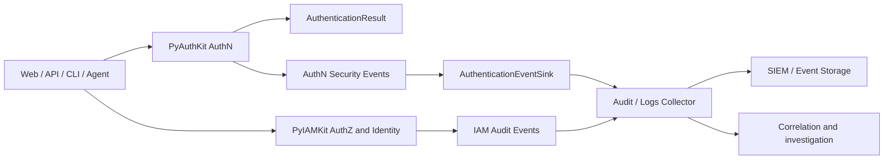
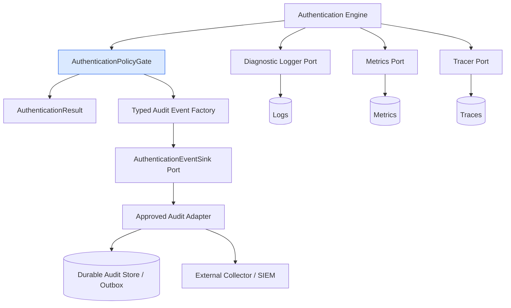
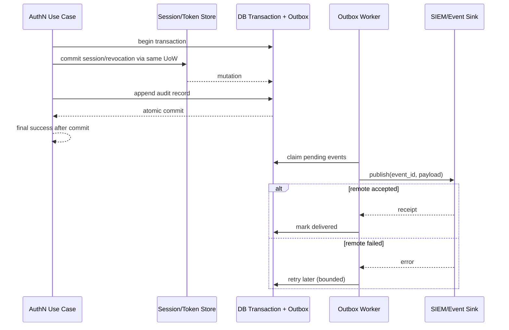
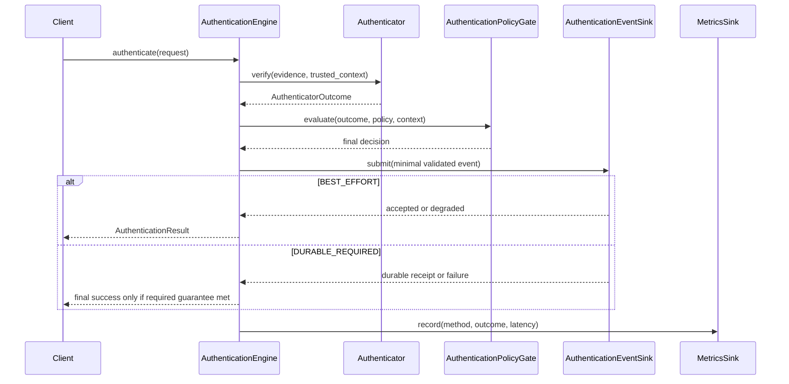
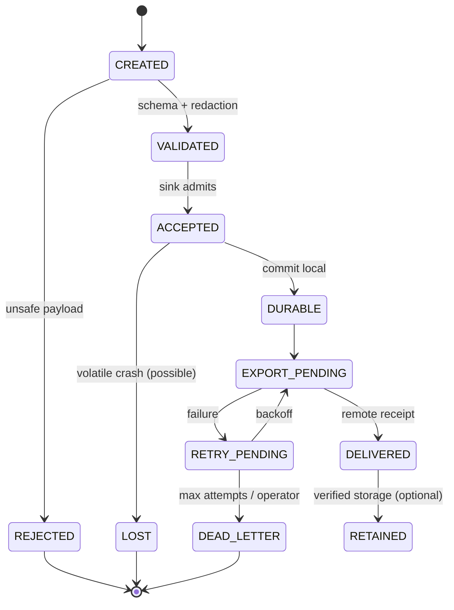
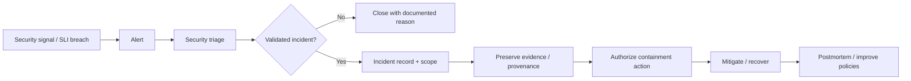

# 21_PYAUTHKIT_AUDIT_EVENTS_AND_OBSERVABILITY

# PyAuthKit — Audit Events and Observability

> **Projet :** PyAuthKit — Authentication Engine for the Modern Python Ecosystem  
> **Document :** `21_PYAUTHKIT_AUDIT_EVENTS_AND_OBSERVABILITY.md`  
> **Type :** Spécification du domaine d'audit AuthN, de télémétrie et d'exploitation sécurisée  
> **Version documentaire :** `0.1.0`  
> **Date :** 2026-10-31  
> **Statut :** **PROPOSED / DESIGN — contrats, métriques et tests candidats, sans qualification live**  
> **Langue :** Français ; contrats et termes d'API en anglais  
> **Documents sources :** `00`–`20`, principalement `07`, `08`, `09`, `11`–`20` et `PYAUTHKIT_SOFTWARE_DESIGN_LEARNING_CONVENTION.md`  
> **Documents suivants :** `22_PYAUTHKIT_FRAMEWORK_INTEGRATIONS.md`, `23_PYAUTHKIT_PYIAMKIT_INTEGRATION_CONTRACT.md`, `24_PYAUTHKIT_PUBLIC_API_AND_SDK_DESIGN.md`, `26_PYAUTHKIT_TESTING_AND_QUALIFICATION_STRATEGY.md`

---

## Guide de lecture

- **MVP :** événements d'issue de tentative Password/API Key/JWT, erreurs de sécurité, provenance non sensible de politique, `AuthenticationEventSink` optionnel par défaut avec contrat de dégradation explicite, métriques et traces adaptables à l'hôte.
- **POST-MVP :** MFA, challenges, WebAuthn, sessions, refresh rotation, OIDC/SAML, risque, workloads, agents et délégation.
- **CONDITIONNEL :** audit durable obligatoire, outbox transactionnelle, SIEM, streaming, export OTLP, signature/chaining, conservation légale spécifique et multi-tenant distribué.
- **Design ≠ implémentation :** les ports, noms de classes, registres et tableaux ci-dessous sont des propositions. Le document ne certifie ni intégration SIEM, ni conformité RGPD/SOC 2, ni absence de perte d'événements.
- **Hiérarchie :** les objets de domaine restent gouvernés par `04`–`08` ; la vérification et la décision finale par `09`, `10`, `17` ; les garanties de transaction par `11`, `13`, `19` ; le risque de sécurité par `20`.

**North Star :** rendre chaque décision de sécurité importante *observable et explicable*, sans exposer les secrets ni créer une autorité concurrente d'authentification, et sans confondre un événement émis avec un événement durablement enregistré.

## 0. Résumé exécutif

La télémétrie PyAuthKit a trois finalités distinctes : **reconstituer les faits de sécurité** (audit), **diagnostiquer l'exécution** (logs/traces) et **surveiller la fiabilité / détecter les anomalies** (métriques et alertes). Le modèle doit être utilisable en Python pur, sans obligation d'OpenTelemetry, de stockage ou de SIEM. Il utilise des ports, de petits objets immuables et des conventions versionnées ; le site hôte choisit collecte, transmission, durabilité, conservation et contrôle d'accès.

```text
AUTHENTICATION REQUEST
  -> TrustedScope + TrustProfile
  -> AuthenticatorOutcome (preuve vérifiée ou non)
  -> AuthenticationPolicyGate (décision autoritative)
  -> AuthenticationResult (contrat public)
          |
          +--> Security/Audit Event (fait borné, sans preuve brute)
          +--> Diagnostic Logs (niveau de détail filtré)
          +--> Metrics (agrégats, labels bornés)
          +--> Traces (durées, corrélation, échantillonnées)
                     |
                     +--> Adapters / Collectors / SIEM / Dashboards
```

Six engagements structurent le document : **autorité** (le journal ne décide pas), **minimisation** (aucun secret dans la télémétrie), **séparation** (audit ≠ métriques ≠ traces), **provenance** (source et versions fiables), **livraison honnête** (émis ≠ acquitté ≠ durable) et **preuve de qualification** (tests négatifs, non simples schémas).

## 1. Filiation documentaire, ownership et prévalence

| Source | Contrat existant à respecter | Contribution de `21` |
|---|---|---|
| `03`, `09` | `AuthenticationEngine`, `AuthenticationPolicyGate`, `AuthenticationResult` | Points d'instrumentation ; aucun second moteur de décision |
| `07` | Invariants d'identité, contexte et audit | Événements de contrôle et oracles négatifs |
| `08` | Commands, Queries, Use Cases | Événement après décision / mutation pertinente |
| `10` | Password, API Key, JWT entrant | Reasons typés sans secret ni token brut |
| `11`, `12`, `15` | Challenge, Flow, MFA, WebAuthn | Usage unique, facteurs, preuve et step-up |
| `13` | Sessions et refresh token families | Création, rotation, révocation, replay |
| `14` | OIDC/SAML et liaison externe | Validation et erreurs de fédération sans assertion brute |
| `16` | Agent et workload identity | Actor, subject, provenance de délégation sans capacité d'autoriser |
| `17` | RiskSignal / RiskAssessment / RiskDecision | Données de risque minimisées, version de policy |
| `18` | `PORT-OUT-08 AuthenticationEventSink`; `AuditSink` candidat | Formalisation ; nom public non figé |
| `19` | Transactions, CAS, outbox conditionnelle | Durabilité et synchronisation des événements |
| `20` | Threat Model, STRIDE, registres `SEC20-*` | Contrôles de détection, enquête, anti-fuite |

**Règle de divergence :** ne pas remplacer silencieusement `AuthenticationEventSink` par `AuditSink`, `AuditPublisher` ou `EventBus` partout. Ce document décrit leurs responsabilités candidates ; la consolidation des noms et signatures relève de `24` et d'un ADR.

## 2. Problème réel et pression de conception

La vérification d'un credential peut être correcte tout en laissant l'opérateur incapable de répondre à : « quelle politique a refusé cette demande ? », « une révocation a-t-elle réellement été appliquée ? », « le même challenge a-t-il été consommé deux fois ? », « l'authentification a-t-elle échoué ou seulement son export de logs ? ».

Les difficultés réelles sont : variations des intégrations, données d'identité sensibles, volumes potentiellement élevés, stockage non obligatoire pour le MVP, exigences probatoires de certains clients, ordre partiel en environnement distribué et contraintes d'authentification très strictes.

**Pression de design :** une ligne de `logging.info()` ne peut simultanément satisfaire les contrats de durabilité, de confidentialité, de corrélation et de qualification. Une infrastructure distribuée n'est toutefois pas justifiée tant que le cas d'usage n'en a pas besoin.

## 3. Objectifs et non-objectifs

### 3.1 Objectifs

1. Produire des événements de sécurité typés et versionnés sans fuite de credentials ou d'assertions.
2. Séparer capture d'audit, diagnostic, mesure et alerte.
3. Exposer des ports testables et fonctionner sans backend d'observabilité obligatoire.
4. Préserver la distinction entre *decision*, *commit*, *emission*, *delivery* et *retention*.
5. Faciliter investigation, détection des abus, exploitation des pannes et revues de conformité.
6. Permettre des choix d'exploitation explicitement gouvernés par tenant, environnement et finalité.
7. Fournir un vocabulaire de conception et des preuves de tests exploitables dans tout l'écosystème Py**Kit.

### 3.2 Non-objectifs

- Recréer un SIEM, un data warehouse, un SOC, un Event Sourcing ou un moteur de détection ML.
- Authentifier une personne via un log, ou accorder une permission IAM via un événement AuthN.
- Garantir une preuve juridique, une non-répudiation cryptographique ou une conservation universelle.
- Imposer Kafka, PostgreSQL, Redis, Prometheus, OpenTelemetry SDK, Loki, Elastic ou Datadog.
- Promettre une capture à 100 % si le réseau, le processus ou l'export peuvent perdre des données.

## 4. Langage ubiquitaire : concepts à distinguer

| Terme | Définition située dans PyAuthKit | Non-équivalence |
|---|---|---|
| `AuthenticationEvent` | Fait AuthN significatif, typé et immuable | ≠ preuve cryptographique d'identité |
| `SecurityAuditRecord` | Représentation conservable d'un fait d'audit | ≠ log libre ou trace complète |
| `DiagnosticLog` | Information technique de résolution d'incident | ≠ registre probatoire complet |
| `MetricMeasurement` | Mesure agrégée, généralement sans identifiant individuel | ≠ historique des tentatives |
| `TraceSpan` | Intervalle d'exécution et liens de causalité | ≠ décision d'authentification |
| `Alert` | Signal de surveillance produit par une règle | ≠ incident prouvé |
| `EventOccurrence` | Fait produit à une date source | ≠ observation à une date collector |
| `DeliveryReceipt` | Acquittement d'un sink défini | ≠ preuve de stockage permanent |
| `AuditPolicy` | Règle de capture/livraison définie par l'application | ≠ `AuthenticationPolicyGate` |
| `CorrelationId` | Identifiant de rapprochement d'une opération | ≠ credential, token ou scope d'autorité |
| `TraceId` | Identifiant technique de trace | ≠ identifiant de tenant ou principal fiable |
| `EventId` | Identité de l'occurrence d'événement | ≠ idempotency key d'une mutation métier |
| `DomainEvent` | Fait du domaine déjà survenu | ≠ publication garantie ni GoF Observer |
| `IntegrationEvent` | Message publié hors du bounded context | ≠ copie intégrale du Domain Event |

## 5. Bounded contexts, Truth Ownership et séparation IAM

**PyAuthKit owns :** verdict d'authentification et événements relatifs aux mécanismes, à la confiance et aux transitions AuthN dont il est autorité. **PyIAMKit owns :** événements d'habilitation, de groupes, de provisioning et de décisions d'accès. **Plateforme d'observabilité owns :** transport, stockage, recherche, rétention et accès aux traces selon les contrats de l'opérateur.



Le même `correlation_id` peut aider à relier `AuthenticationSucceeded` à une décision d'accès ultérieure ; il **ne transforme pas** le système d'audit en source de vérité des identités ou des permissions.

## 6. Périmètre MVP / extensions / conditions

| Catégorie | MVP | POST-MVP | CONDITIONNEL |
|---|---|---|---|
| Password/API Key/JWT | Succès, refus, erreurs critiques, policy decision | — | Audit durable prescrit par déploiement |
| `TrustProfileResolver` | Scope résolu, profil versionné, absence/ambiguïté | Reconfiguration dynamique | Historisation de configuration |
| Registry / plugins | Composition et erreurs de démarrage | Admission/retrait/hot reload | SIEM de supply chain |
| Session / token | Pas d'émission automatique | Create, rotate, revoke, replay | Outbox et durabilité |
| MFA / challenge | Pas de challenge persistant imposé | Create, verify, consume, expire, step-up | Journal à haute valeur probatoire |
| OIDC/SAML/WebAuthn | — | Assert, callback, enroll, validate | Flux de conformité particuliers |
| Workload/agent | — | Service principal et delegation proof | Cross-service correlation |
| Risk adaptatif | — | Signal, assessment, step-up | Détection avancée externalisée |
| Logs/metrics/traces | Adaptateurs et no-op sûr selon politique | Tableaux de bord | OTLP, exporter et collector multi-tenant |

## 7. Architecture de référence : Audit vs Telemetry



Les dépendances pointent du périphérique vers l'intérieur : `domain` ne connaît ni SDK OpenTelemetry, ni `logging.Handler`, ni exporter, ni base de données. L'application décide **quand** un fait d'audit existe et **quelle garantie de persistance** lui est attachée ; les adapters portent l'IO.

## 8. Chaîne de confiance et points d'instrumentation

| Point | Données autoritatives | Données à ne jamais prendre pour preuve | Événement typique |
|---|---|---|---|
| Request ingress | Contexte validé de l'hôte | `X-Tenant`, `X-User`, baggage libre | `authentication.started` avec restrictions |
| Scope / profile | `TrustedScope` et config fiable | JWT header `kid/jku`, issuer auto-déclaré | `trust_profile.resolution_failed` |
| Authenticator | Verdict du vérificateur | Simple `claim_verified: true` externe | `credential.verification_rejected` |
| Policy gate | Policy/version et résultat autoritatif | Score de risque client | `authentication.succeeded/denied` |
| Session manager | Mutation commitée | Cookie client non validé | `session.created/revoked` |
| Token family | Rotation CAS validée | Ancien refresh token réutilisé | `refresh_token.reuse_detected` |
| Federation adapter | Assertion validée selon profil | Assertion XML/ID token brut | `federation.assertion_rejected` |
| Workload/agent | Attestation et mandat vérifiés | Simple nom de service/agent | `delegation.proof_rejected` |

**Interdit :** faire dépendre le résultat AuthN de données enregistrées dans un journal ou reconstruire le niveau AAL à partir du type textuel d'un événement.

## 9. Trust boundaries de télémétrie (`OBS-TB-*`)

| ID | Frontière | Risque principal | Contrôle |
|---|---|---|---|
| `OBS-TB-01` | Client → Auth engine | Entrée et headers non fiables | Validation à l'ingress |
| `OBS-TB-02` | Engine → EventFactory | Inclusion de secrets | Schéma typé + allowlist |
| `OBS-TB-03` | Scope resolver → metadata | Confusion tenant | Provenance autoritative |
| `OBS-TB-04` | Plugin → audit | Injection ou mensonge | Source trust tier ; événements non autoritatifs |
| `OBS-TB-05` | Application → audit sink | Panne/livraison partielle | Delivery policy testée |
| `OBS-TB-06` | Outbox → worker | Duplicates et ordre partiel | Idempotence, retry borné |
| `OBS-TB-07` | Worker → SIEM | Divulgation, interception | Chiffrement, endpoint allowlist |
| `OBS-TB-08` | SDK trace → collector | Secret dans span/baggage | Filtrage avant export |
| `OBS-TB-09` | Collector → storage | Altération / perte | Contrôles d'intégrité et accès |
| `OBS-TB-10` | Analyste → recherche | Curiosité admin / cross-tenant | RBAC, journalisation des consultations |
| `OBS-TB-11` | Metrics endpoint → consommateurs | Information leak, DoS | AuthN réseau, labels minimaux |
| `OBS-TB-12` | Alert engine → incident | Faux positifs / automations dangereuses | Runbook et approbation adaptée |
| `OBS-TB-13` | Archive → restauration | Preuve historique fabriquée | Provenance et manifest |
| `OBS-TB-14` | IAM → audit central | Attribution incorrecte | Contract mapping versionné |
| `OBS-TB-15` | Tenant A → télémétrie partagée | Fuite d'activité | Scope et contrôle de requête |
| `OBS-TB-16` | Config → runtime | Capture modifiée par une entrée | Politique versionnée et signée si besoin |

## 10. Taxonomie des faits AuthN (`OBS-EVT-*`)

| Famille | Noms candidats | Déclencheur et sémantique |
|---|---|---|
| Authentication | `authentication.started`, `.succeeded`, `.denied`, `.unavailable` | Un verdict final n'est produit que par le gate |
| Credential | `credential.verification_failed`, `.revoked`, `.rotated` | Ne pas exposer identifiant ni secret brut |
| Trust | `trust_profile.resolution_failed`, `.changed` | Changement sous autorité de config |
| Challenge | `challenge.created`, `.verified`, `.consumed`, `.expired`, `.replay_detected` | Un usage unique requiert transaction/CAS |
| MFA / Assurance | `assurance.step_up_required`, `.step_up_completed`, `.rejected` | AAL justifié par preuve et policy |
| Session | `session.created`, `.reauthenticated`, `.revoked`, `.expired` | Référence opaque, jamais handle brut |
| Token | `token.issued`, `.rejected`, `refresh_token.rotated`, `.reuse_detected` | JWT entrant ≠ token émis |
| Federation | `federation.started`, `.callback_rejected`, `.assertion_accepted` | Identity mapping ne prouve pas provisioning |
| WebAuthn | `webauthn.registration_completed`, `.assertion_rejected` | Ne pas journaliser authenticatorData/assertion intégrale |
| Risk | `risk.assessed`, `risk.step_up_required`, `risk.provider_unavailable` | Évaluation non substitutive à AuthN |
| Workload | `workload.attestation_rejected`, `delegation.proof_rejected` | Authentication ≠ Delegation ≠ AuthZ |
| Runtime | `audit.delivery_degraded`, `authenticator.unavailable`, `plugin.admission_rejected` | Éviter boucle de logs audit |

Les noms sont **une convention locale proposée**, pas une affirmation que ces noms sont des événements OpenTelemetry normalisés. Préférer une convention stable de nommage en minuscules et namespace ; documenter explicitement son mapping éventuel à OTel.

## 11. Catalogue d'événements détaillé : noyau MVP

| Event name | Émetteur logique | Payload minimum | Sens |
|---|---|---|---|
| `authentication.succeeded` | PolicyGate/Application | scopeRef, method, policyRef, outcome, eventId | Succès **final**, pas uniquement preuve locale vérifiée |
| `authentication.denied` | PolicyGate/Application | scopeRef, method, coarseReason, policyRef | Refus fonctionnel, sans révélation d'existence de compte |
| `authentication.unavailable` | Engine boundary | scopeRef si fiable, component, coarseFailure | Panne contrôlée sans fallback permissif |
| `credential.verification_failed` | Verifier adapter | method, coarseReason, requestRef | Indice de diagnostic, pas verdict final |
| `trust_profile.resolution_failed` | Resolver/Application | trustedContextRef, reasonCode | Profil manquant / ambigu / indisponible |
| `authenticator.unavailable` | Registry/Engine | pluginKind, capabilityRef | Mécanisme non disponible, sans détail d'implémentation sensible |
| `audit.delivery_degraded` | Infrastructure watchdog | sinkType, healthStatus | Télémétrie de santé hors du chemin récursif de l'audit |

Les événements `authentication.started` peuvent être très volumineux et ne sont pas automatiquement des preuves obligatoires. Le **succès/refus final** est un événement logique de décision ; l'affirmation « persisté durablement » exige un reçu et/ou une transaction selon la politique.

## 12. Catalogue POST-MVP : flux, sessions, fédération, risque

Un `challenge.verified` ne signifie pas qu'un challenge a été consommé de manière atomique ; `challenge.consumed` ne signifie pas succès global ; `assurance.step_up_completed` doit être lié à une preuve qualifiée et à une décision. Dans le cycle de refresh : `refresh_token.rotated` décrit une mutation réalisée, `refresh_token.reuse_detected` une tentative de rejeu, et `session.revoked` une décision de révocation ayant atteint son point de commit défini.

Pour OIDC/SAML : journaliser un identifiant de provider approuvé, le protocole, la raison typée et les versions de confiance, **jamais** authorization code, ID token, SAML assertion ni claims non nécessaires. Pour les agents, des champs `actor_ref` et `subject_ref` peuvent être enregistrés **seulement si** le mandat et leur provenance ont été vérifiés, sans déduire la permission de lancer un outil.

## 13. `SecurityAuditRecord` : enveloppe canonique proposée

| Champ | Cardinalité | Provenance | Sensibilité / règles |
|---|---|---|---|
| `schema_version` | 1 | Build/config maîtrisée | Version `major.minor` de l'enveloppe |
| `event_id` | 1 | Source fiable | UUID/ULID opaque généré serveur |
| `event_name` | 1 | Enum/catalogue | Pas de texte libre client |
| `occurred_at` | 1 | Clock source | UTC, timezone explicite |
| `observed_at` | 0..1 | Collecteur | Ne pas confondre avec `occurred_at` |
| `source_service` | 1 | Runtime/config | Nom stable, non secret |
| `scope_ref` | 0..1 | `TrustedScope` | Tenant/realm/purpose minimisés |
| `principal_ref` | 0..1 | Identité vérifiée/autoritative | Pseudonyme si besoin ; absent si non vérifié |
| `claimed_subject_ref` | 0..1 | Entrée non fiable | Très limité, pseudonymisé, explicitement marqué |
| `method` | 0..1 | Authenticator résolu | Enum de faible cardinalité |
| `outcome` | 1 | Moteur/policy | SUCCESS / DENIED / ERROR / DEFER |
| `reason_code` | 0..1 | Catalogue interne | Codes discrets, sans message exception brut |
| `policy_ref` | 0..1 | Policy config | ID/version ou empreinte contrôlée |
| `authenticator_ref` | 0..1 | Registry approuvé | Type/version, sans identifiant de clé secret |
| `request_ref` | 0..1 | Application | ID opaque borné |
| `correlation_id` | 0..1 | Middleware validé / généré | Ne confère aucune autorité |
| `trace_id` / `span_id` | 0..1 | Instrumentation validée | Log correlation uniquement |
| `delivery_class` | 1 | `AuditPolicy` | BEST_EFFORT / DURABLE_REQUIRED |
| `attributes` | 0..n | Factory allowlist | Schema par event, limites de taille |

**Définition d'événement :** contenu immuable, champs typés et obligation de versionner toute rupture d'interprétation. La présence d'un `event_id` facilite la déduplication, **pas** la garantie exactly-once en bout en bout.

## 14. Identifiants, corrélation et confiance

1. Générer `event_id` côté serveur ; ne jamais le dériver d'un mot de passe ou d'un token.
2. Réutiliser un `interaction_id`/`correlation_id` dans une chaîne de requêtes *après* validation de format, longueur et origine, ou en créer un nouveau.
3. `traceparent`, `tracestate`, `baggage` restent des données **de propagation non autoritatives** ; ne pas y placer le tenant fiable, la policy ou des secrets.
4. Un `tenant_ref` est calculé depuis `TrustedScope`, non depuis un span attribute client.
5. Un identifiant principal n'apparaît que lorsque la source et le statut de vérification sont explicitement connus.
6. Pour un identifiant d'événement exporté à des tiers, choisir une pseudonymisation gouvernée, non un simple SHA-256 d'un email ou d'un ID à faible entropie ; le cas échéant HMAC à clé contrôlée par scope/usage.
7. Les `jti`, API keys, cookies, codes OTP, refresh tokens et challenges secrets ne sont pas des IDs d'audit publics.

## 15. Données à exclure et contrôles de minimisation

| À exclure par défaut (valeurs brutes) | Autoriser seulement si justification et protection spécifiques |
|---|---|
| Password, password hash, salt/pepper, PIN, TOTP seed, code OTP | Référence de méthode et résultat |
| Authorization header, cookies, access/refresh/ID/session tokens, API key | Référence opaque contrôlée, pas le secret |
| SAML assertion/XML, `clientDataJSON`, `authenticatorData`, WebAuthn raw payload | Nom de protocole, résultat, version d'un profil approuvé |
| Clé privée, KMS material, JWKS contenu, certificate private key | `key_set_version` non sensible si nécessaire |
| Exception `str(exc)` libre, URL entière contenant query secrets | Code d'erreur de catalogue et service logique |
| Full request/response bodies, HTTP headers, user-agent brut sans besoin | Dimensions catégorielles validées/bornées |
| IP complète, position GPS, device fingerprint persistant | Forme minimisée/pseudonymisée **si nécessaire** et base de traitement définie |
| Claims de JWT / SAML contenant PII | `issuer_ref`/`subject_ref` sous accès strict |

La *redaction* ne doit pas dépendre uniquement d'un filtre côté SIEM : la politique de minimisation s'applique **avant émission**. Une validation ne doit pas réémettre la valeur malformée dans les messages d'erreur ou le `repr` d'une dataclass.

## 16. Classification de sensibilité et accès

| Classe | Exemples | Accès | Pipeline |
|---|---|---|---|
| `PUBLIC_METADATA` | Nom du mécanisme, event type, version d'API | Visibilité limitée si topologie sensible | Export contrôlé |
| `OPERATIONAL_INTERNAL` | Latence, codes d'erreur, health checks | SRE autorisés | Metrics / logs |
| `SECURITY_AUDIT` | tentative, policyRef, issue, principalRef pseudonymisé | SecOps / auditeurs selon rôles | Audit dédié |
| `PERSONAL_DATA` | IP, activité nominative, identifiants corrélables | RBAC + finalité et journal d'accès | Minimisation + rétention |
| `SECRET_PROHIBITED` | Password, token, assertion brute, clé privée | Aucun sink de télémétrie | Refuser / éliminer |

Une pseudonymisation ne rend pas automatiquement une donnée anonyme ; les possibilités de réidentification et les obligations RGPD demeurent.

## 17. Delivery semantics : « émis » n'est pas « conservé »

```text
EVENT CREATED
  -> VALIDATED / REDACTED
  -> ACCEPTED BY LOCAL SINK
  -> QUEUED OR TRANSACTIONALLY PERSISTED
  -> EXPORTED
  -> ACKNOWLEDGED BY REMOTE SINK
  -> VERIFIED RETAINED (if evidence exists)
```

| Niveau | Exemple de garantie | Limite |
|---|---|---|
| `BEST_EFFORT` | Fire-and-forget avec compteur d'échec | Perte possible en crash/saturation |
| `PROCESS_BUFFERED` | Queue bornée locale | Crash/perte après ack possible |
| `DURABLE_LOCAL` | Store ou outbox commitée | Export/collecteur peut encore être en panne |
| `AT_LEAST_ONCE_EXPORT` | Retry avec identifiant stable | Duplicates possibles |
| `REMOTE_ACKED` | Acquittement défini par SIEM | Pas forcément rétention ou intégrité future |
| `RETAINED_AND_AUDITABLE` | Recherche/manifest/contrôles d'intégrité | Dépend d'une preuve opérationnelle datée |

Aucune API ne doit prétendre garantir « exactly-once » sans définir ses frontières, son modèle d'idempotence et ses pertes résiduelles.

## 18. Politique d'indisponibilité de l'audit

**BEST_EFFORT :** le moteur peut répondre selon la décision authentifiée, mais doit exposer un statut de dégradation sûr et une métrique/alerte *hors boucle récursive*. **DURABLE_REQUIRED :** le succès ne doit pas être déclaré comme définitivement finalisé sans atteindre le point de durabilité requis par le contrat, lorsqu'il est réalisable. Pour une opération qui modifie déjà un store, utiliser une transaction atomique ou outbox cohérente ; si cette atomicité n'existe pas, documenter le risque et reconsidérer l'architecture au lieu de promettre un rollback magique.

| Cas | Politique candidate | Issue proposée |
|---|---|---|
| MVP stateless, audit facultatif indisponible | BEST_EFFORT | Résultat selon gate + indicateur de dégradation indépendant |
| Login critique avec audit requis et sink avant décision en panne | DURABLE_REQUIRED | Ne pas finaliser le succès ; erreur externe neutre |
| Session commit + outbox dans même DB | DURABLE_REQUIRED | Commit des deux ou rollback des deux |
| Token déjà émis puis export échoué | Contrat mal conçu pour audit requis | Ne pas prétendre avoir annulé le token ; protocole de compensation/révocation si réellement possible |
| Collector distant en panne après outbox durable | AT_LEAST_ONCE_EXPORT | Opération peut rester valide si durabilité locale suffit ; worker retry |
| Panne télémétrie sur événement de refus | Selon politique / menace | Protection de disponibilité et absence de fuite |

**Décision ouverte majeure :** quelles catégories d'événements sont `DURABLE_REQUIRED` par produit, application hôte, tenant et action ? La réponse doit être arrêtée avant de définir les garanties de production.

## 19. Transactional Outbox et cohérence (`19`)



**Condition :** le store modifié et l'outbox doivent partager une vraie frontière transactionnelle ; deux systèmes différents ne deviennent pas atomiques en nommant un composant `UnitOfWork`. Le worker utilise `event_id` et une stratégie de déduplication côté consommateur, avec délais et DLQ explicités. Le système ne fabrique pas un événement au passé si la mutation d'origine a échoué.

## 20. Logs structurés : responsabilités et schémas

Un log technique répond à « que faisait le runtime ? », non à « quelle décision normative d'identité a été prise ? ». Champs candidats : `timestamp`, `level`, `logger`, `component`, `operation`, `duration_ms`, `reason_code`, `correlation_id`, `span_id`, `environment`, `service_version`, **jamais** `request_body` ou `Authorization`.

Exemples utiles : `authenticator.verify.duration`, `jwks.refresh.failed`, `audit_sink.retry_scheduled`, `registry.invalid_configuration`, `store.operation.timeout`. Un log d'exception peut utiliser `exception.type` ou une catégorie allowlist ; les stacktraces doivent être limitées aux zones privées avec filtrage, sans inclusion de payloads secrets.

## 21. OpenTelemetry : interopérabilité sans verrou fournisseur

OpenTelemetry **Logs Data Model** est publié comme *Stable* ; il distingue `Timestamp`, `ObservedTimestamp`, `TraceId`, `SpanId`, `Resource`, `Attributes` et `EventName`. Les *Semantic Conventions for Events* génériques consultées sont **Development**, et ne constituent donc pas une certification des noms d'événements `authentication.*` inventés ici.

Mapping candidat : `occurred_at → Timestamp`, `event_name → EventName`, `outcome/reason/scope → Attributes` filtrés, `source_service → Resource`, `trace_id → TraceId`. Les SDK/Exporters sont des **adapters**. Les versions des conventions doivent être épinglées lorsque la stabilité de l'export est une exigence.

Un opérateur peut choisir `structlog`, `logging` standard, OTLP Collector ou un sink spécifique ; le domaine ne doit pas importer ces bibliothèques.

## 22. Traces distribuées : spans, propagation et échantillonnage

Opérations candidates : `pyauthkit.authenticate`, `pyauthkit.resolve_trust_profile`, `pyauthkit.authenticator.verify`, `pyauthkit.policy.evaluate`, `pyauthkit.audit.submit`, `pyauthkit.session.rotate`. Noms à faible cardinalité ; pas d'email, de user ID ou de tenant ID non protégés dans les noms.

Le `traceparent` propagé est utile à la corrélation mais non fiable pour attribuer l'identité ; le `baggage` est propagé vers des services externes, sans intégrité intrinsèque. Ne jamais y placer secrets, claims d'identité, rôles, scopes d'autorisation ou preuves MFA. L'échantillonnage de traces peut perdre des événements rares ; **l'audit requis n'est jamais échantillonné avec les spans**.

## 23. Metrics : modèle et sémantique

| Nom candidat | Type | Labels de faible cardinalité | Usage |
|---|---|---|---|
| `pyauthkit.authn.attempts` | Counter | `method`, `outcome`, `reason_family` | Tendances succès / refus / indisponibilité |
| `pyauthkit.authn.duration` | Histogram | `method`, `outcome` | Latence et budgets par mode |
| `pyauthkit.authenticator.duration` | Histogram | `method`, `component_kind` | Temps de vérification |
| `pyauthkit.challenge.replay_detected` | Counter | `challenge_kind` | Anti-rejeu, alerte |
| `pyauthkit.token.refresh_reuse_detected` | Counter | `token_family_kind` | Suspicion de vol |
| `pyauthkit.audit.events_submitted` | Counter | `event_family`, `delivery_class` | Volume d'audit |
| `pyauthkit.audit.delivery_failures` | Counter | `sink_kind`, `failure_family` | Santé export |
| `pyauthkit.audit.backlog` | ObservableGauge | `sink_kind`, `queue_kind` | Retard worker/outbox |
| `pyauthkit.audit.oldest_pending_age` | ObservableGauge | `sink_kind` | Fraîcheur du backlog |
| `pyauthkit.plugin.admission_rejected` | Counter | `plugin_kind`, `reason_family` | Supply chain |
| `pyauthkit.risk.step_up_required` | Counter | `method`, `risk_band` | Profil global, sans profil individuel |

Les noms et unités exacts seront fixés en `24` / `26`; `duration` doit porter une unité explicite à l'enregistrement (par exemple secondes en OTel), non mélanger des millisecondes et des secondes dans les exporters.

## 24. Cardinalité, labels, sampling et quotas

**Interdit par défaut dans les labels de métriques :** `user_id`, `principal_id`, `session_id`, `jti`, `event_id`, `request_id`, `trace_id`, `client_ip`, email, nom d'agent, URL complète, exception message. La dimension `tenant` n'est pas librement admise : si nécessaire, utiliser un découpage d'exploitation maîtrisé avec budget explicite et autorisations de lecture.

Limiter le nombre de séries, fenêtres, buckets, taux d'émission, tailles de payload, file d'attente et nombre de labels. Les counters d'audit ne sont pas une preuve de complétude des journaux ; les comparaisons peuvent seulement détecter des écarts sous des hypothèses explicites.

## 25. SLI, SLO et alertes candidates

| SLI | Définition opérationnelle | Fenêtre / cible |
|---|---|---|
| Disponibilité AuthN | Réponses techniques non-`UNAVAILABLE` / requêtes valides | Cible à fixer selon hôte |
| Latence AuthN p95/p99 | Mesure de `AuthenticationEngine` de frontière à frontière | Budget à profiler par mode |
| Audit capture success | Records **acceptés par niveau promis** / records exigibles | Vérifier par réconciliation |
| Audit export delay | `delivered_at - occurred_at` | Seuil dépend criticité et collecteur |
| Outbox backlog | Nombre d'événements non livrés + âge max | Budget de rétention et de retry |
| Redaction violation rate | Événements testés présentant des secrets | Objectif zéro ; tests CI et contrôles runtime |
| Clock drift | Écart entre horloges observables | Budget propre à l'architecture |
| SIEM ingestion error | Lots rejetés / lots soumis | Seuil + action documentés |

Aucun pourcentage arbitraire de disponibilité ou délai de rétention ne vaut engagement produit sans profil de charge et ADR. Les alertes doivent relier un signal, une source, une condition de seuil, un owner de réponse, un runbook et un mécanisme anti-bruit.

## 26. Détection d'anomalies et interprétation prudente

Exemples : hausse de refus Password, échecs de vérification d'issuer JWT, refresh reuse, double challenge consumption, augmentation des profils de confiance manquants, anomalies de tentatives agent, variation inattendue du taux MFA, désactivation d'un plugin, lacune de séquence d'audit. Une anomalie **n'est pas une preuve d'attaque** ; mesurer biais, bruit, saisonnalité et indisponibilité de collecte.

Ne jamais désactiver un compte ou révoquer un mandat uniquement parce qu'un exporteur a émis une alerte, sauf workflow d'application explicitement approuvé. L'architecture d'incident externe peut demander une action à un composant autoritatif, mais ne remplace pas ses politiques.

## 27. Séquence d'authentification et instrumentation



Ce diagramme **ne déclare pas** une politique universelle d'ordre des effets. Lorsqu'une mutation de session/token et l'audit doivent être atomiques, le flux du document `19` avec outbox remplace le simple submit avant réponse.

## 28. États de livraison et machine à états d'audit



Les états indiquent des **garanties d'infrastructure** distinctes du statut d'une tentative d'authentification. Un audit perdu et une authentification refusée ne doivent jamais être fusionnés sous le code `FAILED` sans domaine de référence.

## 29. Échecs, exceptions et erreurs normalisées

| Échec | Traitement externe | Diagnostic interne |
|---|---|---|
| Payload d'event malformé | Ne pas exporter données non filtrées | `audit.schema_rejected` via canal de santé sûr |
| Collector down | Selon `delivery_class` | `sink_unavailable`, backlog, alerte |
| Queue saturée | Backpressure/budget ou refus si required | `audit.queue_overflow` sans boucle infinie |
| Panne outbox | Opération atomique rollback si contract | Code d'erreur stable, preuve incident |
| Duplication due au retry | Contrôle idempotent au sink | Marque `duplicate` sans réexécuter mutation |
| Secret détecté | Refuser/supprimer champ, ne jamais logguer la valeur | Compteur redaction violation |
| Trace collector down | Ne change pas résultat d'authentification | Signal de dégradation sans secret |
| Retention manifest manquant | Ne pas alléguer conservation durable | Escalade conformité / opérationnelle |

Le logger de secours **ne doit pas reprendre le payload de l'event qui a échoué**, car cela contournerait la minimisation. La hiérarchie d'exceptions devra être consolidée dans `24`.

## 30. Intégrité, preuve et absence de faux absolus

Mesures conditionnelles : écriture append-only, séparation des rôles, chiffrement en transit/au repos, signatures par lot, hash-chain, horodatage fiable, manifest de livraison, contrôles de lacunes, sauvegarde/restauration et accès administratifs audités. **Tamper-evident** aide à détecter des modifications *dans son modèle de menace* ; cela ne signifie pas **tamper-proof**, ni complétude en cas de suppression avant capture, ni non-répudiation juridique.

Un hash-chain est particulièrement délicat en multishard : documenter la portée de la séquence, le gestionnaire de clés, la rotation, les événements manquants et l'ancrage. Ne pas l'imposer au MVP en l'absence de besoin probatoire réel.

## 31. Retention, purge et confidentialité (RGPD/CNIL)

Les principes RGPD pertinents sont la **limitation des finalités**, la **minimisation**, la **limitation de conservation**, l'**intégrité et confidentialité**. La CNIL recommande généralement une durée comprise entre **six mois et un an** pour les traces de sécurité, avec exceptions documentées ; ce n'est **ni une durée universelle obligatoire**, ni une autorisation de conserver librement des données personnelles plus longtemps que nécessaire.

Pour chaque catégorie, le responsable du traitement doit spécifier : finalité, base juridique, données incluses, durée, période à chaud/archivée, droit d'accès, destinataires, purge et dérogations (litige, incident, obligation). Les contrôles de rétention sont configurables ; PyAuthKit **ne choisit pas** un délai juridique par défaut pour chaque application hôte.

| Catégorie | Finalité | Durée documentaire | Traitement |
|---|---|---|---|
| Audit AuthN | Sécurité, incidents, accountability | Paramètre sous décision opérateur | Accès ségrégué, purge |
| Logs de debug | Diagnostic temporaire | Plus court que l'audit si possible | Limites et filtrage |
| Metrics agrégées | SLO, capacité | Selon coût/finalité et anonymisation réelle | Limiter cardinalité |
| Traces | Performance / anomalies | Sampling et durée contrôlée | Aucun secret/baggage sensible |
| Incident evidence | Investigations documentées | Dérogation cas par cas | Extraction, provenance et chaîne de garde |

Le droit d'accès, l'effacement et les obligations de conservation peuvent nécessiter une analyse spécifique : ne pas supprimer arbitrairement un élément probatoire sous litige, et ne pas utiliser cela pour justifier une rétention sans fin.

## 32. Isolation multi-tenant et contrôle des requêtes

- Toute référence de tenant provient d'un `TrustedScope` et reste attachée au record sans fuite entre instances.
- Les queries SIEM, indexes, APIs d'export et droits d'analystes doivent imposer l'isolation ; la simple présence d'un `tenant_id` dans un JSON ne la réalise pas.
- Les identifiants pseudonymisés peuvent rester corrélables ; éviter clé HMAC commune entre entreprises si absence de besoin.
- Les caches de logs, buffers, DLQ et backups sont des surfaces de cross-tenant leakage.
- Un opérateur multi-tenant doit tester le partage de process/pools, les overrides d'exporter et les chemins « admin / support ».
- Les alertes centralisées qui agrègent plusieurs tenants nécessitent une politique de partage explicite.

## 33. Plugins, supply chain et observabilité de la composition

La découverte d'un plugin Python n'est pas une admission. Événements candidats : `plugin.discovered` (diagnostic seulement), `plugin.admission_rejected`, `plugin.activated`, `plugin.configuration_changed`, `plugin.deactivated`. Les champs portent nom/capacité/version/fingerprint de distribution **sans secret de configuration**. Un plugin malveillant peut fabriquer ses propres logs : seuls les records issus de points de contrôle du moteur et dotés de provenance ont autorité pour son admission.

Le runtime doit distinguer events du noyau et events du plugin, appliquer une validation de schéma avant admission et limiter l'usage d'IO des exports, selon la politique de sécurité `18`/`20`.

## 34. Workloads, agents et attribution de délégation

Quand un agent IA ou workload agit, les dimensions suivantes ne sont pas interchangeables : `workload_subject`, `agent_instance`, `user_subject`, `delegation_grant`, `target_resource`. L'événement ne doit déclarer `user_subject` comme validé que lorsque la vérification de mandat l'a établi ; l'autorisation de l'action reste à PyIAMKit / service cible. Éviter les messages d'audit rédigés par un agent comme source autoritative : l'événement de sécurité est produit **au point de contrôle**.

Les prompts d'agent, outils appelés et contenus de documents sont potentiellement sensibles et **ne sont pas** des attributs d'audit AuthN par défaut.

## 35. Incident response : de l'alerte à la preuve



Runbook minimal : propriétaire/astreinte, classification, limites de collecte, préservation de l'état des preuves, révocation ou rotation **par service autoritatif**, notification selon obligations applicables, et revue des faux positifs. Les logs ne doivent pas être consultés librement à d'autres fins ; l'accès d'investigation lui-même est audité.

## 36. Observabilité et responsabilités de l'application hôte

| PyAuthKit | Application / plateforme hôte |
|---|---|
| Émettre des faits AuthN validés et minimisés | Choisir `AuditDeliveryPolicy` et risques acceptés |
| Publier ports/adapters sans backend imposé | Composer logger, metrics, tracing, sink et collector |
| Fournir des identifiants de corrélation bornés | Fournir contexte réseau / identities de service fiables |
| Fournir reason codes et versions de policy | Gérer permissions d'accès et purge des logs |
| Tester les invariants de sécurité de ses contrats | Tester disponibilité/durabilité et reprise réelle |
| Ne pas exposer les secrets par API / exception | Gérer clé HMAC pseudonymisation, rotation et KMS |
| Documenter limitations et points de preuve | Conduire DPIA, audit juridique/SOC 2 le cas échéant |

## 37. Déploiements : monolithe, services et environnements distribués

**In-process library :** adapter local en mémoire ou JSON filtré, aucun service imposé. **Service dédié :** OTLP/HTTP sécurisé et outbox selon besoin. **Multiprocess / multi-worker :** pas d'« exactly-once » implicite ; corrélation, ordre et idempotence par shard. **Serverless :** fin de processus, buffering, flush et limites de timeout peuvent entraîner des pertes ; ne pas utiliser best-effort comme preuve de livraison obligatoire. **Offline/edge :** stockage local chiffré et synchronisation différée soumis à un contrat de rétention et replay.

## 38. Anti-patterns à éviter

| Anti-pattern | Pourquoi incorrect | Alternative |
|---|---|---|
| `logger.info(f"password={password}")` | Fuite de secret | Schéma allowlist + test de non-fuite |
| `AuthEvent == OpenTelemetry Span` | Échantillonnage et sémantique incompatibles | Audit distinct des traces |
| `Kafka == Domain Event` | Transport ≠ fait de domaine | Port + adapter |
| `trace_id == user_id` | Corrélation ≠ identité vérifiée | Champs distincts, provenance |
| `audit_failed -> authenticate_success` | Mauvais contrat required | Fail selon policy de durabilité |
| `audit_failed -> always deny` | DoS possible si best-effort défini | Politique par use case |
| `SHA256(email)` = anonymisation | Réidentification possible | Minimisation/HMAC gouverné si nécessaire |
| Export de JWT brut dans une exception | Secret persistant | Codes d'erreur allowlist |
| Labels de métriques par utilisateur | Explosion cardinalité / PII | Labels bornés |
| Logging dans l'Aggregate Root | Couplage IO / transaction | Application boundary + port |
| Trace échantillonnée = audit complet | Pertes possibles | Audit dedicated sink |
| Audit immutable = intégrité garantie | Modification ou suppression en amont | Provenance, garanties explicites, contrôles |
| « Non-répudiation » parce que hash-chain | Portée juridico-technique excessive | Preuves et périmètre contrôlés |
| SIEM bloqué -> exporter payload vers stderr | Fuite par fallback | Canal de santé minimal indépendant |

## 39. Méthode Software Design & Learning — Problem Before Pattern

```text
PROBLÈME RÉEL (panne de diagnostic / fuite / preuve)
  -> BOUNDED CONTEXT + WHO OWNS THE EVENT?
  -> CONTRAINTES (données, conformité, durabilité, échelle)
  -> INVARIANTS ET FAILURE SEMANTICS
  -> SOLUTION LA PLUS SIMPLE TESTABLE
  -> PATTERN SI JUSTIFIÉ (Event / Adapter / Outbox / Repository)
  -> PYTHON : dataclass, Protocol, composition, types explicites
  -> TESTS : négatifs, contrats, panne, reprise, traces
  -> ADR + preuve / rétrospective
```

L'expression `SecurityAuditRecord` est un nom métier naturel ; `ObserverPatternLogger` ou `EventSourcingManager` seraient artificiels. Un événement de domaine n'est ni nécessairement implémenté via Observer GoF, ni synonyme de commande CQRS.

---

## 40. Registre d’exigences spécialisées `OBS-REQ-*`

Ces exigences complètent les `FR/NFR/SEC/ARC` de `01` et ne remplacent pas les obligations déjà posées par `07`/`20`. **P0** : confiance, confidentialité, sécurité du MVP ; **P1** : opérations importantes et extensions ; **P2** : capacités conditionnelles à leur contexte. Les preuves requises sont décrites dans `OBS-TST-*`.

| ID | Priorité | Domaine | Exigence (candidate) |
| --- | --- | --- | --- |
| `OBS-REQ-001` | P0 | Ownership | Les événements AuthN sont émis depuis un point de contrôle autoritatif et non à partir de données du client |
| `OBS-REQ-002` | P0 | Ownership | Audit AuthN, IAM, logs, metrics et traces ont des contrats et owners séparés |
| `OBS-REQ-003` | P0 | Ownership | La sortie de AuthenticatorOutcome ne peut produire authentication.succeeded avant le PolicyGate |
| `OBS-REQ-004` | P0 | Ownership | La bibliothèque fonctionne sans fournisseur de collecte ou base de données obligatoire |
| `OBS-REQ-005` | P0 | Ownership | L’activation des adapters d’audit est explicite au bootstrap et gouvernée par configuration fiable |
| `OBS-REQ-006` | P0 | Ownership | Les noms/schémas d’événements sont versionnés et catalogués, avec codes discrets |
| `OBS-REQ-007` | P0 | Schema and identity | Chaque record comporte event_id, event_name, schema_version, occurred_at, outcome et source fiables |
| `OBS-REQ-008` | P0 | Schema and identity | Les références de tenant et de realm sont dérivées de TrustedScope, jamais d’un header client libre |
| `OBS-REQ-009` | P0 | Schema and identity | Le principal authentifié est présent uniquement si la vérification et le gate ont abouti |
| `OBS-REQ-010` | P0 | Schema and identity | Les références claimed et verified restent distinctes et possèdent une provenance explicite |
| `OBS-REQ-011` | P0 | Schema and identity | Les identifiants de corrélation sont bornés, opaques et non utilisés comme facteur de confiance |
| `OBS-REQ-012` | P0 | Schema and identity | Les champs optionnels ou manquants ont une sémantique déclarée, sans réinterprétation silencieuse |
| `OBS-REQ-013` | P0 | Privacy | Les événements sont filtrés par allowlist avant tout export, log de secours ou sérialisation |
| `OBS-REQ-014` | P0 | Privacy | Passwords, API keys, bearer/refresh tokens, assertions et secrets ne sont jamais présents en clair |
| `OBS-REQ-015` | P0 | Privacy | Les messages d’erreur et repr d’objets ne divulguent pas les valeurs sensibles |
| `OBS-REQ-016` | P0 | Privacy | Les données personnelles sont minimisées selon finalité, classification et durée de conservation |
| `OBS-REQ-017` | P0 | Privacy | Les pseudonymes d’identifiants faibles ne reposent pas sur un hash non salé présenté comme anonyme |
| `OBS-REQ-018` | P0 | Privacy | L’accès aux journaux sensibles est contrôlé et lui-même audité par l’opérateur |
| `OBS-REQ-019` | P0 | Delivery and consistency | Chaque cas d’usage déclare sa politique BEST_EFFORT ou DURABLE_REQUIRED |
| `OBS-REQ-020` | P0 | Delivery and consistency | Le niveau d’acquittement exposé décrit la garantie réellement atteinte |
| `OBS-REQ-021` | P0 | Delivery and consistency | Une panne de sink obligatoire empêche le succès final lorsque la durabilité promise est requise |
| `OBS-REQ-022` | P1 | Delivery and consistency | Le commit métier et le record outbox sont atomiques lorsqu’une transaction commune est requise |
| `OBS-REQ-023` | P1 | Delivery and consistency | Retry, duplications, idempotence, backoff et DLQ sont définis pour chaque exporter durable |
| `OBS-REQ-024` | P1 | Delivery and consistency | Un événement ne décrit pas comme réalisée une mutation non commitée |
| `OBS-REQ-025` | P1 | Telemetry | Traces et metrics n’interviennent pas dans la décision d’identité et leur panne ne crée aucun succès |
| `OBS-REQ-026` | P1 | Telemetry | Les spans possèdent des noms stables sans identifiants utilisateur ou secrets |
| `OBS-REQ-027` | P1 | Telemetry | Les labels des métriques sont bornés et excluent IDs de session, user, token et trace |
| `OBS-REQ-028` | P1 | Telemetry | Le sampling des traces ne s’applique jamais à l’audit obligatoire |
| `OBS-REQ-029` | P1 | Telemetry | Les métriques de durée exposent une unité cohérente et versionnée |
| `OBS-REQ-030` | P1 | Telemetry | La corrélation de traces n’accorde aucune autorité à traceparent, tracestate ou baggage |
| `OBS-REQ-031` | P1 | Security and operations | Chaque destination de télémétrie est authentifiée, autorisée et chiffrée selon son exposition |
| `OBS-REQ-032` | P1 | Security and operations | Les files, tailles de payload, budgets de retries et timeouts sont bornés |
| `OBS-REQ-033` | P1 | Security and operations | Une panne de journalisation ne provoque ni récursion infinie ni dump du payload en stderr |
| `OBS-REQ-034` | P1 | Security and operations | Les événements de plugins externes portent un niveau de confiance inférieur à ceux du core |
| `OBS-REQ-035` | P1 | Security and operations | L’isolement des enquêtes et exports multi-tenant est vérifié jusqu’aux requêtes et backups |
| `OBS-REQ-036` | P1 | Security and operations | La couverture et les lacunes d’audit critiques déclenchent alertes et procédure de traitement |
| `OBS-REQ-037` | P1 | Governance and evidence | La politique de rétention, purge, base de traitement et exceptions est décidée par le responsable du traitement |
| `OBS-REQ-038` | P1 | Governance and evidence | Le stockage et les manifests attestant l’intégrité sont évalués selon un threat model explicite |
| `OBS-REQ-039` | P1 | Governance and evidence | Une preuve d’événement n’est pas déclarée immutable ou non répudiable sans vérification ciblée |
| `OBS-REQ-040` | P1 | Governance and evidence | Les dashboards et alertes possèdent owner, seuil, runbook et procédures anti-bruit |
| `OBS-REQ-041` | P1 | Governance and evidence | La compatibilité de schéma inclut évolution des producteurs et consommateurs en rolling upgrade |
| `OBS-REQ-042` | P1 | Governance and evidence | La qualification référence commit, adapter, config, environnement et résultats de tests exécutés |
| `OBS-REQ-043` | P2 | Extension lifecycle | Les événements MFA, sessions, fédération, WebAuthn et workloads utilisent un schéma extensible mais fermé |
| `OBS-REQ-044` | P2 | Extension lifecycle | Un challenge vérifié et un challenge consommé sont des événements distincts |
| `OBS-REQ-045` | P2 | Extension lifecycle | Un refresh reuse est détecté/rapporté sans journaliser le token présenté |
| `OBS-REQ-046` | P2 | Extension lifecycle | Une élévation AAL journalisée reflète la preuve et la policy réellement validées |
| `OBS-REQ-047` | P2 | Extension lifecycle | Un agent authentifié n’est pas enregistré comme autorisé à déléguer sans mandat vérifié |
| `OBS-REQ-048` | P2 | Extension lifecycle | Les changements de trust profile ou policy sont attribués à une source de configuration autoritative |
| `OBS-REQ-049` | P2 | Availability and adaptation | L’instrumentation évite les IO bloquants non bornés dans le chemin critique de l’authentification |
| `OBS-REQ-050` | P2 | Availability and adaptation | La politique de fail-closed tient compte des cas d’usage et des risques de déni de service |
| `OBS-REQ-051` | P2 | Availability and adaptation | Les exporteurs ont des health checks indépendants des événements qu’ils exportent |
| `OBS-REQ-052` | P2 | Availability and adaptation | La saturation ne transforme jamais un ERROR ou DENIED en AUTHENTICATED |
| `OBS-REQ-053` | P2 | Availability and adaptation | Les tests d’incident évaluent coupures, partitions réseau, duplications, ordre et restauration |
| `OBS-REQ-054` | P2 | Availability and adaptation | Les références externes, versions des SDKs et caveats de conformité sont suivis dans des ADR |

---

## 41. Registre d’invariants `OBS-INV-*`

Un invariant décrit une propriété **à prouver dans son périmètre**. Les formulations sur l’intégrité/ordre supposent explicitement les mécanismes de livraison configurés, pas un stockage universel.

| ID | Famille | Invariant candidat |
| --- | --- | --- |
| `OBS-INV-001` | Semantics | authentication.succeeded implique verdict final positif issu du PolicyGate |
| `OBS-INV-002` | Semantics | authenticator verified ne constitue jamais à lui seul une réussite finale |
| `OBS-INV-003` | Semantics | authz granted ne se déduit jamais d’un événement AuthN |
| `OBS-INV-004` | Semantics | un événement de mutation accomplie implique un commit reconnu dans son scope |
| `OBS-INV-005` | Semantics | un événement de tentative refusée ne doit pas prouver l’existence d’un compte |
| `OBS-INV-006` | Trust and identity | scope_ref n’est jamais dérivé uniquement d’un paramètre client non fiable |
| `OBS-INV-007` | Trust and identity | principal_ref verified est absent tant que l’identité n’est pas validée |
| `OBS-INV-008` | Trust and identity | trace_id et correlation_id ne constituent pas un jeton de confiance |
| `OBS-INV-009` | Trust and identity | actor_ref et subject_ref de délégation sont séparés et de provenance vérifiée |
| `OBS-INV-010` | Trust and identity | un plugin non approuvé ne crée aucun événement autoritatif du noyau |
| `OBS-INV-011` | Privacy | aucun mot de passe, hash de password, API key ou secret OTP n’est journalisé |
| `OBS-INV-012` | Privacy | aucun access/refresh/ID/session token ni cookie brut n’est journalisé |
| `OBS-INV-013` | Privacy | aucune assertion OIDC/SAML ou réponse WebAuthn brute n’est journalisée |
| `OBS-INV-014` | Privacy | le payload rejeté ne figure pas dans le message de fallback |
| `OBS-INV-015` | Privacy | les attributs event suivent un schéma allowlist avec limites de taille |
| `OBS-INV-016` | Delivery | un receipt local en mémoire ne vaut pas durable persisted |
| `OBS-INV-017` | Delivery | un outbox record ne vaut pas preuve de remote delivered |
| `OBS-INV-018` | Delivery | un succès DURABLE_REQUIRED n’est finalisé qu’après la garantie demandée |
| `OBS-INV-019` | Delivery | event_id stable permet déduplication mais n’empêche pas toutes les pertes |
| `OBS-INV-020` | Delivery | le sink best-effort indisponible ne modifie pas le verdict cryptographique |
| `OBS-INV-021` | Consistency | challenge consumed et refresh rotated exigent le point de commit défini |
| `OBS-INV-022` | Consistency | un rollback n’émet pas mutation completed comme fait durable |
| `OBS-INV-023` | Consistency | la même opération sous retry n’introduit pas deux mutations par simple publication |
| `OBS-INV-024` | Consistency | les timestamps occurred_at et observed_at sont distincts |
| `OBS-INV-025` | Consistency | l’absence de séquence globale entre shards n’est pas présentée comme une corruption |
| `OBS-INV-026` | Telemetry | metric labels n’incluent pas d’identifiants individuels à forte cardinalité |
| `OBS-INV-027` | Telemetry | le sampling d’une trace n’efface pas un audit mandatory |
| `OBS-INV-028` | Telemetry | baggage externe n’est pas une source fiable de principal ou tenant |
| `OBS-INV-029` | Telemetry | exception message non filtré n’est pas une dimension métrique |
| `OBS-INV-030` | Telemetry | duration utilise une unité explicitement déterminée |
| `OBS-INV-031` | Operations | toute alerte de sécurité a un owner et une procédure de triage |
| `OBS-INV-032` | Operations | les accès aux audits sensibles sont contrôlés et traçables |
| `OBS-INV-033` | Operations | les opérations de purge suivent un calendrier et un scope définis |
| `OBS-INV-034` | Operations | une archive restaurée conserve provenance et limites de preuve |
| `OBS-INV-035` | Operations | une dégradation du sink est observable sans provoquer une boucle récursive |
| `OBS-INV-036` | Governance | une configuration d’audit ne peut élever les privilèges d’un principal |
| `OBS-INV-037` | Governance | un profil de rétention n’est pas présumé conforme par défaut |
| `OBS-INV-038` | Governance | une preuve de checksum ne prouve pas l’exhaustivité des événements |
| `OBS-INV-039` | Governance | une donnée pseudonymisée n’est pas automatiquement anonyme |
| `OBS-INV-040` | Governance | un test candidat n’est pas un résultat de qualification exécutée |

---

## 42. Registre de menaces `OBS-THR-*`

Registre de menaces orienté **détection et robustesse de la télémétrie** ; voir les scénarios STRIDE déjà établis par `20` pour la vue de sécurité transversale.

| ID | Menace | Vecteur / risque | Contrôle candidat |
| --- | --- | --- | --- |
| `OBS-THR-001` | Log injection | CRLF, delimiter or JSON abuse | Structured serialization and bounded fields |
| `OBS-THR-002` | Secret exfiltration | Password/token stored in log or span | Allowlist at source + secret scanning |
| `OBS-THR-003` | PII overcollection | IP, device, username replicated | Privacy matrix and retention policy |
| `OBS-THR-004` | Cross-tenant log leak | Shared index / exporter query | Trusted scope and query-level isolation |
| `OBS-THR-005` | Forged audit event | Plugin or caller claims success | Core provenance and event schema |
| `OBS-THR-006` | Missing audit | Sink silently drops security result | Delivery policy, health and reconciliation |
| `OBS-THR-007` | Audit DoS | Required sink flooded or offline | Budget, deployment choice and fail policy |
| `OBS-THR-008` | Outbox duplication | Retry redelivers record | Stable event_id and consumer idempotence |
| `OBS-THR-009` | Outbox loss | Mutation commits separately | Shared transaction + fault tests |
| `OBS-THR-010` | Event tampering | Admin modifies retained record | Restricted access, manifests, integrity |
| `OBS-THR-011` | Evidence rollback | Old archive replaces recent events | Retention provenance, epochs and anchors |
| `OBS-THR-012` | Timestamp manipulation | Clock skew / falsified client time | Trusted clock and observed_at |
| `OBS-THR-013` | Correlation poisoning | Client sets principal via trace header | Never trust baggage for identity |
| `OBS-THR-014` | Metric cardinality DoS | Per-user label explosion | Allowed dimensions and series budgets |
| `OBS-THR-015` | Trace export leakage | Unfiltered exception or baggage | Span processor allowlist |
| `OBS-THR-016` | SIEM credential leak | Exporter endpoint or credential stolen | Secret manager and scoped access |
| `OBS-THR-017` | Alert storm | High false positive volume | Triage, thresholds, grouping and rate limits |
| `OBS-THR-018` | Alert suppression | Noisy pipeline masks replay | Critical indicators and health-of-health |
| `OBS-THR-019` | Privilege abuse | Analyst browses individual events | RBAC, purpose limitation, access auditing |
| `OBS-THR-020` | Retention drift | Logs kept indefinitely | Retention schedules and purge tests |
| `OBS-THR-021` | Replay event forgery | Refresh reuse fabricated by malicious client | Verifier/commit provenance |
| `OBS-THR-022` | Schema downgrade | Unrecognized field interpreted permissively | Versioned schema and strict adapters |
| `OBS-THR-023` | Sensitive failure fallback | Exception dumps unsafe event to stderr | Independent health channel with no payload |
| `OBS-THR-024` | Backpressure cascade | Exporter blocks auth pipeline indefinitely | Timeout, bounded queue, explicit policy |

---

## 43. Plan de qualification détaillé `OBS-TST-*`

Tous les cas sont des **tests candidats**, sans statut `PASS` dans la codebase. À exécuter au niveau unit, contract, integration, architecture, security et chaos selon le cas ; les tests de panne/durabilité exigent un véritable adapter et son environnement.

### 43.1 Core outcome and provenance

| ID | Cas | Précondition / stimulus | Oracle attendu |
| --- | --- | --- | --- |
| `OBS-TST-001` | Password success | Verifier success + gate allow | One final authentication.succeeded event |
| `OBS-TST-002` | Password denied | Wrong password | Event denied, no verified principal |
| `OBS-TST-003` | Key revoked | API Key revoked | No success and event coarse reason |
| `OBS-TST-004` | JWT wrong issuer | JWT signature valid under untrusted issuer | Reject event without JWT contents |
| `OBS-TST-005` | JWT expired | Expired JWT | No authenticated principal / no JWT payload in logs |
| `OBS-TST-006` | Gate deny after verified | Verifier OK but policy denies | No authentication.succeeded |
| `OBS-TST-007` | Authenticator timeout | Verifier unavailable | Unavailable event; no permissive fallback |
| `OBS-TST-008` | Trust profile absent | No resolved trust profile | Denial / error with safe provenance |
| `OBS-TST-009` | Trust profile ambiguous | Two equally plausible profiles | No arbitrary selected provider |
| `OBS-TST-010` | Claimed identity forged | Caller sets is_verified=true | No verified principal in audit |
| `OBS-TST-011` | Cross-tenant scoped principal | Principal from different tenant | No cross-tenant success/ref |
| `OBS-TST-012` | Correlation mismatch | Client-provided ID with invalid format | Generated safe replacement or reject header |

### 43.2 Schema and data minimization

| ID | Cas | Précondition / stimulus | Oracle attendu |
| --- | --- | --- | --- |
| `OBS-TST-013` | Password exclusion | Secret in supplied event attributes | Reject before sink sees payload |
| `OBS-TST-014` | Bearer exclusion | JWT in raw exception | JWT not present in exported record |
| `OBS-TST-015` | API Key exclusion | Raw API key in exception | No raw key in event or stderr |
| `OBS-TST-016` | Refresh exclusion | Raw refresh in diagnostics | No refresh token anywhere in telemetry |
| `OBS-TST-017` | TOTP exclusion | OTP/seed in log request | Neither value stored |
| `OBS-TST-018` | SAML exclusion | XML Assertion in failure | No raw assertion |
| `OBS-TST-019` | WebAuthn exclusion | clientDataJSON in failure | No raw client payload |
| `OBS-TST-020` | Authorization header exclusion | Authorization set on request | No headers exposed |
| `OBS-TST-021` | CRLF escaping | User input contains newline | Structured sink not log-injected |
| `OBS-TST-022` | Oversize metadata | Oversize plugin attribute | Bounded rejection without dumping payload |
| `OBS-TST-023` | Unsupported attribute | Unrecognized key in event data | Reject or remove according schema, not pass through |
| `OBS-TST-024` | Non-UTF8/malformed | Malformed input field | Safe error signal without unsafe value |

### 43.3 Audit delivery and state

| ID | Cas | Précondition / stimulus | Oracle attendu |
| --- | --- | --- | --- |
| `OBS-TST-025` | Best effort sink down | Telemetry sink unavailable | Gate result preserved, health degraded |
| `OBS-TST-026` | Mandatory sink down | Required capture unavailable | No final success returned |
| `OBS-TST-027` | Mandatory durable receipt | Record only memory queued | Not marked durable |
| `OBS-TST-028` | Outbox atomic success | Session commit with outbox | Both committed once |
| `OBS-TST-029` | Outbox rollback | DB fails before commit | No session success and no event pretending commit |
| `OBS-TST-030` | Sink retry duplicates | Worker sends twice | Consumer handles same event_id |
| `OBS-TST-031` | Sink lost ack | Remote accepted but ack lost | At-least-once semantics documented |
| `OBS-TST-032` | DLQ saturation | Retries exhausted | Dead-letter and operational alarm |
| `OBS-TST-033` | Queue backpressure | Full bounded queue | Expected failure policy, no hang |
| `OBS-TST-034` | Exporter cancellation | Task canceled during submission | No false receipt or leaked secret |
| `OBS-TST-035` | Process crash before flush | Volatile buffer event | Potential loss recorded in documented guarantee |
| `OBS-TST-036` | Remote collector temporary fail | Outbox retained + retry | No rollback false claim |

### 43.4 Domain lifecycle extensions

| ID | Cas | Précondition / stimulus | Oracle attendu |
| --- | --- | --- | --- |
| `OBS-TST-037` | Challenge created | Begin MFA flow | Created event bound to request/tenant |
| `OBS-TST-038` | Challenge consumed | Two parallel consume attempts | One committed consumed event |
| `OBS-TST-039` | Challenge replay | Repeat consumed challenge | Replay detected event no credential leak |
| `OBS-TST-040` | TOTP reuse | Same TOTP accepted twice under policy | Fail independently of challenge single-use |
| `OBS-TST-041` | Assurance step-up | Valid MFA under policy | Event states proven assurance only |
| `OBS-TST-042` | Step-up denied | Expired/unverified factor | No elevation event |
| `OBS-TST-043` | Session create | Session committed successfully | Correct SessionCreated after commit |
| `OBS-TST-044` | Session revoke | Revocation committed | No false guarantee of instant JWT revocation |
| `OBS-TST-045` | Refresh rotate | CAS success | One rotation and event |
| `OBS-TST-046` | Refresh replay | Reuse of old token | Replay flagged without raw token |
| `OBS-TST-047` | Federation callback rejected | OIDC state mismatch | No code/ID token in event |
| `OBS-TST-048` | Workload delegation failure | Agent without valid grant | No user delegation claim |

### 43.5 Observability signals

| ID | Cas | Précondition / stimulus | Oracle attendu |
| --- | --- | --- | --- |
| `OBS-TST-049` | Latency unit | Auth method duration | Histogram values and unit consistent |
| `OBS-TST-050` | Low-cardinality labels | 10000 users authenticate | Bounded number of metric series |
| `OBS-TST-051` | Invalid metric label | User ID label supplied | Rejected/ignored by metrics adapter |
| `OBS-TST-052` | Traceparent untrusted | Client-supplied trace headers | Cannot change trusted tenant/principal |
| `OBS-TST-053` | Baggage leaked | External propagation with credentials | No sensitive baggage leaves process |
| `OBS-TST-054` | Trace sampling | Spans sampled out | Required audit still captured |
| `OBS-TST-055` | Error stack trace | Exception includes raw request | No secrets exported |
| `OBS-TST-056` | Metric sink down | Metric exporter unavailable | Auth decision unaffected |
| `OBS-TST-057` | Logs sink down | Diagnostic logs exporter down | No permissive auth change |
| `OBS-TST-058` | Audit latency | Outbox delivery delayed | SLO/alert uses correct event vs observed time |
| `OBS-TST-059` | Clock skew | Collector time differs | occurred/observed remain distinct |
| `OBS-TST-060` | Health-of-health | Collector silent during outage | Independent watchdog alert |

### 43.6 Access privacy and retention

| ID | Cas | Précondition / stimulus | Oracle attendu |
| --- | --- | --- | --- |
| `OBS-TST-061` | Tenant A search tenant B | Cross-tenant audit query | Denied at API/query layer |
| `OBS-TST-062` | Tenant A shared buffer | Multi-tenant exporter | No data crossing scopes |
| `OBS-TST-063` | Admin query misuse | Auditor accesses sensitive records | Purpose/authorization/access log enforced |
| `OBS-TST-064` | Retention expiration | Record older than approved period | Purge/archival per policy |
| `OBS-TST-065` | Purge idempotence | Purge job retried | Consistent state and audit of deletion |
| `OBS-TST-066` | Legal hold | Scoped incident preservation | Retention override recorded/authorized |
| `OBS-TST-067` | HMAC pseudonym | Low entropy identifier | No reversible unkeyed hash exposed |
| `OBS-TST-068` | HMAC rotation | Key material changed | Correlation policy and historical compatibility explicit |
| `OBS-TST-069` | Personal data in trace | IP/email entered as span attribute | Blocked or sanitized |
| `OBS-TST-070` | Restored archive | Backup replayed | Provenance preserved; no false original evidence |
| `OBS-TST-071` | Retention doc missing | Deploy with no schedule | Configuration validation blocks required profile |
| `OBS-TST-072` | Data subject visibility | End-user activity export | No cross-tenant leakage / controlled output |

### 43.7 Threat and resilience

| ID | Cas | Précondition / stimulus | Oracle attendu |
| --- | --- | --- | --- |
| `OBS-TST-073` | Plugin audit forgery | Plugin claims auth success | Provenance rejects untrusted source |
| `OBS-TST-074` | Plugin compromised | Malicious extension emits rich payload | Allowlist/quotas apply |
| `OBS-TST-075` | Metrics endpoint exposed | Unauthenticated network request | Denied according to deployment policy |
| `OBS-TST-076` | SIEM outbound SSRF | Exporter destination controlled by user | Only approved endpoints allowed |
| `OBS-TST-077` | Log store tampering | Operator edits stored record | Detection under declared integrity contract |
| `OBS-TST-078` | Gap in audit sequence | Dropped outbox event | Gap detectable within stated scope |
| `OBS-TST-079` | Backlog age alert | Worker unavailable | Alert and runbook triggered |
| `OBS-TST-080` | Incident false positive | Unusual login volume | Classification not automatic proof |
| `OBS-TST-081` | Collector recursive failures | Sink logs its own failed log | Bounded independent signal |
| `OBS-TST-082` | Noisy neighbor | Tenant floods telemetry | Quotas protect peers |
| `OBS-TST-083` | Secret scanner | Synthetic random credential in test | Redaction regression detected |
| `OBS-TST-084` | Recovery after crash | Restart after transaction | Committed records recovered and retry safe |

### 43.8 Schema and compatibility

| ID | Cas | Précondition / stimulus | Oracle attendu |
| --- | --- | --- | --- |
| `OBS-TST-085` | Reader old version | v1 reader receives v1 compatible v1.1 | Deterministic compatibility path |
| `OBS-TST-086` | Breaking schema upgrade | Required field meaning changes | New major and migration plan |
| `OBS-TST-087` | Unknown major event | Consumer cannot parse version | Dead-letter controlled, no silent success |
| `OBS-TST-088` | Rolling upgrade | Old/new producers coexist | Both versions handled explicitly |
| `OBS-TST-089` | Event name validation | Client proposes arbitrary event name | Catalog rejects unapproved name |
| `OBS-TST-090` | Reason code stability | Error mapping changes | No old code silently new semantics |
| `OBS-TST-091` | Stable event ID | Retries same event | Same event_id and no conflicting payload |
| `OBS-TST-092` | Receipt tamper | Adapter returns fabricated remote durable | Contract test rejects false receipt |
| `OBS-TST-093` | Replay dry-run | Import historical event | No real authentication side-effect |
| `OBS-TST-094` | Evidence record | Test run recorded | Commit + environment + adapter + output links present |
| `OBS-TST-095` | Architecture import rule | Domain imports OTLP SDK | Fitness test fails |
| `OBS-TST-096` | Config rollback | Audit policy changed during deployment | Version provenance remains correct |

**Evidence Record minimal :** test_id, source revision/commit, adapter version, runtime version, environment, fixtures, timestamp UTC, exit status, logs *eux-mêmes filtrés*, et artefact de résultat stocké. Un simple `pytest -q` sans environnement ni cas négatifs ne vaut pas qualification de résilience distribuée.

---

## 44. Architecture Fitness Functions `OBS-FIT-*`

Ces règles peuvent être rendues exécutables par import-linter, AST, analyse de schéma, pytest et scanners d’artefacts. Le test ne doit pas seulement chercher une chaîne dans le code ; il doit prouver une propriété observable.

| ID | Règle | Assertion de qualification |
| --- | --- | --- |
| `OBS-FIT-001` | Core dependency | domain/application do not import otel SDK, Kafka client, SQLAlchemy or SIEM SDK |
| `OBS-FIT-002` | No raw secret attributes | export schemas forbid password, token, assertion, cookie, authorization headers |
| `OBS-FIT-003` | Audit gate | success event emitted only after final policy decision |
| `OBS-FIT-004` | Tenant source | tenant scope derived only from authoritative TrustedScope |
| `OBS-FIT-005` | Versioned schemas | every event family has schema_version and compatible reader |
| `OBS-FIT-006` | Delivery status | API cannot misreport accepted as durable or remote acknowledged |
| `OBS-FIT-007` | Metric cardinality | no principal/session/token IDs in labels |
| `OBS-FIT-008` | Trace privacy | no PII/secret in span names, baggage and attributes |
| `OBS-FIT-009` | Failure isolation | telemetry unavailable cannot cause success or silent required-audit bypass |
| `OBS-FIT-010` | Outbox atomicity | when specified, mutation and event write use same DB transaction |
| `OBS-FIT-011` | No recursion | audit delivery failure uses independent bounded health channel |
| `OBS-FIT-012` | Plugin separation | untrusted plugin cannot claim core authoritative event |
| `OBS-FIT-013` | Retention | every persisted category has a documented TTL or purge policy |
| `OBS-FIT-014` | Access controls | audit query APIs enforce tenant and analyst authorization |
| `OBS-FIT-015` | Reviewability | each major logging decision linked to ADR / test |
| `OBS-FIT-016` | Port contract | fakes and live adapters run same conformance suite |
| `OBS-FIT-017` | Clock semantics | UTC occurred_at and collector observed_at are not conflated |
| `OBS-FIT-018` | No false evidence | docs and release notes never equate drafted tests with qualified tests |

---

## 45. Scénarios d’acceptation bout-en-bout `OBS-SC-*`

| ID | Scénario | Stimulus | Critère de succès |
| --- | --- | --- | --- |
| `OBS-SC-001` | Login Password 성공/échec | Une paire succès/refus sur un compte test | Deux records finals distincts, aucun secret dans logs |
| `OBS-SC-002` | JWT forgé | Un JWT non autoritatif contient `sub` plausible | Aucun `AuthenticatedPrincipal`, event minimal et raison générique |
| `OBS-SC-003` | Challenge multi-workers | Deux workers consomment simultanément le même challenge | Un gagnant et un seul event de consommation commitée |
| `OBS-SC-004` | Refresh-token replay | Ancien refresh après rotation | Event de réutilisation, family handling et preuve sans token |
| `OBS-SC-005` | OIDC callback invalid | Échec de state/nonce | Refus sans code/ID Token divulgué |
| `OBS-SC-006` | WebAuthn RP mismatch | Assertion émise pour autre RP | Événement de rejet sans raw assertion |
| `OBS-SC-007` | Agent sans délégation | Service authentifié tente une action utilisateur | Aucun claim de délégation autorisée |
| `OBS-SC-008` | Exporter indisponible | Collector hors-ligne | Comportement conforme à `delivery_class`, métrique santé |
| `OBS-SC-009` | PostgreSQL outbox panne | Transaction de session et append échoue | Rollback de l’ensemble si le contrat l’exige |
| `OBS-SC-010` | Cross-tenant SIEM | Analyste A requête les journaux B | Refus à toutes les couches pertinentes |
| `OBS-SC-011` | Redaction canary | Credential synthétique placé dans exception/log | Aucun enregistrement/transport ne contient le canary |
| `OBS-SC-012` | Restoration + incident | Archives restaurées et événement manquant | Provenance et lacune explicitement observables |

---

## 46. Décisions ouvertes et ADR candidats `OBS-DEC-*`

Aucun de ces arbitrages n’est présenté comme **ACCEPTED**. Lorsqu’un choix modifie la frontière de confiance, la forme des contrats ou la garantie d’audit, produire un ADR avant d’implémenter.

| ID | Décision | Options / problème à trancher |
| --- | --- | --- |
| `OBS-DEC-001` | Port naming | AuthenticationEventSink vs AuditSink vs AuditPublisher; ownership / API stability |
| `OBS-DEC-002` | MVP delivery class | BEST_EFFORT default or required categories for deployment |
| `OBS-DEC-003` | Mandatory auditing | Per-use-case and per-tenant definition of success finalization |
| `OBS-DEC-004` | Event catalogue | Namespacing, public names and schema semantic versioning |
| `OBS-DEC-005` | Principal references | Raw internal ID, scoped pseudonym or absent on failure |
| `OBS-DEC-006` | Pseudonymisation | HMAC key ownership, rotation and key scope |
| `OBS-DEC-007` | Correlation | Trusted middleware ID format and untrusted propagation handling |
| `OBS-DEC-008` | Failure reason policy | Allowed coarseReason mapping and anti-enumeration |
| `OBS-DEC-009` | Provider error details | Secure troubleshooting channels without raw payload |
| `OBS-DEC-010` | No-op adapters | When permitted and how misconfiguration is detected |
| `OBS-DEC-011` | OTel SDK | Optional extra, version pinning, semconv mapping |
| `OBS-DEC-012` | Metric API | Instrument names, units, bucket defaults, labels |
| `OBS-DEC-013` | Trace sampling | By operation / error while preserving mandatory audit |
| `OBS-DEC-014` | Backpressure | Drop, bounded queue, fail-closed per class |
| `OBS-DEC-015` | Outbox ownership | Shared store, transaction boundaries and retry worker |
| `OBS-DEC-016` | Remote acknowledgement | What precisely qualifies durable / delivered |
| `OBS-DEC-017` | Audit ordering | Global vs per aggregate vs best-effort local ordering |
| `OBS-DEC-018` | Tamper evidence | Append-only/signing/chaining necessity and key lifecycle |
| `OBS-DEC-019` | SIEM integration | OTLP, HTTP, Kafka, file, syslog priority |
| `OBS-DEC-020` | Multi-tenant telemetry | Shared vs partitioned indexes and read isolation |
| `OBS-DEC-021` | Retention policy | Purpose, duration, archive and deletion by data category |
| `OBS-DEC-022` | Incident export | Evidence preservation, access recording and chain of custody |
| `OBS-DEC-023` | Dashboard SLO | Service-specific thresholds and runbook ownership |
| `OBS-DEC-024` | Compatibility & migration | Rolling upgrades and old reader event schema support |

---

## 47. Matrice de traçabilité vers documents et risques

| Capacité | Sources | Requirements | Invariants | Tests |
| --- | --- | --- | --- | --- |
| Final verdict and policy | `07`, `09`, `17` | `OBS-REQ-001..012` | `OBS-INV-001..010` | `OBS-TST-001..012` |
| Secrets and privacy | `10`, `14`, `15`, `20` | `OBS-REQ-013..018` | `OBS-INV-011..015` | `OBS-TST-013..024` |
| Delivery and persistence | `11`, `13`, `19` | `OBS-REQ-019..024` | `OBS-INV-016..025` | `OBS-TST-025..048` |
| Telemetry / cardinality | `18`, `20` | `OBS-REQ-025..030` | `OBS-INV-026..030` | `OBS-TST-049..060` |
| Security and operations | `16`, `18`, `20` | `OBS-REQ-031..036` | `OBS-INV-031..035` | `OBS-TST-073..084` |
| Compliance / governance | `01`, `20`, CNIL | `OBS-REQ-037..042` | `OBS-INV-036..040` | `OBS-TST-061..072` |
| Extensions | `11`–`17` | `OBS-REQ-043..048` | domain-specific | `OBS-TST-037..048` |
| Deployment and resilience | `19`, `20`, `26` | `OBS-REQ-049..054` | `OBS-INV-016..035` | `OBS-TST-073..096` |

---

## 48. Design Learning Cards — douze problèmes concrets

### 48.1 `SecurityAuditRecord`

- **Business / Security Problem :** Reconstituer un verdict AuthN sans copier la requête complète.
- **Domain Role / DDD :** Value Object ou event payload immutable.
- **Principles :** Information Hiding, explicit modeling.
- **Pattern, s’il existe :** Event Record ≠ Event Sourcing.
- **Python :** `dataclass(frozen=True)` + enum.
- **Test & Evidence :** Tests allowlist + immutabilité.
- **Alternative / trade-off :** partir d’une fonction ou d’un callback filtré lorsque le besoin ne justifie ni registry, ni event bus ; le découplage ajoute versioning, délais et coûts d’exploitation.

### 48.2 `AuthenticationEventSink`

- **Business / Security Problem :** Accepter des records sans coupler le noyau au SIEM.
- **Domain Role / DDD :** Outbound Port.
- **Principles :** DIP, ISP, SoC.
- **Pattern, s’il existe :** Ports and Adapters.
- **Python :** `typing.Protocol`.
- **Test & Evidence :** Contract tests sur fake et adapter.
- **Alternative / trade-off :** partir d’une fonction ou d’un callback filtré lorsque le besoin ne justifie ni registry, ni event bus ; le découplage ajoute versioning, délais et coûts d’exploitation.

### 48.3 `AuditDeliveryPolicy`

- **Business / Security Problem :** Gouverner le comportement d’échec et la durabilité.
- **Domain Role / DDD :** Application Policy / configuration fiable.
- **Principles :** Fail-closed, KISS.
- **Pattern, s’il existe :** Policy Object si variation réelle.
- **Python :** Enum + dispatch explicite.
- **Test & Evidence :** Sink down vs mandated policy.
- **Alternative / trade-off :** partir d’une fonction ou d’un callback filtré lorsque le besoin ne justifie ni registry, ni event bus ; le découplage ajoute versioning, délais et coûts d’exploitation.

### 48.4 `AuditEventFactory`

- **Business / Security Problem :** Créer un event à partir du résultat final, non de claims bruts.
- **Domain Role / DDD :** Domain/Application factory (à arbitrer).
- **Principles :** SRP, trust provenance.
- **Pattern, s’il existe :** Factory Method non nécessaire par défaut.
- **Python :** Fonction pure puis classe si utile.
- **Test & Evidence :** Gate denied / verified distinction.
- **Alternative / trade-off :** partir d’une fonction ou d’un callback filtré lorsque le besoin ne justifie ni registry, ni event bus ; le découplage ajoute versioning, délais et coûts d’exploitation.

### 48.5 `OutboxRecord`

- **Business / Security Problem :** Assurer commit cohérent entre mutation et audit.
- **Domain Role / DDD :** Persistence record.
- **Principles :** Atomicity, failure isolation.
- **Pattern, s’il existe :** Transactional Outbox si même UoW.
- **Python :** SQL transaction / Port.
- **Test & Evidence :** Crash, rollback, duplicate export.
- **Alternative / trade-off :** partir d’une fonction ou d’un callback filtré lorsque le besoin ne justifie ni registry, ni event bus ; le découplage ajoute versioning, délais et coûts d’exploitation.

### 48.6 `RefreshTokenReuseDetected`

- **Business / Security Problem :** Tracer tentative de rejeu sans stocker le token.
- **Domain Role / DDD :** Domain Event or Security Event.
- **Principles :** Least Disclosure.
- **Pattern, s’il existe :** Observer non requis.
- **Python :** Typed event + reason code.
- **Test & Evidence :** Replay + token leak negative.
- **Alternative / trade-off :** partir d’une fonction ou d’un callback filtré lorsque le besoin ne justifie ni registry, ni event bus ; le découplage ajoute versioning, délais et coûts d’exploitation.

### 48.7 `TelemetrySanitizer`

- **Business / Security Problem :** Empêcher secrets et textes client d’atteindre les sinks.
- **Domain Role / DDD :** Boundary adapter / policy.
- **Principles :** Defense in Depth.
- **Pattern, s’il existe :** Adapter/filter.
- **Python :** Allowlist, dataclass, mapping.
- **Test & Evidence :** Secret canary + CRLF injection.
- **Alternative / trade-off :** partir d’une fonction ou d’un callback filtré lorsque le besoin ne justifie ni registry, ni event bus ; le découplage ajoute versioning, délais et coûts d’exploitation.

### 48.8 `MetricsSink`

- **Business / Security Problem :** Mesurer taux/latence sans enregistrer des identités.
- **Domain Role / DDD :** Infrastructure Port.
- **Principles :** SoC, information hiding.
- **Pattern, s’il existe :** Observer absent par défaut.
- **Python :** Protocol / Histogram adapter.
- **Test & Evidence :** Cardinality budget test.
- **Alternative / trade-off :** partir d’une fonction ou d’un callback filtré lorsque le besoin ne justifie ni registry, ni event bus ; le découplage ajoute versioning, délais et coûts d’exploitation.

### 48.9 `TraceContext`

- **Business / Security Problem :** Corréler sans transformer traceparent en autorité.
- **Domain Role / DDD :** Context Value Object candidate.
- **Principles :** Trust First.
- **Pattern, s’il existe :** No GoF pattern.
- **Python :** Context manager / ContextVar.
- **Test & Evidence :** Forged baggage has no effect.
- **Alternative / trade-off :** partir d’une fonction ou d’un callback filtré lorsque le besoin ne justifie ni registry, ni event bus ; le découplage ajoute versioning, délais et coûts d’exploitation.

### 48.10 `RetentionPolicy`

- **Business / Security Problem :** Définir une durée et une finalité par catégorie.
- **Domain Role / DDD :** Operational policy.
- **Principles :** Privacy by Design.
- **Pattern, s’il existe :** Strategy conditionnelle.
- **Python :** Configuration validated.
- **Test & Evidence :** Expiry/hold/purge tests.
- **Alternative / trade-off :** partir d’une fonction ou d’un callback filtré lorsque le besoin ne justifie ni registry, ni event bus ; le découplage ajoute versioning, délais et coûts d’exploitation.

### 48.11 `AuditInvestigationQuery`

- **Business / Security Problem :** Rechercher sans fuite multi-tenant.
- **Domain Role / DDD :** Application Query of audit platform.
- **Principles :** Least Privilege, SoC.
- **Pattern, s’il existe :** CQRS optional.
- **Python :** Query adapter separate from core.
- **Test & Evidence :** Cross-tenant query denied.
- **Alternative / trade-off :** partir d’une fonction ou d’un callback filtré lorsque le besoin ne justifie ni registry, ni event bus ; le découplage ajoute versioning, délais et coûts d’exploitation.

### 48.12 `SecurityAlert`

- **Business / Security Problem :** Escalader un signal sans confondre anomalie et attaque.
- **Domain Role / DDD :** Operational event, separate bounded context.
- **Principles :** Explicit semantics, fail-safe.
- **Pattern, s’il existe :** Rules/Strategy conditionnelle.
- **Python :** Typed alert + runbook reference.
- **Test & Evidence :** False positive / incident workflow.
- **Alternative / trade-off :** partir d’une fonction ou d’un callback filtré lorsque le besoin ne justifie ni registry, ni event bus ; le découplage ajoute versioning, délais et coûts d’exploitation.

---

## 49. Contrats Python — événements strictement typés

Les exemples qui suivent sont **pédagogiques, autonomes et volontairement minimaux**. Ils ne constituent pas une API publique validée ni une protection exhaustive contre toutes les fuites (une API Python peut toujours être mal utilisée). Une implémentation de production devra appliquer des contrôles supplémentaires au transport, à l'exception handling, au backend et aux métadonnées provenant des plugins.

### 49.1 Contrat événement : construire à partir de données déjà fiabilisées

```python
from __future__ import annotations

from dataclasses import dataclass
from datetime import datetime, timezone
from enum import Enum
from typing import Literal
from uuid import UUID, uuid4


class AuthnOutcome(str, Enum):
    SUCCESS = "success"
    DENIED = "denied"
    ERROR = "error"


class AuthnEventName(str, Enum):
    SUCCEEDED = "authentication.succeeded"
    DENIED = "authentication.denied"
    UNAVAILABLE = "authentication.unavailable"


@dataclass(frozen=True, slots=True)
class TrustedAuditContext:
    """References supplied by a trusted application boundary, not headers."""

    scope_ref: str
    source_service: str
    policy_ref: str
    correlation_id: str


@dataclass(frozen=True, slots=True)
class SecurityAuditRecord:
    """Minimal, immutable AuthN event; no raw credential transport fields.

    Design: Value Object / immutable event representation.
    Security: explicit allowlist, no free-form request body.
    """

    event_id: UUID
    event_name: AuthnEventName
    schema_version: Literal["1.0"]
    occurred_at: datetime
    source_service: str
    scope_ref: str
    policy_ref: str
    method: Literal["password", "api_key", "jwt"]
    outcome: AuthnOutcome
    reason_code: str
    correlation_id: str


def build_authentication_event(
    *,
    trusted: TrustedAuditContext,
    method: Literal["password", "api_key", "jwt"],
    outcome: AuthnOutcome,
    reason_code: str,
) -> SecurityAuditRecord:
    """Application service must call only after final policy decision."""
    # Demo allowlist; a production catalog will be versioned and stricter.
    allowed_reasons = {"AUTHENTICATED", "REJECTED", "UNAVAILABLE"}
    if reason_code not in allowed_reasons:
        raise ValueError("Unsupported audit reason code")
    event_name = {
        AuthnOutcome.SUCCESS: AuthnEventName.SUCCEEDED,
        AuthnOutcome.DENIED: AuthnEventName.DENIED,
        AuthnOutcome.ERROR: AuthnEventName.UNAVAILABLE,
    }[outcome]
    expected_reason = {
        AuthnOutcome.SUCCESS: "AUTHENTICATED",
        AuthnOutcome.DENIED: "REJECTED",
        AuthnOutcome.ERROR: "UNAVAILABLE",
    }[outcome]
    if reason_code != expected_reason:
        raise ValueError("Inconsistent event outcome and reason")
    return SecurityAuditRecord(
        event_id=uuid4(),
        event_name=event_name,
        schema_version="1.0",
        occurred_at=datetime.now(timezone.utc),
        source_service=trusted.source_service,
        scope_ref=trusted.scope_ref,
        policy_ref=trusted.policy_ref,
        method=method,
        outcome=outcome,
        reason_code=reason_code,
        correlation_id=trusted.correlation_id,
    )
```

**Ce que ce code montre :** schéma fermé, `datetime` aware, raison cohérente, provenance du contexte. **Ce qu'il ne montre pas :** comment la frontière d'application prouve la confiance du `TrustedAuditContext`, comment gérer l'anti-enumeration dans toutes les erreurs ou comment implémenter l'export durable. L'absence d'un champ `password` limite la surface, mais un appelant pourrait encore placer un secret dans `scope_ref` si sa construction n'est pas sécurisée : il faut valider cette frontière également.

### 49.2 Port de capture et sémantique des reçus

```python
from dataclasses import dataclass
from enum import IntEnum
from typing import Protocol


class DeliveryLevel(IntEnum):
    ACCEPTED = 1
    DURABLE_LOCAL = 2
    ACKED_REMOTE = 3


@dataclass(frozen=True)
class AuditReceipt:
    event_id: str
    achieved: DeliveryLevel
    sink_ref: str


class AuthenticationEventSink(Protocol):
    async def submit(self, record: SecurityAuditRecord) -> AuditReceipt:
        """Return only the guarantee truly achieved by this adapter."""
        ...


class AuditGuaranteeNotMet(Exception):
    """The required event recording guarantee was not established."""


async def capture_required_event(
    sink: AuthenticationEventSink,
    record: SecurityAuditRecord,
    minimum: DeliveryLevel,
) -> AuditReceipt:
    receipt = await sink.submit(record)
    if str(record.event_id) != receipt.event_id or receipt.achieved < minimum:
        raise AuditGuaranteeNotMet("Audit guarantee was not met")
    return receipt
```

`ACKED_REMOTE` ne signifie pas nécessairement `RETAINED_AND_AUDITABLE`. On ne peut pas simplement classer tous les reçus sur une échelle totale si les garanties d'un fournisseur ne sont pas comparables ; cette `IntEnum` est donc un **exemple simplifié à clarifier par ADR** avec capacités et niveaux de preuve réels. Le `minimum` est décidé par le cas d'usage et l'environnement, **pas** par un header client.

### 49.3 Outbox : frontière transactionnelle explicite

```python
from __future__ import annotations

from dataclasses import dataclass
from typing import AsyncContextManager, Protocol


@dataclass(frozen=True)
class RevokeSessionCommand:
    trusted_session_ref: str
    reason: str


class SessionMutationPort(Protocol):
    async def revoke(self, trusted_session_ref: str) -> bool: ...


class OutboxPort(Protocol):
    async def append(self, event: SecurityAuditRecord) -> None: ...


class AuthnTransaction(Protocol):
    sessions: SessionMutationPort
    outbox: OutboxPort


class UnitOfWork(Protocol):
    def transaction(self) -> AsyncContextManager[AuthnTransaction]: ...


async def revoke_session_with_audit(
    command: RevokeSessionCommand,
    uow: UnitOfWork,
    event: SecurityAuditRecord,
) -> bool:
    # Only valid when session mutation and outbox append share one ACID commit.
    async with uow.transaction() as tx:
        changed = await tx.sessions.revoke(command.trusted_session_ref)
        if changed:
            await tx.outbox.append(event)
    # Exit from context must await successful commit before reporting success.
    return changed
```

Ce pseudocode **ne prouve pas** l'atomicité par sa forme : la propriété dépend du backend réel et de la sémantique du context manager. L'`event` doit être créé par un producteur autoritatif et refléter `session.revoked` ; l'exemple réutilise le type `SecurityAuditRecord` du MVP et devra être étendu à un nom d'événement de session dans `13`/`24`.

### 49.4 Métriques sans labels individuels

```python
from dataclasses import dataclass
from typing import Literal, Protocol


@dataclass(frozen=True)
class AuthnMeasurement:
    method: Literal["password", "api_key", "jwt"]
    outcome: Literal["success", "denied", "error"]
    duration_seconds: float


class AuthnMetricRecorder(Protocol):
    def record_attempt(self, measurement: AuthnMeasurement) -> None: ...


def observe_authn(
    metrics: AuthnMetricRecorder,
    *,
    method: Literal["password", "api_key", "jwt"],
    outcome: Literal["success", "denied", "error"],
    duration_seconds: float,
) -> None:
    if not (0 <= duration_seconds < 3600):
        raise ValueError("Invalid duration measurement")
    # No principal_id, token_id, request_id or IP labels.
    metrics.record_attempt(AuthnMeasurement(method, outcome, duration_seconds))
```

Le type `Literal` améliore la lisibilité, mais ne remplace pas la validation runtime à une frontière externe. La limitation à trois méthodes est un **exemple MVP**, pas une décision permanente sur le catalogue des authenticators.

### 49.5 Intégration au `AuthenticationPolicyGate` : ordre conceptuel

```python
from typing import Callable, Protocol


class FinalDecision(Protocol):
    @property
    def approved(self) -> bool: ...


class AuthenticationPolicyGate(Protocol):
    async def decide(self, verified_outcome: object, trusted_context: object) -> FinalDecision:
        ...


async def decide_then_audit(
    gate: AuthenticationPolicyGate,
    verified_outcome: object,
    trusted_context: object,
    event_factory: Callable[[FinalDecision], SecurityAuditRecord],
    sink: AuthenticationEventSink,
    required_minimum: DeliveryLevel | None,
    health_signal: Callable[[str], None],
) -> FinalDecision:
    """Illustrate the policy gate followed by declared audit guarantees."""
    decision = await gate.decide(verified_outcome, trusted_context)
    # The factory must use trusted context and only the FINAL decision.
    event = event_factory(decision)
    if required_minimum is not None:
        await capture_required_event(sink, event, required_minimum)
    else:
        try:
            await sink.submit(event)
        except Exception:
            # Independent channel: never log the event payload or exception.
            health_signal("AUDIT_BEST_EFFORT_UNAVAILABLE")
    return decision
```

Cet exemple suppose que l'`event_factory` est un composant approuvé, déjà testé et contrôlé par la composition root ; il ne doit pas recevoir des claims non vérifiés comme autorité. Il n'émet ni session ni token et ne gère pas les mutations transactionnelles : si le cas d'usage réalise des effets durables, adopter le modèle outbox du §19 avant de répondre au client. Pour la variante best-effort, la fonction `health_signal` doit être bornée et protégée de ses propres pannes, sans récursion ni divulgation.

## 50. Tests pédagogiques locaux et oracles Python

L'exemple autonome `49.1` peut être exercé avec les assertions ci-dessous. Ces cas n'établissent **ni** la sécurité de l'exporter réel, **ni** la redaction de l'ensemble des informations système.

```python
from dataclasses import FrozenInstanceError


def check_minimal_audit_model() -> None:
    trusted = TrustedAuditContext(
        scope_ref="tenant-ref-01",
        source_service="example-api",
        policy_ref="policy-v1",
        correlation_id="request-ref-01",
    )
    record = build_authentication_event(
        trusted=trusted,
        method="password",
        outcome=AuthnOutcome.DENIED,
        reason_code="REJECTED",
    )
    assert record.event_name is AuthnEventName.DENIED
    assert record.occurred_at.tzinfo is not None
    assert not hasattr(record, "password")
    assert not hasattr(record, "token")
    try:
        record.reason_code = "AUTHENTICATED"  # type: ignore[misc]
    except FrozenInstanceError:
        pass
    else:
        raise AssertionError("Audit record must be immutable")
    try:
        build_authentication_event(
            trusted=trusted,
            method="password",
            outcome=AuthnOutcome.SUCCESS,
            reason_code="REJECTED",
        )
    except ValueError:
        pass
    else:
        raise AssertionError("Success event with denied reason must be impossible")
```

### 50.1 Matrice des preuves

| Preuve | Peut être validée localement | Nécessite intégration réelle |
|---|---|---|
| Syntaxe Python et types | Oui | Contrat API stable non garanti |
| Immutabilité d'une dataclass | Oui | Aucune preuve d'intégrité stockage |
| Allowlist des champs et reason codes | Oui | Collecteurs/exporteurs doivent aussi filtrer |
| Panne d'un fake sink | Oui | Failure recovery du vrai backend |
| Outbox atomique | Non | DB / UoW / chaos tests |
| Isolation multi-tenant SIEM | Non | Permissions et indexes réels |
| Conservation et purge | Non | Politique opérateur et tests de restauration |
| Intégrité probatoire / tamper evidence | Non | Ancrage, clés, manifests et contrôle externe |

## 51. Configuration candidate — séparation des profils

```yaml
# Illustration non contractuelle ; aucune variable sensible dans le YAML.
pyauthkit:
  observability:
    audit:
      enabled: true
      default_delivery: BEST_EFFORT
      event_schema: "1.0"
      max_attribute_bytes: 2048
      retention_policy_ref: "operator-defined"
      # Per-use-case override only after an approved architecture decision.
      mandatory_use_cases: []
    metrics:
      enabled: true
      approved_labels: [method, outcome, reason_family]
      max_series_budget: 500
    tracing:
      enabled: false
      sensitive_attributes: deny
      sampling_policy: "host-defined"
    exporters:
      # Explicit, operator-approved adapters, never user-controlled URLs.
      configured_by_composition_root: true
```

Cette configuration n'est pas nécessairement un format public final. Le responsable de traitement doit décider rétention et finalité, et les options doivent être validées au bootstrap ; une erreur de configuration critique doit être contrôlée, **pas** interprétée comme « désactiver l'audit ».

## 52. Design Decision Record : template adapté à l'audit

```markdown
# ADR-OBS-XXX — <Event/delivery design decision>

## Status
PROPOSED | ACCEPTED | SUPERSEDED | REJECTED

## Problem and threat boundary
Quel fait doit être observé et quel risque de perte/fuite couvre-t-il ?

## Domain ownership
PyAuthKit / PyIAMKit / Host platform ?

## Required delivery guarantee
BEST_EFFORT, DURABLE_LOCAL, remote acknowledgement, etc.

## Sensitive data and minimization
Quelles classes de données sont exclues ?

## Alternatives
Simple callback, structured log, sink, transactional outbox.

## Decision and consequences
Coûts, pannes, cardinalité, latence, exploitation.

## Test and evidence
Test IDs, commit, environnement, résultats ; risques résiduels.
```

## 53. Definition of Done — événement d'audit nouveau

- [ ] L'événement représente un fait AuthN, pas un souhait ou une commande.
- [ ] Le point d'émission et l'autorité sont connus.
- [ ] L'événement appartient à une famille cataloguée et versionnée.
- [ ] `event_id`, `occurred_at`, contexte fiable et outcome sont déterminés.
- [ ] Les données exclues sont interdites avant sérialisation.
- [ ] Les références d'identité, de session et de tenant ont une provenance explicite.
- [ ] Le niveau de livraison et le comportement de panne sont spécifiés.
- [ ] Les transitions commit / rollback / concurrence sont couvertes lorsqu'applicables.
- [ ] La compatibilité de schéma et les consumers sont testés.
- [ ] Les métriques/traces ne dupliquent pas des secrets ni ne prétendent être l'audit.
- [ ] Rétention, accès, purge et export sont gouvernés pour tout store réel.
- [ ] Des tests négatifs, contract tests et éventuellement tests de chaos existent.
- [ ] Toute affirmation `TESTED` ou `QUALIFIED` possède une preuve référencée.

## 54. Definition of Done — adapter / exporter / collector

- [ ] Port entrant/sortant clairement défini et indépendant des SDK externes.
- [ ] Endpoint, identité et configuration approuvés au Composition Root.
- [ ] Timeout, budget de retry, backoff et saturation bornés.
- [ ] Aucune fuite via exceptions, debug logging, traces ou headers.
- [ ] Niveaux de receipt fidèles à la durabilité atteinte.
- [ ] Reprise après panne et idempotence testées lorsque requises.
- [ ] Endpoint métrique/logs correctement protégé.
- [ ] Conformité au contrat multi-tenant testée jusqu'aux recherches.
- [ ] Processus de rotation de clé, stockage et accès de l'exporter documenté.
- [ ] Dérive de schema, redaction et coûts de cardinalité surveillés.
- [ ] Runbook, SLO et procédure d'escalade disponibles.
- [ ] Pas de revendication de compliance sans audit applicable.

## 55. Roadmap d'implémentation de l'observabilité (proposition)

| Étape | Capacité | Preuve à produire | Dépendances |
|---|---|---|---|
| `OBS-M0` | Catalogue minimal d'événements `authentication.*` | Typage + tests de non-fuite | `07`, `09` |
| `OBS-M1` | `AuthenticationEventSink` + fake + STDOUT sécurisé optionnel | Contract tests + absence de secrets | `18`, `24` |
| `OBS-M2` | Métriques et tracing adaptables | Budgets de labels + spans sûrs | `22`, `25` |
| `OBS-M3` | Audit durable conditionnel + outbox | Tests DB et crash/retry | `19`, `26` |
| `OBS-M4` | Evénements MFA, session, fédération, WebAuthn | Tests ciblés de chaque lifecycle | `11`–`15` |
| `OBS-M5` | Corrélation IAM/workloads/agents et SIEM | Test cross-context et multi-tenant | `16`, `23` |
| `OBS-M6` | Retention, alertes, incident runbooks, preuves | Tests de purge, export et restauration | Opérateur / `26` |

Ces jalons ne sont **pas** des versions publiées de PyAuthKit. Leur insertion dans la roadmap formelle devra être décidée dans `27` et leur bootstrap dans `28`.

## 56. Références externes, versions et précautions d'interprétation

| Source | Apport vérifié | Limite d'emploi |
|---|---|---|
| [OWASP Logging Cheat Sheet](https://cheatsheetseries.owasp.org/cheatsheets/Logging_Cheat_Sheet) | Événements de sécurité, champs à exclure, anti-injection, gestion des erreurs et tests | Recommandations, pas conformité automatique |
| [OpenTelemetry Logs Data Model](https://opentelemetry.io/docs/specs/otel/logs/data-model/) | Schéma générique de logs ; **Status: Stable** à la consultation | Ne standardise pas chaque event PyAuthKit |
| [OpenTelemetry Semantic Conventions — Events](https://opentelemetry.io/docs/specs/semconv/general/events/) | Modèle d'événements nommés ; **Status: Development** à la consultation | Suivre versions et migration avant adoption |
| [OpenTelemetry Baggage](https://opentelemetry.io/docs/concepts/signals/baggage/) | Risques de propagation de données sensibles et d'absence d'intégrité | Ne constitue pas une source d'identité fiable |
| [NIST SP 800-92 (2006)](https://csrc.nist.gov/pubs/sp/800/92/final) | Gestion des logs de sécurité | Guide historique ; vérifier les publications futures |
| [NIST SP 800-92r1 — IPD](https://csrc.nist.gov/pubs/sp/800/92/r1/ipd) | Travaux sur la planification de logs | **Draft**, pas final à la consultation |
| [CNIL — Tracer les opérations](https://www.cnil.fr/fr/securite-tracer-les-operations) | Journalisation, ségrégation, minimisation et conservation | Recommandations modulées selon traitement |
| [CNIL — Recommandation journalisation](https://www.cnil.fr/fr/la-cnil-publie-une-recommandation-relative-aux-mesures-de-journalisation) | Durées usuelles **6 mois à 1 an** avec exceptions circonstanciées | Pas une prescription globale automatique |
| [RGPD, art. 5](https://eur-lex.europa.eu/legal-content/FR/TXT/?uri=CELEX:32016R0679) | Finalité, minimisation, conservation et sécurité | Application au traitement et à l'organisation réelle |

**Nota :** ces sources ont été consultées pour la présente conception (31 octobre 2026) ; elles ne remplacent pas une analyse de conformité par contexte, ni un constat de version exécutée du SDK.

## 57. Annexes

### A. Catalogue de codes `reason_code` candidat

| Code | Sens interne | Message externe |
|---|---|---|
| `AUTHENTICATED` | Verdict final positif | Authenticated |
| `REJECTED` | Vérification ou policy a refusé | Authentication failed |
| `UNAVAILABLE` | Composant essentiel indisponible | Temporarily unavailable |
| `TRUST_PROFILE_MISSING` | Aucun profil de confiance approprié | Authentication failed / unavailable selon policy |
| `TRUST_PROFILE_AMBIGUOUS` | Profils de confiance ambigus | Authentication failed |
| `CREDENTIAL_REVOKED` | Credential non éligible | Authentication failed |
| `CHALLENGE_REPLAYED` | Défi réutilisé | Authentication failed |
| `REFRESH_REUSE_DETECTED` | Refresh ancien réutilisé | Reauthentication required |
| `FEDERATION_ASSERTION_REJECTED` | Assertion non valide | Federated authentication failed |
| `AUDIT_DELIVERY_UNAVAILABLE` | Niveau de preuve requis impossible | Temporarily unavailable |

Le code public doit respecter l'anti-enumeration : plusieurs diagnostics internes peuvent partager un message externe neutre.

### B. Structure indicative des fichiers d'exploitation (sans obligation)

```text
pyauthkit/
  domain/                      # authentication facts, policies (no exporters)
  application/                 # use cases, event construction boundaries
  ports/
    authentication_event_sink.py
    metrics.py                # only if a port actually adds value
    tracing.py                # only if a port actually adds value
  adapters/
    observability/
      json_logging.py
      otel.py                 # optional extra
      durable_outbox.py       # conditional, deployment-specific
  config/
    audit_policy.py

docs/
  observability/
    event_catalog.md
    privacy_matrix.md
    integration_guide.md
    runbooks/
    adr/
```

Ces chemins sont des intentions d'organisation, pas un constat de structure existante dans un dépôt.

### C. Matrice d'arbitrage — quel niveau de sophistication ?

| Situation réelle | Première solution à qualifier | Introduire plus seulement si... |
|---|---|---|
| Bibliothèque Python in-process | Événement typé + callback/adaptateur | Besoin de durabilité ou consommateurs multiples |
| API avec console de diagnostic | JSON filtré ou Python logging | Traçage distribué et analyse de performance nécessaires |
| Service multi-instance | OTel/collector en option | Volumes et besoins de corrélation vérifiés |
| Mutation de session à audit obligatoire | Transaction locale + outbox | Backend commun et vrais critères ACID disponibles |
| Enquête réglementée / litige | Stockage ségrégué avec conservation gouvernée | Intégrité probatoire et chaîne de garde exigées |
| Alerting sur attaques | Règles simples + revue humaine | Besoin de modèles statistiques/ML démontré |

### D. Liste de questions pour une revue sécurité

1. Quel fait est enregistré et quel composant en a l'autorité ?
2. La preuve AuthN est-elle validée avant d'émettre un succès ?
3. Que se passe-t-il si le collecteur échoue avant/après la mutation ?
4. Quels secrets peuvent fuiter dans `repr`, exceptions, traces et debug logs ?
5. Comment le tenant est-il fixé et comment l'accès au journal est-il isolé ?
6. Quels noms d'événements et reason codes sont publics et versionnés ?
7. Quels identifiers peuvent permettre de réidentifier une personne ?
8. Quelles garanties portent réellement les reçus d'audit et les backups ?
9. Comment détecte-t-on une lacune, un backlog ou un export silencieusement arrêté ?
10. Quelle durée, quelle finalité et quel processus de purge sont justifiés ?
11. Quels tests exécutés démontrent les propriétés annoncées ?
12. Quelles décisions restantes requièrent ADR et quelles équipes en sont propriétaires ?

## 58. Conclusion et transition vers le document `22`

PyAuthKit doit produire des **faits de sécurité fiables dans leur périmètre**, non des dumps d'identité ni une pile de monitoring imposée. Les événements d'audit sont gouvernés par le contrat AuthN, tandis que la collecte, la conservation et l'investigation demeurent des responsabilités explicites de l'application et de la plateforme. Les métriques et traces aident à comprendre le runtime mais ne remplacent ni la preuve cryptographique ni l'audit durable exigé par un cas d'usage.

La règle finale s'exprime ainsi :

```text
TRUSTED VERDICT FIRST.
MINIMIZE BEFORE EMISSION.
DELIVERY CONTRACT BEFORE GUARANTEE.
INTEGRITY AND RETENTION REQUIRE EVIDENCE.
OBSERVABILITY MUST NOT BECOME AUTHORITY.
PROBLEM FIRST; PATTERN ONLY IF JUSTIFIED.
```

**Suivant :** `22_PYAUTHKIT_FRAMEWORK_INTEGRATIONS.md` définira l'intégration avec FastAPI, Django, Flask, CLI et services, notamment les mécanismes d'injection de contexte, la propagation de `correlation_id` et les hooks sûrs pour l'audit sans couplage du core à un framework.
