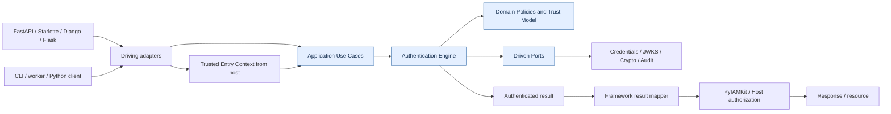
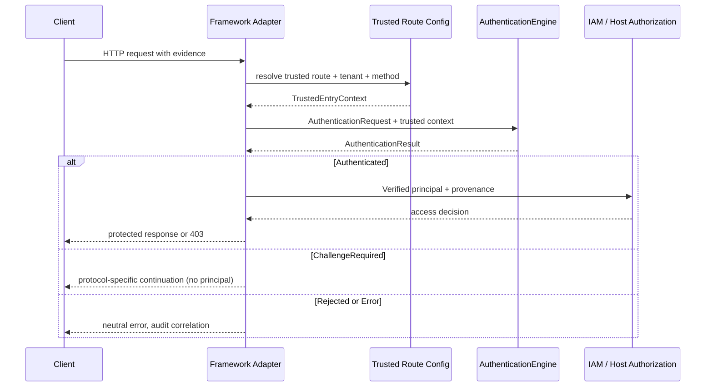
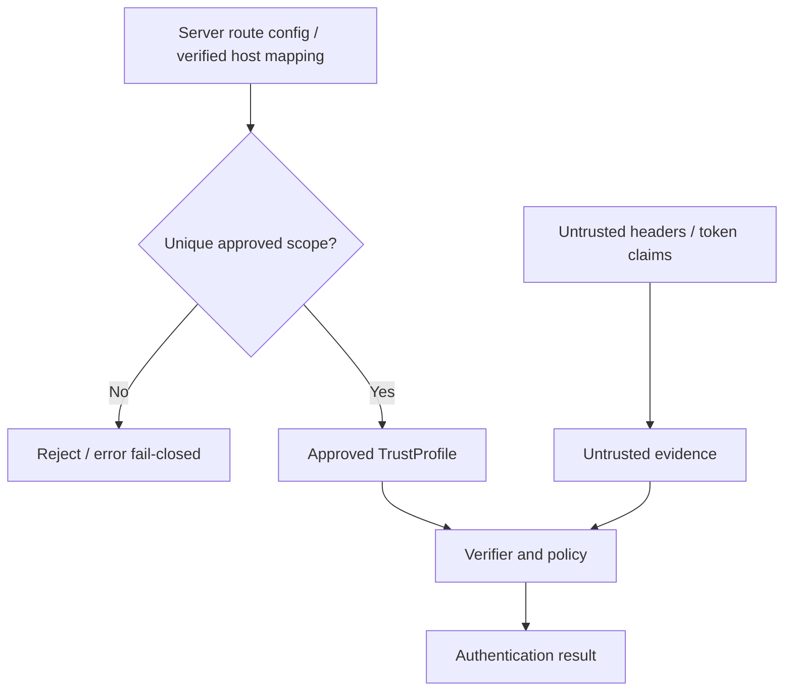
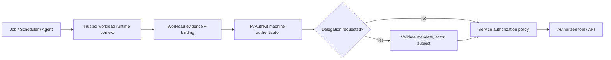
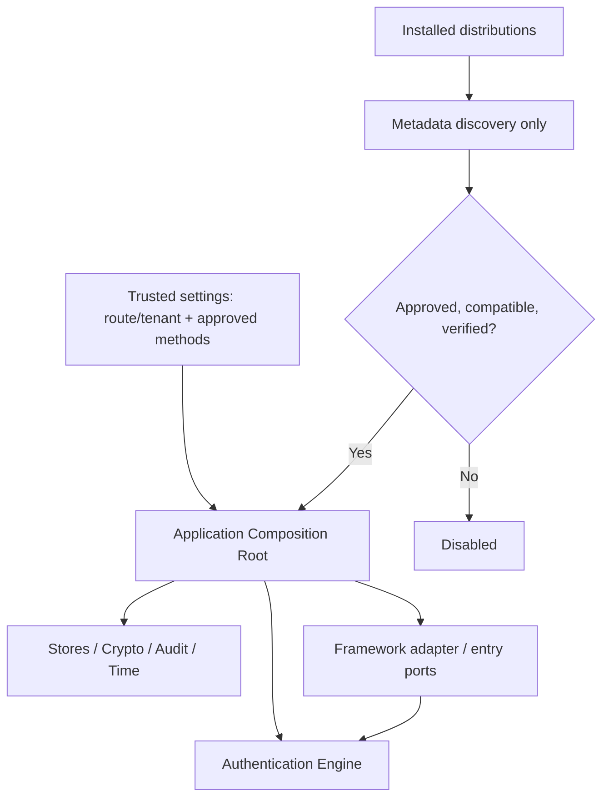
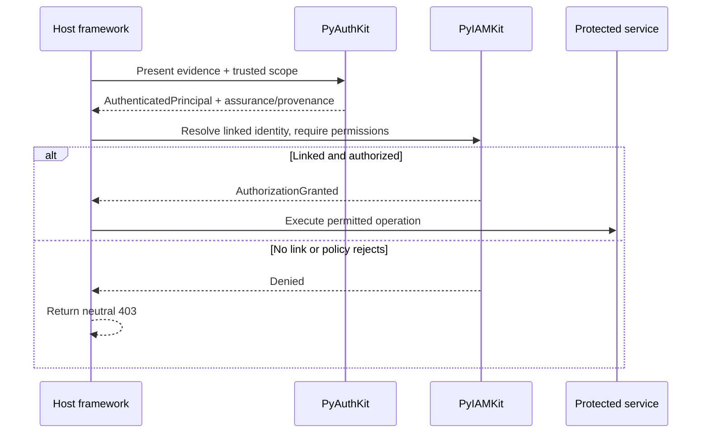

# 22_PYAUTHKIT_FRAMEWORK_INTEGRATIONS

# PyAuthKit — Framework Integrations

> **Projet :** PyAuthKit — Authentication Engine for the Modern Python Ecosystem  
> **Document :** `22_PYAUTHKIT_FRAMEWORK_INTEGRATIONS.md`  
> **Version documentaire :** `0.1.0` (proposition)  
> **Date :** 2026-10-31  
> **Statut :** `PROPOSED / DESIGN` — aucun adapter déployé, testé ou qualifié ne peut être déduit de ce document.  
> **Portée :** FastAPI, Starlette/ASGI, Django, DRF, Flask/WSGI, CLI, scripts, workers et services Python.  
> **Fondations :** documents `00`–`21` et `PYAUTHKIT_SOFTWARE_DESIGN_LEARNING_CONVENTION.md`.  
> **Suite :** `23_PYAUTHKIT_PYIAMKIT_INTEGRATION_CONTRACT.md`, `24_PYAUTHKIT_PUBLIC_API_AND_SDK_DESIGN.md`, `25_PYAUTHKIT_CONFIGURATION_MODEL.md`, `26_PYAUTHKIT_TESTING_AND_QUALIFICATION_STRATEGY.md`.

> **North Star — Problem First, Trust First, Pattern Second :** adapter l'entrée, établir une provenance fiable, invoquer l'Authentication Engine et exposer son résultat sans transférer la décision de sécurité au framework. Le nom d'une bibliothèque n'est jamais une preuve de sécurité.

## Guide de lecture

- **Cœur (`0`–`15`)** : responsabilités, contrats et frontière de confiance.
- **Frameworks (`16`–`29`)** : FastAPI/Starlette, Django/DRF, Flask, CLI et workers.
- **Exécution (`30`–`43`)** : sessions, erreurs, concurrence, observabilité, intégrations et migration.
- **Registres (`44`–`51`)** : exigences, invariants, menaces, tests, fitness functions, scénarios, décisions.
- **Pédagogie (`52`–`58`)** : Design Learning Cards, ADR, Definition of Done, roadmap et références.

**Conventions :** les noms de types, imports et packages `pyauthkit.*` sont **candidats** et ne doivent pas être présentés comme API existante. Les exemples illustrent uniquement les frontières de responsabilité ; aucun n'implémente à lui seul toutes les vérifications cryptographiques, de session ou d'autorisation.

## 0. Résumé exécutif


PyAuthKit vise une intégration agnostique avec les applications Python : le même cœur doit accepter un `AuthenticationRequest` et une entrée hôte approuvée, puis retourner un `AuthenticationResult` discriminé. Le transport (HTTP, WebSocket, CLI, job), le framework, ses sessions et ses utilisateurs ne changent pas les invariants AuthN. 

**Cible MVP** : Python pur, FastAPI/Starlette et intégration programmatique CLI via un même contrat ; les ponts Django, DRF et Flask peuvent être livrés en modules séparés après qualification de leurs frontières. **Ce calendrier est proposé**, et ne décrit pas un état de code. Password, API Key et JWT entrant sont les trois méthodes du MVP ; sessions, émission de tokens, MFA, SSO, passkeys et agents restent soumis aux phases et contracts respectifs de `11`–`17`.

Une intégration ne doit jamais : accepter `X-User-ID` comme preuve AuthN, choisir librement le `TrustProfile` par un paramètre client, réécrire `request.user` sans contrat IAM/Django explicite, créer un token après un simple outcome partiel, ou confondre 401/403 avec un verdict de sécurité suffisant.

## 1. Filiation et gouvernance documentaire


| Source | Apport autoritatif dans ce document | Éléments à ne pas réécrire ici |
|---|---|---|
| `03` | règles d'imports, architecture C4, boundaries | nomenclature exhaustive des couches |
| `07` | invariants de confiance, fail-closed, état | registre canonique des règles métier |
| `08` | Commands, Queries, Use Cases et DTO | catalogue complet APP-CMD / APP-QRY |
| `09` | pipeline neuf étapes, `AuthenticationPolicyGate` | politique de décision métier |
| `10` | Password, API Key, JWT verifiers | algorithmes et contrats de credentials |
| `11`–`13` | challenges, assurance, sessions, tokens | transitions et invariants propres |
| `14`–`16` | OIDC/SAML, WebAuthn, workloads/agents | protocoles cryptographiques détaillés |
| `17` | risque, step-up et incertitude | moteur d'évaluation de risque |
| `18` | ports, adapters, plugins, composition | mécanisme générique d'admission |
| `19` | storages, cohérence et transactions | modèles DB et coûts de durabilité |
| `20` | STRIDE, menaces et contrôles | traitement global des risques |
| `21` | audit durable vs télémétrie | politique de conservation et preuve |
| Convention | DDD, design patterns, anti-cargo-cult | catalogue général de patterns |

La convention **What / How / Evidence** : les documents métier disent *quoi garantir*, `22` dit *comment un transport livre les bonnes entrées*, les tests prouvent ce qui est effectivement réalisé. Toute contradiction est enregistrée en ADR avant tout changement de contrat.

## 2. Problème réel : éviter la duplication de sécurité par framework


Chaque framework possède sa propre notion d'utilisateur, de session et de middleware. Si chaque adapter réimplémente la sélection de méthode, la validation JWT, le mapping de claims et les règles de blocage, les garanties divergent selon la route ou le processus. **Pression de conception** : réutilisation d'un verdict AuthN unique, sous des contraintes de cycle de vie différentes.

- Une requête FastAPI peut utiliser des dépendances async et `request.state`.
- Django peut posséder `request.user`, des backends de login et des sessions applicatives.
- Flask expose `request` et `g` sur un contexte WSGI, non une API ASGI native.
- Un job CLI n'a ni `Host`, ni cookie, ni destinataire HTTP ; l'identité du workload vient de son environnement autoritatif.

L'adapter normalise les *faits observés*, sans inventer des faits vérifiés. Le mécanisme de vérification reste dans le core, et la décision d'accès reste dans PyIAMKit ou dans l'application autorisée.

## 3. Objectifs, non-objectifs et critères de succès


**Objectifs** : interopérabilité Python, configuration par application, zero dependency du core aux frameworks, saisie bornée, neutralité des erreurs, propagation explicite du contexte authentifié, composition contrôlée, tracing expurgé et tests de contrat cross-framework.

**Non-objectifs** : remplacer Django auth, implémenter DRF permissions, se substituer à l'IdP, fournir des écrans login par défaut, déterminer les rôles dans PyAuthKit, supposer l'activation implicite de middleware, sécuriser magiquement toute route, gérer l'authorization par CORS ou déployer un serveur de session obligatoire.

**Succès** : le même résultat de vérification/méthode, sous le même `TrustedScope`, n'est pas différent à cause du framework ; aucun adapter ne transforme une preuve invalide en principal ; toute erreur sensible reste expurgée et traçable.

## 4. Périmètre MVP et évolutions


| Périmètre | MVP proposé | Post-MVP / condition |
|---|---|---|
| Pure Python | client applicatif, contexte de confiance, résultat | API de session/tokens |
| ASGI/Starlette | dependency utilitaire et middleware minimal | WS, ASGI streaming avancé |
| FastAPI | dependency factory, gestion des erreurs | FastAPI Security/OpenAPI scopes IAM |
| Django | contrat de coexistence documenté | `AuthenticationBackend`, middleware, sessions |
| DRF | mapping `BaseAuthentication` et exceptions | permissions d'accès / scopes (IAM) |
| Flask | `before_request` ou decorator léger | extension et factory d'app |
| CLI | adaptateur explicite pour scripts/workers | interactive/device login protocolique |
| OIDC/SAML/WebAuthn | seulement intégrations de providers existantes | callback/ceremonies dans adapters dédiés |

Les lignes MVP sont des cibles de périmètre, non des preuves de livraison ; un MVP minimal peut démarrer en Python pur puis ajouter les frameworks lorsque les contrats et leurs tests sont stabilisés.

## 5. Ubiquitous Language et distinctions sémantiques


| Terme | Définition opérationnelle | Confusion à éviter |
|---|---|---|
| `TransportEvidence` | preuve capturée depuis HTTP/CLI/etc. | preuve valide ou sujet vérifié |
| `TrustedEntryContext` | portée hôte établie par configuration et routage contrôlés | `tenant` auto-déclaré par le client |
| `AuthenticationRequest` | enveloppe de tentative à vérifier | Django `HttpRequest`, Flask `Request` |
| `AuthenticatorOutcome` | verdict du verifier spécialisé | succès final de politique |
| `AuthenticationResult` | décision finale AuthN discriminée | décision d'accès IAM |
| `AuthenticatedPrincipal` | sujet authentifié + provenance, scope et assurance | `request.user` ORM automatiquement |
| `IdentityLink` | liaison IAM contrôlée | comparaison d'emails non vérifiés |
| `CurrentUser` | objet framework / domaine hôte | preuve AuthN autonome |
| `Session` | état applicatif ou AuthN selon owner | access token ou `AuthenticationResult` |
| `Middleware` | hook/filtre de transport | point universel de politique métier |
| `Permission`/`Scope` | contrainte d'action/ressource | preuve de l'identité |
| `Adapter` | traduction transport ↔ port | authenticator crypto complet par défaut |

## 6. Carte de responsabilités et ownership


| Zone | Autorité | Peut faire | Ne doit pas faire |
|---|---|---|---|
| Application hôte | route, tenant mapping autorisé, composition | charger config, gérer CORS/CSRF et mapping HTTP | s'approprier la validation JWT |
| Driving adapter | transport/normalisation | parser Bearer ou cookie, limiter tailles, reconstruire DTO | déclarer `VerifiedSubject` |
| `AuthenticationEngine` | verdict AuthN | faire vérifier la preuve et appliquer policy | accorder des permissions métier |
| Outbound ports | IO autorisés | stores/crypto/audit/clock | importer l'API web du framework |
| PyIAMKit | identité gérée et autorisation | lier le verified subject et contrôler l'accès | transformer une preuve non vérifiée en identité |
| IdP externe | assertion sous protocole | attester un sujet dans son cadre | choisir les permissions locales |
| Application de ressources | réponse, exception, effets | refuser 403 après IAM | attribuer automatiquement AAL3 |

**Responsabilité commune** : contrat de corrélation sur la tentative, aucune fuite de secret, deadline, annulation et format de résultat stables.

## 7. Architecture hexagonale — C4 Components




**Règle d'import** : `domain` et `application` n'importent jamais `fastapi`, `starlette`, `django`, `flask`, `werkzeug` ni `typer`. `integrations.fastapi` peut importer le core et FastAPI ; l'inverse est interdit. Le composition root assemble les adapters avec des dépendances explicitement admises, conformément à `18`.

## 8. Trust Boundaries — carte `FW-TB-*`


| ID | Transition | Provenance et contrôle | Attaque à exclure |
|---|---|---|---|
| FW-TB-01 | client → HTTP headers | champs non fiables, tailles bornées | auth via en-tête forgé |
| FW-TB-02 | reverse proxy → host metadata | proxies explicitement approuvés | spoofed Forwarded / XFF |
| FW-TB-03 | route → tenant/realm | mapping côté serveur, non revendication | tenant confusion |
| FW-TB-04 | transport → proof | pas de mutation sémantique silencieuse | token substitution |
| FW-TB-05 | middleware → engine | appel unique sous profil approuvé | bypass par path |
| FW-TB-06 | outcome → result mapper | état discriminé | principal on failure |
| FW-TB-07 | result → IAM | provenance/assurance gardées | privilege escalation |
| FW-TB-08 | result → framework user | mapping IAM explicite | user takeover |
| FW-TB-09 | cookies → session manager | validation/CSRF binding | fixation et CSRF |
| FW-TB-10 | request → logs/traces | redaction + cardinalité | leakage of credentials |
| FW-TB-11 | worker/CLI → workload scope | attestation configuration/OIDC | forged CLI tenant |
| FW-TB-12 | plugin → execution | admission et version approuvée | supply-chain execution |
| FW-TB-13 | WebSocket → handshake | validation before `accept()` | unauthorized WS |
| FW-TB-14 | async → sync bridge | bounded budget et pool | deadlock / DoS |
| FW-TB-15 | app → downstream propagation | contexte sérialisé explicitement et protégé | trusting arbitrary X-Auth headers |
| FW-TB-16 | framework session → AuthN | validité/expiration/révocation | stale session elevated |

**Règle de provenance** : une information peut être transmise depuis une requête sans devenir fiable. Exemple : IP déclarée et Origin peuvent constituer des signaux à vérifier et non un tenant authentifié.

## 9. Flux canonique end-to-end (sans identité privilégiée implicite)




La conversion de `ChallengeRequired` en HTTP dépend du protocole : un *continuation handle* opaque peut être livré sous un format applicatif défini ; aucune session d'accès ni principal authentifié ne doit en découler avant complétion.

## 10. Contrat transport-agnostic : entrée, sortie et contexte de confiance


Les exemples suivants illustrent un **port d'entrée candidat**, indépendant de tout framework. `scope` provient d'un fournisseur de confiance ; le `AuthenticationRequest` contient des informations présentées et non une décision.

```python
from dataclasses import dataclass
from typing import Literal, Protocol

@dataclass(frozen=True)
class TrustedEntryContext:
    tenant_id: str
    realm_id: str
    application_id: str
    route_policy_id: str
    origin: Literal["trusted_host"] = "trusted_host"

@dataclass(frozen=True)
class PresentedEvidence:
    method: Literal["password", "api_key", "jwt"]
    value: bytes  # sensitive: never stringify or emit in logs

@dataclass(frozen=True)
class AuthInput:
    evidence: PresentedEvidence
    request_id: str

@dataclass(frozen=True)
class AuthVerdict:
    status: Literal["authenticated", "rejected", "error", "challenge_required"]
    principal_ref: str | None = None

class AuthenticationPort(Protocol):
    async def authenticate(
        self, data: AuthInput, *, trusted: TrustedEntryContext
    ) -> AuthVerdict: ...
```

**Limite du sketch** : `origin="trusted_host"` est un indicateur de provenance nominal, **pas une preuve cryptographique** et pas un constructible à exposer au client. L'instance est construite seulement par la composition/route hôte ; le vrai résultat devra empêcher les états incohérents par une union discriminée. Les `bytes` doivent être expurgés du `repr` si un objet réel les contient.

## 11. Extraction des credentials : API contractuelle et priorité


**Formats candidats** : `Authorization: Bearer`, header API Key dédié, body password *uniquement* sur une route de login, cookie de session uniquement sous politique hôte et protection CSRF adaptée. Les tokens en query string ne sont pas un transport par défaut ; de même, ne pas accepter des credentials dans des headers arbitraires ou dans une liste de fallbacks.

| Cas | Comportement candidat |
|---|---|
| Absent | `UNAUTHENTICATED` ou requête non protégée selon politique de route explicite |
| Malformé | rejet neutre, audit expurgé |
| Deux méthodes présentées sans protocole composite | rejet pour ambiguïté, pas « essayer la suivante » |
| Bearer et cookie simultanés | politique explicite de priorité/combinaison ou rejet |
| Très grande valeur | rejet avant parser/verifier |
| Header répété / canonicalisation ambiguë | rejet ou normalisation contrôlée suivant serveur validé |
| Autorisation composée/step-up | `AuthenticationFlow` selon `11`, pas middleware maison |

Un login par mot de passe reste une action HTTP explicite avec protections rate-limit/CSRF selon le canal, non un `@middleware` qui relit un mot de passe à chaque requête.

## 12. Résolution serveur du tenant, du realm et du profil




La route et le routage hôte sont la racine de sélection : les champs `tenant`, `aud`, `iss`, `kid`, `Host`, `X-Tenant-ID` ou autres valeurs présentées ne peuvent forcer le choix d'une autorité non approuvée. Pour plusieurs tenants partageant un domaine, un identifiant client peut servir de **candidat** seulement si une règle serveur le relie sans ambiguïté à un contexte autorisé et à un binding vérifié.

## 13. Modèle de résultat et mapping vers les réponses de transport


| Résultat PyAuthKit | HTTP candidat | CLI candidat | Principe |
|---|---|---|---|
| `AUTHENTICATED` | passer à AuthZ ; sinon 2xx applicatif | retour structuré, exit 0 si action réussie | pas de 200 automatique dans middleware |
| `REJECTED` / preuve invalide | 401 + `WWW-Authenticate` approprié | code d'échec neutre | jamais lister les users valides |
| `CHALLENGE_REQUIRED` | 202/401/format dédié selon protocole | action guidée si supportée | pas de principal final |
| `ERROR` infrastructure critique | 503 ou erreur neutre appropriée | code échec technique distinct | aucune ouverture permissive |
| AuthN valide, AuthZ refusée | 403 décidé par l'hôte/IAM | code permission denied | ne pas requalifier comme preuve invalide |
| Route non protégée | comportement propre à la route | action normale | jamais déduire un principal |

**Attention** : 401 et 403 sont des mappings d'interface et ne prouvent pas la présence d'un contrôle AuthN/AuthZ effectif. Les détails internes (`user_exists`, `secret_mismatch`, `issuer_unknown`) ne sont pas envoyés au client.

## 14. ASGI et WSGI : cycle de vie, concurrency et effets


| Propriété | ASGI | WSGI |
|---|---|---|
| Interface | `scope`, `receive`, `send` | `environ`, `start_response` |
| Durée HTTP | une requête, y compris streaming | une requête synchronisée |
| WebSocket | protocole distinct supporté | pas de contrat WebSocket natif |
| Middleware | callable async | fonction/callable sync |
| Contexte requête | `scope` / framework state | context locals de l'application |
| IO async | naturel, si deps non bloquantes | nécessite pont explicite si engine async |

**Règle** : la fonction d'adaptation protège les ressources et les budgets ; elle ne tient pas un mutex global ni ne stocke un utilisateur « courant » dans un singleton mutable. Un `ContextVar` est utile pour corrélation mais n'est pas la source autoritative du scope et exige une restauration (`reset`) au terme de la requête.

## 15. Matrice des responsabilités par framework


| Framework | Hook conseillé | Principal exposé | Sync/async | Note de sécurité |
|---|---|---|---|---|
| FastAPI | `Depends` ou `Security` | typed dependency return | async privilégié | scopes API = politique IAM, pas preuve |
| Starlette | route/dependency custom ; pure ASGI middleware | `scope` namespacé / request state | ASGI async | ne pas muter state middleware entre requêtes |
| Django | integration service ; auth backend optionnel | `request.user` uniquement si contrat validé | hybride | Django session et backend ownership |
| DRF | `BaseAuthentication` dédié | `(user, auth)` | principalement synchrone dans contrat | ne pas inventer ORM user |
| Flask | `before_request` / decorator / extension | `g.pyauthkit_result` | sync WSGI | ne pas confondre `g` et auth de session |
| CLI | composition explicite | variable locale typée | sync/async contrôlé | pas de host/headers implicites |
| Worker | wrapper d'entrée métier | workload identity | runtime-dépendant | service account != mandat utilisateur |

## 16. FastAPI — approche recommandée : dependency factory


**Raison** : `Depends()` permet d'injecter et tester le port, de documenter la dépendance et de conserver la route responsable du contrôle des ressources. `Security(..., scopes=[...])` ne suffit pas à accorder ces scopes : une politique IAM doit vérifier explicitement chaque permission requise. Le port peut être stocké dans `app.state` au bootstrap, mais sa configuration sensible ne doit pas être remplaçable par la requête.

```python
# SKETCH: assumes a pre-composed, qualified auth port and a trusted router.
# It is NOT a drop-in authentication implementation.
from fastapi import Depends, FastAPI, HTTPException, Request

app = FastAPI()

async def authenticated_principal(request: Request):
    port = request.app.state.pyauthkit_auth_port
    trusted = request.app.state.pyauthkit_trusted_router.resolve(request.scope)
    value = request.headers.get("authorization", "")
    data = request.app.state.pyauthkit_input_parser.parse_bearer(value)
    result = await port.authenticate(data, trusted=trusted)
    if result.status == "authenticated" and result.principal_ref is not None:
        return result.principal_ref
    if result.status == "error":
        raise HTTPException(status_code=503, detail="Authentication unavailable")
    raise HTTPException(status_code=401, detail="Authentication required")

@app.get("/protected")
async def protected(principal_ref: str = Depends(authenticated_principal)):
    # Application/IAM must still authorize the requested operation.
    return {"subject_ref": principal_ref}
```

Le parseur `pyauthkit_input_parser` est un **contrat hôte candidat** : contrôle des doublons, tailles, forme de preuve, schéma Bearer et aucune fuite de secret. Le code ne décrit ni la politique de scopes ni le schéma de sortie production. La source `request.scope` n'est fiable qu'après la normalisation de proxy et le routage autorisé.

## 17. FastAPI — stratégie OpenAPI, Security et scopes


OpenAPI décrit le mécanisme présenté ; il n'est ni la politique de confiance ni l'autorité de permission. Un security scheme (`HTTPBearer`, `OAuth2AuthorizationCodeBearer`, etc.) documente l'extraction. Une `SecurityScopes` peut exprimer les scopes exigés par l'application, puis être **vérifiée** par PyIAMKit ou une policy AuthZ explicite.

- Bien séparer *extractor* FastAPI (`HTTPAuthorizationCredentials`) et verifier du moteur (`JWTAuthenticator`).
- Ne jamais utiliser un simple `jwt.decode(..., verify_signature=False)` pour produire un current user.
- Les exceptions FastAPI sont générées **après** décision, sans exposer les reason codes internes.
- Toute route `@app.get` protégée doit dépendre du guard ou être couverte par une convention automatisée ; l'existence d'un middleware ne garantit pas la présence de la policy IAM.
- Les redirections OAuth/OIDC sont celles du document `14`, pas un `Depends` générique qui accepte n'importe quel issuer.

## 18. Starlette / ASGI — middleware pur et isolation par connexion


La documentation Starlette signale que `BaseHTTPMiddleware` comporte des restrictions de propagation de `contextvars`; pour une observation/propagation explicite, préférer un middleware ASGI pur. Il doit ignorer ou traiter séparément les scopes `lifespan` et `websocket`, ne jamais parser un body sans raison et ne pas conserver l'état de requête dans `self`.

```python
# Pure ASGI composition sketch: state is per request, not instance state.
class PyAuthASGIMiddleware:
    def __init__(self, app, authenticate_http):
        self.app = app
        self.authenticate_http = authenticate_http

    async def __call__(self, scope, receive, send):
        if scope["type"] != "http":
            return await self.app(scope, receive, send)
        scoped = dict(scope)
        result = await self.authenticate_http(scoped)
        if result is None:  # explicitly public route, or delegated enforcement
            return await self.app(scoped, receive, send)
        if result.status != "authenticated":
            await send({"type": "http.response.start", "status": 401, "headers": []})
            await send({"type": "http.response.body", "body": b"Unauthorized"})
            return
        scoped["pyauthkit.result"] = result
        await self.app(scoped, receive, send)
```

**Limites intentionnelles** : l'exemple ne traite pas challenge/error, header de réponse, routage public/protégé, WebSocket, audit ni exceptions ; ces points sont obligatoires dans un vrai adapter. `authenticate_http` devra résumer l'entrée hôte et invoquer le moteur selon la politique de route. La décision d'autorisation reste aval.

## 19. Starlette WebSocket et streaming HTTP


**WebSocket** : authentifier et éventuellement autoriser avant `websocket.accept()` ; un transport browser ne peut pas supposer l'envoi d'un header Authorization standard depuis toutes les APIs ; le choix cookie/subprotocol/token à usage dédié exige une spec, des contrôles anti-CSRF/cross-site et une absence de logs secrets. Après acceptation, la session ou le token peut expirer : définir la revalidation, la fermeture et les quotas.

**SSE / streaming** : le guard doit s'exécuter avant le début de la réponse ; on ne peut pas renvoyer rétroactivement 401 après l'envoi des headers. Définir la fréquence de revalidation sur flux long selon sensibilité. 

**ASGI Lifespan** : les connexions réseaux, clés et stores du composition root sont créés au démarrage et fermés proprement à l'arrêt ; ne jamais instancier un resolver ou un client HTTP à chaque appel si le port prévoit un pool partagé. 

## 20. Django — coexistence avec AuthenticationMiddleware, backends et sessions


Django possède sa propre chaîne `AuthenticationMiddleware` → `request.user`, des `AUTHENTICATION_BACKENDS`, une session et `login()`/`logout()`. **Par défaut, PyAuthKit n'écrase pas `request.user`** : il conserve `request.pyauthkit_result` ou une projection typée. Pour transformer une authentification PyAuthKit en login Django, un *identity bridge* dédié doit lier le `VerifiedSubject` à un utilisateur Django via PyIAMKit/règles hôte, vérifier son statut, puis appeler un backend compatible selon un contrat explicite.

| Mode | Usage | Risque / arbitrage |
|---|---|---|
| AuthN indépendante API | `request.pyauthkit_result` ; pas de login Django | user ORM potentiellement absent |
| Backend dédié | après lien IAM, retourne un `User` Django valide | double preuve, règles de login et permission |
| Middleware protégé | établit un contexte précoce | ordre et couverture des routes |
| Session Django | réutilise `login()` sous décision hôte | TTL, rotation session et niveau AAL |
| Remote user proxy | possible seulement avec proxy authentifiant et header sécurisé | header injection / auto-login |

Les APIs synchrones et asynchrones de Django ne sont pas identiques : pour les custom backends, fournir les variantes async lorsque pertinent, sans supposer qu'un wrapper `sync_to_async` rend tout le pipeline non bloquant.

## 21. Django — ordre des middlewares et séparation de l’authentification


Ordre candidat selon installation : `SecurityMiddleware` et middleware proxy fiables → `SessionMiddleware` → `AuthenticationMiddleware` → intégration PyAuthKit propre à l'application. Cet ordre n'est pas universel : la politique de route, CORS/CSRF, auth backend et exception handlers dépendent de l'app. L'ordre effectif doit être testé sous les settings réels.

**Le middleware de conversion ne doit pas** : forcer un login Django depuis un simple `email`, interpréter un `REMOTE_USER` HTTP direct, vider une session légitime sur une panne transitoire d'un IdP sans policy explicite, ni contourner des permissions Django définies localement.

## 22. Django REST Framework — authentication classes et permissions


DRF définit conceptuellement deux étapes : l'`authentication` fournit un couple `(user, auth)` ou `None`, puis les `permission_classes` décident si l'accès est accordé. Le pont PyAuthKit doit être conçu avec un référentiel de comptes IAM/Django : renvoyer un simple `AuthenticatedPrincipal` à la place d'un `User` Django peut être incompatible avec des permissions, renderers ou serialisers existants.

```python
# Architectural sketch only — requires Django/DRF and an approved IAM user bridge.
from rest_framework.authentication import BaseAuthentication
from rest_framework.exceptions import AuthenticationFailed

class PyAuthDRFAuthentication(BaseAuthentication):
    def __init__(self, auth_port=None, trusted_router=None, user_bridge=None):
        self.auth_port = auth_port
        self.trusted_router = trusted_router
        self.user_bridge = user_bridge

    def authenticate(self, request):
        # DRF's canonical BaseAuthentication hook is synchronous.
        # Wire a qualified *synchronous* adapter; never asyncio.run() here.
        if self.auth_port is None or self.trusted_router is None:
            raise AuthenticationFailed("Authentication service unavailable")
        trusted = self.trusted_router.resolve(request)
        result = self.auth_port.authenticate_sync(request, trusted=trusted)
        if result.status != "authenticated":
            raise AuthenticationFailed("Authentication required")
        if self.user_bridge is None:
            raise AuthenticationFailed("Identity mapping unavailable")
        user = self.user_bridge.to_django_user(result, trusted=trusted)
        if user is None:
            raise AuthenticationFailed("Authentication required")
        return (user, result)
```

**Précision** : pour une requête sans credential dans un schéma explicitement optionnel, la classe peut renvoyer `None` et laisser DRF poursuivre ses autres authenticators ; si un credential invalide est présenté, un fallback non autorisé ne doit pas le masquer. Une implémentation candidate `authenticate_sync` est une interface séparée, pas un appel à un engine async dans la boucle déjà active. Les `permission_classes` demeurent nécessaires. Le choix de mapper sur un vrai `User` Django est conditionné à un contrat IAM.

## 23. Flask / WSGI — hooks, app factory et context-local


Flask utilise `before_request`, `g`, `request`, `current_app` et un contexte de requête local. L'extension doit être créée sans état de requête partagé ; le composition root peut stocker les dépendances inertes dans `app.extensions`, tandis que `g` ne porte qu'un résultat courant.

```python
# WSGI sketch: a synchronous, qualified adapter is explicitly required.
from flask import Flask, abort, current_app, g, request

def install_pyauthkit(app: Flask, *, auth_port, trusted_router, parser):
    app.extensions["pyauthkit"] = {
        "auth_port": auth_port,
        "router": trusted_router,
        "parser": parser,
    }

    @app.before_request
    def authenticate_request():
        deps = current_app.extensions["pyauthkit"]
        trusted = deps["router"].resolve(request)
        if not trusted.protected:  # trusted route policy, not user-supplied flag
            return None
        auth_input = deps["parser"].from_flask(request)
        verdict = deps["auth_port"].authenticate_sync(auth_input, trusted=trusted)
        if verdict.status == "authenticated":
            g.pyauthkit_result = verdict
            return None
        if verdict.status == "error":
            abort(503)
        abort(401)
```

**Limites** : `protected` est une propriété de routage hôte approuvé, et le sketch n'implémente ni sessions, ni erreurs expurgées personnalisées, ni IAM. `g.pyauthkit_result` ne doit jamais être considéré comme un `user` Flask ou une permission sans vérification aval. Pour un engine `async`, définir un adaptateur sync qualifié ; éviter de faire tourner un event loop nouveau pour chaque requête WSGI sans une décision de performance et de durée de vie documentée.

## 24. Flask — async, extensions et limites des workers


Flask autorise les vues `async def` lorsque son support async est installé, mais reste principalement un framework WSGI ; une vue asynchrone ne transforme pas tout le worker en serveur ASGI. La documentation officielle signale également que les tâches asyncio lancées dans une vue peuvent être annulées à la fin de la requête.

- **Factory** : `init_app` et composition root hôte, aucun global `Flask` importé dans `domain`.
- **Décorateur** : accepte uniquement un verdict qualifié, préserve `functools.wraps`, vérifie l'ordre des décorateurs.
- **Request context** : s'assurer que le résultat est effacé entre requêtes, y compris exceptions.
- **Sessions Flask** : cookie signé ≠ preuve de protection contre vol, fixation, rejeu ou révocation ; conserver les politiques du document `13`.
- **Background jobs** : passer une identité de workload explicitement attestée ; ne pas transmettre `g`, `request` ou cookie HTTP comme identité durable.

## 25. CLI / Typer / Click / scripts Python — pas de routage web implicite


Le CLI doit permettre deux cas : **authentification explicite d'un humain** (selon mode pris en charge) et **authentification d'un workload** pour lancer une opération. Une variable d'environnement `USER`, un argument `--tenant` ou la présence d'une clé SSH n'est pas une preuve AuthN suffisante par elle-même.

```python
# A pure-Python CLI composition sketch; never print the presented secret.
import argparse
import sys


def main(argv, *, auth_port, trusted_config, secret_reader) -> int:
    p = argparse.ArgumentParser(prog="pyauthkit-demo")
    p.add_argument("--realm", required=True)
    options = p.parse_args(argv)
    trusted = trusted_config.resolve_cli_realm(options.realm)
    # secret_reader handles hidden input / secure fd / temporary exposure.
    proof = secret_reader.read_for_realm(trusted)
    result = auth_port.authenticate_sync(proof, trusted=trusted)
    if result.status == "authenticated":
        print("Authentication succeeded")
        return 0
    if result.status == "error":
        print("Authentication unavailable", file=sys.stderr)
        return 3
    print("Authentication rejected", file=sys.stderr)
    return 2
```

**Ne pas faire** : mettre les passwords dans des arguments shell (historique/process list), afficher des tokens sur stdout, stocker des secrets dans logs de CI, déduire `TrustedScope` du nom du compte Unix seul. Les commandes qui ouvrent des outils après authentification nécessitent un contrôle IAM ou applicatif supplémentaire.

## 26. Workers, services, tâches planifiées et agents


Une tâche interne n'a pas de requête HTTP mais doit porter une preuve de workload depuis un mécanisme approuvé (`SPIFFE`, cloud workload federation, certificat client ou token éphémère dans un profil autorisé). Un worker ne doit pas utiliser un « utilisateur service » global pour ignorer les frontières tenant/realm.



L'agent authentifié n'est pas automatiquement autorisé à agir au nom de son utilisateur ; le mandat doit être validé, relié à un acteur et requalifié à chaque ressource selon `16` et `23`.

## 27. HTTP API, auth headers, cookies, CSRF, CORS et redirections


- **Headers** : `Authorization` exact, pas de headers `X-Authenticated-User` provenant d'Internet, limitation de longueur, traitement explicite des doublons.
- **Cookies** : `Secure`, `HttpOnly` lorsque applicable, `SameSite` selon cas et défense CSRF explicite pour actions mutantes ; `SameSite` seul n'est pas une politique exhaustive.
- **CORS** : contrôle de navigateur et exposition des origines, **pas un contrôle d'autorisation serveur**.
- **CSRF** : vérifier token CSRF / Origin / Referer selon scénario ; un bearer header non automatiquement joint par le navigateur diffère d'un cookie de session.
- **Redirect URL** : allowlist exacte, pas de redirection ouverte ni `next=` arbitraire ; toute callback OIDC doit suivre `14`.
- **Error pages** : HTML/JSON/CLI distincts mais statuts AuthN cohérents.
- **HTTPS** : exigé sur les canaux exposés de credentials ; proxy correctement configuré avant d'inférer scheme/origin.

## 28. Reverse proxies, Forwarded headers et host validation


Le `Host`, `Forwarded`, `X-Forwarded-For`, `X-Forwarded-Host`, `X-Forwarded-Proto` et les informations de TLS terminaison ne deviennent fiables que par une chaîne de proxies **explicitement approuvée** qui écrase/supprime les valeurs venant du client. Si un serveur est accessible directement, la confiance dans `X-Forwarded-For` ne peut être déduite de l'en-tête seul.

**Données à construire côté hôte** : host validé parmi une liste de domaines, scheme après terminaison TLS fiable, client IP résolue avec politique proxy, routage domaine → application → tenant. Un `JWT.iss` non vérifié ne sélectionne jamais directement le domaine de confiance.

**Tests** : connexions directes, fausses chaînes de proxy, ordre des IP, hôtes non approuvés, collision de domaines, résolution tenant ambiguë, `Origin: null`, retrait de proxy de confiance.

## 29. Sessions natives et modèle PyAuthKit : ownership explicite


| Objet | Owner | Comportement admissible |
|---|---|---|
| Django session cookie | Django/hôte | gestion du cycle selon politique Django et AuthN liée |
| Flask session | Flask/hôte | usage seulement si politique de session et stockage acceptables |
| `AuthenticationSession` de `13` | PyAuthKit si activée | TTL, révocation, AAL, binding et audit |
| Access token | issuer autorisé selon profil | validation distante/locale strictement séparée de l'émission |
| Refresh token | système émetteur / service de token | rotation atomique et anti-rejeu, pas un cookie magique |
| Principal IAM | PyIAMKit/hôte | comptes, permissions, organisations |

**Ne pas assimiler** une session Django valide à un `AuthenticationResult` récent ; la session doit conserver la provenance d'authentification et respecter expirations, step-up et révocation. Un mécanisme de logout doit réconcilier les deux cycles sans revendiquer l'annulation rétroactive d'un JWT déjà émis.

## 30. API publique candidate des intégrations et packaging


Packages proposés, **non créés dans ce document** :

```text
src/pyauthkit/
  domain/
  application/
  ports/
  integrations/
    asgi/
    fastapi/
    django/
    drf/
    flask/
    cli/
  composition/
```

Dépendances optionnelles candidates `pyauthkit[fastapi]`, `[django]`, `[drf]`, `[flask]`, `[cli]` seulement si des extras apportent de la valeur. La présence de DRF peut impliquer Django mais n'impose pas un alias commun. Les imports optionnels ne doivent pas faire échouer `import pyauthkit` si le framework cible n'est pas installé.

**Public API à arbitrer dans `24`** : functions `get_authenticated_principal`, `PyAuthASGIMiddleware`, `DjangoPyAuthBackend`, `init_pyauthkit`, `build_cli_auth_context`. Aucun nom n'est stabilisé avant contrat, tests et décision de compatibilité.

## 31. Composition root, configuration et admission des plugins




Une application doit configurer ses méthodes, profils de confiance, secrets et connexions *avant* de servir la première requête. Découvrir un plugin Python installé ne l'active pas ; l'admission et le chargement explicites sont ceux de `18`. Le statut de santé au démarrage peut rejeter une configuration vitale manquante. Un hot reload nécessite des generations immuables et un mécanisme de drain des demandes en cours, pas une mutation du registry global.

## 32. Sync / async bridging, timeouts, cancellation et charge


**Dilemme** : le moteur peut être async-first, mais DRF et Flask exposent généralement un contrat d'authentification sync. Il faut donc choisir explicitement une implémentation sync du port, un pont dédié qualifié, ou limiter les support matrices ; ne jamais appeler `asyncio.run()` dans un event loop déjà actif, ni lancer des coroutines non attendues depuis des hooks sync.

- `deadline` de tentative = budget total ; adapter ne l'étend pas silencieusement.
- Hashing password CPU-bound peut occuper CPU/threadpool ; dimensionner séparément de l'event loop.
- Politique en cas d'annulation : pas de succès après réponse abandonnée ; audit/commit selon point transactionnel.
- Pool DB/JWKS/KMS : ownership root, quotas, timeouts et fermeture.
- Les retries automatiques ne rejouent jamais une action non idempotente (consommation de challenge, refresh rotation) sans mécanisme CAS.
- Pas de fallback involontaire password → API key si verifier temporairement indisponible.

## 33. Contexte de requête, ContextVar et fuite inter-concurrence


Le contexte courant doit être un objet immutable passé explicitement à l'engine. Les `ContextVar` peuvent améliorer la corrélation mais ne doivent **pas** servir de mécanisme principal de contrôle d'accès, surtout lors d'un transfert de tâche, thread ou process.

```python
from contextvars import ContextVar
from contextlib import contextmanager

correlation_id: ContextVar[str | None] = ContextVar("auth_correlation_id", default=None)

@contextmanager
def correlation_scope(value: str):
    token = correlation_id.set(value)
    try:
        yield
    finally:
        correlation_id.reset(token)
```

**Tests indispensables** : deux requêtes concurrentes avec tenant/subject différents ; exception dans endpoint ; nested scopes ; cancellation ; task groups ; thread pool et contexte propagé ; absence de fuite après réponse. Une propagation d'ID n'implique jamais la propagation d'une permission.

## 34. Résilience, politique fail-closed et erreurs typées


| Défaillance | Conséquence du transport | Preuve à conserver |
|---|---|---|
| moteur non composé | refuser les routes protégées ; boot échec si critique | erreur de configuration |
| JWKS/DB indisponible | erreur neutre, jamais principal | audit sans secret |
| parser invalid | 400/401 selon schéma, pas de détails d'existence | code catégoriel |
| policy de risque indéterminée | appliquer la politique `UNKNOWN` | version, décision et raison |
| audit durable requis indisponible | ne pas annoncer un succès finalisé | status de livraison |
| middleware non exécuté | route doit échouer sous guard local/fitness test | coverage et test |
| session expirée | rejeter / step-up selon contexte | expired reason exfiltration limitée |
| worker réseau timeout | deadline respectée, pas de retry infini | diagnostic / metrics |

Ne jamais interpréter `None`, exception non attrapée, timeout ou `Request.user.is_authenticated` seul comme un signal autorisant l'accès.

## 35. Audit, logs, metrics et traces intégrées


Les adapters transmettent des métadonnées **fiabilisées ou marquées non fiables** : application, route canonique (pas path complet de haute cardinalité), méthode, `correlation_id`, code de résultat, version de politique et latence. Le `AuthenticationEngine` publie les faits AuthN ; l'adapter n'en fabrique pas un second divergent.

**Interdits dans les telemetry payloads** : passwords, API keys, JWT bruts, `Authorization`, cookies, tokens de continuation, email complet si non nécessaire, corps de requête, SAML assertions, certificats private keys, attributs libres à cardinalité illimitée.

Le trace context fourni par le client sert à la corrélation sous règles de validation ; il ne décide jamais du tenant ni de la politique. Le document `21` tranche entre logs best-effort et audit durable, et l'application configure sa rétention et ses sinks.

## 36. Coexistence PyIAMKit et mapping Identity / Access




L'identité externe doit être liée par un identifiant stable et scoped (`issuer`+`sub`, service principal attesté, etc.), jamais par un email seul. Les permissions restent recalculées par l'IAM/hôte, idéalement à l'instant de l'action et non seulement à l'ouverture de session.

## 37. Intégration OIDC, SAML, WebAuthn et MFA : endpoints conditionnels


- OIDC callback : `state` et PKCE corrélés ; origine/redirect approuvées, validation ID Token issue du profil `14`.
- SAML ACS : XML signature/profile vérifiés par le provider, audience/destination strictes ; reject signature wrapping et assertions rejouées.
- WebAuthn registration/authentication : options et challenges côté serveur, RP ID et origin validés (`15`).
- MFA : continuation à usage unique, transaction CAS, exception ne livre aucun principal (`11`, `12`).
- Step-up : action/scope/version liés, AAL requalifié et autorisation IAM recalculée (`12`, `17`).
- Session/token issuance : use case distinct après AuthN (`13`), jamais automatique dans un serializer HTTP.

L'adapter fournit des routes et traduit les messages ; les vérifications protocolaire et cryptographique restent dans les composants qualifiés dédiés. Chaque callback a son propre anti-rejeu, expiration, cancellation et audit.

## 38. Multi-tenant, multi-app et isolation par routage


**Contrainte** : mêmes chemins HTTP et mêmes méthodes peuvent exister pour plusieurs applications, tenants ou environnements. Le routing hôte doit résoudre un *unique* `TrustedScope` : `application_id`, `tenant`, `realm`, `route_policy` et éventuellement `provider binding`.

| Cas | Décision |
|---|---|
| domaine externe non autorisé | reject avant AuthN |
| Host validé mais tenant absent | reject ou public explicitement configuré |
| tenant envoyé par client différent du contexte hôte | reject ou confirmer selon binding configuré |
| identifiant inconnu | reject, pas de tenant default permissif |
| changement de config en cours | génération figée pendant tentative |
| two hosted apps, same token `aud` incorrect | validation avec profil de l'app sélectionnée |

Un `tenant_id` dans `request.state` est une donnée, non une autorité, tant que sa construction et son ownership ne sont pas garantis.

## 39. Trajectoire de migration / interopérabilité de l’existant


L'adoption peut être **strangler-style** par route : instrumenter d'abord, activer sur des endpoints pilotes, vérifier les écarts, généraliser via tests automatisés et supprimer progressivement les validations dupliquées. Ne pas effectuer une double authentification divergente en production sans règles de comparaison et de résolution.

1. Cartographier l'auth existante : Django backend, DRF classes, FastAPI dependencies, Flask sessions.
2. Identifier les vérités de confiance et utilisateurs déjà existants (IAM, DB, IdP).
3. Conserver la session/framework auth tant que son remplacement n'a pas de contrat.
4. Activer PyAuthKit sur une route protégée avec tests nominaux, échec et tenant.
5. Qualifier les observabilités, rollback, incidents et incompatibilités.
6. Supprimer le code redondant uniquement après preuve comportementale.

**Rollback** : une route repasse sous le mécanisme historique sécurisé validé ; jamais « bypass auth until fixed ».

## 40. Versioning, dépendances optionnelles et compatibilité


Les compatibilités doivent être matérialisées par une **matrice versionnée** de Python, FastAPI, Starlette, Django, DRF, Flask, ASGI servers et extras. Le document ne fixe pas une version « latest » ni une garantie hors tests CI réels. Conserver une installation core minimale et tester séparément chaque extra dans une suite dédiée.

Les changements significatifs d'une dépendance (API, contextvars propagation, backend async, exception mapping, cache de session) imposent une revue du contrat et une nouvelle qualification. Les migrations du mapping `AuthenticatedPrincipal` → `request.user` suivent les règles IAM et Django existantes.

## 41. Architecture Fitness Functions — stratégies de preuve


Les fitness functions principales doivent tester statiquement les imports et dynamiquement les flows : pas de dépendances web dans le domain, pas de principal sur erreurs, header spoofing rejeté, pas de grant IAM implicite, plugin non approuvé jamais chargé, `ContextVar` restauré, et isolation multi-tenant garantie.

Les vérifications CI doivent pinner les versions de dépendances, enregistrer la configuration de test, rejouer les cas négatifs et conserver les rapports dans un artefact de qualification. Un `pytest` vert sur une fonction simulée ne prouve pas une intégration de bout en bout.

## 42. Politique d’essais et qualification de l’intégration


Couverture attendue : **unit** (parser / result mapper), **contract** (adapter ↔ port), **integration** (app réelle framework), **security** (proxy/tenant/CSRF/WS/credentials), **concurrency** (state leakage), **resilience** (timeout/audit/storage), **architecture** (imports), **compatibility** (versions), **load** (latency / pools), **E2E** (authn puis authz).

Chaque test référence une exigence `FW-REQ-*`, une condition de succès/échec et une version d'exécution. Les cas de navigateur nécessitent un vrai cookie, redirects TLS et CSRF. Les preuves GitHub/CI ne sont pas présumées disponibles avant le bootstrap.

## 43. Catalogue de risques spécifiques aux frameworks


| Risque | Exemple | Réponse attendue |
|---|---|---|
| Bypass de route | dépendance FastAPI oubliée | policy coverage + tests |
| Request-user confusion | transformer `sub` JWT en Django user | bridge IAM vérifié |
| Tenant spoofing | `X-Tenant-ID` reçu | routing hôte approuvé |
| Proxy spoofing | `X-Forwarded-For` forgé | allowlist proxy et overwrites |
| Context leakage | singleton `current_user` | state local, reset, concurrent tests |
| Middleware coverage | WebSocket non protégé | handshake guard explicite |
| Cookie replay / CSRF | login CSRF, POST protégé | CSRF + session binding |
| Error leaks | exception contenant Bearer token | sanitization |
| Sync deadlock | `asyncio.run` dans ASGI | bridge supporté et tests |
| Confused deputy | authenticated agent ≠ delegated actor | PyIAMKit / `16` |
| Audit gap | success avant audit obligatoire | commit/outbox protocol |
| Plugin bypass | plugin chargé au premier usage | admission au boot |

## 44. Registre d’exigences spécialisées `FW-REQ-*` (48)

Les exigences ci-dessous sont **candidates** ; leur statut devient accepté en ADR ou dans les tests/PR du futur dépôt. Les priorités représentent l'importance de conception, pas un planning publié.

| ID | Domaine | Exigence candidate | Priorité | Preuve attendue |
|---|---|---|---|---|
| `FW-REQ-001` | Boundary | Le core importe uniquement la stdlib et ses ports prévus, jamais les frameworks web | P0 | Cas de contrat à affecter dans `26` |
| `FW-REQ-002` | Boundary | Les adapters HTTP traduisent des entrées en AuthenticationRequest sans créer VerifiedSubject | P0 | Cas de contrat à affecter dans `26` |
| `FW-REQ-003` | Boundary | Chaque appel protégé reçoit un TrustedEntryContext issu du routage hôte validé | P0 | Cas de contrat à affecter dans `26` |
| `FW-REQ-004` | Boundary | Le mapping framework n'accorde aucune permission sans vérification IAM/hôte | P0 | Cas de contrat à affecter dans `26` |
| `FW-REQ-005` | Boundary | Un résultat non authentifié ne porte aucun principal exposable | P0 | Cas de contrat à affecter dans `26` |
| `FW-REQ-006` | Boundary | Les adapters respectent les contrats de résultat discriminé du document 09 | P0 | Cas de contrat à affecter dans `26` |
| `FW-REQ-007` | Boundary | L'adapter préserve la provenance, le niveau d'assurance et la portée vérifiée | P0 | Cas de contrat à affecter dans `26` |
| `FW-REQ-008` | Boundary | Chaque application initialise explicitement son composition root | P0 | Cas de contrat à affecter dans `26` |
| `FW-REQ-009` | Transport | Le parser rejette les valeurs de preuve dépassant la limite configurée | P0 | Cas de contrat à affecter dans `26` |
| `FW-REQ-010` | Transport | Un credential ambigu ou dupliqué est rejeté sans fallback implicite | P0 | Cas de contrat à affecter dans `26` |
| `FW-REQ-011` | Transport | Les headers client ne deviennent jamais une source d'identité ou de tenant approuvée | P0 | Cas de contrat à affecter dans `26` |
| `FW-REQ-012` | Transport | Les informations de proxy sont acceptées seulement depuis une chaîne de confiance configurée | P0 | Cas de contrat à affecter dans `26` |
| `FW-REQ-013` | Transport | Le routage HTTP refuse toute sélection de profil multiple ou inconnue | P0 | Cas de contrat à affecter dans `26` |
| `FW-REQ-014` | Transport | Les cookies de session appliquent une politique CSRF séparée selon le navigateur | P0 | Cas de contrat à affecter dans `26` |
| `FW-REQ-015` | Transport | Les callbacks fédérés appliquent le protocole et la validation de 14 | P0 | Cas de contrat à affecter dans `26` |
| `FW-REQ-016` | Transport | La création et vérification WebAuthn restent dans les composants qualifiés de 15 | P0 | Cas de contrat à affecter dans `26` |
| `FW-REQ-017` | Framework | FastAPI fournit une dependency explicite pour les routes protégées | P1 | Cas de contrat à affecter dans `26` |
| `FW-REQ-018` | Framework | Les SecurityScopes FastAPI déclenchent la vérification d'accès par IAM/hôte | P1 | Cas de contrat à affecter dans `26` |
| `FW-REQ-019` | Framework | Un middleware ASGI conserve l'état auth au niveau de chaque scope connexion | P1 | Cas de contrat à affecter dans `26` |
| `FW-REQ-020` | Framework | Les WebSockets sont authentifiés avant acceptation et revalidés selon contrat | P1 | Cas de contrat à affecter dans `26` |
| `FW-REQ-021` | Framework | L'intégration Django n'écrase pas request.user sans mapping IAM approuvé | P1 | Cas de contrat à affecter dans `26` |
| `FW-REQ-022` | Framework | Le backend Django/Django async utilisé respecte la version effectivement supportée | P1 | Cas de contrat à affecter dans `26` |
| `FW-REQ-023` | Framework | Le provider DRF retourne un utilisateur compatible ou une erreur contrôlée | P1 | Cas de contrat à affecter dans `26` |
| `FW-REQ-024` | Framework | L'adapter Flask utilise g/context-local sans fuite entre requêtes | P1 | Cas de contrat à affecter dans `26` |
| `FW-REQ-025` | Runtime | Les ponts sync/async suivent une stratégie documentée et qualifiée | P1 | Cas de contrat à affecter dans `26` |
| `FW-REQ-026` | Runtime | Les deadlines du moteur sont conservées par tout adapter entrant | P1 | Cas de contrat à affecter dans `26` |
| `FW-REQ-027` | Runtime | Les annulations n'aboutissent pas à une réponse finale faussement authentifiée | P1 | Cas de contrat à affecter dans `26` |
| `FW-REQ-028` | Runtime | Les stores/clients réseau ont un lifecycle géré par le composition root | P1 | Cas de contrat à affecter dans `26` |
| `FW-REQ-029` | Runtime | La résolution de scope ne dépend pas du ContextVar comme seule source autoritative | P1 | Cas de contrat à affecter dans `26` |
| `FW-REQ-030` | Runtime | Les erreurs d'authentification ne divulguent pas l'existence d'un compte | P1 | Cas de contrat à affecter dans `26` |
| `FW-REQ-031` | Runtime | Les pannes critiques d'authentification produisent un échec fail-closed | P1 | Cas de contrat à affecter dans `26` |
| `FW-REQ-032` | Runtime | Le résultat HTTP distingue AuthN (401) d'un refus AuthZ (403) | P1 | Cas de contrat à affecter dans `26` |
| `FW-REQ-033` | Security | Un X-Forwarded-For non approuvé ne pilote pas les décisions de risque | P0 | Cas de contrat à affecter dans `26` |
| `FW-REQ-034` | Security | La session native framework n'élève jamais l'assurance sans preuve nouvelle | P0 | Cas de contrat à affecter dans `26` |
| `FW-REQ-035` | Security | Les headers, cookies et credentials ne sont jamais journalisés en clair | P0 | Cas de contrat à affecter dans `26` |
| `FW-REQ-036` | Security | Les données d'audit respectent la politique durable vs best-effort de 21 | P0 | Cas de contrat à affecter dans `26` |
| `FW-REQ-037` | Security | Les plugins framework sont approuvés avant import/activation opérationnelle | P0 | Cas de contrat à affecter dans `26` |
| `FW-REQ-038` | Security | Les providers JWT entrants restent liés à un issuer et une audience approuvés | P0 | Cas de contrat à affecter dans `26` |
| `FW-REQ-039` | Security | Les jetons de continuation ne sont pas convertis en session authentifiée | P0 | Cas de contrat à affecter dans `26` |
| `FW-REQ-040` | Security | L'authentification d'agent ne crée pas de mandat utilisateur implicite | P0 | Cas de contrat à affecter dans `26` |
| `FW-REQ-041` | Delivery | Le core est importable sans dépendance FastAPI, Django, Flask ni Typer | P1 | Cas de contrat à affecter dans `26` |
| `FW-REQ-042` | Delivery | Les extras d'intégration sont installables/testables indépendamment | P1 | Cas de contrat à affecter dans `26` |
| `FW-REQ-043` | Delivery | La CI teste une matrice de versions supportées réellement annoncée | P1 | Cas de contrat à affecter dans `26` |
| `FW-REQ-044` | Delivery | Les tests d'intégration couvrent des apps framework réelles, non uniquement des mocks | P1 | Cas de contrat à affecter dans `26` |
| `FW-REQ-045` | Delivery | Les routes protégées ne peuvent échapper silencieusement au guard | P1 | Cas de contrat à affecter dans `26` |
| `FW-REQ-046` | Delivery | Une migration progressive possède un rollback vers un mécanisme sécurisé | P1 | Cas de contrat à affecter dans `26` |
| `FW-REQ-047` | Delivery | Les conventions d'erreur et d'API publique sont versionnées | P1 | Cas de contrat à affecter dans `26` |
| `FW-REQ-048` | Delivery | Un adapter ne revendique QUALIFIED qu'avec preuves des tests requis | P1 | Cas de contrat à affecter dans `26` |

## 45. Registre d’invariants `FW-INV-*` (40)

Les invariants sont des propriétés transverses ; certains reposent sur le contrat de domaines antérieurs. Ils doivent posséder un owner et un oracle testable, non un simple commentaire.

| ID | Groupe | Invariant observable | Test oracle candidat |
|---|---|---|---|
| `FW-INV-001` | Proof / trust | Aucun principal AuthN sur REJECTED, ERROR ou CHALLENGE_REQUIRED | Oracle à associer aux tests de `26` |
| `FW-INV-002` | Proof / trust | Un VerifiedSubject n'est créé qu'après la vérification approuvée | Oracle à associer aux tests de `26` |
| `FW-INV-003` | Proof / trust | TrustProfile sélectionné par scope serveur, jamais par un claim non vérifié | Oracle à associer aux tests de `26` |
| `FW-INV-004` | Proof / trust | Un seul scope et un seul authenticator qualifiés par tentative | Oracle à associer aux tests de `26` |
| `FW-INV-005` | Proof / trust | Aucune permission ne découle de la seule authentification | Oracle à associer aux tests de `26` |
| `FW-INV-006` | Proof / trust | Tenant et realm d'un résultat correspondent à la portée approuvée | Oracle à associer aux tests de `26` |
| `FW-INV-007` | Proof / trust | Aucun utilisateur framework ne naît d'un email externe seul | Oracle à associer aux tests de `26` |
| `FW-INV-008` | Proof / trust | La provenance externe de l'identité reste visible après normalisation | Oracle à associer aux tests de `26` |
| `FW-INV-009` | Transport | Les credentials sont bornés avant parsing et vérification | Oracle à associer aux tests de `26` |
| `FW-INV-010` | Transport | Des preuves multiples ambiguës ne sont pas acceptées silencieusement | Oracle à associer aux tests de `26` |
| `FW-INV-011` | Transport | Un header non approuvé ne définit jamais l'IP fiable d'un client | Oracle à associer aux tests de `26` |
| `FW-INV-012` | Transport | Une route protégée exige l'exécution d'un guard explicite | Oracle à associer aux tests de `26` |
| `FW-INV-013` | Transport | Aucun token valide n'est accepté pour une audience hors profil | Oracle à associer aux tests de `26` |
| `FW-INV-014` | Transport | Une session valide aujourd'hui ne prouve pas la fraîcheur d'un step-up | Oracle à associer aux tests de `26` |
| `FW-INV-015` | Transport | Le challenge/continuation reste non-authentifié avant consommation qualifiée | Oracle à associer aux tests de `26` |
| `FW-INV-016` | Transport | Le même credential dans deux tenants ne traverse pas les frontières | Oracle à associer aux tests de `26` |
| `FW-INV-017` | Runtime | Aucun état de requête mutable partagé entre deux connexions | Oracle à associer aux tests de `26` |
| `FW-INV-018` | Runtime | Les ContextVar temporaires sont réinitialisés sur tous les chemins | Oracle à associer aux tests de `26` |
| `FW-INV-019` | Runtime | Une annulation ne confirme pas un succès non commis | Oracle à associer aux tests de `26` |
| `FW-INV-020` | Runtime | La deadline globale n'est jamais prolongée par un adapter | Oracle à associer aux tests de `26` |
| `FW-INV-021` | Runtime | Le pool et les stores sont fermés par leur owner explicite | Oracle à associer aux tests de `26` |
| `FW-INV-022` | Runtime | Un bridge sync/async ne bloque pas indéfiniment un worker | Oracle à associer aux tests de `26` |
| `FW-INV-023` | Runtime | La panne d'un composant critique refuse l'authentification | Oracle à associer aux tests de `26` |
| `FW-INV-024` | Runtime | Un retry non idempotent n'a pas de succès implicite | Oracle à associer aux tests de `26` |
| `FW-INV-025` | Privacy / audit | Le log transport n'expose jamais raw Authorization ni Cookie | Oracle à associer aux tests de `26` |
| `FW-INV-026` | Privacy / audit | Le résultat HTTP n'expose pas le motif interne d'un secret invalide | Oracle à associer aux tests de `26` |
| `FW-INV-027` | Privacy / audit | Les événements AuthN ont une corrélation bornée et contrôlée | Oracle à associer aux tests de `26` |
| `FW-INV-028` | Privacy / audit | L'audit durable requis est conservé avant annonce du succès final | Oracle à associer aux tests de `26` |
| `FW-INV-029` | Privacy / audit | Les métriques n'introduisent pas de labels sensibles à haute cardinalité | Oracle à associer aux tests de `26` |
| `FW-INV-030` | Privacy / audit | La configuration de plugin approuvé est figée pendant une tentative | Oracle à associer aux tests de `26` |
| `FW-INV-031` | Privacy / audit | Une chaîne de proxies non approuvée ne crée aucune racine de confiance | Oracle à associer aux tests de `26` |
| `FW-INV-032` | Privacy / audit | Les callbacks sensibles valident leur binding d'origine | Oracle à associer aux tests de `26` |
| `FW-INV-033` | Integration | Django user, DRF user et PyAuth principal ne sont pas synonymes | Oracle à associer aux tests de `26` |
| `FW-INV-034` | Integration | Les permissions DRF et IAM sont évaluées séparément du verifier | Oracle à associer aux tests de `26` |
| `FW-INV-035` | Integration | Une connexion WebSocket protégée ne s'ouvre pas avant AuthN/AuthZ | Oracle à associer aux tests de `26` |
| `FW-INV-036` | Integration | Une absence de dépendance optionnelle ne casse pas l'import du core | Oracle à associer aux tests de `26` |
| `FW-INV-037` | Integration | Un agent authentifié n'hérite pas du mandat d'un humain | Oracle à associer aux tests de `26` |
| `FW-INV-038` | Integration | Un logout hôte n'annule pas rétroactivement un JWT stateless | Oracle à associer aux tests de `26` |
| `FW-INV-039` | Integration | La décision de risque UNKNOWN n'est pas équivalente à LOW | Oracle à associer aux tests de `26` |
| `FW-INV-040` | Integration | Les sorties publiques respectent une union discriminée cohérente | Oracle à associer aux tests de `26` |

## 46. Registre de menaces `FW-THR-*` (24)

La classification STRIDE sert à chercher des attaques, pas à certifier leur mitigation ; le mapping de contrôles est **une hypothèse de couverture à confirmer** dans le document `20`.

| ID | STRIDE | Menace | Contrôle de référence |
|---|---|---|---|
| `FW-THR-001` | Spoofing | Header REMOTE_USER forgé | `FW-TB-08` + `FW-INV-033` (couverture à valider) |
| `FW-THR-002` | Spoofing | Tenant choisi par en-tête client | `FW-TB-03` + `FW-INV-006` (couverture à valider) |
| `FW-THR-003` | Spoofing | X-Forwarded-For manipulé | `FW-TB-02` + `FW-INV-011` (couverture à valider) |
| `FW-THR-004` | Spoofing | JWT issuer/kid trust confusion | `FW-TB-04` + `FW-INV-003` (couverture à valider) |
| `FW-THR-005` | Tampering | Cookie/session transport modifié | `FW-TB-09` + `FW-INV-014` (couverture à valider) |
| `FW-THR-006` | Tampering | Challenge continuation détournée | `FW-TB-04` + `FW-INV-015` (couverture à valider) |
| `FW-THR-007` | Tampering | Modification de routing à chaud | `FW-TB-03` + `FW-INV-030` (couverture à valider) |
| `FW-THR-008` | Tampering | Substitution de mapping IAM | `FW-TB-08` + `FW-INV-007` (couverture à valider) |
| `FW-THR-009` | Repudiation | Absence d'audit sur refus critique | `FW-TB-10` + `FW-INV-028` (couverture à valider) |
| `FW-THR-010` | Repudiation | Log corrélation falsifiée | `FW-TB-10` + `FW-INV-027` (couverture à valider) |
| `FW-THR-011` | Repudiation | Résultat AuthN non attribuable | `FW-TB-06` + `FW-INV-008` (couverture à valider) |
| `FW-THR-012` | Repudiation | Perte de preuve de configuration | `FW-TB-12` + `FW-INV-030` (couverture à valider) |
| `FW-THR-013` | Information disclosure | Bearer token dans exception | `FW-TB-10` + `FW-INV-025` (couverture à valider) |
| `FW-THR-014` | Information disclosure | Secret stocké dans g/state/log | `FW-TB-10` + `FW-INV-025` (couverture à valider) |
| `FW-THR-015` | Information disclosure | User enumeration dans 401 | `FW-TB-06` + `FW-INV-026` (couverture à valider) |
| `FW-THR-016` | Information disclosure | Trace haute cardinalité avec PII | `FW-TB-10` + `FW-INV-029` (couverture à valider) |
| `FW-THR-017` | Denial of Service | Body/header oversized | `FW-TB-01` + `FW-INV-009` (couverture à valider) |
| `FW-THR-018` | Denial of Service | CPU hashing bloquant event loop | `FW-TB-14` + `FW-INV-022` (couverture à valider) |
| `FW-THR-019` | Denial of Service | Pool sync/async saturé | `FW-TB-14` + `FW-INV-022` (couverture à valider) |
| `FW-THR-020` | Denial of Service | Retry vers IdP non borné | `FW-TB-14` + `FW-INV-024` (couverture à valider) |
| `FW-THR-021` | Elevation of Privilege | Route sans guard | `FW-TB-05` + `FW-INV-012` (couverture à valider) |
| `FW-THR-022` | Elevation of Privilege | Principal importé comme permission IAM | `FW-TB-07` + `FW-INV-005` (couverture à valider) |
| `FW-THR-023` | Elevation of Privilege | WebSocket accepté avant contrôle | `FW-TB-13` + `FW-INV-035` (couverture à valider) |
| `FW-THR-024` | Elevation of Privilege | Session ancienne promue AAL3 | `FW-TB-16` + `FW-INV-014` (couverture à valider) |

## 47. Plan de qualification détaillé `FW-TST-*` (80)

Chaque ligne est un **test à écrire**, pas un test exécuté. Prévoir fixtures réalistes de ports qualifiés, serveurs de test et assertions sur absence de fuite dans logs. Un nombre de cas ne vaut pas une couverture démontrée.

| ID | Groupe | Cas | Oracle attendu |
|---|---|---|---|
| `FW-TST-001` | Proof / parser | Bearer valide pour le profil attendu | authenticated après validation cryptographique |
| `FW-TST-002` | Proof / parser | Bearer signature invalide | 401 et aucun principal |
| `FW-TST-003` | Proof / parser | Header Authorization absent sur route protégée | 401 contrôlé |
| `FW-TST-004` | Proof / parser | Deux headers Authorization concurrents | rejet d'ambiguïté |
| `FW-TST-005` | Proof / parser | Token de taille supérieure au maximum | rejet avant verifier |
| `FW-TST-006` | Proof / parser | Mot de passe envoyé sur route non-login | méthode non prise en charge |
| `FW-TST-007` | Proof / parser | API Key du tenant B sur route tenant A | rejet cross-tenant |
| `FW-TST-008` | Proof / parser | JWT issuer non approuvé avec kid connu | profil non étendu et rejet |
| `FW-TST-009` | Routing / proxy | Host extérieur à l'allowlist | rejet avant sélection de trust |
| `FW-TST-010` | Routing / proxy | X-Forwarded-For client direct forgé | ne sert pas d'IP de confiance |
| `FW-TST-011` | Routing / proxy | Proxy approuvé écrase tous les Forwarded clients | IP/host résolus depuis la bonne source |
| `FW-TST-012` | Routing / proxy | Deux tenants applicables à une route | AMBIGUOUS rejeté |
| `FW-TST-013` | Routing / proxy | Tenant URL revendiqué incohérent | pas de sélection tenant permissive |
| `FW-TST-014` | Routing / proxy | Changement de policy au milieu de la tentative | génération de policy cohérente |
| `FW-TST-015` | Routing / proxy | Origine null sur action navigateur sensible | rejet ou CSRF validé |
| `FW-TST-016` | Routing / proxy | Mélange de domaines identiques multi-app | application/realm vérifiés avant preuve |
| `FW-TST-017` | FastAPI / ASGI | Endpoint FastAPI avec guard explicite | principal sûr et IAM exécuté |
| `FW-TST-018` | FastAPI / ASGI | Endpoint FastAPI oublié sans guard | test coverage échoue |
| `FW-TST-019` | FastAPI / ASGI | SecurityScopes déclarés sans policy IAM | aucun grant implicite |
| `FW-TST-020` | FastAPI / ASGI | ASGI middleware sur http | scope immuable par connexion |
| `FW-TST-021` | FastAPI / ASGI | ASGI middleware sur lifespan | pas de parsing auth HTTP |
| `FW-TST-022` | FastAPI / ASGI | ASGI middleware sur websocket | pas de bypass avant acceptation |
| `FW-TST-023` | FastAPI / ASGI | Deux connexions ASGI concurrentes | aucun partage de principal |
| `FW-TST-024` | FastAPI / ASGI | Exception en streaming après headers | aucun faux retour 401 rétroactif |
| `FW-TST-025` | Django / DRF | Django middleware sans user bridge | request.user conservé |
| `FW-TST-026` | Django / DRF | Mapping IAM vers User Django connu | utilisateur conforme et lié |
| `FW-TST-027` | Django / DRF | Email OIDC seulement, aucun sub binding | mapping interdit |
| `FW-TST-028` | Django / DRF | REMOTE_USER reçu via header direct | pas de login automatique |
| `FW-TST-029` | Django / DRF | Django session expirée | requête protégée refusée |
| `FW-TST-030` | Django / DRF | Backend Django async sous environnement supporté | contrat sync/async validé |
| `FW-TST-031` | Django / DRF | DRF credential invalide | AuthenticationFailed sans fallback |
| `FW-TST-032` | Django / DRF | DRF authentifié sans permission | 403 par permission class |
| `FW-TST-033` | Flask / WSGI | Flask request protégée auth valide | g contient verdict local |
| `FW-TST-034` | Flask / WSGI | Flask request suivante autre utilisateur | g ne fuite pas l'ancienne identité |
| `FW-TST-035` | Flask / WSGI | Flask request publique explicite | pas de création principal |
| `FW-TST-036` | Flask / WSGI | Exception Flask en hook before_request | erreur neutre et cleanup |
| `FW-TST-037` | Flask / WSGI | Flask session cookie falsifié | rejet |
| `FW-TST-038` | Flask / WSGI | Flask CSRF action mutante avec cookie | requête forgée refusée |
| `FW-TST-039` | Flask / WSGI | Flask engine async appelé depuis sync sans bridge | erreur de composition au boot |
| `FW-TST-040` | Flask / WSGI | Flask app factory multiple instances | registries et profils isolés |
| `FW-TST-041` | CLI / workloads | CLI password redigé sur stdin sécurisé | aucun secret affiché |
| `FW-TST-042` | CLI / workloads | CLI --tenant non autorisé | refus malgré l'argument |
| `FW-TST-043` | CLI / workloads | CLI env vars spoofées | scope non approuvé |
| `FW-TST-044` | CLI / workloads | CLI erreur d'infrastructure | exit code technique distinct |
| `FW-TST-045` | CLI / workloads | Workload identity attestée | authentification de service scope |
| `FW-TST-046` | CLI / workloads | Agent sans mandat utilisateur | aucune action déléguée |
| `FW-TST-047` | CLI / workloads | Job concurrent deux tenants | pas de fuite state |
| `FW-TST-048` | CLI / workloads | CI stdout/stderr | pas de token ni signature brute |
| `FW-TST-049` | Security / sessions | Cookie SameSite sans protection CSRF complémentaire | tests CSRF échouent si politique incomplète |
| `FW-TST-050` | Security / sessions | Session native revendique AAL3 non prouvé | step-up obligatoire |
| `FW-TST-051` | Security / sessions | Token expiré sur WebSocket long | fermeture/revalidation selon policy |
| `FW-TST-052` | Security / sessions | Continuation MFA utilisée comme access token | rejet |
| `FW-TST-053` | Security / sessions | Émission token tentée au sein du mapper HTTP | architecture interdit l'appel |
| `FW-TST-054` | Security / sessions | Erreur de risk provider UNKNOWN | policy unknown et pas LOW |
| `FW-TST-055` | Security / sessions | AuthN réussie permission IAM refusée | 403 après authn |
| `FW-TST-056` | Security / sessions | Logout local sur JWT distant encore valide | limitation de révocation documentée/testée |
| `FW-TST-057` | Failure / audit | JWKS indisponible | 503 neutre, sans principal |
| `FW-TST-058` | Failure / audit | DB credential store indisponible | refus fail-closed |
| `FW-TST-059` | Failure / audit | Audit durable indisponible avant commit | pas de succès finalisé |
| `FW-TST-060` | Failure / audit | Telemetry best effort indisponible | dégradation signalée, policy respectée |
| `FW-TST-061` | Failure / audit | Timeout de port sortant | deadline globale respectée |
| `FW-TST-062` | Failure / audit | Requête annulée pendant authentification | pas de faux success event |
| `FW-TST-063` | Failure / audit | Plugin non approuvé installé | aucun chargement opérationnel |
| `FW-TST-064` | Failure / audit | Redirection OIDC open redirect | redirect URI refusée |
| `FW-TST-065` | Compatibility / architecture | Import pyauthkit sans frameworks | import fonctionne |
| `FW-TST-066` | Compatibility / architecture | Import extras sans dépendance installée | erreur isolée/documentée |
| `FW-TST-067` | Compatibility / architecture | Core source import FastAPI ou Django | fitness CI échoue |
| `FW-TST-068` | Compatibility / architecture | Test sur 2 versions framework supportées | même résultat contractuel |
| `FW-TST-069` | Compatibility / architecture | Test change cycle de vie contextvars | reset garanti |
| `FW-TST-070` | Compatibility / architecture | Test client ASGI sans middleware | guards indépendants adéquats |
| `FW-TST-071` | Compatibility / architecture | Callback WebAuthn Origin/RP ID invalide | rejet en verifier qualifié |
| `FW-TST-072` | Compatibility / architecture | Branche release qualifiée sans artefact CI | statut QUALIFIED interdit |
| `FW-TST-073` | E2E / load | Login Password FastAPI + autorisation IAM | 200 seulement si deux décisions positives |
| `FW-TST-074` | E2E / load | API Key microservice Starlette | scope et quotas vérifiés |
| `FW-TST-075` | E2E / load | JWT DRF + permissions | User bridge et 403 indépendants |
| `FW-TST-076` | E2E / load | Flask session réauth après timeout | aucun accès avant preuve rafraîchie |
| `FW-TST-077` | E2E / load | CLI machine attestation pour job | authn puis IAM distinctes |
| `FW-TST-078` | E2E / load | Burst 100 requêtes tenants alternés | aucune cross contamination |
| `FW-TST-079` | E2E / load | 100 req concurrentes, pool KMS lent | budgets et backpressure observables |
| `FW-TST-080` | E2E / load | Release adapter + rollback | retour vers mécanisme sécurisé |

## 48. Architecture Fitness Functions `FW-FIT-*` (16)

| ID | Assertion architecturale | Méthode candidate |
|---|---|---|
| `FW-FIT-001` | **Core framework-agnostic** — Aucun import direct de fastapi, django, flask, starlette ou typer dans domain/application | import graph / AST / contract / integration CI |
| `FW-FIT-002` | **Ports inward** — Un import de ports depuis adapters est accepté, jamais l'inverse | import graph / AST / contract / integration CI |
| `FW-FIT-003` | **No request.user mutation** — L'assignation user Django est isolée dans un bridge explicitement testé | import graph / AST / contract / integration CI |
| `FW-FIT-004` | **No framework policy** — Aucune signature JWT vérifiée dans un middleware/framework adapter | import graph / AST / contract / integration CI |
| `FW-FIT-005` | **Unique trust root** — Chaque protected endpoint utilise une trusted scope factory approuvée | import graph / AST / contract / integration CI |
| `FW-FIT-006` | **Route coverage** — Toute route classée protected porte un guard ou middleware garanti et testé | import graph / AST / contract / integration CI |
| `FW-FIT-007` | **No implicit fallback** — Aucun fallback entre authenticators sur exception de verification | import graph / AST / contract / integration CI |
| `FW-FIT-008` | **No secret logs** — Les captures de logs de toute suite ne révèlent aucun credential brut | import graph / AST / contract / integration CI |
| `FW-FIT-009` | **Context isolation** — Concurrent requests ne partagent aucun principal mutable | import graph / AST / contract / integration CI |
| `FW-FIT-010` | **WS handshake** — Aucun websocket.accept avant authn/authz sur route WS protégée | import graph / AST / contract / integration CI |
| `FW-FIT-011` | **Async safety** — Pas de asyncio.run dans un hook susceptible de s'exécuter en event loop | import graph / AST / contract / integration CI |
| `FW-FIT-012` | **AuthN/AuthZ split** — Les permissions IAM ne sont pas hardcodées en core AuthN | import graph / AST / contract / integration CI |
| `FW-FIT-013` | **No plugin autocall** — Aucun entry point externe chargé sans admission | import graph / AST / contract / integration CI |
| `FW-FIT-014` | **Minimal core install** — Import du core passe sans dépendances web additionnelles | import graph / AST / contract / integration CI |
| `FW-FIT-015` | **Safe errors** — Les réponses 401/403/503 n'exposent aucun motif interne sensible | import graph / AST / contract / integration CI |
| `FW-FIT-016` | **Audited qualification** — Chaque changement de framework exige tests contrat et preuve de version | import graph / AST / contract / integration CI |

## 49. Scénarios d’acceptation bout-en-bout `FW-SC-*` (12)

| ID | Scénario | Critère d'acceptation |
|---|---|---|
| `FW-SC-001` | FastAPI password login puis permission IAM | Login vérifié, AuthZ requise pour ressource, audit expurgé |
| `FW-SC-002` | FastAPI JWT issuer trompeur | Pas de sélection dynamique de TrustProfile depuis le token |
| `FW-SC-003` | Starlette API Key dans deux tenants | Résultats indépendants et aucune fuite inter-request |
| `FW-SC-004` | Starlette WebSocket protégé | Refus du handshake non autorisé |
| `FW-SC-005` | Django API autonome | Résultat dans attribut dédiè, request.user Django inchangé |
| `FW-SC-006` | Django login après identity linking | User Django mappé par ID stable et session qualifiée |
| `FW-SC-007` | DRF access control | Authentification positive et permission négative entraînent 403 |
| `FW-SC-008` | Flask API Bearer | Résultat limité à g de la requête |
| `FW-SC-009` | Flask CSRF avec cookie | POST cross-site malveillant refusé |
| `FW-SC-010` | CLI job avec workload identity | Authentifier service puis contrôler l'action |
| `FW-SC-011` | OIDC callback sécurisé | State et PKCE reliés, aucun open redirect |
| `FW-SC-012` | Incident provider indisponible | 503 sans données sensibles + audit selon politique |

## 50. Décisions ouvertes et ADR candidats `FW-DEC-*` (24)

**Aucune décision ci-dessous n'est déclarée acceptée** par la seule présence dans ce document.

| ID | Sujet | Question à arbitrer | Livrable attendu |
|---|---|---|---|
| `FW-DEC-001` | MVP adapter exact | Python pur + FastAPI/Starlette, ou seul core au démarrage ? | ADR + contrat + tests |
| `FW-DEC-002` | Sync/async public port | async-first, deux ports, ou pont explicite qualifié ? | ADR + contrat + tests |
| `FW-DEC-003` | Django user bridge | authn indépendante, backend ou login intégré ? | ADR + contrat + tests |
| `FW-DEC-004` | DRF dependency | extra distinct de Django ou installation combinée ? | ADR + contrat + tests |
| `FW-DEC-005` | Flask integration | extension avec init_app ou decorator ponctuel ? | ADR + contrat + tests |
| `FW-DEC-006` | Starlette middleware | pure ASGI générique ou dependencies sur routes ? | ADR + contrat + tests |
| `FW-DEC-007` | WebSocket | support officiel, guard de handshake et revalidation ? | ADR + contrat + tests |
| `FW-DEC-008` | Trusted host mapping | configuration par host, route, gateway et namespace ? | ADR + contrat + tests |
| `FW-DEC-009` | Transport credentials | un seul schéma autorisé par route ou combinaison définie ? | ADR + contrat + tests |
| `FW-DEC-010` | Error mapping | 401/403/503 et challenge HTTP par profil/protocole ? | ADR + contrat + tests |
| `FW-DEC-011` | Framework session | inter-op avec Django/Flask ou session PyAuthKit distincte ? | ADR + contrat + tests |
| `FW-DEC-012` | OAuth scopes | qui évalue scopes et permissions lorsque PyIAMKit est absent ? | ADR + contrat + tests |
| `FW-DEC-013` | Context propagation | objet explicite seul ou ContextVar optionnel ? | ADR + contrat + tests |
| `FW-DEC-014` | Proxy trust | quelles IP et headers de proxies sont approuvés en production ? | ADR + contrat + tests |
| `FW-DEC-015` | Origin/CSRF | politique navigateur par intégration (SPA, SSR, API) ? | ADR + contrat + tests |
| `FW-DEC-016` | Deployment lifecycle | bootstrap synchrone, lifespan ASGI et cleanup ? | ADR + contrat + tests |
| `FW-DEC-017` | Optional extras | noms et contraintes de versions supportées ? | ADR + contrat + tests |
| `FW-DEC-018` | Parser size limits | bornes de preuve, headers et nombre de credentials ? | ADR + contrat + tests |
| `FW-DEC-019` | Audit durability | quelle classe d'événement est durable_required ? | ADR + contrat + tests |
| `FW-DEC-020` | OpenTelemetry | instrumentation native, hooks ou ports neutres ? | ADR + contrat + tests |
| `FW-DEC-021` | Tenant mapping | comment résoudre les collisions multi-app à hôtes partagés ? | ADR + contrat + tests |
| `FW-DEC-022` | Release status | quelle matrice frameworks/versions publiée ? | ADR + contrat + tests |
| `FW-DEC-023` | Compatibility deprecation | préavis et migration des adaptateurs ? | ADR + contrat + tests |
| `FW-DEC-024` | Fallback and rollback | quelle stratégie de migration route par route sans bypass ? | ADR + contrat + tests |

## 51. Matrice de traçabilité exigences → preuves


| Couche | Exigences | Invariants | Tests | Architecture | Source canonique |
|---|---|---|---|---|---|
| Trust & proof | `FW-REQ-001`–`008` | `FW-INV-001`–`008` | `FW-TST-001`–`008` | `FW-FIT-001`–`004` | `07`, `09`, `18` |
| Transport/Proxy | `FW-REQ-009`–`016` | `FW-INV-009`–`016` | `FW-TST-009`–`016` | `FW-FIT-005`–`010` | `14`, `20` |
| Framework adapters | `FW-REQ-017`–`024` | `FW-INV-017`–`024` | `FW-TST-017`–`040` | `FW-FIT-003`, `006` | `03`, `08`, `18` |
| Runtime | `FW-REQ-025`–`032` | `FW-INV-017`–`024` | `FW-TST-041`–`056` | `FW-FIT-009`, `011` | `09`, `13`, `19` |
| Security and audit | `FW-REQ-033`–`040` | `FW-INV-025`–`032` | `FW-TST-057`–`064` | `FW-FIT-007`–`015` | `20`, `21` |
| Release / compatibility | `FW-REQ-041`–`048` | `FW-INV-033`–`040` | `FW-TST-065`–`080` | `FW-FIT-014`–`016` | `18`, `24`, `26` |

**Règle** : il s'agit d'un *mapping de couverture indicative* ; les suites finales devront relier chaque test à ses exigences effectivement exercées, et non se reposer sur les plages numériques affichées ici.

## 52. Design Learning Cards — douze problèmes réels


L'objectif pédagogique est **reconnaître la pression de conception**, pas ajouter des patterns pour eux-mêmes. Chaque fiche doit rester liée à une preuve exécutable et à une alternative plus simple.

### 52.1 `FastAPIAuthenticatedPrincipalDependency`

| Axe | Analyse |
|---|---|
| **Business / technical problem** | Une route veut un principal vérifié sans réimplémenter JWT |
| **Domain / architectural role** | Application/transport |
| **Trust boundary** | Trust profile depuis route hôte |
| **Principles / patterns (si justifiés)** | DIP, SoC; dependency injection plutôt que service global |
| **Python mapping** | `Protocol`, function, typed result or composition according to actual pressure |
| **Simpler alternative** | Fonction explicite si la variation ou le cycle de vie ne justifie pas une classe |
| **Test evidence** | Une dependency typée, tests route couverte et 401 neutre |
| **Implementation status** | `CONCEPTUAL / PROPOSED` |

### 52.2 `StarletteAuthenticationMiddleware`

| Axe | Analyse |
|---|---|
| **Business / technical problem** | Plusieurs clients HTTP exigent un guard commun |
| **Domain / architectural role** | Driving Adapter |
| **Trust boundary** | ASGI scope créé par connexion |
| **Principles / patterns (si justifiés)** | Ports & Adapters; pure ASGI plutôt que BaseHTTPMiddleware si contextvars critiques |
| **Python mapping** | `Protocol`, function, typed result or composition according to actual pressure |
| **Simpler alternative** | Fonction explicite si la variation ou le cycle de vie ne justifie pas une classe |
| **Test evidence** | Test HTTP, WS, lifespan, concurrence et état local |
| **Implementation status** | `CONCEPTUAL / PROPOSED` |

### 52.3 `DjangoIdentityBridge`

| Axe | Analyse |
|---|---|
| **Business / technical problem** | Mapper VerifiedSubject vers un utilisateur Django existant |
| **Domain / architectural role** | Anti-Corruption Layer |
| **Trust boundary** | Issuer+sub, tenant et user status vérifiés |
| **Principles / patterns (si justifiés)** | Adapter / ACL, encapsulation; pas de lookup par email |
| **Python mapping** | `Protocol`, function, typed result or composition according to actual pressure |
| **Simpler alternative** | Fonction explicite si la variation ou le cycle de vie ne justifie pas une classe |
| **Test evidence** | Test de non-prise de compte et request.user inchangé en mode indépendant |
| **Implementation status** | `CONCEPTUAL / PROPOSED` |

### 52.4 `DRFAuthenticationAdapter`

| Axe | Analyse |
|---|---|
| **Business / technical problem** | Le framework attend (user, auth) |
| **Domain / architectural role** | Driven vs driving boundary clarifiée |
| **Trust boundary** | Le résultat final AuthN ne suffit pas pour permissions |
| **Principles / patterns (si justifiés)** | Adapter, ISP et contrat de backend |
| **Python mapping** | `Protocol`, function, typed result or composition according to actual pressure |
| **Simpler alternative** | Fonction explicite si la variation ou le cycle de vie ne justifie pas une classe |
| **Test evidence** | Test 401 AuthN et 403 permission DRF |
| **Implementation status** | `CONCEPTUAL / PROPOSED` |

### 52.5 `FlaskRequestAuthContext`

| Axe | Analyse |
|---|---|
| **Business / technical problem** | Exposer un résultat sans variable globale persistante |
| **Domain / architectural role** | Request Context |
| **Trust boundary** | Par requête uniquement, app factory approuvée |
| **Principles / patterns (si justifiés)** | Context local, SoC et encapsulation |
| **Python mapping** | `Protocol`, function, typed result or composition according to actual pressure |
| **Simpler alternative** | Fonction explicite si la variation ou le cycle de vie ne justifie pas une classe |
| **Test evidence** | Test sequential/concurrent, exception et cleanup |
| **Implementation status** | `CONCEPTUAL / PROPOSED` |

### 52.6 `TrustedHostRouter`

| Axe | Analyse |
|---|---|
| **Business / technical problem** | Plusieurs tenants/routes partagent un serveur |
| **Domain / architectural role** | Host trust policy / adapter |
| **Trust boundary** | Host/proxy approuvés, unique TrustProfile |
| **Principles / patterns (si justifiés)** | Domain Policy + Resolver, algorithme de résolution déterministe |
| **Python mapping** | `Protocol`, function, typed result or composition according to actual pressure |
| **Simpler alternative** | Fonction explicite si la variation ou le cycle de vie ne justifie pas une classe |
| **Test evidence** | Tests de 0/N candidats et proxy spoofing |
| **Implementation status** | `CONCEPTUAL / PROPOSED` |

### 52.7 `TransportCredentialParser`

| Axe | Analyse |
|---|---|
| **Business / technical problem** | Des valeurs client malformées pourraient contourner la vérification |
| **Domain / architectural role** | Input Boundary |
| **Trust boundary** | Valeur reste non fiable après parsing |
| **Principles / patterns (si justifiés)** | Pure function avant Strategy, validation de structure et limites |
| **Python mapping** | `Protocol`, function, typed result or composition according to actual pressure |
| **Simpler alternative** | Fonction explicite si la variation ou le cycle de vie ne justifie pas une classe |
| **Test evidence** | Property tests des tailles, doublons et formats |
| **Implementation status** | `CONCEPTUAL / PROPOSED` |

### 52.8 `FrameworkErrorMapper`

| Axe | Analyse |
|---|---|
| **Business / technical problem** | Une erreur interne doit devenir une réponse cohérente |
| **Domain / architectural role** | Presentation Adapter |
| **Trust boundary** | Ne change jamais le verdict de sécurité |
| **Principles / patterns (si justifiés)** | Facade légère, mapping discriminé, no secret leakage |
| **Python mapping** | `Protocol`, function, typed result or composition according to actual pressure |
| **Simpler alternative** | Fonction explicite si la variation ou le cycle de vie ne justifie pas une classe |
| **Test evidence** | Tests 401/403/503 et erreurs neutres |
| **Implementation status** | `CONCEPTUAL / PROPOSED` |

### 52.9 `SessionBridge`

| Axe | Analyse |
|---|---|
| **Business / technical problem** | Django/Flask session et AuthN n'ont pas le même owner |
| **Domain / architectural role** | Application integration |
| **Trust boundary** | AAL, exp, revocation, CSRF explicites |
| **Principles / patterns (si justifiés)** | Adapter / Policy, pas de double truth implicite |
| **Python mapping** | `Protocol`, function, typed result or composition according to actual pressure |
| **Simpler alternative** | Fonction explicite si la variation ou le cycle de vie ne justifie pas une classe |
| **Test evidence** | Tests de fraîcheur et logout inter-systèmes |
| **Implementation status** | `CONCEPTUAL / PROPOSED` |

### 52.10 `WorkloadEntryAdapter`

| Axe | Analyse |
|---|---|
| **Business / technical problem** | Un job n'a pas de requête HTTP |
| **Domain / architectural role** | Driving Adapter |
| **Trust boundary** | Attestation workload issue du runtime autoritatif |
| **Principles / patterns (si justifiés)** | Adapter, DIP, explicit dependency |
| **Python mapping** | `Protocol`, function, typed result or composition according to actual pressure |
| **Simpler alternative** | Fonction explicite si la variation ou le cycle de vie ne justifie pas une classe |
| **Test evidence** | No user delegation without mandate + tenant tests |
| **Implementation status** | `CONCEPTUAL / PROPOSED` |

### 52.11 `CorrelationScope`

| Axe | Analyse |
|---|---|
| **Business / technical problem** | L'audit doit corréler sans partager de principal |
| **Domain / architectural role** | Cross-cutting observation |
| **Trust boundary** | ContextVar jamais propriétaire de confiance |
| **Principles / patterns (si justifiés)** | Scoped context manager, KISS |
| **Python mapping** | `Protocol`, function, typed result or composition according to actual pressure |
| **Simpler alternative** | Fonction explicite si la variation ou le cycle de vie ne justifie pas une classe |
| **Test evidence** | Tests reset on exceptions, concurrency, cancellation |
| **Implementation status** | `CONCEPTUAL / PROPOSED` |

### 52.12 `FrameworkAdapterFactory`

| Axe | Analyse |
|---|---|
| **Business / technical problem** | Composer des integrations compatibles sans import implicite |
| **Domain / architectural role** | Composition Root |
| **Trust boundary** | Plugins admis et bootstrap validé |
| **Principles / patterns (si justifiés)** | Factory uniquement si création réellement complexe; DI |
| **Python mapping** | `Protocol`, function, typed result or composition according to actual pressure |
| **Simpler alternative** | Fonction explicite si la variation ou le cycle de vie ne justifie pas une classe |
| **Test evidence** | Tests extras isolation, compatibility and lifecycle |
| **Implementation status** | `CONCEPTUAL / PROPOSED` |

## 53. Conventions de code, noms et docstrings


La convention *Domain Names First* s'applique : `TrustedHostRouter`, `FrameworkErrorMapper`, `FlaskRequestAuthContext`, `DjangoIdentityBridge`, `AuthenticationDependency` décrivent une responsabilité. `StrategyPattern`, `GenericMiddlewareFactory`, `AuthGodService` ou `UniversalUser` sont des noms à éviter.

```python
from typing import Protocol

class TrustedHostRouter(Protocol):
    """Resolve an approved entry scope for one request.

    Architectural role: driving adapter / host trust boundary.
    Invariant: a client-controlled header cannot establish authority.
    Design: explicit dependency; no framework imports in the core.
    """
    def resolve(self, request_metadata: object) -> object: ...
```

**Docstrings** : responsabilité, pré/postconditions, owner, invariants et comportement d'échec ; le pattern peut être identifié dans une annotation pédagogique, sans remplacer le nom métier. Les commentaires expliquent le *why* ; ne pas paraphraser `if result == ...`.

## 54. Template ADR adapté aux intégrations


```markdown
# ADR-FW-XXX — <Natural integration decision>

## Status
Proposed | Accepted | Rejected | Superseded

## Problem and actor
Quel problème concret rencontre l'application hôte ?

## Trust boundary and ownership
Quel objet devient fiable, par quelle autorité ?

## Alternatives
Simple dependency, middleware, auth backend, decorator, etc.

## Decision
Nommer le contrat choisi sans supposer une conformité.

## Principles / patterns
KISS, DIP, Adapter, ACL seulement s'ils ont une preuve.

## Failure and async semantics
401/403/503, deadline, cancellation, concurrency, retry.

## Compatibility and migration
Python/framework versions, extras, rollback.

## Tests and evidence
FW-REQ, FW-INV, FW-TST, CI, source code and commit.
```

Un ADR **décide** ; une Design Learning Card **enseigne** ; une spec **définit** ; une suite de tests **prouve** (dans son périmètre réel).

## 55. Definition of Ready / Definition of Done


### 55.1 Definition of Ready — nouvel adapter

- [ ] Périmètre et owner de l'intégration identifiés ; framework et versions cibles listées.
- [ ] Route/tenant/trust profile construits côté application hôte.
- [ ] Source des preuves et formats explicites ; transports refusés définis.
- [ ] Contrats `AuthenticationRequest`, `AuthenticationResult` et erreurs mappés.
- [ ] Scope AuthN ≠ mapping identité IAM ≠ autorisation ressource.
- [ ] Cycle de vie sync/async/cleanup et timeouts documentés.
- [ ] Alternatives à middleware/bibliothèque envisagées ; ADR si frontière durable.

### 55.2 Definition of Done — adapter prêt à qualification

- [ ] Test unitaire parser/mapper, contrat moteur, E2E framework réel.
- [ ] Tests négatifs sur headers, proxies, tenants, issuer, credentials et erreurs.
- [ ] Tests concurrence, annulation, sessions et logs expurgés.
- [ ] Imports et extras vérifiés en isolation.
- [ ] Matrice des versions/OS/Python annoncée effectivement testée.
- [ ] Audit configuré selon les classes `21`, y compris dégradation.
- [ ] Documentation API, exemple Python pur, migration et rollback.
- [ ] Preuves identifiables : commit, workflow CI, résultats, artefact si publié.
- [ ] Aucun statut `QUALIFIED` si les preuves manquent.

## 56. Roadmap technique d’intégration — proposition non contraignante


| Étape | Focus | Conditions de sortie |
|---|---|---|
| FW-M0 | contrats transport-neutres, parser et trusted host routing | tests de pureté core et fail-closed |
| FW-M1 | dependency FastAPI + pure ASGI middleware minimal | tests HTTP, tenant, proxy et contextvars |
| FW-M2 | CLI/script/workload adapter | tests secret handling, scopes et delegation |
| FW-M3 | Django et DRF (backend/permissions optionnels) | login bridge IAM + session lifecycle qualifiés |
| FW-M4 | Flask / WSGI et sync bridge | app factory, concurrency, deadline et tests |
| FW-M5 | callbacks MFA/OIDC/WebAuthn et sessions avancées | tests protocole/navigateur et audit durable |
| FW-M6 | matrice multi-framework & package public | API `24`, config `25`, stratégie `26`, release CI |

Chaque milestone n'est qu'un **candidat** à arbitrer avec `27` et `28`. Une livraison qui saute certains frameworks est valide si le périmètre est déclaré précisément.

## 57. Références officielles et périmètre de vérification (2026-10-31)


Les éléments suivants ont été consultés pour les comportements **des frameworks et des standards externes**. Ils n'effacent pas les contrats PyAuthKit internes. Toujours pinner les versions lors de l'implémentation.

| Référence officielle | Apport pour `22` |
|---|---|
| [ASGI HTTP Specification](https://asgi.readthedocs.io/en/stable/specs/www.html) | scope/request, lifecycle HTTP vs WebSocket |
| [Starlette middleware](https://www.starlette.io/middleware/) | pure ASGI middleware, limitations `BaseHTTPMiddleware`/ContextVar |
| [FastAPI dependencies — get current user](https://fastapi.tiangolo.com/tutorial/security/get-current-user/) | dépendances et security schemes |
| [FastAPI OAuth2 scopes](https://fastapi.tiangolo.com/advanced/security/oauth2-scopes/) | `Security`, scopes et documentation OpenAPI |
| [Django authentication backends](https://docs.djangoproject.com/en/5.2/topics/auth/customizing/) | backends, sync/async, Django auth responsibilities |
| [Django auth middleware source](https://github.com/django/django/blob/main/django/contrib/auth/middleware.py) | `AuthenticationMiddleware` et risques `RemoteUserMiddleware` |
| [Flask request context](https://flask.palletsprojects.com/en/stable/reqcontext/) | `request`, `g`, context-local lifecycle |
| [Flask async](https://flask.palletsprojects.com/en/stable/async-await/) | WSGI worker et limits de coroutines |
| [OWASP CSRF Prevention Cheat Sheet](https://cheatsheetseries.owasp.org/cheatsheets/Cross-Site_Request_Forgery_Prevention_Cheat_Sheet.html) | CSRF, origin et proxys |
| [MDN X-Forwarded-For](https://developer.mozilla.org/en-US/docs/Web/HTTP/Reference/Headers/X-Forwarded-For) | limites de confiance des proxies |
| [OpenTelemetry semantic conventions HTTP](https://opentelemetry.io/docs/specs/semconv/http/http-spans/) | redaction et précautions de cardinalité/sensibilité |

**Décision documentaire** : il n'existe à ce stade aucune matrice de compatibilité qualifiée par versions, aucune garantie de déploiement, ni d'affirmation qu'un adapter PyAuthKit est publié ou opérationnel.

## 58. Conclusion et transition vers le document `23`


L'architecture d'intégration doit démontrer trois propriétés simultanées : **le core ne connaît pas les frameworks**, **les frameworks ne choisissent pas la vérité d'authentification**, et **aucune authentification ne devient automatiquement une permission**. Les cycles de vie asynchrones, les sessions, les proxies et les environnements multi-tenant amplifient les risques dès que les frontières sont implicites : ils exigent donc des contrats et des tests séparés.

**Prochaine étape :** `23_PYAUTHKIT_PYIAMKIT_INTEGRATION_CONTRACT.md` définira précisément l'handoff `AuthenticatedPrincipal` → Identity Mapping → Authorization et les stratégies d'identité/mandat inter-projets. Le document `24` figera seulement ensuite les interfaces publiques ; `25` définira la configuration et `26` la qualification réelle.

> **Formule pédagogique :** *Parse untrusted inputs. Resolve trusted context. Verify evidence. Decide authentication. Authorize separately. Test every boundary.*
