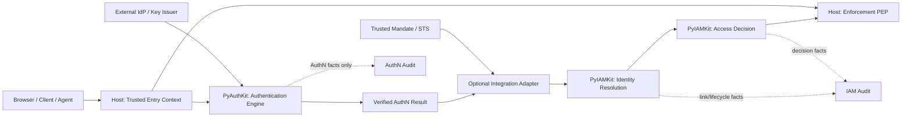
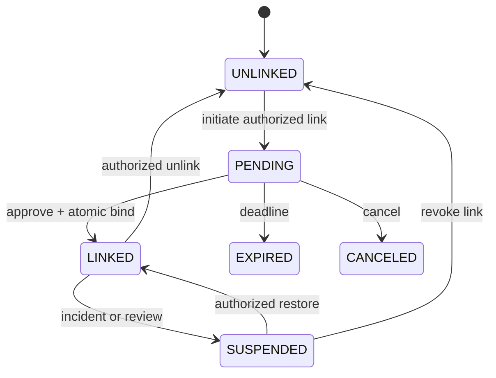
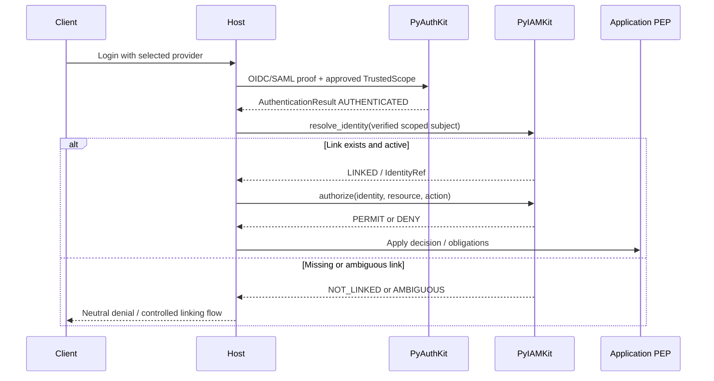
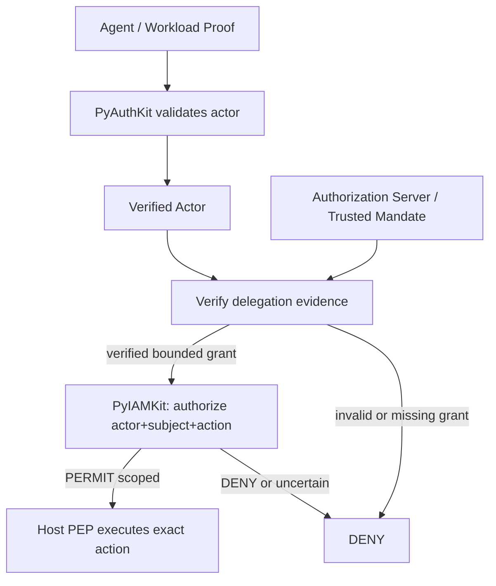
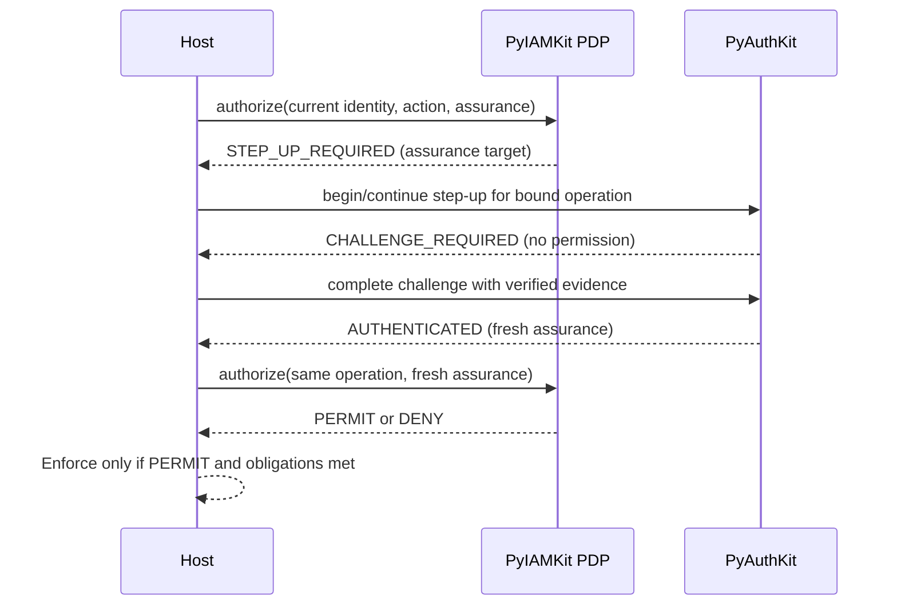
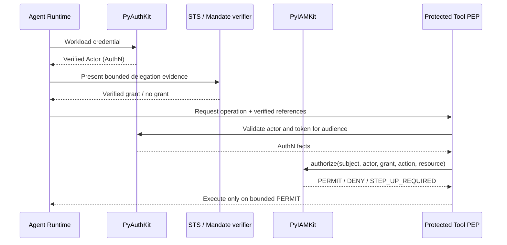
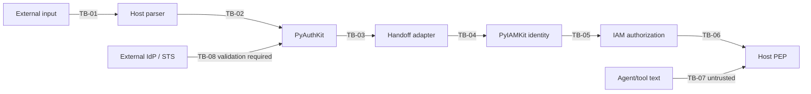

# 23_PYAUTHKIT_PYIAMKIT_INTEGRATION_CONTRACT

> **Projet :** PyAuthKit / PyIAMKit  
> **Document :** `23_PYAUTHKIT_PYIAMKIT_INTEGRATION_CONTRACT.md`  
> **Type :** Contrat d'intégration inter-domaines (Authentication / Identity & Access Management)  
> **Version documentaire :** 0.1.0 (proposition)  
> **Date :** 2026-10-31  
> **Statut :** PROPOSED / DESIGN - aucun contrat d'API de production ni conformité opérationnelle attestés  
> **Langue :** Français, noms de types Python et protocoles standard en anglais  
> **Portée :** humains, identités externes, services, workloads, agents, délégations, clients Web/API/CLI  
> **Source de méthode :** `PYAUTHKIT_SOFTWARE_DESIGN_LEARNING_CONVENTION.md`  
> **Sources de conception :** documents `00` à `22` de PyAuthKit  
> **Documents aval :** `24_PYAUTHKIT_PUBLIC_API_AND_SDK_DESIGN.md`, `25_PYAUTHKIT_CONFIGURATION_MODEL.md`, `26_PYAUTHKIT_TESTING_AND_QUALIFICATION_STRATEGY.md`.

**Règle de lecture.** Ce document spécifie un *contrat cible*, et non une interface de PyIAMKit dont l'implémentation aurait été inspectée. Les types, ports, statuts, URLs exemples et diagrammes sont candidats. Les décisions en attente sont répertoriées `IAM-DEC-*`. Le document n'attribue aucun statut `IMPLEMENTED`, `TESTED` ou `QUALIFIED` au dépôt.

**North Star :** `Authenticated != Identified in local IAM != Authorized != Delegated`.

---

## 0. Résumé exécutif

PyAuthKit établit qu'un sujet est authentifié à l'intérieur d'un contexte de confiance approuvé. PyIAMKit peut ensuite rapprocher ce sujet d'une identité gérée, appliquer ses règles de cycle de vie et évaluer une demande d'accès. L'application hôte reste responsable de l'enforcement sur sa ressource, et une délégation doit être vérifiée indépendamment de l'identité technique de l'agent.

Le chemin canonique est : **trusted entry context → authentication → verified handoff → identity resolution → authorization → enforcement**. Le passage en IAM est **optionnel** pour PyAuthKit mais obligatoire dans une application qui exige les décisions IAM pour ses ressources. Le résultat d'authentification n'est jamais transformé silencieusement en compte, groupe, rôle, organisation ni permission.

Les propriétés structurantes sont l'identité située (`issuer + subject + scope`), la provenance vérifiée, le mapping explicite, la non-ambiguïté, l'absence d'auto-link par email, l'isolation multi-tenant, le refus en cas d'incertitude critique, les décisions à durée bornée et la traçabilité sans secret.

## 1. Motivation et problème réel

Un même utilisateur peut être authentifié par un mot de passe local, un IdP OIDC, une assertion SAML ou une passkey ; un service peut présenter une clé d'API ; un agent peut s'authentifier avec une identité de workload. Ces mécanismes ne répondent pas à la question « cette identité possède-t-elle le droit d'exécuter `payment.approve` sur `invoice:123` ? ».

Sans frontière explicite, le code applicatif tend à confondre `sub`, email, compte local, organisation, rôle, scopes OAuth, niveau MFA et permissions. Les erreurs possibles sont une prise de contrôle de compte par linking automatique, une élévation de privilège inter-tenant, une autorisation obtenue avec une session ancienne ou la transmission des droits de l'utilisateur à un agent sans mandat.

**Besoin :** définir un langage de publication et des ports substituables permettant à PyAuthKit et PyIAMKit de coopérer, sans fusionner leurs domaines ni imposer un runtime partagé.

## 2. Objectifs, non-objectifs et périmètre

**Objectifs.** Définir le handoff vérifié, le mapping identitaire, les contrats d'autorisation, l'enforcement, les règles de refus, l'assurance, les délégations, le versionnement et les tests. Fournir des exemples Python pur avant les adapters FastAPI/Django et rendre les compromis explicites.

**Non-objectifs.** Réimplémenter un IAM dans PyAuthKit ; définir une taxonomie universelle de rôles ; choisir l'ORM ou l'API publique de PyIAMKit ; garantir la conformité NIST ; faire du provisioning SCIM une opération automatique du login ; certifier une identité légale ; remplacer les contrôles d'accès de l'application hôte.

**Périmètre par phase.** MVP : handoff local sans dépendance IAM, faculté de brancher un resolver en lecture et un port d'autorisation simple. Post-MVP : account linking gouverné, step-up conditionnel, SCIM/provisioning, delegated-agent grants, cache et revocation distribués. Le découpage de release réel relève de `27`.

## 3. Terminologie canonique et ambiguïtés

| Terme | Sens ici | Ne signifie pas |
|---|---|---|
| `ClaimedIdentity` | Identité déclarée par l'entrée, non vérifiée | Sujet confirmé |
| `VerifiedSubject` | Sujet établi par mécanisme et trust profile | Compte IAM |
| `AuthenticatedPrincipal` | Sujet validé après `AuthenticationPolicyGate` | Permission sur une ressource |
| `TrustedScope` | Périmètre de confiance fourni par l'hôte après résolution sûre | Organisation IAM automatiquement équivalente |
| `ExternalSubjectKey` | Identité externe composite et contextualisée | Email ou username universel |
| `IAM Identity` | Identité/compte dont PyIAMKit détient le cycle | Evidence cryptographique |
| `IdentityLink` | Association gouvernée entre une clé externe et une identité IAM | Fusion par attribut de profil |
| `AuthorizationDecision` | Décision contextuelle sur action et ressource | Résultat permanent ou token sans portée |
| `VerifiedDelegation` | Mandat dont la provenance et les limites ont été vérifiées | Authentification de l'agent seule |
| `PEP` | Policy Enforcement Point, composant appliquant la décision | Authenticator |
| `PDP` | Policy Decision Point, moteur de décision IAM | AuthenticationEngine |

**Précision DDD :** `IdentityLink` n'est pas obligatoirement un Aggregate Root, `VerifiedSubject` n'est pas obligatoirement une Entity et le port n'est pas automatiquement le pattern GoF Adapter. Classer selon la responsabilité effective et la cohérence à protéger.

## 4. Bounded contexts et truth ownership

| Contexte | Vérité détenue | Ce qu'il ne décide pas |
|---|---|---|
| PyAuthKit / Authentication | Validité de la preuve, source, méthode, assurance attestée, résultat AuthN | Comptes, organisations, permissions, droits métier |
| PyIAMKit / Identity | Identités locales, liens externes, états, memberships, groupes, rôles | Vérification crypto brute du credential extérieur |
| PyIAMKit / Access | Policies, décisions d'accès, mandats et éventuelles obligations | Origine d'une preuve AuthN non vérifiée |
| Hôte / Relying Party | Trusted route, ressource, action, session applicative, enforcement | Auto-signature d'une identité vérifiée |
| IdP / Credential Issuer | Identité et assertions qu'il émet selon contrat de confiance | Permission locale implicite |
| STS / Authorization Server | Émission/échange de tokens selon une policy | Droits extrapolés sans contrôle IAM |

Un Bounded Context n'impose ni service réseau, ni base séparée, ni dépendance circulaire. Le port PyAuthKit peut être utilisé dans un monolithe, avec un adapter IAM in-process, ou via un service externe doté d'une authentification mutuelle appropriée.

## 5. Context map et relations



Le contrat entre contextes relève d'un **Published Language** versionné et d'une **Anti-Corruption Boundary**. L'adapter transforme les types sans rendre PyAuthKit dépendant des entités ou tables privées de PyIAMKit.

## 6. Chaîne de confiance et absence de transitivité

```text
CLIENT CLAIMS / CREDENTIALS [untrusted]
   ↓
HOST-APPROVED TrustedScope, TrustProfile [trusted configuration]
   ↓
PyAuthKit cryptographic/protocol verification [verified evidence]
   ↓
AuthenticationPolicyGate [final AuthN decision]
   ↓
VerifiedAuthnHandoff [bounded AuthN assertion inside trusted integration]
   ↓
PyIAMKit IdentityLinkResolver [IAM account resolution]
   ↓
PyIAMKit AuthorizationPort [scoped decision]
   ↓
Host PEP [enforce for resource/action]
```

Aucune étape ne bénéficie d'une transitivité de confiance implicite. Le fait que le serveur ait reçu des headers au travers d'un reverse proxy ne les rend pas fiables sans contrat de proxy. Le fait qu'un type porte le nom `Verified*` ne prouve rien lorsque sa construction est possible depuis une entrée hostile.

Entre processus, un simple JSON `authenticated=true` n'est pas une assertion acceptable : le récepteur doit authentifier son émetteur, vérifier la cible, la fraîcheur, la corrélation et l'intégrité du message, ou revalider une preuve standard correctement profilée.

## 7. Règles immuables de séparation Authentication / IAM

1. Le moteur PyAuthKit ne connaît pas `Role`, `Permission`, `Group`, `Organization` comme autorités d'accès.
2. Un IAM ne transforme pas un `ClaimedIdentity` en `VerifiedSubject` par simple lookup de base.
3. `AUTHENTICATED` n'implique ni compte trouvé ni accès autorisé.
4. Les scopes OAuth sont des données de token à valider et interpréter dans leur contexte ; ils ne deviennent pas universellement des permissions locales.
5. Les claims externes `groups`, `roles`, `is_admin` sont non autoritatifs par défaut, même signés, tant qu'une politique de mapping explicite ne les accepte pas.
6. Le statut de compte, la désactivation, les mandats et les versions de politique sont réévalués sous les garanties de fraîcheur définies.
7. Le résultat IAM ne modifie jamais rétroactivement l'issue de la vérification cryptographique ; l'application conserve deux statuts distincts.
8. Une politique de risque peut demander un step-up ; elle ne peut pas dispenser de la vérification de preuve.

## 8. Niveaux d'intégration et modes de composition

| Mode | Usage | Dépendance | Garantie à qualifier |
|---|---|---|---|
| `AUTHN_ONLY` | Services qui valident un credential sans IAM | PyAuthKit seul | AuthN et scope seulement |
| `AUTHN_PLUS_IDENTITY` | Connexion nécessitant un compte local | Resolver IAM optionnel | Unicité, statut et portée du lien |
| `AUTHN_PLUS_AUTHZ` | API protégée par policy IAM | Resolver + AuthorizationPort | Décision contextualisée et enforcement |
| `DELEGATED_ACTION` | Agent au nom d'un utilisateur | AuthN actor + grant verifier + IAM PDP | Double identité et mandat borné |

Le choix du mode est détenu par l'hôte et sa configuration approuvée, pas par le navigateur ni le claim `scope`. Un endpoint ne peut pas retomber silencieusement de `AUTHN_PLUS_AUTHZ` à `AUTHN_ONLY` quand le service IAM est indisponible.

## 9. Contrat d'entrée : AuthenticationResult vers handoff IAM

Le handoff est construit uniquement après `AuthenticationResult.status == AUTHENTICATED` et lorsque le résultat porte un sujet vérifié et une provenance cohérente. Il ne transporte **aucun bearer token**, password, TOTP, session cookie, assertion SAML brute, certificate private key ni `refresh_token`.

**Champs candidats requis :** `contract_version`, `correlation_id`, `trusted_scope_id`, `subject_namespace`, `issuer_id` ou autorité équivalente, `subject_id`, `principal_type`, `method`, `authenticated_at`, `verified_at`, `trust_profile_ref/version`. Les attributs d'assurance sont facultatifs mais, s'ils existent, ils sont accompagnés de provenance et de politique de validation.

**Claims facultatifs et minimisés :** `amr`, `acr`, references d'attestation, `federation_transaction_id`, `session_generation` (non bearer), `actor_ref`. Ces informations sont des faits AuthN ou des références, pas des privilèges IAM.

L'identifiant de la forme `scope + issuer + subject` peut devoir inclure un provider registration, client binding ou un identifiant de format SAML pour garantir l'unicité pertinente ; l'algorithme exact est choisi selon `14` et `IAM-DEC-004`.

## 10. Exemple de schéma JSON strict (non normatif)

```json
{
  "contract_version": "0.1",
  "correlation_id": "corr-7f2a",
  "trusted_scope_id": "scope-prod-eu",
  "principal_type": "HUMAN",
  "subject": {
    "authority_kind": "OIDC_ISSUER",
    "issuer_id": "https://login.example.invalid",
    "subject_id": "opaque-subject-42",
    "provider_registration_id": "oidc-provider-approved"
  },
  "authentication": {
    "method": "oidc",
    "authenticated_at": "2026-10-31T10:00:00Z",
    "verified_at": "2026-10-31T10:00:01Z",
    "trust_profile_ref": "profile-version-12"
  },
  "assurance": {
    "assurance_profile_ref": "human-aal2-profile-3",
    "assurance_verified": true,
    "auth_time": "2026-10-31T10:00:00Z"
  }
}
```

`example.invalid` est un nom de domaine réservé aux exemples. Ce JSON n'est pas un jeton signé et ne doit pas être accepté depuis un client arbitraire. Le contrat de transport, l'authentification inter-service et la compatibilité des versions restent à concevoir.

## 11. Identité externe composite et canonicalisation

**OIDC :** l'`iss` et le `sub` validés ensemble constituent le référent externe stable dans leur contexte. Le `sub` d'un issuer n'est pas celui d'un autre. **SAML :** la clé dépend de l'EntityID de l'IdP, du profil de `NameID` et des qualificatifs de portée pertinents ; un `NameID` transitoire n'est pas une clé durable sans accord de profil.

**API Key / Password :** l'autorité peut être un store approuvé et un namespace de credentials plutôt qu'un issuer OIDC. **SPIFFE / workload :** le trust domain et l'identité du workload sont qualifiés, puis bornés au tenant/application hôte.

Ne jamais normaliser une identité en changeant arbitrairement la casse de `sub`, en supprimant des parties d'issuer URL, ou en convertissant un email vérifié en identifiant primaire de compte. La canonicalisation dépend du protocole et de la source autoritative.

## 12. Résolution d’identité IAM : statuts discriminés

| Statut candidat | Signification | Suite admissible |
|---|---|---|
| `LINKED` | Une seule identité IAM active autorisée correspond | Continuer vers Authorization |
| `NOT_LINKED` | Aucune association locale | Refus ou cérémonie de linking explicite |
| `AMBIGUOUS` | Plusieurs associations concurrentes ou incompatibles | Refus, incident et remédiation contrôlée |
| `DISABLED` | L'identité IAM est désactivée ou déprovisionnée | Refus, ne pas ressusciter via login |
| `SCOPE_MISMATCH` | Tenant/application/realm incompatibles | Refus et audit |
| `LINK_SUSPENDED` | Association désactivée ou en revue | Refus ou remédiation séparée |
| `UNAVAILABLE` | IAM non joignable ou erreur de dépendance | Aucun grant et réponse disponibilité |
| `INVALID_PROOF` | Handoff malformé, non intègre ou non fiable | Refus et signal de sécurité |

`NOT_LINKED` n'est pas un succès d'autorisation. Un seul résultat `LINKED` n'établit pas que le compte est autorisé à voir la ressource. Les codes publics doivent rester neutres pour éviter l'énumération.

## 13. Identity linking : cycle de vie et garanties



**Conditions de liaison :** session existante authentifiée pour le compte cible selon policy IAM ; nouvelle preuve fédérée validée ; consentement/approbation adaptée ; contrôle tenant et ownership ; unicité transactionnelle ; audit durable ; confirmation explicite en cas d'opération sensible.

L'email, même `email_verified=true`, n'est pas un lien. Une invitation email ou un profil IdP peuvent servir de signal d'affichage/recherche sous une politique documentée, mais pas de preuve suffisante pour prendre possession d'un compte existant. Lier un nouvel IdP à un utilisateur disposant d'une ancienne session insuffisamment fraîche doit déclencher une réauthentification ou un step-up.

## 14. Résolution, création JIT et provisioning : trois opérations

1. **Identity resolution** : rechercher un lien existant et vérifier son statut. Lecture, sans création de compte.
2. **Just-in-Time (JIT) provisioning** : créer une identité sous une politique approuvée, si besoin métier réel, preuve suffisante, absence de conflit et idempotence ; ne jamais se produire par défaut simplement parce qu'une connexion a réussi.
3. **Lifecycle provisioning** : créer, mettre à jour, désactiver ou supprimer des comptes via événements RH, SCIM ou processus administratif ; le propriétaire est PyIAMKit ou l'IdP selon contexte.

SCIM 2.0 (RFC 7643/7644) concerne les schémas et protocoles de gestion d'identités ; ce n'est ni un protocole de vérification de password ni une permission d'auto-link. La suppression/ désactivation de compte doit affecter les accès et sessions selon un contrat de propagation explicite.

## 15. Personnes, services, workloads, devices et agents

| PrincipalType | Clé de preuve typique | Résolution IAM facultative | Précaution |
|---|---|---|---|
| `HUMAN` | OIDC issuer+sub, local credential subject | Account/Identity | Pas de fusion par email |
| `SERVICE` | Client ID, clé approuvée, certificat | ServicePrincipal | Pas d'utilisateur fictif « bot-admin » |
| `WORKLOAD` | SPIFFE ID + trust domain / K8s binding | WorkloadIdentity | Namespace K8s n'est pas tenant IAM |
| `DEVICE` | Device credential, attestation si profil | DeviceIdentity | Posture != authentication |
| `AGENT` | Identité de runtime ou workload | AgentIdentity | Agent authentifié != mandat d'utilisateur |
| `EXTERNAL` | Fournisseur et namespace vérifiés | Guest/PartnerIdentity | Politique de relation explicite |

Une même identité IAM peut avoir plusieurs mécanismes AuthN ; l'association inverse n'est permise qu'avec des règles explicites d'unicité, de partage ou de transfert. Les niveaux humains `AAL1/2/3` ne sont pas attribués automatiquement à une machine.

## 16. Tenant, realm, organisation et contexte applicatif

Le `TrustedScope` est une frontière de confiance technique de PyAuthKit. `Organization` et `Tenant` côté PyIAMKit sont des objets gouvernés par l'IAM. Une correspondance peut exister, mais **n'est jamais une identité sémantique universelle**.

La table de binding host-managed mappe `application_binding / trusted_scope_id / provider_registration` vers un ou plusieurs contextes IAM explicitement approuvés. Si une résolution renvoie plusieurs organisations possibles pour une même opération, l'hôte exige une sélection sûre, ou refuse. La présence d'un en-tête `X-Tenant` ne décide pas à elle seule de l'organisation.

En cas de changement d'organisation active, le serveur revalide l'appartenance et la policy pour la ressource ; il ne réutilise pas automatiquement les permissions calculées dans le contexte précédent.

## 17. Roles, groups, permissions et politiques d’accès

**Règle :** rôles, groupes, memberships, politiques RBAC/ABAC et décisions finales appartiennent à PyIAMKit ou au service d'autorisation déclaré par l'hôte. Une assertion externe peut transporter des claims de groupe ; leur mapping doit être gouverné, versionné et idéalement synchronisé selon un contrat d'autorité.

Le port d'autorisation prend au moins : `resolved_identity`, `actor` si délégation, `resource`, `action`, `effective_tenant`, `context` pertinent, `authentication_assurance`, `decision_timestamp`. Il retourne une décision typée : `PERMIT`, `DENY`, `INDETERMINATE` ou `STEP_UP_REQUIRED` (mode de réponse supplémentaire proposé).

`NOT_APPLICABLE` peut être utile à un moteur de politiques composables ; l'hôte ne doit pas convertir ce statut en allow. Une policy doit expliciter la décision par défaut, le comportement de conflit et les obligations d'enforcement.

## 18. Contract d’autorisation : contexte, décision et enforcement

| Champ candidat | Rôle | Invariant |
|---|---|---|
| `identity_ref` | Identité IAM résolue | Active, dans le scope attendu |
| `resource_ref` | Ressource effectivement ciblée | Référence canonique côté application |
| `action` | Opération exacte | Jamais wildcard implicite |
| `effective_tenant` | Tenant validé | Compatible binding et ressource |
| `actor_ref` | Acteur présent si agent | Provenance vérifiée |
| `delegation_ref` | Mandat pour opération déléguée | Non expiré et suffisamment scoped |
| `assurance_ref` | Assurance interprétée selon policy | Fraîcheur et méthode qualifiées |
| `decision_id` | Corrélation décision | Non sensible, non bearer |
| `policy_version` | Gouvernance / audit | Version utilisée identifiable |
| `expires_at` | Durée de réutilisation éventuelle | Borne stricte ou no-cache |

Le **PEP** compare la ressource et l'action réelles au contexte de décision avant l'action. Un `PERMIT` pour `invoice:123/read` n'est pas un `PERMIT` pour `invoice:124/approve`. Les obligations, conditions et restrictions retournées par le PDP doivent être évaluées et appliquées ou le PEP refuse.

## 19. Step-up, assurance et réautorisation

L'autorisation peut exiger une assurance supérieure ou plus récente. `STEP_UP_REQUIRED` est une **instruction de poursuite du workflow**, pas un accès permis. Le client retourne vers PyAuthKit pour une nouvelle preuve ou un challenge conforme aux modèles `11` et `12`.

Après réussite du step-up, l'application crée une nouvelle requête d'autorisation avec l'assurance vérifiée et l'action initiale toujours liée à son contexte. Le token/session utilisé doit refléter la nouvelle assurance uniquement sous les règles de `13` ; on ne modifie pas arbitrairement un claim `aal` coté client. Une action sensible ne peut pas être libérée en attendant le challenge.

Pour une personne, l'assertion `acr`, `amr`, `auth_time` externe doit être mappée à un profil de confiance défini ; pour un workload/agent, on utilise des propriétés de preuve spécifiques, pas des AAL humains copiés.

## 20. Session, révocation, fraîcheur et caches

Les décisions IAM sensibles dépendent d'un état potentiellement mutable : désactivation de compte, appartenance, rôle, délégation, policy, lien externe. Une session authentifiée techniquement valable peut être insuffisante pour une opération actuelle.

Une décision cacheable possède des clés couvrant **identity, tenant, resource, action, policy version, evidence/assurance, delegation ref et génération de révocation** ; les données sensibles ne sont pas stockées en clair dans des clés de cache exposées. Un cache sans TTL borné et sans invalidation crédible pour les opérations critiques n'est pas admissible.

**Failure policy :** indisponibilité IAM → DENY ou `INDETERMINATE` sans exécution. Une décision `PERMIT` ancienne ne devient pas une permission permanente parce que le PDP est temporairement hors ligne.

## 21. Fédération et social login : account linking contrôlé



`AuthN success + email present` n'est jamais une raison suffisante pour créer le lien. Le mapping `issuer + subject + scope` est séparé des informations de profil. La session IdP, la session RP et la session IAM ne sont pas le même objet ; logout local, global et fédéré exigent des contrats différents.

## 22. Création, modification et suppression d’un lien

**Link command** : sujet IAM cible authentifié, preuve fraîche du fournisseur à lier, méthode de confirmation, scope, action idempotente et version attendue. **Unlink command** : sujet IAM autorisé, raison, dépendances de récupération, impact sur sessions et journal d'audit.

L'unicité de `ExternalSubjectKey` doit être protégée au niveau transactionnel pour empêcher deux threads/instances de le lier à deux identités distinctes. Les cas de conflits ne sont pas résolus par `first()` ni par migration silencieuse d'un compte à l'autre.

Si le dernier facteur d'accès au compte est retiré, le processus IAM doit vérifier l'existence d'une méthode de récupération autorisée. Le périmètre de réauthentification nécessaire est un choix de policy (`IAM-DEC-009`).

## 23. Agent, workload et délégation : double identité

La preuve AuthN de l'agent désigne l'acteur technique. Une action *on behalf of* exige un mandat distinct, vérifié, expirant, limité par tenant, ressource, audience, action, durée et éventuellement l'approbation humaine. Un prompt, un message, un résultat RAG ou un argument d'outil ne peut accorder un tel mandat.



**Trois identités possibles** : `Subject` humain au nom duquel une opération est demandée, `Actor` (agent/runtime courant) et `Resource Owner`/tenant effectif. Elles ne sont pas fusionnées et ne se réduisent pas à `user_id`.

## 24. Token Exchange et implications RFC 8693

RFC 8693 décrit un mécanisme de Security Token Service pouvant combiner `subject_token` et `actor_token`. Le claim `act` représente l'acteur courant et, si nécessaire, l'historique des acteurs. L'échange de tokens est décidé par le STS / Authorization Server selon sa configuration et les policies applicables.

PyAuthKit peut vérifier un token de délégation émis par une autorité de confiance, y compris audience et propriétés de preuve du présentateur. PyIAMKit vérifie que l'acteur a effectivement le droit d'effectuer l'opération sous le mandat concerné. Un token ne suffit pas à lui seul à forcer un `PERMIT` local. Les acteurs historiques restent des éléments de traçabilité, pas des permissions additionnelles.

**No escalation across hops :** pour `User → Agent A → Agent B → Tool`, chaque étape conserve ou réduit le scope, le TTL et l'audience ; aucune délégation chaînée ne peut élargir le mandat initial. Une chaîne incomplète ou un mandat révoqué conduit au refus.

## 25. Contrats d’intégration candidats (ports)

| Port / contrat candidat | Sens | Responsabilité unique |
|---|---|---|
| `AuthenticationPort` | Host → PyAuthKit | Authentifier et produire un résultat vérifié |
| `AuthnToIamMapper` | Integration adapter | Transformer le résultat sans privileges ni secrets |
| `IdentityLinkResolverPort` | Host → PyIAMKit | Résoudre une identité et son statut |
| `IdentityLinkCommandPort` | Host → PyIAMKit | Lier/délier sous policy IAM |
| `AuthorizationDecisionPort` | Host → IAM PDP | Décider sur ressource et action précises |
| `DelegationVerifierPort` | Host → approved STS/IAM | Vérifier un mandat en plus de l'actor AuthN |
| `AssuranceRequirementPort` | Host → IAM/Policy | Déterminer le step-up requis |
| `AuditSink` | Domain → approved adapter | Enregistrer un fait de sécurité minimisé |

Le nom d'un port décrit une responsabilité ; il ne doit pas être choisi pour démontrer le pattern `Adapter`. Tous ces ports ne sont pas nécessaires au MVP : un petit appel de fonction explicite peut suffire si une seule intégration locale existe.

## 26. Types de contrats et règles de sérialisation

- Préférer des DTO immuables et validés, avec champs explicitement optionnels et champs inconnus rejetés aux frontières sensibles selon le protocole négocié.
- Utiliser un identifiant de version de contrat indépendant de la version Python package.
- Ne pas exporter l'objet Python `AuthenticationResult` entier comme JSON arbitraire ; ne publier que les champs du `AuthnHandoff` autorisés.
- `evidence_ref` ou `provenance_ref` est une référence non secrète et non porteur de droits ; éviter identifiants de session / bearer.
- Les horodatages sont timezone-aware UTC ; `authenticated_at` et `verified_at` ont des significations distinctes.
- Les propriétés de confiance ne sont pas démontrées par les seules annotations `typing` ; les adapters font respecter le contrat.
- Conserver la distinction entre `identity_ref` (identité IAM) et `external_subject_key` (identité de preuve).
- Pour le cross-process, employer un transport authentifié et audiencé plutôt qu'un JSON fourni par le client.

## 27. API de résolution : règles d’algorithme

```text
Given verified handoff and trusted IAM binding:
  1. Validate contract version and trusted origin.
  2. Normalize external key under approved protocol profile.
  3. Resolve effective IAM tenant from server-controlled binding.
  4. Query link records scoped by tenant+authority+subject.
  5. If zero -> NOT_LINKED; if multiple -> AMBIGUOUS.
  6. Check link status, local identity status and constraints.
  7. Return LINKED(IdentityRef, version) or explicit refusal.
```

Les vérifications 2 à 6 peuvent se faire sous une transaction/snapshot cohérent ; une réponse historique ou cacheable doit porter sa version et sa date de validité. Une lecture dupliquée en deux providers doit être dédupliquée ou provoquer un résultat explicite d'ambiguïté.

## 28. API d’autorisation : décision et Policy Enforcement Point

Le PDP reçoit des faits **déjà vérifiés** plus le contexte métier, exécute une policy versionnée et renvoie un résultat typé. Le PEP vérifie lui-même que la décision concerne exactement la requête actuelle, respecte les obligations et s'arrête en cas de désaccord ou d'incertitude.

**Exemples d'obligations :** exiger une MFA récente, limiter à un champ, enregistrer un audit obligatoire, vérifier une approbation avant exécution. Une obligation non exécutée invalide le droit de poursuivre pour cette opération.

**Cas potentiellement dangereux :** le PEP utilise `identity.role == 'admin'` issu de la réponse IAM sans scope d'organisation, de ressource ni version de politique. Une décision autoritative complète est préférable à un attribut laissé à interpréter dans chaque route.

## 29. Forme discriminée des réponses et erreurs

| Couche | Résultat | Conséquence côté hôte |
|---|---|---|
| AuthN | `AUTHENTICATED` | Handoff possible, pas d'accès encore |
| AuthN | `REJECTED` | Ne pas interroger IAM pour autoriser |
| AuthN | `CHALLENGE_REQUIRED` | Continuer flow, pas de principal final |
| AuthN | `ERROR` | Disponibilité sans bypass |
| Identity | `NOT_LINKED` / `AMBIGUOUS` | Workflow de liaison autorisé ou refus |
| Identity | `DISABLED` / `SCOPE_MISMATCH` | Refus et audit |
| Identity | `UNAVAILABLE` | Pas d'accès ; signal de disponibilité |
| Authorization | `PERMIT` | Vérifier binding, obligations, expiration |
| Authorization | `DENY` / `INDETERMINATE` | Refus |
| Authorization | `STEP_UP_REQUIRED` | Challenge, réautoriser après succès |

**Public mapping :** éviter de révéler compte absent vs désactivé vs lien ambigu à un attaquant. Les diagnostics internes peuvent garder des codes structurés non sensibles avec corrélation et contrôle d'accès.

## 30. Flux séquentiel Password / API Key / JWT avec IAM facultatif

```mermaid
sequenceDiagram
  participant App as Host / API
  participant Auth as PyAuthKit
  participant Link as IAM Identity Resolver
  participant PDP as IAM Authorization PDP
  App->>Auth: authenticate(evidence, trusted host context)
  Auth-->>App: AuthenticationResult
  alt AuthN rejected or incomplete
    App-->>App: Reject / continue challenge
  else AuthN authenticated
    opt Route requires IAM resolution
      App->>Link: resolve(verified handoff)
      Link-->>App: IdentityResolution
      alt LINKED and active
        App->>PDP: authorize(identity, resource, action)
        PDP-->>App: AuthorizationDecision
        App-->>App: Enforce exact decision
      else no trustworthy mapping
        App-->>App: Deny / controlled account flow
      end
    end
  end
```

Le chemin `AUTHN_ONLY` n'interroge pas obligatoirement PyIAMKit. Il convient uniquement aux opérations dont la politique hôte n'exige pas de compte IAM. La sécurisation de la ressource demeure une responsabilité de l'application.

## 31. Flux de step-up et réautorisation après MFA



Le binding au contexte d'opération et la protection anti-rejeu suivent `11`, tandis que l'algorithme de niveau d'assurance suit `12`. La première décision devient obsolète lorsque l'action, la ressource, le tenant ou la session changent.

## 32. Flux de délégation agentique et tool invocation



La figure n'exige pas que le token soit retourné au modèle LLM : le runtime peut le garder dans un coffre de secrets ou injecter une capacité éphémère. L'agent ne choisit pas son tenant, son autorisation ni sa chaîne de délégation depuis le texte du prompt.

## 33. Gestion transactionnelle et cohérence des liens

`IdentityLink` est un état IAM qui peut évoluer pendant une tentative d'authentification. Recommandation : clé unique (scope IAM + provider issuer key + subject composite), contraintes d'unicité au stockage, opération de création conditionnelle et audit.

Pour éviter l'élévation par course, l'enforcement sensible doit vérifier la version du lien/compte ou une policy de cohérence (TTL de décision très court, relecture, génération de révocation). Deux transactions concurrentes de linking du même sujet vers des comptes différents doivent donner un seul succès ou un conflit explicite, jamais deux liens actifs contradictoires.

La réservation d'un identifiant externe pendant un flow de linking doit expirer ; un flow abandonné ne doit pas bloquer indéfiniment le compte ni céder la réservation à un demandeur non autorisé.

## 34. Stockage et propriété des données

- PyAuthKit : credentials locaux et sessions uniquement s'il en possède réellement le cycle de vie (`19`).
- PyIAMKit : identités locales, organisations, groupes, rôles, permissions, external identity links et mandats selon sa spécification propre.
- Host : ressources métier, décisions d'enforcement, éventuellement sessions framework et bindings de route.
- IdP : identité/facteurs émis et gérés à l'extérieur.

**Pas de jointure cross-context directe** depuis le `AuthenticationEngine` vers les tables IAM. **Pas de classe ORM partagée** exposée comme contrat public. Les records peuvent être colocalisés dans une même base au déploiement, mais les frontières d'écriture doivent rester explicites.

## 35. Cache, invalidation et tolérance aux pannes

**Invariants de cache :** namespace tenant, provenance de décision, version de policy, portée ressource/action, expiration, invalidation après désactivation, révocation de lien ou mandat. Cache négatif et cache positif ont des risques distincts.

**Indisponibilité de PyIAMKit :** la plateforme peut authentifier un sujet mais doit refuser l'accès sur les routes exigeant l'IAM. Un circuit breaker ne peut pas réutiliser sans borne un ancien allow. Les timeouts et retries sont configurés avec deadline globale et idempotence ; aucun retry aveugle des mutations de linking/provisioning.

Pour un système critique, définir contractuellement `max_staleness`, budget de panne, délai de propagation d'invalidation et valeur des SLO avant de qualifier une stratégie offline.

## 36. Conception résiliente et réponse à incident

| Incident | Confinement AuthN | Confinement IAM / Host |
|---|---|---|
| Credential / issuer compromis | Désactiver profil ou clés de confiance | Suspendre liens, sessions et accès concernés |
| Account takeover suspect | Révoquer sessions locales si owned | Suspendre compte, liens, privilèges et mandat |
| Lien externe malveillant | Aucun auto-relink | Geler link, investiguer provenance, corriger sous contrôle |
| IAM indisponible | Reporter AuthN factuelle si possible | Refuser les ressources IAM-only |
| Policy déployée incorrecte | Conserver faits de preuve | Rollback policy signé/versionné + audit |
| Délégation agent compromise | Révoquer credential agent si owned | Révoquer grant, tokens et décisions liées |

Les procédures et autorités d'activation dépendent de l'organisation déployante. Ce tableau n'affirme pas que PyAuthKit ou PyIAMKit implémentent déjà ces mécanismes.

## 37. Sécurité et privacy by design

Les données d'identité et d'accès peuvent être personnelles ou sensibles. Appliquer minimisation, séparation des finalités, contrôle d'accès aux logs, conservation bornée et capacité de purge selon les obligations du système déployé. Les informations `issuer`, `subject`, `tenant`, `session`, `group` et `actor` ne doivent pas être émises partout en télémétrie brute.

Les logs d'audit distinguent `AuthenticationSucceeded`, `IdentityLinkEstablished`, `IdentityLinkRevoked`, `AuthorizationDecisionMade`, `DelegationGranted/Revoked`. Chaque contexte est propriétaire de son événement ; un event AuthN ne certifie pas que l'accès a été permis. Les événements d'audit durables ne se réduisent pas aux traces OpenTelemetry ou au niveau DEBUG.

Protéger les échanges inter-services (mTLS, JWT avec audience dédiée ou autre contrôle qualifié) et contrôler explicitement les droits d'exposition des endpoints de résolution et d'autorisation.

## 38. Threat modeling : frontières du contrat



**STRIDE axes :** spoofing de handoff, tampering de tenant, repudiation de linking, information disclosure dans audit, denial of service du resolver, elevation of privilege par permission mapping ou confused deputy. L'analyse complète s'appuie sur `20` ; les menaces particulières du pont sont enregistrées `IAM-THR-*`.

## 39. Conventions Software Design & Learning appliquées

**Problem First.** Résoudre un problème de confusion de responsabilité avant de choisir ports et patterns. **Trust First.** Identifier chaque autorité et la provenance des données avant l'API. **Pattern Second.** `Adapter` lorsque deux modèles évoluent indépendamment ; `Strategy` seulement pour des policies réellement substituables ; `Repository` lorsqu'un état IAM est effectivement possédé ; `Result Object` pour rendre visibles échec et ambiguïté.

**Principes.** `SRP` sépare proof verification, linking et permission decision. `DIP` fait dépendre l'orchestration des ports, pas d'un client SQL/HTTP. `OCP` peut permettre une nouvelle stratégie de mapping sans changer le noyau. `KISS` et `YAGNI` préviennent un bus d'architecture ou une hiérarchie de policies prématurée.

**Noms naturels.** `ExternalSubjectKey`, `IdentityLinkResolver`, `AuthorizationDecision` sont préférables à `AdapterStrategyManager`, `GeneralAuthService` ou `AbstractPermissionPattern`. Nommer les patterns dans les ADR et docstrings quand cela explique la raison d'être du composant.

## 40. Conventions de tests : preuve, pas décoration

Une suite de tests IAM doit démontrer les comportements observables sur **deux états distincts** : un résultat AuthN correct peut entraîner `NOT_LINKED`, et une identité IAM valide peut entraîner `DENY`. Les tests n'obtiennent pas une autorisation par le simple fait d'avoir instancié un dataclass.

Prévoir tests unitaires de mapping, tests de contrat sur implémentations de port, tests de concurrence du linking, tests property-based de séparation des tenants, tests de replay et de réauthentification, intégration réelle avec l'adapter IAM, et E2E sur PEP. Le contrat d'audit doit être vérifié sans secrets.

**Convention d'évidence :** identifier commit, version de dépendances, profil de confiance, tenant de test, fixtures, résultat attendu, résultat constaté, traces anonymisées et décision d'acceptation ; aucun test candidat ne vaut preuve `QUALIFIED`.

## 41. Références normatives, limites et versionnement

- OpenID Connect Core 1.0 : `iss` + `sub` et validation des claims ID Token. <https://openid.net/specs/openid-connect-core-1_0.html>
- NIST SP 800-63C-4 (final, 2025) : federation and assertions, account linking et trust agreements. <https://csrc.nist.gov/pubs/sp/800/63/c/4/final>
- RFC 8693 : OAuth 2.0 Token Exchange, distinction délégation / impersonation, claim `act`. <https://www.rfc-editor.org/rfc/rfc8693>
- RFC 9700 : OAuth 2.0 Security Best Current Practice. <https://www.rfc-editor.org/rfc/rfc9700>
- RFC 7643 / RFC 7644 : SCIM Core Schema / Protocol (provisioning, pas authentification). <https://www.rfc-editor.org/rfc/rfc7643> et <https://www.rfc-editor.org/rfc/rfc7644>
- NIST SP 800-63B-4 : Authentication and Authenticator Management, notamment niveau d'assurance et sessions. <https://pages.nist.gov/800-63-4/sp800-63b.html>
- RFC 8725 : JWT Best Current Practices. <https://www.rfc-editor.org/rfc/rfc8725>

Les standards ne prescrivent pas les noms de classes PyAuthKit/PyIAMKit, les enums `LINKED` ou `PERMIT`, ni le modèle de données du dépôt : ceux-ci sont des propositions de conception. Toute revendication de conformité exige un profil d'applicabilité, une implémentation et les preuves correspondantes.

## 42. Schémas de compatibilité et stratégie de versionnement

Le contrat versionne indépendamment la **sémantique de la preuve**, le **schéma du handoff**, les **ports Python**, et les **claims des tokens transportés**. Un champ facultatif ajouté ne doit pas changer le sens de `AuthenticatedPrincipal`; une modification de portée du sujet, de l'audience ou du tenant exige une revue de compatibilité.

Proposer la matrice `PyAuthKit version range ↔ Integration Adapter version ↔ PyIAMKit contract version`. Des tests contractuels multi-version distinguent read compatibility et write compatibility. L'application hôte verrouille une combinaison testée, jamais une dépendance `latest` non qualifiée.

Lorsque l'intégration s'exécute dans un autre processus, traiter sérialisation, encodage, signatures, autorité de l'appelant, rotation de clés et anti-rejeu comme un protocole explicite ; ne pas transporter sans enveloppe des objets Python picklés.

## 43. Migration depuis des comptes existants

**Stratégie progressive :**

1. Inventorier les méthodes de login, comptes locaux, emails, `sub` OIDC, memberships, groupes et règles existantes.
2. Identifier les référents stables prouvés et les liens dont la provenance est incertaine.
3. Créer un registre de liens IAM avec origine (`ORIGINAL`, `MIGRATED`, `RECONSTRUCTED`, `UNKNOWN`) et statut.
4. Exiger une confirmation sécurisée pour les associations ambiguës ; pas de matching automatique par email.
5. Activer le nouveau resolver en shadow mode sans impact d'enforcement, puis comparer des décisions anonymisées.
6. Activer par route/tenant avec feature gate, rollback vers un mécanisme sûr connu et audit.
7. Révoquer les mappings problématiques et documenter l'impact sur sessions et tokens.

`MIGRATED` n'est pas équivalent à `PROVEN_VERIFIED`. Les données historiques ne doivent pas être inventées pour compléter un handoff de preuve.

## 44. Configuration côté host et composition root

Le composition root assemble `AuthenticationPort`, `AuthnToIamMapper`, `IdentityLinkResolverPort`, `AuthorizationDecisionPort` et les politiques de routing approuvées. Les secrets de fournisseurs, clients IAM, TTL, audience et timeout sont injectés par configuration validée.

L'hôte définit explicitement quelles routes demandent IAM : par défaut les endpoints sensibles ne retombent jamais sur un mode AuthN-only. Un route-policy doit inclure le principal admissible, le minimum d'assurance, le trust scope, la ressource et les permissions nécessaires, ou déléguer cette définition au service IAM compétent.

La configuration tenant ↔ IAM est un binding gouverné, pas une transformation statique aveugle `tenant_id=request.header['tenant']`. Les plugins IAM doivent être explicitement approuvés comme ceux de `18`.

## 45. Évolution et jalons de réalisation proposés

| Étape proposée | Travail | Preuve de sortie |
|---|---|---|
| M0 - Contract baseline | Validations et statuts discriminés | Revue DDD + ADR approuvés |
| M1 - Local adapter | Python pur AuthN → IAM fake | Tests de contrat et échecs négatifs |
| M2 - Identity binding | Resolver IAM scoped | Tests tenant, ambiguity, disabled, link race |
| M3 - Authorization PEP | Resource/action/version | E2E deny-by-default et obligations |
| M4 - Step-up | Assurance requise et nouvelle décision | E2E MFA, stale/session expiry |
| M5 - Federation linking | OIDC/SAML et linking explicite | Tests account takeover et migration |
| M6 - Delegation | Actor/subject/STS/IAM | Scénarios confused deputy / downscope |
| M7 - Operations | Revocation, audit, cache, SLO, resilience | Chaos/recovery/incident rehearsal |

La roadmap est indicative ; `27` arbitre la séquence réelle et `28` organise le bootstrap. Le nombre d'étapes n'est pas un calendrier de livraison.

## 46. Registre des exigences d’intégration `IAM-REQ-*`

Les exigences `IAM-REQ-*` sont **spécialisées au pont AuthN/IAM**. Leur couverture CI est candidate tant que `26` et les ADR n'ont pas fixé les fixtures de bout en bout. « MVP » signifie requis par le périmètre de conception retenu si un adapter IAM est activé, non exigence d'installation de PyIAMKit pour tous les utilisateurs.

| ID | Phase | Exigence | Critère de vérification |
|---|---|---|---|
| `IAM-REQ-001` | MVP | L’hôte transmet uniquement un AuthenticationResult authentifié au mapper | Handoff nul sur rejet |
| `IAM-REQ-002` | MVP | Le trusted scope vient d’une configuration serveur approuvée | Client scope spoof rejeté |
| `IAM-REQ-003` | MVP | Le handoff porte issuer + subject + scope contextualisés | Clé composite non ambiguë |
| `IAM-REQ-004` | MVP | Aucun secret ni bearer token dans le handoff | Scan du DTO sans secret |
| `IAM-REQ-005` | MVP | La provenance d’authentification inclut trust profile et méthode | Provenance conservée |
| `IAM-REQ-006` | MVP | PyAuthKit fonctionne sans PyIAMKit installé | Import et AuthN-only réussis |
| `IAM-REQ-007` | MVP | Aucun permission/role/group/is_admin ne sort du contrat AuthN | DTO strict sans grants |
| `IAM-REQ-008` | MVP | Résolution IAM facultative et explicitement activée par route | Routing typé et fermé |
| `IAM-REQ-009` | MVP | L’identity resolver filtre par tenant et authority | Cross-tenant non visible |
| `IAM-REQ-010` | MVP | Un lien manquant retourne NOT_LINKED et jamais un compte créé | Pas d’effet d’écriture |
| `IAM-REQ-011` | MVP | Une résolution multiple retourne AMBIGUOUS | Aucun choix arbitraire |
| `IAM-REQ-012` | MVP | Une identité inactive retourne DISABLED | Aucune autorisation |
| `IAM-REQ-013` | MVP | La politique IAM évalue resource et action exactes | Pas de wildcard implicite |
| `IAM-REQ-014` | MVP | Le PEP refuse DENY et INDETERMINATE | Aucun effet métier |
| `IAM-REQ-015` | MVP | Toute décision PERMIT est contextualisée et bornée | Scope/version/timestamp présents |
| `IAM-REQ-016` | MVP | L’indisponibilité IAM ne déclenche pas de bypass | 0 opération protégée exécutée |
| `IAM-REQ-017` | MVP | Les erreurs publiques n’exposent pas l’existence du compte | Énumération limitée |
| `IAM-REQ-018` | MVP | Les événements AuthN et IAM restent distincts | Audit avec source et kind |
| `IAM-REQ-019` | MVP | Les adapters ne dépendent pas de tables IAM privées | Import boundary respectée |
| `IAM-REQ-020` | MVP | Le port d’authentification reste testable avec fake IAM | Test de contrat substituable |
| `IAM-REQ-021` | POST-MVP | Le linking exige une session existante autorisée | Compte cible vérifié |
| `IAM-REQ-022` | POST-MVP | Le linking exige une preuve fraîche de l’identifiant externe | Preuve associée au provider |
| `IAM-REQ-023` | POST-MVP | Le linking ne fusionne jamais sur email seul | Email collision rejetée |
| `IAM-REQ-024` | POST-MVP | L’unicité de l’external subject est transactionnelle | Une seule liaison gagnante |
| `IAM-REQ-025` | POST-MVP | L’unlink invalide immédiatement le binding à l’accès selon SLA | Accès refusé après révocation |
| `IAM-REQ-026` | POST-MVP | Le provisioning JIT possède une policy distincte de l’AuthN | Pas de création implicite |
| `IAM-REQ-027` | POST-MVP | SCIM est un canal lifecycle distinct du login | Aucun effet d’AuthN via SCIM seul |
| `IAM-REQ-028` | POST-MVP | Les groupes IdP sont mappés sous source et policy contrôlées | Claim non gouvernée ignorée |
| `IAM-REQ-029` | POST-MVP | La session IAM est indépendante de la session IdP | Logout et expiry distingués |
| `IAM-REQ-030` | POST-MVP | Le step-up lie action, resource et tenant | Challenge non réutilisable |
| `IAM-REQ-031` | POST-MVP | Un STEP_UP_REQUIRED ne donne pas accès | Aucune exécution avant deuxième PDP |
| `IAM-REQ-032` | POST-MVP | La fraîcheur d’authentification est évaluée par policy | auth_time stale rejeté |
| `IAM-REQ-033` | POST-MVP | Les sessions révoquées invalident l’accès selon contrat | Décision ancienne non acceptée |
| `IAM-REQ-034` | POST-MVP | Le cache de décision est tenant/resource/action aware | Pas de collision inter-tenant |
| `IAM-REQ-035` | POST-MVP | Un grant agent désigne actor, subject, audience et scope | Grant incomplet rejeté |
| `IAM-REQ-036` | POST-MVP | Le mandat est vérifié indépendamment de l’AuthN actor | Workload AuthN non suffisant |
| `IAM-REQ-037` | POST-MVP | Chaque hop de délégation réduit ou conserve les droits | No privilege expansion |
| `IAM-REQ-038` | POST-MVP | Le runtime ne transforme pas de prompt en grant | Injection non autoritative |
| `IAM-REQ-039` | POST-MVP | Le STS décide de l’émission sous policy approuvée | Token self-signed rejeté |
| `IAM-REQ-040` | POST-MVP | Un token délégué est audiencé au resource server | Audience mismatch rejeté |
| `IAM-REQ-041` | POST-MVP | Une action IAM sensible peut exiger l’assurance adaptée | Assurance human vs workload distinguée |
| `IAM-REQ-042` | POST-MVP | L’identity linking produit un audit durable | Link/unlink corrélés |
| `IAM-REQ-043` | POST-MVP | Le revocation cache est versionné ou invalidé | Pas de stale permit |
| `IAM-REQ-044` | POST-MVP | Les erreurs IAM sont corrélées sans PII brute | Logs minimisés |
| `IAM-REQ-045` | CROSS | Chaque contrat versionne son schéma et ses sémantiques | Compatibility tests pass |
| `IAM-REQ-046` | CROSS | Les services distants authentifient les appels IAM | Spoof de handoff rejeté |
| `IAM-REQ-047` | CROSS | Le PEP applique les obligations ou refuse | Obligation manquante = refus |
| `IAM-REQ-048` | CROSS | Les tests distinguent SPECIFIED, IMPLEMENTED et QUALIFIED | Preuves de code séparées |

## 47. Catalogue des invariants `IAM-INV-*`

La numérotation est propre au document `23` et ne remplace pas les identifiants `AUTH-INV-*` définis dans `07`. Chaque invariant doit être rattaché à un test ou une revue de contrat. La preuve ne peut pas provenir du seul diagramme.

| ID | Invariant du pont | Test candidat |
|---|---|---|
| `IAM-INV-001` | Seul AUTHENTICATED autorise un handoff final. | `IAM-TST-001` |
| `IAM-INV-002` | Aucun claim client ne devient TrustedScope par lui-même. | `IAM-TST-002` |
| `IAM-INV-003` | ExternalSubjectKey inclut l’autorité vérifiée. | `IAM-TST-003` |
| `IAM-INV-004` | Deux issuers OIDC distincts n’ont pas de sub commun. | `IAM-TST-050` |
| `IAM-INV-005` | Le handoff est un type de données, pas un bearer token. | `IAM-TST-004` |
| `IAM-INV-006` | La provenance et le profil de confiance sont non ambigus. | `IAM-TST-005` |
| `IAM-INV-007` | Aucun rôle ni permission IAM dans VerifiedSubject. | `IAM-TST-007` |
| `IAM-INV-008` | L’AuthN-only ne suppose pas de compte IAM. | `IAM-TST-006` |
| `IAM-INV-009` | La résolution d’identité est strictement scoped. | `IAM-TST-009` |
| `IAM-INV-010` | Un résultat de résolution renvoie zéro ou un compte autoritatif. | `IAM-TST-010` |
| `IAM-INV-011` | Une ambiguïté ne se résout pas par first()/latest(). | `IAM-TST-011` |
| `IAM-INV-012` | Un compte désactivé ne reçoit aucun nouvel allow. | `IAM-TST-012` |
| `IAM-INV-013` | Un lien suspendu ne vaut pas LINKED actif. | `IAM-TST-025` |
| `IAM-INV-014` | Aucun account linking automatique par email. | `IAM-TST-023` |
| `IAM-INV-015` | L’identity linking exige compte cible authentifié. | `IAM-TST-021` |
| `IAM-INV-016` | Le lien externe est unique selon son scope. | `IAM-TST-024` |
| `IAM-INV-017` | Un unlink révoque l’effet d’accès du lien. | `IAM-TST-025` |
| `IAM-INV-018` | JIT provisioning n’est jamais le default d’AuthN. | `IAM-TST-026` |
| `IAM-INV-019` | Les group claims externes ne sont pas des rôles locaux automatiques. | `IAM-TST-028` |
| `IAM-INV-020` | IAM tenant ne provient pas d’un header brut. | `IAM-TST-002` |
| `IAM-INV-021` | La décision PDP porte action et ressource exactes. | `IAM-TST-013` |
| `IAM-INV-022` | Une décision DENY ne produit aucun effet sur la ressource. | `IAM-TST-014` |
| `IAM-INV-023` | INDETERMINATE ne devient pas PERMIT. | `IAM-TST-076` |
| `IAM-INV-024` | Une obligation PDP non satisfaite empêche l’exécution. | `IAM-TST-047` |
| `IAM-INV-025` | STEP_UP_REQUIRED n’accorde aucun accès. | `IAM-TST-031` |
| `IAM-INV-026` | Un step-up réussi exige une nouvelle décision PDP. | `IAM-TST-032` |
| `IAM-INV-027` | AAL de personne n’est pas propagé comme assurance machine. | `IAM-TST-041` |
| `IAM-INV-028` | Le cache de PERMIT est borné et contextualisé. | `IAM-TST-034` |
| `IAM-INV-029` | Une révocation interdit le stale PERMIT sous le SLA choisi. | `IAM-TST-033` |
| `IAM-INV-030` | Une session IdP n’est pas une session RP. | `IAM-TST-029` |
| `IAM-INV-031` | L’agent possède une identité AuthN propre. | `IAM-TST-036` |
| `IAM-INV-032` | Une identité agent n’implique pas mandat utilisateur. | `IAM-TST-036` |
| `IAM-INV-033` | Une délégation lie actor, subject, audience, action, TTL. | `IAM-TST-035` |
| `IAM-INV-034` | Le token exchange ne remplace pas l’autorisation locale. | `IAM-TST-039` |
| `IAM-INV-035` | Aucun hop n’étend le mandat initial. | `IAM-TST-037` |
| `IAM-INV-036` | Une instruction LLM non fiable ne confère aucun droit. | `IAM-TST-038` |
| `IAM-INV-037` | Une panne IAM ne déclenche aucune autorisation de secours implicite. | `IAM-TST-016` |
| `IAM-INV-038` | Les événements AuthN et IAM ont des truth owners séparés. | `IAM-TST-018` |
| `IAM-INV-039` | Le contrat cross-process authentifie l’émetteur et l’audience. | `IAM-TST-046` |
| `IAM-INV-040` | Aucun statut QUALIFIED sans preuves exécutables traçables. | `IAM-TST-048` |

## 48. Registre de menaces `IAM-THR-*`

Ces scénarios adaptent les catégories STRIDE à la frontière PyAuthKit/PyIAMKit. Leur traitement détaillé renvoie à `20_PYAUTHKIT_SECURITY_THREAT_MODEL.md` et aux procédures de l'hôte.

| ID | STRIDE | Scénario | Contre-mesure candidate |
|---|---|---|---|
| `IAM-THR-001` | Spoofing | Handoff forgé depuis le navigateur | Origine authentifiée + trusted binding |
| `IAM-THR-002` | Spoofing | Issuer OIDC substitué | Allowlist issuer, profile pinning |
| `IAM-THR-003` | Tampering | Tenant modifié dans l’API | Scope résolu côté hôte |
| `IAM-THR-004` | Elevation | Email collision pour relier un compte | Liaison par clé composite et cérémonie forte |
| `IAM-THR-005` | Elevation | Deux comptes liés au même external subject | Unicité atomique + conflit |
| `IAM-THR-006` | Elevation | Group claim externe traité comme admin | Mapping IAM explicitement gouverné |
| `IAM-THR-007` | Elevation | AUTHENTICATED traité comme PERMIT | PDP et PEP séparés |
| `IAM-THR-008` | Information disclosure | Erreur distingue utilisateur inexistant | Messages neutres, accès restreint aux diagnostics |
| `IAM-THR-009` | Repudiation | Link/unlink sans historique | Audit IAM durable et corrélation |
| `IAM-THR-010` | Denial of Service | PDP indisponible, fallback allow | Fail-closed + deadline |
| `IAM-THR-011` | Elevation | Stale PERMIT après offboarding | Révocation et cache sous SLA |
| `IAM-THR-012` | Elevation | Cross-tenant policy reuse | Cache key tenant/resource/action |
| `IAM-THR-013` | Tampering | Obligation PDP ignorée | PEP fail-closed si obligation non appliquée |
| `IAM-THR-014` | Spoofing | Trust profile remplacé par entrée externe | Composition root et config versionnée |
| `IAM-THR-015` | Elevation | Step-up réutilisé pour autre opération | Binding resource/action/session |
| `IAM-THR-016` | Elevation | Agent hérite rôles du propriétaire | VerifiedDelegation séparée |
| `IAM-THR-017` | Elevation | Prompt injection forge grant d’agent | Tool gate et STS hors LLM |
| `IAM-THR-018` | Tampering | Token exchange hors audience | Issuer + audience + actor validation |
| `IAM-THR-019` | Repudiation | Acteur absent de la chaîne d’audit | Actor/subject distincts et horodatés |
| `IAM-THR-020` | Elevation | Mandat élargi au second hop | Downscoping et depth limits |
| `IAM-THR-021` | Information disclosure | Logs contiennent subject/email brut | Minimisation + tokenisation/ACL |
| `IAM-THR-022` | Elevation | SCIM crée un compte à partir du login | Provisioning séparé du handoff |
| `IAM-THR-023` | Tampering | Schema downgradé vers version permissive | Version negotiation contrôlée |
| `IAM-THR-024` | Elevation | Link migré sans provenance vérifiée | Migration avec preuve ou revue manuelle |

## 49. Catalogue de tests de qualification `IAM-TST-*`

Les cas sont candidats. Les invariants sont reliés à des tests sélectionnés selon le scénario réellement couvert, sans inférer une correspondance sur le seul numéro. Certains liens restent partiels et doivent être renforcés par `26` ; les cas `041` à `080` complètent la couverture par la fédération, la concurrence, l'intégration et les erreurs.

| ID | Type / zone | Fixture et stimulus | Attendu |
|---|---|---|---|
| `IAM-TST-001` | AuthN rejection | REJECTED supplied to mapper | No IAM handoff |
| `IAM-TST-002` | Trust scope | Spoofed tenant header | Scope mismatch / reject |
| `IAM-TST-003` | OIDC identity | Two issuers same sub | Distinct external keys |
| `IAM-TST-004` | Handoff serialization | Secret token in input object | Secret absent from DTO |
| `IAM-TST-005` | Provenance | Missing trust profile | Reject handoff |
| `IAM-TST-006` | Core independence | No pyiamkit installed | PyAuthKit imports and authenticates |
| `IAM-TST-007` | DTO constraints | Roles/is_admin in handoff | Unknown grant fields rejected |
| `IAM-TST-008` | Routing | IAM-only route with IAM disabled | Fail-closed |
| `IAM-TST-009` | Tenant lookup | Link from tenant B queried in A | Not exposed / mismatch |
| `IAM-TST-010` | Link none | No matching subject | NOT_LINKED and no writes |
| `IAM-TST-011` | Ambiguity | Duplicate active link records | AMBIGUOUS |
| `IAM-TST-012` | Disabled | Account disabled | DISABLED and no allow |
| `IAM-TST-013` | PDP scope | Resource/action mismatch | DENY |
| `IAM-TST-014` | PEP deny | PDP DENY | No side effect |
| `IAM-TST-015` | Decision lifetime | Expired PERMIT | Not reusable |
| `IAM-TST-016` | IAM outage | Resolver timeout | No fallback allow |
| `IAM-TST-017` | Error privacy | Different account statuses | Same public error class |
| `IAM-TST-018` | Events | AuthN and IAM events | Correct truth owner and kind |
| `IAM-TST-019` | Import boundary | AuthN domain import graph | No PyIAMKit ORM dependence |
| `IAM-TST-020` | Port contract | Fake and real adapter same suite | Equivalent statuses |
| `IAM-TST-021` | Link ceremony | Anonymous link request | Reject |
| `IAM-TST-022` | Link freshness | Stale session link | Reauthentication required |
| `IAM-TST-023` | Email takeover | Same verified email, different sub | Never auto-link |
| `IAM-TST-024` | Link race | Two concurrent target accounts | Exactly one transaction succeeds |
| `IAM-TST-025` | Unlink | Authorized unlink then login | NOT_LINKED |
| `IAM-TST-026` | JIT | Unmapped login with policy disabled | No account created |
| `IAM-TST-027` | SCIM | SCIM deprovision before login | Account cannot be authorized |
| `IAM-TST-028` | External groups | Signed admin group no approved map | No admin grant |
| `IAM-TST-029` | Sessions | IdP logout vs RP session | Independent states |
| `IAM-TST-030` | Step-up binding | Challenge used for another action | Reject |
| `IAM-TST-031` | Step-up gating | PDP STEP_UP_REQUIRED | No resource execution |
| `IAM-TST-032` | Step-up freshness | Successful challenge, old PDP decision | Fresh PDP required |
| `IAM-TST-033` | Revocation | Session revoked under active cache | No stale permit after SLA |
| `IAM-TST-034` | Cache isolation | Same user/resource in tenant A/B | Separate cache entries |
| `IAM-TST-035` | Delegation shape | Missing actor or scope | Reject grant |
| `IAM-TST-036` | Agent AuthN | Verified workload without grant | DENY user-only operation |
| `IAM-TST-037` | Delegation chain | Second hop requests larger scope | Reject amplification |
| `IAM-TST-038` | Prompt injection | Tool input says role=admin | No policy escalation |
| `IAM-TST-039` | STS | Self-issued actor token | Reject issuer |
| `IAM-TST-040` | Delegation audience | Token for API A used at API B | Reject |
| `IAM-TST-041` | Assurance | Workload carries human aal=3 | No human AAL asserted |
| `IAM-TST-042` | Link audit | Link/unlink transactions | Durable audit with correlation |
| `IAM-TST-043` | Cache invalidation | Policy version changed | Invalidate old decisions |
| `IAM-TST-044` | Logs | Failure logs with email/password | Sensitive content absent |
| `IAM-TST-045` | Versioning | Old/new handoff contract | Backward compatibility as declared |
| `IAM-TST-046` | Transport | Unsigned client JSON cross-process | Handoff rejected |
| `IAM-TST-047` | Obligations | PERMIT with unmet audit obligation | PEP denies |
| `IAM-TST-048` | Evidence | Unexecuted candidate test labelled green | Qualification rejected |
| `IAM-TST-049` | SAML | Transient NameID reused as durable key | Reject or provider rule |
| `IAM-TST-050` | OIDC | Changed issuer path | Different external key |
| `IAM-TST-051` | Password local | Credential owned outside IAM | Do not create duplicate user |
| `IAM-TST-052` | API Key service | Machine principal mapped to human role | Reject policy |
| `IAM-TST-053` | Kubernetes | Namespace hint conflicts with trust domain | Reject mismatched binding |
| `IAM-TST-054` | Organization | Unselected ambiguous organization | No arbitrary selection |
| `IAM-TST-055` | Reassignment | External identifier reassigned by provider | Review source trust guarantee |
| `IAM-TST-056` | Concurrent disable | Account disabled during PDP | No invalid post-disable allow under SLA |
| `IAM-TST-057` | Double authorize | Repeated same decision request | Deterministic response under same inputs |
| `IAM-TST-058` | Obligation | Decision scoped to partial fields | Unauthorized fields not returned |
| `IAM-TST-059` | Trace | Correlation between AuthN and IAM | No bearer in trace |
| `IAM-TST-060` | Time | Naive datetime in assurance | Reject or normalize safely |
| `IAM-TST-061` | Expiry | Grant expires between check and action | PEP refuses or rechecks |
| `IAM-TST-062` | Actor chain | Nested act historical actor | History not accumulated as rights |
| `IAM-TST-063` | Delegation revocation | Grant revoked after issuance | No stale sensitive action |
| `IAM-TST-064` | Delegation depth | Exceeded configured hop count | Reject |
| `IAM-TST-065` | Recovery | Unlink last login method | Require recovery policy |
| `IAM-TST-066` | Invite | Invitation token from wrong tenant | Reject |
| `IAM-TST-067` | JIT race | Two simultaneous JIT creations | Single identity or conflict |
| `IAM-TST-068` | SCIM race | Deprovision vs active session | Access blocked under contract |
| `IAM-TST-069` | Partial outage | Audit sink down when audit mandatory | Fail as configured, no false success |
| `IAM-TST-070` | Cross-process | Valid signed handoff wrong audience | Reject |
| `IAM-TST-071` | Property-based | Random issuer/sub/tenant tuples | Isolation invariant |
| `IAM-TST-072` | Mutation | Alter subject after handoff construction | Immutable validated representation |
| `IAM-TST-073` | Contract | Duplicate binder implementations | Same result semantics |
| `IAM-TST-074` | DIP test | Import graph across bounded contexts | No forbidden dependencies |
| `IAM-TST-075` | Load | IAM circuit under requests | Bounded queue/timeouts |
| `IAM-TST-076` | Fault injection | PDP returns malformed response | Fail closed |
| `IAM-TST-077` | Version | Unknown critical schema field | Reject rather than silent downgrade |
| `IAM-TST-078` | Outbox | Link write succeeds but event publish fails | Recover audit without double link |
| `IAM-TST-079` | Incident | Revoke provider profile | All affected routes refuse appropriately |
| `IAM-TST-080` | E2E | Web request protected by AuthN+IAM | Correct PERMIT/DENY and audit |

## 50. Scénarios E2E et Definition of Acceptance

| Scénario | Prérequis | Résultat acceptable |
|---|---|---|
| `IAM-E2E-01` Password local + compte lié | Credential validé, identité active, policy permit | 200/operation, audit AuthN + IAM |
| `IAM-E2E-02` JWT service sans IAM | Route explicitement AuthN-only | AuthN réussi, pas de compte fictif |
| `IAM-E2E-03` OIDC sujet non lié | Issuer/sub vérifiés | Refus ou linking contrôlé, pas de création |
| `IAM-E2E-04` OIDC email collision | Même email, sub différent | Aucun takeover |
| `IAM-E2E-05` SAML transient NameID | Provider ne garantit pas stabilité | Pas de lien permanent automatique |
| `IAM-E2E-06` Tenant mismatch | TrustScope A, link B | Refus et audit |
| `IAM-E2E-07` Permission denied | AuthN + LINKED, PDP DENY | Aucun effet métier |
| `IAM-E2E-08` Step-up | Policy exige assurance fraîche | Challenge puis second PDP |
| `IAM-E2E-09` IAM unavailable | PDP timeout | Refus, pas de fallback |
| `IAM-E2E-10` Agent delegated | Actor + grant borné | Seule action autorisée exécutée |
| `IAM-E2E-11` Agent spoof | Prompt réclame admin | Aucune permission additionnelle |
| `IAM-E2E-12` Deprovision | Identité désactivée / session encore valide | Accès bloqué sous SLA défini |
| `IAM-E2E-13` Concurrent linking | Deux comptes cibles même sub | Une transaction au plus, conflit sûr |
| `IAM-E2E-14` External group claim | `admin` non approuvé | Claim non autoritative |
| `IAM-E2E-15` Cross-process spoof | Handoff forgé sans service credential | Refus |
| `IAM-E2E-16` PEP obligations | PERMIT avec obligation non exécutée | Refus |

Les E2E utilisent des fournisseurs simulés ou des sandboxes contrôlées sans exposer de comptes réels. Les montées en production requièrent tests de non-régression par version et tests de révocation sous le contexte d'exploitation choisi.

## 51. Architecture Fitness Functions `IAM-AFF-*`

| ID | Règle contrôlable |
|---|---|
| `IAM-AFF-01` | `pyauthkit.domain` n'importe pas `pyiamkit` |
| `IAM-AFF-02` | `pyauthkit.domain` n'importe pas d'ORM / framework Web |
| `IAM-AFF-03` | Aucun modèle IAM direct dans `VerifiedSubject` |
| `IAM-AFF-04` | Aucun scope tenant dérivé d'un paramètre client seul |
| `IAM-AFF-05` | Aucune route IAM-only ne bypass un PDP indisponible |
| `IAM-AFF-06` | Aucune lecture IAM hors port approuvé |
| `IAM-AFF-07` | Aucun `roles` ou `permissions` dans le handoff AuthN |
| `IAM-AFF-08` | Aucun `email` seul ne définit un external subject key |
| `IAM-AFF-09` | Aucune Entity IAM mutée depuis un authenticator |
| `IAM-AFF-10` | Aucun `CHALLENGE_REQUIRED` ne contient un PERMIT |
| `IAM-AFF-11` | Chaque adapter IAM possède tests de contrat discriminés |
| `IAM-AFF-12` | Aucun event AuthN ne revendique un access granted |
| `IAM-AFF-13` | Aucun cache IAM sans tenant, policy version et TTL borné |
| `IAM-AFF-14` | Aucun credential bearer transporté en audit/handoff |
| `IAM-AFF-15` | Aucun plugin inconnu n'injecte de port IAM au bootstrap |
| `IAM-AFF-16` | Toute décision PERMIT a une cible action/ressource explicite |
| `IAM-AFF-17` | Aucun LLM/tool argument ne crée de mandat valide |
| `IAM-AFF-18` | Aucun AAL humain généré à partir de la seule identity workload |
| `IAM-AFF-19` | Les types d'erreur publics ne divulguent pas l'état du compte |
| `IAM-AFF-20` | Les statuts de release sont adossés aux preuves CI / commit |

Les contrôles statiques d'import sont nécessaires mais insuffisants : les règles comportementales exigent des tests d'intégration et des fixtures de sécurité.

## 52. Design Learning Cards : 12 cas concrets du domaine

Chaque fiche distingue la **pression de conception**, le **concept DDD/architecture**, le **mécanisme Python** et sa preuve. Les patterns ne sont pas une checklist ; lorsque la solution directe est suffisante, on conserve une fonction pure ou un mapping explicite.

### DLC-IAM-01 - `IdentityBridge`

**Problème réel.** Une preuve vérifiée n’est pas un compte local.  
**Rôle / Design.** Anti-Corruption Layer / Adapter.  
**Principe(s).** DIP, SRP.  
**Mécanisme Python.** DTO immuable + mapper explicite.  
**Preuve attendue.** Rejeter handoff forgé et grants intégrés.  
**Alternative simple.** Un petit service et des fonctions explicites peuvent suffire tant que l'évolution observée ne justifie pas une abstraction supplémentaire.  
**Trade-off.** Un contrat stabilise les frontières mais ajoute versions, validation et surface de maintenance.  
**Statut.** SPECIFIED / PROPOSED, pas IMPLEMENTED.

### DLC-IAM-02 - `ExternalSubjectKey`

**Problème réel.** Un email ne garantit pas une identité unique.  
**Rôle / Design.** Value Object / Composite Key.  
**Principe(s).** Information Hiding.  
**Mécanisme Python.** dataclass(frozen=True).  
**Preuve attendue.** Deux issuers avec le même sub restent distincts.  
**Alternative simple.** Un petit service et des fonctions explicites peuvent suffire tant que l'évolution observée ne justifie pas une abstraction supplémentaire.  
**Trade-off.** Un contrat stabilise les frontières mais ajoute versions, validation et surface de maintenance.  
**Statut.** SPECIFIED / PROPOSED, pas IMPLEMENTED.

### DLC-IAM-03 - `IdentityLinkResolver`

**Problème réel.** Une clé externe peut être absente, unique ou ambiguë.  
**Rôle / Design.** Domain/Application Service selon ownership.  
**Principe(s).** KISS, fail-closed.  
**Mécanisme Python.** Protocol + discriminated result.  
**Preuve attendue.** 0/1/N liens et tenant mismatch.  
**Alternative simple.** Un petit service et des fonctions explicites peuvent suffire tant que l'évolution observée ne justifie pas une abstraction supplémentaire.  
**Trade-off.** Un contrat stabilise les frontières mais ajoute versions, validation et surface de maintenance.  
**Statut.** SPECIFIED / PROPOSED, pas IMPLEMENTED.

### DLC-IAM-04 - `IdentityLink`

**Problème réel.** Une liaison peut être suspendue ou révoquée.  
**Rôle / Design.** Entity/Aggregate candidat IAM.  
**Principe(s).** Encapsulation.  
**Mécanisme Python.** Entity ID, version, guarded transitions.  
**Preuve attendue.** Race et unlink empêchent takeover.  
**Alternative simple.** Un petit service et des fonctions explicites peuvent suffire tant que l'évolution observée ne justifie pas une abstraction supplémentaire.  
**Trade-off.** Un contrat stabilise les frontières mais ajoute versions, validation et surface de maintenance.  
**Statut.** SPECIFIED / PROPOSED, pas IMPLEMENTED.

### DLC-IAM-05 - `AccountLinkingPolicy`

**Problème réel.** Le linking est une opération sensible.  
**Rôle / Design.** Domain Policy / Strategy si variation.  
**Principe(s).** OCP, DIP.  
**Mécanisme Python.** Callable ou Protocol si justifié.  
**Preuve attendue.** Email-only linking rejeté.  
**Alternative simple.** Un petit service et des fonctions explicites peuvent suffire tant que l'évolution observée ne justifie pas une abstraction supplémentaire.  
**Trade-off.** Un contrat stabilise les frontières mais ajoute versions, validation et surface de maintenance.  
**Statut.** SPECIFIED / PROPOSED, pas IMPLEMENTED.

### DLC-IAM-06 - `AuthorizationDecision`

**Problème réel.** La preuve ne décide pas l’accès.  
**Rôle / Design.** Result Object / PDP-PEP.  
**Principe(s).** SoC, explicit contract.  
**Mécanisme Python.** Enum + immutable DTO.  
**Preuve attendue.** PERMIT borné, DENY sans side effect.  
**Alternative simple.** Un petit service et des fonctions explicites peuvent suffire tant que l'évolution observée ne justifie pas une abstraction supplémentaire.  
**Trade-off.** Un contrat stabilise les frontières mais ajoute versions, validation et surface de maintenance.  
**Statut.** SPECIFIED / PROPOSED, pas IMPLEMENTED.

### DLC-IAM-07 - `PolicyEnforcementPoint`

**Problème réel.** Une décision ne vaut que sur sa cible.  
**Rôle / Design.** PEP / Application Service.  
**Principe(s).** Fail-closed, SRP.  
**Mécanisme Python.** fonction ou petit service.  
**Preuve attendue.** Wrong resource/action and missing obligation.  
**Alternative simple.** Un petit service et des fonctions explicites peuvent suffire tant que l'évolution observée ne justifie pas une abstraction supplémentaire.  
**Trade-off.** Un contrat stabilise les frontières mais ajoute versions, validation et surface de maintenance.  
**Statut.** SPECIFIED / PROPOSED, pas IMPLEMENTED.

### DLC-IAM-08 - `AssuranceRequirement`

**Problème réel.** Une opération requiert parfois un step-up.  
**Rôle / Design.** Domain Policy / VO.  
**Principe(s).** Explicit Modeling.  
**Mécanisme Python.** immutable assurance ref.  
**Preuve attendue.** Challenge ne crée pas PERMIT.  
**Alternative simple.** Un petit service et des fonctions explicites peuvent suffire tant que l'évolution observée ne justifie pas une abstraction supplémentaire.  
**Trade-off.** Un contrat stabilise les frontières mais ajoute versions, validation et surface de maintenance.  
**Statut.** SPECIFIED / PROPOSED, pas IMPLEMENTED.

### DLC-IAM-09 - `TrustedIamScopeBinding`

**Problème réel.** Tenant technique et organisation IAM divergent.  
**Rôle / Design.** Value Object / Adapter.  
**Principe(s).** Trust First, DIP.  
**Mécanisme Python.** mapping approuvé versionné.  
**Preuve attendue.** Header spoof & organization ambiguity.  
**Alternative simple.** Un petit service et des fonctions explicites peuvent suffire tant que l'évolution observée ne justifie pas une abstraction supplémentaire.  
**Trade-off.** Un contrat stabilise les frontières mais ajoute versions, validation et surface de maintenance.  
**Statut.** SPECIFIED / PROPOSED, pas IMPLEMENTED.

### DLC-IAM-10 - `VerifiedDelegation`

**Problème réel.** Un agent ne possède pas les droits du délégant.  
**Rôle / Design.** Value Object attesté / Policy.  
**Principe(s).** Least Privilege.  
**Mécanisme Python.** immutable scoped grant.  
**Preuve attendue.** Downscoping, expiry, actor provenance.  
**Alternative simple.** Un petit service et des fonctions explicites peuvent suffire tant que l'évolution observée ne justifie pas une abstraction supplémentaire.  
**Trade-off.** Un contrat stabilise les frontières mais ajoute versions, validation et surface de maintenance.  
**Statut.** SPECIFIED / PROPOSED, pas IMPLEMENTED.

### DLC-IAM-11 - `IdentityLifecycleEvent`

**Problème réel.** SCIM, offboarding et AuthN sont distincts.  
**Rôle / Design.** Domain Event, context mapping.  
**Principe(s).** Separation of Concerns.  
**Mécanisme Python.** event typé / outbox si besoin.  
**Preuve attendue.** Disabled account blocks access.  
**Alternative simple.** Un petit service et des fonctions explicites peuvent suffire tant que l'évolution observée ne justifie pas une abstraction supplémentaire.  
**Trade-off.** Un contrat stabilise les frontières mais ajoute versions, validation et surface de maintenance.  
**Statut.** SPECIFIED / PROPOSED, pas IMPLEMENTED.

### DLC-IAM-12 - `IamIntegrationAdapter`

**Problème réel.** PyAuthKit doit rester autonome.  
**Rôle / Design.** Ports & Adapters.  
**Principe(s).** KISS, OCP, DIP.  
**Mécanisme Python.** Composition Root + optional extras.  
**Preuve attendue.** Core imports without IAM.  
**Alternative simple.** Un petit service et des fonctions explicites peuvent suffire tant que l'évolution observée ne justifie pas une abstraction supplémentaire.  
**Trade-off.** Un contrat stabilise les frontières mais ajoute versions, validation et surface de maintenance.  
**Statut.** SPECIFIED / PROPOSED, pas IMPLEMENTED.

## 53. Contrats Python pur : types, ports et orchestration illustrative

Ces extraits sont des **esquisses pédagogiques typées**. Ils ne valident pas une preuve cryptographique, ne prennent pas d'autorisation réelle et ne garantissent pas l'intégrité d'une assertion cross-process. Ils constituent une base de discussion pour `24` et pour les tests de contrat.

### 53.1 Value Objects et statuts explicites

```python
from dataclasses import dataclass
from datetime import datetime
from enum import Enum

class PrincipalType(str, Enum):
    HUMAN = "human"
    SERVICE = "service"
    WORKLOAD = "workload"
    AGENT = "agent"

@dataclass(frozen=True, slots=True)
class ExternalSubjectKey:
    trust_scope_id: str
    authority_id: str
    subject_id: str
    principal_type: PrincipalType
    provider_registration_id: str | None = None

@dataclass(frozen=True, slots=True)
class VerifiedAuthnHandoff:
    contract_version: str
    correlation_id: str
    external_subject: ExternalSubjectKey
    authentication_method: str
    authenticated_at: datetime
    verified_at: datetime
    trust_profile_ref: str
    assurance_profile_ref: str | None = None

    # SECURITY: This class shape is not proof of verification.
    # Only a trusted adapter may build it from an accepted AuthN result.
```

### 53.2 Identity resolution et résultat discriminé

```python
from dataclasses import dataclass
from enum import Enum
from typing import Protocol

class IdentityResolutionStatus(str, Enum):
    LINKED = "linked"
    NOT_LINKED = "not_linked"
    AMBIGUOUS = "ambiguous"
    DISABLED = "disabled"
    SCOPE_MISMATCH = "scope_mismatch"
    UNAVAILABLE = "unavailable"

@dataclass(frozen=True, slots=True)
class IdentityRef:
    tenant_id: str
    identity_id: str
    version: int

@dataclass(frozen=True, slots=True)
class IdentityResolution:
    status: IdentityResolutionStatus
    identity: IdentityRef | None = None
    diagnostic_code: str | None = None

    def __post_init__(self) -> None:
        if (self.status is IdentityResolutionStatus.LINKED) != (self.identity is not None):
            raise ValueError("LINKED must carry exactly one identity reference")

class IdentityLinkResolverPort(Protocol):
    async def resolve(self, handoff: "VerifiedAuthnHandoff") -> IdentityResolution: ...
```

### 53.3 Authorization context et PEP strict

```python
from dataclasses import dataclass
from enum import Enum
from typing import Protocol

class DecisionEffect(str, Enum):
    PERMIT = "permit"
    DENY = "deny"
    INDETERMINATE = "indeterminate"
    STEP_UP_REQUIRED = "step_up_required"

@dataclass(frozen=True, slots=True)
class AuthorizationRequest:
    identity: "IdentityRef"
    resource: str
    action: str
    tenant_id: str
    correlation_id: str
    assurance_ref: str | None = None
    delegation_ref: str | None = None

@dataclass(frozen=True, slots=True)
class AuthorizationDecision:
    effect: DecisionEffect
    resource: str
    action: str
    tenant_id: str
    policy_version: str | None = None
    obligations: tuple[str, ...] = ()

class AuthorizationDecisionPort(Protocol):
    async def authorize(self, request: AuthorizationRequest) -> AuthorizationDecision: ...

def enforce(request: AuthorizationRequest, decision: AuthorizationDecision) -> None:
    if decision.effect is not DecisionEffect.PERMIT:
        raise PermissionError("access denied")
    if (request.tenant_id, request.resource, request.action) != (
        decision.tenant_id, decision.resource, decision.action
    ):
        raise PermissionError("decision scope mismatch")
    if decision.obligations:
        # Placeholder: the host must execute and verify each obligation.
        raise PermissionError("unfulfilled obligations")
```

### 53.4 Composer sans coupler le moteur à PyIAMKit

```python
from dataclasses import dataclass

@dataclass(slots=True)
class ProtectedUseCase:
    identity_resolver: "IdentityLinkResolverPort"
    authorization: "AuthorizationDecisionPort"

    async def execute(self, handoff: "VerifiedAuthnHandoff", resource: str, action: str) -> str:
        # PRECONDITION: trusted code obtained the handoff from an
        # AUTHENTICATED PyAuthKit result; this sketch cannot verify it.
        resolution = await self.identity_resolver.resolve(handoff)
        if resolution.status is not IdentityResolutionStatus.LINKED:
            raise PermissionError("access denied")
        if resolution.identity is None:
            raise PermissionError("malformed IAM resolution")
        # The resolver must have validated the host-approved tenant binding.
        request = AuthorizationRequest(
            identity=resolution.identity,
            resource=resource,
            action=action,
            tenant_id=resolution.identity.tenant_id,
            correlation_id=handoff.correlation_id,
        )
        decision = await self.authorization.authorize(request)
        enforce(request, decision)
        return "AUTHORIZED_FOR_EXACT_ACTION"
```

### 53.5 Exemples de tests de contrat et séparation de statut

```python
import pytest

@pytest.mark.asyncio
async def test_missing_link_does_not_authorize(fake_resolver, fake_pdp, verified_handoff):
    fake_resolver.result = IdentityResolution(IdentityResolutionStatus.NOT_LINKED)
    use_case = ProtectedUseCase(fake_resolver, fake_pdp)
    with pytest.raises(PermissionError):
        await use_case.execute(verified_handoff, "invoice:123", "approve")
    assert fake_pdp.calls == 0

def test_permit_for_wrong_resource_is_not_reusable():
    req = AuthorizationRequest(
        identity=IdentityRef("tenant-a", "id-1", 1),
        resource="invoice:123", action="approve", tenant_id="tenant-a", correlation_id="c-1"
    )
    wrong = AuthorizationDecision(
        effect=DecisionEffect.PERMIT,
        resource="invoice:124", action="approve", tenant_id="tenant-a"
    )
    with pytest.raises(PermissionError):
        enforce(req, wrong)
```

## 54. Template officiel de décision architecturale (ADR)

```markdown
# ADR-IAM-XXX - <Decision name>

## Status
Proposed | Accepted | Superseded | Rejected

## Context and Security Problem
## Bounded Context and Truth Owner
## Trust Boundary
## Invariants and Threats
## Decision
## Principle / Pattern (if truly present)
## Simpler Alternative Considered
## Failure and Ambiguity Semantics
## Tenant / Scope / Temporal Semantics
## Compatibility and Migration
## Tests and Evidence
## Residual Risk
## Learning Notes
```

Un ADR accepté ne prouve pas l'implémentation. Chaque décision ouvre une issue de qualification et renvoie aux tests candidats pertinents. On évite l'ADR décoratif pour un simple renommage local.

## 55. Registre des décisions ouvertes `IAM-DEC-*`

Les décisions suivantes sont explicites pour éviter de présenter un design conditionnel comme une API fixée. Les propriétaires et échéances d'arbitrage appartiennent au futur processus ADR/roadmap.

| ID | Décision ouverte | Statut |
|---|---|---|
| `IAM-DEC-001` | Type formel du handoff et nom public `AuthenticatedPrincipal` vs `VerifiedAuthnHandoff` | PROPOSED |
| `IAM-DEC-002` | Mode mono-processus seul ou protocole inter-service dès le MVP | PROPOSED |
| `IAM-DEC-003` | Source d’autorité du binding TrustedScope → IAM tenant | PROPOSED |
| `IAM-DEC-004` | Clé externe canonique par type de principal et fournisseur | PROPOSED |
| `IAM-DEC-005` | Politique de collisions et d’unicité des external subject links | PROPOSED |
| `IAM-DEC-006` | Garanties et statuts de l’IdentityLinkResolver | PROPOSED |
| `IAM-DEC-007` | Contrat de provisionnement JIT et opt-in par tenant | PROPOSED |
| `IAM-DEC-008` | Méthode de liaison initiale compte↔fournisseur | PROPOSED |
| `IAM-DEC-009` | Assurance/fraîcheur exigée pour linking et unlink | PROPOSED |
| `IAM-DEC-010` | Qui possède la session RP vs session IAM | PROPOSED |
| `IAM-DEC-011` | Place de l’AuthorizationDecisionPort dans l’API publique | PROPOSED |
| `IAM-DEC-012` | Contrat PEP d’exécution des obligations | PROPOSED |
| `IAM-DEC-013` | Durée de cache d’un PERMIT et génération de révocation | PROPOSED |
| `IAM-DEC-014` | Policy step-up et format de `AssuranceRequirement` | PROPOSED |
| `IAM-DEC-015` | Autorité des claims de groupe externes et règles de mapping | PROPOSED |
| `IAM-DEC-016` | Schémas de délégation agent/STS et audience/sender constraint | PROPOSED |
| `IAM-DEC-017` | Gestion de la chaîne multi-hop `act` et sa profondeur | PROPOSED |
| `IAM-DEC-018` | Événements métier et audit durable link/grant/revocation | PROPOSED |
| `IAM-DEC-019` | Comportement offline/partition réseau pour décision IAM | PROPOSED |
| `IAM-DEC-020` | Politique de provisioning SCIM et ordre de deprovisioning | PROPOSED |
| `IAM-DEC-021` | Contrat de compatibilité et negotiation des versions | PROPOSED |
| `IAM-DEC-022` | Adapter PyIAMKit in-process, client HTTP ou deux variantes | PROPOSED |
| `IAM-DEC-023` | Niveaux de minimisation, retention et pseudonymisation | PROPOSED |
| `IAM-DEC-024` | Enveloppe de confiance cross-process et anti-rejeu | PROPOSED |
| `IAM-DEC-025` | Traitement des anciennes liaisons uniquement fondées sur email | PROPOSED |
| `IAM-DEC-026` | Architecture des approvals pour actions sensibles et agents | PROPOSED |
| `IAM-DEC-027` | Triage des erreurs publiques vs codes diagnostics internes | PROPOSED |
| `IAM-DEC-028` | Profil de qualification sécurité et menace résiduelle acceptée | PROPOSED |

## 56. Matrice de traçabilité inter-documents

| Source préexistante | Contribution au contrat `23` | Artefact de vérification |
|---|---|---|
| `03 §22` | AuthN séparée de l’identité et de l’autorisation | `IAM-REQ-001..008` |
| `04 §25` | Handoff minimal, sans grants IAM | `IAM-INV-001..008` |
| `05` | Entity vs VO, trust scope et ownership | DLC-IAM-01..04 |
| `06` | Cardinalités et scope d’identité | `IAM-REQ-009..012` |
| `07 AUTH-INV-*` | Fail-closed, liens IAM et délégation | `IAM-INV-001..040` |
| `08 APP-UC-020` | Handoff facultatif | `IAM-E2E-01..03` |
| `09` | AuthenticationResult final après PolicyGate | `IAM-TST-001..005` |
| `11` | Challenges à usage unique | `IAM-E2E-08` |
| `12` | Assurance et step-up | `IAM-REQ-030..032` |
| `13` | Sessions / tokens / révocation | `IAM-REQ-029,033..034` |
| `14` | OIDC/SAML, external subject key, linking | `IAM-E2E-03..05` |
| `16` | Actor, subject et délégation | `IAM-REQ-035..040` |
| `17` | Risk / Step-up PolicyGate | `IAM-TST-030..032` |
| `18` | Ports, adapters, DI, admission | `IAM-AFF-01..11` |
| `19` | Cohérence, CAS, caches et stores | `IAM-TST-024,043,078` |
| `20` | Threat model STRIDE | `IAM-THR-*` |
| `21` | Audit et minimisation | `IAM-REQ-018,042,044` |
| `22 §36` | Framework host + PEP | `IAM-E2E-01,07,16` |
| Convention Software Design | Patterns justifiés et tests comme preuves | DLC-IAM-* / ADR-IAM-* |

Le renvoi d'un identifiant à un cas ne vaut pas preuve de couverture complète : `26` devra établir la matrice requirements → tests → code réel → CI.

## 57. Checklist Definition of Ready

- [ ] Le problème de l'application demande-t-il réellement un compte IAM et une permission ?
- [ ] Le propriétaire de chaque donnée et chaque policy est-il nommé ?
- [ ] Le trusted scope est-il résolu par un mécanisme côté serveur ?
- [ ] Le sujet externe possède-t-il une clé composite stable et vérifiée ?
- [ ] Le DTO de handoff exclut-il secrets, rôles et bearer tokens ?
- [ ] Les statuts `NOT_LINKED`, `AMBIGUOUS`, `DISABLED` et `UNAVAILABLE` sont-ils définis ?
- [ ] L'application connaît-elle sa ressource, action, tenant et ses obligations d'enforcement ?
- [ ] Les exigences MFA/step-up et délégation sont-elles explicites lorsque pertinentes ?
- [ ] Les risques de linking, cross-tenant et pannes IAM sont-ils examinés ?
- [ ] Un ADR est-il requis pour l'autorité, la portée et le transport ?

## 58. Checklist Definition of Done et qualification

- [ ] Les ports ont des tests de contrat pour résultats nominaux et échecs.
- [ ] `AuthenticationEngine` n'importe aucune entité IAM privée.
- [ ] Un AUTHENTICATED n'autorise pas seul une ressource protégée.
- [ ] Les liens IAM sont scoped et les collisions échouent explicitement.
- [ ] Aucun auto-link n'est possible par email seul.
- [ ] Tenant, resource, action et assurance sont vérifiés au PEP.
- [ ] Les obligations et refus PDP empêchent tout effet métier.
- [ ] Les erreurs publiques sont neutres et les diagnostics privés minimisés.
- [ ] Les tests de concurrency/linking et cache/revocation sont exécutés.
- [ ] Les tokens d'agent, grants et tool invocations ont des tests d'audience et downscope.
- [ ] Les preuves mentionnent un commit, une CI, des logs anonymisés et un profil de configuration.
- [ ] Toute affirmation `QUALIFIED` peut être retracée vers une campagne effective.

## 59. Open questions pour `24` à `28`

**`24_PUBLIC_API_AND_SDK_DESIGN` :** quelles façades publiques exposent le handoff ou le gardent strictement dans l'adapter ? Quels objets Python sont stables, sérialisables et versionnés ?

**`25_CONFIGURATION_MODEL` :** qui fournit les bindings trust-scope-to-IAM-tenant, profils de policy, seuils de cache, allowlists de clients et authentification inter-service ?

**`26_TESTING_AND_QUALIFICATION_STRATEGY` :** quelle matrice de preuve unifie `IAM-TST-*`, les `AUTH-INV-*` et les suites réelles d'intégration PyIAMKit ?

**`27_IMPLEMENTATION_ROADMAP` :** quels jalons découpent core AuthN-only, basic link resolution, PDP, federation linking, JIT provisioning et agent delegation ?

**`28_IMPLEMENTATION_BOOTSTRAP_PLAN` :** comment rendre exécutable une première tranche verticale sans installer PyIAMKit comme dépendance obligatoire ni afficher de fausses preuves de sécurité ?

## 60. Annexe A - Glossaire des relations et cardinalités

| Relation conceptuelle | Cardinalité candidate | Justification |
|---|---|---|
| `TrustedScope → ApprovedProviders` | 0..N | Plusieurs issuers peuvent être autorisés explicitement |
| `ExternalSubjectKey → IdentityLink` | 0..1 actif dans un tenant | L'unicité évite le takeover concurrent |
| `IAM Identity → IdentityLink` | 0..N | Un compte peut lier plusieurs fournisseurs |
| `IAM Identity → OrganizationMembership` | 0..N | L'adhésion reste gouvernée par IAM |
| `IAM Identity → ActiveSession` | 0..N | Session locale != session IdP |
| `IAM Identity → AuthorizationDecision` | 0..N | Une décision porte une opération contextuelle |
| `Actor → DelegationGrant` | 0..N | Un acteur peut recevoir des mandats distincts |
| `Subject → DelegationGrant` | 0..N | Plusieurs délégations bornées sont possibles |
| `DelegationGrant → ResourceScope` | 1..N défini | Ne peut pas être un grant illimité implicite |

Ces cardinalités concernent le modèle conceptuel, non des contraintes SQL imposées par PyAuthKit. Le modèle IAM propriétaire peut raffiner la portée, les historiques et les versions.

## 61. Annexe B - Tableau des décisions et comportements fail-closed

| État observé | AuthN | IAM resolution | PDP / PEP | Accès métier |
|---|---|---|---|---|
| Preuve invalide | REJECTED | Non appelé | Non appelé | Refus |
| Challenge pending | CHALLENGE_REQUIRED | Non appelé | Non appelé | Refus / continuation |
| Preuve valide, pas de lien | AUTHENTICATED | NOT_LINKED | Non appelé | Refus / linking explicite |
| Preuve valide, lien ambigu | AUTHENTICATED | AMBIGUOUS | Non appelé | Refus + investigation |
| Preuve valide, compte disabled | AUTHENTICATED | DISABLED | Non appelé | Refus |
| Preuve valide, identity linked | AUTHENTICATED | LINKED | PERMIT | Autorisé après obligations |
| Preuve valide, identity linked | AUTHENTICATED | LINKED | DENY | Refus |
| Preuve valide, assurance insuffisante | AUTHENTICATED | LINKED | STEP_UP_REQUIRED | Refus jusqu'à nouvelle décision |
| Preuve valide, IAM panne | AUTHENTICATED | UNAVAILABLE | Non fiable | Refus |
| Actor authentifié sans grant | AUTHENTICATED | Agent lié | Délégation requise | Refus user-on-behalf-of |
| Actor + mandat hors audience | AUTHENTICATED | Lié | Grant invalide | Refus |

## 62. Annexe C - Manifeste du contrat

```text
1. Authentication is not authorization.
2. Verified external subject is not a local IAM account.
3. Context and provenance precede the identity link.
4. Email and profile attributes are never universal identities.
5. No implicit roles, groups, permissions or tenant conversion.
6. An absent, disabled or ambiguous link never becomes an allow.
7. A PERMIT is bound to resource, action, scope, time and obligations.
8. Step-up is a request for proof, not a grant.
9. A machine or agent authenticates as itself.
10. Delegation requires a separate verifiable and bounded mandate.
11. Revocation, deprovisioning and cache invalidation are contract matters.
12. A diagram is a design; tested behavior and evidence qualify it.
```

**Conclusion.** PyAuthKit doit rester un moteur d'authentification autonome et extensible. PyIAMKit, lorsqu'il est présent, exerce son autorité sur les identités locales, leurs associations et les permissions. L'application hôte relie ces responsabilités par un contrat explicite, interprète les échecs sans ambiguïté et protège la ressource par un PEP fail-closed. C'est cette séparation - et non la multiplication des classes - qui fait la qualité de l'architecture.

