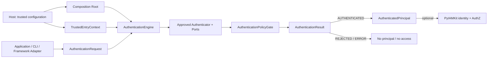
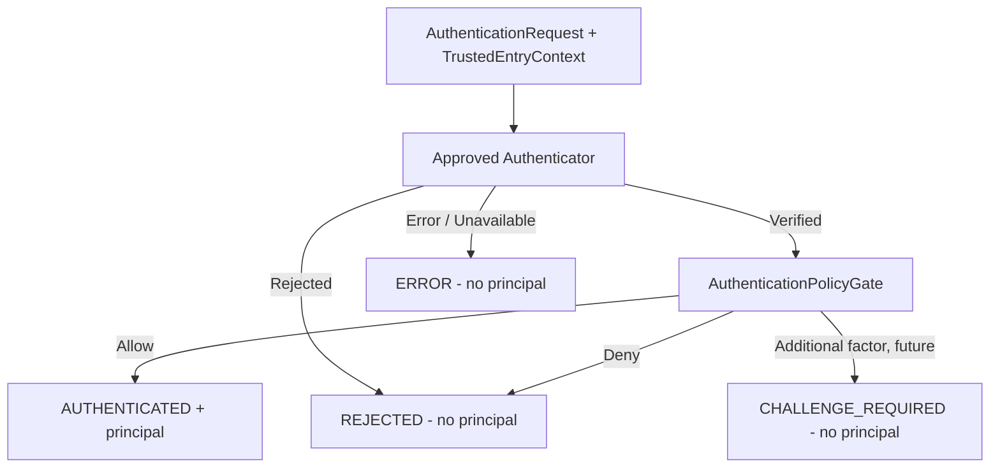
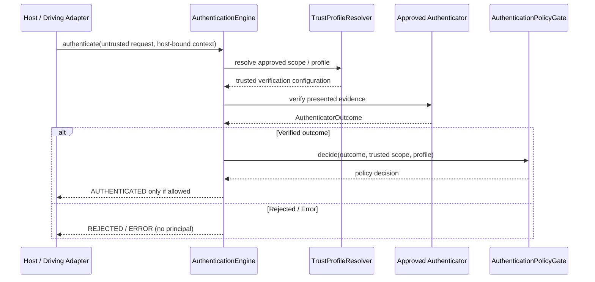
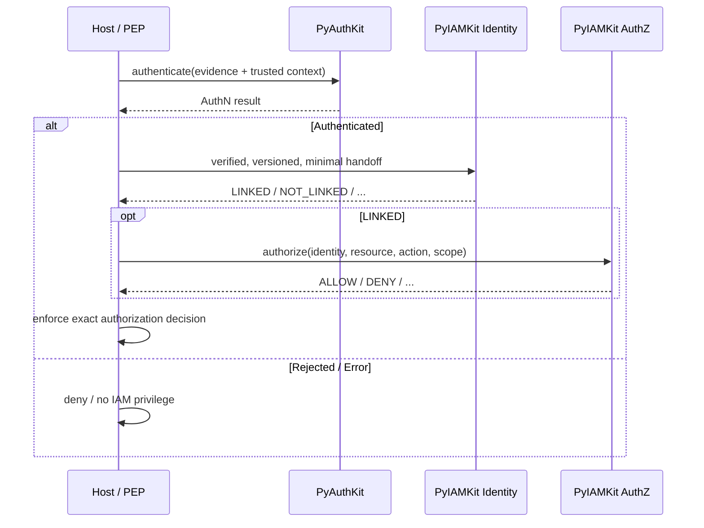
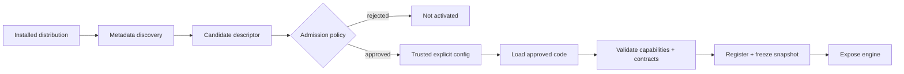
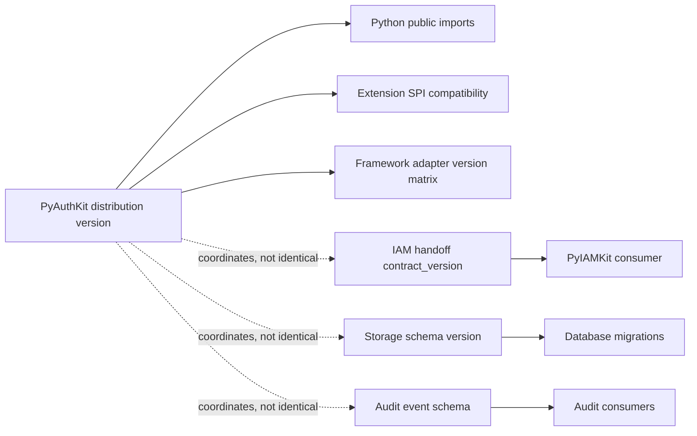

# 24_PYAUTHKIT_PUBLIC_API_AND_SDK_DESIGN

# PyAuthKit - Public API and Python SDK Design

> **Projet :** PyAuthKit  
> **Document :** `24_PYAUTHKIT_PUBLIC_API_AND_SDK_DESIGN.md`  
> **Nature :** spécification de surface publique, ergonomie, contrats, packaging et compatibilité  
> **Version documentaire :** 0.1.0 (proposition)  
> **Date :** 2026-10-31  
> **Statut :** PROPOSED / DESIGN - aucune API installable, stable ou qualifiée n'est attestée  
> **Langue :** français, noms de types et signatures Python en anglais  
> **Convention :** `PYAUTHKIT_SOFTWARE_DESIGN_LEARNING_CONVENTION.md`  
> **Sources de conception :** `00` à `23`  
> **Documents aval :** `25_PYAUTHKIT_CONFIGURATION_MODEL.md`, `26_PYAUTHKIT_TESTING_AND_QUALIFICATION_STRATEGY.md`, `27_PYAUTHKIT_IMPLEMENTATION_ROADMAP.md`, `28_PYAUTHKIT_IMPLEMENTATION_BOOTSTRAP_PLAN.md`

**Règle de lecture.** Ce document stabilise le *langage candidat* de l'API publique. Il n'affirme pas l'existence dans le dépôt d'une classe, d'un extra pip, d'une distribution PyPI, d'une implémentation cryptographique ni d'une garantie de compatibilité déjà publiée. Les signatures Python sont des *design sketches*. Les décisions non closes sont explicitement identifiées `SDK-DEC-*`.

**North Star :** *Simple to call, difficult to misuse, impossible to mistake authentication for authorization.*

---

## Guide de lecture

1. **0-10 :** objectifs, périmètre, frontières, vocabulaire et objets exposés.
2. **11-24 :** méthode principale, construction du moteur, comportements, méthodes et résultats.
3. **25-38 :** adapters, intégration IAM, async, plugins, sécurité de surface, compatibilité.
4. **39-47 :** packaging, exemples Python, qualification, menaces, invariants et tests.
5. **48-55 :** arbitrages, ADR, Design Learning Cards, DoD, traçabilité et annexes.

Les sections **MVP** précisent le noyau candidat Password/API Key/JWT. Les sections **POST-MVP** décrivent des évolutions prévues dans les documents `11` à `17` : elles ne constituent pas un engagement de livraison de la première release.

---

## 0. Résumé exécutif

PyAuthKit doit offrir à une application Python une API d'authentification cohérente, utilisable indépendamment de Django, FastAPI, Flask, PostgreSQL, Redis ou PyIAMKit. La forme ergonomique initiale reste :

```python
# DESIGN SKETCH ONLY - no installable SDK or verification implementation implied.
result = await engine.authenticate(request, trusted_entry=host_context)
```

Cette simplicité est **une façade**, pas une suppression des frontières de confiance : `request` contient de l'evidence non fiable, tandis que `host_context` doit provenir d'une construction de confiance opérée par l'hôte. La signature exacte pourrait devenir une API de dependency injection par adapter ; elle ne doit pas autoriser le client HTTP à fournir lui-même son `TrustedScope`.

Le SDK sépare cinq responsabilités :

1. recevoir une intention d'authentification et des preuves présentées ;
2. sélectionner un profil de confiance et un authenticator approuvés ;
3. vérifier la preuve via des contrats de ports et adapters contrôlés ;
4. appliquer la décision finale AuthN et produire un résultat discriminé ;
5. proposer un handoff optionnel vers PyIAMKit, sans attribuer de permission.

La surface publique est organisée autour de `AuthenticationEngine`, `AuthenticationRequest`, `AuthenticationResult`, `AuthenticatedPrincipal` et d'un moyen explicite d'établir le contexte hôte. Les ports, registries, policies et plugins restent principalement des interfaces de **composition**. L'API runtime ordinaire doit être plus petite que l'architecture interne.

## 1. Filiation documentaire et priorité des sources

| Document | Autorité fonctionnelle pour `24` | Ce que `24` ne remplace pas |
|---|---|---|
| `00` | Intention `await auth.authenticate(request)` ; moteur agnostique | Expression du besoin |
| `01` | exigences FR/NFR/SEC/ARC/INT | registre d'exigences initial |
| `02` | vision et principes SOLID/DDD/Hexagonal | arbitrages de vision |
| `03` | pipeline, composants et ports `PORT-*` | architecture système |
| `04-06` | vocabulaire et relations d'objets | classification DDD détaillée |
| `07` | invariants fondamentaux et fail-closed | catalogue normatif des règles du domaine |
| `08` | Commands/Queries/Use Cases et DTO | cas d'usage applicatifs |
| `09` | orchestration, résultats, trust gate | contrat interne du moteur |
| `10` | Authenticators, credentials, Password/API Key/JWT | vérification des preuves |
| `11-12` | flows, challenges, MFA, assurance | machines à états et AAL |
| `13` | sessions, tokens, rotation, révocation | gestion de sessions/tokens |
| `14-17` | fédération, passkeys, NHI, risque | profils protocolaires spécialisés |
| `18` | ports, adapters, plugins, registry | architecture d'extension et admission |
| `19` | persistence et cohérence | choix/contrats des stores |
| `20` | Threat Model, menaces et contrôle | analyse STRIDE et risques |
| `21` | audit et observabilité | garanties de livraison et confidentialité |
| `22` | intégrations frameworks | comportement spécifique ASGI/WSGI |
| `23` | contrat AuthN → IAM/AuthZ | ownership des identités et permissions |
| Convention | *Problem First, Trust First, Pattern Second* | pédagogie et gouvernance du design |

Une proposition de `24` conflictuelle avec un invariant de `07`, une frontière de `20` ou un contrat inter-contextes de `23` doit être **mise en attente d'ADR**, jamais imposée par l'ergonomie souhaitée.

## 2. Problème réel : une API simple peut être dangereuse

Une API trop générique peut laisser le caller :

- choisir arbitrairement un issuer JWT ou une source de JWKS ;
- substituer un tenant non autorisé ;
- déclarer `authenticated=True` sans vérification ;
- interpréter `AuthenticationResult` comme une permission ;
- exposer un secret via `repr`, `str`, exceptions ou logs ;
- modifier un registry pendant qu'une tentative est en cours ;
- provoquer une panne ouverte quand une dépendance est inaccessible.

À l'inverse, une API qui exige vingt classes, un `CommandBus`, un `UnitOfWork` et un conteneur DI obligatoire pour vérifier une API key serait disproportionnée. Le contrat doit rester minimal tout en imposant des *trust boundaries* non négociables.

## 3. Objectifs et critères de qualité de l'API

| Dimension | Attendu observable | Anti-objectif |
|---|---|---|
| Ergonomie | un appel d'authentification lisible | magie implicite à l'import |
| Sécurité | séparation evidence / contexte approuvé | `trusted=True` depuis JSON |
| Extensibilité | nouveaux authenticators via composition approuvée | `if provider` central |
| Agnosticisme | core Python sans framework Web | import FastAPI par défaut |
| Typage | statuts discriminés et surfaces annotées | `dict[str, Any]` partout |
| Testabilité | temps, stores et cryptographie injectables | clock cachée / singleton mutable |
| Opérabilité | corrélation, erreurs bornées et audit minimisé | secrets dans les logs |
| Compatibilité | règles de version et de migration explicites | changements silencieux de sûreté |
| Performance | peu d'objets obligatoires et IO maîtrisée | proxy sync qui bloque l'event loop |
| Documentation | exemples Python pur avant frameworks | snippets qui simulent un vrai verifier |

## 4. Périmètre MVP, POST-MVP et hors périmètre

### 4.1 MVP candidat

- `AuthenticationEngine.authenticate(...)` asynchrone ;
- `AuthenticationRequest` et preuves présentées avec discriminant de méthode ;
- `TrustedEntryContext` établi par l'hôte, sous une forme à arbitrer ;
- `AuthenticationResult` discriminé (`AUTHENTICATED`, `REJECTED`, `ERROR`, éventuellement `UNAVAILABLE`) ;
- `AuthenticatedPrincipal` avec provenance et scope ;
- `PasswordAuthenticator`, `APIKeyAuthenticator`, `JWTAuthenticator`, uniquement après injection de ports cryptographiques fiables ;
- bootstrap par configuration approuvée, résolution déterministe et registry gelé ;
- politiques AuthN, audit expurgé et horloge injectable ;
- exemples Python pur et intégration hôte minimale.

### 4.2 POST-MVP

- `CHALLENGE_REQUIRED` et handle de continuation ;
- MFA, assurance et step-up ;
- sessions, refresh token families et émissions de tokens séparées ;
- fédération OIDC/SAML, passkeys et passwordless ;
- identité des workloads, agents et délégation ;
- risque adaptatif et plugins spécialisés ;
- adapters supplémentaires avec leurs dépendances optionnelles.

### 4.3 Hors périmètre du SDK AuthN

- moteur universel de droits IAM, RBAC/ABAC ;
- catalogue des comptes, organisations et permissions ;
- annuaire LDAP/SCIM complet ;
- interface de login ou serveur IAM complet ;
- stockage imposé, IdP obligatoire ou cloud propriétaire ;
- sérialisation automatique de toute preuve brute ;
- attestations formelles de conformité NIST/OWASP/SOC 2 sans vérification.

## 5. Audiences, scénarios et modes de consommation

| Audience | Usage | API candidate | Contraintes |
|---|---|---|---|
| développeur Python | authentifier dans un worker/CLI | `await engine.authenticate(...)` | pas de transport HTTP requis |
| développeur FastAPI | dependency hôte | adapter `integrations.fastapi` | scope serveur, pas de privileges implicites |
| développeur Django | backend ou service d'AuthN | `integrations.django` | préserver `request.user`/sessions natives |
| développeur Flask | hook ou décorateur | `integrations.flask` | WSGI/sync explicite |
| équipe sécurité | imposer trust profiles/policies | API de bootstrap/configuration | configuration vérifiable et figée |
| auteur d'adapter | implémenter un port | `pyauthkit.ports.*` | tests contractuels et pas d'effet de bord caché |
| auteur de plugin | fournir une capability approuvable | plugin descriptor et factory | discovery != admission != activation |
| propriétaire de services IAM | consommer un handoff | adapter `integrations.iam` | AuthN != identity != AuthZ |
| agent/workload runtime | identité technique puis mandat éventuel | capacités POST-MVP | identité d'agent != délégation utilisateur |

## 6. Taxonomie publique et niveaux de stabilité

| Niveau | Surface | Compatibilité promise | Exemple candidat |
|---|---|---|---|
| `PUBLIC_RUNTIME` | appel métier documenté | cible de stabilité selon release | `AuthenticationEngine.authenticate` |
| `PUBLIC_VALUE` | objets d'entrée/sortie | changements contrôlés | `AuthenticationRequest`, `AuthenticationResult` |
| `PUBLIC_BOOTSTRAP` | composition explicite | compatibilité versionnée | `build_authentication_engine` (candidat) |
| `EXTENSION_SPI` | ports d'extension | compatibilité par contrat/capability | `Authenticator`, `PasswordVerifier` |
| `INTEGRATION` | adapters optionnels | matrice par versions | `pyauthkit.integrations.fastapi` |
| `INTERNAL` | détails de runtime | non garanti | `ResultNormalizer`, pipeline privé |
| `EXPERIMENTAL` | capacité à arbitrer | opt-in / pré-release | MFA/session/plugin auto-discovery |

**SPI** (*Service Provider Interface*) : interface destinée aux auteurs d'intégration ; elle est publique pour ce public, mais non requise de l'utilisateur final. Un objet importable n'est pas nécessairement stable ; **les exports stables doivent être explicitement catalogués**.

## 7. Ubiquitous Language : termes qu'une API ne doit pas confondre

| Terme | Définition à préserver | Confusion à éviter |
|---|---|---|
| `AuthenticationRequest` | intention + preuve présentée | HTTP request ou preuve déjà validée |
| `PresentedEvidence` | matériel soumis, sensible et non fiable | credential record local |
| `ClaimedIdentity` | identité revendiquée par l'appelant | `VerifiedSubject` |
| `TrustedEntryContext` | liaison hôte approuvée | simple dataclass reçue depuis JSON |
| `TrustedScope` | portée validée par l'hôte | header `X-Tenant-ID` libre |
| `TrustProfile` | politique d'autorité, clés, issuer, méthodes | champs non vérifiés d'un JWT |
| `AuthenticatorOutcome` | verdict interne du mécanisme | succès final du moteur |
| `VerifiedSubject` | sujet vérifié sous profil et scope | permission IAM |
| `AuthenticationResult` | décision finale AuthN discriminée | `AuthorizationDecision` |
| `AuthenticatedPrincipal` | sujet authentifié, provenance et assurance éventuelle | `User` Django ou rôle |
| `AuthenticationSession` | état de maintien AuthN si owned | bearer token / permission |
| `VerificationKeyResolver` | source de clés approuvées | téléchargement arbitraire de `jku` |
| `CredentialReference` | localisateur non secret d'un record | preuve de possession |
| `PluginDescriptor` | métadonnées d'une extension | preuve d'intégrité et d'admission |

## 8. Cartographie de l'expérience développeur



L'expression visuelle `REQ --> ENGINE` représente la soumission de l'evidence **non fiable** ; `ENTRY --> ENGINE` représente une entrée différente, établie par une autorité de l'hôte. Ce schéma n'autorise aucun raccourci via le runtime Python ou l'import d'une classe.

## 9. Politique de conception : public minimal, cœur explicite

La façade initiale n'expose que ce qu'un développeur doit maîtriser pour l'opération AuthN. Les abstractions `Repository`, `Policy`, `Registry`, `Factory` et `Port` sont nommées dans la documentation lorsqu'elles répondent à une pression réelle, mais ne deviennent pas automatiquement des classes exportées depuis `pyauthkit.__init__`.

**Alternative simple privilégiée :** `AuthenticationEngine` peut orchestrer sans `AuthenticateUseCase` distinct, selon le choix ouvert dans `09` et `08`. Si le use case est introduit, la façade **délègue** au lieu de dupliquer les vérifications.

## 10. Surface d'import publique candidate

### 10.1 Facade ergonomique

```python
# Names below are design candidates, not confirmed imports.
from pyauthkit import (
    AuthenticationEngine,
    AuthenticationRequest,
    AuthenticationResult,
    AuthenticatedPrincipal,
)
```

La présence de `AuthenticationResult` dans l'import ne préjuge pas de sa matérialisation concrète (type union, protocole scellé, classe de base). L'intention est de permettre un `match`/discriminant sûr, sans `cast` ou `Any` systématique.

### 10.2 Surfaces spécialisées

```text
pyauthkit                    # façade mince, types essentiels (candidat)
pyauthkit.domain             # vocabulaire public explicitement autorisé
pyauthkit.application        # contrats applicatifs, usages avancés
pyauthkit.ports              # extension SPI (Protocol)
pyauthkit.authenticators     # implémentations approuvées / factories
pyauthkit.bootstrap          # composition root
pyauthkit.integrations.*     # adapters optionnels
pyauthkit.plugins            # API d'extension contrôlée
pyauthkit._internal          # aucun contrat de stabilité
```

Ce découpage représente une **carte logique candidate**, pas une obligation de multiplier les fichiers. Les namespaces privés et les re-exports doivent être vérifiés contre la distribution effectivement publiée avant de les annoncer dans une release.

---

## 11. `AuthenticationRequest` : entrée sensible mais non vérifiée

### 11.1 Contrat conceptuel

`AuthenticationRequest` exprime une tentative : méthode demandée, evidence présentée, éventuelle revendication d'identité et métadonnées strictement bornées. Il ne doit pas porter une décision de confiance, une permission, un `AuthenticatedPrincipal` ou un profil cryptographique sélectionné par le client.

```python
# DESIGN SKETCH - not yet a canonical constructor.
from dataclasses import dataclass
from typing import Literal

@dataclass(frozen=True, repr=False)
class PresentedEvidence:
    method: Literal["password", "api_key", "jwt"]
    opaque_payload: bytes  # sensitive, untrusted, bounded at the adapter

@dataclass(frozen=True, repr=False)
class AuthenticationRequest:
    evidence: PresentedEvidence
    claimed_subject: str | None = None  # untrusted lookup hint
```

**Interdiction :** `request.tenant_id` ne peut pas décider seul du tenant effectif. Un éventuel champ de préférence tenant doit être rapproché d'une autorité hôte préexistante.

### 11.2 Validation structurelle vs AuthN

- **Structure** : type, taille, encodage, limites de profondeur, caractères invalides, format supporté.
- **Vérification** : preuve cryptographique ou credential store sous profil autoritatif.
- **Décision finale** : politique AuthN et assurance requise.

Un DTO peut être bien formé et contenir une preuve invalide. Aucune `pydantic.BaseModel`, `dataclass` ou validation JSON ne prouve une authentification.

### 11.3 Nullabilité et secrets

Les éléments optionnels doivent réellement être optionnels pour la méthode concernée. `claimed_subject=None` est admissible pour une authentication username-less ou certains tokens ; un mot de passe avec utilisateur connu peut en avoir besoin. Éviter un champ universel `credentials: dict[str, Any]` sans schéma par méthode.

## 12. `TrustedEntryContext` : source d'autorité et injection

### 12.1 Invariant principal

Le `TrustedEntryContext` provient d'un binding ou routage approuvé détenu par l'application hôte, **pas** de l'evidence qu'il accompagne. Un simple nom de classe, un mot-clé `trusted` ou une structure immuable ne fournissent pas une frontière cryptographique.

Une API publique peut accepter un objet `trusted_entry` si :

1. la construction de l'objet est liée à une configuration hôte contrôlée ;
2. l'adapter sait comment associer une route/application à un scope ;
3. le moteur revalide les références et la compatibilité avec ses trust profiles ;
4. les comptes/claims client ne peuvent pas changer l'autorité effective ;
5. l'hôte documente les conséquences si du code applicatif malveillant possède déjà les privilèges de composition.

### 12.2 Trois options pour le passage du contexte

| Option | API | Bénéfice | Risque | Statut |
|---|---|---|---|---|
| A - paramètre explicite | `authenticate(request, trusted_entry=...)` | traçabilité, testabilité | caller peut construire un faux objet sans contrôle | **recommandation candidate** |
| B - instance liée au scope | `bound_engine.authenticate(request)` | réduit surface d'erreur | multi-tenant dynamique plus délicat | à arbitrer |
| C - injection par adapter | `dependency(request)` | ergonomie framework | sécurité dépend du binding hôte | intégration seulement |

**Recommandation :** utiliser A dans les exemples Python pur, sous condition d'un `TrustedEntryResolver`/composition root qui valide l'origine de l'objet. B ou C peuvent être des façades sûres supplémentaires, si leur construction est contrôlée.

### 12.3 Préserver les tenants

```text
Client-supplied tenant hint       -> untrusted
Host route/application binding    -> authoritative entry source
TrustedScopeResolver              -> server-side resolved scope
TrustProfileResolver              -> approved cryptographic profile
Authenticator                     -> verifies only within this scope
```

Sur divergence, le moteur refuse ou demande un autre flow approuvé ; il ne change pas silencieusement de tenant.

## 13. `AuthenticationResult` : union discriminée




### 13.1 Statuts candidats

| Statut | Principale sémantique | Principal final ? | Présentation à l'appelant |
|---|---|---|---|
| `AUTHENTICATED` | preuve vérifiée et policy AuthN satisfaite | exactement un | succès AuthN, pas AuthZ |
| `REJECTED` | preuve/policy insuffisante | aucun | refus générique et non énumératif |
| `ERROR` | erreur interne/contrat/condition d'exécution | aucun | code sûr, correlation id |
| `UNAVAILABLE` | dépendance critique indisponible, si statut distinct retenu | aucun | temporaire, sans fallback permissif |
| `CHALLENGE_REQUIRED` | preuve supplémentaire nécessaire | aucun | POST-MVP, continuation bornée |

`UNAVAILABLE` peut être un sous-type de `ERROR` si le modèle d'erreurs de `09` le préfère : **ne pas stabiliser les deux simultanément sans ADR**. Les champs du résultat doivent refléter le statut, pas autoriser un objet contradictoire.

### 13.2 Modèle Python discriminé pédagogique

```python
# CONCEPTUAL DTO SHAPES - no actual cryptographic verifier is included.
from dataclasses import dataclass
from typing import Literal, TypeAlias

@dataclass(frozen=True)
class Authenticated:
    status: Literal["AUTHENTICATED"]
    principal: "AuthenticatedPrincipal"
    correlation_id: str

@dataclass(frozen=True)
class Rejected:
    status: Literal["REJECTED"]
    reason_code: str
    correlation_id: str

@dataclass(frozen=True)
class AuthError:
    status: Literal["ERROR"]
    error_code: str
    correlation_id: str

AuthenticationResult: TypeAlias = Authenticated | Rejected | AuthError
```

Le code est un exemple de typage ; `AuthenticatedPrincipal` est défini par les modèles `04-06` et son constructeur sécurisé n'est pas montré. La version finale pourra utiliser `Enum`, types nommés ou modèles de domaine différents, avec les mêmes **invariants observables**.

### 13.3 Lecture sûre côté client

```python
# DESIGN SKETCH - engine is an injected, approved implementation.
result = await engine.authenticate(request, trusted_entry=host_context)

match result.status:
    case "AUTHENTICATED":
        principal = result.principal  # AuthN fact, not permission
        # Optional IAM / resource policy check must happen separately.
    case "REJECTED":
        deny_generic_access()
    case "ERROR" | "UNAVAILABLE":
        report_temporary_failure(result.correlation_id)
    case "CHALLENGE_REQUIRED":
        require_explicit_continuation(result)
    case _:
        deny_generic_access()  # unknown statuses must not grant access
```

Les fonctions `deny_generic_access`, `report_temporary_failure` et `require_explicit_continuation` sont des placeholders de l'application hôte. La variable `result` correspond à une **union candidate**, donc le code d'exemple vise la sémantique et non la preuve d'un narrowing effectif par mypy.

## 14. `AuthenticatedPrincipal` : contrat public sans effet IAM

Le principal résultant représente une identité **authentifiée** dans un contexte défini. Son contrat candidat contient :

- `principal_type` : HUMAN / SERVICE / APPLICATION / AGENT / DEVICE / WORKLOAD / EXTERNAL ;
- `subject_id` et `subject_namespace` ou équivalent unique ;
- `issuer_id` ou autorité de credential vérifiée ;
- `trusted_scope_ref` et éventuellement `tenant_binding_ref` côté hôte ;
- `method` et référence de profil de confiance ;
- `authenticated_at`, `verified_at`, provenance ;
- assurance validée, si capacité activée et réellement prouvée.

**Absences intentionnelles :** `is_admin`, `permissions`, `roles`, `group_ids`, `organization_membership`, `authorized_resources`, `delegated_user_permissions`. Ces données sont gérées par PyIAMKit ou un autre service d'autorisation déclaré.

**Stabilité de l'identité :** ne pas confondre email, display name, external subject, session id et subject local IAM. OIDC nécessite un namespace `issuer + sub` correctement profilé, conformément au document `14`.

## 15. Facade `AuthenticationEngine` : préconditions et postconditions




### 15.1 Contrat candidat

```python
# API DESIGN - signature subject to SDK-DEC-001/002.
class AuthenticationEngine:
    async def authenticate(
        self,
        request: "AuthenticationRequest",
        *,
        trusted_entry: "TrustedEntryContext",
    ) -> "AuthenticationResult":
        ...
```

Aucune politique, clé ou base de données ne doit être découverte implicitement par `authenticate()`. Les dépendances sont composées et vérifiées lors du bootstrap ou résolues à partir d'une configuration serveur approuvée.

### 15.2 Préconditions

- engine dans un état prêt (`READY`) avec registry sans collisions ;
- méthode supportée et approuvée pour le scope effectif ;
- trust profile non ambigu, valide pour ce contexte ;
- request bornée ;
- policy de rate limiting/audit déterminée ;
- mécanismes critiques et ressources de vérification explicitement déclarés ;
- décisions sur deadline/cancellation définies.

### 15.3 Postconditions

- aucun `AuthenticatedPrincipal` en cas de refus ou d'incertitude ;
- `AUTHENTICATED` uniquement après `AuthenticatorOutcome` valide **et** `AuthenticationPolicyGate` favorable ;
- un `correlation_id` non secret et un diagnostic interne borné ;
- aucune émission automatique de session, access token, IAM grant ou mandat ;
- aucune mutation globale d'un registry en cours de requête ;
- aucun secret dans `str`, `repr`, log ou message d'erreur standard.

## 16. Bootstrap explicite : composition root

### 16.1 API candidate de composition

Deux modèles sont raisonnables, mais ne doivent pas être imposés ensemble sans nécessité.

**Option A : fonction de bootstrap à paramètres explicites.**

```python
# ILLUSTRATION ONLY - constructors and factory are not implemented.
engine = build_authentication_engine(
    trust_profiles=approved_profiles,
    authenticators=[password_authenticator, api_key_authenticator, jwt_authenticator],
    policy_gate=authn_policy,
    audit_sink=redacted_audit_sink,
    clock=clock,
)
```

**Option B : builder temporaire avec `freeze()`.**

```python
# ILLUSTRATION ONLY - builder is a candidate, not a required GoF pattern.
builder = AuthenticationEngineBuilder()
builder.register(password_authenticator)
builder.register(api_key_authenticator)
builder.register(jwt_authenticator)
engine = builder.freeze(approved_configuration)
```

**Trade-off :** l'option A est plus simple et probablement suffisante pour le MVP. B devient utile si l'inventaire des extensions, la validation préalable et le gel atomique créent une pression de construction réelle. `Builder` ne sera pas introduit uniquement pour enseigner le GoF Builder.

### 16.2 Validation au bootstrap

- rejeter duplications ou ambiguïtés dans les méthodes exposées ;
- vérifier les capabilities réellement supportées ;
- refuser un profil de confiance manquant ou contradictoire ;
- vérifier configurations de clés, issuer et audience ;
- vérifier qu'aucun plugin découvert ne s'active sans admission ;
- imposer une configuration de l'audit selon son niveau de durabilité ;
- désactiver les callbacks transport/IO non nécessaires ;
- publier une génération immuable de runtime après validation.

### 16.3 Aucun Service Locator caché

`AuthenticationEngine()` qui récupère automatiquement un `global_db`, un environnement mutable ou un compte utilisateur courant dans un module est à proscrire si cela empêche l'isolement des tenants et le déterminisme des tests. L'injection n'impose pas de conteneur DI ; des constructeurs Python ordinaires suffisent souvent.

## 17. Authenticator SPI : comportement substituable

### 17.1 Port candidat

```python
# EXTENSION SPI SKETCH - returned outcome is not final authentication.
from typing import Protocol

class Authenticator(Protocol):
    @property
    def method(self) -> str: ...

    async def authenticate(
        self,
        evidence: "PresentedEvidence",
        context: "VerificationContext",
    ) -> "AuthenticatorOutcome": ...
```

Le contrat ne doit pas rendre le plugin capable de choisir `TrustedScope`, de changer une policy active ou de construire le `AuthenticationResult` final. Les outcomes `VERIFIED`, `REJECTED`, `ERROR`, `UNAVAILABLE` suivent les invariants documentés dans `09` et `10`.

### 17.2 Substituabilité

Deux implémentations d'un même authenticator doivent respecter le même contrat : validation de scope, erreurs structurées, deadlines, redaction, compensation/cancellation et provenance. Les tests de substituabilité ne suffisent pas à garantir la sûreté d'un plugin inconnu : admission et audit restent nécessaires.

## 18. Méthodes Password, API Key et JWT : ergonomie et bornes

| Méthode | Evidence présentée | Dépendances approuvées | Public runtime | Sécurité spécifique |
|---|---|---|---|---|
| Password | sujet revendiqué + secret | CredentialResolver + PasswordVerifier | `method="password"` | KDF, timing, rate limit, état record |
| API Key | token/API key bearer | ApiKeyCredentialResolver + ApiKeyVerifier | `method="api_key"` | lookup scindé, scope, rotation/revocation |
| JWT | bearer compact signé | TrustProfileResolver + VerificationKeyResolver + SignedTokenVerifier | `method="jwt"` | issuer/audience/alg, signature et claims |

Les détails de validation, limites cryptographiques, configuration et menaces sont définis dans `10`, `07`, `20`. Le SDK ne réimplémente pas ces décisions dans une fonction pratique de raccourci.

### 18.1 Interdictions spécifiques

- `authenticate_jwt(token, verify=False)` ne doit pas exister comme API d'authentification.
- `authenticate_password(password, hash=client_supplied_hash)` ne peut pas donner au client le contrôle de la politique de vérification.
- `authenticate_api_key(key, tenant=untrusted_header)` ne peut pas redéfinir le scope effectif.
- `authenticate(method="auto")` ne peut pas tester successivement des credentials non équivalents et accepter le premier succès.

## 19. API de capabilities et diagnostics

Une lecture des méthodes supportées peut aider l'hôte à présenter les parcours disponibles :

```python
# OPTIONAL CANDIDATE - sanitized data, no key IDs or privileged policy content.
methods = engine.supported_methods(trusted_scope=server_scope)
```

Ce diagnostic n'expose ni liste d'API keys valides ni empreintes, keys IDs sensibles, secrets, identifiants de comptes ou détails de sécurité exploitables. `supported_methods` peut être réservé aux appels internes/bootstrap et ne doit pas nécessairement figurer sur `AuthenticationEngine` dans la première release.

## 20. Erreurs : verdict métier, dépendance en panne et erreur de programmation

### 20.1 Trois couches d'erreurs

| Couche | Exemple | Traitement |
|---|---|---|
| Résultat métier attendu | password invalide, credential révoqué | `REJECTED`, message public neutre |
| Indisponibilité opérationnelle | JWKS introuvable, store inaccessible | `ERROR`/`UNAVAILABLE`, aucun succès |
| Erreur de programmation/configuration | registry invalide, contrat non satisfait | bootstrap refusé ou exception typée |

**Principe :** ne pas transformer un bug de programmation ou une mauvaise configuration de trust en simple `invalid credentials` indistinct dans les diagnostics internes. La réponse externe peut être neutralisée pour réduire l'énumération des comptes.

### 20.2 Hiérarchie d'exception candidate

```python
# ILLUSTRATION - names not yet exported in an actual SDK.
class PyAuthKitError(Exception):
    """Base for typed SDK failures; never hold credentials in args."""

class ConfigurationError(PyAuthKitError):
    """Invalid bootstrap or trust policy configuration."""

class UnsupportedMechanismError(ConfigurationError):
    """Mechanism requested by setup is unavailable or unapproved."""

class ContractViolationError(PyAuthKitError):
    """An extension or adapter violated its declared contract."""
```

Les exceptions ne portent pas de secret dans leurs `args`, `__cause__` formatés ou attributs imprimables. La politique d'exception vs résultat doit être alignée sur `09` et réglée par `SDK-DEC-006`.

### 20.3 Codes publics candidats

- `INVALID_CREDENTIALS` : refus neutre, sans divulguer existence d'un compte ;
- `AUTHENTICATION_NOT_ALLOWED` : refus de policy, détails internes non sensibles ;
- `METHOD_NOT_SUPPORTED` : méthode absente dans un scope approuvé ;
- `AUTHENTICATION_TEMPORARILY_UNAVAILABLE` : indisponibilité de dépendance ;
- `AUTHENTICATION_CONTEXT_INVALID` : contexte hôte non accepté, log interne sans secret ;
- `CHALLENGE_REQUIRED` : POST-MVP, continuation nécessaire ;
- `AUTHENTICATION_TIMEOUT` : deadline expirée, aucun succès.

Les codes sont **candidats** et doivent être figés une seule fois dans un registre versionné, sans introduire de différences de réponse exploitables pour énumérer les comptes.

## 21. Async-first et contrat de concurrence

### 21.1 Règle principale

L'API runtime est `async def authenticate`, car les ports peuvent effectuer des IO (credential store, JWKS, audit, risk service). Cela ne signifie pas que chaque opération cryptographique est réellement non bloquante : un KDF CPU-bound devra être exécuté sous des limites adéquates.

### 21.2 Cancellation et deadlines

- la cancellation de l'appelant ne doit jamais produire `AUTHENTICATED` ;
- les opérations à consommation unique doivent rester atomiques avec leurs éventuelles side effects ;
- un timeout sur un store critique ne doit pas être interprété comme absence de credential valide ;
- les retries automatiques sont interdits lorsque l'opération peut consommer un challenge ou faire tourner un refresh token sans stratégie d'idempotence ;
- l'engine doit pouvoir être partagé entre requêtes sans stocker un principal courant dans un attribut mutable.

### 21.3 `ContextVar` ne porte pas la confiance

Un `ContextVar` peut servir à la corrélation de logs dans une requête async, mais ne doit pas devenir l'unique porteur d'autorité tenant, de permission ou de trust profile. Tout contexte de sécurité nécessaire à une décision doit être passé ou résolu par un contrat explicite, couvert par des tests de concurrence.

## 22. Faut-il une façade synchrone ?

**Décision ouverte `SDK-DEC-007`.** Trois options :

1. **Async only au MVP** : le plus petit contrat, facile à tester ; CLI sync utilise `asyncio.run` en couche extérieure contrôlée.
2. **Façade sync explicite** `authenticate_sync` : ergonomie WSGI/CLI, mais attention aux event loops déjà actifs et adapters async.
3. **API sync indépendante** : coûteuse et risquée si elle duplique les règles de sécurité.

**Recommandation actuelle :** option 1, documenter l'intégration Flask/Django sans prétendre qu'un appel sync peut être effectué n'importe où depuis une boucle active. Si un pont sync est ajouté, il doit être une couche externe testée, jamais un `asyncio.run()` caché au sein de `async def`.

## 23. Retour d'une opération MFA : pas de succès prématuré

Pour le POST-MVP, si une policy exige un facteur supplémentaire, le résultat ne doit pas contenir de `AuthenticatedPrincipal` final. Le modèle candidat est :

```python
# FUTURE SKETCH - no challenge issuing implementation is provided.
from dataclasses import dataclass
from typing import Literal

@dataclass(frozen=True)
class ChallengeRequired:
    status: Literal["CHALLENGE_REQUIRED"]
    continuation_handle: str
    correlation_id: str
    expires_at: str
```

Le handle doit être opaque, scoped, lié au flow et à la tentative, limité dans le temps, non réutilisable après consommation, et géré conformément à `11`. Le *step-up* ne remplace pas une vérification d'autorisation sur la ressource (`12` et `23`).

## 24. Sessions et tokens : interfaces distinctes de l'AuthN pure

L'API d'authentification ne doit pas émettre par défaut un access token ou une session. Les capacités `SessionManager`, `TokenIssuer`, `TokenValidator`, `TokenRevoker` ou leurs alternatives sont **POST-MVP et conditionnelles** à un besoin réel.

```text
AuthenticationEngine.authenticate(...) -> AuthenticationResult

POST-MVP, if explicitly configured:
SessionManager.create_from_authenticated_result(...)
TokenIssuer.issue_for_approved_grant(...)
RefreshTokenManager.rotate_atomically(...)
```

Chaque opération possède ses propres préconditions : politique d'émission, audience, client, état de révocation, assurance et permissions **si l'autorisation ou le grant l'exigent**. Les access tokens et ID tokens ne sont pas des substituts universels aux sessions ; les JWT entrants doivent être vérifiés indépendamment de la capacité d'émission.

---

## 25. Handoff optionnel avec PyIAMKit




### 25.1 API d'intégration candidate

La traduction d'un `AuthenticationResult.AUTHENTICATED` en langage inter-contextes doit être explicite, via un adapter de publication/consommation contrôlé. `23` définit le contenu minimal du handoff, les comportements en cas d'identité non liée et la responsabilité de l'enforcement.

```python
# CONCEPTUAL HANDOFF - not a built-in success path of authenticate().
result = await engine.authenticate(request, trusted_entry=host_context)
if result.status != "AUTHENTICATED":
    deny_access()
else:
    handoff = handoff_adapter.from_authenticated_result(result)
    identity_resolution = await iam_resolver.resolve(handoff)
    if identity_resolution.status != "LINKED":
        deny_access()
    else:
        decision = await iam_authorizer.decide(
            identity_resolution.identity_ref,
            resource=resource_ref,
            action="read",
        )
        if decision.status != "ALLOW":
            deny_access()
        else:
            serve_resource()
```

`deny_access`, `serve_resource` et les objets IAM sont placeholders ; l'exemple explicite **les responsabilités**, sans implémenter un PEP ou un protocole de handoff fiable. Les contrats d'autorisation doivent porter tenant, action, ressource, actor/delegation le cas échéant, fraîcheur et provenance nécessaires.

### 25.2 Sémantique des refus IAM

`NOT_LINKED`, `AMBIGUOUS`, `DISABLED`, `SCOPE_MISMATCH`, `LINK_SUSPENDED`, `UNAVAILABLE`, `INVALID_PROOF` sont des statuts de résolution IAM possibles d'après `23`. Aucun n'est converti par PyAuthKit en authentification réussie supplémentaire ni en grant. Un compte créé par JIT provisioning ne peut être une conséquence implicite d'un login si la policy IAM ne le permet pas.

### 25.3 Transport inter-processus

Si PyAuthKit et PyIAMKit vivent dans des processus distincts, **une structure JSON contenant `authenticated: true` ne suffit pas**. Il faut une liaison de confiance inter-service : mTLS ou mécanisme standard signé approprié, audience, nonce/expiration, identité de l'émetteur, prévention du rejeu et autorisation du receiver. Le SDK public de PyAuthKit ne doit jamais laisser entendre qu'une dataclass `VerifiedAuthnHandoff` est inviolable par sa seule existence.

## 26. Intégration FastAPI et Starlette : choix de surface

### 26.1 API attendue

Une factory de dependency candidate pourrait :

1. extraire la preuve de la requête HTTP ;
2. appliquer les limites de taille et le parsing transport ;
3. obtenir du serveur un contexte d'entrée approuvé ;
4. appeler l'engine composé à la startup ;
5. convertir le résultat en une réponse HTTP sans secret ;
6. laisser l'hôte exécuter l'autorisation de la ressource.

### 26.2 Exemple pédagogique

```python
# DESIGN ONLY. Not a complete runnable FastAPI application.
# The dependency factory MUST bind host_context via trusted server configuration.
async def authenticate_request_from_http(
    http_request: "Request",
    engine: "AuthenticationEngine",
    trusted_entry: "TrustedEntryContext",
) -> "AuthenticationResult":
    evidence = extract_bounded_http_evidence(http_request)
    request = build_authentication_request(evidence)
    return await engine.authenticate(request, trusted_entry=trusted_entry)
```

`extract_bounded_http_evidence` et `build_authentication_request` sont des fonctions d'adapter non fournies. Ce code ne retourne ni `CurrentUser` Django ni `AuthorizedPrincipal`. Ne pas baser une permission locale sur des scopes `Security` FastAPI sans policy IAM applicative explicite.

### 26.3 Limites

- middleware : ne pas consommer deux fois le body ou bloquer le streaming ;
- propagation : `ContextVar` seulement pour diagnostic, pas source unique d'autorité ;
- OpenAPI : documenter l'authentification sans promettre qu'un scope OAuth est une permission métier ;
- erreurs : mapping HTTP spécifique au transport, pas logique de domaine ;
- cookie auth : CSRF, SameSite et origine appartiennent aussi à l'hôte ;
- startup : engine construit et validé une fois par génération, non par requête.

## 27. Intégration Django et DRF

Une éventuelle classe `AuthenticationBackend` ou `BaseAuthentication` est un adapter, pas le core. `request.user` désigne un objet/framework identity et ne doit pas être rempli avec un `AuthenticatedPrincipal` incompatible sans convention claire de mapping et de lifecycle.

**Scénario de coexistence :**

```text
Django/DRF request
   -> transport evidence extraction
   -> host trusted routing
   -> PyAuthKit AuthN result
   -> optional IAM/local-account resolution
   -> framework user mapping, if explicitly configured
   -> Django/DRF authorization/permissions
   -> protected view
```

En cas de `AUTHENTICATED` mais `NOT_LINKED`, l'authentification cryptographique reste vraie, mais l'application peut refuser la session ou les endpoints exigeant un compte local. Les sessions natives Django ne deviennent pas automatiquement des `AuthenticationSession` PyAuthKit.

**Décisions spécifiques** : mapping `request.user`, gestion du CSRF, appels sync/async, hook d'exception, backend ordering, session invalidation et éventuel re-login. Elles demeurent du ressort de l'adapter `22`.

## 28. Flask, WSGI, CLI et workers

- **Flask** : `before_request`, décorateur ou extension légère ; pas de magie sur le `g` mutable sans scope par requête ; un pont sync devra être qualifié.
- **CLI** : construire le contexte approuvé à partir du profil CLI/hôte, jamais d'un argument `--trusted-tenant` sans contrôles. Une CLI peut être une application locale autonome avec son propre bootstrap.
- **Worker** : chaque job porte une identité du workload vérifiable ; ne pas traiter le contenu d'un message d'une queue comme une autorité AuthN.
- **Agent** : authentifier l'agent puis vérifier distinctement un mandat de délégation pour l'action requise.

Les exemples spécialisés restent dans `22` et `16`. `24` définit la compatibilité de surface qui les concerne.

## 29. API plugin : découverte ≠ admission ≠ activation

### 29.1 Stades



Un entry point installé n'est ni une preuve de confiance ni un bac à sable. L'exécution de `ep.load()` exécute du code Python avec les privilèges du processus hôte. Les plugins inconnus exigent une gouvernance d'admission (provenance, signature/artefact lorsque requis, tests, allowlist, politique d'upgrade), conformément à `18` et `20`.

### 29.2 Compatibilité SPI

- une capability est explicitement déclarée ;
- la version de protocole/contrat est comparée à la version supportée ;
- une méthode inconnue, ambiguë ou non admise échoue au bootstrap ;
- l'extension n'obtient que les ports et permissions nécessaires ;
- les secrets d'autres tenants ne sont pas accessibles via un registry global ;
- les implémentations satisfont les mêmes tests de contrat ;
- la découverte de plugins reste désactivable pour les environnements durcis.

### 29.3 Ne pas exposer une API de chargement arbitraire

L'API ordinaire d'authentification ne propose pas `engine.load_plugin(name_from_request)`. Le choix des plugins est une opération du propriétaire de la configuration. Le mécanisme de découverte Python et la policy d'admission sont des sujets différents.

## 30. API d'audit, metrics et tracing

Le SDK expose seulement les données nécessaires à l'instrumentation, sans exporter les preuves :

- `correlation_id` et `attempt_id` comme identifiants non secrets ;
- statut final et catégorie d'échec bornée ;
- méthode, classe d'acteur et profil de trust sous une forme minimisée ;
- latence/compteurs sans haute cardinalité abusive ;
- événements d'audit suffisamment durables selon la policy de `21` ;
- trace context transmis sans devenir preuve AuthN ou source de tenant.

Le contrat interne `AuthenticationEventSink` peut être public comme **SPI** sans que l'utilisateur ordinaire importe `EventPublisher` ou un backend SIEM. Les exigences de confidentialité et de livraison appartiennent à `21`.

## 31. Sécurité des représentations, exceptions et sérialisation

### 31.1 Secret-safe `repr`

L'option la plus robuste n'est pas forcément un `SecretStr` propriétaire : un type sensible doit être défini par une politique de manipulation et de redaction, quel que soit le wrapper. `repr=False` est un garde-fou local mais ne garantit pas l'absence de fuite dans les buffers, outils de debug, arguments d'exception ou journaux.

```python
# EDUCATIONAL EXAMPLE: repr suppression, not a complete secret policy.
from dataclasses import dataclass, field

@dataclass(frozen=True)
class ApiKeyEvidence:
    key_id_hint: str | None
    secret: bytes = field(repr=False)

item = ApiKeyEvidence(key_id_hint="key-demo", secret=b"not-a-real-secret")
assert b"not-a-real-secret" not in repr(item).encode()
```

### 31.2 Sérialisation publique opt-in

Ne jamais proposer `result.to_dict(include_evidence=True)` ou `asdict(request)` dans des exemples de logs. Les DTO exposés par un API adapter ne doivent inclure que les champs approuvés pour ce transport. Les `AuthenticationResult` sont des objets de runtime, pas des claims JWT ou des handoffs signés par défaut.

### 31.3 Logging et PII

Tout chemin `__str__`, `__repr__`, `Exception`, `event`, `span.attribute`, `HTTP detail` et traceback exporté doit être contrôlé. La notion de `error_code` public ne justifie pas la divulgation d'issuer internes, de `kid` secrets ou d'existence d'un credential.

## 32. Sérialisation et version des schémas inter-processus

Une API Python en mémoire et un contrat wire sont deux engagements de compatibilité distincts.

| Surface | Versionnée par | Contrat |
|---|---|---|
| import Python | distribution PyAuthKit | nom/chemin/type/signature |
| result Python | API de runtime | discriminants + invariants |
| plugin SPI | version de contract/capability | substituabilité et admission |
| handoff IAM | `contract_version` inter-contextes | compatibilité receiver et validation |
| HTTP API adapter | schéma OpenAPI/HTTP | mapping safe vers RFC 9457 si retenu |
| storage | schema/migrations propres à `19` | cohérence et rétrocompatibilité |
| event audit | event schema/version propres à `21` | conservation et consommateurs |

Un changement de nom d'un champ Python n'est pas automatiquement un changement de schema de données stockées ; l'inverse est également vrai.

## 33. HTTP error mapping sans fuite AuthN/AuthZ

Le core ne retourne pas de code HTTP. L'adapter peut proposer une grille d'interprétation :

| Résultat | HTTP candidat | Notes |
|---|---|---|
| evidence absente ou invalide | 401 | défi `WWW-Authenticate` pertinent, sans détails énumératifs |
| authentifié mais accès refusé par IAM | 403 | résultat d'un composant AuthZ distinct |
| mécanisme non activé | 400/401 selon contrat | ne pas révéler une politique de tenant sensible |
| dépendance critique indisponible | 503 | ne jamais donner un succès permissif |
| erreur de forme | 400/422 selon adapter | validation de transport, pas verdict AuthN |
| challenge supplémentaire | 202/401/flow response selon protocole | dépend du transport et du flow, à spécifier dans `11/12/22` |

**RFC 9457** définit un format possible pour représenter les erreurs HTTP, non un modèle de résultat AuthN obligatoire. Les messages `detail` exposés peuvent nécessiter une redaction supplémentaire ; l'API Python conserve son propre contrat de résultat.

## 34. Compatibilité binaire, source et comportementale

Pour une bibliothèque Python pure, le contrat principal est la compatibilité d'import, de signature et de comportement ; les composants natifs éventuels exigent une qualification ABI séparée.

**Compatibilité source** : imports, kwargs, signatures, annotations utiles, types d'exception, discriminants, order de paramètres documenté.

**Compatibilité comportementale** : mêmes préconditions de confiance, interprétation des failures, conditions de succès, deadlines et règles de révocation. Un changement qui convertit un refus en succès ou affaiblit une vérification de sécurité est une **rupture majeure**, même si la signature Python reste identique.

**Compatibilité extension** : `Protocol` et interfaces remplacés seulement avec version de SPI, tests contractuels et plan de migration. L'usage de `@runtime_checkable` ne doit pas être pris comme preuve que la sécurité d'un adapter est vérifiée ; le typage structurel n'exécute pas de tests de cryptographie.

## 35. Versionnement des distributions et API




### 35.1 Version PEP 440

Le projet doit utiliser des versions publiques conformes à PEP 440, par exemple :

```text
0.1.0a1   # alpha
0.1.0b1   # beta
0.1.0rc1  # release candidate
0.1.0     # final
0.1.1     # maintenance release
```

Cette suite illustre le format, **pas** une release déjà publiée. Les garanties exactes d'une série `0.x` doivent être documentées, sans s'appuyer sur une hypothèse implicite que toute modification est permise avant `1.0.0`.

### 35.2 Politique candidate

| Changement | Exemple | Règle cible |
|---|---|---|
| patch | correction sans changement du contrat public | version de maintenance |
| minor | nouveau modèle opt-in compatible | version mineure |
| major | suppression d'export ou changement de statut | version majeure / migration documentée |
| security fix | durcissement nécessaire même si effet comportemental | changelog, tests et information consommateurs |
| SPI change | ajout de méthode obligatoire à un Protocol | nouvelle version SPI ou adaptation contrôlée |
| wire schema | handoff incompatible | version de contrat indépendante |

Cette classification est une **politique de projet proposée**, non une conséquence automatique de PEP 440. Le projet peut adopter une convention sémantique interne compatible avec l'ordre des versions PEP 440.

## 36. Dépréciation et migrations

Le cycle candidat est : `propose -> document -> deprecate -> warn where safe -> migrate -> remove in announced version`. Aucune dépréciation ne doit introduire une voie de contournement de sécurité ou maintenir indéfiniment des comportements risqués.

Une note de migration doit contenir :

1. ancien chemin/import ou signature ;
2. nouveau chemin/import ou signature ;
3. raison et sécurité du changement ;
4. compatibilité et date/version de retrait ;
5. exemple avant/après ;
6. tests de non-régression et cas limites ;
7. impact sur adapters, plugins et types Python ;
8. migrations de données lorsque nécessaires.

Le système d'avertissement (`DeprecationWarning`, documentation, outils de type-checking) peut être choisi selon la compatibilité cible. Un warning ne constitue pas une migration automatique fiable.

## 37. Typage public et PEP 561

Les types publics doivent aider l'appelant à distinguer `AUTHENTICATED` des refus. Le projet envisagera un package `py.typed` conforme à PEP 561 si la distribution propose des annotations inline ; cette décision sera vérifiée lors du packaging.

Recommandations :

- `typing.Protocol` pour les ports lorsque substituabilité requise ;
- `Literal` ou `Enum` pour les discriminants ;
- `dataclass(frozen=True)` ou équivalent pour les petits Value Objects ;
- unions discriminées et `TypeAlias` pour les résultats ;
- `Mapping` vs `MutableMapping` selon mutabilité réelle ;
- `Any` limité aux adaptateurs de frontières ;
- pas de pseudo-sécurité obtenue par `NewType[Trusted]` construit depuis une entrée hostile ;
- tests mypy/pyright et tests runtime comme preuves complémentaires.

**Sémantique de sécurité :** un type annotation est un contrat de développement, pas un certificat de provenance cryptographique.

## 38. Packaging Python, extras et modularité

### 38.1 Topologie candidate

```text
src/
  pyauthkit/
    __init__.py
    py.typed                # if inline typing is declared
    domain/
    application/
    ports/
    authenticators/
    bootstrap/
    adapters/
    plugins/
    integrations/
      fastapi.py
      starlette.py
      django.py
      drf.py
      flask.py
      iam.py
    _internal/
tests/
  unit/
  contract/
  architecture/
  integration/
  security/
  packaging/
examples/
  pure_python/
  fastapi/
  django/
  flask/
docs/
```

Il ne s'agit ni d'une arborescence constatée ni d'une architecture de déploiement imposée. Le noyau doit rester utilisable sans installer les extras des frameworks.

### 38.2 Extras candidats

```toml
# PACKAGING SKETCH - dependencies/versions require selection and qualification.
[project]
name = "pyauthkit"
version = "0.1.0a1"
requires-python = ">=3.11"
dependencies = []  # placeholder: not a promise of zero dependencies

[project.optional-dependencies]
fastapi = ["fastapi"]
django = ["django"]
flask = ["flask"]
redis = ["redis"]
sql = ["sqlalchemy"]
```

**Important :** cet extrait montre la syntaxe de packaging moderne, pas des contraintes de versions approuvées ni une distribution PyPI existante. `requires-python` et les versions des dépendances doivent être arbitrés et testés dans `27/28` ; le support réel peut être plus strict.

### 38.3 Distribution unique ou packages séparés

| Option | Avantage | Inconvénient |
|---|---|---|
| core + extras | installation simple, release coordonnée | dépendances et cadence liées |
| `pyauthkit-fastapi` etc. | lifecycle séparé par adapter | maintenance de compatibilité plus coûteuse |
| plugins fournisseurs externes | indépendance de la communauté | gouvernance/admission renforcée |
| composition pure Python | MVP minimal et reproductible | bootstrap manuel plus explicite |

Ne pas multiplier les distributions tant que la séparation ne répond pas à un besoin concret. Les noms `pyauthkit-fastapi` ou `pyauthkit-provider-*` sont **hypothétiques**, pas des projets confirmés.

## 39. Documentation publique, exemples et expérience SDK

### 39.1 Parcours minimal de documentation

Le README public devra offrir :

1. définition de PyAuthKit et frontières avec IAM/AuthZ ;
2. aperçu d'un `AuthenticationEngine` composé explicitement ;
3. exemple Password/API Key/JWT **avec adaptateur approuvé**, sans faux verifier prêt à copier en production ;
4. descriptions des trois statuts MVP et des échecs ;
5. guide FastAPI et Django optionnel ;
6. modèle de sécurité et limites connues ;
7. exigences de configuration et d'audit ;
8. version installable, plateforme réellement testée et preuves de release.

### 39.2 Matrice des guides

| Guide | Public | Preuve attendue |
|---|---|---|
| `quickstart-pure-python.md` | développeur Python | exécutable avec provider de test explicite |
| `security-model.md` | intégrateur sécurité | scénarios négatifs et boundaries |
| `api-reference.md` | consommateur SDK | signature réelle et annotations synchronisées |
| `adapter-author-guide.md` | auteur de ports | contract tests et limitations |
| `plugin-author-guide.md` | auteur de plugins | admission, versionnement, permissions |
| `fastapi-integration.md` | développeur Web | tests ASGI et proxy/tenant |
| `django-integration.md` | développeur Django | tests session, user mapping, CSRF |
| `iam-handoff.md` | intégrateur PyIAMKit | statuts et contrat `23` |
| `migrations.md` | utilisateurs de releases | avant/après vérifiés |
| `troubleshooting.md` | exploitation | diagnostics redacted et corrélation |

### 39.3 Anti-pattern de documentation

Le code pédagogique ne doit pas contenir `return Authenticated(...)` comme implémentation d'un `PasswordAuthenticator` sans que le bloc soit explicitement nommé *fake de test*. Le README ne doit jamais recommander de désactiver la vérification TLS/JWT pour rendre un exemple « plus facile ».

---

## 40. Registre des exigences spécialisées `SDK-REQ-*`

Chaque ligne exprime un **comportement cible**. La priorité `M` (MVP), `P` (post-MVP) ou `C` (conditionnelle) ne remplace pas la roadmap produit de `27`.

| ID | Phase | Exigence et critère observable | Source principale |
|---|---|---|---|
| SDK-REQ-001 | M | L'appel principal expose un résultat AuthN non ambigu | `00`, `09` |
| SDK-REQ-002 | M | Le SDK fonctionne sans framework Web | `02`, `22` |
| SDK-REQ-003 | M | L'evidence reste marquée non fiable jusqu'à vérification | `07`, `10` |
| SDK-REQ-004 | M | Le contexte d'entrée est établi par l'hôte, pas par le client | `09`, `22` |
| SDK-REQ-005 | M | Le scope effectif est résolu avant les credential lookups | `09`, `20` |
| SDK-REQ-006 | M | Le profil de confiance vient de configuration approuvée | `09`, `18` |
| SDK-REQ-007 | M | Le registry de méthodes est validé et gelé avant trafic | `18` |
| SDK-REQ-008 | M | Aucun chargement arbitraire de plugin depuis les inputs | `18`, `20` |
| SDK-REQ-009 | M | Password, API Key et JWT passent par contracts spécialisés | `10` |
| SDK-REQ-010 | M | L'authenticator ne décide pas du succès AuthN final | `09`, `10` |
| SDK-REQ-011 | M | `AuthenticationPolicyGate` précède le succès public | `09` |
| SDK-REQ-012 | M | Un résultat refusé ne contient aucun principal final | `07`, `09` |
| SDK-REQ-013 | M | Les statuts publics sont discriminés et exhaustifs | `08`, `09` |
| SDK-REQ-014 | M | Les erreurs de programmation ne sont pas masquées comme succès | `09`, `20` |
| SDK-REQ-015 | M | Les erreurs publiques ne révèlent aucun secret | `07`, `21` |
| SDK-REQ-016 | M | Le résultat contient une corrélation non secrète | `09`, `21` |
| SDK-REQ-017 | M | La source d'horloge est injectable | `18` |
| SDK-REQ-018 | M | La deadline et cancellation ne mènent jamais à un succès | `09`, `11` |
| SDK-REQ-019 | M | Les IO critiques indisponibles produisent un échec sûr | `09`, `19` |
| SDK-REQ-020 | M | L'engine ne stocke pas de principal par requête globalement | `09`, `22` |
| SDK-REQ-021 | M | Le SDK ne délivre pas automatiquement de permission IAM | `23` |
| SDK-REQ-022 | M | Le SDK n'émet ni session ni token par effet implicite | `08`, `13` |
| SDK-REQ-023 | M | Les ports de vérification sont substituables sous contrat | `18` |
| SDK-REQ-024 | M | Les constructions invalides échouent au bootstrap | `18` |
| SDK-REQ-025 | M | Les exemples distinguent fakes et crypto réelle | Convention, `20` |
| SDK-REQ-026 | M | Les secrets ne figurent pas dans `repr`/logs normaux | `10`, `21` |
| SDK-REQ-027 | M | Les imports publics sont explicitement catalogués | `18` |
| SDK-REQ-028 | M | Les interfaces SPI documentent failures et effets de bord | `18`, `19` |
| SDK-REQ-029 | M | L'API fonctionne sous tests de concurrence multi-tenant | `07`, `22` |
| SDK-REQ-030 | M | Le packaging publie des métadonnées versionnées vérifiables | `18` |
| SDK-REQ-031 | M | Les exemples Python pur sont testés avant les adapters | Convention |
| SDK-REQ-032 | M | L'API n'autorise pas de `verify=False` comme AuthN | `10`, `20` |
| SDK-REQ-033 | C | Une surface capabilities ne révèle que les méthodes approuvées | `18` |
| SDK-REQ-034 | C | Une façade synchrone respecte les limites event loop | `22` |
| SDK-REQ-035 | C | Les types inline sont distribués avec `py.typed` si promis | `24` |
| SDK-REQ-036 | C | Les extras ne contaminent pas l'import core | `18`, `22` |
| SDK-REQ-037 | C | Les adapters HTTP mappent erreurs sans décision AuthZ implicite | `22`, `23` |
| SDK-REQ-038 | C | Le handoff IAM versionné ne contient aucun bearer secret | `23` |
| SDK-REQ-039 | P | `CHALLENGE_REQUIRED` ne contient pas de principal final | `11`, `12` |
| SDK-REQ-040 | P | Le handle de continuation est opaque, borné et consommable une fois | `11` |
| SDK-REQ-041 | P | La session est créée par une opération distincte | `13` |
| SDK-REQ-042 | P | La rotation de refresh token est atomique et anti-rejeu | `13`, `19` |
| SDK-REQ-043 | P | Les providers OIDC/SAML restent des adapters optionnels | `14`, `18` |
| SDK-REQ-044 | P | L'API WebAuthn préserve les cérémonies et RP binding | `15` |
| SDK-REQ-045 | P | L'identité d'agent ne confère aucune délégation implicite | `16`, `23` |
| SDK-REQ-046 | P | Le risque adaptatif ne remplace pas l'evidence | `17` |
| SDK-REQ-047 | P | Les plugins utilisent une compatibilité SPI versionnée | `18` |
| SDK-REQ-048 | M | Un changement de sécurité incompatible entraîne décision/version/migration | `20`, `24` |

## 41. Registre des invariants `SDK-INV-*`

Les invariants ci-dessous couvrent le **SDK et ses frontières** ; les invariants cryptographiques spécialisés demeurent normatifs dans `07`, `10` et `20`.

| ID | Invariant | Négatif attendu |
|---|---|---|
| SDK-INV-001 | `ClaimedIdentity` ne vaut jamais `VerifiedSubject` sans vérification | rejeter les flags client |
| SDK-INV-002 | `AuthenticatedPrincipal` n'existe que dans un résultat final de succès | aucune fuite dans `REJECTED` |
| SDK-INV-003 | La policy AuthN finale s'applique après l'outcome du verifier | pas d'acceptation directe plugin |
| SDK-INV-004 | Un `TrustedEntryContext` doit être associé à l'hôte et au scope | refus du scope forgé |
| SDK-INV-005 | Tenant/realm serveur bornent tous les lookups et clés | aucun accès inter-tenant |
| SDK-INV-006 | L'issuer/audience/algorithme proviennent du profil approuvé | refuser `jku` externe arbitraire |
| SDK-INV-007 | Un `AuthenticatorOutcome` rejeté n'est jamais promu en succès | rejet conservé |
| SDK-INV-008 | Une méthode inconnue n'entraîne pas de fallback permissif | refus déterministe |
| SDK-INV-009 | Un registry ambigu ne devient pas `READY` | bootstrap échoue |
| SDK-INV-010 | Un plugin découvert n'est pas activé par défaut | aucun `load()` sans admission |
| SDK-INV-011 | Une preuve brute ne figure pas dans un résultat sérialisable | redaction obligatoire |
| SDK-INV-012 | Aucun secret ne figure dans exceptions/logs de succès ou échec | tests sentinelle |
| SDK-INV-013 | `AUTHENTICATED` ne signifie pas `AUTHORIZED` | enforcement externe obligatoire |
| SDK-INV-014 | Un token ou une session ne naît pas du simple `authenticate` | effets de bord absents |
| SDK-INV-015 | `AuthenticationResult` possède un discriminant stable | refus du status inconnu |
| SDK-INV-016 | `REJECTED`, `ERROR`, `UNAVAILABLE` ont zéro principal final | propriété de type + runtime |
| SDK-INV-017 | Un timeout critique ne devient jamais une absence neutre | pas de succès dégradé |
| SDK-INV-018 | La cancellation ne publie jamais de faux succès | arrêt/rollback sûr |
| SDK-INV-019 | Un credential révoqué ne passe pas en mode permissif | refus après invalidation |
| SDK-INV-020 | Une API key n'est vérifiée que dans son scope effectif | rejet hors scope |
| SDK-INV-021 | Un JWT entrant n'est pas fiable parce qu'il est parsable | signature+claims obligatoires |
| SDK-INV-022 | Un Password KDF ne dépend pas d'un algorithme fourni par le client | algorithme approuvé requis |
| SDK-INV-023 | Les ressources de vérification respectent quotas/deadlines | bornes et backpressure |
| SDK-INV-024 | Le contexte courant ne peut fuir entre requêtes async | tests concurrents |
| SDK-INV-025 | Les champs d'assurance ne sont publiés que s'ils sont prouvés | pas d'AAL par défaut |
| SDK-INV-026 | Le handoff IAM ne contient pas de bearer token brut | payload minimisé |
| SDK-INV-027 | Un `NOT_LINKED` IAM n'est pas `ALLOW` | refus local |
| SDK-INV-028 | Le statut `AMBIGUOUS` ne choisit pas le premier compte | fail-closed |
| SDK-INV-029 | Un agent authentifié ne porte pas un mandat utilisateur par défaut | délégation séparée |
| SDK-INV-030 | Un challenge consommé ne peut pas être accepté de nouveau | CAS/transaction |
| SDK-INV-031 | Un refresh token réutilisé ne provoque pas une seconde rotation valide | anti-rejeu |
| SDK-INV-032 | L'API sync éventuelle ne bloque pas une boucle active silencieusement | erreur explicite |
| SDK-INV-033 | Les tests des extensions qualifient les contrats, pas seulement leurs types | contract + security |
| SDK-INV-034 | Les re-exports publics et extras ne déclenchent pas de connexion externe | import sûr |
| SDK-INV-035 | Les modifications du wire schema sont versionnées indépendamment | rejet incompatible |
| SDK-INV-036 | Un changement de règle de sécurité est annoncé et qualifié | migration documentée |
| SDK-INV-037 | Les types annotés ne valent pas attestation de confiance | provenance vérifiée à runtime |
| SDK-INV-038 | La corrélation d'audit n'est jamais une preuve AuthN | pas de substitution |
| SDK-INV-039 | Une feature expérimentale ne s'active pas sans opt-in approuvé | option désactivée par défaut |
| SDK-INV-040 | Aucun écran/adapter n'invente un compte ou un rôle sans IAM | séparation AuthN/IAM |

## 42. Modèle de menaces de surface API `SDK-THR-*`

| ID | Menace | Vecteur SDK | Contrôle proposé |
|---|---|---|---|
| SDK-THR-001 | Forged tenant | champ `tenant` libre dans `AuthenticationRequest` | host-bound context |
| SDK-THR-002 | JWKS key substitution | `jku`, `kid`, issuer non vérifiés | profil autoritatif + clés approuvées |
| SDK-THR-003 | Algorithm downgrade | `alg=none` / confusion HS/RS | allowlist et vérification profilée |
| SDK-THR-004 | Credential enumeration | erreurs détaillées | messages publics neutres |
| SDK-THR-005 | Secret leakage | repr/exception/log | redaction et sentinelles |
| SDK-THR-006 | Unapproved plugin execution | auto-discovery et `ep.load()` | admission + allowlist |
| SDK-THR-007 | Plugin privilege escalation | plugin modifiant policy finale | SPI limité, composition contrôlée |
| SDK-THR-008 | Cross-tenant registry collision | sélection ambiguë | freeze, unicité, scope |
| SDK-THR-009 | Authentication-as-authorization | rôle dérivé du résultat AuthN | IAM/PDP/PEP séparés |
| SDK-THR-010 | Auto-link account takeover | match email avec compte local | linking explicite |
| SDK-THR-011 | Header spoofing | proxy/Host/X-Tenant non approuvés | trusted proxy map |
| SDK-THR-012 | Async context bleed | principal partagé en global | request-scoped state |
| SDK-THR-013 | Cancellation race | grant après timeout | termination/atomicity |
| SDK-THR-014 | Retry replay | challenge ou token tourné deux fois | idempotence/CAS |
| SDK-THR-015 | Dependency fail-open | JWKS/store indisponible | error/unavailable, no principal |
| SDK-THR-016 | Error-oracle | différence de temps/messages | neutralité, profil KDF et guard |
| SDK-THR-017 | CPU DoS | KDF ou vérification non bornés | quotas et backpressure |
| SDK-THR-018 | Event-loop block | sync I/O dans async | execution strategy qualifiée |
| SDK-THR-019 | Session fixation | session réutilisée après AuthN | rotate session secret |
| SDK-THR-020 | Delegation confusion | agent actor utilisé comme user | mandat distinct, subject/actor |
| SDK-THR-021 | Schema downgrade | accepteur wire incompatible | version stricte et migration |
| SDK-THR-022 | Untrusted serialization | `asdict` sur preuves et contexts | serializers allowlisted |
| SDK-THR-023 | Supply-chain compromise | extras/plugins vulnérables | pin/test/provenance/SBOM selon policy |
| SDK-THR-024 | Incorrect AAL | AAL calculé sur nom de méthode | assessment/provenance vérifiés |

## 43. Architecture Fitness Functions `SDK-FIT-*`

| ID | Règle automatisable | Exemple de vérification |
|---|---|---|
| SDK-FIT-001 | core n'importe pas Django/FastAPI/Flask | AST import graph |
| SDK-FIT-002 | domain n'importe pas adapters | règles de dépendances |
| SDK-FIT-003 | domain n'importe pas SQLAlchemy/Redis/HTTPX | import-linter |
| SDK-FIT-004 | root import n'ouvre pas réseau/DB | tests import en environnement isolé |
| SDK-FIT-005 | registry refusé en cas de collision | unit/contract tests |
| SDK-FIT-006 | résultat refusé ne contient pas de principal | discriminant property tests |
| SDK-FIT-007 | aucune API publique `verify=False` AuthN | introspection d'exports + revue |
| SDK-FIT-008 | tous ports SPI ont contract tests | couverture de protocoles |
| SDK-FIT-009 | tous les extras sont optionnels au core | installation minimale en environnement vierge |
| SDK-FIT-010 | les exemples importent uniquement des noms publics documentés | doctests/smoke examples |
| SDK-FIT-011 | `repr` de DTO sensibles n'expose pas de sentinel | tests de logging |
| SDK-FIT-012 | concurrent tenant A/B ne croise pas son contexte | asyncio concurrency tests |
| SDK-FIT-013 | le schema handoff échoue sur version inconnue | consumer contract test |
| SDK-FIT-014 | statuts inconnus n'accordent jamais d'accès | negative tests |
| SDK-FIT-015 | les versions et extras suivent métadonnées Python valides | packaging check/build |
| SDK-FIT-016 | les changements d'exports sont détectés avant release | snapshot API + diff |


## 44. Plan de qualification SDK `SDK-TST-*`

Les tests ci-dessous sont des **tests candidats**. Aucun résultat `PASS` ne peut être attribué sans code, environnement, commandes, logs et commit identifiables. Un test unitaire avec un fake ne prouve pas qu'un PasswordVerifier, une signature JWT ou un provider WebAuthn sont sûrs.

| ID | Type | Test et résultat attendu | Référence |
|---|---|---|---|
| SDK-TST-001 | unit | `AuthenticationRequest` refuse une méthode invalide | REQ-003 |
| SDK-TST-002 | unit | evidence trop volumineuse rejetée par adapter | REQ-003 |
| SDK-TST-003 | unit | claimed identity non traitée comme subject vérifié | INV-001 |
| SDK-TST-004 | unit | contexte hôte absent -> aucun appel verifier | REQ-004 |
| SDK-TST-005 | security | tenant demandé hors scope -> rejet | INV-005 |
| SDK-TST-006 | security | issuer non approuvé -> aucun JWKS arbitraire | INV-006 |
| SDK-TST-007 | contract | trust profile sans provenance -> refus | REQ-006 |
| SDK-TST-008 | unit | registry avec deux bindings identiques -> erreur startup | REQ-007 |
| SDK-TST-009 | unit | registry gelé ne peut plus être muté | REQ-007 |
| SDK-TST-010 | contract | méthode absente -> résultat négatif stable | INV-008 |
| SDK-TST-011 | contract | authenticator `VERIFIED` puis policy refuse -> REJECTED | INV-003 |
| SDK-TST-012 | contract | authenticator `REJECTED` -> zéro principal | INV-007 |
| SDK-TST-013 | contract | authenticator `ERROR` -> zéro principal | INV-016 |
| SDK-TST-014 | contract | authenticator `UNAVAILABLE` -> zéro principal | INV-016 |
| SDK-TST-015 | unit | `Authenticated` contient exactement un principal | REQ-012 |
| SDK-TST-016 | unit | `Rejected` ne peut pas recevoir de champ principal | INV-016 |
| SDK-TST-017 | unit | status inconnu -> pas de grant | INV-015 |
| SDK-TST-018 | unit | `correlation_id` présent et non secret | REQ-016 |
| SDK-TST-019 | security | secret sentinelle absent de `repr(request)` | INV-012 |
| SDK-TST-020 | security | secret sentinelle absent des exceptions | INV-012 |
| SDK-TST-021 | security | secret sentinelle absent du trace export | INV-012 |
| SDK-TST-022 | security | serializer allowlist exclut les bearer credentials | INV-011 |
| SDK-TST-023 | unit | Clock fake produit horodatage prévisible | REQ-017 |
| SDK-TST-024 | timeout | store critique expiré -> `ERROR`/`UNAVAILABLE` | INV-017 |
| SDK-TST-025 | concurrency | annulation pendant lookup -> aucun succès | INV-018 |
| SDK-TST-026 | concurrency | annulation après vérification avant gate -> pas de grant | INV-018 |
| SDK-TST-027 | concurrency | deux tenants parallèles restent isolés | INV-024 |
| SDK-TST-028 | concurrency | engine partagé ne porte aucun `current_user` global | INV-024 |
| SDK-TST-029 | security | JWT non signé ne passe pas | INV-021 |
| SDK-TST-030 | security | JWT avec mauvais `aud` refusé | INV-006 |
| SDK-TST-031 | security | JWT avec `alg` non approuvé refusé | INV-006 |
| SDK-TST-032 | security | JWT avec `jku` contrôlé par client ignoré/refusé | INV-006 |
| SDK-TST-033 | security | JWT expiré ou `nbf` futur refusé selon profil | INV-021 |
| SDK-TST-034 | security | API key révoquée refusée | INV-019 |
| SDK-TST-035 | security | API key d'un autre tenant refusée | INV-020 |
| SDK-TST-036 | security | password invalide reste non énumératif | THR-004 |
| SDK-TST-037 | security | KDF utilise config approuvée, non payload client | INV-022 |
| SDK-TST-038 | security | attempt guard interdit abus sans fail-open | REQ-019 |
| SDK-TST-039 | performance | KDF CPU-bound n'affame pas l'event loop | INV-023 |
| SDK-TST-040 | performance | deadline borne un verifier distant | INV-023 |
| SDK-TST-041 | contract | fake et adapter satisfont le même Protocol | REQ-023 |
| SDK-TST-042 | architecture | aucune dépendance Framework dans Domain | FIT-001 |
| SDK-TST-043 | architecture | aucun import d'adapter dans Domain | FIT-002 |
| SDK-TST-044 | architecture | aucun import de store dans Core | FIT-003 |
| SDK-TST-045 | architecture | l'import `pyauthkit` n'ouvre pas de socket | FIT-004 |
| SDK-TST-046 | packaging | core installable sans extras | REQ-036 |
| SDK-TST-047 | packaging | `fastapi` extra correctement résolu | REQ-036 |
| SDK-TST-048 | packaging | `django` extra correctement résolu | REQ-036 |
| SDK-TST-049 | typing | type-check de résultat discriminé réussi | REQ-013 |
| SDK-TST-050 | typing | type-check des ports publics sous mypy/pyright | REQ-023 |
| SDK-TST-051 | unit | builder invalide ne publie pas d'engine | REQ-024 |
| SDK-TST-052 | unit | package plugins découvert n'est pas exécuté | REQ-008 |
| SDK-TST-053 | unit | plugin admis chargé uniquement au bootstrap | REQ-008 |
| SDK-TST-054 | contract | plugin incompatible SPI refusé | REQ-047 |
| SDK-TST-055 | security | collision plugin/mécanisme refusée | REQ-007 |
| SDK-TST-056 | security | un plugin ne peut pas désactiver policy finale via SPI | REQ-010 |
| SDK-TST-057 | integration | FastAPI route bind scope hôte | REQ-037 |
| SDK-TST-058 | integration | FastAPI spoofed header ne modifie pas scope | THR-011 |
| SDK-TST-059 | integration | FastAPI 401 AuthN vs 403 AuthZ distincts | REQ-037 |
| SDK-TST-060 | integration | Django `request.user` n'est pas déduit par email seul | REQ-021 |
| SDK-TST-061 | integration | Django session native n'est pas session PyAuthKit implicite | REQ-022 |
| SDK-TST-062 | integration | Flask adapter ne lance pas `asyncio.run()` dans boucle active | REQ-034 |
| SDK-TST-063 | integration | CLI runtime sans HTTP réussit avec approved fake | REQ-002 |
| SDK-TST-064 | integration | handoff IAM ne transporte pas bearer token | REQ-038 |
| SDK-TST-065 | contract | IAM `NOT_LINKED` ne devient pas `ALLOW` | INV-027 |
| SDK-TST-066 | contract | IAM `AMBIGUOUS` ne choisit pas première identité | INV-028 |
| SDK-TST-067 | contract | IAM `DISABLED` refuse l'accès | REQ-021 |
| SDK-TST-068 | contract | IAM indisponible ne dégrade pas authZ | REQ-021 |
| SDK-TST-069 | contract | version handoff inconnue rejetée | INV-035 |
| SDK-TST-070 | security | agent sans mandat ne reçoit pas les droits utilisateur | INV-029 |
| SDK-TST-071 | state | challenge consommé rejette le second usage | INV-030 |
| SDK-TST-072 | state | flow step-up non terminé n'émet pas principal final | REQ-039 |
| SDK-TST-073 | concurrency | deux continuations concurrentes -> au plus un gagnant | REQ-040 |
| SDK-TST-074 | state | rotation refresh token rejette réemploi | INV-031 |
| SDK-TST-075 | security | AAL non vérifié non publié dans principal | INV-025 |
| SDK-TST-076 | security | score risque faible ne remplace pas preuve | REQ-046 |
| SDK-TST-077 | compatibility | snapshot des exports publics diffé avant release | FIT-016 |
| SDK-TST-078 | compatibility | version PEP 440 et métadonnées valides | REQ-030 |
| SDK-TST-079 | documentation | tous snippets exécutables étiquetés et testés | REQ-031 |
| SDK-TST-080 | documentation | docs ne promettent aucun mécanisme non implémenté | Convention |

**Lecture des références.** Les suffixes `REQ`, `INV`, `THR`, `FIT` renvoient aux registres locaux `SDK-*`. Le test doit aussi être lié au contrat source (`09`, `10`, `23`, etc.) lors de son implémentation. Un même ID n'implique pas une preuve de couverture complète : il faudra fixer les fixtures, l'environnement, les attentes négatives et la frontière d'intégration dans `26`.

### 44.1 Test de comportement pédagogique (pas une preuve AuthN)

Le test ci-dessous vérifie une **propriété locale de représentation**, sans vérifier une cryptographie ou une politique d'authentification réelle.

```python
# Runnable local example. Only tests safe repr, never cryptographic security.
from dataclasses import dataclass, field

@dataclass(frozen=True)
class SensitiveInput:
    label: str
    evidence: bytes = field(repr=False)

def test_sensitive_input_repr_is_redacted() -> None:
    item = SensitiveInput(label="demo", evidence=b"sentinel-never-print")
    assert "sentinel-never-print" not in repr(item)
```

Un vrai test de production vérifiera également la sérialisation, le logging structuré, le traitement des exceptions et les adapters transport concernés ; un `repr=False` n'empêche pas toutes les exfiltrations.

## 45. Scénarios d'acceptation `SDK-ACC-*`

| ID | Scénario | Critère d'acceptation cible |
|---|---|---|
| SDK-ACC-001 | Python pur Password | succès seulement avec verifier + policy approuvés |
| SDK-ACC-002 | API Key non valide | résultat `REJECTED`, aucun principal |
| SDK-ACC-003 | JWT issuer non approuvé | aucune résolution de clé externe arbitraire |
| SDK-ACC-004 | configuration multi-tenant | mêmes credentials hors tenant refusés |
| SDK-ACC-005 | registry avec doublon | bootstrap échoue avant exposition du service |
| SDK-ACC-006 | plugin tiers découvert | aucune exécution sans admission explicite |
| SDK-ACC-007 | dépendance de trust indisponible | indisponibilité explicite, jamais succès |
| SDK-ACC-008 | FastAPI AuthN + IAM AuthZ | refus IAM 403 même après AuthN valide |
| SDK-ACC-009 | Django et account link ambigu | aucun `request.user` choisi automatiquement |
| SDK-ACC-010 | concurrency async | pas de fuite de scope/principal entre requêtes |
| SDK-ACC-011 | packaging minimal | import du core sans frameworks externes |
| SDK-ACC-012 | compatibilité SDK | source et manifest des exports versionnés et vérifiés |

## 46. Matrice de traçabilité de bout-en-bout

| Contrat public ou composant | Exigences | Invariants | Tests | Source de référence |
|---|---|---|---|---|
| `AuthenticationRequest` | 003, 026 | 001, 011 | 001-003, 019 | `04/05/08` |
| `TrustedEntryContext` | 004-006, 029 | 004-006, 024 | 004-007, 027 | `09/20/22` |
| `AuthenticationEngine` | 001, 010-022 | 002, 003, 013-018 | 011-028 | `09` |
| `AuthenticationResult` | 012-016 | 002, 015, 016 | 012-018 | `08/09` |
| Password verifier | 009, 032 | 019, 022 | 036-039 | `10` |
| API key verifier | 009 | 019, 020 | 034-035 | `10/19` |
| JWT verifier | 009, 032 | 006, 021 | 029-033 | `10/14` |
| Plugins/Registry | 007, 008, 023, 024, 047 | 009, 010, 033 | 041, 051-056 | `18/20` |
| Framework Adapters | 002, 036, 037 | 024, 034 | 057-063 | `22` |
| PyIAMKit integration | 021, 038, 045 | 026-029, 040 | 064-070 | `23` |
| Flows/MFA | 039, 040 | 025, 030 | 071-073, 075 | `11/12` |
| Sessions/Tokens | 022, 041, 042 | 014, 031 | 061, 074 | `13/19` |
| Packaging/compatibility | 027, 030, 035, 036, 048 | 035-037 | 046-050, 077-080 | `02/18` |

Cette matrice est une **proposition de traçabilité**, pas une déclaration de tests déjà exécutés. `26` doit enrichir chaque relation d'une preuve identifiée (test node id, CI run, commit, environnement, classification du résultat).

## 47. Sécurité de l'API : checklist avant gel

- [ ] `AUTHENTICATED` requiert une preuve vérifiée et une policy favorable.
- [ ] L'evidence non fiable reste distincte du contexte serveur approuvé.
- [ ] Les configurations de trust ne viennent pas des headers/claims du client.
- [ ] Les tenants sont isolés avant lookup des credentials ou clés.
- [ ] Les secrets sont exclus des `repr`, logs, traces, exceptions et DTO de résultat.
- [ ] Un refus ou `UNAVAILABLE` ne porte jamais de principal final.
- [ ] Les erreurs publiques n'énumèrent pas les comptes ou clés valides.
- [ ] Les extensions ne peuvent pas remplacer le gate final.
- [ ] L'activation de plugins requiert l'admission explicite.
- [ ] Les timeouts et cancellations n'introduisent pas de succès.
- [ ] Les opérations non idempotentes restent distinctes et transactionnelles.
- [ ] Les handoffs IAM ne véhiculent ni token brut ni permission supposée.
- [ ] Le runtime ne convertit pas les claims externes en rôles locaux.
- [ ] Les intégrations Web ne font pas confiance aux proxy headers non approuvés.
- [ ] Les matrices de compatibilité distinguent imports, transports et wire contracts.
- [ ] La documentation identifie les exemples de démonstration non sécurisés.

---

## 48. Décisions ouvertes et ADR candidats `SDK-DEC-*`

Une décision ouverte n'est pas un défaut de conception ; elle matérialise un choix dont les contraintes doivent être mesurées ou validées avant implémentation. Les recommandations ci-dessous ne sont pas des décisions acceptées.

| ID | Question à arbitrer | Option candidate | Critère de décision |
|---|---|---|---|
| SDK-DEC-001 | Signature publique exacte de `authenticate` ? | `request, *, trusted_entry` | ergonomie + sécurité de binding |
| SDK-DEC-002 | Comment construire un `TrustedEntryContext` ? | résolution hôte validée | source d'autorité prouvable |
| SDK-DEC-003 | Façade engine directe ou use case séparé ? | engine direct MVP | absence de duplication de règles |
| SDK-DEC-004 | Union résultat dataclasses vs classe de base ? | union discriminée | typing + sérialisation sûre |
| SDK-DEC-005 | `UNAVAILABLE` statut distinct ou `ERROR` catégorisé ? | à tester | ergonomie et sécurité de l'API |
| SDK-DEC-006 | Erreur opérationnelle : statut ou exception ? | résultats pour failures attendues | prévisibilité et log sûr |
| SDK-DEC-007 | Façade sync ? | async only MVP | coûts event loop/WSGI |
| SDK-DEC-008 | Builder ou factory ? | factory simple | complexité réelle du bootstrap |
| SDK-DEC-009 | Exports depuis `pyauthkit` root ? | surface minimale | compatibilité à maintenir |
| SDK-DEC-010 | Forme stable des méthodes supportées ? | capabilities séparées | confidentialité + UX |
| SDK-DEC-011 | Secrets encapsulés dans quel type ? | wrapper simple + redaction | prévention des fuites runtime |
| SDK-DEC-012 | Comment publier les erreurs de configuration ? | exceptions au bootstrap | crash sûr et diagnostics |
| SDK-DEC-013 | Gestion des deadlines ? | timeout au boundary + ports | cancellation cohérente |
| SDK-DEC-014 | Stratégie IO CPU-bound dans engine ? | adapter explicitement borné | latence + ressources |
| SDK-DEC-015 | Version de SPI plugin indépendante ? | capability/contract version | migration des extensions |
| SDK-DEC-016 | Discovery entry points à quelle étape ? | bootstrap opt-in | sûreté supply chain |
| SDK-DEC-017 | Extras vs distributions séparées ? | extras au départ | coûts de maintenance |
| SDK-DEC-018 | Version Python minimale ? | à qualifier dans `27/28` | tests OS/Python/deps |
| SDK-DEC-019 | PEP 561/py.typed au premier alpha ? | oui si annotations qualifiées | tests mypy/pyright |
| SDK-DEC-020 | Quelle politique de rupture avant `1.0` ? | contract stability explicite | attentes downstream |
| SDK-DEC-021 | API publique de handoff IAM ? | adapter distinct | compatibilité `23` |
| SDK-DEC-022 | Modèle HTTP des erreurs ? | RFC 9457 seulement si utile | cohérence adapters |
| SDK-DEC-023 | API de session et token future ? | interfaces séparées | ownership et garanties `13` |
| SDK-DEC-024 | Garantie de dépréciation et fenêtre migration ? | dépend de classe d'API | sécurité et effort downstream |

### 48.1 Ordre recommandé des ADR

1. **P0 pour bootstrap :** 001, 002, 004, 005, 006, 008, 009, 012, 013.
2. **P1 pour publication alpha :** 007, 011, 015-020, 024.
3. **P2 conditionnels :** 003, 010, 014, 021-023.

Les priorités sont des recommandations de préparation, pas un calendrier de releases. Les décisions qui modifient une frontière de trust ou un invariant doivent être validées par revue sécurité et tests négatifs.

### 48.2 Template ADR SDK

```markdown
# ADR-SDK-XXX - <Nom naturel de la décision>

## Status
Proposed | Accepted | Rejected | Superseded

## Real developer and security problem
## Bounded Context / trust owner
## Inputs, outputs and invariants
## Design forces and constraints
## Alternatives (including simplest option)
## Decision and rationale
## Python API and import-path impact
## Compatibility and migration impact
## Risk, misuse and fail-closed behavior
## Contract tests and evidence
## Teaching notes (principles/patterns if present)
```

## 49. Software Design Learning Cards - 12 cas appliqués

### 49.1 `AuthenticationEngine` - Facade sans God Object

**Problème.** Une application doit invoquer un contrat homogène alors que la vérification varie selon la méthode. **Responsabilité.** Coordonner la résolution et la policy, sans posséder les algorithmes crypto ni le stockage. **Pression.** Séparation des responsabilités et substituabilité des mécanismes. **Concepts.** SRP, DIP, Facade comme représentation possible, orchestration applicative. **Alternative simple.** Une fonction `authenticate` avec dépendances explicites si l'objet Engine n'apporte aucun gain. **Preuve.** Ajouter un authenticator sans modifier le pipeline, tests `SDK-TST-011/041/042`.

### 49.2 `AuthenticationRequest` - DTO, pas identité prouvée

**Problème.** Transporter une preuve de manière testable. **DDD.** Objet d'entrée, généralement DTO plutôt qu'Entity. **Conception.** Limites d'entrée, Information Hiding, redaction. **Pattern GoF.** Aucun requis. **Alternative simple.** Dataclass immuable plutôt qu'une hiérarchie de builders. **Preuve.** `SDK-TST-001/002/003/019`.

### 49.3 `TrustedEntryContext` - l'autorité ne vient pas du type

**Problème.** Un caller peut mentir sur le tenant ou la route. **Boundary.** Hôte approuvé vs evidence client. **Concepts.** Domain policy / provenance, fail-closed, DIP. **Pattern.** Adapter pour relier le routage hôte au modèle PyAuthKit, si traduction réelle. **Anti-pattern.** `TrustedContext` mutable fourni par JSON. **Preuve.** `SDK-TST-004/005/058`.

### 49.4 `AuthenticationResult` - union discriminée

**Problème.** Un booléen peut coexister par erreur avec un principal présent sur un échec. **Modèle.** Success/Failure result object, `Literal`, union. **Principe.** Explicit Modeling, invalid states difficult to represent. **GoF.** Aucun requis. **Coût.** Plus de types exposés et une discipline de compatibilité. **Preuve.** `SDK-TST-012..018`.

### 49.5 `Authenticator` - Strategy sous contrat

**Problème.** Password, API Key et JWT emploient des algorithmes différents mais un consommateur stable. **Pression.** Variation comportementale réellement substituable. **Principes.** OCP, DIP, composition. **Pattern.** Strategy seulement si les implementations sont sélectionnées selon la méthode et respectent le même contrat. **Alternative simple.** Plusieurs fonctions sans registry si une seule méthode activée. **Preuve.** `SDK-TST-041/051/055`.

### 49.6 `AuthenticatorRegistry` - lookup déterministe, pas discovery magique

**Problème.** Des mécanismes autorisés peuvent être multiples. **Conception.** Registry comme objet de composition, construction puis gel. **Pattern GoF.** Aucun imposé par le mot Registry. **Coût.** Contrôle de collisions, versioning, lifecycle. **Alternative.** Mapping immuable construit au bootstrap. **Preuve.** `SDK-TST-008/009/010`.

### 49.7 `PasswordVerifier` - déléguer la cryptographie

**Problème.** La logique métier de connexion ne doit pas implémenter un KDF artisanal. **Architecture.** Port de crypto / adapter approuvé. **Principes.** Information Hiding, DIP, security by design. **GoF.** Adapter uniquement si intégration concrète externe. **Alternative.** Fonction crypto injectée testée, pas hiérarchie de classes pour le principe. **Preuve.** `SDK-TST-036..040` et tests crypto spécifiques `10`.

### 49.8 `PluginAdmissionPolicy` - extension avec frontière de sécurité

**Problème.** Un package installé pourrait exécuter du code avec les droits du processus. **Conception.** Discovery séparée de l'admission, activation et composition. **Patterns.** Policy object, Adapter, éventuellement Factory. **Anti-pattern.** Appeler `load()` sur tous les entry points à la première requête. **Preuve.** `SDK-TST-052..056` ; revue supply-chain `20`.

### 49.9 `AuthenticationContext` et concurrency

**Problème.** Dans un serveur async, le principal de A ne doit pas être visible dans B. **Conception.** Context Object / explicit state per attempt. **Algorithme.** Résolution immuable par requête. **Pattern.** Aucun nécessaire ; un `ContextVar` de trace ne remplace pas les arguments de sécurité. **Preuve.** `SDK-TST-025..028`.

### 49.10 `IAMHandoffAdapter` - Anti-Corruption Layer

**Problème.** `AuthenticatedPrincipal` n'est pas une entité `Account` PyIAMKit. **DDD.** Bounded Contexts, Published Language, Anti-Corruption Layer. **Design.** Adapter et contrat versionné. **Alternative.** Appeler le resolver IAM depuis l'application hôte si seule intégration interne nécessaire. **Preuve.** `SDK-TST-064..070`.

### 49.11 `ChallengeRequired` - State Machine ≠ State Pattern

**Problème.** MFA rend l'authentification multi-étapes. **DDD.** Flow et challenge peuvent porter une identité métier et des règles de transition. **Concepts.** State Machine, invariants, CAS. **GoF State.** Non requis pour un petit nombre d'états ; un Enum + transitions contrôlées peut suffire. **Preuve.** `SDK-TST-071..073`.

### 49.12 `PublicAPIContract` - compatibilité comme comportement observable

**Problème.** Un refactoring interne peut casser les consommateurs du SDK. **Conception.** Semantic compatibility, stable exports, tests de signature et de typage. **Pattern GoF.** Aucun requis. **Algorithme.** Comparaison des manifests d'API et des snapshots de types. **Alternative.** Tests simples sur imports avant de construire un framework de migration. **Preuve.** `SDK-TST-077..080`.

## 50. Anti-patterns à interdire ou justifier

| Anti-pattern | Pourquoi problématique | Réponse plus sûre |
|---|---|---|
| `AuthenticationManager` géant | mélange crypto, HTTP, IAM, persistence | moteur + ports spécialisés |
| `authenticated: bool` seul | états contradictoires | union discriminée |
| `TrustedContext` issu de JSON | élévation inter-tenant | liaison serveur approuvée |
| `verify=False` exposé | contournement du cœur AuthN | pas de chemin de succès non vérifié |
| `jwt.get_unverified_claims()` = trust | lecture non vérifiée | verifier sous profil fixe |
| `engine.register()` pendant trafic | config race | registry gelé par génération |
| `ep.load()` sur tous plugins | exécution de code non admis | discovery + admission + activation |
| `asdict(AuthenticationRequest)` en logs | exfiltration de secrets | serializers redacted allowlist |
| `current_user` global | fuite cross-request | état par tentative |
| `asyncio.run` caché dans l'event loop | deadlock / runtime error | async-first, bridge externe testé |
| exceptions contenant token | fuite PII/secret | codes neutres et corrélation |
| succès AuthN = accès ressource | confusion sécurité | IAM/PEP explicites |
| auto-link par email | account takeover | linking IAM gouverné |
| token émis implicitement | responsabilités croisées | service d'émission distinct |
| API publique surchargée de patterns | faible ergonomie, maintenance | façade mince et SPI séparée |
| compatibilité uniquement de signature | affaiblissement sécurité possible | contract + behavioral tests |

## 51. Definition of Ready et Definition of Done

### 51.1 DoR avant gel d'une surface publique

- [ ] Cas d'usage réel identifié (`08`) et scope défini.
- [ ] Source de confiance/provenance explicitée (`09/20`).
- [ ] Entrées sensibles, sorties et erreurs classifiées (`10/21`).
- [ ] Invariants du domaine reliés aux APIs (`07`).
- [ ] Choix sync/async et deadlines fixés.
- [ ] Alternative plus simple étudiée (KISS/YAGNI).
- [ ] Impact IAM et approbation des ressources analysés (`23`).
- [ ] Typage public, statuts et re-exports recensés.
- [ ] Stratégie de compatibilité et migration identifiée.
- [ ] ADR requis rédigé pour une décision durable.

### 51.2 DoD pour un contrat Python public

- [ ] Signature réelle implémentée sans imports externes inutiles.
- [ ] Docstring précise pré/postconditions, failures et usage.
- [ ] Tests unitaires et de contrat couvrent succès/refus/errors.
- [ ] Cas d'échec non énumératifs et absence de principal sur refus.
- [ ] Aucune donnée sensible loggée ou imprimée.
- [ ] Concurrency et cancellation testées pour les chemins concernés.
- [ ] Tests de type-checking et API manifest mis à jour.
- [ ] Examples exécutables qualifiés sur version exacte.
- [ ] Dependences et versions packaging sélectionnées et testées.
- [ ] Documentation API / changelog / migration synchronisés.
- [ ] Conformité du code au Threat Model examinée.
- [ ] Évidence reproductible (commit, CI, logs, artefact) conservée.

### 51.3 Evidence tiers

| Statut | Définition | Preuve requise |
|---|---|---|
| `CONCEPTUAL` | intention de conception | ce document |
| `SPECIFIED` | signature et invariants définis | spec et décision ADR |
| `IMPLEMENTED` | code intégré | commit et chemins vérifiés |
| `TESTED` | tests spécifiques exécutés | commande, sortie, environnement |
| `QUALIFIED` | critères de qualification satisfaits | suite + rapport + risques résiduels |
| `PUBLISHED` | wheel/sdist distribués | artifacts, version, hashes, index |
| `STABLE` | politique de compatibilité réellement tenue | tests release/migrations |

Le présent document **ne dépasse pas `SPECIFIED` pour ses propositions de contrats** ; même ce statut suppose l'acceptation formelle des arbitrages ouverts. Il ne prouve aucune implémentation.

## 52. Correspondance avec les documents aval

| Document | Reprend de `24` | Doit décider ou qualifier |
|---|---|---|
| `25_PYAUTHKIT_CONFIGURATION_MODEL.md` | composition root, trust context, profiles, plugin admission | schémas, precedence, validation, secret sources, reload |
| `26_PYAUTHKIT_TESTING_AND_QUALIFICATION_STRATEGY.md` | `SDK-REQ`, `SDK-INV`, `SDK-TST`, `SDK-FIT`, `SDK-ACC` | fixtures, contracts, suites et preuves CI |
| `27_PYAUTHKIT_IMPLEMENTATION_ROADMAP.md` | MVP, POST-MVP, breaking changes, releases | milestones, cutoffs et acceptance gates |
| `28_PYAUTHKIT_IMPLEMENTATION_BOOTSTRAP_PLAN.md` | arborescence, packaging, root exports, fakes | commandes, commits, CI, first runnable slice |

Le document `24` doit être révisé après les décisions `25` sur la configuration, avant de figer les exemples de bootstrap. Aucun `ADR` ne peut être considéré comme accepté du seul fait de sa présence dans ce fichier.

## 53. Références externes et applicabilité

Les références ci-dessous étayent des **mécanismes de langage, de packaging et de transport**, sans conférer de conformité sécurité à PyAuthKit :

1. **Python Packaging User Guide, Version Specifiers / PEP 440** : https://packaging.python.org/en/latest/specifications/version-specifiers/
2. **Python Packaging User Guide, Writing `pyproject.toml`** : https://packaging.python.org/en/latest/guides/writing-pyproject-toml/
3. **Typing Specification, Protocols / structural subtyping** : https://typing.python.org/en/latest/reference/protocols.html
4. **Typing Specification, Distributing Type Information (`py.typed` / PEP 561)** : https://typing.python.org/en/latest/spec/distributing.html
5. **PyPA, Entry Points specification** : https://packaging.python.org/en/latest/specifications/entry-points/
6. **RFC 9457, Problem Details for HTTP APIs** : https://www.rfc-editor.org/rfc/rfc9457.html
7. **RFC 8725, JWT Best Current Practices** : https://www.rfc-editor.org/rfc/rfc8725
8. **RFC 9700, Best Current Practice for OAuth 2.0 Security** : https://www.rfc-editor.org/rfc/rfc9700

La documentation NIST, OWASP et les RFC spécialisées sont déjà structurées dans les documents `10`, `12-16` et `20`. Les choix de support Python, dépendances et release doivent être revérifiés au moment de l'implémentation.

## 54. Synthèse des décisions proposées

```text
Python application / host
  ├── owns routing, configured trust bindings, request scope
  ├── creates/uses approved composition root
  │   ├── approved trust profiles
  │   ├── approved Authenticators and verification ports
  │   ├── AuthenticationPolicyGate
  │   ├── immutable AuthenticatorRegistry
  │   └── redacted audit/correlation ports
  └── calls async AuthenticationEngine
         ├── AuthenticationRequest [UNTRUSTED EVIDENCE]
         ├── TrustedEntryContext [HOST-ESTABLISHED]
         ├── verifies evidence under approved trust profile
         ├── applies final AuthenticationPolicyGate
         └── AuthenticationResult
                ├── AUTHENTICATED -> one AuthenticatedPrincipal
                │      └── optional IAM handoff -> AuthZ -> Host PEP
                ├── REJECTED -> no principal
                ├── ERROR / UNAVAILABLE -> no principal
                └── CHALLENGE_REQUIRED [POST-MVP] -> no principal
```

La composition est un choix de **conception applicative**, pas une permission pour un plugin ou une entrée utilisateur de remplacer les contrôles d'authentification.

## 55. Conclusion et prochain document

L'API publique de PyAuthKit doit être **petite, typée, explicite sur la confiance, sûre en cas d'échec et compatible avec plusieurs cadres d'exécution**. Elle doit permettre à un développeur de se concentrer sur la demande d'authentification sans lui offrir involontairement la capacité de contourner la vérification, de choisir un tenant non autorisé ou de confondre AuthN et AuthZ.

La convention *Software Design & Learning* est respectée : chaque abstraction correspond à un problème visible ; le vocabulaire du code vient du domaine ; les patterns sont identifiés uniquement lorsqu'ils émergent ; la qualification repose sur des tests et des preuves, non sur les diagrammes.

**Document suivant :** `25_PYAUTHKIT_CONFIGURATION_MODEL.md` pour définir l'origine et la validation des configurations, les sources de secrets, les trust bindings, le chargement des plugins et le changement sûr de génération de runtime.

---

# Annexe A - Index de la surface publique candidate

| Nom | Surface | Phase | Source |
|---|---|---|---|
| `AuthenticationEngine` | runtime | MVP | `09` |
| `AuthenticationRequest` | input | MVP | `04/08` |
| `PresentedEvidence` | input sensitive | MVP | `10` |
| `AuthenticationResult` | output discriminated | MVP | `08/09` |
| `AuthenticatedPrincipal` | output AuthN | MVP | `05/23` |
| `TrustedEntryContext` | trusted host boundary | MVP | `09/22` |
| `TrustProfile` | bootstrap/runtime security | MVP | `09/18` |
| `Authenticator` | SPI | MVP | `10/18` |
| `AuthenticatorRegistry` | bootstrap | MVP | `18` |
| `AuthenticationPolicyGate` | internal/policy | MVP | `09` |
| `AuthenticationEventSink` | SPI optional | MVP/C | `18/21` |
| `PasswordVerifier` | SPI | MVP | `10/18` |
| `VerificationKeyResolver` | SPI | MVP | `10/18` |
| `ChallengeRequired` | result extension | POST-MVP | `11/12` |
| `SessionManager` | runtime extension | POST-MVP | `13` |
| `IAMHandoffAdapter` | integration | C | `23` |
| `PluginDescriptor` | extension SPI | C | `18` |

# Annexe B - Manifest API et évolution

Un manifest d'exports par release peut lister pour chaque symbole : chemin public, nature, phase/stabilité, signature, changement depuis la version précédente, garanties de typing, test de contrat et dépréciations. Ce manifest est **un outil de qualification proposé**, pas une exigence de produit indépendante de la roadmap.

```yaml
# Example document metadata only; not an authoritative release manifest.
api_manifest_version: "0.1"
package: pyauthkit
release: "0.1.0a1"
status: proposed
exports:
  - name: AuthenticationEngine
    path: pyauthkit.AuthenticationEngine
    category: PUBLIC_RUNTIME
    phase: MVP
    signature: "authenticate(request, *, trusted_entry)"
    evidence: null
```

# Annexe C - Glossaire des erreurs de conception fréquentes

- **Facade ≠ moteur cryptographique** : la façade orchestre ; la vérification spécialisée appartient aux authenticators.
- **Protocol ≠ preuve d'admission** : le typing ne contrôle ni provenance ni privilèges d'un plugin.
- **Dataclass frozen ≠ infalsifiable** : l'immutabilité locale ne garantit pas l'origine de l'objet.
- **JWT parsable ≠ JWT valide** : le parsing peut précéder une vérification, il ne la remplace pas.
- **AuthN ≠ IAM ≠ AuthZ ≠ Delegation** : chaque autorité possède ses décisions et son owner.
- **Version de package ≠ version de wire schema** : elles ont des cycles indépendants.
- **State Machine ≠ State Pattern** : les transitions ne justifient pas automatiquement une classe par état.
- **Command ≠ GoF Command** : une commande applicative exprime une intention ; un pattern structure une encapsulation.
- **Async def ≠ non bloquant** : un appel synchrone ou CPU-bound peut bloquer l'event loop.
- **Test de fake ≠ qualification crypto** : les adapters de sécurité doivent être audités et testés réellement.

# Annexe D - Révision documentaire

| Version documentaire | Date | Nature |
|---|---|---|
| 0.1.0 proposée | 2026-10-31 | première spécification de surface SDK, erreurs, conventions, extras, risques, registres et tests |

**Statut final du document : PROPOSED / DESIGN.** Le registre de décisions ouvertes et les tests candidats sont prêts pour arbitrage et qualification, mais l'API Python n'est pas déclarée implémentée.
