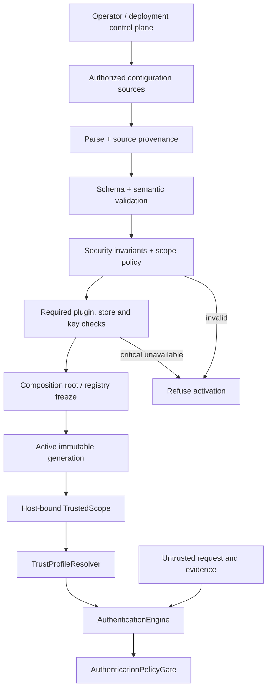
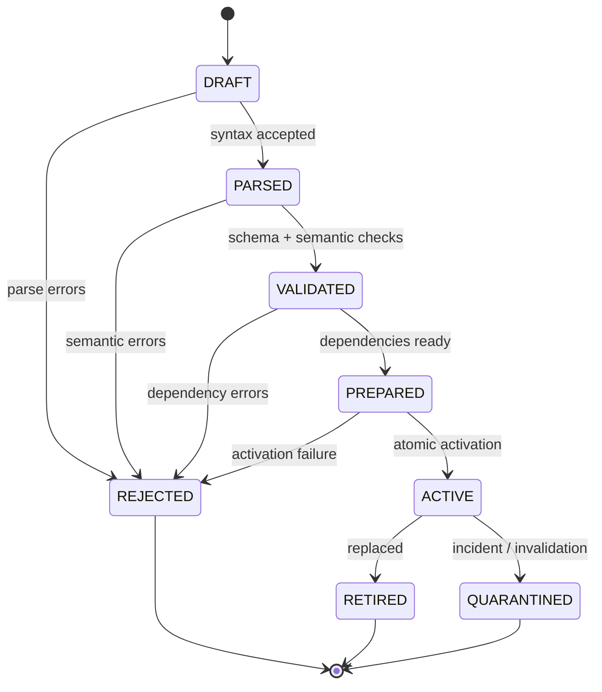
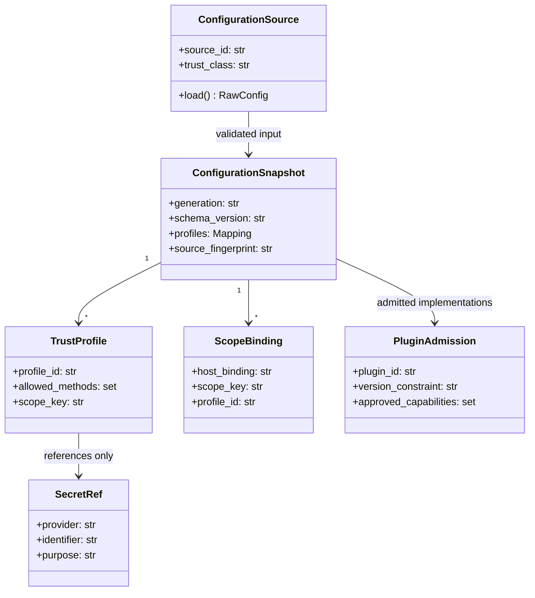
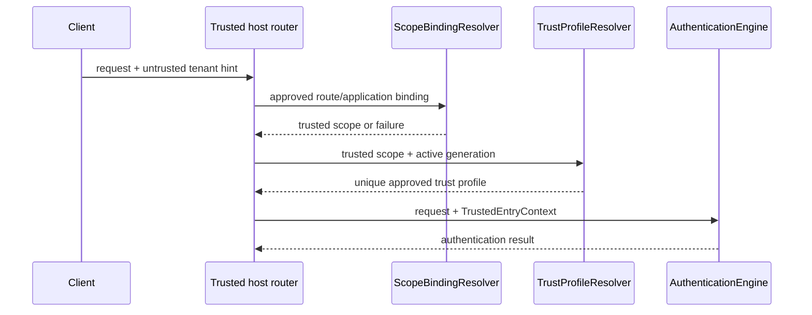
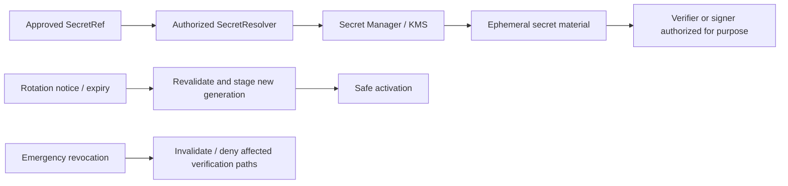
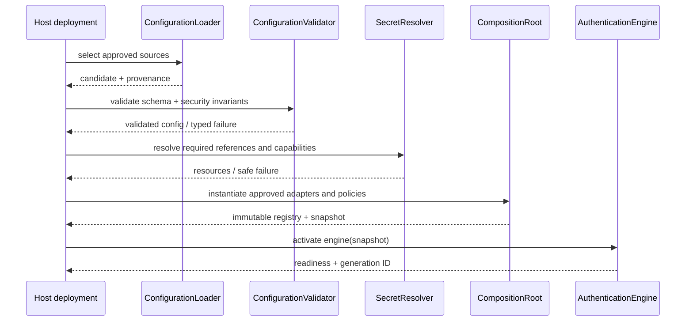
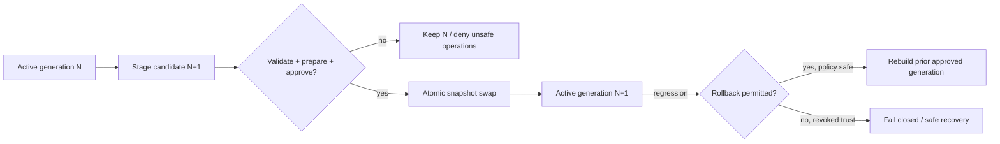

# 25_PYAUTHKIT_CONFIGURATION_MODEL

# PyAuthKit - Configuration Model and Trusted Bootstrap Architecture

> **Projet :** PyAuthKit - Authentication Engine for the Modern Python Ecosystem  
> **Document :** `25_PYAUTHKIT_CONFIGURATION_MODEL.md`  
> **Nature :** spécification du domaine Configuration, des frontières de confiance et du cycle de vie opérationnel  
> **Version documentaire :** `0.1.0` (proposition)  
> **Date :** 31 octobre 2026  
> **Statut :** `PROPOSED / DESIGN` - aucune implémentation, conformité ou garantie opérationnelle n'est présumée  
> **Langue :** français, contrats et identifiants techniques en anglais  
> **Convention :** `PYAUTHKIT_SOFTWARE_DESIGN_LEARNING_CONVENTION.md`  
> **Références internes :** documents `00` à `24`, spécialement `03`, `07`, `09`, `10`, `13` à `24`  
> **Documents aval :** `26_PYAUTHKIT_TESTING_AND_QUALIFICATION_STRATEGY.md`, `27_PYAUTHKIT_IMPLEMENTATION_ROADMAP.md`, `28_PYAUTHKIT_IMPLEMENTATION_BOOTSTRAP_PLAN.md`

**North Star :** *Configuration is policy-bearing authority, not just application settings.* Une configuration chargée ne devient pas « fiable » parce qu'elle est bien typée : sa source, son intégrité, son périmètre, sa validation, son activation et son renouvellement doivent être maîtrisés.

**Conventions de statut :** `EXISTING SPEC` indique un contrat documentaire précédent, non une fonctionnalité implémentée ; `PROPOSED` désigne un choix candidat ; `CONDITIONAL` un choix soumis à un contexte de déploiement ; `POST-MVP` une évolution non incluse automatiquement. Les noms de classes ci-dessous sont des *design sketches*, sauf décision ADR ultérieure.

## Guide de lecture

| Parcours | Sections | Objectif |
|---|---|---|
| Vision et domaine | 0-11 | Finalité, ownership, vocabulaire et modèle conceptuel |
| Schémas et sources | 12-23 | Sources, profils, règles de fusion et contrats de configuration |
| Secrets et cycle de vie | 24-40 | Bootstrap, snapshots, rotation, reload, sécurité et exploitation |
| Exemples et qualification | 41-59 | Python, menaces, exigences, tests, ADR, apprentissage, DoD |
| Annexes A-F | Annexes | Glossaire, références, schémas candidats, checklists et provenance |

---

## 0. Résumé exécutif

Le moteur PyAuthKit vérifie une preuve d'authentification **dans un `TrustedScope` déjà établi**, au moyen d'un `TrustProfile` configuré par une autorité hôte et d'un `AuthenticatorRegistry` composé de composants admis. Le document `25` détermine **comment** ces paramètres atteignent le moteur et comment empêcher qu'un changement de settings transforme une preuve non fiable en décision d'identité.

Les règles architecturales proposées sont les suivantes :

1. **Bootstrap contrôlé** : chargement, provenance, parsing, validation de schéma, contrôles inter-champs, vérification des dépendances, composition puis activation. Aucun moteur prêt n'existe si un contrôle critique échoue.
2. **Séparation configuration / secrets** : les paramètres décrivent des `SecretRef` ou `KeyRef`, pas des secrets imprimables ; les valeurs sont récupérées à travers un port autorisé à l'étape appropriée.
3. **Snapshots immuables** : une tentative utilise une génération de configuration cohérente, depuis la résolution de scope jusqu'à la décision d'authentification.
4. **Pas de dégradation silencieuse** : source manquante, issuer inattendu, algorithme non approuvé, tenant ambigu, plugin inconnu ou audit obligatoire indisponible conduisent à un refus/état indisponible ou au refus de démarrage selon le contrat.
5. **Changements gouvernés** : reload éventuel en deux phases (préparation et activation atomique), rollback explicite, journalisation minimisée et compatibilité des flows en cours.
6. **Agnosticisme** : Python pur au coeur, adapters optionnels pour environnement, fichiers, secrets managers ou outils de validation ; aucun couplage obligatoire à Pydantic, Kubernetes, Vault, Django ou une plateforme cloud.

Le MVP configure Password, API Key et validation JWT. Les champs des sessions, challenges, MFA, passkeys, fédération, workloads et risque sont **décrits comme extensions conditionnelles** avec leurs invariants propres. Configurer un protocole ne prouve ni sa mise en oeuvre ni sa conformité.

## 1. Filiation documentaire et hiérarchie des contrats

| Document | Contribution reprise par `25` | Ce que `25` ne doit pas redéfinir |
|---|---|---|
| `00`-`02` | Agnosticisme, sécurité par défaut, extensibilité | Vision produit et catalogue initial |
| `03` | `TrustProfileResolver`, `TrustedScope`, composition root, ports | Carte d'architecture générale |
| `04`-`07` | Domain Objects, invariants, statut des preuves | Entités et règles canoniques |
| `08`-`10` | Use cases, `AuthenticationEngine`, authenticators Password/API Key/JWT | Sémantique des résultats et vérificateurs |
| `11`-`13` | Challenges, MFA, session/token lifecycle | Atomicité, révocation et assurance |
| `14`-`17` | OIDC/SAML/WebAuthn/NHI/risque | Garanties propres aux protocoles et facteurs |
| `18` | Plugin admission, registry gelé, ports/adapters | Gouvernance interne des plugins |
| `19` | Stores, transactions, cohérence | Choix de persistance |
| `20` | STRIDE et frontières de confiance | Catalogue général de menaces |
| `21` | Audit durable, logs, metrics, traces | Livraison de l'audit |
| `22` | Bindings hôte, ASGI/WSGI, contextes | Cycle de vie des frameworks |
| `23` | Contrat PyAuthKit -> PyIAMKit, séparation AuthN/AuthZ | Modèle d'autorisations |
| `24` | API publique, statut des exceptions et des surfaces | Noms d'API stabilisés |
| Convention | *Problem First, Trust First, Pattern Second, Evidence Before Claim* | Qualification de code inexistante |

**Conflits documentaires :** si une facilité de configuration affaiblit `07`/`20` ou crée un droit d'accès appartenant à `23`, cette facilité est bloquée et soumise à une décision d'architecture documentée. Les identifiants `CFG25-*` sont locaux à `25`.

## 2. Problem Statement : pourquoi configurer est une décision de sécurité

Un fichier correctement parsé peut tout de même déclarer `verify_signature=false`, une audience JWT vide, un algorithme non approuvé, une URL JWKS contrôlée par l'attaquant, un plugin chargé depuis une dépendance inconnue, un `tenant_id` pris dans un header client ou un niveau d'audit insuffisant. Le danger n'est pas la syntaxe TOML/YAML/JSON : c'est **la chaîne d'autorité des valeurs**.

Une architecture qui lit `os.environ` au cours de chaque `authenticate()` cumule trois risques : divergences de configuration entre requêtes, résultats non déterministes et incapacité à produire une trace fiable de la politique effectivement appliquée. Inversement, une configuration figée sans plan de rotation expose à l'expiration des clés et à des redémarrages fragiles.

**Question d'ingénierie :** comment transformer des paramètres d'exploitation de différentes origines en une politique AuthN cohérente, non ambiguë, traçable, activée sans élargissement de confiance accidentel ?

## 3. Objectifs, non-objectifs et contraintes

**Objectifs :** une configuration explicite, minimale, reproductible et vérifiable ; validation préalable ; découplage core/adapters ; confidentialité ; multi-tenant sûr ; migrations contrôlées ; mécanisme de rotation et rollback ; diagnostics exploitables sans fuite.

**Non-objectifs :** bâtir un gestionnaire universel de secrets ; imposer une stack GitOps ; héberger un control plane central ; autoriser l'utilisateur final à écrire des trust profiles ; gérer les rôles PyIAMKit ; rendre le hot reload obligatoire ; signer cryptographiquement chaque fichier local indépendamment de son système de déploiement.

**Contraintes :** comportement fail-closed ; absence de secrets en logs et `repr` ; support de déploiement local sans KMS ; migrations de schéma explicites ; fenêtres temporelles cohérentes ; pas de lecture de source arbitraire déterminée par une requête.

## 4. Portée : MVP, extensions, options

| Domaine | MVP | POST-MVP ou CONDITIONNEL |
|---|---|---|
| Authenticator | Password, API Key, validation JWT | WebAuthn, OIDC/SAML, MFA, agent/workload |
| Sources | Objet hôte explicite ; mapping validé ; env contrôlé par l'hôte | Fichiers structurés, services distants, GitOps |
| Secret resolution | Références et injection de ports ; variables de test sans secrets réels | Vault, cloud KMS/Secrets Manager, workload identity |
| Bootstrap | Validation complète, composition et snapshot figé | Reload atomique multi-processus |
| Audit configuration | Événements de démarrage / changement minimisés | Outbox durable et réconciliation distribuée |
| Multi-tenant | Un ou plusieurs scopes préconfigurés | Dynamic tenant onboarding sous gouvernance |
| Operability | Validation offline et erreurs typées | Contrôleur de déploiement et rollouts progressifs |

Un contexte à tenant unique n'autorise pas une implémentation qui efface la dimension `TrustedScope` du modèle de confiance.

## 5. Ubiquitous Language : éviter les faux synonymes

| Terme | Signification | N'est pas |
|---|---|---|
| `ConfigurationSource` | Origine d'un ensemble de valeurs avec provenance | Une autorité automatiquement digne de confiance |
| `RawConfig` | Données non validées et potentiellement malveillantes | Une politique exécutable |
| `ParsedConfig` | Structure typée dont la syntaxe est admise | Un profil cryptographique sûr |
| `ValidatedConfig` | Configuration ayant franchi les contrôles requis | La preuve qu'un provider externe restera fiable |
| `ConfigurationSnapshot` | Version active immuable, référençable | Un singleton global mutable |
| `ConfigurationGeneration` | Identifiant monotone ou unique d'une activation | Le hash d'un secret |
| `TrustedScope` | Portée d'autorité établie par l'hôte | `tenant` d'une requête brute |
| `TrustProfile` | Politique vérifiable des preuves acceptées | Un champ `iss` de JWT |
| `SecretRef` | Identifiant opaque d'une valeur sensible dans un dépôt autorisé | Secret en clair ou URI URL arbitrary-access |
| `KeyRef` | Référence de clé approuvée avec usages bornés | `kid` non vérifié pilotant un téléchargement |
| `ReloadPlan` | Transition vérifiée entre deux générations | Mutation à chaud du dictionnaire global |
| `ConfigurationDrift` | Écart détecté entre générations / déploiements attendus | Échec d'authentification utilisateur |

Les *feature flags* n'accordent pas une identité ou une permission. Un flag peut restreindre une capacité approuvée ; son activation ne doit pas créer une nouvelle autorité sans validation.

## 6. Bounded Contexts et ownership

- **PyAuthKit / Authentication** : contrat du `TrustProfile`, méthodes supportées, invariants de vérification, admission des adapters, état actif d'une génération, erreurs sûres.
- **Host Application / Deployment** : qui peut modifier les sources, quels tenants existent, quelle route serveur lie une requête à un scope, qui exploite le secret manager, politiques d'approbation et déploiement.
- **PyIAMKit / Identity & Authorization** : comptes, rôles, droits et relations organisationnelles. PyAuthKit ne peut créer ces données en lisant un fichier de configuration.
- **Provider / Infrastructure** : availability des clés, état d'une clé rotative, politiques du vault, permissions d'accès, logs d'accès aux secrets.

Le `CompositionRoot` assemble les adapters conformément au snapshot. Le core ne choisit pas un profil depuis une variable globale implicite. Une application hôte compromise avec les droits d'édition de trust constitue une frontière de sécurité majeure ; les dataclasses gelées ne sont pas une protection contre un administrateur malveillant.

## 7. Cartographie d'autorité et chemin de bout en bout



**Deux plans séparés :** le plan de contrôle installe l'autorité ; le plan de données vérifie les preuves présentées. Le contenu d'une requête ne modifie jamais le plan de contrôle. Une mise à jour de politique n'est pas une méthode d'authentification.

## 8. Trust Boundaries spécifiques à la configuration

| Boundary | Entrée | Risque | Politique candidate |
|---|---|---|---|
| `CFG-TB-01` | Dépôt Git / CI vers runtime | Compromission supply chain | Revue, contrôle d'accès, provenance artefact |
| `CFG-TB-02` | Env du processus vers parser | Injection d'override | Allowlist et contrôle propriétaire de l'environnement |
| `CFG-TB-03` | Fichier monté vers service | TOCTOU, montage erroné | Lire de manière contrôlée, versionner et valider |
| `CFG-TB-04` | Vault/KMS vers adapter | Secret disclosure | AuthN workload, permissions minimales et TLS |
| `CFG-TB-05` | Bootstrap vers moteur | Invariants non appliqués | Activation par objet validé, pas dictionnaire libre |
| `CFG-TB-06` | Host route vers scope | Tenant spoofing | Binding serveur autoritatif |
| `CFG-TB-07` | JWT vers trust profile | Issuer/alg choisi par preuve | Profil préselectionné côté serveur |
| `CFG-TB-08` | Entry points vers registry | Code tiers chargé | Allowlist, admission, validation, freeze |
| `CFG-TB-09` | Snapshot N vers N+1 | Politique élargie silencieuse | Diff classifié, approbation, activation atomique |
| `CFG-TB-10` | Observabilité vers SIEM | Secrets dans dumps et labels | Redaction, allowlist de champs |
| `CFG-TB-11` | Redis/cache vers policy | Valeurs obsolètes | Version des clés, TTL et source de vérité |
| `CFG-TB-12` | Processus A vers B | Divergence de génération | Coordination/rollout, preuve de cohérence |

L'analyse STRIDE complète demeure dans `20`. Les frontières listées ici portent exclusivement sur les chemins de configuration.

## 9. Principes de conception et patterns réellement utiles

| Principe | Effet concret | Anti-pattern évité |
|---|---|---|
| **DIP** | `ConfigurationSource` et `SecretResolver` abstraits | Domaine importateur de Vault/Pydantic |
| **SoC** | Chargement, validation, activation séparés | `.env` lu dans une décision AuthN |
| **SRP** | Parseur, validator et composition root distincts | Settings object « dieu » |
| **OCP** | Nouveau source adapter sans changer la validation coeur | Ajout de `if provider == ...` partout |
| **KISS** | Config hôte Python simple pour le MVP | Control plane distribué obligatoire |
| **YAGNI** | Pas de reload distribué avant besoin établi | Horloge vectorielle superflue |
| **Immutable Snapshot** | Cohérence par tentative | Config mutate en plein flow |
| **Anti-Corruption Layer** | Traduction de champs fournisseurs | Types KMS publics dans le core |
| **Factory / Builder** | Composition approuvée à démarrage | Plugin chargé au fil des requêtes |
| **State Machine** | Candidat, validé, activé, retiré | Mutation implicite d'état |

Nommer les classes selon leur fonction réelle (`TrustProfile`, `ConfigurationSnapshot`, `SecretResolver`) plutôt que `ConfigFactoryStrategyPattern`. Un pattern est une explication, pas une obligation de conception.

## 10. Cycle de vie d'une configuration



`PARSED` n'autorise aucune vérification. Seul `ACTIVE` peut alimenter la résolution. L'ancienne génération peut rester disponible pour achever un flow lié et borné, lorsque le modèle le justifie explicitement ; elle ne doit pas réintroduire des clés révoquées ni contourner une suspension d'urgence.

**État d'un secret != état du fichier de config.** Révocation de clé, disponibilité d'un coffre et fenêtre d'acceptation des signatures sont des dimensions séparées, vérifiées à leurs frontières respectives.

## 11. Domain Objects et relations candidates



**Candidats de Value Objects :** `ConfigurationGeneration`, `SourceProvenance`, `TrustProfileId`, `TrustedScopeKey`, `SecretRef`, `ProviderEndpoint`, `ApprovedAlgorithm`, `PluginId`, `PolicyVersion`, `ChangeClassification`. **Candidats de services d'application :** `ConfigurationLoader`, `ConfigurationValidator`, `ConfigurationActivator`, `ConfigurationDiffClassifier`. Aucune entité de type `UserRole` n'appartient à PyAuthKit.

## 12. Sources et niveaux de confiance

| Source | Usage recommandé | Autorité requise | Risque principal |
|---|---|---|---|
| Paramètre de constructeur approuvé | MVP, tests | Code hôte contrôlé | Override involontaire |
| Mapping / objet gelé | Hôte Python | Provenance du composant appelant | Valeurs fabriquées à runtime |
| Variables d'environnement | Déploiement | Ownership du process, orchestrateur, CI | Injection, logs, héritage de sous-processus |
| `.env` local | Développement uniquement par défaut | Fichier protégé, non commité | Secrets versionnés, mauvais CWD |
| TOML/JSON/YAML | Profil de déploiement | Provenance, ACL, validation stricte | Alias YAML, doublons, injection |
| Kubernetes Secret/ConfigMap | Cluster conditionnel | RBAC, chiffrement, namespace, service account | Accès excessif, etcd, drift |
| Vault / Secrets Manager / KMS | Valeurs sensibles | Workload identity, politique de lecture | Autorisation trop large, panne |
| Service distant de config | Reload conditionnel | Canal authentifié, source admise, version | Compromission, rollback, split-brain |
| Claims / HTTP headers / query args | **Jamais source d'autorité** | Aucune autorité de config | Trust substitution |

Une source peut être techniquement lisible sans être autorisée à modifier certains champs. La confiance porte sur le **couple (source, propriété)**, pas seulement sur le format.

## 13. Precedence, merging et override policy

**Recommandation candidate :** ne pas réutiliser automatiquement la precedence native d'une bibliothèque externe pour les champs de sécurité. Définir une matrice explicite des sources admises par propriété :

| Catégorie de propriété | Defaults | Configuration déploiement | Environment | Secret manager | Override requête |
|---|---|---|---|---|---|
| Observabilité non sensible | oui | oui | allowlist | non | non |
| Timeouts dans bornes | oui | oui | allowlist | non | non |
| Trust profiles / algorithmes | valeurs restrictives | source autoritative signée/approuvée selon déploiement | uniquement autorisé explicitement | clés par référence | jamais |
| Tenant bindings | aucun binding implicite | autorité hôte | seulement si hôte gouverne | non | jamais |
| Private keys / client secrets | jamais en clair | référence uniquement | discouraged ; exceptions justifiées | valeur via port | jamais |
| Approved plugins | aucun par défaut | allowlist approuvée | non sans ADR | non | jamais |

Une fusion superficielle de dictionnaires peut mélanger un issuer d'une source et une audience d'une autre. Préférer une **fusion atomique par TrustProfile** ou une validation complète du produit fusionné, avec une provenance par champ. `false -> true` pour un flag sensible, `deny -> allow` ou `fixed issuer -> wildcard` requiert une *security change approval*, jamais un override opportuniste. Il est interdit d'utiliser une clé `DEFAULT_TENANT` comme repli après une erreur de routage.

## 14. Validation des schémas : trois niveaux

1. **Syntaxe / structure :** champs requis, type exact, bornes de taille, formats contrôlés, version de schéma, aucune clé inconnue sensible, détection de doublons selon le format.
2. **Sémantique / cross-field :** si `jwt.enabled`, exiger issuer, audience non vide, algorithmes admis, source de clés liée au profil ; si MFA configuré, vérifier les facteurs et le stockage de challenges ; si audit strict, exiger une destination durable conforme.
3. **Runtime readiness :** capacités réellement présentes, plugins admis, secrets accessibles avec permissions minimales, clés structurées correctement, ports requis satisfaits, configuration compatible avec la version de l'engine.

**Important :** `BaseModel` ou `dataclass` n'apporte que les niveaux qu'on lui programme. Validation de schéma != admission de plugin != authentification d'une requête. Les contrôles réseau de disponibilité doivent rester bornés, documentés et séparés des vérifications cryptographiques effectuées lors des tentatives.

**Politique inconnue :** `extra='forbid'` recommandé pour les blocs de sécurité ; pour les blocs extensibles, définir un namespace versionné et une procédure de compatibilité.

## 15. Schéma canonique candidat et conventions de nommage

```yaml
# DESIGN EXAMPLE - values are placeholders; no real secrets.
schema_version: "1"
environment: "production"
engine:
  default_deny: true
  request_timeout_ms: 3000
  allowed_methods: [password, api_key, jwt]
scopes:
  - scope_key: "app:main"
    host_binding: "trusted-route:main"
    trust_profile: "profile-main"
trust_profiles:
  - profile_id: "profile-main"
    scope_key: "app:main"
    password:
      enabled: true
      verifier_policy: "password-policy-v1"
    api_key:
      enabled: true
      store_ref: "store:api-keys-main"
    jwt:
      enabled: true
      issuer: "https://id.example.invalid/realm"
      audiences: ["pyapp-api"]
      allowed_algorithms: ["RS256"]
      verification_key_ref: "keyset:issuer-main"
plugins:
  approved: []
audit:
  required: true
  sink_ref: "audit:durable-main"
```

Ce schéma est **illustratif** ; les noms et l'existence d'un fichier YAML ne sont pas une API. La présence de `.invalid` interdit toute utilisation comme endpoint réel. Les noms `issuer`, `audiences`, `allowed_algorithms` ne doivent pas être dérivés du JWT entrant. Les ids `store_ref`, `verification_key_ref`, `sink_ref` sont résolus exclusivement à partir de ressources composées par l'hôte.

## 16. `TrustProfile` : propriété de l'hôte et exhaustivité

Chaque profil doit identifier son `scope_key`, les méthodes admises, les policies de vérification, les références de clés/stores et les contraintes d'assurance lorsque celles-ci s'appliquent. Un profil incomplet, ambigu, désactivé ou référençant une capacité absente est rejeté.

**Contrat de résolution :** `(active_generation, resolved_server_scope, method) -> exactly one approved policy / typed failure`. La preuve présentée peut indiquer un mécanisme, mais ne peut ni créer un profil, ni sélectionner librement un issuer ou un store d'un autre tenant.

**Interdictions :** issuer wildcard sauf décision documentée avec stratégie de mapping validée ; algorithme JWT `none` ; `verify_signature=false` ; `audience=None` en production ; téléchargement de clés vers une URL entièrement issue de `jku`, `x5u` ou d'un champ non vérifié ; « essayer tous les profils jusqu'au succès ». La liste exacte d'algorithmes cryptographiques acceptés relève d'une politique versionnée qui peut évoluer.

## 17. JWT Validation Configuration (MVP)

| Champ candidat | Invariant | Exemple de test négatif |
|---|---|---|
| `issuer` | Correspondance exacte selon policy, issu d'une source admise | JWT signé par autre issuer |
| `audiences` | Ensemble explicite non vide pour la destination | Token destiné à autre API |
| `allowed_algorithms` | Ensemble admis, non contrôlé par token | `alg=none`, confusion algorithme |
| `verification_key_ref` | Référence serveur / JWKS autorisé, usage verify | `jku` externe client |
| `kid_policy` | Résolution parmi les clés déjà autorisées | `kid` inconnu / traversée / duplication |
| `max_clock_skew` | Borne explicite min/max, faible et justifiée | `nbf` futur hors tolérance |
| `required_claims` | Schéma et contrainte de sens | Iss/exp absents selon profil |
| `token_type` | Usage de token attendu | ID token utilisé comme access token |
| `max_token_bytes` | Taille encadrée avant parsing | JWT gigantesque / nested claims |

**Risque opérationnel :** la rotation JWKS doit préserver la validité attendue de tokens non expirés sans accepter durablement une clé compromise. La stratégie d'urgence (révocation, invalidation du cache, refus) appartient au runbook ; ne jamais prétendre qu'une simple TTL de JWKS garantit une révocation immédiate.

## 18. Password Verification Configuration (MVP)

Les paramètres configurables doivent couvrir la stratégie de hachage approuvée, les bornes d'effort, la politique de migration des anciens hachages, les tentatives et mécanismes anti-abus, le provider de vérification et le binding au `TrustedScope`.

- `PasswordVerifier` doit appliquer une politique cryptographique approuvée, non un `hashlib.sha256(password)` naïf.
- Le store de credential doit revenir avec un identifiant de sujet et un état compatible, pas un droit d'accès.
- Un changement de coût KDF peut déclencher un rehash progressif **après vérification réussie**, sous contrat de transaction.
- Le compte utilisateur existant, ses rôles et son état organisationnel ne sont pas inférés de la config PyAuthKit ; PyIAMKit et l'hôte restent responsables de leurs décisions.
- Les mots de passe utilisateur ne sont pas des secrets d'exploitation à rotation automatique périodique : ne pas confondre rotation de clés de service et politique de changement de mot de passe.

**Tests importants :** configuration de hachage invalide, downgrade, pepper indisponible, rehash concurrent, backend fermé et audit obligatoire en panne.

## 19. API Key Verification Configuration (MVP)

Distinguer **API Key présentée par le client**, **SecretRef de l'application** et **clé cryptographique utilisée par le moteur**. Une clé d'API cliente n'est jamais stockée en clair dans un fichier settings. Une politique de vérification peut déclarer : `lookup_strategy`, store approuvé, hash/compare policy, statut du credential, préfixe non secret pour routage autorisé, rotation et exigences de révocation.

Une clé d'API ne peut sélectionner sa propre `tenant_id` ou un store global non borné. Les lookup indexes doivent être construits à partir de la portée hôte et d'identifiants non secrets, avec vérification du secret par un composant sécurisé. L'attribution de scopes **d'autorisation** à une API Key n'est pas un remplacement du PDP PyIAMKit.

## 20. Host bindings, `TrustedScope` et routes



Les domaines, chemins, reverse proxies, workspaces et headers peuvent contribuer à l'établissement d'un scope **uniquement si l'application hôte a préalablement validé leur provenance**. Une chaîne `X-Tenant-ID` non signée n'est pas un binding. Un `Host` susceptible d'être forgé, un `Forwarded` non filtré ou un paramètre de requête ne sont pas des références autoritatives par défaut.

## 21. Multi-tenancy : isolation des politiques et des données

Le snapshot peut contenir plusieurs profils, mais chaque résolution s'effectue dans le tuple `(generation, scope, method, purpose)`. Les caches de clés, credentials, introspection et décisions incluent les dimensions nécessaires pour ne pas mélanger les tenants. Les valeurs `tenant_id` au format identique ne sont pas nécessairement globalement uniques : utiliser des clés composites explicites.

**Opérations de gestion des tenants :** création/activation/désactivation de binding par autorité hôte ; preuve de propriété du domaine ou routage ; contrôle des collisions ; configuration complète du trust profile ; audit ; déploiement progressif ; suppression réversible si état résiduel. Une requête d'authentification ne peut exécuter aucune de ces mutations.

**Interdit :** fallback `if profile_missing: use default_profile`, héritage d'un issuer d'un tenant voisin, secret resolvers partagés sans cloisonnement, plugins administrables par un tenant sans policy d'admission.

## 22. Approved plugins and extension configuration

Le document `18` fixe le cycle discovery -> admission -> activation ; `25` décrit **la partie déclarative** de l'admission. Chaque entrée candidate comporte `plugin_id`, package/distribution, versions compatibles, capabilities admises, binding de scope éventuel, configuration d'adapter et dépendances.

```yaml
# DESIGN EXAMPLE - no plugin activated by mere installation.
plugins:
  approved:
    - plugin_id: "builtin.password"
      distribution: "pyauthkit"
      capabilities: ["authenticator:password"]
      scopes: ["app:main"]
      config_ref: "adapter:password-main"
```

Une référence dans `plugins.approved` ne prouve pas la confiance du code importé : l'admission implique une provenance de package, des contrôles supply chain, un contrat versionné et, selon risque, l'isolation de processus. `importlib.metadata.entry_points()` fait de la découverte ; `.load()` exécute du code. Ne jamais choisir un plugin depuis un champ de requête.

## 23. Storage, sessions and risk configuration

| Domaine | Paramètres | Risque de mauvaise configuration |
|---|---|---|
| `CredentialStore` | scope, source-of-truth, read/write roles, timeouts | Fuite cross-tenant, downtime ouvert |
| `ChallengeStore` (POST-MVP) | TTL, consommation unique atomique, ownership | Rejeu d'un challenge |
| `SessionStore` (POST-MVP) | fixation, expiration, invalidation, cookie bindings | Session fixation / persistance indue |
| `RefreshTokenStore` (POST-MVP) | rotation CAS, family ID, réutilisation, révocation | Double consommation concurrente |
| `RiskSignalProvider` (POST-MVP) | source admise, bornes, comportement UNKNOWN | `UNKNOWN -> LOW` |
| `AuditSink` | durabilité, retries, quotas, redaction | Succès silencieux sans audit requis |

Les garanties transactionnelles viennent des ports/adapters `19`, pas de `durable=true` écrit dans un fichier. Une config qui exige `consume_once` doit échouer au bootstrap si l'adapter ne présente pas la capacité attestée par contrat et testée selon `26`.

## 24. Secrets : classification, ownership et références

**Classification :** configuration publique, interne, sensible, secret cryptographique, credential utilisateur, secret d'infrastructure. Les profils de confiance peuvent contenir des identifiants non secrets et références opaques ; les clés privées, tokens de service, peppers et mots de passe de stockage doivent rester hors des exemples versionnés.

**Règle candidate :** `SecretRef(provider, path_or_id, purpose, scope)` ne contient pas la valeur et n'est jamais interprété comme URL arbitraire. Un namespace/allowlist de providers autorisés empêche de transformer un ref en SSRF ou accès inter-tenant. Les secrets transitent par un port `SecretResolver`, sous identité de workload minimale, avec expiration, journalisation d'accès sans payload et capacité de rotation.

**Borne de menace :** un objet `SecretStr` peut réduire les impressions accidentelles ; il n'assure ni chiffrement mémoire, ni nettoyage fiable de bytes Python, ni protection contre un processus compromis. Le secret manager ne remplace pas les contrôles d'accès au processus consommateur.

## 25. Secrets : acquisition, cache, rotation et révocation



Le choix entre fetch à chaque tentative, mémoire temporaire ou handles KMS dépend du provider et du niveau de risque. Les secrets en cache portent une durée de vie, une version/référence, une invalidation et une politique en cas de panne. Une rotation sûre peut nécessiter une période de recouvrement ; une révocation d'urgence peut exiger un refus immédiat sans période de recouvrement. Ces deux scénarios ont des politiques distinctes.

**Ne pas confondre :** rotation de secret d'infrastructure, rotation de clé de signature, rollover de JWKS, révocation de credential utilisateur et réauthentification. Chaque cycle exige ses tests propres.

## 26. Variables d'environnement et `.env`

- Préfixe candidat `PYAUTHKIT_`, noms explicites, conversion stricte des booléens, entiers et durées. `PYAUTHKIT_JWT_VERIFY_SIGNATURE=false` ne doit pas être un override autorisé.
- `.env` est **une commodité locale**, pas un contrat production par défaut ; exclure de Git, protéger les permissions et interdire les dumps d'environnement en diagnostics.
- Des credentials dans les variables d'environnement restent susceptibles d'exposition via outils de debugging, journaux, processus enfants ou surface administrative : préférer des références ou montages sécurisés selon contexte.
- L'environnement peut fournir une **localisation de configuration** autorisée (p. ex. `PYAUTHKIT_CONFIG_PATH`) sans permettre une URL arbitraire venue de la requête.
- Valider le chemin effectif, la politique de symlinks, les permissions et la source ; ne pas supposer que le CWD soit constant.

Les priorités par défaut de `pydantic-settings` sont documentées par la bibliothèque et peuvent être personnalisées. Elles ne constituent pas automatiquement une politique d'autorisation de sources pour PyAuthKit. Le mode debug des sources peut afficher des valeurs sensibles : le désactiver en production et ne pas logger les dumps raw.

## 27. Fichiers TOML, JSON et YAML : parsing sûr

| Format | Usage candidat | Précaution majeure |
|---|---|---|
| TOML | config lisible Python, structure limitée | parser strict, taille, version de schéma |
| JSON | config générée ou transport typé | refuser doublons critiques, limites de taille/profondeur |
| YAML | config d'infrastructure | safe loader, alias/anchors et types non attendus, doublons |

**Recommandation MVP :** la configuration hôte Python typée suffit ; proposer TOML comme premier format textuel si un besoin est confirmé. Ajouter YAML uniquement pour les déploiements qui en ont réellement l'utilité.

**File security :** ne pas parser de fichier influencé par un header client ; limiter la taille ; éviter toute interpolation de commande ; désactiver la résolution d'objets arbitraires ; préserver la provenance d'origine ; émettre un digest des valeurs *non sensibles* normalisées sans inclure de secret dans le hash observable.

## 28. Remote configuration services (CONDITIONAL)

Un service distant permet des changements supervisés mais crée un nouvel élément de confiance. La connexion doit authentifier l'hôte et le service ; l'identité de la source et les namespaces autorisés sont configurés avant le fetch ; la réponse possède une version, une validité et une politique anti-rollback.

**Séquence minimale :** établir canal -> récupérer candidat versionné -> vérifier origine/intégrité selon architecture -> valider schéma et invariants -> comparer à génération active -> classifier sécurité -> autoriser -> préparer dépendances -> activer -> auditer. Ne pas basculer automatiquement sur un endpoint « miroir » dont la confiance n'a pas été configurée.

**Panne distante :** le démarrage peut utiliser une génération approuvée durable préexistante uniquement selon une politique explicitement acceptée ; un changement de trust révoquant des clés exige parfois l'arrêt/refus, même si un ancien snapshot existe. Ne jamais promettre une tolérance universelle aux pannes.

## 29. Bootstrap : séquence et points de contrôle



**Contrat de démarrage :** aucune requête d'authentification n'est acceptée avant la réussite des contrôles nécessaires. Les dépendances purement diagnostiques facultatives peuvent suivre leur propre politique de dégradation. En revanche, les key sources, stores et audit *déclarés indispensables* ne sont pas omis silencieusement.

## 30. Immutable `ConfigurationSnapshot`

L'objet candidat encapsule : `schema_version`, `generation`, `created_at`, `source_provenance`, `scope_bindings`, `trust_profiles`, `approved_plugins`, `resource_refs` et `policy_fingerprint` sans secret. Les collections doivent être véritablement immuables ou copiées défensivement : `@dataclass(frozen=True)` ne gèle pas un `dict` imbriqué.

Chaque tentative capture le snapshot au début de l'orchestration. Elle ne relit pas `os.environ`, ne consulte pas « current profile » entre deux étapes, ne change pas d'issuer après parsing du token. Les sous-systèmes externes revocables (credential state, key revocation, logout) gardent toutefois leur **propre contrat de fraîcheur** : un snapshot cohérent ne suffit pas à garantir l'état externe au moment de la décision.

**Identity of snapshot :** un hash peut attester l'égalité de la configuration canonique non sensible, mais ne remplace pas une signature de provenance ou une gestion des accès. Les secrets ne doivent pas entrer dans un hash visible ou un label de métrique.

## 31. Hot reload : nécessaire ou non ?

**MVP proposé :** pas de hot reload générique ; redémarrage contrôlé ou reconstruction du moteur lors d'un déploiement. Cette option est plus simple à qualifier et évite des cas de concurrence subtils. **POST-MVP conditionnel :** reload lorsque rotation ou opérations multi-tenant le rendent réellement nécessaire.

Lorsque retenu, un reload est une transaction de contrôle :

1. recevoir le candidat versionné par un canal autorisé ;
2. valider en isolation ;
3. vérifier les dépendances et préparer les ressources ;
4. classifier et approuver les changements de sécurité ;
5. établir la stratégie pour les sessions/challenges et les tentatives actives ;
6. échanger atomiquement le pointeur de génération active ;
7. auditer `old_generation`, `new_generation` et un diff minimisé ;
8. libérer l'ancienne génération seulement lorsqu'aucun utilisateur légitime n'en dépend ou selon politique d'urgence.

**Interdit :** `config.update(new_dict)` pendant le traitement d'une requête, ou changement d'une seule sous-politique sans validation complète.

## 32. Classification des changements de configuration

| Classe | Exemples | Processus candidat |
|---|---|---|
| **Operational non-security** | sampling métriques, timeout dans bornes | revue légère, test et audit |
| **Restrictive security** | désactiver méthode, retirer issuer/tenant | revue + évaluation de l'impact sur flows et disponibilité |
| **Trust-expanding** | nouvel issuer/audience, nouvel algorithme, nouvel IdP, nouveau plugin | approbation sécurité explicite et tests ciblés |
| **Credential/key rotation** | nouvelle key ref, fin de validité ancienne | double fenêtre si appropriée, révocation d'urgence distincte |
| **Breaking schema** | changer semantics de champ | migration versionnée, plan rollback |
| **Emergency incident** | révoquer clé, suspendre scope | priorité au refus, canal d'urgence et audit |

La classification n'est pas basée uniquement sur un diff textuel. Exemple : changer `issuer` de `A` à `B` est un **changement d'autorité**, même si le champ est une simple chaîne. Une modification de `timeout` peut affecter la failover policy et donc devenir sensible.

## 33. Atomic activation et rollback



Un rollback de binaire peut remettre en circulation une clé déjà révoquée. **Rollback n'est pas toujours une transition permise** : la politique de révocation prime. Un nouvel issuer supprimé ne doit pas réapparaître silencieusement via un ancien manifest. Un plan d'urgence exige une source autoritative à jour des révocations et une capacité de refuser même si l'ancienne configuration est encore stockée.

## 34. Concurrence, async et multi-processus

- **Dans un processus :** le remplacement atomique d'une référence de snapshot réduit les états intermédiaires ; chaque opération capture un snapshot, sans mutation de structures partagées.
- **Entre processus :** plusieurs workers peuvent servir des générations différentes pendant un rollout. Une politique explicite fixe la fenêtre de convergence acceptable, ou impose une barrière de version pour les changements critiques.
- **Entre services :** l'audit et les décisions downstream doivent transporter des identifiants de génération non secrets si nécessaires à la traçabilité.
- **Sessions/challenges :** l'état mutable externe reste soumis aux CAS et transactions du `19` ; la version de policy attachée à un challenge doit être vérifiée à sa consommation.
- **Async cancellation :** une tâche annulée ne doit pas laisser une génération partiellement activée, ni une ressource secrète publiée dans un registry intermédiaire.

La prise en charge réelle d'activation atomique multi-processus n'est **pas présumée** par ce design.

## 35. Cache et invalidation des données de configuration

Un cache de `TrustProfile` indexé seulement par `tenant_id` est insuffisant si le même nom de tenant existe dans plusieurs realms ou si la génération change. Clé candidate : `(generation, trusted_scope_key, purpose, method)` ; ajouter les dimensions nécessaires à la séparation des autorités.

**Règles :** source de vérité explicite, TTL bornée, cache negative explicite, invalidation sur activation, pas de repli vers un keyset périmé en cas de révocation critique, budgets mémoire et cardinalité observés, tests de concurrence. Une clé publique connue peut être servie depuis un cache approuvé sous policy ; un `jku` non fiable n'ajoute pas une nouvelle source de clés. Un timeout du cache n'autorise pas un algorithme moins exigeant.

## 36. Validation des dépendances et capacités réelles

Les adapters doivent fournir des capacités déclaratives vérifiables (`read_only`, `atomic_consume`, `durable_audit`, `key_verify`, `rotate`, etc.), mais **déclarer** une capacité n'est pas démontrer qu'elle fonctionne. Le bootstrap vérifie une compatibilité de contrat et une disponibilité bornée. Les tests réels de sémantique, de concurrence et de panne relèvent du document `26`.

**Cas typiques de refus :** JWT activé sans vérificateur ni source de clés ; refresh token rotation activée sans `compare_and_swap` ; audit strict sur un sink best-effort ; plugin requis mais non admis ; scope routé vers deux profils ; config non compatible avec engine version. La disponibilité distante peut changer après bootstrap : les erreurs runtime sont toujours fail-closed.

## 37. Defaults et fail-closed by design

**Defaults admissibles :** télémétrie facultative désactivée, TTL en borne, paramètres non sensibles explicitement documentés. **No default** pour : issuer, audience, key source, identité tenant, secret provider, allowlist plugin, autorité de délégation et permissions.

- `missing critical config` -> échec de démarrage / configuration indisponible.
- `missing tenant binding` -> pas de `TrustedScope`; refus neutre côté client.
- `unknown method` -> unsupported/rejected selon résultat typé, jamais auto-enable.
- `key source unavailable` -> indisponible, pas de skip-signature.
- `risk signal unknown` -> policy spécifique, jamais « LOW » par défaut.
- `audit sink required but down` -> politique de succès/arrêt du document `21`, explicitement qualifiée.

**Interdiction de compatibilité :** un mode `unsafe_disable_checks` accessible dans les versions de production. Pour les tests, utiliser des composants de test identifiés et non des contournements d'invariants.

## 38. Errors, diagnostics and redaction

| Type candidat | Cause | Diagnostic externe | Diagnostic interne autorisé |
|---|---|---|---|
| `ConfigSyntaxError` | document illisible, type invalide | erreur startup générique | path logique, ligne, champ non secret |
| `ConfigValidationError` | champ absent / policy contradictoire | configuration non disponible | id de règle et champ, valeur masquée |
| `ConfigSourceUnauthorized` | source ou propriété non admise | indisponible | source id, règle d'autorité |
| `SecretResolutionError` | secret inaccessible/non autorisé | indisponible | secret ref opaque non révélateur |
| `ConfigActivationError` | ressources ou registry invalides | startup refusé | génération candidate, cause classée |
| `ConfigConflictError` | profile/scope/plugin ambigu | indisponible | ids logiques de conflit |
| `ConfigVersionError` | migration/schema incompatible | startup refusé | versions prévues et obtenues |

Ne pas inclure secrets, URL credentials, contenu `env`, JWT, key material ou JSON raw dans `Exception.args`, `repr`, logs, traces, labels métriques et rapport de diff. Privilégier des codes structurés stables et un `correlation_id` borné.

## 39. Audit de configuration : événements et règles

Les événements candidats `configuration.candidate_loaded`, `.validation_failed`, `.approved`, `.activation_succeeded`, `.activation_failed`, `.rollback_requested`, `.rollback_denied`, `.generation_retired`, `.emergency_revocation` contiennent au plus : génération ancienne/nouvelle, identifiant de source non secret, type de changement, actor opérateur de confiance si disponible, résultat, timestamp, trace/correlation id.

**Ne jamais auditer :** matériau secret, chaînes d'environnement brutes, token complet, URL contenant des credentials, liste de tenants sensible non autorisée. Le sink est un port configuré selon le `21`. Pour les transitions critiques, l'audit doit respecter un contrat de durabilité explicite ; `logger.info` ne constitue pas une preuve de conservation.

## 40. Metrics, SLI/SLO, alerting et privacy

| Signal | Exemple | Alerte / interprétation | Cardinalité |
|---|---|---|---|
| `config_bootstrap_failures_total` | erreurs par catégorie | rollout bloqué | `error_class` borné |
| `config_validation_duration_seconds` | histogramme | dégradation du startup | pas de chemin arbitraire |
| `config_active_generation` | exposée via info service restreint | divergence inter-worker | génération comme métadonnée, pas label haute cardinalité |
| `config_reload_failures_total` | refus de reload | surveillance changements | sans secret |
| `secret_resolution_errors_total` | par type provider | panne de coffre | pas de `secret_ref` en label |
| `config_drift_detected_total` | mismatch déploiement | investiguer | pas d'inventaire tenant public |
| `config_policy_downgrade_blocked_total` | changement interdit | alerte sécurité | pas de details exploitables |

**SLI candidats :** taux de startups valides, délai d'activation sous objectif fixé, conformité à une génération attendue, erreurs de résolution de secret. Les objectifs chiffrés sont **à décider** selon les SLO d'application, sans inventer de disponibilité mesurée.

## 41. CI/CD, GitOps et gouvernance des changements

Pipeline recommandé : syntax/static schema -> checks inter-champs -> secret scanning -> SCA/SBOM dépendances -> tests de contrat -> sécurité ciblée -> policy approval -> release manifest/version -> staging -> promotion -> observation/rollback policy. La CI ne doit pas recevoir des secrets production pour valider une syntaxe.

**Change control :** un changement sur `trust_profiles`, `scope_bindings`, `plugins`, `jwks`, `oidc`, `saml`, `audit.required` exige un reviewer responsable de la sécurité et une preuve de qualification proportionnée. Un acteur de déploiement ne peut exploiter une revue Git comme preuve que l'environnement courant n'a subi aucun override hors Git.

**Artefacts :** documenter auteur, approbation, commit/artefact déployé, `schema_version`, version SDK, génération, politique de rollback, environnement cible et résultat de contrôle, sans exporter les secrets ou captures de coffre.

## 42. Kubernetes, Docker, services cloud et développement local

- **Kubernetes :** Secret n'est pas chiffré par défaut dans etcd sur toutes les configurations ; activer le chiffrement au repos lorsque pertinent, réduire RBAC et l'accès `list/watch`, cloisonner par namespace et ServiceAccount. Un montage de secret n'authentifie pas à lui seul son destinataire.
- **Docker :** un fichier secret monté a des permissions, une durée de vie et un chemin contrôlés ; une variable passée au conteneur peut être plus exposée qu'un gestionnaire de secrets adapté.
- **Cloud KMS :** IAM workload identity et restrictions sur `GetSecretValue`/`Decrypt` ou opération équivalente ; distinguer clé utilisable sans export et clé exportée en mémoire.
- **Dev local :** config d'exemple sans secret, faux services explicitement marqués, `.env.example` avec uniquement des noms de variables et références factices, profil `development` interdit en production sans procédure d'approbation.
- **Serverless :** cycles cold start, rotation, ressources réutilisées, snapshot d'instance et caches de secrets exigent des critères de fraîcheur explicites.

Un orchestrateur et un SDK n'assurent pas automatiquement la provenance et l'autorisation des changements. Ce sont des responsabilités de déploiement et de contrôles d'accès.

## 43. Python standard library : objets immuables et validation minimale

Le squelette pédagogique suivant n'est pas le SDK final. Il montre une frontière claire entre l'objet de configuration validé et les données brutes ; il n'effectue aucune vérification JWT ni authentification réelle.

```python
# DESIGN SKETCH - stdlib only, no actual authentication or secret access.
from dataclasses import dataclass
from types import MappingProxyType
from typing import Mapping


@dataclass(frozen=True, slots=True)
class JwtVerificationPolicy:
    issuer: str
    audiences: frozenset[str]
    allowed_algorithms: frozenset[str]
    keyset_ref: str

    def __post_init__(self) -> None:
        if not self.issuer.startswith("https://"):
            raise ValueError("issuer must be an approved HTTPS identifier")
        if not self.audiences:
            raise ValueError("audiences must be nonempty")
        if not self.allowed_algorithms <= frozenset({"RS256", "ES256"}):
            raise ValueError("unsupported JWT algorithm")
        if not self.keyset_ref:
            raise ValueError("verification key reference required")


@dataclass(frozen=True, slots=True)
class TrustProfileSettings:
    profile_id: str
    scope_key: str
    jwt_policy: JwtVerificationPolicy | None


@dataclass(frozen=True, slots=True)
class ConfigurationSnapshot:
    generation: str
    profiles: Mapping[str, TrustProfileSettings]


def freeze_snapshot(
    generation: str,
    profiles: Mapping[str, TrustProfileSettings],
) -> ConfigurationSnapshot:
    if not generation or not profiles:
        raise ValueError("generation and profiles required")
    if any(k != v.profile_id for k, v in profiles.items()):
        raise ValueError("profile mapping mismatch")
    return ConfigurationSnapshot(
        generation=generation,
        profiles=MappingProxyType(dict(profiles)),
    )
```

**Limites expressément connues :** la valeur de `issuer` HTTPS est seulement une condition structurelle, pas une preuve d'autorité ; la liste `RS256`/`ES256` est illustrative, pas une recommandation universelle de politique cryptographique ; `MappingProxyType` ne gèle pas des objets mutables *imbriqués* ; le validateur complet est nécessaire.

## 44. Python `Protocol` : ports de sources et de secrets

```python
# DESIGN SKETCH - interfaces for the host composition boundary.
from dataclasses import dataclass
from typing import Protocol, Mapping, Any


@dataclass(frozen=True, slots=True)
class SourceProvenance:
    source_id: str
    authority_class: str
    revision: str


@dataclass(frozen=True, slots=True)
class CandidateConfiguration:
    raw: Mapping[str, Any]
    provenance: SourceProvenance


@dataclass(frozen=True, slots=True)
class SecretRef:
    provider: str
    identifier: str
    purpose: str
    scope_key: str


class ConfigurationSource(Protocol):
    async def load(self) -> CandidateConfiguration: ...


class SecretHandle(Protocol):
    async def use_for_verification(self, payload: bytes) -> bool: ...


class SecretResolver(Protocol):
    async def open_approved(self, ref: SecretRef) -> SecretHandle: ...


class ConfigurationValidator(Protocol):
    def validate(self, candidate: CandidateConfiguration) -> object: ...
```

Le port `SecretHandle` illustre une alternative à l'extraction du secret brut : laisser le fournisseur/adapter effectuer une opération sécurisée. Ce design n'est pas compatible avec tous les providers et reste soumis à ADR. Ne pas concevoir `open_approved` comme un accès universel au vault : il requiert admission préalable des namespaces et des usages.

## 45. Pydantic Settings : adapter facultatif, pas autorité du domaine

```python
# OPTIONAL ADAPTER EXAMPLE - requires pydantic-settings installed.
from pydantic import BaseModel, ConfigDict, Field
from pydantic_settings import BaseSettings, SettingsConfigDict


class RuntimeLimits(BaseModel):
    model_config = ConfigDict(extra="forbid", frozen=True)
    request_timeout_ms: int = Field(ge=100, le=15_000)


class HostSettings(BaseSettings):
    model_config = SettingsConfigDict(
        env_prefix="PYAUTHKIT_",
        env_nested_delimiter="__",
        extra="forbid",
        frozen=True,
    )
    environment: str = "development"
    runtime: RuntimeLimits = RuntimeLimits(request_timeout_ms=3000)


# HostSettings() reads approved environment settings only when the
# deployment operator has chosen this adapter and source policy.
```

**Précaution :** les paramètres `frozen=True`, `extra="forbid"` et les bornes numériques valident des formes, pas des frontières de provenance. `pydantic-settings` peut ordonner par défaut les sources CLI, paramètres d'initialisation, environment, dotenv et secret files : la politique PyAuthKit doit décider quels réglages sont autorisés depuis quelle source. En particulier, éviter le debug de settings qui expose des valeurs brutes de sources.

## 46. Composition Root : admission avant activation

```python
# CONCEPTUAL ONLY - the methods are illustrative host implementations.
from dataclasses import dataclass
from typing import Callable, Generic, TypeVar

T = TypeVar("T")


@dataclass(frozen=True, slots=True)
class PreparedGeneration(Generic[T]):
    generation: str
    validated_config: object
    registry: T


class BootstrapError(Exception):
    pass


def prepare_generation(
    raw_config: object,
    *,
    validate: Callable[[object], object],
    compose: Callable[[object], T],
    generation: str,
) -> PreparedGeneration[T]:
    # Fail before publication; errors must be sanitized at the boundary.
    if not generation:
        raise BootstrapError("missing configuration generation")
    validated = validate(raw_config)
    registry = compose(validated)  # approved components only
    return PreparedGeneration(generation, validated, registry)


class ActiveConfiguration(Generic[T]):
    def __init__(self, initial: PreparedGeneration[T]) -> None:
        self._active = initial

    def capture(self) -> PreparedGeneration[T]:
        # Each attempt retains one coherent generation reference.
        return self._active

    def activate(self, prepared: PreparedGeneration[T]) -> None:
        # Conceptual single-process swap, not cross-process coordination.
        self._active = prepared
```

La protection contre des activations concurrentes, les permissions de l'initiateur, la durée de vie des ressources et l'atomicité inter-processus ne sont **pas** implémentées ici. Le code sert à rendre visible la responsabilité de l'application hôte ; une implantation réelle doit traiter ces garanties explicitement et les tester.

## 47. Change classification : empêcher les downgrades

```python
# PEDAGOGICAL FUNCTION - covers a single sensitive change dimension.
from dataclasses import dataclass
from enum import Enum


class ChangeKind(str, Enum):
    NO_CHANGE = "NO_CHANGE"
    RESTRICTIVE = "RESTRICTIVE"
    TRUST_EXPANDING = "TRUST_EXPANDING"


@dataclass(frozen=True)
class AllowedIssuers:
    values: frozenset[str]


def classify_issuer_change(old: AllowedIssuers, new: AllowedIssuers) -> ChangeKind:
    if old.values == new.values:
        return ChangeKind.NO_CHANGE
    if new.values <= old.values:
        return ChangeKind.RESTRICTIVE
    return ChangeKind.TRUST_EXPANDING


def requires_security_approval(kind: ChangeKind) -> bool:
    return kind is ChangeKind.TRUST_EXPANDING
```

Cet exemple classe un **seul axe**. Il ne suffit pas à autoriser une mise en production : remplacer un issuer par un autre est expansif pour le nouveau, mais implique aussi des risques de retrait pour l'ancien ; il faut comparer méthodes, audiences, keys, scopes, plugins, sources et conséquences en même temps. Une restriction peut casser des sessions actives et demande une revue opérationnelle.

## 48. Exemples de configuration et scénarios opérationnels

### 48.1 Application Python simple - un seul `TrustedScope`

Un service FastAPI crée une configuration hôte approuvée au bootstrap, valide un `TrustProfile` Password et API Key, assemble les ports en mémoire/test ou avec le store hôte, puis injecte un moteur déjà composé dans ses dependencies. Un header `X-Tenant` libre n'est jamais un argument de configuration.

### 48.2 Service API JWT multi-tenant

Deux scopes sont liés à des routes serveur vérifiées ; chacun possède son issuer, sa propre audience et son `KeyRef`. Un token du tenant A présenté sur la route B ne déclenche pas une recherche du profil A : il est refusé selon le profil B.

### 48.3 Rotation d'une clé de vérification

Une nouvelle génération référence un keyset autorisé ; l'ancienne clé peut rester admise dans une fenêtre bornée pour des tokens valides, sauf si une compromission impose son retrait immédiat. Les transitions et caches sont qualifiés, avec audit et vérification de l'impact des tokens déjà émis.

### 48.4 Plugin fédéré non admis

Un package fournit un entry point `oidc_provider`, mais l'allowlist d'admission ne le contient pas : il ne participe pas au registry, même si la distribution est installée. Le cas est distinct d'un authenticator OIDC autorisé dont le provider distant est indisponible.

### 48.5 Incident de secret manager

Le service ne peut plus accéder au `SecretRef` nécessaire pour vérifier une preuve : refus/indisponibilité sans bypass. Le comportement au redémarrage dépend de la politique d'usage de la dernière génération approuvée, de la révocation en cours et du seuil de risque.

### 48.6 Audit obligatoire indisponible

Le moteur ne convertit pas `audit.required=true` en `best_effort`. Il applique les garanties et le comportement d'échec négociés dans `21`, avec preuve de non-perte à fournir par qualification.

### 48.7 Configuration invalide après déploiement

Le candidat N+1 omet une audience JWT. La validation échoue et N reste actif seulement si la politique de sécurité n'exige pas la fermeture immédiate. Le système produit un événement de refus d'activation sans reprendre le contenu brut du secret.

### 48.8 Révocation d'urgence

Le contrôle de sécurité marque une key ref comme révoquée et bloque l'usage des générations qui la réintroduisent. Un rollback automatique vers N, même techniquement possible, est interdit tant que le risque n'est pas levé.

### 48.9 Django/DRF et PyIAMKit

Django fournit un backend de framework, PyAuthKit vérifie la preuve sous scope hôte, PyIAMKit résout le compte et la permission. Un setting `auto_link_account=true` non validé ne doit pas déclencher de liaison d'identités non prouvées.

### 48.10 Machine-to-machine et agents (POST-MVP)

Un token de workload permet d'authentifier un acteur dans un environnement approuvé. Un paramètre `delegate_all=true` ne prouve pas un mandat. Les autorités de token exchange, audience, actor, subject, durée et délégation restent soumises aux contrats de `16` et `23`.

## 49. Stratégie de tests : pyramide et preuves attendues

| Couche | Objet testé | Preuve attendue |
|---|---|---|
| Unit | parse, champs, bornes, semantic validation | cas positifs et négatifs déterministes |
| Property-based | combinaisons arbitraires de profils/scopes | jamais de trust expansion non approuvée |
| Contract | `ConfigurationSource`, `SecretResolver`, `TrustProfileResolver` | équivalence et refus sûrs |
| Integration | settings adapter, Vault/KMS fake + test tenant | permissions et panne qualifiées |
| Concurrency | snapshot N/N+1, requêtes simultanées | pas de profil hybride |
| Chaos / resilience | outage, rotation, cache stale, rollback | fail-closed et reprise contrôlée |
| Security | source injection, downgrade, SSRF, redaction | aucune fuite ni contournement |
| E2E | Password/API Key/JWT via framework hôte | résultat AuthN correct et séparation IAM |
| Operations | déploiement, reload/rollback conditionnel, observabilité | version active, audit et runbooks |

**État actuel :** tests ci-dessous **candidats**. La preuve d'exécution requiert commits, versions, infrastructure, seeds et résultats CI. Compiler les snippets Python ou exécuter quelques tests pédagogiques ne qualifie pas le moteur réel.

## 50. Threat model ciblé : STRIDE sur la configuration

Les identifiants ci-dessous prolongent le modèle `20` sans modifier ses identifiants. Le risque varie selon la nature du déploiement ; la sévérité indiquée est indicative et requiert une revue contextuelle.

| ID | STRIDE | Menace | Impact | Contrôle candidat |
|---|---|---|---|---|
| `CFG25-THR-001` | S | Source remote imite le control plane | Trust profile frauduleux | Canal authentifié, provenance |
| `CFG25-THR-002` | T | `.env` injecté avec override | Downgrade cryptographique | Source/property allowlist |
| `CFG25-THR-003` | T | Fichier modifié entre validation et usage | TOCTOU | Snapshot et activation atomique |
| `CFG25-THR-004` | R | Changement sans actor/trace | Non-attribution | Audit contrôles de changement |
| `CFG25-THR-005` | I | Dump de settings dans une exception | Secrets divulgués | Redaction tests |
| `CFG25-THR-006` | D | Config service indisponible | Startup impossible | Runbook de continuité sûre |
| `CFG25-THR-007` | E | `issuer` vient d'un JWT non vérifié | Forged identity | Résolution host-bound |
| `CFG25-THR-008` | E | Plugin non admis chargé au runtime | Code arbitraire | Admission + allowlist |
| `CFG25-THR-009` | T | Audience supprimée | Cross-resource JWT use | Audience requise |
| `CFG25-THR-010` | T | `verify_signature` désactivé | Forged principal | Configuration impossible |
| `CFG25-THR-011` | E | Binding `tenant` depuis header libre | Cross-tenant access | TrustedScope host-controlled |
| `CFG25-THR-012` | I | SecretRef d'un autre tenant | Credential exfiltration | Namespace + scope bound |
| `CFG25-THR-013` | D | Secret manager inaccessible | Panne authentification | Timeout, fail-closed, alert |
| `CFG25-THR-014` | T | Ancienne config réintroduit clé révoquée | Acceptation preuve compromise | Anti-rollback revocation |
| `CFG25-THR-015` | R | Audit de reload best-effort perdu | Change invisible | Audit delivery contract |
| `CFG25-THR-016` | E | JSON/YAML avec doublons trompe validator | Trust policy ambiguous | Parser strict |
| `CFG25-THR-017` | D | YAML alias bomb / oversized input | Resource exhaustion | Size/depth/resource limits |
| `CFG25-THR-018` | T | Incohérence entre workers | Validations divergentes | Generation convergence policy |
| `CFG25-THR-019` | E | `kid` choisi comme URL/chemin | SSRF/path traversal | KeyRef allowlist |
| `CFG25-THR-020` | T | On active fallback sur profil par défaut | Tenant confusion | No fallback |
| `CFG25-THR-021` | I | Debug pydantic affiche env secrets | Leakage logs | Debug disabled + scan logs |
| `CFG25-THR-022` | T | KMS key rotate sans synchronisation | Rejets indus / split keys | Staged rotation + tests |
| `CFG25-THR-023` | E | `default_deny=false` en production | Bypass de policy | Immutable security baseline |
| `CFG25-THR-024` | D | Activation partielle puis exception | Instance inconsistante | Prepare/commit boundary |

La mitigation doit être étayée par un test reproductible et une décision de responsabilité. « Le fournisseur est sécurisé » n'est pas une preuve suffisante.

## 51. Registre des exigences candidates `CFG25-REQ-*`

Ces exigences sont **spécialisées** au domaine Configuration ; elles n'altèrent pas `FR-*`, `SEC-*`, `PORT-*` ou `SDK-*`. Le niveau exact (MVP / conditionnel / post-MVP) est fourni en section 4 et sera affecté ligne par ligne dans le backlog `27`. Les critères sont des ancres de qualification, pas une certification acquise.

| ID | Domaine | Exigence | Critère de qualification |
|---|---|---|---|
| `CFG25-REQ-001` | Architecture | Aucune dépendance au format ou provider dans le domaine | Imports core indépendants de pydantic/Vault/ORM |
| `CFG25-REQ-002` | Sources | Sources explicitement admises par le composition root | Unknown source refusée |
| `CFG25-REQ-003` | Authority | Allowlist des propriétés modifiables par source | Env non autorisé ne modifie pas trust |
| `CFG25-REQ-004` | Schema | Version de schéma obligatoire et validée | Schema version inconnue refusée |
| `CFG25-REQ-005` | Schema | Champs inconnus de sécurité rejetés | Typos ne deviennent pas defaults |
| `CFG25-REQ-006` | Parser | Borne de taille et profondeur des documents | Document géant rejeté avant allocation |
| `CFG25-REQ-007` | Parser | Refuser les duplications de clés sensibles | Dup issuer/audience invalide |
| `CFG25-REQ-008` | Source | Provenance contrôlée par champ sensible | Traçabilité sans valeur secrète |
| `CFG25-REQ-009` | Scope | Host binding indépendant des claims et headers non fiables | Scope non inférable du body |
| `CFG25-REQ-010` | Scope | Chaque binding résout au plus un TrustedScope | Ambiguïté provoque erreur |
| `CFG25-REQ-011` | Scope | Pas de fallback de scope ni de profil | Scope inconnu refuse |
| `CFG25-REQ-012` | Profile | Profil unique pour scope/méthode/génération | Deux profils se disputant méthode refusés |
| `CFG25-REQ-013` | JWT | Issuer approuvé préselect par configuration hôte | Token issuer inconnu refuse |
| `CFG25-REQ-014` | JWT | Audience explicite et non vide | JWT destiné à autre API refuse |
| `CFG25-REQ-015` | JWT | Algorithmes autorisés en ensemble fermé | alg none et alg inattendu refusés |
| `CFG25-REQ-016` | JWT | KeyRef/KeysetRef issu de source admise | jku/x5u untrusted ignoré |
| `CFG25-REQ-017` | JWT | Résolution kid sous keyset préapprouvé | kid inconnu ne fait aucun fetch libre |
| `CFG25-REQ-018` | JWT | Horloges et tailles dans bornes | clock skew excessif refuse |
| `CFG25-REQ-019` | Password | Politique de verifier et KDF requise | Verifier manquant bloque bootstrap |
| `CFG25-REQ-020` | Password | Pepper référencé uniquement si provider admis | Pepper manquant ne déclenche pas bypass |
| `CFG25-REQ-021` | API Key | Store de vérification scoped obligatoire | Cross-tenant key lookup interdit |
| `CFG25-REQ-022` | API Key | Aucune clé d’API utilisateur en clair dans configuration | Secret scanning et redaction |
| `CFG25-REQ-023` | Secret | Référence opaque et purpose-bound | SecretRef n’est pas URL libre |
| `CFG25-REQ-024` | Secret | Permissions minimales au SecretResolver | Accès autre tenant refusé |
| `CFG25-REQ-025` | Secret | Aucune valeur sensible dans repr/log/error/metrics | Tests capture stdout/log |
| `CFG25-REQ-026` | Secret | Plan de rotation et révocation distincts | Révocation bloque fenêtre de recouvrement |
| `CFG25-REQ-027` | Plugin | Admission précède import/load et activation | Entry point inconnu ignoré |
| `CFG25-REQ-028` | Plugin | Capabilities approuvées et version compatibles | Plugin incompatibilité bloquante |
| `CFG25-REQ-029` | Store | Capacités requises comparées aux garanties des ports | CAS requis non déclaré -> refus |
| `CFG25-REQ-030` | Audit | Durabilité du sink correspond à required policy | Best effort ne satisfait pas strict |
| `CFG25-REQ-031` | Bootstrap | Aucune authentification avant validation et activation | Readiness false avant prepared |
| `CFG25-REQ-032` | Bootstrap | Echec dépendance critique empêche activation | Fail closed |
| `CFG25-REQ-033` | Snapshot | Snapshot et registry gelés pour chaque tentative | No mutation mid-flight |
| `CFG25-REQ-034` | Snapshot | Provenance et génération non sensibles référençables | Audit generation id |
| `CFG25-REQ-035` | Reload | Reload facultatif désactivé par défaut MVP | Aucun watch implicite |
| `CFG25-REQ-036` | Reload | Si activé, prepare avant atomic activate | No hybrid generation |
| `CFG25-REQ-037` | Reload | Anciens flows bornés par policy de révocation | No expired retired generation usage |
| `CFG25-REQ-038` | Change | Diff sémantique classifié par sensibilité | New issuer triggers approval |
| `CFG25-REQ-039` | Change | Trust expansion nécessite approbation | No automatic allowlist growth |
| `CFG25-REQ-040` | Rollback | Révocation critique domine rollback | Cannot resurrect revoked key |
| `CFG25-REQ-041` | Cache | Keys incluent génération + scope + purpose | No tenant collision |
| `CFG25-REQ-042` | Cache | Caches invalidés selon policy sur rotation | No stale compromised key |
| `CFG25-REQ-043` | Concurrency | Tentatives ne croisent pas les générations | Snapshot captured once |
| `CFG25-REQ-044` | Distributed | Workers disposent d’une politique de convergence | Observe generation drift |
| `CFG25-REQ-045` | Errors | Erreurs typées sans valeurs sensibles | Sanitized exception args |
| `CFG25-REQ-046` | Audit | Événements activation/rejet avec acteur/génération | Auditable change |
| `CFG25-REQ-047` | Metrics | Labels bornés sans identifiants secrets | No secret_ref label |
| `CFG25-REQ-048` | Test | Chaque exigence critique a test négatif | Traceability explicit |
| `CFG25-REQ-049` | Lifecycle | Shutdown libère les adapters sans invalider les requêtes actives | Resource disposal tested |
| `CFG25-REQ-050` | Compatibility | Schemas versionnés et migrations contrôlées | Unsupported version fails |
| `CFG25-REQ-051` | Deployment | Sources et privilèges audités au déploiement | Operator ACL and provenance verified |
| `CFG25-REQ-052` | IAM | Aucun paramètre ne crée une permission PyIAMKit | AuthN != AuthZ |
| `CFG25-REQ-053` | Agents | Délégation requiert preuve/contrat distinct | delegate_all flag ignored |
| `CFG25-REQ-054` | Risk | UNKNOWN ne devient pas LOW en cas de défaut | Risk provider unavailable safe |

## 52. Registre des invariants `CFG25-INV-*`

Un invariant est une propriété qui doit rester vraie sous concurrence, panne ou entrée malveillante. Le critère de preuve ci-dessous décrit **comment l'invalider expérimentalement** ; il ne constitue pas une affirmation que le test a été exécuté.

| ID | Domaine | Invariant | Test probant |
|---|---|---|---|
| `CFG25-INV-001` | Trust | Aucune valeur non fiable ne choisit une autorité de vérification | JWT issuer/header/body n’élargit jamais profil |
| `CFG25-INV-002` | Trust | Une décision AuthN se fait sous une seule génération | No generation mixing |
| `CFG25-INV-003` | Trust | Un scope ne provient pas seulement d’un champ client | Host route binding required |
| `CFG25-INV-004` | Trust | Aucune ambiguïté de profile résolue par first match | Ambiguous -> reject |
| `CFG25-INV-005` | Trust | Un trust profile sans issuer/audience ne vérifie pas JWT | Missing required -> reject |
| `CFG25-INV-006` | Trust | Un algorithme non approuvé n’est jamais accepté | No alg=none bypass |
| `CFG25-INV-007` | Trust | Une clé révoquée ne redevient pas fiable via rollback | Emergency deny precedes reuse |
| `CFG25-INV-008` | Trust | Aucun succès AuthN ne crée permission IAM | Separate IAM contract |
| `CFG25-INV-009` | Secret | Aucun secret brut dans snapshot public | SecretRef only |
| `CFG25-INV-010` | Secret | SecretRef ne permet pas lookup hors namespace/scope | Purpose-bound access |
| `CFG25-INV-011` | Secret | Aucun secret dans les diagnostics structurés | No values in logs/metrics |
| `CFG25-INV-012` | Secret | Une panne de SecretResolver ne baisse pas l’assurance | Unavailable != allow |
| `CFG25-INV-013` | Secret | Rotation et révocation ont états distincts | No overlap after compromise |
| `CFG25-INV-014` | Source | Une source non admise ne peut modifier un profil | Property/source matrix |
| `CFG25-INV-015` | Source | Un parse syntaxique ne confère pas autorité | Validation and approval required |
| `CFG25-INV-016` | Source | Une version inconnue ne s’active pas | Version gate |
| `CFG25-INV-017` | Source | Tout champ sécurité inconnu échoue strictement | Extra forbid |
| `CFG25-INV-018` | Source | Fichier non fiable ne déclenche pas import code arbitraire | Safe parser |
| `CFG25-INV-019` | Plugin | Découverte de plugin n’implique pas activation | Allowlist prerequisite |
| `CFG25-INV-020` | Plugin | Registry actif ne se modifie pas en requête | Bootstrap only |
| `CFG25-INV-021` | Snapshot | Les objets internes ne restent pas mutables via alias | Defensive copies |
| `CFG25-INV-022` | Snapshot | Un snapshot a une génération traçable | Generation bound to evidence |
| `CFG25-INV-023` | Bootstrap | Une dépendance requise manquante bloque readiness | Fail startup |
| `CFG25-INV-024` | Bootstrap | Aucune policy active partiellement préparée | Atomic publish |
| `CFG25-INV-025` | Bootstrap | Les erreurs de configuration ne deviennent pas valid credentials | Typed failure |
| `CFG25-INV-026` | Reload | Un reload non validé ne remplace pas l’actif | Keep or deny per policy |
| `CFG25-INV-027` | Reload | Une activation est complète ou n’a pas lieu | No hybrid |
| `CFG25-INV-028` | Reload | Une politique de retrait limite les anciens flows | Revocation gate |
| `CFG25-INV-029` | Rollback | Un rollback ne viole pas une révocation supérieure | No resurrected authority |
| `CFG25-INV-030` | Tenant | Cache et profil n’entremêlent pas les tenants | Scoped key |
| `CFG25-INV-031` | Tenant | Un tenant absent ne reçoit jamais un profil par défaut | No fallback |
| `CFG25-INV-032` | Tenant | Un store d’un tenant ne sert pas un autre | Scoped adapter reference |
| `CFG25-INV-033` | Audit | Audit critique conserve les métadonnées nécessaires | Required audit contract |
| `CFG25-INV-034` | Audit | Un audit ne contient aucun credential | Field allowlist |
| `CFG25-INV-035` | Metric | Les labels évitent les valeurs hautement cardinales/secrètes | No key IDs |
| `CFG25-INV-036` | Risk | Une panne de risk provider ne devient pas LOW | UNKNOWN state preserved |
| `CFG25-INV-037` | Challenge | Une policy modifiée ne requalifie pas un challenge ancien | Bound policy version |
| `CFG25-INV-038` | Session | Un nouveau profil n’efface pas les règles de révocation | Mutable security state maintained |
| `CFG25-INV-039` | Performance | Un cache miss n’autorise aucun fallback faible | Fail secure |
| `CFG25-INV-040` | Governance | Toute expansion de trust exige la procédure convenue | Approval record |

## 53. Plan de tests candidats `CFG25-TST-*`

Les résultats attendus sont conçus comme des assertions vérifiables. En phase `26`, attribuer à chaque test un propriétaire, son niveau (unit/contract/integration/E2E), sa fixture, son environnement et son lien de preuve ; les tests qui ciblent la même règle ne sont pas artificiellement déclarés équivalents.

| ID | Périmètre | Injection / cas | Résultat attendu |
|---|---|---|---|
| `CFG25-TST-001` | Schema | version absente | erreur de version, aucun snapshot actif |
| `CFG25-TST-002` | Schema | version future non reconnue | refus de chargement |
| `CFG25-TST-003` | Schema | clé trust_profiles inconnue | extra field rejected |
| `CFG25-TST-004` | Schema | champ boolean avec chaîne ambiguë | conversion invalide |
| `CFG25-TST-005` | Schema | durée négative ou au-dessus du plafond | validation rejetée |
| `CFG25-TST-006` | Schema | structure de profondeur excessive | rejet sans dégradation de mémoire |
| `CFG25-TST-007` | Parser | YAML avec constructeur objet arbitraire | aucun code exécuté |
| `CFG25-TST-008` | Parser | JSON à clé issuer doublée | ambiguïté rejetée |
| `CFG25-TST-009` | Parser | configuration géante | limite de taille appliquée |
| `CFG25-TST-010` | Parser | YAML alias explosif | limitation ressources / rejet |
| `CFG25-TST-011` | Provenance | source non allowlist | aucun changement de profil |
| `CFG25-TST-012` | Provenance | env tente modifier allowed_algorithms | override bloqué |
| `CFG25-TST-013` | Provenance | settings `.env` source non prod | refus en environnement production |
| `CFG25-TST-014` | Provenance | remote source non authentifiée | aucune activation |
| `CFG25-TST-015` | Provenance | source de confiance déclassée | nouvelle approbation nécessaire |
| `CFG25-TST-016` | Provenance | revision diminuée | anti-rollback évalué |
| `CFG25-TST-017` | Scope | tenant uniquement dans query string | pas de TrustedScope |
| `CFG25-TST-018` | Scope | header X-Tenant non vérifié | pas de TrustedScope |
| `CFG25-TST-019` | Scope | deux routes même binding ambigu | refus au bootstrap |
| `CFG25-TST-020` | Scope | scope retiré | nouvelle tentative refusée |
| `CFG25-TST-021` | Scope | tenant A token sur route B | validation sous B puis refus |
| `CFG25-TST-022` | Scope | tenant inexistant avec fallback local | pas de fallback |
| `CFG25-TST-023` | Profile | deux profiles pour scope/méthode | erreur de conflit |
| `CFG25-TST-024` | Profile | profile désactivé | méthode non acceptée |
| `CFG25-TST-025` | Profile | JWT issuer manquant | bootstrap bloqué |
| `CFG25-TST-026` | Profile | JWT audience vide | bootstrap bloqué |
| `CFG25-TST-027` | Profile | JWT alg=none | rejet absolu |
| `CFG25-TST-028` | Profile | JWT allowed_algorithms trop permissif | rejet par policy |
| `CFG25-TST-029` | Profile | kid inconnu dans keyset approuvé | pas de réseau arbitraire |
| `CFG25-TST-030` | Profile | token jku pointe serveur interne | aucun fetch SSRF |
| `CFG25-TST-031` | Profile | token d’une audience différente | authentication rejected |
| `CFG25-TST-032` | Profile | clock skew hors bornes | rejet config |
| `CFG25-TST-033` | Password | verifier non configuré | bootstrap bloqué |
| `CFG25-TST-034` | Password | pepper ref indisponible | fail closed |
| `CFG25-TST-035` | Password | paramètres KDF invalides | erreur validation |
| `CFG25-TST-036` | API Key | key store non scoped | bootstrap bloqué |
| `CFG25-TST-037` | API Key | clé cross-tenant | lookup limité au scope |
| `CFG25-TST-038` | API Key | clé en clair dans manifest | scanner et policy signalent incident |
| `CFG25-TST-039` | Secrets | secret ref URL non admise | résolution interdite |
| `CFG25-TST-040` | Secrets | secret ref d’autre tenant | authorization denied |
| `CFG25-TST-041` | Secrets | secret périmé | refus ou rotation sûre |
| `CFG25-TST-042` | Secrets | secret manager timeout | no bypass |
| `CFG25-TST-043` | Secrets | révocation d’urgence | key usage blocked |
| `CFG25-TST-044` | Secrets | exception du resolver contient valeur | redaction test échoue si fuite |
| `CFG25-TST-045` | Secrets | configuration logging DEBUG | pas de settings dump |
| `CFG25-TST-046` | Plugins | entry point inconnu installé | plugin non chargé |
| `CFG25-TST-047` | Plugins | plugin allowlist version incompatible | bootstrap refusé |
| `CFG25-TST-048` | Plugins | plugin réclame une capacité supplémentaire | admission refusée |
| `CFG25-TST-049` | Plugins | plugin comble un scope d’un autre tenant | routage refusé |
| `CFG25-TST-050` | Stores | refresh rotation sans atomic CAS | capacité requise refuse |
| `CFG25-TST-051` | Stores | audit strict sur sink best-effort | activation refusée |
| `CFG25-TST-052` | Stores | credential store indisponible | AuthN non réussie |
| `CFG25-TST-053` | Bootstrap | validate échoue après parse | moteur non ready |
| `CFG25-TST-054` | Bootstrap | compose échoue après validation | aucun registry publié |
| `CFG25-TST-055` | Bootstrap | secret requis absent | moteur non ready |
| `CFG25-TST-056` | Bootstrap | audit requis indisponible | politique de refus appliquée |
| `CFG25-TST-057` | Bootstrap | snapshot créé puis mapping source muté | snapshot stable |
| `CFG25-TST-058` | Bootstrap | reboot avec version de schema incompatible | refus explicite |
| `CFG25-TST-059` | Reload | reload désactivé MVP | aucun watcher démarré |
| `CFG25-TST-060` | Reload | reload N+1 invalide | N intact si encore sûr |
| `CFG25-TST-061` | Reload | concurrent N/N+1 sur plusieurs requêtes | pas d’état hybride |
| `CFG25-TST-062` | Reload | N+1 modifie issuer pendant JWT verify | tentative conserve N |
| `CFG25-TST-063` | Reload | two reloads competing | policy de séquencement vérifiée |
| `CFG25-TST-064` | Reload | retrait de scope avec challenge en cours | continuation conforme politique |
| `CFG25-TST-065` | Reload | cancellation durant staging | pas d’activation partielle |
| `CFG25-TST-066` | Reload | échec d’audit activation critique | comportement conforme contrat |
| `CFG25-TST-067` | Rollback | rollback vers clé révoquée | interdit |
| `CFG25-TST-068` | Rollback | rollback sur schéma incompatible | refus |
| `CFG25-TST-069` | Rollback | rollback approuvé non sensible | génération et audit corrects |
| `CFG25-TST-070` | Cache | clé cache sans génération | test d’isolation échoue |
| `CFG25-TST-071` | Cache | JWKS obsolète après révocation | refus ou invalidation forcée |
| `CFG25-TST-072` | Cache | cache miss provoque default profile | pas de fallback |
| `CFG25-TST-073` | Concurrency | thread mutile dict source | snapshot non affecté |
| `CFG25-TST-074` | Concurrency | async task capture snapshot puis await | même génération |
| `CFG25-TST-075` | Distributed | worker N et worker N+1 | drift détecté |
| `CFG25-TST-076` | Distributed | rollout trust expanding sans approbation | déploiement bloqué |
| `CFG25-TST-077` | Audit | événement sans generation_id | échec test schema audit |
| `CFG25-TST-078` | Audit | événement contient secret_ref sensible | échec redaction |
| `CFG25-TST-079` | Metrics | label contient JWT/secret identifier | échec garde cardinalité |
| `CFG25-TST-080` | Framework | FastAPI injecte tenant d’un header libre | scope non établi |
| `CFG25-TST-081` | Framework | Django confond AuthN et permission | aucun droit implicite |
| `CFG25-TST-082` | IAM | auto account linking non approuvé | aucune association |
| `CFG25-TST-083` | Agents | delegate_all flag actif | ne prouve aucun mandat |
| `CFG25-TST-084` | Risk | provider retourne UNKNOWN | pas de conversion LOW |
| `CFG25-TST-085` | Security | downgrade default_deny=false | configuration refusée |
| `CFG25-TST-086` | Security | trust expansion nouvel issuer | approval required |
| `CFG25-TST-087` | Operations | startup logs contient env secrets | test redaction fail |
| `CFG25-TST-088` | Operations | runbook rotation clé sur cluster | générations contrôlées |
| `CFG25-TST-089` | Operations | snapshot report sans secrets | provenance et diff sûrs |

## 54. Architecture Fitness Functions candidates `CFG25-FIT-*`

Ce sont des règles exécutables à développer, non des tests déjà exécutés.

| ID | Règle / résultat de contrôle |
|---|---|
| `CFG25-FIT-001` | **Core import boundaries** : No import of pydantic_settings, Vault SDK, framework or ORM inside domain |
| `CFG25-FIT-002` | **No request-side configuration** : No os.environ, dotenv, file reads or remote config from authenticate path |
| `CFG25-FIT-003` | **No unsafe toggles** : Static scan rejects unsafe_disable_checks and verify_signature=false in production artifacts |
| `CFG25-FIT-004` | **No client-derived trust** : TrustProfileResolver inputs require scope established by host |
| `CFG25-FIT-005` | **No cross-tenant fallback** : No default profile on scope-missing branch |
| `CFG25-FIT-006` | **Config schema strictness** : Unknown security fields fail validation |
| `CFG25-FIT-007` | **SecretRef-only config** : No credentials/keys embedded as public profile fields |
| `CFG25-FIT-008` | **Config redaction** : No raw config in exception, repr, logger or trace tests |
| `CFG25-FIT-009` | **No implicit plugin loading** : Entry point discovery cannot trigger load without admission |
| `CFG25-FIT-010` | **Plugin version policy** : Incompatible plugin versions fail bootstrap |
| `CFG25-FIT-011` | **Snapshot immutability** : Nested mutable aliases cannot change active config |
| `CFG25-FIT-012` | **No hybrid reload** : One generation for every full authentication attempt |
| `CFG25-FIT-013` | **Change approval** : Trust expanding changes carry review evidence |
| `CFG25-FIT-014` | **Rollback restriction** : Revocation blocks unsafe generation restore |
| `CFG25-FIT-015` | **No permissions in AuthN** : No role grants or IAM policy interpretation in config core |
| `CFG25-FIT-016` | **Error taxonomy** : Safe typed failures for invalid/unavailable/ambiguous config |
| `CFG25-FIT-017` | **Auditable activation** : Generation changes emit structured non-secret events |
| `CFG25-FIT-018` | **Source-property matrix** : Unauthorized overrides cannot affect protected property |
| `CFG25-FIT-019` | **Safe cache keys** : Generation and scope dimensions appear in trust caches |
| `CFG25-FIT-020` | **Test traceability** : Critical requirements have at least one negative test with real assertion |

## 55. Architecture Decision Records en attente `CFG25-ADR-*`

`PROPOSED` dans cette table signifie que le choix n'est pas arbitré définitivement. La priorité, le décideur et la date seront ajoutés au registre de décision pendant `27`.

| ADR | Sujet | Proposition / option à instruire | Critère ou contrainte |
|---|---|---|---|
| `CFG25-ADR-001` | MVP config source | Host typed object + optional environment adapter | No forced Pydantic dependency |
| `CFG25-ADR-002` | First textual format | TOML before YAML | Needs explicit real use case |
| `CFG25-ADR-003` | Source precedence | Per-property authority policy | Do not inherit Pydantic defaults blindly |
| `CFG25-ADR-004` | Schema unknown fields | Forbid for security blocks | Versioned extension namespace |
| `CFG25-ADR-005` | Trust profile shape | Atomic profile snapshots | No mixed-source issuers/audiences |
| `CFG25-ADR-006` | Trusted entry API | Explicit host-bound context | Align SDK-DEC in 24 |
| `CFG25-ADR-007` | Scope mapping | Host routing table with approval | No arbitrary tenant header |
| `CFG25-ADR-008` | JWT algorithm policy | Closed approved algorithm set | Crypto policy maintained separately |
| `CFG25-ADR-009` | JWT key selection | Approved KeyRef/keyset | No dynamic untrusted jku |
| `CFG25-ADR-010` | Secrets interface | SecretRef and optional handles | Handle vs bytes via ADR |
| `CFG25-ADR-011` | Secret caching | Bounded cache and invalidation | Provider-dependent |
| `CFG25-ADR-012` | Password policy | External vetted verifier policy | No builtin custom cryptography |
| `CFG25-ADR-013` | Plugin admission | Strict allowlist with version/capabilities | Review supply chain |
| `CFG25-ADR-014` | Plugin configuration | Typed plugin namespace | Prevent configuration injection |
| `CFG25-ADR-015` | Snapshot implementation | Frozen defensive copies | Nested immutability tests |
| `CFG25-ADR-016` | Hot reload | Not required MVP | Phase later if demanded |
| `CFG25-ADR-017` | Reload activation | Prepare and atomic pointer swap | Distributed requires coordinator |
| `CFG25-ADR-018` | Emergency revocation | Revocation dominates rollback | Incident response owner |
| `CFG25-ADR-019` | Cache policy | Generation-scope-purpose keys | No stale compromised keys |
| `CFG25-ADR-020` | Audit durability | Align document 21 required contract | Evidence of delivery |
| `CFG25-ADR-021` | Observability config | Small low-cardinality labels | Never log secrets |
| `CFG25-ADR-022` | Kubernetes path | Prefer explicit secret manager integration as needed | Least-privilege RBAC |
| `CFG25-ADR-023` | Compatibility | Schema versions and migration window | Update release strategy |
| `CFG25-ADR-024` | Production defaults | No unsafe permissive fallback | Fail closed without config |

## 56. Software Design Learning Cards (12)

Conformément à la convention, chaque carte part d'un problème, identifie la pression, justifie le pattern **seulement s'il aide**, expose l'alternative et demande une preuve. Aucune carte ne prétend que le pattern est implémenté dans un dépôt.

### DLC-CFG25-01 - Pourquoi un snapshot plutôt qu’un dict global ?

- **Problem & trust boundary :** Des requêtes concurrentes peuvent voir deux politiques incompatibles.
- **Design pressure :** préserver provenance, cohérence et refus sans complexifier inutilement.
- **Concept utilisé :** Immutable Snapshot / SoC.
- **Décision pédagogique candidate :** Capturer la génération au début et tester son invariance.
- **Alternative / trade-off :** Une config globalement mutable ne garde pas la cohérence.
- **Evidence before claim :** État `PROPOSED`, tests concurrentiels à écrire.

### DLC-CFG25-02 - Pourquoi un `ConfigurationSource` Protocol ?

- **Problem & trust boundary :** Env, objet hôte et fichier doivent être interchangeables sans importer un SDK cloud dans le core.
- **Design pressure :** préserver provenance, cohérence et refus sans complexifier inutilement.
- **Concept utilisé :** DIP / Ports & Adapters.
- **Décision pédagogique candidate :** Définir un port de lecture et adapters optionnels.
- **Alternative / trade-off :** Construire un manager universel au MVP serait du surdesign.
- **Evidence before claim :** État `PROPOSED`, test de substituabilité.

### DLC-CFG25-03 - Pourquoi une validation en deux étapes ?

- **Problem & trust boundary :** Une structure bien typée peut modifier dangereusement la confiance.
- **Design pressure :** préserver provenance, cohérence et refus sans complexifier inutilement.
- **Concept utilisé :** SRP / Validation Pipeline.
- **Décision pédagogique candidate :** Séparer syntaxe, invariants métier, readiness.
- **Alternative / trade-off :** Ne pas confondre `pydantic` avec preuve de sécurité.
- **Evidence before claim :** Test issuer/audience missing, fail startup.

### DLC-CFG25-04 - Pourquoi une precedence par champ ?

- **Problem & trust boundary :** Un override env peut neutraliser un trust profile approuvé.
- **Design pressure :** préserver provenance, cohérence et refus sans complexifier inutilement.
- **Concept utilisé :** Policy as Data / Source Authority.
- **Décision pédagogique candidate :** Autoriser chaque source seulement pour certains champs.
- **Alternative / trade-off :** Une precedence globale est simple mais trop permissive.
- **Evidence before claim :** Test env override interdit.

### DLC-CFG25-05 - Pourquoi `SecretRef` ?

- **Problem & trust boundary :** L’exploitant doit configurer des secrets sans les exposer en YAML et logs.
- **Design pressure :** préserver provenance, cohérence et refus sans complexifier inutilement.
- **Concept utilisé :** Information Hiding / Value Object.
- **Décision pédagogique candidate :** Séparer ref opaque et résolution par port.
- **Alternative / trade-off :** `SecretStr` masque parfois le repr sans protéger mémoire.
- **Evidence before claim :** Test redaction et cross-tenant.

### DLC-CFG25-06 - Pourquoi pas le hot reload immédiatement ?

- **Problem & trust boundary :** Les changements en concurrence créent des états hybrides.
- **Design pressure :** préserver provenance, cohérence et refus sans complexifier inutilement.
- **Concept utilisé :** KISS / YAGNI.
- **Décision pédagogique candidate :** Redémarrage contrôlé MVP, reload après exigence réelle.
- **Alternative / trade-off :** Disponibilité contre complexité et sécurité.
- **Evidence before claim :** ADR reload différé; tests à définir.

### DLC-CFG25-07 - Pourquoi la composition root valide les plugins ?

- **Problem & trust boundary :** La simple installation d’un entry point permet exécution de code.
- **Design pressure :** préserver provenance, cohérence et refus sans complexifier inutilement.
- **Concept utilisé :** Factory / Explicit Composition.
- **Décision pédagogique candidate :** Admission + allowlist avant import et activation.
- **Alternative / trade-off :** `ep.load()` n’isole pas le code.
- **Evidence before claim :** Test unknown plugin never loaded.

### DLC-CFG25-08 - Pourquoi versionner les profils ?

- **Problem & trust boundary :** Une session en cours peut traverser une mise à jour de politique.
- **Design pressure :** préserver provenance, cohérence et refus sans complexifier inutilement.
- **Concept utilisé :** Temporal Coupling / Versioned Policy.
- **Décision pédagogique candidate :** Lier flow/generation, définir règles de retrait.
- **Alternative / trade-off :** La génération seule ne révoque pas une clé compromise.
- **Evidence before claim :** Tests challenges in-flight.

### DLC-CFG25-09 - Pourquoi classer un diff sémantiquement ?

- **Problem & trust boundary :** Une nouvelle chaîne issuer peut élargir l’autorité de vérification.
- **Design pressure :** préserver provenance, cohérence et refus sans complexifier inutilement.
- **Concept utilisé :** Risk-Based Change Governance.
- **Décision pédagogique candidate :** Comparer les ensembles d’autorité et exiger approbation.
- **Alternative / trade-off :** Un diff textuel ne mesure pas le risque.
- **Evidence before claim :** Test trust expansion approval.

### DLC-CFG25-10 - Pourquoi interdire un default tenant ?

- **Problem & trust boundary :** Un tenant inconnu pourrait utiliser un profil moins restrictif.
- **Design pressure :** préserver provenance, cohérence et refus sans complexifier inutilement.
- **Concept utilisé :** Fail Secure / Least Privilege.
- **Décision pédagogique candidate :** Refuser la résolution et tracer le diagnostic.
- **Alternative / trade-off :** Fallback améliore ergonomie mais casse isolation.
- **Evidence before claim :** Test unknown tenant rejects.

### DLC-CFG25-11 - Pourquoi un audit spécifique de config ?

- **Problem & trust boundary :** La sécurité change même sans tentative de connexion.
- **Design pressure :** préserver provenance, cohérence et refus sans complexifier inutilement.
- **Concept utilisé :** Domain Events / Audit Trail.
- **Décision pédagogique candidate :** Journaliser transition et acteur sans secrets.
- **Alternative / trade-off :** `logger.info` seul ne prouve pas durabilité.
- **Evidence before claim :** Test activation event and durable sink.

### DLC-CFG25-12 - Pourquoi distinguer rollback et révocation ?

- **Problem & trust boundary :** Une restauration peut réactiver une clé compromise.
- **Design pressure :** préserver provenance, cohérence et refus sans complexifier inutilement.
- **Concept utilisé :** State Machine / Security Invariant.
- **Décision pédagogique candidate :** Interdire rollback non autorisé en situation de révocation.
- **Alternative / trade-off :** L’opérabilité ne doit pas annuler la réponse à incident.
- **Evidence before claim :** Test no resurrection of revoked key.

## 57. Backlog d'arbitrages et priorités vers `27` / `28`

| Priorité | Sujet | Pourquoi avant implémentation ? | Livrable attendu |
|---|---|---|---|
| P0 | Ownership de trust source/scope | Décide qui peut authentifier au nom d'une autorité | ADR + test négatif |
| P0 | Modèle de profil Password/API Key/JWT | Fixe les premiers vérificateurs | Types et validateur cross-field |
| P0 | Bootstrap fail-closed | Empêche un engine partiellement composé | Composition root et readiness tests |
| P0 | Secret references/redaction | Réduit le risque d'exposition de clés | Port + tests de fuite |
| P0 | Snapshot immuable/generation | Assure cohérence en concurrence | Contrat + unit tests |
| P0 | Séparation AuthN/AuthZ | Préserve l'intégration PyIAMKit | Contract tests |
| P1 | Format TOML / env policy | Ergonomie des intégrateurs | ADR et exemple documenté |
| P1 | Plugin admission config | Étendre sans charger du code non approuvé | Registry allowlist testée |
| P1 | Audit activation | Traçabilité des politiques | Event schema et sink tests |
| P1 | Packaging des adapters | Sans dépendance facultative imposée | Extras, CI matrix |
| P2 | Reload atomique | Seulement si cas d'usage prouvé | ADR, plan de rollout |
| P2 | Remote config service | Complexité distribuée et failover | Threat model et E2E |
| P2 | Dynamic tenant onboarding | Autorité de création des tenants | Host management policy |

**Cutoff MVP proposé :** réaliser l'objet de config hôte, le validateur, la composition, le snapshot et les ports nécessaires aux mécanismes Password/API Key/JWT, avec un nombre limité d'adapters. Le reste exige un besoin et des preuves spécifiques.

## 58. Traceability Matrix : document à document

| Décision/configuration | Source antérieure | Vérification dans `26` | Risque couvert |
|---|---|---|---|
| Scope binding host-authoritative | `03`, `07`, `09`, `22` | `CFG25-TST-017` à `-022` | Spoofing tenant |
| TrustProfile JWT strict | `09`, `10`, `14`, `20` | `CFG25-TST-025` à `-032` | Token confusion, alg downgrade |
| Credential/password policy | `10`, `19` | `CFG25-TST-033` à `-038` | Weak verifier / cross-tenant |
| Security source authority | `18`, `20`, `24` | `CFG25-TST-011` à `-016` | Config injection |
| Plugin admission | `18`, `20` | `CFG25-TST-046` à `-049` | Arbitrary code execution |
| Store capabilities | `13`, `19` | `CFG25-TST-050` à `-052` | Replay / undurable audit |
| Bootstrap readiness | `09`, `18`, `24` | `CFG25-TST-053` à `-058` | Partial initialization |
| Snapshot/rollback | `13`, `19`, `20` | `CFG25-TST-059` à `-072` | Mixed trust, restored revoked key |
| Audit and observability | `21` | `CFG25-TST-077` à `-079` | Secret leakage / lost event |
| Host framework/IAM handoff | `22`, `23` | `CFG25-TST-080` à `-083` | AuthN/AuthZ confusion |
| Risk and delegation profiles | `16`, `17`, `23` | `CFG25-TST-084` à `-085` | Invalid delegation/risk downgrade |

Cette matrice lie des **intentions de test** à des contrats existants. Les liens vers code, CI et preuves resteront vides tant que l'implémentation n'aura pas commencé.

## 59. Definition of Done documentaire et technique

### 59.1 Document de conception

- [x] Domain boundaries et relation PyIAMKit précisées.
- [x] Distinction `RawConfig` / `ValidatedConfig` / `ConfigurationSnapshot`.
- [x] TrustProfile/TrustedScope et source authority documentés.
- [x] Secrets, rotation, revocation, reload et rollback différenciés.
- [x] Menaces et exigences candidates identifiées.
- [x] Exemples pédagogiques et Design Learning Cards fournis.
- [ ] ADR critiques formellement acceptés par les mainteneurs.
- [ ] Cross-review complète des propriétés avec l'implémentation réelle.

### 59.2 MVP implémenté et qualifié (non réalisé à ce stade)

- [ ] Loader/validator versionnés présents dans repository et API approuvée.
- [ ] Composition root et snapshots immuables testés.
- [ ] Aucun secret de test réel dans artefacts et logs.
- [ ] Invariants par méthode Password/API Key/JWT prouvés.
- [ ] Tests adversariaux, concurrents et de panne en CI.
- [ ] Tests de contrat avec au moins un adapter hôte et un SecretResolver de test.
- [ ] Documentation de déploiement et runbooks de panne.
- [ ] Rapport de qualification des risques et exceptions.

**Ne pas déclarer `QUALIFIED` uniquement parce que ce fichier est complet.** Le document `26` transformera le plan de validation en matrice de preuves, environnements et portes de qualité.

---

# Annexes

## Annexe A - Glossaire et table de responsabilités

| Élément | Nature | Responsable |
|---|---|---|
| `ConfigurationSource` | Port d'entrée de données non validées | Host / adapter |
| `ConfigurationValidator` | Service de validation des invariants | PyAuthKit application |
| `ConfigurationSnapshot` | Value Object d'une génération active | PyAuthKit composition |
| `TrustProfile` | Politique d'authentification | PyAuthKit model ; hôte configure |
| `TrustedScope` | Périmètre d'autorité effectif | Host + resolver |
| `SecretRef` | Référence sans secret | Host policy / domain vocabulary |
| `SecretResolver` | Port de résolution autorisée | Host adapter |
| `AuthenticatorRegistry` | Catalogue d'implémentations approuvées | Composition root (`18`) |
| `AuthenticationEngine` | Décision AuthN | PyAuthKit (`09`,`24`) |
| `AuditSink` | Contrat d'audit selon garanties | PyAuthKit port / adapter (`21`) |
| `IdentityResolver` | Association sujet vers identité locale | PyIAMKit (`23`) |
| `AuthorizationDecision` | Décision d'accès à une ressource | PyIAMKit / PDP, PEP hôte |

## Annexe B - Commandes de contrôle envisageables

```bash
# Illustrative CLI surface - NOT a published command.
pyauthkit config validate --file ./config.toml
pyauthkit config explain --profile profile-main --redact
pyauthkit config diff --from active --to candidate
pyauthkit config check-compat --schema-version 1
```

Chaque commande nécessite un design d'autorisations ; `explain` ne doit jamais produire de valeur de secret, keyset brut, token ou inventaire tenant interdit. Aucun flag CLI de production ne peut court-circuiter la policy de confiance. Ces commandes restent des **idées** pour le roadmap `27`.

## Annexe C - Exemple de schéma TOML minimal (design sketch)

```toml
schema_version = "1"
environment = "production"

[engine]
default_deny = true
request_timeout_ms = 3000

[[scopes]]
scope_key = "app:main"
host_binding = "trusted-route:main"
trust_profile = "profile-main"

[[trust_profiles]]
profile_id = "profile-main"
scope_key = "app:main"
allowed_methods = ["jwt"]

[trust_profiles.jwt]
issuer = "https://id.example.invalid/realm"
audiences = ["pyapp-api"]
allowed_algorithms = ["RS256"]
verification_key_ref = "keyset:issuer-main"

[audit]
required = true
sink_ref = "audit:durable-main"
```

**Note :** le mapping nested TOML vers objets de domaine et l'autorité du fichier lui-même nécessitent un adapter explicite. Ce manifeste n'est pas installable tel quel et n'implique aucun serveur ou KMS effectivement accessible.

## Annexe D - Checklist opérationnelle de revue sécurité

1. Qui peut écrire chaque source et chaque propriété ?
2. Quel mécanisme atteste l'origine de la génération effectivement exécutée ?
3. Quelles méthodes sont actives dans chaque `TrustedScope` ?
4. Les issuer, audiences, key refs et algorithmes proviennent-ils du bon profil ?
5. La configuration peut-elle inclure des secrets en clair, directement ou indirectement ?
6. Une valeur de requête peut-elle devenir nom de provider, URL de clé ou tenant ?
7. Quels adapters sont admis et quels privilèges ont leurs processus ?
8. Quelle indisponibilité déclenche un refus plutôt qu'une dégradation ?
9. Quel événement prouve la validation et l'activation d'une génération ?
10. Une ancienne génération peut-elle réactiver une clé révoquée ?
11. Comment détecter divergence de génération entre workers ?
12. Quels tests négatifs couvrent les décisions critiques de `CFG25-ADR-*` ?
13. Quelles informations d'exposition figurent dans exceptions, logs et traces ?
14. Quels contrôles autorisent le changement de profil et l'onboarding tenant ?
15. Quelles garanties appartiennent à l'application hôte et à PyIAMKit ?

## Annexe E - Références de conception et sources

### Sources internes (références autoritatives au projet)

- `PYAUTHKIT_SOFTWARE_DESIGN_LEARNING_CONVENTION.md` ; documents `00` à `24` de PyAuthKit.
- `03_PYAUTHKIT_SYSTEM_ARCHITECTURE.md` : `PORT-OUT-05`, `TrustProfileResolver`, pipeline de décision.
- `07_PYAUTHKIT_DOMAIN_INVARIANTS_AND_BUSINESS_RULES.md` : invariants de trust et fail-closed.
- `18_PYAUTHKIT_PORTS_ADAPTERS_AND_PLUGIN_ARCHITECTURE.md` : registry, plugins, composition root.
- `19_PYAUTHKIT_STORAGE_AND_PERSISTENCE_ARCHITECTURE.md` : stores, cohérence et transactions.
- `20_PYAUTHKIT_SECURITY_THREAT_MODEL.md` : STRIDE, frontières de confiance.
- `21_PYAUTHKIT_AUDIT_EVENTS_AND_OBSERVABILITY.md` : audit durable, privacy et observabilité.
- `22_PYAUTHKIT_FRAMEWORK_INTEGRATIONS.md` : cadre des adapters et propagation du scope.
- `23_PYAUTHKIT_PYIAMKIT_INTEGRATION_CONTRACT.md` : séparation AuthN/Identity/AuthZ.
- `24_PYAUTHKIT_PUBLIC_API_AND_SDK_DESIGN.md` : noms de l'API candidate.

### Sources externes (consultées le 31 octobre 2026)

- OWASP, *Secrets Management Cheat Sheet*: https://cheatsheetseries.owasp.org/cheatsheets/Secrets_Management_Cheat_Sheet.html - lifecycle, rotation, revocation, secret logging.
- Kubernetes, *Good practices for Kubernetes Secrets*: https://kubernetes.io/docs/concepts/security/secrets-good-practices/ - encryption at rest and least-privilege RBAC.
- Pydantic Settings documentation: https://docs.pydantic.dev/latest/concepts/pydantic_settings/ - precedence, secret sources, validation integration. Versions and behavior should be pinned and retested at implementation time.
- The Twelve-Factor App, *Config*: https://12factor.net/config - externalized deployment configuration as a general design reference; **not** an authentication security authority.
- Python standard library, `tomllib`: https://docs.python.org/3/library/tomllib.html - TOML parsing (read-only).
- Python standard library, `importlib.metadata`: https://docs.python.org/3/library/importlib.metadata.html - metadata / entry point discovery, not plugin admission or sandboxing.

### Précaution de lecture

Les sources externes éclairent des mécanismes et principes, sans imposer de conformité globale ni les choix de dépendances. **Toutes les obligations `CFG25-*` sont des propositions PyAuthKit à qualifier**, pas des prescriptions directes de ces sources.

## Annexe F - Journal de décisions et état de preuve

| Objet | État documentaire au 31 octobre 2026 | Preuve manquante |
|---|---|---|
| Design configuration | `PROPOSED` | ADR acceptés / implémentation |
| Source and schema adapters | `PROPOSED` | Code et tests de contrat |
| Snapshots et génération | `PROPOSED` | Tests de concurrence et revue |
| SecretResolver/KMS | `CONDITIONAL` | Provider concret + tests négatifs |
| Hot reload distribué | `POST-MVP / CONDITIONAL` | Besoin, ADR, qualification |
| Tests `CFG25-TST-*` | `CANDIDATE` | CI et résultats traçables |
| Security fitness `CFG25-FIT-*` | `CANDIDATE` | Exécuteurs et seuils validés |
| Documentation `25` | `SPECIFIED / DESIGN` | Validation mainteneurs |

**Prochain livrable :** `26_PYAUTHKIT_TESTING_AND_QUALIFICATION_STRATEGY.md` pour traduire les contrats en suites exécutable, critères d'acceptation, preuve et gates de release.

