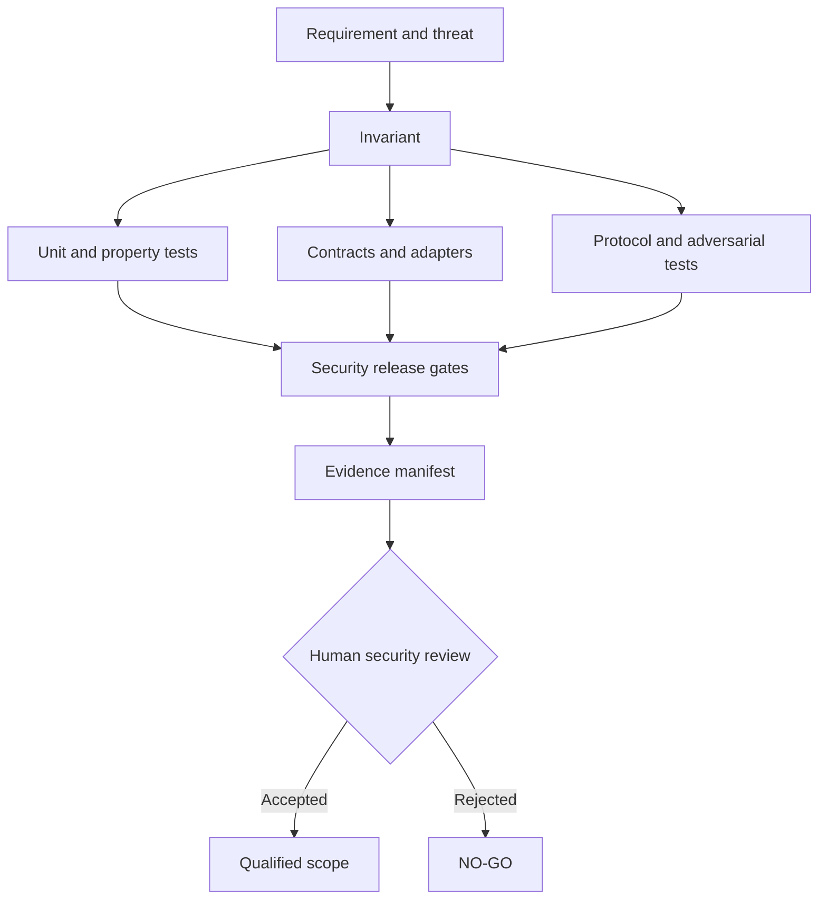
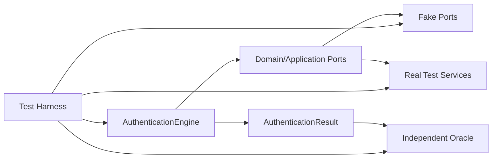
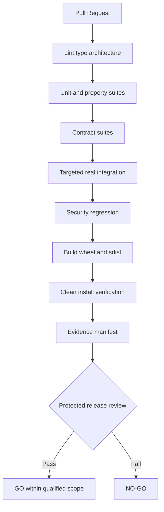
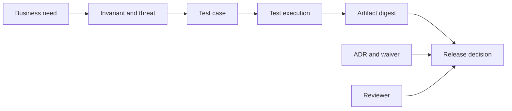

# 26_PYAUTHKIT_TESTING_AND_QUALIFICATION_STRATEGY

# PyAuthKit - Testing and Qualification Strategy

> **Projet :** PyAuthKit - Authentication Engine for the Modern Python Ecosystem  
> **Document :** `26_PYAUTHKIT_TESTING_AND_QUALIFICATION_STRATEGY.md`  
> **Nature :** stratégie globale de test, qualification sécurité, release evidence  
> **Version documentaire :** `0.1.0` (proposition)  
> **Date :** 31 octobre 2026  
> **Statut :** `PROPOSED / DESIGN` - tests du moteur réel non exécutés  
> **Langue :** français, API Python et identifiants en anglais  
> **Convention :** `PYAUTHKIT_SOFTWARE_DESIGN_LEARNING_CONVENTION.md`  
> **Sources internes :** documents `00` à `25`, prioritairement `07`, `09` à `25`  
> **Documents suivants :** `27_PYAUTHKIT_IMPLEMENTATION_ROADMAP.md`, `28_PYAUTHKIT_IMPLEMENTATION_BOOTSTRAP_PLAN.md`

**North Star :** *No verified evidence, no authenticated principal; no test evidence, no security claim.*

**Limite :** il s'agit d'une spécification cible. Les noms d'API, chemins de test, registres et commandes sont candidats. Aucun test PyAuthKit, aucune compatibilité de release et aucune conformité normative n'est réputé réalisé du fait de ce document.

## Guide de lecture

| Parcours | Sections | Objectif |
|---|---|---|
| Gouvernance et preuve | 0 à 11 | fixer oracles, responsables et gates |
| Architecture de test | 12 à 24 | port contracts, fixtures, properties, concurrence |
| Qualification fonctionnelle | 25 à 40 | MVP et extensions post-MVP |
| Sécurité, CI et release | 41 à 52 | automatiser la preuve et les contrôles |
| Registres et apprentissage | 53 à 66 | exigences, tests, menaces, ADR, exemples |
| Annexes A-G | Annexes | modèles, checklists et références |

**Périmètres :** `MVP` (moteur, Password/API Key/JWT validation, policy gate, config, audit minimal); `POST-MVP` (MFA, challenges, sessions, OIDC/SAML, WebAuthn, agents, risque); `CONDITIONAL` (stores réels, OAuth issuer, plugins tiers, multi-tenant distribué, SIEM, hot reload). Si une capacité est exposée, sa qualification devient obligatoire même si son label commercial est « expérimentale ».

---

## 0. Résumé exécutif

La qualité de PyAuthKit est un problème de **preuve de sécurité vérifiable**. Tester une méthode correcte n'assure ni la protection du `TrustedScope`, ni la validité du `TrustProfile`, ni le passage par `AuthenticationPolicyGate`. Le faux positif est critique : une preuve invalide ne doit jamais produire `AuthenticatedPrincipal`.

La stratégie relie besoin, invariant, frontière de confiance, risque, oracle, test, exécution CI et artefact de release. Elle combine tests unitaires, contracts, propriétés, intégrations, essais adverses, concurrence, fiabilité et packaging. Chaque gate est lié à un périmètre; la couverture de lignes ne permet pas de contourner un invariant P0.

Le verdict visé est `QUALIFIED FOR A DEFINED SCOPE`, non « PyAuthKit est sécurisé » sans limite.

## 1. Filiation documentaire et autorité des contrats

| Source | Propriété à tester | Autorité conservée |
|---|---|---|
| `00`-`03` | besoins, acteurs, frontières, architecture | cadrage original |
| `04`-`08` | modèles du domaine, invariants, use cases | règles métier AuthN |
| `09`-`10` | moteur, outcome, Password, API Key, JWT | décision technique vs finale |
| `11`-`13` | one-time, MFA, sessions, refresh | temporalité et atomicité |
| `14`-`15` | OIDC, SAML, WebAuthn | conformité protocolaire |
| `16`-`17` | workload, agents, risk | identité, délégation et assurance |
| `18`-`19` | ports, plugins, persistence | admission, contracts, CAS |
| `20`-`21` | threat model, audit | prévention, confidentialité, preuve |
| `22`-`23` | frameworks, PyIAMKit | AuthN distinct d'AuthZ |
| `24`-`25` | API publique, configuration | ergonomie et autorité de config |
| Convention | Problem First, Trust First, Pattern Second | statut de preuve et pédagogie |

Les IDs `TQS26-*` sont nouveaux et locaux. Ils **ne remplacent** ni les invariants `07` ni les registres sources `SEC20-*`, `SDK-*` ou `CFG25-*`. Une association dans un tableau n'atteste pas encore une implémentation.

## 2. Problème réel : les faux positifs cachés aux jonctions

Les défauts les plus dangereux naissent aux passages entre sous-systèmes : request vers host trust, claims JWT vers key source, outcome d'authenticator vers résultat final, identité fédérée vers compte IAM, plugin découvert vers code exécuté, cache vers store autoritatif, audit émis vers audit persisté.

Un test de classe isolée peut passer alors que le chemin complet contourne la politique. Un mock de base de données ne prouve pas un CAS; un provider OIDC factice qui retourne `sub` ne prouve ni `state`, ni `nonce`, ni signature. Le plan doit donc tester les **jonctions**, les **échecs** et le **caractère réellement autoritatif** des paramètres.

## 3. Objectifs, non-objectifs et qualité mesurable

Objectifs : (1) aucun faux succès AuthN, (2) refus des preuves invalides ou ambiguës, (3) ports substituables avec mêmes failure semantics, (4) invariants temporels et concurrentiels, (5) intégrations avec vrais backends lorsque la capacité les utilise, (6) absence de secrets en sortie, (7) provenance des releases et capacité à reproduire un test.

Non-objectifs : certifier automatiquement NIST ou OWASP; implémenter une primitive cryptographique maison; atteindre un pourcentage magique de couverture; exiger Redis/PostgreSQL pour le noyau; attribuer à PyAuthKit la responsabilité de l'autorisation de PyIAMKit; prétendre à la sécurité absolue.

## 4. Ubiquitous Language et états de qualification

| Terme | Sémantique |
|---|---|
| `Invariant` | propriété métier ou de confiance non négociable |
| `Oracle` | attendu indépendant du code évalué |
| `Test Case` | préconditions, action, oracle, scope |
| `Property` | règle vérifiée sur un ensemble d'inputs ou de transitions |
| `Contract Test` | mêmes assertions pour toutes les implémentations d'un port |
| `Conformance Test` | validation d'exigences d'un standard/version donné |
| `Fitness Function` | règle d'architecture automatisée |
| `Evidence` | logs CI signifiants, version, environnement, commit et artefact |
| `Gate` | condition de sécurité qui autorise ou bloque le passage |
| `Qualified Scope` | ensemble précis de capacités et d'environnements validés |

Statuts recommandés : `PROPOSED`, `IMPLEMENTED`, `TESTED`, `SECURITY_REVIEWED`, `QUALIFIED`, `RELEASED`. Verdicts de test : `PASS`, `FAIL`, `NOT_RUN`, `NOT_APPLICABLE`, `BLOCKED`, `INCONCLUSIVE`, `QUARANTINED`. `NOT_RUN` n'est jamais `PASS`.

## 5. Bounded Contexts et responsabilités des tests

Le noyau PyAuthKit porte la vérification et la décision finale. Les adapters portent l'interprétation du transport et des erreurs de leurs dépendances. L'hôte établit le contexte de confiance; PyIAMKit résout le compte, l'identité gérée et la décision d'autorisation. L'équipe release établit si le package testé est celui distribué.

Pour un test AuthN/AuthZ conjoint, le succès de PyAuthKit ne crée pas un droit IAM : l'oracle du host doit refléter une décision d'autorisation distincte. Le test prouve la frontière d'intégration, pas toute la conformité de PyIAMKit.

## 6. Inventaire des actifs, adversaires et frontières

Actifs : `TrustedScope`, `TrustProfile`, `VerifiedSubject`, credentials, secrets, keys, sessions, refresh families, challenge state, plugin allow-list, audit, artefacts. Adversaires : client externe, utilisateur malveillant, tenant hostile, provider compromis, plugin non approuvé, erreur d'administration, runner CI compromis.

Tracer explicitement les frontières non fiable vers fiable : HTTP request/host, JWT/header/JWK, remote assertion/subject, entrypoint/plugin, event/sink, store/cache, config/bootstrap, actor/mandate, AuthN/IAM, CI/artifact.

## 7. Classification des preuves et portée des affirmations

| Evidence | Prouve potentiellement | Ne prouve pas |
|---|---|---|
| Spécification | règle souhaitée | code correct |
| Typage/SAST | propriété statique ciblée | absence de faille logique |
| Unit | branche et invariant local | orchestration multi-ports |
| Contract | substitution et failure semantics | backend physique |
| Integration | comportement d'un service/version | production HA |
| Adversarial | rejet d'un vecteur donné | invulnérabilité |
| Concurrency | propriété sur environnement testé | tous failovers |
| Release | résultat rattaché au digest | qualité de la configuration cliente |

Une preuve n'est reconnue que si elle est reproductible et attachée à la version/portée. Le test écrit mais jamais exécuté reste `PROPOSED`.

## 8. Sécurité, performance et assurance

Un chemin fonctionnel peut être correct tout en étant vulnérable à une confusion d'algorithme JWT, une fuite de secret, un contrôle de nonce incomplet ou un `ContextVar` partagé. La qualification impose donc des axes indépendants : correction fonctionnelle, sécurité de confiance, performance bornée, résilience et preuves de livraison.

Le niveau AAL de NIST ne se déduit jamais du nombre de facteurs ni du nombre de tests. La conformité se discute clause par clause pour la fonctionnalité réellement délivrée.

## 9. Stratégie pyramidale et gates de confiance



Pyramide rapide pour les fonctions pures, tests contractuels pour les ports, intégration réelle pour les garanties d'infrastructure, protocol vectors et essais adverses pour la confiance. Aucun gate vertical critique ne peut être compensé par un haut taux de coverage.

## 10. Criticité risk-based et priorisation

`P0` : authenticated principal issu de preuve invalide, confusions issuer/tenant, fail-open de policy, fuite clé ou secret. `P1` : révocation, protocole, atomicité ou indisponibilité susceptible d'entraîner un défaut majeur selon la capacité. `P2` : fonction, compatibilité et performance importante. `P3` : documentation et ergonomie non critique.

Toute capacité livrée reçoit les gates correspondant à ses menaces, même si elle appartient au POST-MVP historique. Le classement est confirmé pendant l'ADR sécurité et peut être rehaussé par l'exposition effective.

## 11. Qualification de release et règles NO-GO

`GO` demande : aucun P0/P1 ouvert applicable, tests critiques exécutés avec `PASS`, artefact testé identique à l'artefact livré, provenance et revue nommées, exceptions bornées, limites publiées.

`NO-GO` si : principal sans preuve, confiance choisie par entrée client, politique AuthN contournée, permission IAM implicite, secret exposé, primitive one-time non atomique dans un profil vendu comme tel, plugin chargé hors allow-list, ou absence d'une preuve critique. Un waiver administratif ne neutralise pas une faille de confiance.

## 12. Arborescence cible des suites

```text
tests/
  unit/domain/ application/ authenticators/
  properties/ contracts/
  integration/postgres/ redis/ kms/ federation/ framework/ pyiamkit/
  security/jwt/ trust_boundaries/ privacy/ plugins/
  concurrency/ resilience/ performance/
  packaging/ architecture/ acceptance/
  fixtures/
```

Il s'agit d'une arborescence de responsabilité et non de l'inventaire d'un dépôt existant. La même fonction peut être appelée par plusieurs suites, mais chaque preuve a un oracle et un statut propres.

## 13. Test harness hexagonal et ports



Contrôler le temps, l'état, les dépendances et le transport par les ports convenus. Une couche d'adapter est qualifiée avec service réel sur les propriétés qu'elle annonce. Mocks et spies servent aux interactions et à l'injection d'échec, pas à « prouver » une transaction PostgreSQL/Redis.

## 14. Fixtures, builders et données synthétiques

Fixtures : `FakeClock` UTC, scope autoritatif construit par l'hôte, keypairs de test éphémères, signed JWT vectors, secrets canaris non réels, store contract factories, configuration snapshots versionnés, providers simulant timeout et réponse malformed.

Jamais de vrais credentials ou tokens. Éviter un seul tenant de test qui masque les fuites. Les builders doivent représenter des inputs trust et untrusted distincts; construire systématiquement un contexte privilégié à partir des champs clients introduirait le bug à détecter dans la fixture.

## 15. Oracles indépendants et tables de décision

Pour une règle AuthN, créer les attendus à partir des invariants du document `07`, des exigences du mécanisme et d'une politique de confiance prédéfinie. Ne pas appeler la même méthode du système pour générer `expected` puis `actual`.

Oracle central : toute issue non vérifiée ou interdite par `AuthenticationPolicyGate` produit un résultat **sans principal**, avec erreur typée et audit minimal. Un test positif n'est pertinent que si l'injection du faux/outcome technique ne contourne pas la politique.

## 16. Tests unitaires d'invariants et value objects

Pour chaque valeur sensible : construction valide, entrées invalides, bornes, égalité/immutabilité, sérialisation, `repr` expurgé, scope et provenance. Ne pas présumer qu'une dataclass frozen garantit l'immuabilité d'un `dict` contenu. Les erreurs de construction et de désérialisation ne doivent pas contenir de secret.

Tester le domaine sans import de FastAPI, Django, Redis, SQLAlchemy ou PyIAMKit. Les contrats existent dans le cœur; les adapters en dépendent et non l'inverse.

## 17. Property-based tests et shrinking

Hypothesis sert à générer preuves invalides, claims, indices de tenants, séquences de changement d'état et délais. Propriétés candidates : aucun JWT aléatoire n'est authentifié sans validation, `tenant_hint` n'affecte pas le scope, `UNKNOWN` n'égale pas `LOW`, aucune proof expirée ne réussit, aucun raw secret ne fuit en sortie.

Limiter les données et le temps en CI, conserver la seed et le contre-exemple shrinké. Convertir les défauts révélés en régression déterministe. Les generators doivent produire aussi des données structurées valides, pas uniquement du bruit rejeté au parsing.

## 18. Stateful et model-based testing

Les flows, challenges et refresh token families sont des automates : `CREATED -> PENDING -> CONSUMED/EXPIRED/REVOKED`, `ACTIVE -> ROTATED -> REPLAY_DETECTED/REVOKED_FAMILY`.

Générer des séquences `create, consume, retry, rotate, revoke, expire, crash` et comparer l'état réel à un petit modèle indépendant. Les state machines in-memory ne démontrent pas l'atomicité sur plusieurs workers; cette prétention impose un backend réel et des tests de concurrence.

## 19. Contract testing des ports et des adapters

Suite partagée obligatoire par port implémenté : `Authenticator`, `CredentialStore`, `ChallengeStore`, `SessionStore`, `AuditSink`, `ConfigurationSource`, `PluginAdmission`. Vérifier cas valide, absent, invalide, hors scope, timeout, cancellation, state mutation et versioning. Documenter la sémantique de `NOT_FOUND`, `DENIED` et `DEPENDENCY_UNAVAILABLE`.

Une implémentation qui ne respecte pas le port ne doit pas être automatiquement remplacée par une implémentation plus permissive. La déclaration de capabilities doit correspondre aux tests réellement passés.

## 20. Fake vs stub vs spy vs infrastructure réelle

| Type | Bon usage | Ne prouve pas |
|---|---|---|
| Fake | manipuler l'état en mémoire | garanties transactionnelles réelles |
| Stub | erreur ou réponse prédéterminée | interopérabilité protocolaire |
| Spy | capturer appels/events | durabilité d'un audit |
| Mock | isoler une branche d'orchestration | cohérence de bout en bout |
| Service réel éphémère | transactions, networking, schema | environnement de production entier |
| Fault proxy | resets, retries, latence | toutes les pannes possibles |

Utiliser le moyen le plus simple qui peut réellement falsifier la propriété. Refuser un fake lorsqu'il rend impossible le scénario testé.

## 21. Configuration, secrets et composition root

Tester provenance des sources, precedence validée, secrets référencés mais non sérialisés, overrides interdits, snapshots immuables, validation avant READY, admission de plugins et hot reload atomique si activé. Un `TrustProfile` obtenu d'un JWT ou d'un paramètre client doit être refusé.

Le moteur doit rester sur sa génération si la configuration candidate échoue; éviter un mélange des paramètres N/N+1 dans une même tentative AuthN. Injecter erreurs KMS et timeout sans révélation de secrets.

## 22. Architecture Fitness Functions

Règles candidates : domain ne doit pas importer les frameworks/ORM; application dépend de ports abstraits; composition root seul connaît les adapters concrets; core n'importe pas PyIAMKit ni PyAgentsKit; résultats AuthN ne contiennent pas de décision AuthZ implicite; imports publics versionnés; aucun secret dans `__repr__`; audit typé; registry admis avant activation; chaque port livré a ses contract tests.

Valider par graphes d'import et AST, typing, tests d'API, inspection des wheels et revue, avec IDs `TQS26-FIT-*` en section 59. Une vérification d'import est nécessaire mais insuffisante contre l'injection de dépendance à l'exécution.

## 23. Horloges, frontières temporelles et timeouts

Utiliser `TestClock` UTC pour exp/nbf/iat/TTL; temps monotone pour deadline et budget de timeout. Vérifier avant, exactement à, juste après chaque borne, avec leeway décidé. Injecter expiration plutôt que `sleep()` fragile.

Tester l'annulation async pendant accès store et provider. Une cancellation ne publie ni principal partiel ni challenge « résurrected ». Tester des skew multi-workers si la capacité distribuée est livrée.

## 24. Concurrence, linéarisation et idempotence

Pour challenges et refresh rotation : synchroniser deux ou plusieurs consommateurs à une barrière, recueillir invoke/return, vérifier au plus un succès commité et absence de double branche active. Exécuter en threads, processus, connexions et backend réels selon le profil. Inclure erreur réseau après commit et crash avant réponse.

Un test concurrent asyncio dans un processus est utile, mais n'atteste pas la linéarisation d'un Redis cluster ou PostgreSQL sous failover. L'architecture doit déclarer précisément l'atomicité promise.

## 25. MVP : AuthenticationEngine et PolicyGate

Parcours complet : `AuthenticationRequest -> TrustedEntryContext -> TrustProfileResolver -> Authenticator -> AuthenticatorOutcome -> AuthenticationPolicyGate -> AuthenticationResult`. Prouver que valid outcome peut encore être refusé par la policy et qu'un résultat non authentifié n'expose pas de `AuthenticatedPrincipal`.

Cas : profil manquant/ambigu, authenticator absent/désactivé, collision, erreur provider, timeouts, cancellation, method forbidden, malformed request, audit failure selon mode. Les mécanismes ne doivent jamais créer une authorization IAM.

## 26. MVP : Password

Tester mot de passe correct/incorrect, credential absent/révoqué, scope isolé, KDF/paramètres, migration de hash planifiée, pepper indisponible, encodage Unicode et non-fuite de secret en diagnostics. La comparaison, le coût de KDF et les limitations temporelles sont délégués à des bibliothèques maintenues et à une politique explicitée.

Les mesures de timing exigent approche statistique et revue du canal d'attaque. Un `assert duration < 1s` ne prouve aucune sécurité et peut dégrader les tests.

## 27. MVP : API Keys

Tester full key vs prefix public, clé inconnue, status désactivé, révocation, rotation, key id collision, hash mismatch, tenant crossing, cache stale, log canary et absence de secrets dans les erreurs. Le secret complet est nécessaire : un préfixe ou un ID d'API key ne prouve jamais la possession.

Une revendication de révocation « immédiate » doit être prouvée sur l'architecture de cache/store retenue; sinon annoncer explicitement la fenêtre de propagation.

## 28. MVP : JWT verification et JOSE

Matrice : signature valide, faux algorithme, `alg=none`, key family confusion, kid inconnu/dupliqué, `jku` et `x5u` non approuvés, signature corrompue, `iss`/`aud` incorrects, `exp`/`nbf` aux limites, types de claims invalides, JWKS indisponible, key rotation, tokens volumineux.

Le profil de confiance vient du contexte hôte et non du JWT non vérifié. Le test doit contrôler la clé, l'algorithme, l'issuer, l'audience et les temps applicables. La validation de JWT entrant est séparée de l'émission de tokens.

## 29. POST-MVP : challenges et OTP

Propriétés : one-time, binding `(flow, purpose, subject, scope)`, expiration, refus des tentatives excessives, anti-replay, concurrence, crash après consommation, expiration lors de la continuation et non-publication avant policy gate. Ne pas fusionner `CHALLENGE_REQUIRED` avec `Authenticated`.

La consommation unique exige test backend réel si elle est contractée comme garantie distribuée.

## 30. POST-MVP : MFA, assurance et step-up

Tester facteurs réellement indépendants, user verification, fraîcheur de preuve, récupération et remplacement, step-up inachevé, assurance évaluée et absence de downgrade. Le test d'un deuxième facteur valide n'établit pas automatiquement AAL2 ou AAL3.

Les obligations exactes dépendent des authenticator types, de la politique et du standard choisi. Les conclusions de conformité sont versionnées et revues clause par clause.

## 31. POST-MVP : sessions, JWT de session et refresh

Scénarios : session fixation, renewal après AuthN, expiration idle/absolute, revocation, logout, token audience, cookies selon integration, refresh rotation, reuse detection, two contenders, family invalidation, store outage et failover.

JWT stateless n'assure pas la révocation immédiate sans mécanisme additionnel. Pour les clients OAuth publics, la protection des refresh tokens par rotation ou sender-constraining s'appuie sur RFC 9700 selon rôle de l'implémentation.

## 32. POST-MVP : OIDC/OAuth/SAML

OIDC : state, nonce, PKCE, issuer binding, mix-up, redirect URI, ID token, JWKS, subject mapping explicite. OAuth : scope/resource binding, usages autorisés des tokens, non-confusion avec authentication. SAML : validation XMLSig et de l'élément signé, Destination, AudienceRestriction, InResponseTo, expiry, XXE et signature wrapping.

Un mock qui retourne un `sub` ne prouve pas une ceremony fédérée. Utiliser des providers de test et des vectors négatifs documentés.

## 33. POST-MVP : WebAuthn / passkeys

Registration et authentication : challenge aléatoire consommable une seule fois, RP ID, Origin, signature, binding user/credential, user presence et user verification selon politique, attestation conditionnelle, sign counter selon garanties de l'authenticator, recovery et replay.

Utiliser un validateur de protocole maintenu; ne pas recoder COSE/CBOR. Les passkeys synchronisées modifient les hypothèses sur le counter, à documenter.

## 34. POST-MVP : workloads, agents et délégations

Valider SPIFFE/SVID selon trust domain, audience et expiry; token exchange si activé; actor distinct de subject; mandate, consent et scope validés; mTLS/PKI selon configuration; cross-tenant refus. Un agent techniquement authentifié ne détient pas automatiquement les droits de l'utilisateur.

Les tests de délégation portent conjointement sur PyAuthKit et PyIAMKit/host sans attribuer à PyAuthKit un rôle de PDP.

## 35. POST-MVP : adaptive authentication et risque

Tester `LOW` malgré preuve invalide (toujours refus), `UNKNOWN` (policy explicite), signal obsolète, provider indisponible, step-up requis, changement de risque pendant flow, isolation tenant et protection contre l'injection de signal. Une évaluation de risque n'est ni un credential ni une preuve AuthN.

Si le modèle de risque utilise un composant ML, ajouter qualité de données, drift et robustesse, sans substituer un score ML aux règles de trust.

## 36. Plugins, registry et supply chain

Cycle testé : discovery, validation metadata, allow-list, admission, construction, activation, désactivation. Collision/version incompatible doit bloquer. Un plugin installé ne doit pas s'activer silencieusement. Les imports tiers in-process ne constituent pas une sandbox.

Couverture : provenance package, dépendances, SBOM, vulnérabilités et digest de l'artefact, selon ADR release. Tests des plugins hostiles uniquement dans un environnement isolé et autorisé.

## 37. Persistence et contracts de stores réels

Contract tests identiques sur InMemory, PostgreSQL et Redis seulement s'ils prétendent porter le même contrat. Valider transactions, CAS, scope, TTL, revocation, migration, restore, outage et failover. Un service Redis mono-instance peut avoir d'autres garanties de durabilité qu'un cluster; le document doit les distinguer.

PostgreSQL RLS est testé avec le vrai rôle applicatif et les rôles privilégiés pertinents; la présence d'une policy SQL n'est pas une preuve automatique d'isolation.

## 38. Audit, OpenTelemetry et redaction

Tests canaris pour password, API key, bearer JWT, refresh token, OTP, cookie et private key dans logs, traces, spans, metrics, exceptions et JSON events. Éviter les identifiants sensibles comme labels métriques à forte cardinalité. Contrôler la corrélation via IDs non secrets.

Audit best-effort et audit durable ont des oracles distincts; un événement émis n'est pas considéré comme durable avant l'ack annoncé par son backend.

## 39. Frameworks, host trust et PyIAMKit

FastAPI/Starlette : ASGI lifecycle, middleware, contexte serveur, dépendances; Django/DRF : sessions natives et request.user; Flask/WSGI : request context; CLI/workers : workload identity et paramètres hôte. Tester spoilers des headers de tenant et fuite de ContextVar entre requêtes.

Le résultat AuthN publié par PyAuthKit ne crée aucun account linking, permission, rôle ou mandat implicite. Le test E2E doit inclure une décision AuthZ indépendante et son enforcement host.

## 40. Public API, packaging et matrice de versions

Wheel/sdist installés dans venv vierge; imports core sans framework/ORM ni PyIAMKit; extras optionnels; `py.typed` PEP 561; signatures et errors documentés; compatibilité Python/OS/support explicite. Le bootstrap ne doit pas inventer une promesse SemVer stable en version `0.x`.

La matrix d'exécution et les dependencies versions doivent être fixées dans `27/28`, et la vérification portera sur la distribution réellement construite.

## 41. Threat-driven tests et abuse cases

Chaque menace applicable de `20` porte : acteur, capacité, point d'entrée, vecteur, oracle, contrôle, résultat. Priorité aux attaques de trust boundaries : JWT alg/key confusion, IdP mix-up, replay, config downgrade, plugin admission, headers spoofed, agent confused deputy, logger injection.

Aucun test de pénétration hors environnement autorisé. Les constats de sécurité externes alimentent les régressions automatisées et une mise à jour du threat model.

## 42. Fuzzing, mutation et differential testing

Fuzzer parseurs de credentials, JOSE/JWT, XML/SAML, CBOR/WebAuthn selon les capacités. Oracles : pas de false success, crash inexpliqué, amplification non bornée ou fuite d'information. Mutation testing cible les checks de signature, policy gate, tenant scope et redaction; une mutation survivante critique implique analyse.

Différentiel entre bibliothèques de référence possibles avec hypothèses de version documentées; deux implémentations peuvent partager le même défaut.

## 43. Fault injection et chaos contrôlé

Injections : DNS indisponible, provider HTTP 500, timeout, KeySet source offline, store read-only, partition, crash, cancellation, audit sink saturé et secrets manquants. Résultat attendu : non-authenticated pour preuve non établie, error typée, pas de fallback permissif, cleanup et audit selon policy.

Le chaos doit rester borné, autorisé, reproductible et exécuté uniquement en environnement de test contenant des identités synthétiques.

## 44. Performance, charge et contraintes de sécurité

Mesurer p50/p95/p99, débit, CPU, mémoire, attente réseau et hashing costs pour profiles identifiés. Évaluer DoS via payload size, nombre de clés, nombre de plugins et high concurrency. Enregistrer machine, Python, versions des dépendances et charge. Ne pas inventer d'objectif chiffré avant baseline.

Les budgets sont subordonnés aux garanties cryptographiques et de sûreté : un KDF ne doit pas être affaibli pour améliorer un benchmark.

## 45. Compatibilité Python, OS et environnement

Tester versions Python minimales et courantes décidées, plateformes supportées et environnements d'extras. Les adapters PostgreSQL/Redis/IdP déclarent versions/configurations testées; un noyau Python pur ne doit pas être contraint par un extra optionnel.

Construire une matrice « capability x backend x Python x OS x mode » sans créer un produit cartésien de tests inutile; prioriser les combinaisons à risque et conserver les lacunes.

## 46. Toolchain candidate et adoption YAGNI

| Besoin | Outil candidat | Risque de sur-ingénierie |
|---|---|---|
| Harness | pytest, pytest-asyncio | surcharger les fixtures |
| Properties | Hypothesis | générateurs non pertinents |
| Coverage | coverage.py / pytest-cov | confondre métrique et sécurité |
| Types/lint | mypy ou pyright, ruff | règles non alignées API |
| Architecture | import-linter / AST | heuristiques insuffisantes |
| Package | build, twine, venv | ne pas tester le wheel |
| Integration | containers / services CI | n'utiliser que mocks |
| SAST/SCA | tooling choisi en ADR | accumulation de faux positifs |
| Benchmark | pytest-benchmark | chiffres non reproductibles |
| Fuzz / mutation | outil spécialisé | coût avant nécessité |

Choisir d'abord la solution minimale qui falsifie l'invariant; l'outil n'est pas un objectif pédagogique en soi.

## 47. CI pipeline et isolation des jobs



Diff sensible sur cryptographie, policy, trust, registry, session, store ou config déclenche tests approfondis. Exécuter du code de PR non fiable sans lui exposer les secrets CI. Les actions CI et les dépendances sont pinées selon politique supply chain.

## 48. Quality gates PR, main et release

| Gate | PR | Main | Release |
|---|---|---|---|
| Typing, lint, architecture | bloquant | bloquant | bloquant |
| Unit, properties MVP, contracts | bloquant | bloquant | bloquant |
| Security regressions | ciblé et bloquant | complet applicable | bloquant |
| Intégration réelle | selon diff | selon capacité | bloquant si active |
| Protocole et replay/concurrence | selon diff | applicable | bloquant si active |
| Packaging, artefact, digest | smoke | build | bloquant |
| Threat/risk et revue humaine | selon criticité | selon risque | bloquant |

Exiger une justification explicite de `NOT_APPLICABLE`; ne jamais transformer un job `skipped` en succès de sécurité.

## 49. Evidence manifest et chaîne de traçabilité



Champs : commit, artifact_sha256, configuration digest non sensible, versions Python et deps, OS, test IDs, results, CI run URI, reviewer, exceptions et limitations. Le manifest final accompagne la release et permet de requalifier si artefact ou profil opérationnel changent.

## 50. Flakiness, quarantines et tests non exécutés

Un test de sécurité flaky impose enquête, non simple rerun jusqu'au vert. `QUARANTINED` porte owner, durée et plan de correction; ne doit pas exclure un gate P0/P1 actif. Les tests qui ne peuvent pas décider deviennent `INCONCLUSIVE` et demandent un nouvel oracle ou une infrastructure pertinente.

Conserver seeds, traces non sensibles, environment et historique. Limiter l'instabilité due à `sleep`, temps global ou services partagés.

## 51. Release readiness, risque résiduel et waivers

Le mainteneur recueille résultats, waivers, revue de sécurité, digest et notes de limites. Seul un acteur autorisé prend la décision `GO/NO-GO`. Un waiver est borné à une version et expiration, contient menace, raison, compensation et owner; il ne rend pas acceptable un succès AuthN sans preuve.

Si une capacité optionnelle ne peut être qualifiée, la retirer de l'artefact/registry et documenter l'exclusion plutôt que la laisser activable avec `NOT_RUN`.

## 52. Référentiels externes et applicabilité

Référentiels actuels consultés : OWASP ASVS 5.0.0, NIST SP 800-63B-4 et SP 800-63-4, RFC 9700, OWASP WSTG stable 4.2, pytest/pytest-asyncio, Hypothesis stateful testing, OpenTelemetry semantic conventions et SLSA v1.2. Les liens datés figurent en annexe C.

Une bibliothèque d'authentification n'est pas automatiquement une application web complète. Mapper chaque contrôle externe à la version, au composant responsable, à l'oracle et à sa preuve; les clauses non pertinentes restent `NOT_APPLICABLE` justifiées, et non « conforme » par omission.

## 53. Registre des exigences de test candidates `TQS26-REQ-*`


Chaque exigence est *proposée*, porte sur le périmètre indiqué et appelle un test avec oracle. Les liaisons présentées plus bas sont des **candidats de couverture**, non un état d'exécution. Les exigences de protocole ne sont applicables qu'après décision de livraison correspondante.

| ID | Groupe | Portée | Source(s) | Exigence candidate |
|---|---|---|---|---|
| `TQS26-REQ-001` | `G01` | `MVP` | `09/24` | Aucun succès sans preuve vérifiée et policy finale approuvée. |
| `TQS26-REQ-002` | `G01` | `MVP` | `07/09` | Une issue non-authenticated ne transporte jamais de principal utilisable. |
| `TQS26-REQ-003` | `G01` | `MVP` | `09/24` | Les erreurs techniques restent distinguées d'un refus de preuve dans l'API typée. |
| `TQS26-REQ-004` | `G02` | `MVP` | `10/20` | La validation Password rejette tout secret erroné, credential inactif ou absent. |
| `TQS26-REQ-005` | `G02` | `MVP` | `10/20` | Le mot de passe brut n'apparaît ni en logs, trace, repr ni erreur. |
| `TQS26-REQ-006` | `G02` | `MVP` | `10/25` | Le hash/KDF et les paramètres nécessaires sont validés selon politique et backend. |
| `TQS26-REQ-007` | `G03` | `MVP` | `10/19` | Une API key invalide, révoquée ou désactivée ne peut authentifier. |
| `TQS26-REQ-008` | `G03` | `MVP` | `07/10` | L'identifiant public ou le prefix d'une API key n'est jamais une preuve suffisante. |
| `TQS26-REQ-009` | `G03` | `MVP` | `19/20` | La recherche et révocation de clé restent isolées par trusted scope. |
| `TQS26-REQ-010` | `G04` | `MVP` | `10/14` | Le JWT est validé cryptographiquement avec algorithme et clé autorisés. |
| `TQS26-REQ-011` | `G04` | `MVP` | `09/25` | Le JWT ne choisit pas lui-même son profil de confiance ou key source. |
| `TQS26-REQ-012` | `G04` | `MVP` | `14/20` | Issuer, audience et fenêtres temporelles sont testés avant publication du sujet. |
| `TQS26-REQ-013` | `G05` | `MVP` | `18/24` | Tous les authenticators approuvés suivent le même contrat d'outcome. |
| `TQS26-REQ-014` | `G05` | `MVP` | `18/25` | Une collision ou résolution ambiguë du registry bloque l'activation. |
| `TQS26-REQ-015` | `G05` | `MVP` | `18/20` | La découverte d'un plugin ne provoque pas son activation. |
| `TQS26-REQ-016` | `G06` | `MVP` | `25` | La configuration critique dispose de provenance et validation autorisées. |
| `TQS26-REQ-017` | `G06` | `MVP` | `25` | Aucun démarrage READY ne suit l'échec d'un contrôle de configuration critique. |
| `TQS26-REQ-018` | `G06` | `CONDITIONAL` | `25` | Hot reload ne mélange pas plusieurs générations d'un même flux. |
| `TQS26-REQ-019` | `G07` | `MVP` | `21` | Les événements d'audit d'authentification sont typés et redacted. |
| `TQS26-REQ-020` | `G07` | `MVP` | `21` | Un échec d'export télémétrique ne change pas le verdict AuthN. |
| `TQS26-REQ-021` | `G07` | `CONDITIONAL` | `19/21` | Le mode audit durable ne revendique succès qu'après le niveau d'ack défini. |
| `TQS26-REQ-022` | `G08` | `POST-MVP` | `11/19` | Un challenge one-time n'est consommé qu'une seule fois. |
| `TQS26-REQ-023` | `G08` | `POST-MVP` | `11/12` | Une continuation expirée ou liée à un autre sujet est refusée. |
| `TQS26-REQ-024` | `G08` | `POST-MVP` | `11/20` | Les retries, annulations et pannes ne créent aucun succès prématuré. |
| `TQS26-REQ-025` | `G09` | `POST-MVP` | `12` | L'assurance ne peut être élevée par simple présence d'un code OTP. |
| `TQS26-REQ-026` | `G09` | `POST-MVP` | `12/17` | Un step-up exige une preuve fraîche et une policy finale. |
| `TQS26-REQ-027` | `G09` | `POST-MVP` | `12/20` | Les facteurs non indépendants ne sont pas comptés séparément sans justification. |
| `TQS26-REQ-028` | `G10` | `POST-MVP` | `13/19` | Le refresh token réutilisé est détecté selon le profil de protection adopté. |
| `TQS26-REQ-029` | `G10` | `POST-MVP` | `13/19` | Les opérations de refresh concurrentes ne créent pas deux branches actives. |
| `TQS26-REQ-030` | `G10` | `POST-MVP` | `13` | Les sessions suivent expiration, révocation et binding au contexte. |
| `TQS26-REQ-031` | `G11` | `POST-MVP` | `14` | OIDC state/nonce/PKCE sont validés selon le flux applicable. |
| `TQS26-REQ-032` | `G11` | `POST-MVP` | `14/23` | Un sujet fédéré ne devient pas automatiquement un compte local lié. |
| `TQS26-REQ-033` | `G11` | `POST-MVP` | `14/20` | Issuer mix-up, JWKS non approuvés et redirect non autorisés sont rejetés. |
| `TQS26-REQ-034` | `G12` | `POST-MVP` | `14` | Une assertion SAML exige signature, audience et destinataire valides. |
| `TQS26-REQ-035` | `G12` | `POST-MVP` | `14/20` | XML signature wrapping et entités externes ne conduisent pas à une identité vérifiée. |
| `TQS26-REQ-036` | `G12` | `POST-MVP` | `14` | `InResponseTo` et conditions de temps sont vérifiés quand attendus. |
| `TQS26-REQ-037` | `G13` | `POST-MVP` | `15` | WebAuthn vérifie challenge, Origin, RP ID et signature de la cérémonie. |
| `TQS26-REQ-038` | `G13` | `POST-MVP` | `15` | Un credential ou challenge appartenant à un autre scope est rejeté. |
| `TQS26-REQ-039` | `G13` | `POST-MVP` | `15` | La politique UV/UP requise est évaluée explicitement. |
| `TQS26-REQ-040` | `G14` | `POST-MVP` | `16` | Une workload identity est validée contre son trust domain et audience. |
| `TQS26-REQ-041` | `G14` | `POST-MVP` | `16/23` | L'acteur agent, le sujet délégué et le mandat ne sont pas confondus. |
| `TQS26-REQ-042` | `G14` | `POST-MVP` | `16/20` | Une délégation expirée ou hors scope ne déclenche pas d'autorisation. |
| `TQS26-REQ-043` | `G15` | `POST-MVP` | `17` | Un signal LOW ou score bas ne constitue pas une preuve d'identité. |
| `TQS26-REQ-044` | `G15` | `POST-MVP` | `17` | Un signal UNKNOWN suit la politique explicite, sans fallback LOW. |
| `TQS26-REQ-045` | `G15` | `POST-MVP` | `17` | Le risk step-up ne publie pas prématurément un authenticated principal. |
| `TQS26-REQ-046` | `G16` | `CONDITIONAL` | `19` | Le store réel satisfait les garanties de CAS/transaction qu'il annonce. |
| `TQS26-REQ-047` | `G16` | `CONDITIONAL` | `19/25` | Les données et caches restent isolés par tenant/trusted scope. |
| `TQS26-REQ-048` | `G16` | `CONDITIONAL` | `19` | Backup/restore et failover ne violent pas les invariants de révocation déclarés. |
| `TQS26-REQ-049` | `G17` | `MVP` | `22/23` | L'adapter framework ne construit pas un trusted scope depuis une preuve client. |
| `TQS26-REQ-050` | `G17` | `MVP` | `23` | Authenticated ne devient pas Authorized sans résolution/policy IAM distincte. |
| `TQS26-REQ-051` | `G17` | `CONDITIONAL` | `22` | Les contextes ASGI/WSGI/CLI ne fuient pas entre requêtes concurrentes. |
| `TQS26-REQ-052` | `G18` | `MVP` | `24` | Le SDK publié s'importe dans un environnement sans framework facultatif. |
| `TQS26-REQ-053` | `G18` | `MVP` | `24` | Une release possède un manifest de tests et d'artefacts traçable. |
| `TQS26-REQ-054` | `G18` | `MVP` | `20/24` | Les tests de sécurité critiques et revues requises bloquent la publication. |

## 54. Registre des invariants de qualification `TQS26-INV-*`


Ces invariants sont sélectionnés parce qu'une violation aurait un impact d'authentification, de confidentialité ou de fiabilité de la preuve. Ils complètent les invariants métier propres aux documents `07`, `09`-`25` et n'ont pas vocation à les remplacer.

| ID | Groupe | Invariant à falsifier |
|---|---|---|
| `TQS26-INV-001` | `G01` | Aucun `Authenticated` sans evidence valide et policy gate passé. |
| `TQS26-INV-002` | `G01` | `AuthenticatorOutcome` ne peut contourner la décision finale. |
| `TQS26-INV-003` | `G01` | Toute issue d'erreur ou de refus n'expose pas de principal. |
| `TQS26-INV-004` | `G02` | Un password incorrect, manquant ou révoqué ne peut réussir. |
| `TQS26-INV-005` | `G02` | Les secrets Password sont absents de toutes sorties observables. |
| `TQS26-INV-006` | `G03` | Une API key prefix n'est pas une preuve. |
| `TQS26-INV-007` | `G03` | Une API key hors scope ou révoquée ne valide jamais. |
| `TQS26-INV-008` | `G04` | Le trust profile d'un JWT ne dérive pas du token non vérifié. |
| `TQS26-INV-009` | `G04` | Une signature/claim invalide bloque le principal. |
| `TQS26-INV-010` | `G04` | Un algorithme ou une clé non autorisés ne sont jamais acceptés. |
| `TQS26-INV-011` | `G05` | Aucun plugin non approuvé n'est activé. |
| `TQS26-INV-012` | `G05` | Résolution des authenticators déterministe et non ambiguë. |
| `TQS26-INV-013` | `G06` | Configuration sans source autoritative ne produit pas READY. |
| `TQS26-INV-014` | `G06` | Chaque requête utilise une génération cohérente de configuration. |
| `TQS26-INV-015` | `G06` | Les secrets ne se retrouvent pas dans diagnostics de configuration. |
| `TQS26-INV-016` | `G07` | Aucun audit/log/trace ne contient la preuve brute. |
| `TQS26-INV-017` | `G07` | Un événement émis n'est pas réputé durable sans ack contractuel. |
| `TQS26-INV-018` | `G08` | Un challenge one-time ne peut réussir deux fois. |
| `TQS26-INV-019` | `G08` | Une continuation hors purpose/scope/TTL est rejetée. |
| `TQS26-INV-020` | `G09` | Assurance revendiquée ne peut dépasser celle réellement établie. |
| `TQS26-INV-021` | `G09` | Step-up inachevé ne peut autoriser un accès renforcé. |
| `TQS26-INV-022` | `G10` | Une rotation refresh ne crée pas deux successeurs actifs. |
| `TQS26-INV-023` | `G10` | La réutilisation d'un refresh invalidé suit la réponse de replay définie. |
| `TQS26-INV-024` | `G10` | La révocation autoritative s'applique aux sessions dans les délais déclarés. |
| `TQS26-INV-025` | `G11` | OIDC state/nonce et issuer sont liés à la tentative initiatrice. |
| `TQS26-INV-026` | `G11` | Un email fédéré seul ne crée pas un lien IAM sécurisé. |
| `TQS26-INV-027` | `G12` | Une assertion SAML non vérifiée ne construit pas de sujet. |
| `TQS26-INV-028` | `G12` | Le parser XML ne peut contourner l'élément effectivement signé. |
| `TQS26-INV-029` | `G13` | WebAuthn challenge, RP ID et Origin sont obligatoires suivant profil. |
| `TQS26-INV-030` | `G13` | Une assertion credential hors scope est rejetée. |
| `TQS26-INV-031` | `G14` | Identité workload validée ne signifie pas mandat délégué valide. |
| `TQS26-INV-032` | `G14` | Acteur et sujet délégué sont distincts dans la provenance. |
| `TQS26-INV-033` | `G14` | Un mandat expiré ou hors scope ne peut élargir les droits. |
| `TQS26-INV-034` | `G15` | Un signal de risque faible ne devient pas une preuve AuthN. |
| `TQS26-INV-035` | `G15` | Une absence de signal suit la politique, jamais un fallback implicite. |
| `TQS26-INV-036` | `G16` | L'atomicité annoncée est vraie pour le backend réel. |
| `TQS26-INV-037` | `G16` | Aucun lookup/mutation inter-tenant ne peut être autorisé. |
| `TQS26-INV-038` | `G16` | Aucun crash de store ne ressuscite silencieusement un secret révoqué. |
| `TQS26-INV-039` | `G17` | Le host trust context n'est pas construit à partir d'un header libre. |
| `TQS26-INV-040` | `G17` | Authentication n'implique ni account linking ni authorization. |
| `TQS26-INV-041` | `G17` | Aucune fuite de contexte entre requêtes concurrentes. |
| `TQS26-INV-042` | `G18` | Core importable sans adapter externe ni PyIAMKit. |
| `TQS26-INV-043` | `G18` | Artefact qualifié est identique à artefact publié. |
| `TQS26-INV-044` | `G18` | Statut NOT_RUN ne peut être comptabilisé comme PASS. |
| `TQS26-INV-045` | `X` | Toute erreur de dépendance critique respecte le fail-closed. |
| `TQS26-INV-046` | `X` | Tout oracle de sécurité est indépendant du SUT évalué. |
| `TQS26-INV-047` | `X` | Toute preuve de release référence commit, configuration et environnement. |
| `TQS26-INV-048` | `X` | Toute capacité exposée est assujettie aux gates applicables. |

## 55. Tests candidats `TQS26-TST-*` : catalogues et oracles


Un test est listé avec l'attendu observable, sans assertion selon le comportement actuel (non inspecté). Tous les identifiants sont des **backlog items**. Une fois implémentés, chacun reçoit chemin de code, commit, runner, paramètres, environnement, résultat et preuve d'artefact; le nombre de tests réels peut être supérieur au nombre de scénarios du catalogue.

| ID | Groupe | Scénario | Oracle attendu | Portée |
|---|---|---|---|---|
| `TQS26-TST-001` | `G01` | proof valid + policy approved | Authenticated avec principal situé et provenance valide | `MVP` |
| `TQS26-TST-002` | `G01` | proof valid + policy denied | Denied sans principal, malgré outcome positif | `MVP` |
| `TQS26-TST-003` | `G01` | proof invalid | Denied sans principal et sans token émis | `MVP` |
| `TQS26-TST-004` | `G01` | trusted context absent | configuration/refus non authentifié, aucun profil implicite | `MVP` |
| `TQS26-TST-005` | `G01` | authenticator timeout | DependencyUnavailable sans principal ni fallback permissif | `MVP` |
| `TQS26-TST-006` | `G01` | ambiguous mechanism resolution | No success; error contrôlée et audit minimal | `MVP` |
| `TQS26-TST-007` | `G02` | valid password and active hash | outcome vérifié sous le bon scope | `MVP` |
| `TQS26-TST-008` | `G02` | wrong password | non vérifié sans secret en diagnostic | `MVP` |
| `TQS26-TST-009` | `G02` | credential disabled or missing | aucun principal et révélation minimale | `MVP` |
| `TQS26-TST-010` | `G02` | KDF parameters rejected | configuration invalide, jamais traitement downgradé | `MVP` |
| `TQS26-TST-011` | `G02` | password containing unicode edge cases | comparaison conforme à politique documentée | `MVP` |
| `TQS26-TST-012` | `G02` | password canary in exception path | secret absent de logs/trace/repr | `MVP` |
| `TQS26-TST-013` | `G03` | valid full API key | outcome vérifié pour scope et statut corrects | `MVP` |
| `TQS26-TST-014` | `G03` | known prefix without secret | rejet sans lookup permissif | `MVP` |
| `TQS26-TST-015` | `G03` | rotated key before/after cutover | ancien secret refusé après borne autoritative | `MVP` |
| `TQS26-TST-016` | `G03` | revoked API key in warm cache | refus selon délai contractuel, aucune promesse fausse | `MVP` |
| `TQS26-TST-017` | `G03` | key from another tenant | non authentifié, aucune fuite de credential | `MVP` |
| `TQS26-TST-018` | `G03` | API key canary in telemetry | clé absente de toute sortie | `MVP` |
| `TQS26-TST-019` | `G04` | valid signature with expected claims | principal vérifié sous profil autoritatif | `MVP` |
| `TQS26-TST-020` | `G04` | alg none/algorithm confusion | rejet avant construction d'identité | `MVP` |
| `TQS26-TST-021` | `G04` | wrong issuer or audience | rejet même si signature valide | `MVP` |
| `TQS26-TST-022` | `G04` | exp/nbf around boundaries | verdict exact selon leeway documenté | `MVP` |
| `TQS26-TST-023` | `G04` | untrusted jku or kid ambiguity | aucun fetch ou fallback vers confiance arbitraire | `MVP` |
| `TQS26-TST-024` | `G04` | JWKS unavailable or rotated | erreur non authentifiée et refresh conforme | `MVP` |
| `TQS26-TST-025` | `G05` | registered authenticator with valid capabilities | sélection déterministe et contrat conforme | `MVP` |
| `TQS26-TST-026` | `G05` | duplicate plugin entrypoint | activation bloquée avec erreur explicite | `MVP` |
| `TQS26-TST-027` | `G05` | discovered not approved package | jamais import/activation implicite | `MVP` |
| `TQS26-TST-028` | `G05` | unsupported plugin version | rejet au bootstrap | `MVP` |
| `TQS26-TST-029` | `G05` | plugin failure during verification | pas de principal ni fallback | `MVP` |
| `TQS26-TST-030` | `G05` | alternate port adapter contract suite | mêmes verdicts et erreurs documentés | `MVP` |
| `TQS26-TST-031` | `G06` | trusted configuration valid | READY avec snapshot cohérent | `MVP` |
| `TQS26-TST-032` | `G06` | untrusted env overrides security setting | override refusé selon source policy | `MVP` |
| `TQS26-TST-033` | `G06` | missing required secret | bootstrap bloqué sans dump de secret | `MVP` |
| `TQS26-TST-034` | `G06` | parallel reload requests | chacune voit génération unique | `MVP` |
| `TQS26-TST-035` | `G06` | downgrade security policy | changement bloqué sauf décision explicitement autorisée | `MVP` |
| `TQS26-TST-036` | `G06` | failed candidate snapshot | ancienne génération intacte, aucun mélange | `MVP` |
| `TQS26-TST-037` | `G07` | success event schema | event typé sans preuve brute | `MVP` |
| `TQS26-TST-038` | `G07` | denial with secret canary | aucun secret dans event, logs et trace | `MVP` |
| `TQS26-TST-039` | `G07` | audit best-effort sink unavailable | verdict AuthN inchangé; panne observable | `MVP` |
| `TQS26-TST-040` | `G07` | audit mandatory sink unavailable | gate bloquant si contrat exige persistence | `MVP` |
| `TQS26-TST-041` | `G07` | ack from durable sink | événement durable seulement selon ack contractuel | `MVP` |
| `TQS26-TST-042` | `G07` | high-cardinality subject in metrics | identifiant brut exclu des labels | `MVP` |
| `TQS26-TST-043` | `G08` | valid pending challenge consumed | une seule finalisation sous scope | `POST-MVP` |
| `TQS26-TST-044` | `G08` | same challenge consumed twice | seconde tentative refusée | `POST-MVP` |
| `TQS26-TST-045` | `G08` | challenge exactly at expiration | refus ou règle de frontière explicitement prouvée | `POST-MVP` |
| `TQS26-TST-046` | `G08` | challenge for different subject | rejet sans publication de principal | `POST-MVP` |
| `TQS26-TST-047` | `G08` | two workers consume concurrently | au plus un succès sur backend déclaré | `POST-MVP` |
| `TQS26-TST-048` | `G08` | crash after consumption before response | aucune résurrection ou double acceptation | `POST-MVP` |
| `TQS26-TST-049` | `G09` | two independent factors | assurance évaluée selon policy et evidence | `POST-MVP` |
| `TQS26-TST-050` | `G09` | same underlying factor duplicated | aucune élévation de niveau injustifiée | `POST-MVP` |
| `TQS26-TST-051` | `G09` | step-up requested but unfinished | pas de succès élevé ni authorization | `POST-MVP` |
| `TQS26-TST-052` | `G09` | reauth freshness expired | preuve fraîche exigée | `POST-MVP` |
| `TQS26-TST-053` | `G09` | factor recovery downgraded | règles de récupération appliquées | `POST-MVP` |
| `TQS26-TST-054` | `G09` | risk changed during continuation | assurance et politique réévaluées | `POST-MVP` |
| `TQS26-TST-055` | `G10` | refresh valid and active | rotation unique et liaison client correctes | `POST-MVP` |
| `TQS26-TST-056` | `G10` | second use of previous refresh | replay détecté et famille traitée | `POST-MVP` |
| `TQS26-TST-057` | `G10` | two concurrent refresh requests | un seul successeur actif | `POST-MVP` |
| `TQS26-TST-058` | `G10` | session revoked then replayed | non acceptée dans délai déclaré | `POST-MVP` |
| `TQS26-TST-059` | `G10` | idle / absolute expiry boundaries | session expirée rejetée | `POST-MVP` |
| `TQS26-TST-060` | `G10` | store fails during rotation | pas de nouvelle famille active incohérente | `POST-MVP` |
| `TQS26-TST-061` | `G11` | OIDC state valid matching browser flow | callback autorisé seulement pour tentative initiatrice | `POST-MVP` |
| `TQS26-TST-062` | `G11` | OIDC nonce mismatch | authentification refusée | `POST-MVP` |
| `TQS26-TST-063` | `G11` | PKCE verifier mismatch | échange refusé selon protocole | `POST-MVP` |
| `TQS26-TST-064` | `G11` | wrong issuer / mix-up | assertion rejetée | `POST-MVP` |
| `TQS26-TST-065` | `G11` | valid external email not linked | aucune création IAM automatique | `POST-MVP` |
| `TQS26-TST-066` | `G11` | OIDC key/redirect source untrusted | aucun ajout de trust dynamic | `POST-MVP` |
| `TQS26-TST-067` | `G12` | valid signed SAML response | subject accepté pour audience/recipient attendus | `POST-MVP` |
| `TQS26-TST-068` | `G12` | signature wrapping payload | élément non signé ignoré / rejet | `POST-MVP` |
| `TQS26-TST-069` | `G12` | external XML entity input | parsing sécurisé, pas de XXE | `POST-MVP` |
| `TQS26-TST-070` | `G12` | wrong InResponseTo | réponse rejetée | `POST-MVP` |
| `TQS26-TST-071` | `G12` | audience/destination mismatch | réponse rejetée même signée | `POST-MVP` |
| `TQS26-TST-072` | `G12` | expired assertion | non authentifié sans grace non configurée | `POST-MVP` |
| `TQS26-TST-073` | `G13` | valid WebAuthn assertion | preuve vérifiée avec RP/origin attendus | `POST-MVP` |
| `TQS26-TST-074` | `G13` | challenge reused | replay refusé | `POST-MVP` |
| `TQS26-TST-075` | `G13` | wrong origin | rejet | `POST-MVP` |
| `TQS26-TST-076` | `G13` | wrong RP ID | rejet | `POST-MVP` |
| `TQS26-TST-077` | `G13` | UV required but absent | rejet ou step-up selon policy | `POST-MVP` |
| `TQS26-TST-078` | `G13` | credential for different user/scope | rejet sans linking implicite | `POST-MVP` |
| `TQS26-TST-079` | `G14` | valid workload ID and trust domain | actor authentifié avec provenance | `POST-MVP` |
| `TQS26-TST-080` | `G14` | SVID wrong trust domain | acteur non authentifié | `POST-MVP` |
| `TQS26-TST-081` | `G14` | token exchange wrong audience | rejet et absence de scope élargi | `POST-MVP` |
| `TQS26-TST-082` | `G14` | agent identity without mandate | aucune permission déléguée | `POST-MVP` |
| `TQS26-TST-083` | `G14` | expired delegation | rejet du mandat | `POST-MVP` |
| `TQS26-TST-084` | `G14` | cross-tenant actor/subject mapping | pas de résolution ou autorisation indue | `POST-MVP` |
| `TQS26-TST-085` | `G15` | valid proof + low risk | succès seulement si evidence/policy valides | `POST-MVP` |
| `TQS26-TST-086` | `G15` | invalid proof + low risk | refus, risk ne prouve pas identité | `POST-MVP` |
| `TQS26-TST-087` | `G15` | unknown risk signal | policy explicite, pas fallback LOW | `POST-MVP` |
| `TQS26-TST-088` | `G15` | high risk requires step-up | challenge requis et aucun success élevé | `POST-MVP` |
| `TQS26-TST-089` | `G15` | stale risk provider | dégradation contrôlée | `POST-MVP` |
| `TQS26-TST-090` | `G15` | risk signal from other tenant | ignoré/rejeté sans modification de scope | `POST-MVP` |
| `TQS26-TST-091` | `G16` | CAS expected version | une seule mutation gagnante | `CONDITIONAL` |
| `TQS26-TST-092` | `G16` | concurrent compare-and-swap on real DB | un seul vainqueur observé | `CONDITIONAL` |
| `TQS26-TST-093` | `G16` | row-level tenant isolation | aucun read/write croisé | `CONDITIONAL` |
| `TQS26-TST-094` | `G16` | redis failover during consume | garanties réelles documentées, pas de double succes | `CONDITIONAL` |
| `TQS26-TST-095` | `G16` | rollback after partial write | aucun état AuthN incohérent | `CONDITIONAL` |
| `TQS26-TST-096` | `G16` | restore after revocation | révocations préservées selon RPO/RTO contractuels | `CONDITIONAL` |
| `TQS26-TST-097` | `G17` | FastAPI trust context from server | scope autoritatif transmis au core | `MVP` |
| `TQS26-TST-098` | `G17` | spoofed user/tenant HTTP header | aucun override trust profile | `MVP` |
| `TQS26-TST-099` | `G17` | Django request.user mapping | pas de compte IAM auto-assigné | `MVP` |
| `TQS26-TST-100` | `G17` | concurrent request context | absence de leakage ContextVar | `MVP` |
| `TQS26-TST-101` | `G17` | PyIAMKit rejects unlinked account | aucune authorization malgré AuthN | `MVP` |
| `TQS26-TST-102` | `G17` | agent host cannot assert authorization | policy IAM/PDP reste souveraine | `MVP` |
| `TQS26-TST-103` | `G18` | install core wheel clean venv | imports fondamentaux sans extras | `MVP` |
| `TQS26-TST-104` | `G18` | import supported public SDK | exports stables au profil de version | `MVP` |
| `TQS26-TST-105` | `G18` | install optional extra | dépendances isolées et fonctionnelles | `MVP` |
| `TQS26-TST-106` | `G18` | test wheel vs published digest | artefact identique ou blocage | `MVP` |
| `TQS26-TST-107` | `G18` | release test results include NOT_RUN | aucun faux PASS | `MVP` |
| `TQS26-TST-108` | `G18` | P0 security test fails | release gate rejette malgré couverture élevée | `MVP` |
| `TQS26-TST-109` | `X` | invalid proof under provider outage | aucun succès via fallback | `MVP` |
| `TQS26-TST-110` | `X` | secret canaries across all logs | aucune fuite dans outputs | `MVP` |
| `TQS26-TST-111` | `X` | untrusted scope hint fuzzed | aucun tenant crossing | `MVP` |
| `TQS26-TST-112` | `X` | invalid result cannot be serialized as success | serialization cohérente | `MVP` |
| `TQS26-TST-113` | `X` | test matrix references missing run | QUALIFIED refusé | `MVP` |
| `TQS26-TST-114` | `X` | same evidence manifest for distinct digests | requalification requise | `MVP` |

**Transverse (tous profils selon fonctionnalité présente) :**

| ID | Catégorie | Scénario | Oracle attendu |
|---|---|---|---|
| `TQS26-TST-115` | `CLOCK` | monotonic deadline independently of UTC skew | deadline contrôlée sans erreur de clock mix-up |
| `TQS26-TST-116` | `CANCEL` | async cancellation while store lock held | ressource libérée et aucun résultat partiel |
| `TQS26-TST-117` | `NETWORK` | provider returns malformed HTTP JSON | erreur typée non authentifiée |
| `TQS26-TST-118` | `PRIVACY` | JWT presented in 500 response | aucun token en body ou traceback publique |
| `TQS26-TST-119` | `PROPERTIES` | Hypothesis arbitrary evidence bytes | absence de principal sans preuve cryptographique |
| `TQS26-TST-120` | `MUTATION` | remove policy gate check in controlled mutant | security test détecte le mutant |
| `TQS26-TST-121` | `FUZZ` | malformed bounded JWT headers | pas de crash ni amplification |
| `TQS26-TST-122` | `SUPPLY` | tampered wheel metadata/provenance | release bloquée |
| `TQS26-TST-123` | `COMPAT` | minimum supported Python version | SDK importable et tests passés |
| `TQS26-TST-124` | `EVIDENCE` | missing approval owner | pas de statut QUALIFIED |
| `TQS26-TST-125` | `RESILIENCE` | event-sink backpressure with bounded resources | aucune fuite de preuve ni blocage non maîtrisé |
| `TQS26-TST-126` | `PACKAGING` | fresh install from sdist | même API/markers que wheel annoncé |

## 56. Matrice de traçabilité inter-documents


Cette matrice rattache les **familles de tests candidates** aux documents qui portent l'autorité sur les invariants. La couverture n'est pas attestée avant création des tests, exécution et revue d'assertions.

| Feature | Sources `*.md` | Test Group | Candidate Tests | Gate |
|---|---|---|---|---|
| Core and policy | `07, 09, 24` | `G01` | `TST-001..006` | blocking MVP |
| Password | `10, 20, 25` | `G02` | `TST-007..012` | blocking MVP |
| API keys | `10, 19` | `G03` | `TST-013..018` | blocking MVP |
| JWT | `09, 10, 14, 20` | `G04` | `TST-019..024` | blocking MVP |
| Authenticators and plugins | `18, 24` | `G05` | `TST-025..030` | blocking MVP |
| Configuration | `25` | `G06` | `TST-031..036` | blocking if enabled |
| Audit and telemetry | `21` | `G07` | `TST-037..042` | privacy blocking MVP |
| Challenge lifecycle | `11, 19` | `G08` | `TST-043..048` | if exposed |
| MFA and assurance | `12` | `G09` | `TST-049..054` | if exposed |
| Session and refresh | `13, 19` | `G10` | `TST-055..060` | if exposed |
| OIDC | `14, 23` | `G11` | `TST-061..066` | if exposed |
| SAML | `14` | `G12` | `TST-067..072` | if exposed |
| WebAuthn | `15` | `G13` | `TST-073..078` | if exposed |
| Workloads and agents | `16, 23` | `G14` | `TST-079..084` | if exposed |
| Adaptive risk | `17` | `G15` | `TST-085..090` | if exposed |
| Persistence | `19` | `G16` | `TST-091..096` | if exposed |
| Frameworks and IAM | `22, 23` | `G17` | `TST-097..102` | per adapter |
| SDK and release | `20, 24, 25` | `G18` | `TST-103..108` | blocking release |
| Global safety | `07, 20, convention` | `X` | `TST-109..114 and 115..126` | blocking applicable |

## 57. Threat-to-test mapping : scénarios de sécurité


Un test de menace doit être résistant aux régressions et la menace doit garder son ID amont lorsque l'équipe a confirmé son périmètre dans `20`. Les identifiants `TQS26-THR-*` suivants sont des scénarios de qualification locaux, **pas** une réécriture du registre `SEC20-THR-*`.

| ID | Menace / attaque | Vecteur | Contrôle attendu | Suites liées |
|---|---|---|---|---|
| `TQS26-THR-001` | Trust scope spoofing | headers / client hints | Scope resolved by host | `G01/G17` |
| `TQS26-THR-002` | JWT alg confusion | alg=none / algorithm family | Explicit alg allow-list | `G04` |
| `TQS26-THR-003` | JWT key source injection | jku or x5u | Pinned trust profile | `G04` |
| `TQS26-THR-004` | Issuer mix-up | federated callback | Issuer/flow binding | `G11` |
| `TQS26-THR-005` | JWT replay across audience | token re-use | Audience binding | `G04` |
| `TQS26-THR-006` | API key prefix spoofing | public identifier | Full secret verification | `G03` |
| `TQS26-THR-007` | Credential revocation bypass | stale cache | Authoritative revocation | `G03/G16` |
| `TQS26-THR-008` | Password leak | traceback/logs | Redaction and no raw secret | `G02/G07` |
| `TQS26-THR-009` | MFA downgrade | duplicate factor | Assurance policy | `G09` |
| `TQS26-THR-010` | Challenge replay | parallel consume | Atomic one-time | `G08/G16` |
| `TQS26-THR-011` | Refresh rotation race | parallel requests | Single winner | `G10/G16` |
| `TQS26-THR-012` | Session fixation | pre-auth ID reuse | Session lifecycle control | `G10` |
| `TQS26-THR-013` | OIDC state forgery | callback | State/nonce/PKCE | `G11` |
| `TQS26-THR-014` | SAML signature wrapping | XML payload | Signed element validation | `G12` |
| `TQS26-THR-015` | WebAuthn origin spoofing | clientData | RP/origin binding | `G13` |
| `TQS26-THR-016` | Agent confused deputy | delegation | Mandate and IAM policy separate | `G14/G17` |
| `TQS26-THR-017` | Risk unknown treated as low | provider outage | Policy on UNKNOWN | `G15` |
| `TQS26-THR-018` | Plugin auto-execution | entry point metadata | Admission first | `G05` |
| `TQS26-THR-019` | Malicious package change | wheel build | Provenance and digest | `G18` |
| `TQS26-THR-020` | Cross-tenant store read | query/cache | Scope isolation | `G16` |
| `TQS26-THR-021` | Config downgrade | untrusted override | Trusted provenance and validation | `G06` |
| `TQS26-THR-022` | Audit poisoning | log injection | Structured minimal events | `G07` |
| `TQS26-THR-023` | Unbounded fuzz request | oversized token | Parser size limits | `G04/X` |
| `TQS26-THR-024` | Flaky safety suite ignored | quarantine | Release gate enforcement | `G18/X` |

## 58. Acceptance scenarios et BDD / Gherkin


Les scénarios BDD décrivent un **comportement**, pas un mock. Propositions prioritaires :

```gherkin
Feature: Verified authentication never grants authorization
  Scenario: Valid JWT with no IAM entitlement
    Given an application has bound a trusted realm and JWT profile
    And a valid signature and claims for external subject S
    And PyIAMKit has no entitlement for resource R
    When the caller authenticates and requests operation R
    Then PyAuthKit can return an authenticated principal for S
    But the host must deny operation R after IAM authorization

Feature: Challenge one-time use
  Scenario: Two simultaneous consumptions
    Given a pending challenge linked to scope A and subject S
    When two independent workers attempt to consume the same challenge
    Then at most one consumption is committed
    And no second authenticated result is published
```

Autres parcours : password succès/refus; API key rotation; JWT trust injection; OIDC callback mix-up; WebAuthn wrong origin; refresh replay; provider outage; config downgrade; plugin non approuvé; cross-tenant IAM; audit canary; wheel install; full release gate. Chaque scénario est associé à un test candidate, un backend testé et des preconditions vérifiées.

## 59. Architecture Fitness Functions détaillées `TQS26-FIT-*`


Les 16 règles de la section 22 sont reformulées en checks automatisables ci-dessous; l'implémentation exacte et le tool owner sont à valider dans `28`. Un simple grep textuel peut aider à explorer mais ne suffit pas lorsque des imports dynamiques sont possibles.

| ID | Rule | Evaluation | Failure condition |
|---|---|---|---|
| `TQS26-FIT-001` | No framework libs in domain | AST/import graph | Fail if import is present |
| `TQS26-FIT-002` | Application uses abstract ports | dependency graph | Fail on concrete infra dependency |
| `TQS26-FIT-003` | Composition root owns adapters | import graph | Fail if domain constructs infra |
| `TQS26-FIT-004` | No IAM dependency in auth core | import graph | Fail on direct/transitive pyiamkit import |
| `TQS26-FIT-005` | Final result only after policy gate | contract + structural review | Fail on bypass codepath |
| `TQS26-FIT-006` | Outcome not success result | contract test | Fail on promotion without policy |
| `TQS26-FIT-007` | Plugins require admission | contract + bootstrap test | Fail on discovery auto-import/activate |
| `TQS26-FIT-008` | Public exports documented | API baseline | Fail on unintended API change |
| `TQS26-FIT-009` | Safe repr for secrets | unit + redaction test | Fail on canary leak |
| `TQS26-FIT-010` | Host trust not client header | integration test | Fail on spoofed scope |
| `TQS26-FIT-011` | No real clock in core tests | fixture lint + review | Fail on nondeterministic dependency |
| `TQS26-FIT-012` | Every shipped adapter passes contract | coverage manifest | Fail if adapter not tested |
| `TQS26-FIT-013` | No AuthZ inside domain AuthN | import graph + contract | Fail on policy enforcement in core |
| `TQS26-FIT-014` | Telemetry schema safe | privacy tests | Fail on raw credential field |
| `TQS26-FIT-015` | Security config change approved | bootstrap test | Fail on unsigned/unapproved downgrade |
| `TQS26-FIT-016` | Wheel tested post-build | packaging smoke | Fail if clean install not exercised |

## 60. Architecture Decision Records et arbitrages `TQS26-ADR-*`


Ces décisions sont ouvertes tant qu'un ADR n'a pas été accepté. Pour chaque ADR : contexte, risque, solution minimale, alternatives, impacts d'API, tests de preuve, owner, statut et horizon. Le document **ne crée aucune adoption d'outil par défaut**.

| ID | Arbitrage | Options à comparer | Horizon | Statut |
|---|---|---|---|---|
| `TQS26-ADR-001` | Async test harness | pytest-asyncio vs unittest IsolatedAsyncioTestCase | `MVP` | `PROPOSED` |
| `TQS26-ADR-002` | Property testing tool | Hypothesis vs tests paramétrés seuls | `MVP` | `PROPOSED` |
| `TQS26-ADR-003` | Contract test discovery | factory paramétrée vs plugin pytest | `MVP` | `PROPOSED` |
| `TQS26-ADR-004` | Oracle independence | tables de décisions vs reference implementation | `MVP` | `PROPOSED` |
| `TQS26-ADR-005` | Coverage policy | coverage indicative vs seuil bloquant | `MVP` | `PROPOSED` |
| `TQS26-ADR-006` | Critical gate taxonomy | P0/P1 et classifications de changements | `MVP` | `PROPOSED` |
| `TQS26-ADR-007` | Supported Python versions | minimum et CI matrix | `MVP` | `PROPOSED` |
| `TQS26-ADR-008` | Static architecture checks | import-linter vs AST custom | `MVP` | `PROPOSED` |
| `TQS26-ADR-009` | JWT vector provider | signed fixtures vs external vector suites | `MVP` | `PROPOSED` |
| `TQS26-ADR-010` | Password timing review | statistical test vs specialist audit | `MVP` | `PROPOSED` |
| `TQS26-ADR-011` | Secret canary strategy | scan logs vs structured sink validators | `MVP` | `PROPOSED` |
| `TQS26-ADR-012` | CI engine | GitHub Actions vs GitLab CI | `MVP` | `PROPOSED` |
| `TQS26-ADR-013` | Release provenance | attestation mechanism and SBOM format | `MVP` | `PROPOSED` |
| `TQS26-ADR-014` | SCA/SAST triage | tooling, SLA and exception policy | `MVP` | `PROPOSED` |
| `TQS26-ADR-015` | Integration services | ephemeral containers vs CI managed services | `CONDITIONAL` | `PROPOSED` |
| `TQS26-ADR-016` | PostgreSQL isolation | RLS contract matrix and role policy | `CONDITIONAL` | `PROPOSED` |
| `TQS26-ADR-017` | Redis race/failover | consistency profile and supported deployment | `CONDITIONAL` | `PROPOSED` |
| `TQS26-ADR-018` | Stateful property suites | Hypothesis rule-based vs explicit model | `POST-MVP` | `PROPOSED` |
| `TQS26-ADR-019` | Fault/chaos injection | fault proxy vs custom mock | `POST-MVP` | `PROPOSED` |
| `TQS26-ADR-020` | Federation conformance | protocol test provider matrix | `POST-MVP` | `PROPOSED` |
| `TQS26-ADR-021` | Passkeys authenticators | emulator vs physical authenticators | `POST-MVP` | `PROPOSED` |
| `TQS26-ADR-022` | Performance baseline | dedicated runner and benchmark policy | `MVP` | `PROPOSED` |
| `TQS26-ADR-023` | Evidence schema | JSON manifest + artifact signing | `MVP` | `PROPOSED` |
| `TQS26-ADR-024` | Waiver governance | security owner, expiry and blocking exceptions | `MVP` | `PROPOSED` |

## 61. Software Design Learning Cards : problème avant outil


Les fiches suivent la convention transversale : **Problem & actor -> Bounded Context / Authority -> Trust Boundary -> Invariants -> Design Pressure -> Simplest Alternative -> Pattern/idiome si justifié -> Python Contract -> Tests & Evidence -> Status**. Les patterns ne sont pas des médailles, et une technique de test n'est pas nécessairement un pattern GoF.

### Card 01 - `TestClock`

- **Problem & actor:** Une expiration testée avec time.sleep est fragile.
- **Bounded context / authority:** Domain / time authority.
- **Trust boundary:** Clock port and DI.
- **Design pressure / invariant:** il faut construire un oracle falsifiable et éviter les faux positifs de sécurité.
- **Simplest alternative:** Fausse horloge injectée.
- **Principe, mécanisme ou pattern:** Test fixture / DIP, pas GoF requis; ne pas ajouter une abstraction si une fonction de test suffit.
- **Tests & evidence:** boundaries, skew, replay; preuve obligatoire sur commit et environnement désignés.
- **Trade-offs:** nombre de dépendances et coût CI versus couverture réaliste; rejeter les mocks qui contournent la propriété centrale.
- **Implementation status:** `PROPOSED`; aucun code réel qualifié par cette fiche seule.

### Card 02 - `AuthenticatorContractSuite`

- **Problem & actor:** Un nouveau provider se comporte différemment.
- **Bounded context / authority:** Application / authenticator SPI.
- **Trust boundary:** Untrusted evidence -> outcome.
- **Design pressure / invariant:** il faut construire un oracle falsifiable et éviter les faux positifs de sécurité.
- **Simplest alternative:** Suite paramétrée pour chaque implémentation.
- **Principe, mécanisme ou pattern:** LSP / Contract Testing; ne pas ajouter une abstraction si une fonction de test suffit.
- **Tests & evidence:** invalid proof, error semantics, cancellation; preuve obligatoire sur commit et environnement désignés.
- **Trade-offs:** nombre de dépendances et coût CI versus couverture réaliste; rejeter les mocks qui contournent la propriété centrale.
- **Implementation status:** `PROPOSED`; aucun code réel qualifié par cette fiche seule.

### Card 03 - `PolicyGateOracle`

- **Problem & actor:** Un outcome technique est pris pour un succès.
- **Bounded context / authority:** Application / final authority.
- **Trust boundary:** Outcome -> final result.
- **Design pressure / invariant:** il faut construire un oracle falsifiable et éviter les faux positifs de sécurité.
- **Simplest alternative:** Table de décision indépendante.
- **Principe, mécanisme ou pattern:** Specification by Example / SoC; ne pas ajouter une abstraction si une fonction de test suffit.
- **Tests & evidence:** policy denied despite valid evidence; preuve obligatoire sur commit et environnement désignés.
- **Trade-offs:** nombre de dépendances et coût CI versus couverture réaliste; rejeter les mocks qui contournent la propriété centrale.
- **Implementation status:** `PROPOSED`; aucun code réel qualifié par cette fiche seule.

### Card 04 - `TrustedScopeSpoof`

- **Problem & actor:** Le header tenant modifie le profil de confiance.
- **Bounded context / authority:** Host/adapter.
- **Trust boundary:** Untrusted request -> TrustedScope.
- **Design pressure / invariant:** il faut construire un oracle falsifiable et éviter les faux positifs de sécurité.
- **Simplest alternative:** Deux contexts hôtes et headers adverses.
- **Principe, mécanisme ou pattern:** Security boundary / negative testing; ne pas ajouter une abstraction si une fonction de test suffit.
- **Tests & evidence:** same token, different untrusted hints; preuve obligatoire sur commit et environnement désignés.
- **Trade-offs:** nombre de dépendances et coût CI versus couverture réaliste; rejeter les mocks qui contournent la propriété centrale.
- **Implementation status:** `PROPOSED`; aucun code réel qualifié par cette fiche seule.

### Card 05 - `JwtNegativeVectors`

- **Problem & actor:** Un JWT est vérifié contre une clé non approuvée.
- **Bounded context / authority:** JWT authenticator / trusted key source.
- **Trust boundary:** Token header -> key resolution.
- **Design pressure / invariant:** il faut construire un oracle falsifiable et éviter les faux positifs de sécurité.
- **Simplest alternative:** Vecteurs signés et non signés indépendants.
- **Principe, mécanisme ou pattern:** Property + Conformance; ne pas ajouter une abstraction si une fonction de test suffit.
- **Tests & evidence:** alg none, jku, iss/aud, exp; preuve obligatoire sur commit et environnement désignés.
- **Trade-offs:** nombre de dépendances et coût CI versus couverture réaliste; rejeter les mocks qui contournent la propriété centrale.
- **Implementation status:** `PROPOSED`; aucun code réel qualifié par cette fiche seule.

### Card 06 - `ChallengeStateMachine`

- **Problem & actor:** Deux workers consomment le même challenge.
- **Bounded context / authority:** ChallengeStore.
- **Trust boundary:** Read -> atomic consume.
- **Design pressure / invariant:** il faut construire un oracle falsifiable et éviter les faux positifs de sécurité.
- **Simplest alternative:** Modèle minimal et backend réel.
- **Principe, mécanisme ou pattern:** Model-Based Testing / CAS; ne pas ajouter une abstraction si une fonction de test suffit.
- **Tests & evidence:** one-time, crash, race; preuve obligatoire sur commit et environnement désignés.
- **Trade-offs:** nombre de dépendances et coût CI versus couverture réaliste; rejeter les mocks qui contournent la propriété centrale.
- **Implementation status:** `PROPOSED`; aucun code réel qualifié par cette fiche seule.

### Card 07 - `RefreshFamilyReplay`

- **Problem & actor:** Rotation réussie deux fois sous race.
- **Bounded context / authority:** Token/session domain.
- **Trust boundary:** Session -> authoritative store.
- **Design pressure / invariant:** il faut construire un oracle falsifiable et éviter les faux positifs de sécurité.
- **Simplest alternative:** Historique d'opérations et points de linéarisation.
- **Principe, mécanisme ou pattern:** State Machine / Transactional integrity; ne pas ajouter une abstraction si une fonction de test suffit.
- **Tests & evidence:** two contenders, revoked family; preuve obligatoire sur commit et environnement désignés.
- **Trade-offs:** nombre de dépendances et coût CI versus couverture réaliste; rejeter les mocks qui contournent la propriété centrale.
- **Implementation status:** `PROPOSED`; aucun code réel qualifié par cette fiche seule.

### Card 08 - `FederationContract`

- **Problem & actor:** Mock IdP accorde un sub trop facilement.
- **Bounded context / authority:** Federation adapter.
- **Trust boundary:** Remote assertion -> verified subject.
- **Design pressure / invariant:** il faut construire un oracle falsifiable et éviter les faux positifs de sécurité.
- **Simplest alternative:** Provider de test et protocol vectors.
- **Principe, mécanisme ou pattern:** Contract / Anti-Corruption Layer; ne pas ajouter une abstraction si une fonction de test suffit.
- **Tests & evidence:** state/nonce, issuer mix-up, keys; preuve obligatoire sur commit et environnement désignés.
- **Trade-offs:** nombre de dépendances et coût CI versus couverture réaliste; rejeter les mocks qui contournent la propriété centrale.
- **Implementation status:** `PROPOSED`; aucun code réel qualifié par cette fiche seule.

### Card 09 - `PluginAdmission`

- **Problem & actor:** Entrypoint installé devient exécutable.
- **Bounded context / authority:** Composition root.
- **Trust boundary:** Package discovery -> execution.
- **Design pressure / invariant:** il faut construire un oracle falsifiable et éviter les faux positifs de sécurité.
- **Simplest alternative:** Discovery sans load; allow-list.
- **Principe, mécanisme ou pattern:** Adapter / explicit composition; ne pas ajouter une abstraction si une fonction de test suffit.
- **Tests & evidence:** disabled/untrusted versions; preuve obligatoire sur commit et environnement désignés.
- **Trade-offs:** nombre de dépendances et coût CI versus couverture réaliste; rejeter les mocks qui contournent la propriété centrale.
- **Implementation status:** `PROPOSED`; aucun code réel qualifié par cette fiche seule.

### Card 10 - `TelemetryCanary`

- **Problem & actor:** Une exception révèle le bearer token.
- **Bounded context / authority:** Audit/Observability.
- **Trust boundary:** Secret -> diagnostic sink.
- **Design pressure / invariant:** il faut construire un oracle falsifiable et éviter les faux positifs de sécurité.
- **Simplest alternative:** Canaris synthétiques et inspection structurée.
- **Principe, mécanisme ou pattern:** Privacy by Design / redaction; ne pas ajouter une abstraction si une fonction de test suffit.
- **Tests & evidence:** error, timeout, trace, repr; preuve obligatoire sur commit et environnement désignés.
- **Trade-offs:** nombre de dépendances et coût CI versus couverture réaliste; rejeter les mocks qui contournent la propriété centrale.
- **Implementation status:** `PROPOSED`; aucun code réel qualifié par cette fiche seule.

### Card 11 - `ReleaseEvidence`

- **Problem & actor:** Un pipeline vert ne trace pas l'artefact.
- **Bounded context / authority:** Release engineering.
- **Trust boundary:** Test run -> published wheel.
- **Design pressure / invariant:** il faut construire un oracle falsifiable et éviter les faux positifs de sécurité.
- **Simplest alternative:** Manifest digest + reviewer.
- **Principe, mécanisme ou pattern:** Provenance / attestation; ne pas ajouter une abstraction si une fonction de test suffit.
- **Tests & evidence:** missing suite, wrong wheel; preuve obligatoire sur commit et environnement désignés.
- **Trade-offs:** nombre de dépendances et coût CI versus couverture réaliste; rejeter les mocks qui contournent la propriété centrale.
- **Implementation status:** `PROPOSED`; aucun code réel qualifié par cette fiche seule.

### Card 12 - `RiskBasedQualification`

- **Problem & actor:** Un seuil de coverage cache une faille P0.
- **Bounded context / authority:** Security governance.
- **Trust boundary:** Risk decision -> release gate.
- **Design pressure / invariant:** il faut construire un oracle falsifiable et éviter les faux positifs de sécurité.
- **Simplest alternative:** Gates P0 indépendants de coverage.
- **Principe, mécanisme ou pattern:** Threat-Driven Testing / fail-closed; ne pas ajouter une abstraction si une fonction de test suffit.
- **Tests & evidence:** false success despite 100% lines; preuve obligatoire sur commit et environnement désignés.
- **Trade-offs:** nombre de dépendances et coût CI versus couverture réaliste; rejeter les mocks qui contournent la propriété centrale.
- **Implementation status:** `PROPOSED`; aucun code réel qualifié par cette fiche seule.

## 62. Exemples Python : modèles de preuve et fixtures


Les exemples sont des *design sketches* destinés à être repris dans le dépôt lorsque l'API sera stabilisée. Les imports de `pyauthkit` supposent une future distribution; compiler un exemple n'équivaut pas à prouver son exécution sur le projet.

### 62.1 Fixtures de sécurité typées

```python
from dataclasses import dataclass
from datetime import datetime, timedelta, timezone
from typing import Protocol

class Clock(Protocol):
    def now(self) -> datetime: ...

@dataclass
class FakeClock:
    instant: datetime

    def now(self) -> datetime:
        return self.instant

    def advance(self, seconds: int) -> None:
        self.instant += timedelta(seconds=seconds)


def test_fake_clock_at_exact_expiration() -> None:
    clock = FakeClock(datetime(2026, 10, 31, tzinfo=timezone.utc))
    expires_at = clock.now() + timedelta(seconds=60)
    clock.advance(60)
    assert clock.now() >= expires_at  # Design decision: exclusive expiry
```

**Portée de preuve :** comportement déterministe de l'horloge de test, pas validité du moteur réel.

### 62.2 Suite contractuelle paramétrée (API illustrative)

```python
from collections.abc import Callable
from typing import Protocol
import pytest

class CandidateAuthenticator(Protocol):
    async def verify(self, evidence: bytes, trusted_scope: str) -> bool: ...

@pytest.mark.asyncio
@pytest.mark.parametrize("evidence", [b"", b"invalid", b"\x00\xff"])
async def test_invalid_evidence_rejected(
    authenticator_factory: Callable[[], CandidateAuthenticator],
    evidence: bytes,
) -> None:
    authenticator = authenticator_factory()
    assert await authenticator.verify(evidence, trusted_scope="tenant-A") is False
```

**Attention :** ce booléen simplifié est uniquement un harness pédagogique; le vrai port doit restituer des outcomes typés sans `AuthenticatedPrincipal` en cas d'erreur. Les fixtures invalides doivent être réellement invalides pour chaque authenticators testé; `b"invalid"` ne suffit pas en général à qualifier un protocole.

## 63. Exemples Python : propriétés, concurrence et manifest


### 63.1 Property test de la sélection d'autorité (esquisse)

```python
from hypothesis import given, strategies as st

@given(st.text(min_size=0, max_size=128))
def test_untrusted_tenant_hint_cannot_select_scope(hint: str) -> None:
    # Host-side scope deliberately independent from the attacker hint.
    trusted_scope = "tenant-authoritative"
    request = {"tenant_hint": hint}
    resolved = trusted_scope  # Replace with a real host adapter call.
    assert resolved == "tenant-authoritative"
    assert "tenant_hint" in request
```

Ce fragment démontre le format d'un property test, **pas** une propriété réelle du resolver. Pour obtenir une preuve, remplacer l'assignation triviale par la résolution effective d'un `TrustedEntryContext` dans l'adapter concerné.

### 63.2 Consommation unique locale (ne prouve pas PostgreSQL/Redis)

```python
import asyncio

class SingleUseInMemoryChallenge:
    def __init__(self) -> None:
        self._active = True
        self._lock = asyncio.Lock()

    async def consume(self) -> bool:
        async with self._lock:
            if not self._active:
                return False
            self._active = False
            return True

async def test_one_winner_in_same_event_loop() -> None:
    store = SingleUseInMemoryChallenge()
    outcomes = await asyncio.gather(store.consume(), store.consume())
    assert sorted(outcomes) == [False, True]
```

Ce test couvre un seul processus/event loop. Un backend distribué exige ses propres tests CAS, failures et historique d'opérations.

### 63.3 Validateur de manifest de preuve (esquisse indépendante)

```python
from dataclasses import dataclass
from enum import Enum

class Verdict(str, Enum):
    PASS = "PASS"
    FAIL = "FAIL"
    NOT_RUN = "NOT_RUN"
    NOT_APPLICABLE = "NOT_APPLICABLE"

@dataclass(frozen=True)
class QualificationRecord:
    artifact_sha256: str
    required_tests: frozenset[str]
    results: dict[str, Verdict]
    reviewer_approved: bool

    def qualified(self) -> bool:
        if len(self.artifact_sha256) != 64 or not self.reviewer_approved:
            return False
        return all(
            self.results.get(test_id) is Verdict.PASS
            for test_id in self.required_tests
        )


def test_missing_required_test_blocks_release() -> None:
    record = QualificationRecord(
        artifact_sha256="a" * 64,
        required_tests=frozenset({"TQS26-TST-001", "TQS26-TST-002"}),
        results={"TQS26-TST-001": Verdict.PASS},
        reviewer_approved=True,
    )
    assert not record.qualified()
```

**Limite :** un hash bien formé ou un booléen reviewer ne prouve ni l'identité du signataire, ni la validité de la provenance. Le manifest de production exigera attestations, contrôle d'accès et rattachement au build réel.

## 64. Exemples de configuration de tests et CI


### 64.1 `pyproject.toml` candidat

```toml
[tool.pytest.ini_options]
minversion = "8.0"
testpaths = ["tests"]
addopts = "-ra --strict-markers"
markers = [
  "security: security regression tests",
  "contract: shared port conformance tests",
  "integration: tests needing real services",
  "concurrency: race and atomicity scenarios",
  "release: mandatory release qualification checks",
  "slow: bounded longer-running tests"
]

[tool.coverage.run]
branch = true
source = ["pyauthkit"]

[tool.coverage.report]
show_missing = true
```

Ce fragment nécessite une réconciliation avec la configuration de packaging réelle au bootstrap. Il ne crée pas de dépendance installée et ne fixe aucun seuil de couverture arbitraire.

### 64.2 Workflow CI illustratif

```yaml
name: py-authkit-quality
on: [push, pull_request]
jobs:
  unit-contract:
    runs-on: ubuntu-latest
    steps:
      - uses: actions/checkout@v4
      - uses: actions/setup-python@v5
        with:
          python-version: '3.12'
      - run: python -m pip install -e '.[test]'
      - run: python -m pytest -m 'not integration and not slow' -ra
  # Separate protected jobs will execute real infrastructure integration,
  # protocol security tests, packaging and signed release attestation.
```

**Important :** versionnement et pinning des actions/dépendances, permissions minimales, validation des contributions non fiables, activation explicite des jobs bloquants et gestion des secrets doivent être décidés dans l'ADR CI. L'exemple n'est **pas** un pipeline sécurisé de production prêt à copier-coller.

### 64.3 Manifest JSON de qualification (exemple fictif)

```json
{
  "schema_version": "0.1.0-design",
  "release_candidate": "0.1.0a1",
  "artifact_sha256": "aaaaaaaaaaaaaaaaaaaaaaaaaaaaaaaaaaaaaaaaaaaaaaaaaaaaaaaaaaaaaaaa",
  "commit_sha": "EXAMPLE_NOT_A_REAL_COMMIT",
  "configuration_digest": "EXAMPLE_NOT_A_REAL_DIGEST",
  "tests": {"TQS26-TST-001": "NOT_RUN"},
  "verdict": "NOT_QUALIFIED",
  "security_review": "NOT_PERFORMED",
  "limitations": ["Design-only example. No release evidence is claimed."]
}
```

## 65. Definition of Ready, Definition of Done et revue pédagogique


### Definition of Ready (avant de coder)

- [ ] Besoin réel et trust boundary écrits, source et owner nommés.
- [ ] Invariant avec cas positif, négatif, boundary et concurrence si nécessaire.
- [ ] Oracle formulé sans dépendre de l'implémentation à tester.
- [ ] Portée `MVP/POST-MVP/CONDITIONAL` fixée et ADR ouverts recensés.
- [ ] Menace/abus associé et stratégie de test qui peut falsifier l'invariant.
- [ ] Alternative simple examinée avant généralisation de l'abstraction.

### Definition of Done (fonctionnalité et adapter)

- [ ] Tests de domaine et contrats exécutés sur chaque implémentation concernée.
- [ ] Aucun false success, confusion AuthN/AuthZ, fuite de scope ou secret.
- [ ] JWT/Password/API Key : cas adverses MVP applicables exécutés.
- [ ] Tests d'atomicité et de reprise sur backend réel lorsqu'une garantie est annoncée.
- [ ] Packaging, imports et typing conformes à la surface publique annoncée.
- [ ] Fichier de preuve CI avec versions, artefact, suites et résultats conservé.
- [ ] Threat model, ADR et docstrings modifiés si la frontière change.
- [ ] Pas de `QUALIFIED` avant revue des exceptions et preuve de release.

### Learning review après la PR

1. Quel invariant ce test cherche-t-il à falsifier ?
2. Quelle autorité a décidé du scope, du profil et de la politique ?
3. Quel contre-exemple a été introduit, et pourquoi le moteur doit-il le refuser ?
4. Le fake masque-t-il une propriété de concurrence ou de transport ?
5. Le pattern utilisé est-il réellement imposé par le problème ?
6. Qu'est-ce que la preuve **ne** démontre **pas** ?

## 66. Conclusion et passage vers les documents `27` et `28`


Le document `26` transforme les spécifications en **plan de qualification vérifiable**. Il ne convertit aucun des invariants précédents en preuve déjà produite. La suite logique est :

1. **`27_PYAUTHKIT_IMPLEMENTATION_ROADMAP.md` :** ordonnancer les capabilities par risque, définir la progression test-first, les dépendances, la réduction du scope et les gates par milestone.
2. **`28_PYAUTHKIT_IMPLEMENTATION_BOOTSTRAP_PLAN.md` :** créer la structure de repository, le harness `pytest`, les ports minimaux, les stubs de features, le premier pipeline CI et les tests MVP avant implémentation des authenticators.
3. **Première release candidate :** collecter les preuves réelles, compléter l'ADR et accepter/rejeter publiquement un périmètre explicitement défini.

> **Règle de sortie :** une release peut être fonctionnelle sans être qualifiée; elle ne doit jamais être présentée comme qualifiée sans attestations reliant les exigences applicables, les résultats, les revues et l'artefact réellement distribué.

---

## Annexe A - Template de test d'invariant

```yaml
id: TQS26-TST-XXX
status: PROPOSED
feature: feature-name
scope: MVP-COMMITTED
source_documents: ["07", "09", "20"]
requirement_ids: ["TQS26-REQ-XXX"]
invariant_ids: ["TQS26-INV-XXX"]
threat_ids: ["TQS26-THR-XXX"]
trusted_inputs: ["host-bound scope"]
untrusted_inputs: ["evidence", "headers", "claims"]
preconditions: ["approved configuration snapshot"]
positive_case: "proof verified and policy permits"
negative_case: "invalid proof cannot authenticate"
boundary_case: "at expiration timestamp"
concurrency_case: "not applicable unless stateful"
expected_failure_semantics: "DENIED or typed non-authenticated error"
required_environment: "Python pure harness"
evidence:
  commit: null
  artifact_sha256: null
  ci_run: null
  outcome: NOT_RUN
reviewer: null
```

`null` et `NOT_RUN` sont intentionnels. Toute preuve future doit être injectée après exécution et autorisation d'archivage.

## Annexe B - Catalogue des anti-patterns à éviter

| Anti-pattern | Risque | Contre-mesure |
|---|---|---|
| `assert result is not None` pour AuthN | faux succès | tester variante et principal |
| JWT forgé par le SUT testé | oracle circulaire | vectors indépendants |
| mock store pour prouver CAS | fausse sécurité | backend réel avec threads/process |
| test de code HTTP 401 seulement | AuthN/AuthZ flou | état de décision complet |
| tests tout avec un tenant | fuite invisible | matrix multi-tenant |
| `sleep(1)` pour TTL | flaky | clock injectée et boundaries |
| 100 % line coverage = sécurité | confiance abusive | security gates spécifiques |
| faire entrer `sub` OIDC sans state | bypass de protocole | ceremony E2E |
| snapshot config mutable partagé | race/downgrade | generations immuables |
| secrets réels dans fixtures | fuite et pollution | synthetics/secret canaries |
| `retry until green` | masquage de flaky/P0 | incident + analyse |
| test `NOT_RUN` marqué vert | preuve falsifiée | verdicts explicitement distingués |

## Annexe C - Références externes vérifiées (31 octobre 2026)

1. OWASP ASVS 5.0.0 (publication 30 mai 2025), documentation officielle : https://asvs.owasp.org/ . Applicabilité à sélectionner, pas de conformité revendiquée.
2. NIST SP 800-63B-4, Digital Identity Guidelines: Authentication and Authenticator Management (final, juillet 2025) : https://csrc.nist.gov/pubs/sp/800/63/b/4/final .
3. NIST SP 800-63-4, ensemble des Guidelines (final, juillet 2025) : https://csrc.nist.gov/pubs/sp/800/63/4/final .
4. RFC 9700, Best Current Practice for OAuth 2.0 Security (janvier 2025) : https://www.rfc-editor.org/info/rfc9700/ .
5. OWASP WSTG, version stable 4.2 et travail en cours sur 5.0 : https://owasp.org/projects/web-security-testing-guide .
6. Hypothesis, rule-based stateful testing : https://hypothesis.readthedocs.io/en/latest/stateful.html .
7. pytest, parametrize : https://docs.pytest.org/en/stable/how-to/parametrize.html .
8. pytest-asyncio : https://pytest-asyncio.readthedocs.io/ .
9. OpenTelemetry, semantic conventions : https://opentelemetry.io/docs/specs/otel/semantic-conventions/ .
10. SLSA v1.2, specification : https://slsa.dev/spec/v1.2/ .

Ces sources **complètent** les documents internes sans y substituer des choix non acceptés. Toute exigence externe doit être mappée à sa clause et à sa version exactes lors de la qualification d'une capacité réelle.

## Annexe D - Plan minimal des premières PR de qualification

| PR | Objectif | Evidence attendue | Blocage |
|---|---|---|---|
| `PR-TQS-01` | toolchain pytest, import smoke, fake clock | logs CI, env versions | test harness non reproductible |
| `PR-TQS-02` | typed results, policy gate invariants | test de refus malgré outcome positif | principal sans preuve |
| `PR-TQS-03` | authenticator contract matrix | chaque port MVP candidat testé | adapter hors contrat |
| `PR-TQS-04` | Password invalid/valid/secret canary | tests unitaires et redaction | leak ou false success |
| `PR-TQS-05` | API Key scope, revocation, prefix | cas adverses | cross-tenant ou revoked success |
| `PR-TQS-06` | JWT signature/claims/trust | matrice d'algorithmes et claims | alg/key confusion |
| `PR-TQS-07` | configuration/admission | bootstrap fail-closed | plugin ou config non approuvé |
| `PR-TQS-08` | package & release evidence prototype | wheel/sha/manifest draft | artefact non identifié |

Ce plan sera réordonné si le document `27` décide un MVP encore plus restreint, ou si les contrats de `24` changent.

## Annexe E - Model de revue P0 avant release

- [ ] Puis-je obtenir `Authenticated` depuis une preuve invalide ou non vérifiée ?
- [ ] Puis-je sélectionner un autre issuer, tenant ou algorithme avec un input client ?
- [ ] Un mécanisme MFA, risk ou plugin peut-il passer outre la politique finale ?
- [ ] Les clés, secrets ou assertions apparaissent-ils dans logs, traces, erreurs ou artefacts ?
- [ ] Des opérations one-time annoncées comme atomiques réussissent-elles plusieurs fois ?
- [ ] Une identité PyAuthKit est-elle traitée automatiquement comme autorisée par PyIAMKit ?
- [ ] Une suite de test bloquante est-elle exclue, non exécutée ou masquée ?
- [ ] Le wheel publié correspond-il exactement au digest qualifié ?

**Si une réponse critique n'est pas démontrée, verdict = `NO-GO` jusqu'à correction, désactivation de capacité, ou preuve complémentaire jugée admissible.**

## Annexe F - Fiche ADR pédagogique de qualification

```text
ADR ID / Status / Decision owner
Problem and actor
Source requirement and security threat
Bounded context / trust owner
Invariants to protect
Alternatives: simple option first
Trade-offs: complexity, runtime, maintenance, CI cost
Selected choice and why
Python/ports impact
Test oracles and negative cases
Counterexample that would invalidate the choice
Evidence required / current evidence status
Compatibility and rollback
Review / date / subsequent learning
```

## Annexe G - Historique de preuve et statut du document

| Élément | Statut au 31 octobre 2026 |
|---|---|
| Documents `00`-`25` pris comme base | `SOURCE READ` - matériel documentaire, non audit de code |
| Exigences et invariants `TQS26-*` | `PROPOSED` |
| Catalogues de tests, scenarios et fit functions | `PROPOSED` |
| Exemples Python | `DESIGN SKETCH`, vérification syntaxique uniquement si effectivement exécutée |
| Infrastructure PostgreSQL/Redis et IdP | `NOT_TESTED` |
| Compatibilité réelle SDK/packaging | `NOT_TESTED` |
| Compliance NIST/ASVS/WSTG | `NOT_CLAIMED` |
| Release candidate PyAuthKit | `NOT_QUALIFIED` |

La première modification de ce statut exige une preuve traçable et une mise à jour du manifest, pas une affirmation narrative.

