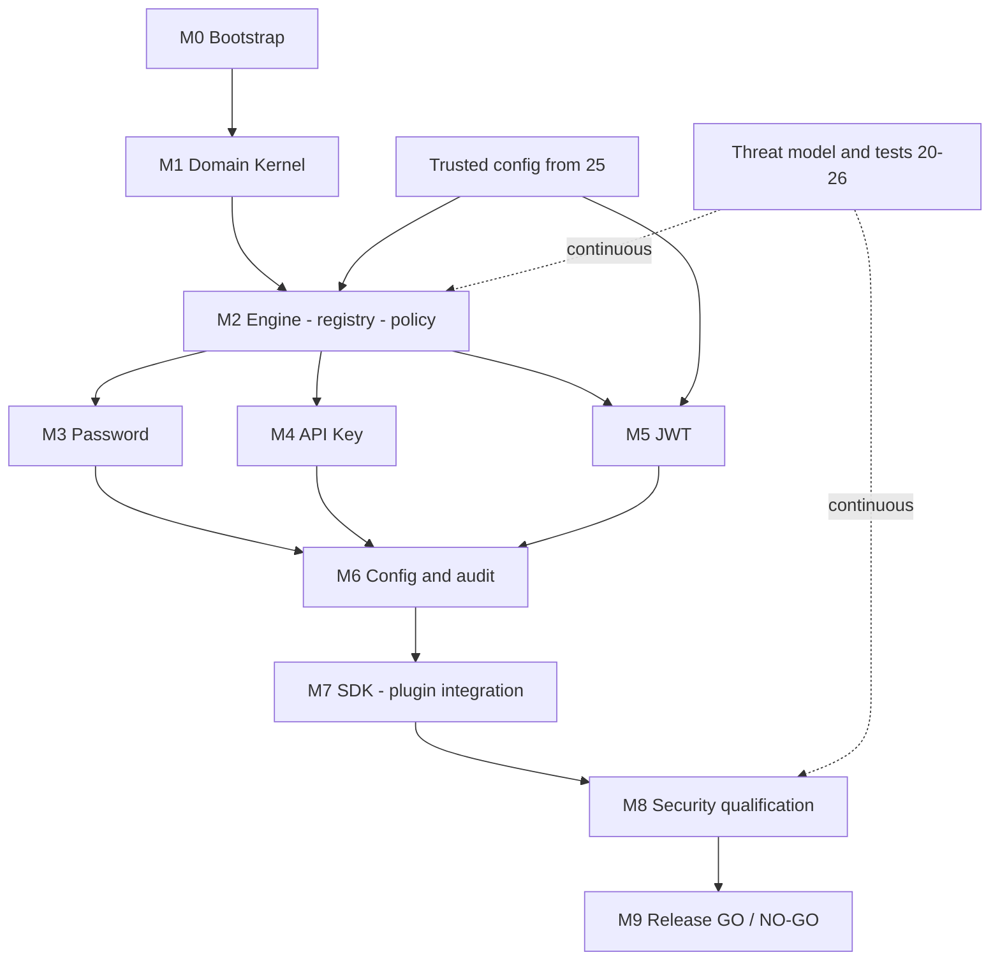
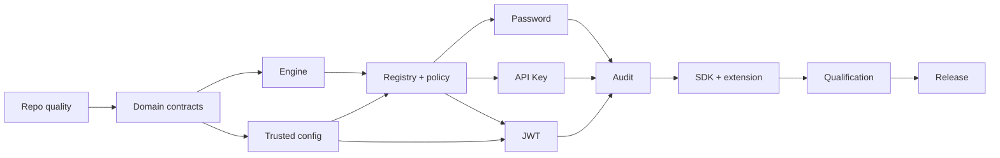
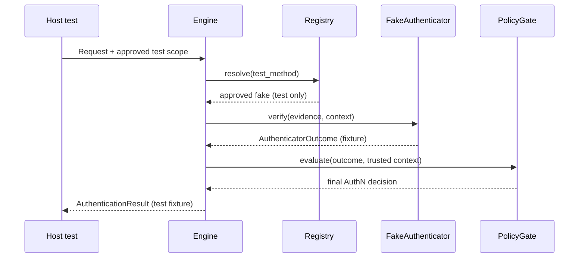
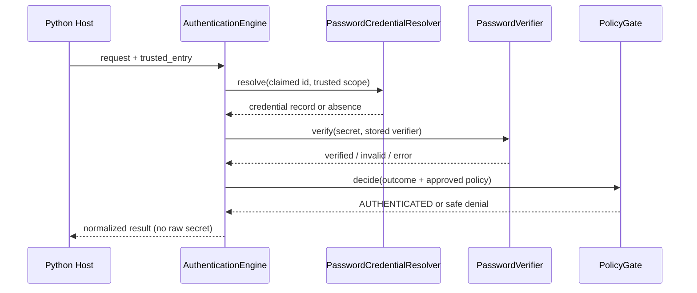
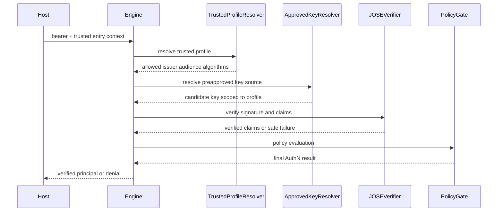
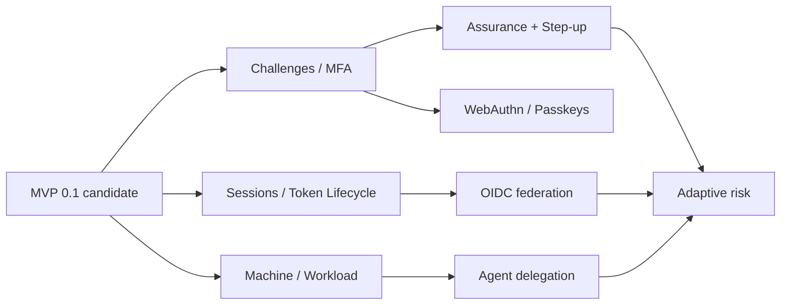
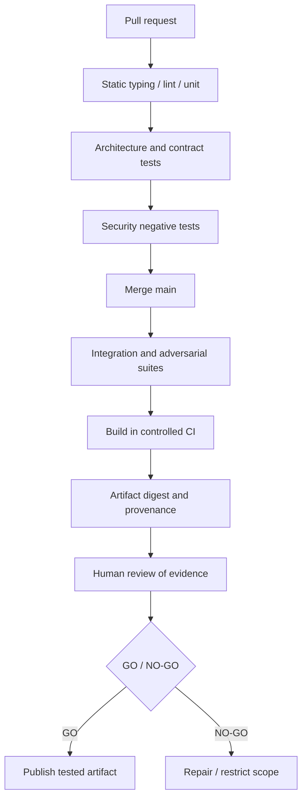
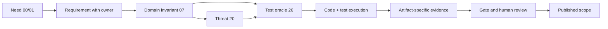

# 27_PYAUTHKIT_IMPLEMENTATION_ROADMAP

# PyAuthKit - Implementation Roadmap

> **Projet :** PyAuthKit, moteur d'authentification Python modulaire.  
> **Document :** `27_PYAUTHKIT_IMPLEMENTATION_ROADMAP.md`.  
> **Version documentaire :** `0.1.0` (proposition de roadmap, non version logicielle publiée).  
> **Date de référence :** 31 octobre 2026.  
> **Statut :** `PROPOSED / SPECIFIED` - ordre d'exécution et versions à accepter par ADR.  
> **Sources internes :** `00` à `26` et `PYAUTHKIT_SOFTWARE_DESIGN_LEARNING_CONVENTION.md`.  
> **Destinataires :** mainteneur, développeurs, revue de sécurité, intégrateurs et auteurs de plugins.  
> **Langue :** français ; objets de domaine, signatures, patterns, protocoles et identifiants en anglais.  
> **Prochain document :** `28_PYAUTHKIT_IMPLEMENTATION_BOOTSTRAP_PLAN.md`.

**Avertissement de preuve.** Ce texte organise du travail à réaliser ; il ne prouve ni l'existence d'un dépôt PyAuthKit exécutable, ni la livraison d'une version, ni le succès d'un test de sécurité, ni une conformité à OWASP/NIST. Tous les éléments de code sont des esquisses pédagogiques à ajuster via ADR. Les jalons sont **des propositions de planning relatif** et non des engagements de dates.

> **North Star** : transformer une preuve non fiable en un sujet authentifié **uniquement** après vérification sous un `TrustedScope` et un `TrustProfile` approuvés et décision du `AuthenticationPolicyGate`. Aucun résultat AuthN ne vaut permission IAM.

---

## Guide de lecture

| Question | Sections recommandées |
|---|---|
| Pourquoi et avec quelles contraintes construire ? | 0-11 |
| Quel noyau réaliser et dans quel ordre ? | 12-26 |
| Comment sécuriser les interfaces et l'intégration ? | 27-43 |
| Quelles extensions après MVP ? | 44-53 |
| Comment qualifier, publier et gouverner ? | 54-64 |
| Comment apprendre et préparer le bootstrap ? | 65-69, annexes |

**Conventions** : `RD27-*` désigne les exigences de roadmap ; `WP27-*` les work packages ; `GATE27-*` les gates ; `RD27-THR-*` les risques ; `ADR27-*` les arbitrages ; `ACC27-*` les cas d'acceptation ; `LC27-*` les cartes pédagogiques. Ces IDs ne remplacent pas les identifiants propriétaires des documents précédents.

## 0. Résumé exécutif

La première cible n'est **pas** un IAM complet, un fournisseur OIDC, une plate-forme de sessions ni un framework universel de sécurité. C'est une bibliothèque Python **framework-agnostic** qui vérifie de manière explicite des preuves Password, API Key ou JWT, produit un résultat normalisé, échoue en sécurité et se laisse étendre par un nouvel `Authenticator` sans modification du noyau.

La roadmap propose une séquence **M0 à M9** : Bootstrap, Domain Kernel, Engine & Ports, Password, API Key, JWT, Configuration & Audit, Extensions & Integration, Security Qualification, Release Review. `M4` dans le découpage initial de `01` (MVP Review) se retrouve ici comme une **étape de release**, sans remplacer rétroactivement les anciens identifiants. La granularité `M0..M9` de ce document est nouvelle et doit être validée.

La trajectoire post-MVP reste conditionnelle aux besoins réels : challenges/MFA, sessions/tokens, OIDC/SAML, WebAuthn, machine/workload/agents et adaptative risk. Toute extension possède **sa propre menace, son oracle de test et sa propre gate**. Une implémentation incomplète n'est pas exposée sous prétexte que le type existe dans l'API.

Trois résultats sont attendus : **(1)** un noyau facile à apprendre et tester ; **(2)** une authenticité défendable des décisions, sans faux succès ; **(3)** une release dont l'artefact est lié aux preuves de qualification. La prochaine spécification `28` convertira `M0` et le premier vertical slice en tâches de bootstrap exécutables.

## 1. Filiation documentaire et autorité

La roadmap orchestre les contrats déjà définis ; elle **ne réécrit pas** leurs règles de sécurité.

| Autorité | Documents | Effet sur la roadmap |
| --- | --- | --- |
| Vision et MVP | `00`, `01`, `02` | Le MVP couvre Password, API Key, JWT et un moteur neutre. |
| Architecture et domaine | `03` à `09` | Domain, Application, ports, outcomes, scope et policy gate. |
| Mécanismes | `10` à `17` | Authenticators MVP, puis capacités avancées conditionnelles. |
| Infrastructure et sécurité | `18` à `21` | Ports/adapters, stores, threat model, audit/observability. |
| Intégrations et API | `22` à `25` | Handoff IAM, framework adapters, API, configuration sûre. |
| Qualification | `26` | Tests, oracles indépendants, matrices de preuves, gates GO/NO-GO. |
| Conception pédagogique | `PYAUTHKIT_SOFTWARE_DESIGN_LEARNING_CONVENTION.md` | Problem -> invariant -> principe/pattern -> Python -> test -> preuve. |

**Règle de conflit :** une simplification de roadmap ne peut abaisser un invariant de sécurité. Si un contrat documenté est contradictoire ou non décidé, créer une question et un ADR avec propriétaires, options, tests de conséquence et statut `OPEN`; ne pas affirmer sa résolution.

**État au 31 octobre 2026 :** documents de design présents dans le corpus fourni. Aucun test de dépôt de PyAuthKit, historique de CI ni version publique n'est ici attesté.

## 2. Problème à résoudre et bénéfices attendus

Une authentification copiée dans chaque application accumule des différences de politique, de validation JWT, de messages d'erreurs, de journalisation et de confiance multi-tenant. À l'inverse, surconcevoir les mécanismes futurs avant une première preuve fonctionnelle crée une surface d'attaque difficile à qualifier.

Le plan vise à réduire ces deux risques : **un chemin vertical minuscule mais réellement sûr**, puis une extension conditionnée par une pression de conception mesurée. Le succès produit se mesure à la sûreté du pipeline et à la capacité de substitution des ports, pas au nombre de classes GoF ni au nombre de providers « supportés ».

## 3. Objectifs explicites et hors périmètre

**Objectifs du MVP :** import Python pur, API asynchrone, `AuthenticationEngine`, preuves typées, `Authenticator`/registry, policy gate, Password/API Key/JWT, `TrustedEntryContext`, configurations approuvées, erreurs discriminées, audit minimal sûr, tests négatifs et packaging reproductible.

**Hors périmètre MVP :** compte IAM, RBAC/ABAC, provisioning, pages de login hébergées, émission d'access tokens, sessions complètes, MFA, OIDC login, SAML, WebAuthn, PKI, orchestration d'agents, antifraude, SIEM, UI d'administration, stockage SQL imposé, résolution automatique des tenants depuis des claims non fiables. Ces capacités peuvent être étudiées, pas déclarées implémentées.

## 4. Concepts et langage ubiquitaire

| Concept | Sens dans la roadmap | Risque de confusion |
| --- | --- | --- |
| `ClaimedIdentity` | Identité revendiquée par l'entrée | Ne vaut pas sujet prouvé. |
| `PresentedEvidence` | Preuve brute/opaque soumise par un client | Ne confère aucune autorité. |
| `TrustedEntryContext` | Contexte d'entrée établi par l'hôte | Ne doit pas être construit depuis un paramètre public arbitraire. |
| `TrustedScope` | Périmètre dans lequel la vérification est permise | Ne se résout pas depuis un JWT non vérifié. |
| `TrustProfile` | Politique approuvée du mécanisme/issuer/audience/key | N'est pas sélectionné uniquement par `iss` ou `kid` fourni. |
| `AuthenticatorOutcome` | Verdict local du mécanisme | Ne remplace pas la décision globale. |
| `VerifiedSubject` | Sujet issu d'une vérification suffisante | Ne peut apparaître avant validation complète. |
| `AuthenticationResult` | Décision AuthN finale, discriminée | N'est ni une session ni une permission. |
| `AuthenticatedPrincipal` | Sujet et provenance d'authentification vérifiés | N'est pas automatiquement `User` de Django/PyIAMKit. |
| `ReleaseEvidence` | Résultats vérifiables rattachés à un artefact | Un test écrit ne suffit pas. |

## 5. Invariants de départ non négociables

1. `AUTHENTICATED` exige preuve cryptographique ou vérification du secret sous autorité approuvée **et** validation de la politique finale.
2. `DENIED`, `ERROR`, `CHALLENGE_REQUIRED` et toute issue non authentifiée ne transportent **aucun principal utilisable**.
3. Le choix de scope, tenant, issuer, audience et stratégie de confiance appartient à un contexte hôte approuvé, jamais directement aux claims.
4. Toute méthode, key ou plugin non connu est rejeté sans fallback silencieux.
5. PyIAMKit reste facultatif et détient l'identité gérée et les permissions.
6. Aucun secret brut dans exceptions, `repr`, telemetry, events, snapshots ni fixtures commitées.
7. Une assertion de propriété temporelle ou atomique requiert une preuve avec l'adapter réellement concerné.
8. Aucune capacité non qualifiée ne doit être activable par défaut ; les artefacts et extras documentent leur portée réelle.
9. L'abstraction n'est légitime que si elle protège un invariant, une variation réelle ou un contrat de substitution.
10. La décision GO n'est possible que pour les capacités et environnements effectivement couverts par les preuves.

## 6. Statuts de travail et de preuve

| Statut | Définition | Preuve exigée |
| --- | --- | --- |
| `PLANNED` | Item dans cette roadmap | Owner, source et critères d'acceptation. |
| `READY` | Dépendances et menaces précisées | DoR approuvée, oracle établi. |
| `IMPLEMENTING` | Travail de code engagé | PR/branche liée. |
| `IMPLEMENTED` | Code présent | Commit et revue technique. |
| `TESTED` | Tests exécutés dans un environnement nommé | CI et résultats par test. |
| `SECURITY_REVIEWED` | Menaces et contrôles revus | Avis et limites résiduelles signés. |
| `QUALIFIED` | Gates du scope atteintes | Evidence manifest + revues. |
| `RELEASED` | Artefact publié | Version, digest, provenance, changelog. |
| `BLOCKED` | Dépendance ou décision non résolue | Cause, risque, owner, action. |

La documentation en elle-même reste `SPECIFIED` sans conférer les statuts `IMPLEMENTED` ou `QUALIFIED` à une fonctionnalité.

## 7. Axes de livraison et gouvernance produit

Deux axes orthogonaux sont suivis : **(A) cœur de produit** (engine, registry, authenticators, ports) et **(B) garanties transverses** (confiance, configuration, audit, tests, packaging). Chaque tranche du cœur doit avancer avec son segment transversal : développer un `JwtAuthenticator` sans oracle JOSE ni configuration trusted n'est pas une tranche livrable.

La responsabilité de configuration de confiance est partagée : l'hôte fournit l'autorité initiale ; le composant de bootstrap valide et fige un snapshot ; le moteur refuse les entrées incompatibles. Le moteur ne devient jamais le PDP d'autorisations de PyIAMKit.

## 8. Hypothèses de planification

- Le dépôt cible, sa licence, la matrice Python et les plateformes CI restent à confirmer au bootstrap. Aucune hypothèse ne doit être déguisée en état existant.
- Les candidats `0.1.0a*`, `0.1.0b*`, `0.1.0rc*`, `0.1.0` servent d'exemples compatibles avec l'usage PEP 440, pas d'engagement public.
- Les estimations calendaires, budgets, équipes disponibles et SLA ne sont pas connus ; employer taille relative, dépendances et gates au lieu d'inventer des dates.
- Un backend mémoire est acceptable pour **tester les contrats** mais ne prouve pas la durabilité ou la cohérence multi-processus de Redis/PostgreSQL.
- Les bibliothèques cryptographiques de production seront éprouvées, auditées et supportées ; aucun algorithme de signature, KDF, TOTP, WebAuthn ou vérification JOSE ne sera réimplémenté en code maison.
- Tout protocole (OIDC/SAML/WebAuthn) requiert un profil de menaces et un environnement de conformité spécifiques avant activation.

## 9. Stratégie de versions candidate

**Recommandation proposée** : versions pré-release pour établir le noyau et ses tests ; une première stable ne signifie pas conformité générale. Les numéros et la date de publication restent ouverts.

| Train candidate | Milestones de travail | Capacités activables | Qualification cible |
| --- | --- | --- | --- |
| `0.1.0a1` | M0-M1 | Import, domain contracts, fakes de tests | Packaging / architecture / unit. |
| `0.1.0a2` | M2-M3 | Engine, registry, Password sous trust explicite | Kernel + password negative suite. |
| `0.1.0a3` | M4-M5 | API Key et JWT validation | Security contract vectors. |
| `0.1.0b1` | M6-M7 | Config, audit, extension explicite, intégration Python pure | Contract + integration + adversarial. |
| `0.1.0rc1` | M8 | API freeze candidate, chaîne de preuves | Release candidate GO/NO-GO. |
| `0.1.0` | M9 | MVP délimité et qualifié | Release digest + maintainer review. |

L'ajout ou le retrait de jalons ne constitue pas un changement de comportement ; tout changement d'API ou de garantie de trust est une décision ADR et doit être accompagné d'un plan de migration. Une `0.x` n'exonère pas de communiquer clairement les ruptures d'API.

## 10. Carte de capacités MVP et post-MVP

| Capacité | Priorité | Source maître | Cible initiale | Condition de sortie |
| --- | --- | --- | --- | --- |
| Domain/AuthN core | P0 | `04-09` | M1-M2 | Invariants et policy gate testés. |
| Password validation | P0 | `10`, `20` | M3 | KDF et rejet sûrs, secret redacted. |
| API Key validation | P0 | `10`, `19` | M4 | Clé inconnue/révoquée refusée. |
| JWT validation | P0 | `10`, `14`, `20` | M5 | JOSE + claims + trust profile. |
| Trusted config | P0 | `25` | M2-M6 | Fail on invalid, immutable snapshot. |
| Audit minimal | P0 | `21` | M6 | Corrélation sans secrets. |
| Plugin admission | P0 | `18` | M7 | Discovery ne vaut pas activation. |
| Python SDK | P0 | `24` | M7-M9 | Public API testée / documentée. |
| Framework adapters | P1 conditionnel | `22` | POST-MVP ou extras ciblés | Conformance ASGI/WSGI. |
| PyIAMKit bridge | P1 conditionnel | `23` | POST-MVP | Handoff sans AuthZ implicite. |
| Challenges et MFA | POST | `11-12` | Future line | Atomic one-use + assurance. |
| Sessions/tokens | POST | `13`, `19` | Future line | Refresh replay + revocation. |
| OIDC/SAML | POST | `14` | Future line | Federation vectors/nonce/state. |
| WebAuthn | POST | `15` | Future line | Ceremony & replay tests. |
| Workload/Agent | POST | `16` | Future line | Attestation + delegation. |
| Risk adaptive | POST | `17` | Future line | Unknown risk not low. |

## 11. Carte des dépendances et chemin critique



**Chemin critique fonctionnel** : Bootstrap -> Domain -> Engine/Policy -> trois vérificateurs -> qualification sécurité -> release. `M3`, `M4` et `M5` peuvent être développés en parallèle **après** stabilisation des contrats nécessaires ; tous convergent vers le même gate MVP. Les boucles de security review existent à chaque PR, pas uniquement à `M8`.

**Loi de migration** : une dépendance post-MVP ne doit pas entrer dans l'import graph du core tant qu'elle n'est pas réellement requise.

## 12. Architecture cible des modules et anti-couplage

```text
src/pyauthkit/
  __init__.py           # exports publics validés par ADR
  domain/               # primitives, invariants et résultats
  application/          # use cases, AuthenticationEngine, policy gate
  ports/                # Protocols requis par le domaine/application
  authenticators/       # password, api_key, jwt - uniquement MVP retenu
  adapters/             # crypto/storage/audit/config; implémentations explicites
  configuration/        # trusted bootstrap et snapshots
  spi/                  # contrats pour auteurs d'extensions
  _internal/            # non-stable, pas de promesse de compatibilité

# extras/installables possibles plus tard :
# integrations/fastapi, integrations/django, integrations/flask, federation, webauthn
```

Le découpage est **candidat** : vérifier l'import graph avant de figer des packages. Les ports résident côté application/domain, les adapters dépendent des ports et non l'inverse. Aucune importation obligatoire de FastAPI, Django, PyIAMKit, Redis ou SQLAlchemy depuis `pyauthkit`.

**Architecture fitness** : un test de packaging installe le wheel minimal dans un environnement isolé puis importe `pyauthkit`, sans extras de framework ni de stockage.

## 13. Milestone M0 - Bootstrap et hygiène de dépôt

**Problème** : une API de sécurité sans build reproductible ni tests rapides crée des régressions non détectées dès le premier commit.

**Livrables** : arborescence `src/`, `pyproject.toml` (backend build à choisir), packaging wheel/sdist, licence à décider, README et `SECURITY.md`, linters/formatter/type checker choisis, `pytest` + async fixture, job CI sur matrice Python décidée, scan de dépendances, sécurité de la publication.

**Slice minimal** : `python -m pip install -e '.[dev]'`, `python -m build`, `python -c 'import pyauthkit'` et un `pytest` simple dans environnement neuf.

**Exit gate `GATE27-01`** : import sans dépendances Web/IAM ; `wheel` installable ; job PR exécuté et artefacts repérables ; aucun secret dans le repo ; matrice Python, licence, compatibilité OS et processus de release documentés. La syntaxe des commandes n'implique pas que les extras existent déjà.

**Do not** : créer tous les packages post-MVP vides, charger des plugins automatiquement, choisir PostgreSQL par habitude, ajouter une arborescence DDD décorative.

## 14. Milestone M1 - Domain Kernel et invariants

**Préconditions** : M0 qualifié, glossary `04-07` parcouru, choix provisoire des exports internes.

**Livrables** : `ClaimedIdentity`, `PresentedEvidence`, `TrustedScope`, `TrustProfile` (ou refs validées), `VerifiedSubject`, `AuthenticatorOutcome`, `AuthenticationResult` discriminé, `AuthenticationRequest`, objets temps/correlation et erreurs de domaine sans détails sensibles. Types et mutabilité doivent rester compatibles avec les décisions du `24`.

**Tests clés** : aucun non-succès ne possède de principal ; représentations/redaction sûres ; contexte non fiable ne peut obtenir le statut trusted par simple annotation ; transitions d'état/constructeurs impossibles vérifiés ; égalité/immutabilité testées là où justifiées.

**Exit gate `GATE27-02`** : invariants centraux testés par assertions et property tests ; imports Domain indépendants des adapters ; API de conversion `AuthenticatorOutcome` -> `AuthenticationResult` explicitement gardée par le policy gate ; une Design Learning Card documente un design rejeté comme trop complexe.

**Anti-pattern** : `AuthenticationResult(success=True, principal=...)` librement construisible depuis une entrée HTTP sans contrôle de provenance.

## 15. Milestone M2 - Engine, policy gate, ports et registry

**Préconditions** : contrats Domain validés et hypothèses de trust documentées.

**Livrables** : `AuthenticationEngine` async, `Authenticator` SPI, `AuthenticatorRegistry` déterministe et figé au bootstrap, `AuthenticationPolicyGate`, contexte établi par host, erreurs contrôlées, fake `Clock`, fake de secret/key resolver, fake `AuthenticationEventSink`.

**Pipeline candidat** : validate inputs -> establish trusted entry -> approved method/profile -> acquire guard -> authenticator verification -> normalize verified evidence -> policy decision -> normalized result -> safe audit.

**Tests négatifs** : méthode inconnue, registry collision, trust profile absent, scope étranger, mécanisme retournant un outcome incohérent, dépendance levant une exception, timeout et annulation ; tous doivent **interdire un succès**.

**Exit gate `GATE27-03`** : le moteur s'exécute avec un authenticator de démonstration non cryptographique **uniquement en test**, sans le déclarer secure ; aucun `VerifiedSubject` public avant policy ; aucun plugin découvert n'est chargé implicitement. Test d'architecture de non-dépendance aux frameworks.

**Option écartée** : *Chain of Responsibility* pour chaque étape du MVP sans besoin réel ; préférer un pipeline explicite et des petites fonctions testables.

## 16. Milestone M3 - Password Authenticator

**Problème** : vérifier un secret sous une politique de credential sans confondre adresse e-mail revendiquée et identité authentifiée.

**Ports hérités de `18`** : `PORT-OUT-01 PasswordCredentialResolver`, `PORT-OUT-02 PasswordVerifier`, `PORT-OUT-09 Clock` et `PORT-OUT-10 AttemptGuard` selon la politique d'abus adoptée.

**Livrables** : vérification par backend cryptographique reconnu, credential actif/révoqué, paramètres KDF approuvés, comportement en cas d'utilisateur inconnu, scope autoritatif, traitement contrôlé des erreurs, limites d'entrée, audit redacted. Le MVP peut utiliser un resolver externe ; PyAuthKit n'a pas à créer une base d'utilisateurs.

**Scénarios bloquants** : password incorrect, credential inconnu, tenant incompatible, hash corrompu, backend absent, ressource épuisée, secret apparaissant dans `repr` ou trace, différence d'erreur divulguant un compte ; les risques de timing/enumeration sont revus avec le modèle de déploiement réel.

**Exit gate `GATE27-04`** : suite positive/négative + properties + tests sur backend choisi, aucun secret clair persistant ou télémetré, configuration des algorithmes documentée et versionnée ; rate limiting total **ne peut être revendiqué** si l'hôte n'a pas fourni l'adapter adéquat.

## 17. Milestone M4 - API Key Authenticator

**Problème** : reconnaître une application ou un workload à partir d'une clé révocable, sans traiter un préfixe public comme une preuve.

**Ports** : `PORT-OUT-03 ApiKeyCredentialResolver`, `PORT-OUT-04 ApiKeyVerifier`. Lookup identifiant/prefix non secret avec portée autorisée, validation du secret/empreinte selon backend et politique, expiration, statut et revocation.

**Scénarios** : key active/inactive/expired/revoked, collisions, clé d'un autre tenant, compteur d'utilisation et limites d'entrée, rotation et clés parallèles seulement si politique explicite, store indisponible, retour d'un résultat ambigu.

**Exit gate `GATE27-05`** : key invalide ou révoquée jamais acceptée ; aucune reconnaissance par prefix seul ; comparaison de preuve robuste ; traces minimisées ; contract tests entre fake et backend cible pour les propriétés annoncées. La présence d'un `ApiKeyAuthenticator` n'ajoute pas un mécanisme de provisionnement de clés au MVP.

## 18. Milestone M5 - JWT Bearer Verification

**Distinction** : vérifier un JWT signé n'est **pas** émettre un access token, ni authentifier automatiquement tous les tokens OAuth.

**Ports** : `PORT-OUT-05 TrustProfileResolver`, `PORT-OUT-06 VerificationKeyResolver`, `PORT-OUT-07 SignedTokenVerifier`, `PORT-OUT-09 Clock`.

**Livrables** : allow-list d'algorithmes par profil, validation JOSE typ/alg/key usage selon profil, issuer/audience/expiration/nbf/iat avec tolérances explicites, identification de subject après validation de signature et claims, contrôle de sources JWKS approuvées (pas de `jku` client libre), refus des tokens d'un autre usage ou d'un tenant distinct.

**Vectors bloquants** : `alg=none` non permis, confusion HMAC/asymétrique, key/alg incompatibles, `kid` collision, JWKS distant malveillant, SSRF, signature corrompue, issuer/audience mismatch, token expiré, key rotation non maîtrisée, token non destiné au composant, claim forgé influençant `TrustedScope`.

**Exit gate `GATE27-06`** : protocol vectors indépendants de la bibliothèque utilisée, tests à clés reconnues, échecs fermés sous erreurs de clé/réseau/clock, cache clés isolé par profil, aucune élévation de trust depuis `iss`, `aud`, `kid` ou custom claims non validés.

## 19. Milestone M6 - Configuration, secrets et audit minimal

**Préconditions** : décisions des profiles JWT/Password/API Key ; menaces `20` et `25` mises à jour.

**Livrables** : `ConfigurationSnapshot` immuable, validation au bootstrap, profils et adapters admis, sources de secrets distinctes de leur résolution, erreurs sûres, absence de hot reload tant que son atomicité n'est pas démontrée, `AuthenticationEventSink` minimal (attempt/success/failure sans preuve), métriques cardinalité bornée.

**Audit** : l'événement *créé* n'est pas l'événement *stocké*. Déclarer une classe de durabilité réaliste et la responsabilité de l'hôte ; pas de garantie implicite de livraison exactly-once.

**Exit gate `GATE27-07`** : configuration malformée ou non autorisée refuse le bootstrap ; des secrets ne se retrouvent ni dans dump, erreurs, fixtures ou logs ; faux profil redémarre sans créer un trust élargi ; les flux d'audit respectent minimisation et corrélation. Si un événement doit être durable et bloquant, le contractuel fail-closed devient explicite.

**Différé** : dashboard intégré, SIEM propriétaire, hot reload multi-replica, saga de configuration sophistiquée.

## 20. Milestone M7 - SDK, extensions et intégration minimale

**Livrables** : surface publique candidate approuvée (`24`), guide de démarrage Python pur, exemple sécurisé de composition root, support de `Authenticator` tiers via SPI versionné, plugin `entry_points` *découvert* mais activé seulement par allow-list explicite, tests d'extensibilité, gestion d'extras facultatifs.

**Scénarios** : remplacement d'un resolver, authenticator custom sans edit core, registry collision/duplicate, mauvais contrat SPI, extras manquants et import minimal, fermeture propre d'un provider async, exceptions tierces conservées comme échec sans succès.

**Critère `GATE27-08`** : un intégrateur réalise un script Python pur fonctionnel de bout en bout avec confiance préconfigurée ; un plugin non approuvé reste inactif ; un authenticator conforme se branche sans casser Domain/Engine.

**Optional** : une très petite démo FastAPI peut servir de *consommateur* du SDK, sans faire de FastAPI une dépendance ni annoncer l'adapter officiel comme supporté. La production d'adapters spécifiques est gouvernée par `22`.

## 21. Milestone M8 - Security qualification et release candidate

**Préconditions** : M0-M7 et leur evidence manifest candidate ; aucune fonctionnalité non qualifiée activable par défaut.

**Travaux** : relecture menace/invariant/test, exécution des suites P0/P1, types/lint/build, contrats avec vrais backends annoncés, adversarial JWT/password/key, négatifs fail-closed, isolation contextes et tenants, fuite de secrets, timeout, concurrency, packaging wheel/sdist, scan supply chain, SBOM/provenance selon politique, documentation des limites.

**Critère `GATE27-09`** : aucun P0/P1 applicable ouvert, preuves lisibles et rattachées au commit/artefact, pas de `NOT_RUN` utilisé comme `PASS`, plan de migration validé, validation indépendante du résultat par reviewer, version candidate installée dans un nouvel environnement.

**Réserve essentielle** : un score de coverage élevé ne peut neutraliser une exploitation démontrée ni une revue de confiance manquante.

## 22. Milestone M9 - GO/NO-GO et première release MVP

**Exigence** : publier l'artefact qui a été testé, pas le rebuilder sans correspondance de digest.

**Dossier GO** : manifest de preuves, SHA256 wheel, liste des capacités activées, matrix Python/OS, changelog, migration notes, runtime deps et extras, limites connues, security policy, revue des risques résiduels, owner et date de décision.

**NO-GO** : principal authentifié sans preuve validée, policy bypass, trust déduit de l'utilisateur, secret exposé, plugin activé implicitement, JWT verification incomplète, tests critiques non exécutés, mismatched artifact digest, autorisation IAM implicite, défaillance entraînant success.

**Critère `GATE27-10`** : décision signée par les rôles responsables ; artefact immuable et vérifié ; release notes bornées au scope qualifié ; rollback et remédiation documentés.

**Règle** : `0.1.0` n'indique **ni** certification NIST/OWASP **ni** maturité de toutes les extensions décrites dans `11-17`.

## 23. Transitions de milestones et gouvernance du scope

Un jalon ne « passe » qu'avec une evidence table dont chaque test a `PASS`, `FAIL`, `BLOCKED`, `NOT_APPLICABLE` justifié ou `INCONCLUSIVE`. Les tests bloquants de sécurité ne peuvent être neutralisés par waiver administratif.

Changement de scope : toute fonctionnalité ajoutée reçoit `feature ID`, source, trust boundary, invariants, tests, gates et notes de non-support éventuelles. Toute capacité supprimée est réellement désactivée du registry/export, non simplement omise des release notes.

L'ordre des milestones est **pédagogique** ; les PR transverses peuvent se dérouler en continu. Il est permis de regrouper M4 et M5 si le coût de coordination est supérieur au bénéfice, mais pas de sauter les preuves de l'un des deux.

## 24. Epics et lots de travail transversaux

Les epics structurent la livraison sans obliger à multiplier les couches :

| Epic | Portée | Livrables vérifiables | Source |
| --- | --- | --- | --- |
| E01 Foundation | M0 | Build, CI, packaging, docs de contribution | `01`, `24`, `26` |
| E02 Domain | M1 | Objets immuables, résultats discriminés, invariants | `04-08` |
| E03 Application | M2 | Engine, policy gate, registry, ports | `09`, `18` |
| E04 Password | M3 | Verifier, resolver, tests négatifs | `10`, `20` |
| E05 API Keys | M4 | Lookup + verify + revocation semantics | `10`, `19` |
| E06 JWT | M5 | Trusted JOSE/JWKS validation | `10`, `14`, `20` |
| E07 Configuration | M2/M6 | Snapshots, secrets, trusted bootstrap | `25` |
| E08 Audit | M6 | Events redacted + sink + failure contract | `21` |
| E09 Extensibility | M7 | SPI, plugin admission, composition | `18`, `24` |
| E10 Qualification | M0-M9 | Tests + artifacts + gates | `20`, `26` |
| E11 Developer Experience | M7-M9 | Docs/tutorial/tests consumer | `22`, `24` |
| E12 Release Governance | M8-M9 | ADR, migration, security, provenance | `26` |

## 25. Work breakdown structure : livrables atomiques

Chaque `WP27` doit pouvoir faire l'objet d'une PR ou d'une petite série de PR cohérentes. L'ID ne présuppose pas une issue GitHub existante ; le `28` attribuera des noms de branches et commandes réelles.

La définition de chaque lot contient `owner`, dépendances, `DoR`, comportement positif, échec/fail-closed, preuve attendue et docs à mettre à jour. Les lots de sécurité traversent toute la roadmap et ne se font pas uniquement à la fin.

## 26. Graphe des work packages



Ce diagramme désigne la **dépendance minimale** et non une liste complète. Audit et tests commencent dès `M0` ; leur matérialisation contractuelle se complète dans M6. Les trois authenticators ont des dépendances crypto et de confiance spécifiques, intégrées aux critères de chaque lot.

## 27. Vertical Slice 01 : méthode de test vers moteur

**Problème :** constater rapidement que Domain -> Engine -> Result fonctionne sans prétendre implémenter une authentification réelle.



**Évidence** : résultat refusé si la policy refuse, si registry ne contient pas la méthode ou si fake renvoie un outcome incohérent. Le fake ne prouve **jamais** une propriété cryptographique. Il sert uniquement à qualifier l'orchestration et la séparation des responsabilités.

## 28. Vertical Slice 02 : Password de bout en bout

**Given** un resolver sous scope approuvé et un hash produit par un backend reconnu ; **When** PasswordEvidence est présentée ; **Then** succès **seulement** si le verifier et la policy acceptent. Le parcours identique avec credential invalide, backend absent ou wrong scope retourne un résultat non authentifié.



L'authenticator gère **l'évidence**, pas la résolution IAM d'un compte ni l'octroi d'un rôle. Les règles de throttling global requièrent un adapter de protection adapté au déploiement.

## 29. Vertical Slice 03 : API Key sous scope et révocation

**Given** une clé API liée à un principal technique et à un scope autoritatif ; **When** l'application présente sa preuve ; **Then** le moteur valide la comparaison et le statut de la clé, la policy et les conditions temporelles.

Cas négatifs obligatoires : prefix-only, clé inconnue, clé d'un autre scope, clé révoquée, expiration, collision d'identifiants, store inaccessible, comparaison non sûre, key presente en telemetry. Le périmètre n'inclut pas une UI de provisioning ou un système de rotation universel.

## 30. Vertical Slice 04 : JWT strict trust



**Critical property** : l'issuer lu dans un JWT non vérifié ne choisit pas librement le `TrustProfile`, le host URL de JWKS ni la politique de tenant. Les profils peuvent être résolus par route/contexte trusted, puis seulement comparés aux claims vérifiés.

## 31. Contrats Python candidats et exemple pédagogique

Le contrat public exact reste sous l'autorité de `24`. Cette esquisse illustre **l'ordre de décision**, pas un moteur installé ni un moyen de déclarer un résultat sûr en production :

```python
# DESIGN SKETCH ONLY - types and factories are placeholders.
from dataclasses import dataclass
from typing import Protocol

@dataclass(frozen=True)
class TrustedEntryContext:
    scope_id: str  # Created by the trusted host, never copied from token claims.
    approved_profile_id: str

class AuthenticationEnginePort(Protocol):
    async def authenticate(self, request: object, *, trusted_entry: TrustedEntryContext) -> object:
        ...

async def handle_request(
    engine: AuthenticationEnginePort,
    request: object,
    trusted_entry: TrustedEntryContext,
) -> object:
    # A real application MUST enforce authorization separately.
    return await engine.authenticate(request, trusted_entry=trusted_entry)
```

**Critère pédagogique** : expliquer pourquoi le type statique `TrustedEntryContext` ne suffit pas à prouver sa provenance. Le composition root et l'API hôte doivent contrôler qui peut l'instancier et quels champs lui sont assignés. N'exposer aucune factory de trust construisant un scope à partir d'un claim client non validé.

## 32. API publique et versionnement

Le manifeste d'API du `24` distingue **User API**, **SPI**, **internal API**. L'API `authenticate(request, trusted_entry=...)` est candidate, non figée. `0.1.0rc1` ne doit être proposé qu'une fois la cohérence des noms, effets, types d'erreurs et documentations vérifiée.

Règles de compatibilité : tests `import`, exemples réels, comparaison des exports publics entre deux versions, dépréciations explicites, compatibilité sous matrices Python documentées, tests d'options facultatives. Une rupture du contrat de trust ou d'un serializer `AuthenticationResult` est traitée comme une modification de comportement de sécurité, même si son type ne change pas.

**Anti-pattern** : réserver trop tôt des dizaines de noms publics pour les futures capacités `11-17`, créant une promesse de stabilité sans implémentation.

## 33. Ports et adapters : seuil de besoin

Le noyau ne connaît que les dépendances requises par ses use cases. Pour M0-M2, commencer avec `Authenticator`, `Clock`, configuration trusted et sinks fakes selon besoin ; pour M3-M5, introduire les resolvers/verifiers du mécanisme réellement livré. Le catalogue `PORT-OUT-01..10` de `18` est la source de filiation, pas l'ordre obligatoire d'apparition des classes.

**Tests de contrat** : même input autorisé/refusé, même interprétation des erreurs, pas d'exception sensible, réponse bornée, absence de state bleed entre requêtes. Les fakes testent la logique ; les adapters réels prouvent leurs propriétés spécifiques.

**Ports prospectifs** (`ChallengeStore`, `SessionStore`, `RiskSignalProvider`) restent absents du core MVP sauf décision exceptionnelle justifiée par un besoin immédiat et qualification correspondante.

## 34. Authenticators et registry

Le `Authenticator` est une **Strategy métier** lorsque plusieurs mécanismes substituables coexistent. `AuthenticatorRegistry` n'est pas un service locator global : il est construit explicitement au bootstrap, refuse les doublons, vérifie la compatibilité de version/capacité, puis expose un mapping figé. La sélection doit respecter la méthode **autorisée** par le profil trusted.

Le plugin ecosystem ajoute provenance, signature éventuelle, allow-list et politique d'isolation sans confondre découverte et admission. Aucun `entry_points()` chargé automatiquement au simple import. Un plugin ne doit pas pouvoir forger la décision finale du `AuthenticationPolicyGate`.

**Porte de sortie** : authenticator tiers de démonstration branché sans modification du core, impossibilité de résolution d'une stratégie inconnue, tests d'échec de plugin compatibles avec le fail-closed du moteur.

## 35. Trusted bootstrap, configuration et secret lifecycle

Le snapshot actif suit `load -> validate provenance -> validate schema/invariants -> prepare dependencies -> activate immutable snapshot`. Les secrets sont des références résolues par un composant autorisé et jamais exportées dans le modèle observable. La configuration approuvée est une dépendance de la vérification et doit être figée ou versionnée pour chaque tentative.

Le **hot reload** reste différé : l'activation atomique d'une nouvelle génération, les in-flight requests, les rotations de key et le rollback de profils exigent des tests de concurrence et de révocation. Un rollback ne peut réactiver une clé révoquée.

MVP : config trusted statique et redémarrage contrôlé. Le multi-tenant avancé n'est pas obligatoire, mais l'interdiction de fallback entre scopes s'applique immédiatement.

## 36. Cryptographie et politique de dépendances

Le projet ne réimplémente ni les algorithmes de hachage de mot de passe, ni la signature/vérification JOSE, ni des primitives cryptographiques bas niveau. La sélection d'une bibliothèque tierce suit : maintenance, état de sécurité, API, validation d'algorithmes, dépendances transitives, support des Python ciblés, cas adverses, politique de mise à jour et retrait.

Évidence attendue : dépendances verrouillées **pour les jobs CI** ou contraintes reproductibles, versions déclarées dans l'artefact, tests de vecteurs indépendants et plan de suivi des advisories. Un test qui patch le verifier à `True` ne prouve rien sur la cryptographie.

## 37. Persistence : option, pas exigence imposée

Pour le MVP, un resolver externe suffit : pas de base propre obligatoire. Les stores conditionnels du `19` distinguent credential source of truth, challenge one-use, session revocation, refresh family rotation et audit durable.

**Règle** : une donnée à consommation unique ou soumise à révocation immédiate doit avoir les opérations transactionnelles nécessaires avant que cette propriété soit annoncée. `Redis SETNX/TTL` ou `PostgreSQL UPDATE ... WHERE ... RETURNING` ne sont pas des preuves en soi ; l'adapter et ses conditions de failover doivent être testés.

Ne jamais vendre `exactly-once` ou révocation JWT stateless immédiate sans architecture et preuve explicites.

## 38. Audit, logs, metrics, traces

Dès M2, produire un événement sans secret en test ; en M6, stabiliser le contrat `AuthenticationEventSink`. Séparer : **Audit** (fait durable et justifiable), **Logs** (diagnostic), **Metrics** (agrégats), **Traces** (chemin de requête). Les garanties d'écriture et de livraison sont contractualisées selon le profil de déploiement.

**Tests bloquants** : redaction tokens/passwords, injection de logs, cardinalité non bornée, mauvaise propagation de correlation_id, tenant cross-talk, indisponibilité du sink, event manquant sur échec, `repr` d'un objet de preuve contenant un secret.

Si audit obligatoire fail-closed est requis par l'hôte, la politique doit choisir explicitement le comportement ; si l'audit est best-effort, il ne doit pas être présenté comme preuve durable de conformité.

## 39. Framework adapters : filière conditionnelle

Le `22` propose FastAPI, Starlette, Django, DRF, Flask, CLI et workers. **Le MVP** n'en dépend pas : une démonstration Python pure est la première acceptance.

Pour un adapter activé : extraction de preuves sans élargir le trust, contrôle des proxy headers, cookies et CSRF selon mode, `ContextVar` et lifecycle async sûrs, absence d'authentification implicite via `request.user`, conversion d'erreurs sans divulgation, tests de deux requêtes concurrentes avec tenants différents.

Chaque adapter déclenche son **propre** contract suite et security review ; le core n'est pas obligé de publier tous les extras au premier release.

## 40. PyIAMKit : contrat de handoff

Le `23` gouverne la séparation. PyAuthKit retourne la preuve et la provenance d'un sujet ; PyIAMKit résout un compte/organisation et rend une décision d'accès ; le PEP de l'hôte applique cette décision.

**Tests** : AuthN success sans matching IAM -> accès refusé ou non résolu ; double lien ambigu -> jamais « choisir le premier » ; identité désactivée -> refusal IAM ; actor authentifié sans mandat -> aucune action déléguée ; step-up AuthN sans re-evaluation IAM -> pas de permission automatique.

L'absence de PyIAMKit ne doit empêcher ni installation, ni import, ni tests du core. L'intégration reste un package/adapter optionnel défini après validation du contrat.

## 41. Multi-tenant, scopes et absence de fallback

Le `TrustedScope` doit être sélectionné par une entrée autorisée (route/host configuration ou canal mTLS approprié) ; le `TrustProfile` est résolu dans ce scope. Un JWT ayant `tenant=foo` ne crée ni autorité pour `foo` ni fallback vers un autre issuer.

Tests : tenant A token chez B, deux authentifications concurrentes, cache de key réutilisé entre profils, erreurs masquant le scope, registry partagé mais configuration isolée, host header spoofing. La complexité de provisioning multi-tenant complète est différée mais la **frontière de confiance** est une obligation du MVP.

## 42. Temporalité, concurrence et panne de dépendances

`Clock` injectée et deterministic tests remplacent `sleep` et temps global. Deadlines/timeouts ne doivent jamais convertir `UNKNOWN` ou `ERROR` en `AUTHENTICATED`. L'annulation async doit libérer les ressources et ne pas publier un succès tardif hors policy.

Tests : deux requêtes simultanées sous profils distincts ; store externe unavailable ; stale config ; time skew JWT ; secret rotation pendant vérification ; provider exception ; cancellation at policy gate ; audit failures et retry policy. Le résultat doit distinguer un **refus de preuve** d'une **défaillance technique**, tout en ne donnant pas de principal utilisable dans les deux cas.

## 43. Extensibilité sans dette de sécurité

Les abstractions sont ajoutées lorsqu'une variation est **réelle**. `Authenticator` et ports répondent à la coexistence des mécanismes ; un pipeline configurable de 15 middlewares n'est pas requis pour trois authenticators. Une factory est justifiée si la configuration produit des graphes distincts ; sinon une fonction de composition suffit.

Chaque extension présente : menace, invariant, choix d'algorithm/lib, contrat d'erreur, persistence éventuelle, observable privacy, tests unitaires + protocol vectors + E2E, guide intégrateur, gate et plan de suppression. Un plugin non qualifié n'est pas automatiquement une capacité du package qualifié.

## 44. Transition post-MVP : capability trains, pas Big Bang

Après M9, l'ordre de réalisation est **proposé** et doit être revu selon demandes d'intégrateurs, risque, niveau d'apprentissage et dépendances. Chaque tranche a une indépendance logique : `0.2.x` pourrait couvrir challenges/MFA, `0.3.x` sessions, `0.4.x` fédération, etc., **sans promesse de version ni de calendrier**. L'ordre peut changer : un premier client API peut nécessiter workload/mTLS avant WebAuthn.



Les flèches sont des **dépendances de conception probables**, non une exigence de tout développer. Aucun claim « tout provider », « AAL2 », « phishing resistant » ou « FAPI » sans qualification du profil concerné.

## 45. Capability C1 - Authentication Flow et challenges

**Source** `11`. Introduire `AuthenticationFlow`, `AuthenticationChallenge`, expiration, statut, `ChallengeStore` et consommation atomique si besoin. Assurer les transitions autorisées, le lien session/flow/challenge et la gestion des retries sans double satisfaction.

**Exit gate** : un challenge consommé ou expiré ne peut être réutilisé, même avec deux requêtes concurrentes ; une panne du store ne se transforme pas en succès ; time source et durable semantics sont testés sur le backend annoncé.

## 46. Capability C2 - MFA, facteurs et assurance

**Source** `12`. Ajouter `FactorVerifier`, enrollment et proof histories explicites, step-up, fraîcheur et contexte. Ne pas inférer automatiquement `AAL2` depuis deux facteurs ni deux étapes d'un même canal. Les protections de downgrade, recovery et factor reset sont des menaces de premier rang.

**Exit gate** : MFA incomplet interdit un `AUTHENTICATED` final lorsque la policy exige MFA ; le niveau d'assurance, s'il est revendiqué, provient de la qualification des authentificateurs et de toutes les conditions NIST applicables à la version cible.

## 47. Capability C3 - Sessions, lifecycle des tokens et revocation

**Source** `13` et `19`. Distinguer authentification initiale, `Session`, access token, refresh token, cookie host, revocation et replay. Un JWT bearer reçu pour validation et un token émis par le host sont deux responsabilités distinctes.

**Exit gate** : refresh rotation et famille atomiques sur backend réel, détection du rejeu, session fixation mitigée, invalidation selon garanties publiées, explicitation des limites de révocation d'un JWT purement stateless. Aucun `SessionStore` universel imposé sans besoin.

## 48. Capability C4 - Fédération OIDC / OAuth / SAML

**Source** `14`. Séparer login OIDC, autorisation OAuth et assertions SAML. OIDC nécessite entre autres `state`, PKCE, `nonce` lorsque requis, validation ID token, issuer/audience et association issuer+subject. SAML appelle une stratégie XMLSig/metadata et parsing sûrs.

**Exit gate** : tests de mix-up/provider confusion, redirect manipulation, state/nonce replay, JWKS trust, signature, account linking et erreurs réseau. Les protocoles ne sont **pas** réputés supportés par la simple présence de classes d'adapter. Le provisioning IAM reste externe.

## 49. Capability C5 - WebAuthn, passkeys et passwordless

**Source** `15`. Définir registration et authentication ceremonies, challenge one-use, origin/RP ID, authenticator data, key binding, counters et règles de révocation/enrollment. Les types seuls ne prouvent pas la résistance au phishing.

**Exit gate** : tests avec vecteurs authentiques, origin/RP mismatch, challenge expiry/replay, attestation policy, credential substitution, counter anomalies et environnement navigateur réel selon profil annoncé.

## 50. Capability C6 - Workloads, identités machines et agents

**Source** `16`. Étendre l'authentification de workloads avec mTLS, SPIFFE/SVID ou identité cloud fédérée si un usage réel apparaît. Distinguer l'acteur authentifié, le sujet représenté, le mandat, la portée de délégation et l'autorisation d'action finale.

**Exit gate** : credential machine valide ne suffit pas à prouver une délégation ; contrôle anti-confused-deputy, lifetime et audiences réduites, revoke/rotate, erreurs non élargissantes, isolation des actors. Le runtime des agents relève d'autres Py*Kit.

## 51. Capability C7 - Adaptive risk et policy dynamique

**Source** `17`. Pipeline `RiskSignal -> RiskAssessment -> RiskPolicy -> RiskDecision -> AuthenticationPolicyGate`. Les risques `UNKNOWN` ou indisponibles ne sont jamais implicitement `LOW`. Un résultat de risque n'est pas une preuve d'identité ni une permission.

**Exit gate** : tests des délais, des signaux contradictoires, du risque absent, du step-up réellement achevé, de l'isolation tenant et de la minimisation de données ; décision `ALLOW` ne peut se substituer au résultat AuthN ou à l'AuthZ IAM.

## 52. Capability C8 - Storage et observabilité avancés

**Sources** `19`, `21`. Les stores PostgreSQL/Redis, Transactional Outbox, OpenTelemetry et SIEM sont **des adapters optionnels**. Les livrer demande de définir les classes de durabilité, CAS, isolation tenant, privacy, retention, alerting et reprise après incident.

**Exit gate** : tests avec vrais backends, failover simulé selon profil, double-consumption impossible pour les opérations annoncées, migrations rollback testées et aucune prétention de garantie exactly-once sans contrat démontré.

## 53. Capability C9 - Framework integrations et PyIAMKit

**Sources** `22`, `23`. Les adapters REST/Web peuvent être livrés avant d'autres capacités sans changer le noyau. Ils doivent transporter `TrustedEntryContext` depuis l'hôte, ne pas exposer un `AuthenticatedPrincipal` à un PEP avant un handoff IAM décidé, et préserver l'absence de permission implicite.

**Exit gate** : installation par extras, tests des conflits de versions, suivi de releases frameworks, tests d'isolation concurrente, résolution IAM ambiguë/non liée/désactivée et refus si le PDP est indisponible.

## 54. Quality Engineering, CI et supply chain

**Chaîne PR -> main -> release** :



**Minimum jobs** : lint, formatting check, type check, unit/contract, architecture, security regression, build smoke, package import, dependency vulnerabilities selon politique ; intégration et adversarial à chaque gate important ; release manifest et provenance lors de publication.

**Contenu du manifest** : commit, runner/env, versions Python/OS, package metadata, dépendances, `artifact_sha256`, test IDs/statuts, tests skippés justifiés, revue de sécurité, limites. Le public doit pouvoir distinguer un simple build réussi d'une release qualifiée.

## 55. Test pyramid et qualification contractuelle

La stratégie `26` couvre : unit, property, stateful, contract, integration, E2E, adversarial, concurrency, resilience, performance, architecture, packaging et release. Les **oracles indépendants** précèdent les implémentations.

Une assertion `bool(result)` n'est pas un oracle pertinent ; vérifier le statut discriminé, l'absence de principal en échec, la source du trust et l'absence de credentials en sortie. `mocks` prouvent l'orchestration ; vrais vérificateurs et vrais stores sont nécessaires pour les propriétés de sécurité qu'ils annoncent.

**Loi de couverture** : P0/P1 applicables exigent preuves `PASS` avant GO, quelles que soient les valeurs de coverage. Les tests post-MVP sont marqués `NOT_APPLICABLE` motivé tant que la capacité est absente, jamais « successful » par omission.

## 56. Gates de sécurité bloquants et tableau GO/NO-GO

| Gate | Milestone | Critère observable | Refus immédiat si |
| --- | --- | --- | --- |
| `GATE27-01` | M0 | Wheel importable sans extra Web | Import core tire framework/IAM obligatoire. |
| `GATE27-02` | M1 | Aucun principal sur erreur/denial | Principal utilisable sans AuthN finale. |
| `GATE27-03` | M2 | Scope/profile trusted et policy inviolable | Trust déduit du client ou fallback. |
| `GATE27-04` | M3 | Password correct/incorrect + KDF sécurisé | Mot de passe révélé ou invalid accepté. |
| `GATE27-05` | M4 | API key active seule valide | Révoquée/expired/foreign acceptée. |
| `GATE27-06` | M5 | JWT signature/claims/profile strict | Alg/issuer/audience/key confusion. |
| `GATE27-07` | M6 | Config sûre et audit minimisé | Dump secret ou config non autorisée. |
| `GATE27-08` | M7 | Plugins opt-in et SPI substituable | Plugin chargé implicitement. |
| `GATE27-09` | M8 | Tests sécurité/contrats/intégration PASS | P0/P1 applicable non couvert. |
| `GATE27-10` | M9 | Digest artefact = digest qualifié | Artefact publié sans provenance fiable. |

En cas de `FAIL`, `BLOCKED` ou `INCONCLUSIVE` d'un critère P0, le chemin est `NO-GO` ; ne pas contourner le gate en modifiant l'étiquette du test.

## 57. Stratégie d'estimation et priorisation

Aucune estimation d'effort en jours/personnes n'est sourcée. Utiliser un classement **XS/S/M/L/XL** pour le sizing relatif d'un `WP27`, puis ajuster après une première tranche mesurée. Risque de sécurité et dépendance externe sont suivis séparément du coût de réalisation : un ticket « petit » de JWT trust peut être plus critique qu'une grosse refactorisation.

**Règle de priorisation** : sécurité de confiance > noyau minimal > expérience intégrateur > fonctionnalités futures. Toute demande POST-MVP reçoit valeur d'usage explicite, domaine propriétaire, matrice des dépendances et plan de qualification. Seule une personne habilitée fixe budget et échéance après évaluation des ressources réelles.

## 58. Revue et décisions de gouvernance

Cadence **proposée** : revue de design à l'entrée d'un milestone ; revue de PR par capacité ; revue sécurité avant merge d'un changement P0 ; revue de release pour l'ensemble du scope. Les rôles sont fonctionnels, non des personnes nominatives : mainteneur, reviewer de sécurité, responsable CI/release et intégrateur référent.

Les ADR doivent documenter : statut `PROPOSED/ACCEPTED/SUPERSEDED`, contexte, menace, options, conséquence, test, migration, propriétaire et date. Un `ADR27-*` catalogue **une décision à prendre**, pas une décision déjà acceptée.

## 59. Définitions de Ready et Done

**Definition of Ready** pour un work package : besoin/scénario et source identifiés ; frontière trusted/untrusted claire ; invariant et négatifs ; alternative simple/pattern décidé ; dépendances et failure semantics ; tests et environnement pertinents ; contrat public/SPI potentiellement affecté ; questions bloquantes arbitrées.

**Definition of Done** pour un package : code revu, test positif et négatif exécutés avec preuve, comportement sous timeout/unavailable, secret redaction, typing/lint, architecture fitness, documentation d'intégration, ADR et change log si nécessaire, aucune fuite de dépendance interdite.

**Definition of Release** : scope précis, risque résiduel approuvé, tests P0/P1 `PASS`, manifest, digest artefact, package installé en environnement neutre, note de compatibilité et support ; aucun `NOT_RUN` silencieux présenté comme qualifié.

## 60. Matrice de risques de livraison

Le risque est traité par sa **cause et son contrôle**, pas par la couleur d'un badge.

| Risque | Impact | Prévention | Gate |
| --- | --- | --- | --- |
| Fallback de trust entre tenants | Faux succès et élévation de privilège | Scope host-authoritative + tests cross-tenant | 03/09 |
| JWT typ/key/alg confusion | Accepter une preuve incompatible | Profil JOSE strict + vectors adverses | 06/09 |
| Credential leak dans telemetry | Compromission des secrets | DTO redaction + logger review | 07/09 |
| Plugin auto-loaded | Exécution de code tiers non approuvé | Allow-list + composition explicite | 08/09 |
| Mocks confondus avec preuve crypto | Fausse confiance release | Protocol vectors + integration réelle | 09 |
| API stable trop tôt | Dette de compatibilité | Surface minimale + ADR et consumer tests | 08/10 |
| Échec d'audit mal spécifié | Perte de traçabilité | Semantics durable/best-effort par profil | 07/09 |
| Token/session scope creep | Complexité non qualifiée | Exclusion du registry initial et roadmap séparée | 08/09 |
| Dépendances fragiles | Vulnérabilité supply chain | Scan, pin CI, provenance et suivi versions | 01/09 |
| Release rebuild non testé | Rupture de chaîne de preuve | Compare SHA256 artefact testé/publié | 10 |

## 61. Traçabilité Requirements -> Code -> Tests -> Evidence

La traçabilité est bidirectionnelle : une exigence possède les tests et preuves nécessaires, et chaque test connu renseigne l'invariant qu'il protège. Éviter les associations mécaniques « ID n -> Test n » quand elles ne représentent pas une couverture réelle.



**Matrice minimale MVP** :

| Capacité | Sources principales | Oracles testables | Evidence attendue |
| --- | --- | --- | --- |
| Engine/result | `01 ACC-001/009/014/016`, `09`, `24` | Pas de principal sur deny/error, policy gate appliquée | Unit+properties+architecture. |
| Password | `01 ACC-002/003`, `10`, `20` | Invalid absent, KDF valid, redaction | Backend crypto + negative suite. |
| API Key | `01 ACC-004/005`, `10`, `19` | Revoked/expired/foreign rejected | Store contract + verifier tests. |
| JWT | `01 ACC-006..008`, `14`, `20` | JOSE+claims+scope strict | Adversarial vector suite. |
| Extensions | `01 ACC-010/011`, `18` | Plugin non admis ne se charge pas | Contract+packaging. |
| Privacy/audit | `01 ACC-013/018`, `21` | No raw secrets in observable outputs | Redaction+event contract. |
| Concurrence | `01 ACC-015`, `26` | No cross-request state bleed | Async concurrent tests. |
| Release | `26 §48-51` | Artifact digest and tests linked | Evidence manifest + review. |

## 62. KPIs, SLO et risques de vanity metrics

Mesurer des **indicateurs utiles** sans inventer de valeurs : rate of passing critical gates, nombre d'invariants P0 couverts, tests contractuels par port, ratio flaky/security tests, packaging matrix, lead time entre PR et preuve qualifiée, nombre de dépendances externes du core, nombre d'adapters activés et qualifiés.

Ne pas fixer arbitrairement `99.99% uptime`, `<10ms verification` ou `100% coverage` sans environnement, baseline et risques définis. Le profil JWT local n'a pas les mêmes budgets de latence qu'un login fédéré ou un challenge WebAuthn. La mesure de performance ne se substitue jamais à la sécurité.

## 63. Backlog des décisions ouvertes

Les décisions formelles suivantes restent à rendre avant leur phase effective : nom final des classes exposées, format des erreurs publiques, algorithmes/implémentations crypto, signature du SPI, stratégie du registry, formats de config, versions Python/OS, politique d'audit, support sync, packages facultatifs, backends et support de l'extension. Le registre `ADR27-*` en annexe est **une liste d'arbitrages** avec option recommandée lorsque justifiée, pas un procès-verbal d'acceptation.

Toute décision portant sur l'autorité de trust, un issuer/JWKS, un niveau d'assurance ou l'émission d'un token nécessite une revue sécurité avant développement.

## 64. Environnements de tests et reproductibilité

Un CI vert sur un runner unique ne démontre pas la sécurité d'autres plateformes. La matrice Python est à décider et doit se fonder sur versions supportées, dépendances cryptographiques et coût de maintenance. Les jobs utilisent isolation des credentials, secrets éphémères si besoin, horloges contrôlées, fixtures sans données personnelles et artefacts avec digest.

Tester séparément **package minimal**, `extras` publiés, tests de contrats port, backend réel et exemples consommateurs. Documenter les restrictions lorsque Redis/PostgreSQL, Django, FastAPI ou PyIAMKit ne sont pas dans le scope de la première release.

## 65. Software Design Learning : méthode pour chaque milestone

Pour chaque `WP27`, écrire une carte courte : **besoin réel -> type d'evidence -> trust boundary -> invariant -> pression de design -> option la plus simple -> principe/pattern réellement appliqué -> Python mechanism -> negative tests -> trade-off -> preuve**.

**Exemples** : Strategy utile pour plusieurs authenticators ; Adapter utile pour extraire un credential FastAPI sans toucher au core ; Repository utile lorsque le stockage d'un agrégat a une sémantique de cycle de vie. Eviter `FactoryFactory`, CQRS général ou Event Sourcing dans le MVP s'ils n'expliquent pas un besoin réel.

## 66. Architecture fitness functions

Les règles sont des **tests candidats**, pas une attestation d'exécution. Vérifier la surface package et les comportements par import tests, scans AST, contract tests et intégrations pertinentes.

La liste normée `FIT27-*` se trouve plus bas ; chaque règle reçoit test exécutable, owner et gate. Les règles de dépendance entre packages et les règles de sécurité comportementale sont distinctes : aucun AST check ne prouve qu'une signature JWT est correctement validée.

## 67. Playbook de gestion du changement et incidents

Tout incident critique (preuve invalide acceptée, secret en logs, confiance cross-tenant, clés compromises) suspend le statut GO du scope concerné. Le plan d'action comporte triage, suspension optionnelle du mécanisme concerné, reproduction confidentielle, correctif, test de régression, réévaluation des artefacts publiés, advisory et rotation des credentials si nécessaire.

Le modèle ne garantit pas qu'une release antérieure puisse être rendue sûre par simple modification de documentation. Si un token ou une session émis est concerné, la politique de révocation dépend de l'architecture réelle et de ses limites documentées.

## 68. Passage vers le bootstrap `28`

Le prochain document `28_PYAUTHKIT_IMPLEMENTATION_BOOTSTRAP_PLAN.md` doit convertir M0-M2 en **commandes et PR concrètes**, sans rouvrir toute la vision produit. Il doit fournir au minimum :

1. repo layout réel `src/` et `tests/`;
2. matrice versions Python et backend build validés ;
3. config `pyproject.toml` minimale, metadata et security policy ;
4. workflow CI PR/main, build wheel/sdist, lint/types/tests ;
5. premiers Domain Objects avec redaction et invariants ;
6. protocole `Authenticator` candidat et test de substitution ;
7. `TrustedEntryContext` administré par l'hôte ;
8. `AuthenticationEngine` fake-first **avec aucune assertion de sécurité crypto** ;
9. PR numérotées, leurs gates, commandes d'exécution et résultats attendus ;
10. décision ADR sur les points bloquants plutôt que choix cachés.

**Critère de sortie vers le code** : pouvoir créer et tester un premier vertical slice déterministe qui échoue en sécurité avant de brancher un authenticator réel.

## 69. Conclusion et décision de lancement proposée

La roadmap privilégie l'établissement d'une **chaîne de confiance vérifiable** avant la richesse des mécanismes. Le MVP Password/API Key/JWT est assez étroit pour être qualifiable, et assez complet pour démontrer l'indépendance du core, les stratégies, les ports, les politiques et les intégrations sûres.

**Décision recommandée à soumettre** : accepter M0-M9 comme séquence relative de travail, reporter les versions exactes et le calendrier à des ADR, lancer `28` pour le bootstrap et refuser toute première release tant que `GATE27-01..10` applicables n'ont pas produit de preuves reproductibles attachées à l'artefact.

## 70. Catalogue opérationnel des work packages (`WP27-*`)

Les lots ci-dessous sont **candidats** : avant prise en charge, ajouter owner, estimation relative, lien vers issue/PR, dépendance précise et état de qualification. Une activité ne peut être close par sa seule description.

| ID | Phase | Track | Travail | Definition of Done abrégée | Evidence |
| --- | --- | --- | --- | --- | --- |
| `WP27-001` | M0 | Foundation | Décider licence, gouvernance et Security Policy | Politique de disclosure, contact et niveaux de support explicités | README + SECURITY.md |
| `WP27-002` | M0 | Foundation | Initialiser package src et metadata | Wheel et sdist importables sans framework | build + clean venv |
| `WP27-003` | M0 | Quality | Définir versions Python et OS supportés | Matrice justifiée par crypto deps + Python devguide | ADR + CI matrix |
| `WP27-004` | M0 | Quality | Choisir lint, format, typing et test runner | Commandes reproductibles sur poste et CI | config + logs CI |
| `WP27-005` | M0 | Release | Configurer CI à permissions minimales | Jobs PR isolés, secrets protégés | workflow review |
| `WP27-006` | M0 | Security | Installer scans dependency, SAST et secret leakage | Détections adaptées, faux positifs documentés | CI report |
| `WP27-007` | M1 | Domain | Modéliser ClaimedIdentity et PresentedEvidence | Input untrusted sans conversion automatique | unit & property |
| `WP27-008` | M1 | Domain | Modéliser VerifiedSubject | Impossibilité d'unverified subject par chemin public autorisé | unit + threat review |
| `WP27-009` | M1 | Domain | Modéliser AuthenticationResult discriminé | Non-success ne possède pas de principal utilisable | property tests |
| `WP27-010` | M1 | Domain | Modéliser TrustedScope / TrustProfile refs | Tenants et profiles conservés sans fallback | unit + negative |
| `WP27-011` | M1 | Domain | Définir time/correlation Value Objects | Temps injecté, trace IDs non secrets | unit |
| `WP27-012` | M1 | Domain | Définir erreur technique distincte du refus | No secret in str/repr/error | unit + redaction |
| `WP27-013` | M2 | Engine | Implémenter pipeline orchestré explicite | Validation -> verify -> policy -> result | unit + sequence |
| `WP27-014` | M2 | Engine | Définir Authenticator SPI minimal | Fake conforme substituable | contract tests |
| `WP27-015` | M2 | Engine | Implémenter registry immutable | Unknown/collision rejects | contract + negative |
| `WP27-016` | M2 | Security | Implémenter AuthenticationPolicyGate | Aucun authenticator ne rend seul le succès final | unit + property |
| `WP27-017` | M2 | Security | Établir TrustedEntryContext depuis host | Untrusted claim ne choisit jamais profile | adversarial tests |
| `WP27-018` | M2 | Resilience | Définir timeout/cancellation semantics | Panne ne convertit jamais en succès | async fault tests |
| `WP27-019` | M3 | Password | Implémenter PasswordCredentialResolver | Lookup seulement dans trusted scope | port contract |
| `WP27-020` | M3 | Password | Brancher PasswordVerifier de bibliothèque éprouvée | KDF config approuvée, validation erreurs | crypto vectors |
| `WP27-021` | M3 | Password | Traiter credential inactive/corrupt/absent | Tous cas sont refusés sans fuite | negative tests |
| `WP27-022` | M3 | Security | Gérer erreurs d'énumération et abus selon profil | Erreurs sûres et responsabilités host documentées | review + tests |
| `WP27-023` | M4 | APIKey | Implémenter ApiKeyCredentialResolver | Lookups exacts et scope-bound | port contract |
| `WP27-024` | M4 | APIKey | Implémenter comparaison de preuve API Key | Prefix seul jamais une authentification | negative + crypto |
| `WP27-025` | M4 | APIKey | Vérifier statut/expiry/revocation | Révoqué refuse sans fallback | property + integration |
| `WP27-026` | M4 | Security | Qualifier isolation API Key multi-tenant | Clé tenant A refuse en B | concurrency tests |
| `WP27-027` | M5 | JWT | Résoudre TrustProfile trusted | Token iss/kid ne choisit pas trust profile | adversarial vectors |
| `WP27-028` | M5 | JWT | Configurer alg/issuer/audience/type stricts | Claims/alg incompatible refuse | protocol vectors |
| `WP27-029` | M5 | JWT | Résoudre clés par source approuvée | No remote jku SSRF/policy widening | network negative tests |
| `WP27-030` | M5 | JWT | Valider signature et temps | Signature/exp/nbf/iat invalide refuse | independent vectors |
| `WP27-031` | M5 | JWT | Isoler caches JWKS par profil | No cross-issuer key acceptance | integration + concurrency |
| `WP27-032` | M5 | Security | Tester confusions JOSE adverses | None/HS-RS/key types misuse rejects | security report |
| `WP27-033` | M6 | Config | Charger sources avec provenance | Seules sources admises influencent trust | unit + config negative |
| `WP27-034` | M6 | Config | Valider immutable snapshot | Invalid config refuse startup | integration bootstrap |
| `WP27-035` | M6 | Secrets | Brancher SecretRef et resolver autorisé | No dump/repr/log secrets | redaction scans |
| `WP27-036` | M6 | Audit | Créer event sink et audit schema | Attempt/result correlation, no raw evidence | contract tests |
| `WP27-037` | M6 | Audit | Documenter durabilité et panne de sink | Best-effort vs required explicite | fault tests |
| `WP27-038` | M6 | Resilience | Tester rotation key/config par redémarrage | No revoked key resurrection | integration scenarios |
| `WP27-039` | M7 | SDK | Valider exports publics et SPI stability map | Minimal import surface, docs cohérentes | consumer tests |
| `WP27-040` | M7 | Plugin | Découvrir entry points sans load | Install does not mean activation | package tests |
| `WP27-041` | M7 | Plugin | Admettre allow-listed plugins uniquement | Unapproved remains inactive | adversarial tests |
| `WP27-042` | M7 | Plugin | Tester collisions et failures des extensions | No silent fallback, no success | contract + fault |
| `WP27-043` | M7 | DX | Écrire quickstart Python pur | Runnable sans DB / Django / FastAPI | tutorial smoke |
| `WP27-044` | M7 | DX | Ajouter authenticator tiers exemple | Core sans code change | consumer tests |
| `WP27-045` | M8 | Security | Revue de threat model et P0/P1 | P0/P1 applicables clos ou scope retiré | security sign-off |
| `WP27-046` | M8 | Testing | Exécuter tests unit/property/contract | PASS avec oracles indépendants | CI test artifacts |
| `WP27-047` | M8 | Testing | Exécuter vectors JWT/password/key | Aucune acceptation de preuve invalide | adversarial report |
| `WP27-048` | M8 | Testing | Tester concurrence, délais, erreurs | No data leakage or fail-open | chaos/fault traces |
| `WP27-049` | M8 | Packaging | Installer wheel sur matrice choisie | Package réellement utilisé en test | matrix run |
| `WP27-050` | M8 | Release | Générer evidence manifest par artefact | SHA256 concorde avec tests | release manifest |
| `WP27-051` | M9 | Release | Revoir docs limites et migrations | Claims publiées bornées au testé | reviewed release notes |
| `WP27-052` | M9 | Release | Prendre décision GO/NO-GO formelle | No applicable P0/P1 open | signed decision |
| `WP27-053` | M9 | Release | Publier artefact déjà qualifié | Digest de publication identique | registry + checksums |
| `WP27-054` | POST | Challenges | Concevoir ChallengeStore atomique | Single-use sous concurrence réelle | backend concurrency |
| `WP27-055` | POST | MFA | Qualifier facteurs/step-up/assurance | No false AAL or premature success | NIST mapping + tests |
| `WP27-056` | POST | Sessions | Implémenter refresh family rotation | Atomic replay detection | real store test |
| `WP27-057` | POST | Federation | Brancher OIDC/SAML conformes | state/nonce/PKCE/signature tests | protocol conformance |
| `WP27-058` | POST | Passkeys | Brancher WebAuthn ceremonies | Origin/RPID/challenge tests | browser + vector suite |
| `WP27-059` | POST | Workload | Brancher workload attestation | Verifier issuer/audience/binding | attestation vectors |
| `WP27-060` | POST | Agents | Qualifier preuve de délégation | Actor != delegation != authorization | security E2E |
| `WP27-061` | POST | Risk | Implémenter risk signal/decision gated | UNKNOWN not LOW, step-up completed | policy testing |
| `WP27-062` | POST | Framework | Intégrer ASGI/WSGI et IAM en extras | No implicit AuthZ or context bleed | framework tests |

## 71. Registre des exigences de roadmap (`RD27-REQ-*`)

Ce registre est une **décomposition de pilotage** issue des documents propriétaires. Chaque exigence doit être reliée à ses véritables scénarios et tests avant fermeture ; le lien de source ne vaut pas un mapping exhaustif.

| ID | Domaine | Phase | Sources | Exigence |
| --- | --- | --- | --- | --- |
| `RD27-REQ-001` | Governance | MVP | `00/01/23` | Le produit reste limité à AuthN au MVP; AuthZ appartient à IAM/host. |
| `RD27-REQ-002` | Governance | MVP | `26` | Chaque capacité possède owner, statut de preuve et limites publiques. |
| `RD27-REQ-003` | Governance | MVP | `07/20` | Chaque modification d'un invariant de confiance déclenche revue sécurité et ADR. |
| `RD27-REQ-004` | Governance | MVP | `26` | Un milestone a un gate avec preuve et décision, pas seulement date de fin. |
| `RD27-REQ-005` | Governance | MVP | `26` | Les releases publient uniquement le scope activé et qualifié. |
| `RD27-REQ-006` | Governance | MVP | `16` | La roadmap ne crée pas de dépendance vers un runtime général d'agents. |
| `RD27-REQ-007` | Kernel | MVP | `07/09/24` | Une issue non authenticated ne contient jamais de principal utilisable. |
| `RD27-REQ-008` | Kernel | MVP | `09/10` | L'outcome d'authenticator n'est pas la décision finale. |
| `RD27-REQ-009` | Kernel | MVP | `09/20` | La policy finale valide tout sujet vérifié avant publication. |
| `RD27-REQ-010` | Kernel | MVP | `09/18` | Les entrées de méthode inconnue sont rejetées sans fallback. |
| `RD27-REQ-011` | Kernel | MVP | `03/22/23` | Les composants core n'importent pas les frameworks web ou PyIAMKit. |
| `RD27-REQ-012` | Kernel | MVP | `09/26` | Le pipeline async est sûr face aux cancellations et erreurs. |
| `RD27-REQ-013` | Trust | MVP | `20/25` | Scope et profil proviennent d'une source approuvée par l'hôte. |
| `RD27-REQ-014` | Trust | MVP | `14/20` | Un JWT non vérifié ne peut sélectionner librement issuer/key source. |
| `RD27-REQ-015` | Trust | MVP | `18/25` | Les scopes étrangers ne peuvent être recoupés via cache ou registry. |
| `RD27-REQ-016` | Trust | MVP | `25` | Config invalide refuse le bootstrap au lieu de réduire les contrôles. |
| `RD27-REQ-017` | Trust | MVP | `25` | Chaque tentative utilise un snapshot de confiance cohérent. |
| `RD27-REQ-018` | Trust | MVP | `20/21/25` | Les secrets ne peuvent apparaître dans aucune sortie observable. |
| `RD27-REQ-019` | Authenticators | MVP | `10/20` | Le password invalide ou credential inactif est refusé. |
| `RD27-REQ-020` | Authenticators | MVP | `10/20` | La vérification password utilise un backend reconnu et contrôlé. |
| `RD27-REQ-021` | Authenticators | MVP | `10/19` | Le prefix API key seul n'est jamais une preuve. |
| `RD27-REQ-022` | Authenticators | MVP | `10/19` | Une API key révoquée, expirée ou hors scope est refusée. |
| `RD27-REQ-023` | Authenticators | MVP | `10/14/20` | Le JWT vérifie signature et claims sous profil approuvé. |
| `RD27-REQ-024` | Authenticators | MVP | `14/20` | Le JWT invalide alg/issuer/audience/type/temps est refusé. |
| `RD27-REQ-025` | Adapters | MVP | `18` | Ports expressifs sont substituables selon contrats d'erreurs explicites. |
| `RD27-REQ-026` | Adapters | MVP | `18` | Registry refuse doublons et extension inconnue. |
| `RD27-REQ-027` | Adapters | MVP | `18/20` | Un plugin installé n'est pas exécuté sans admission explicite. |
| `RD27-REQ-028` | Adapters | MVP | `19/26` | Les adapters sensibles sont qualifiés sur backends réels selon revendication. |
| `RD27-REQ-029` | Adapters | MVP | `19` | Aucun storage framework n'est imposé au core. |
| `RD27-REQ-030` | Adapters | MVP | `22/23` | L'hôte reste responsable du transport et de la décision AuthZ. |
| `RD27-REQ-031` | Operations | MVP | `21` | Audit de succès/échec ne contient pas d'évidence brute. |
| `RD27-REQ-032` | Operations | MVP | `21` | La durabilité audit est spécifiée et testée selon profil. |
| `RD27-REQ-033` | Operations | MVP | `09/20` | Les timeouts et erreurs externes ne produisent jamais un succès. |
| `RD27-REQ-034` | Operations | MVP | `22/26` | La concurrence n'expose pas de contexte inter-tenant. |
| `RD27-REQ-035` | Operations | MVP | `24/26` | La CI construit et valide le package réel. |
| `RD27-REQ-036` | Operations | MVP | `20/26` | Les dépendances crypto ont suivi de sécurité et versions déclarées. |
| `RD27-REQ-037` | Release | MVP | `20/26` | Tests P0/P1 applicables sont PASS avant release. |
| `RD27-REQ-038` | Release | MVP | `26` | Un test NOT_RUN/SKIPPED n'est pas une preuve de sécurité. |
| `RD27-REQ-039` | Release | MVP | `26` | Artefact testé et publié possèdent le même digest. |
| `RD27-REQ-040` | Release | MVP | `20/26` | Les risques résiduels ont owner/revue avant GO. |
| `RD27-REQ-041` | Release | MVP | `24/26` | La documentation publique décrit les limites et exclusions. |
| `RD27-REQ-042` | Release | MVP | `12/20/26` | Une release ne revendique ni conformité ni assurance non démontrée. |
| `RD27-REQ-043` | Extensions | POST | `11/19` | Les challenges single-use sont atomiques sur backend annoncé. |
| `RD27-REQ-044` | Extensions | POST | `11/12` | MFA non achevé interdit un succès avec policy MFA obligatoire. |
| `RD27-REQ-045` | Extensions | POST | `13/19` | La rotation des refresh tokens détecte le rejeu selon modèle retenu. |
| `RD27-REQ-046` | Extensions | POST | `14` | OIDC/SAML sont testés contre confusions et replay. |
| `RD27-REQ-047` | Extensions | POST | `15` | WebAuthn vérifie origin/RPID/challenge/credential. |
| `RD27-REQ-048` | Extensions | POST | `16/23` | Un agent authentifié sans mandat ne devient pas autorisé. |

## 72. Registre des invariants de livraison (`RD27-INV-*`)

Ces règles sont **proposées** comme oracles stables. Les invariants post-MVP ne bloquent pas un MVP qui n'expose pas la capacité, mais ils deviennent bloquants dès qu'elle est activée.

| ID | Famille | Invariant |
| --- | --- | --- |
| `RD27-INV-001` | Trust | Aucun succès AuthN sans preuve valide et policy finale. |
| `RD27-INV-002` | Trust | Toute issue non-authenticated omet le principal exploitable. |
| `RD27-INV-003` | Trust | Le profil et scope sont host-authoritative. |
| `RD27-INV-004` | Trust | Un claim non vérifié ne promeut jamais une source trusted. |
| `RD27-INV-005` | Trust | Une erreur est un échec, pas un refus transformé en succès. |
| `RD27-INV-006` | Trust | Unknown method/issuer/key reçoit fail-closed. |
| `RD27-INV-007` | Trust | Le résultat AuthN n'accorde aucune permission IAM. |
| `RD27-INV-008` | Domain | Une preuve présentée demeure opaque avant vérification. |
| `RD27-INV-009` | Domain | `AuthenticatorOutcome` ne contourne pas `PolicyGate`. |
| `RD27-INV-010` | Domain | `VerifiedSubject` provient d'une vérification qualifiée par profile. |
| `RD27-INV-011` | Domain | Les objets non trusted ne deviennent pas trusted par annotation. |
| `RD27-INV-012` | Domain | Le subject et sa provenance sont cohérents et traçables. |
| `RD27-INV-013` | Password | Un mauvais secret est refusé. |
| `RD27-INV-014` | Password | Un credential absent/inactif est refusé. |
| `RD27-INV-015` | Password | Les secrets bruts ne sont pas persistés ou exposés. |
| `RD27-INV-016` | Password | Le KDF/verifier n'est pas une primitive maison. |
| `RD27-INV-017` | APIKey | Le seul identifiant ou prefix ne prouve rien. |
| `RD27-INV-018` | APIKey | Une API key révoquée/expired est refusée. |
| `RD27-INV-019` | APIKey | Une API key étrangère à un scope est refusée. |
| `RD27-INV-020` | APIKey | Une panne du resolver ne peut autoriser. |
| `RD27-INV-021` | JWT | Algorithmes autorisés uniquement par profil. |
| `RD27-INV-022` | JWT | `iss`/`aud` ne sont acceptés qu'après validation requise. |
| `RD27-INV-023` | JWT | Une signature invalide ne produit jamais succès. |
| `RD27-INV-024` | JWT | Une clé d'un autre issuer/profil ne peut être utilisée. |
| `RD27-INV-025` | JWT | Les contrôles temporels respectent la policy de clock skew. |
| `RD27-INV-026` | JWT | Une source JWKS cliente arbitraire n'est pas suivie. |
| `RD27-INV-027` | Plugins | Discovery n'active aucun code de plugin. |
| `RD27-INV-028` | Plugins | Un plugin hors allow-list est inactif. |
| `RD27-INV-029` | Plugins | La registry ne résout pas silencieusement les collisions. |
| `RD27-INV-030` | Plugins | Un authenticator externe ne forge pas la policy finale. |
| `RD27-INV-031` | Config | Invalid config ne devient pas une config moins stricte. |
| `RD27-INV-032` | Config | Une tentative voit une génération de config cohérente. |
| `RD27-INV-033` | Config | Le bootstrap vérifie provenance et droits de sources. |
| `RD27-INV-034` | Config | Un rollback ne réactive pas une clé révoquée. |
| `RD27-INV-035` | Observability | Aucun raw credential/token dans log, trace, event ou erreur. |
| `RD27-INV-036` | Observability | Audit créé n'équivaut pas à audit conservé. |
| `RD27-INV-037` | Observability | Correlations ne révèlent pas de secrets. |
| `RD27-INV-038` | Infrastructure | Un fake store ne prouve pas CAS ou durabilité. |
| `RD27-INV-039` | Infrastructure | Un challenge consommé ne peut réussir à nouveau. |
| `RD27-INV-040` | Infrastructure | Une refresh family révoquée reste révoquée. |
| `RD27-INV-041` | Concurrency | Deux requêtes ne partagent pas un contexte client mutable. |
| `RD27-INV-042` | Concurrency | Cancellation ne produit aucun succès différé. |
| `RD27-INV-043` | Release | Un P0/P1 applicable non qualifié bloque publication. |
| `RD27-INV-044` | Release | Aucun test non exécuté n'est marqué PASS. |
| `RD27-INV-045` | Release | Digest artefact testé = artefact publié. |
| `RD27-INV-046` | Release | Les revendications de conformité portent sur la bonne version/scope. |
| `RD27-INV-047` | IAM | Le lien sujet -> compte ne vaut pas permission. |
| `RD27-INV-048` | Agents | L'identité de l'acteur ne prouve pas la délégation. |

## 73. Registre des tests candidats (`RD27-TST-*`)

`PASS` doit être attribué seulement après exécution sur un commit, un environnement et un artefact identifiés. Pour les tests de backend ou cryptographie, la cible réelle doit être incluse ; les doubles de test ne peuvent pas prouver la propriété externe annoncée.

| ID | Suite | Scénario | Oracle indépendant attendu | Phase |
| --- | --- | --- | --- | --- |
| `RD27-TST-001` | Foundation | Wheel sans extras s'installe en venv propre | `import pyauthkit` passe et aucune dépendance Web imposée. | MVP |
| `RD27-TST-002` | Foundation | Sdist -> wheel -> import | Les fichiers, metadata et package data restent cohérents. | MVP |
| `RD27-TST-003` | Foundation | Python support matrix | Chaque environnement annoncé exécute le smoke et suites critiques. | MVP |
| `RD27-TST-004` | Foundation | Build twice reproducibility assessment | Différences d'artefacts détectées/documentées; digest suivi. | MVP |
| `RD27-TST-005` | Foundation | CI permission minimization check | Aucune PR non approuvée ne peut publier. | MVP |
| `RD27-TST-006` | Foundation | Secret scan test fixture | Un canary fictif est détecté dans un commit de test. | MVP |
| `RD27-TST-007` | Foundation | Typing and import graph | Domain/Application sans framework et sans IAM. | MVP |
| `RD27-TST-008` | Foundation | Public symbol snapshot | Les exports correspondent à la surface approuvée. | MVP |
| `RD27-TST-009` | Domain | Denied result carries no principal | Le champ authentifié est absent et inaccessible. | MVP |
| `RD27-TST-010` | Domain | Error result carries no principal | Une exception technique ne rend pas un principal. | MVP |
| `RD27-TST-011` | Domain | Malformed evidence constructor | Taille/type invalides refusés. | MVP |
| `RD27-TST-012` | Domain | Trusted context cannot be inferred from claim | Un `tenant_id` client ne définit pas l'authority. | MVP |
| `RD27-TST-013` | Domain | Verified subject provenance required | Sujet vérifié sans provenance ne satisfait pas le constructeur contrôlé. | MVP |
| `RD27-TST-014` | Domain | AuthenticatorOutcome cannot bypass policy | Un outcome positif avec policy refusée échoue. | MVP |
| `RD27-TST-015` | Domain | Unknown authenticator method | Pas de résolution fallback. | MVP |
| `RD27-TST-016` | Domain | Ambiguous or duplicate registry entry | Initialisation refuse. | MVP |
| `RD27-TST-017` | Domain | Clock injected | Test expirations sans sommeil réel. | MVP |
| `RD27-TST-018` | Domain | Result serialization redaction | Pas d'evidence brute dans JSON/log/repr. | MVP |
| `RD27-TST-019` | Password | Correct password verified | Principal uniquement après policy. | MVP |
| `RD27-TST-020` | Password | Wrong password rejected | Aucun principal. | MVP |
| `RD27-TST-021` | Password | Unknown credential rejected | Pas de révélation inutile. | MVP |
| `RD27-TST-022` | Password | Inactive credential rejected | Aucun bypass. | MVP |
| `RD27-TST-023` | Password | Credential wrong tenant rejected | Lookup scope-bound. | MVP |
| `RD27-TST-024` | Password | Corrupted hash rejected | Erreur sûre. | MVP |
| `RD27-TST-025` | Password | KDF params outside policy | Refus/décision de migration contrôlée. | MVP |
| `RD27-TST-026` | Password | Verifier unavailable | Erreur technique sans réussite. | MVP |
| `RD27-TST-027` | Password | Very large password input | Limite de coût et d'entrée respectée. | MVP |
| `RD27-TST-028` | Password | Secret redaction across exceptions | Aucune fuite de secret. | MVP |
| `RD27-TST-029` | APIKey | Valid active key accepted | Principal technique sous scope attendu. | MVP |
| `RD27-TST-030` | APIKey | Key prefix only rejected | Identifiant seul ne vaut pas proof. | MVP |
| `RD27-TST-031` | APIKey | Unknown key rejected | Aucun succès. | MVP |
| `RD27-TST-032` | APIKey | Revoked key rejected | Aucun succès. | MVP |
| `RD27-TST-033` | APIKey | Expired key rejected | Aucun succès. | MVP |
| `RD27-TST-034` | APIKey | Foreign tenant key rejected | Aucun scope fallback. | MVP |
| `RD27-TST-035` | APIKey | Duplicate public identifier | Résolution ambiguous safe. | MVP |
| `RD27-TST-036` | APIKey | Store timeout | No fail-open. | MVP |
| `RD27-TST-037` | APIKey | Secret comparison corrupt record | Safe error/deny. | MVP |
| `RD27-TST-038` | APIKey | Key material in audit | Scanner ne trouve pas la clé brute. | MVP |
| `RD27-TST-039` | JWT | Valid token in approved profile | Signature + claims + policy valides. | MVP |
| `RD27-TST-040` | JWT | Modified signature rejected | Aucun principal. | MVP |
| `RD27-TST-041` | JWT | alg none rejected unless explicitly and safely supported | La configuration MVP n'accepte pas none. | MVP |
| `RD27-TST-042` | JWT | HS/RS algorithm confusion rejected | Clé incompatible ne passe pas. | MVP |
| `RD27-TST-043` | JWT | Unapproved issuer rejected | Pas de trust depuis iss claim. | MVP |
| `RD27-TST-044` | JWT | Wrong audience rejected | Aucun principal. | MVP |
| `RD27-TST-045` | JWT | Expired token rejected | Clock policy appliquée. | MVP |
| `RD27-TST-046` | JWT | Not-before token rejected | Clock policy appliquée. | MVP |
| `RD27-TST-047` | JWT | Wrong token type/purpose rejected | Accès token ne remplace pas ID token ou inverse. | MVP |
| `RD27-TST-048` | JWT | Mismatched kid key rejected | Key selection scoped. | MVP |
| `RD27-TST-049` | JWT | Remote jku SSRF vector rejected | Pas de fetch arbitraire. | MVP |
| `RD27-TST-050` | JWT | JWKS profile A key used on B | Cross-profile rejected. | MVP |
| `RD27-TST-051` | JWT | Key endpoint unavailable | Pas de succès. | MVP |
| `RD27-TST-052` | JWT | JWKS rotation and stale cache | Comportement défini et reproductible. | MVP |
| `RD27-TST-053` | JWT | Unverified tenant claim injection | N'influence pas trusted entry. | MVP |
| `RD27-TST-054` | JWT | Clock skew boundary | Tolérances déclarées strictement testées. | MVP |
| `RD27-TST-055` | Configuration | Unsigned/unapproved config source | Bootstrap refuse. | MVP |
| `RD27-TST-056` | Configuration | Missing required trust profile | Bootstrap refuse. | MVP |
| `RD27-TST-057` | Configuration | Weakening override without authorization | Override refuse. | MVP |
| `RD27-TST-058` | Configuration | Unknown profile for request | No fallback to default tenant. | MVP |
| `RD27-TST-059` | Configuration | SecretRef render as string | Valeur secrète non exposée. | MVP |
| `RD27-TST-060` | Configuration | Two config generations concurrently | Chaque requête utilise une génération cohérente. | MVP |
| `RD27-TST-061` | Configuration | Rollback after revocation | Ne réactive pas secret/key révoquée. | MVP |
| `RD27-TST-062` | Configuration | Plugin allow-list changed | Nouvelle admission seulement selon validation. | MVP |
| `RD27-TST-063` | Plugin/SDK | Entry point enumeration without loading | Aucun effet de bord d'import du plugin. | MVP |
| `RD27-TST-064` | Plugin/SDK | Unapproved plugin installed | Jamais activé. | MVP |
| `RD27-TST-065` | Plugin/SDK | Duplicate plugin names | Bootstrap refuse. | MVP |
| `RD27-TST-066` | Plugin/SDK | Incompatible SPI version | Refus déterministe. | MVP |
| `RD27-TST-067` | Plugin/SDK | Plugin exception in verification | AuthN n'aboutit pas en succès. | MVP |
| `RD27-TST-068` | Plugin/SDK | Third-party authenticator conformant | Branché sans changement du moteur. | MVP |
| `RD27-TST-069` | Plugin/SDK | Core import without optional deps | Aucune ImportError. | MVP |
| `RD27-TST-070` | Plugin/SDK | SDK consumer example in venv | Guide exécutable et scope explicite. | MVP |
| `RD27-TST-071` | Observability | Failed attempt emits safe audit record | No raw credentials. | MVP |
| `RD27-TST-072` | Observability | Successful attempt emits correlation | IDs non secrets; provenance utile. | MVP |
| `RD27-TST-073` | Observability | Log injection from claimed name | Valeur non manipulatrice de structure. | MVP |
| `RD27-TST-074` | Observability | Error message redacts evidence | Pas de token/password/key. | MVP |
| `RD27-TST-075` | Observability | Audit sink unavailable with required mode | Fail closed selon contrat. | MVP |
| `RD27-TST-076` | Observability | Audit sink unavailable with best-effort mode | Limitation explicite et métrique. | MVP |
| `RD27-TST-077` | Observability | Metric high-cardinality input | Pas de label per token/user. | MVP |
| `RD27-TST-078` | Observability | Concurrent request trace isolation | Pas de correlation cross-tenant. | MVP |
| `RD27-TST-079` | Resilience | Authenticator timeout | Non-success sans principal. | MVP |
| `RD27-TST-080` | Resilience | Key resolver cancellation | Resource closed, no late success. | MVP |
| `RD27-TST-081` | Resilience | Store connection reset | No fail-open. | MVP |
| `RD27-TST-082` | Resilience | Parallel tenant A and B | Aucune fuite de contexte. | MVP |
| `RD27-TST-083` | Resilience | Parallel requests same registry | Pas de mutation non autorisée. | MVP |
| `RD27-TST-084` | Resilience | Key rotation during verify | Profile snapshot cohérent. | MVP |
| `RD27-TST-085` | Resilience | Disk/log error during audit | Comportement selon policy. | MVP |
| `RD27-TST-086` | Resilience | Multiple simultaneous invalid attempts | Guard fail semantics sans false positive AuthN. | MVP |
| `RD27-TST-087` | Release | All applicable P0/P1 cases PASS | Evidence manifest complet. | MVP |
| `RD27-TST-088` | Release | NOT_RUN critical test | Release decision NO-GO. | MVP |
| `RD27-TST-089` | Release | Artifact hash changes after qualification | Publication bloquée. | MVP |
| `RD27-TST-090` | Release | Published wheel smoke | Install + public example passent. | MVP |
| `RD27-TST-091` | Release | No-go on unresolved trust ADR | Déploiement bloqué ou capacité retirée. | MVP |
| `RD27-TST-092` | Release | Optional disabled capability | Pas d'import/registry activant capability. | MVP |
| `RD27-TST-093` | Release | Security review recorded | Reviewer, scope, risques signés. | MVP |
| `RD27-TST-094` | Release | Release note claim verification | Aucune déclaration de support non qualifié. | MVP |
| `RD27-TST-095` | Post-MVP conditional | One-use challenge under concurrency | Une seule consommation réussit sur vrai store. | POST |
| `RD27-TST-096` | Post-MVP conditional | Expired challenge | Refus même avec factor correct. | POST |
| `RD27-TST-097` | Post-MVP conditional | MFA pending | Pas de résultat complet. | POST |
| `RD27-TST-098` | Post-MVP conditional | Refresh token replay | Rejeux détectés et famille gérée. | POST |
| `RD27-TST-099` | Post-MVP conditional | OIDC state/nonce mismatch | Refus callback. | POST |
| `RD27-TST-100` | Post-MVP conditional | SAML XMLSig wrapping attempt | Assertion non approuvée rejetée. | POST |
| `RD27-TST-101` | Post-MVP conditional | WebAuthn RP origin mismatch | Ceremony rejetée. | POST |
| `RD27-TST-102` | Post-MVP conditional | Agent without verified delegation | Pas de permission effective. | POST |
| `RD27-TST-103` | Post-MVP conditional | Risk signal unavailable | UNKNOWN != LOW. | POST |
| `RD27-TST-104` | Post-MVP conditional | IAM identity ambiguous | Aucune autorisation implicite. | POST |

## 74. Registre des risques et menaces candidats (`RD27-THR-*`)

Une menace transversale n'est pas automatiquement bloquante sur chaque jalon : la revue STRIDE `20` détermine probabilité, impact et controles par profil d'exposition. La colonne étape indique où intégrer le contrôle **au plus tard**.

| ID | Classe | Scénario | Contrôle / preuve | Étape |
| --- | --- | --- | --- | --- |
| `RD27-THR-001` | Spoofing | TrustedScope issu d'un claim client | Résolution host-side + scope negative test | M2 |
| `RD27-THR-002` | Spoofing | Unverified JWT issuer choisit le profil | Preapproved profile + issuer compare | M5 |
| `RD27-THR-003` | Spoofing | API key prefix seul accepté | Verifier secret + active record | M4 |
| `RD27-THR-004` | Spoofing | Hash password bypass | Backend éprouvé + policies KDF | M3 |
| `RD27-THR-005` | Tampering | Registry/plugin mutation à chaud | Frozen registry/allow-list | M7 |
| `RD27-THR-006` | Tampering | Config override réduit policy | Source authority + immutable snapshot | M6 |
| `RD27-THR-007` | Tampering | JWT signature altérée | JOSE vector tests | M5 |
| `RD27-THR-008` | Tampering | JWKS source substitution | Trusted endpoint + key binding | M5 |
| `RD27-THR-009` | Repudiation | Audit absent ou non corrélé | Event contract + correlation | M6 |
| `RD27-THR-010` | Repudiation | Audit créé mais perdu en delivery | Durability semantics declared | M6 |
| `RD27-THR-011` | Information disclosure | Password/key dans logs | Safe DTO + redaction | M3-M6 |
| `RD27-THR-012` | Information disclosure | Raw JWT dans traces | Structured safe telemetry | M5-M6 |
| `RD27-THR-013` | Information disclosure | Error révèle existence compte | Normalized public error policy | M3 |
| `RD27-THR-014` | Information disclosure | Multi-tenant data bleed | Concurrent isolation tests | M2-M8 |
| `RD27-THR-015` | Denial of service | Password KDF démesuré | Input bounds + resource policy | M3 |
| `RD27-THR-016` | Denial of service | JWKS remote fetch sans bornes | Network policy, timeout, cache | M5 |
| `RD27-THR-017` | Denial of service | AttemptGuard misconfiguré | Explicit deployment contract | M6 |
| `RD27-THR-018` | Denial of service | Plugin bloquant / sync in async | Timeout and cancellation semantics | M7 |
| `RD27-THR-019` | Elevation of privilege | Authenticator outcome bypass policy | Final policy gate and property tests | M2 |
| `RD27-THR-020` | Elevation of privilege | JWT token type confusion | Purpose/typ/aud validation | M5 |
| `RD27-THR-021` | Elevation of privilege | PyIAMKit role implicit after AuthN | Separate IAM decision + PEP | M7+ |
| `RD27-THR-022` | Elevation of privilege | Unapproved plugin has authority | Admission+limited interfaces | M7 |
| `RD27-THR-023` | Supply chain | Compromised dependency or CI runner | Review, scans, immutable artifacts | M0-M9 |
| `RD27-THR-024` | Supply chain | Published artifact differs from tests | SHA256 build/release identity check | M9 |

## 75. Architecture Fitness Functions (`RD27-FIT-*`)

Les *fitness functions* de structure peuvent être automatisées par des tests d'import, des analyses de dépendances et des scanners ; les invariants comportementaux exigent des tests d'exécution en plus.

| ID | Contrôle | Oracle | Milestone |
| --- | --- | --- | --- |
| `RD27-FIT-001` | Core import agnostic | `import pyauthkit` sans FastAPI/Django/PyIAMKit/SQLAlchemy. | M0 |
| `RD27-FIT-002` | Dependency direction | Domain/Application ne dépendent pas des adapters. | M0 |
| `RD27-FIT-003` | Public exports limited | Snapshot imports conforme à API manifest. | M7 |
| `RD27-FIT-004` | Protocol substitution | Chaque implémentation advertised respecte tests port. | M2+ |
| `RD27-FIT-005` | No global mutable current user | Aucun singleton portant la requête courante. | M2 |
| `RD27-FIT-006` | No trust from token claims | TrustProfile only from approved source. | M5 |
| `RD27-FIT-007` | No internal grant authorization | Aucune permission IAM accordée depuis result. | M2 |
| `RD27-FIT-008` | No auto plugin load | Entry point enumeration != import/activate. | M7 |
| `RD27-FIT-009` | No weak default fallback | Unknown issuer/tenant/method rejects. | M2 |
| `RD27-FIT-010` | Secrets redacted | `repr/log/error/trace` scans, no raw evidence. | M3+ |
| `RD27-FIT-011` | Async safe | Cancellation and concurrent tenants invariant. | M2+ |
| `RD27-FIT-012` | Clock injectable | Pas de dépendance temps globale dans domain. | M1 |
| `RD27-FIT-013` | Packaging optional deps | SDK import works without optional integrations. | M0 |
| `RD27-FIT-014` | Audit separation | Audit event semantics distinctes logs/traces. | M6 |
| `RD27-FIT-015` | Evidence integrity | Artifacts SHA256 liés au run de qualification. | M9 |
| `RD27-FIT-016` | No unqualified features enabled | Capability disabled until corresponding suite qualified. | M8 |

## 76. Registre des arbitrages `ADR27-*` (tous OPEN)

Chaque ligne doit être convertie en ADR autonome **avant** que la décision ne devienne une garantie de l'API ou de la release. La recommandation est une piste, pas un choix entériné.

| ID | Sujet | Quand | Option recommandée à examiner | Source |
| --- | --- | --- | --- | --- |
| `ADR27-001` | Version Python minimale | M0 | Choisir versions par support sécurité + crypto deps, tester en CI | `24/26` |
| `ADR27-002` | Build backend et release tooling | M0 | Backend standard, reproductible, package minimal | `24/26` |
| `ADR27-003` | License/security policy | M0 | Adopter policy de vulnérabilités, publication et support | `20/26` |
| `ADR27-004` | Domain result discriminated types | M1 | Privilégier impossible states par constructeurs sûrs | `07/24` |
| `ADR27-005` | Provenance TrustedEntryContext | M1 | Le trusted entry appartient au host/composition root | `09/25` |
| `ADR27-006` | Surface API stable | M1/M7 | Minimiser exports publics; internal vs SPI explicites | `24` |
| `ADR27-007` | Sync facade ou async-only | M2 | Async core; sync facade uniquement avec cas réel et règles async | `09/24` |
| `ADR27-008` | Registry immutability | M2 | Registrar/Freeze au bootstrap, pas mutation à la requête | `18` |
| `ADR27-009` | Policy gate failure semantics | M2 | Fail-closed, discriminated errors, aucune promotion outcome | `09/20` |
| `ADR27-010` | Password KDF et library | M3 | Sélection supportée, paramètres et migration explicites | `10/20` |
| `ADR27-011` | Password enumeration/rate-limit ownership | M3 | Adapter AttemptGuard/host responsibility documentée | `10/18` |
| `ADR27-012` | API Key storage and fingerprint | M4 | Identifier+empreinte/secret policy, pas clé brute | `10/19` |
| `ADR27-013` | API Key revocation and consistency | M4 | Backend applicable + stale/revocation semantics | `19` |
| `ADR27-014` | JWT accepted types & algorithms | M5 | Profils stricts, aucun alg automatique | `14/20/25` |
| `ADR27-015` | JWKS trust and cache | M5 | Approved origins, timeouts, no arbitrary redirects | `14/20` |
| `ADR27-016` | Trusted config sources precedence | M6 | Provenance/ownership par champ, no weakening override | `25` |
| `ADR27-017` | Secret resolution and bootstrap | M6 | Refs uniquement, resolver autorisé, redaction | `25` |
| `ADR27-018` | Audit durability and failure | M6 | Profil best-effort/required explicite, testable | `21` |
| `ADR27-019` | Plugin discovery and admission | M7 | Allow-list explicite + SPI negotiation | `18` |
| `ADR27-020` | Dependency extras / integration packages | M7 | Core indépendant, extras séparés | `22/24` |
| `ADR27-021` | Coverage goals and risk-based gates | M8 | P0/P1 indépendants de threshold coverage | `26` |
| `ADR27-022` | Evidence and artifact provenance | M8/M9 | Digest test/publish identique, manifest complet | `26` |
| `ADR27-023` | Post-MVP sequencing | POST | Prioriser par demande réelle et dépendances trust | `11-17` |
| `ADR27-024` | Compatibility/deprecation policy | M9 | Semantic scope documenté, migration et release notes | `24/26` |

## 77. Scénarios d’acceptation Given/When/Then (`ACC27-*`)

Les conditions décrivent le comportement attendu. Seule une exécution observée avec code, environnement et test ID attribue un statut `PASS`.

| ID | Parcours | Given | When | Then | Gate |
| --- | --- | --- | --- | --- | --- |
| `ACC27-001` | Pure Python host | Le package minimal est installé dans une venv fraîche. | L'hôte appelle `authenticate` avec trusted context. | Une décision normalisée arrive sans Web/IAM dépendants. | M7 |
| `ACC27-002` | Password positive | Un credential actif approuvé existe sous scope. | Une preuve correcte est soumise. | Succès seulement après verifier et policy. | M3 |
| `ACC27-003` | Password negative | Secret incorrect ou credential absent. | Une requête est soumise. | Aucun principal, aucun secret exposé. | M3 |
| `ACC27-004` | API Key revoked | Une clé précédemment valide est révoquée. | Elle est représentée. | Refus sans fallback. | M4 |
| `ACC27-005` | API Key foreign tenant | Clé du tenant A, hôte dans B. | La clé est présentée. | Pas de résolution ni authentification en B. | M4 |
| `ACC27-006` | JWT valid | Profil, issuer, audience, type, clé approuvés. | JWT valide présenté. | Succès conditionnel à tous les contrôles et policy. | M5 |
| `ACC27-007` | JWT forged | Signature/alg/aud/issuer invalides. | JWT présenté. | Refus et pas de key fetch arbitraire. | M5 |
| `ACC27-008` | Untrusted selection | Un client suggère scope, JWKS ou tenant. | JWT ou HTTP header reçu. | Contexte trusted ne change pas. | M2-M5 |
| `ACC27-009` | Plugin third-party | Authenticator compatible et approuvé. | Plugin composé au bootstrap. | Il fonctionne sans modifier le core. | M7 |
| `ACC27-010` | Plugin not approved | Package tiers est seulement installé. | La registry démarre. | Le code du plugin n'est pas activé. | M7 |
| `ACC27-011` | Fault and concurrency | Deux tenants + provider unavailable. | Requêtes async parallèles. | Pas de cross-tenant data ni false success. | M8 |
| `ACC27-012` | Release identity | Tests critiques PASS sur wheel SHA. | Publication avec digest différent tentée. | NO-GO tant que le bon artefact n'est pas publié. | M9 |

## 78. Design Learning Cards (`LC27-*`)

Ces douze fiches appliquent la convention **Problem First, Pattern Second**. Un pattern n'est pas demandé pour apprendre son nom ; il est justifié par une variation ou une propriété de sécurité réellement à soutenir.

### LC27-01 - Domain before flags
- **Real problem / design pressure** : Un simple booléen success autorise des états incohérents.
- **Trust boundary or invariant** : Résultat discriminé + invariants, sans hiérarchie géante.
- **Principles / patterns (when justified)** : DDD Value Object, algebraic results.
- **Simplest alternative / trade-off** : Simple dataclass/enum peuvent suffire.
- **Test and evidence before claim** : Property tests empêchent principal sur error.
- **Milestone learning output** : expliquer l'algorithme et son coût ; produire un exemple Python minimal, son test négatif et une ADR si le choix modifie la frontière de confiance.

### LC27-02 - Policy after verification
- **Real problem / design pressure** : Une Strategy retourne verified mais la policy refuse.
- **Trust boundary or invariant** : Séparer AuthenticatorOutcome de la décision AuthN finale.
- **Principles / patterns (when justified)** : Separation of Concerns, DIP.
- **Simplest alternative / trade-off** : Ne pas donner à Strategy un droit de bypass.
- **Test and evidence before claim** : Test fake `VERIFIED` + policy DENY.
- **Milestone learning output** : expliquer l'algorithme et son coût ; produire un exemple Python minimal, son test négatif et une ADR si le choix modifie la frontière de confiance.

### LC27-03 - Registry versus service locator
- **Real problem / design pressure** : Plusieurs méthodes coexistent.
- **Trust boundary or invariant** : Registry figée, résolution explicite.
- **Principles / patterns (when justified)** : Strategy, Registry, composition root.
- **Simplest alternative / trade-off** : Un dict validé suffit souvent au MVP.
- **Test and evidence before claim** : Unknown/duplicate method fail closed.
- **Milestone learning output** : expliquer l'algorithme et son coût ; produire un exemple Python minimal, son test négatif et une ADR si le choix modifie la frontière de confiance.

### LC27-04 - Trust from host
- **Real problem / design pressure** : Le JWT fournit une valeur `iss` suggestive.
- **Trust boundary or invariant** : Contexte trusted préconfiguré côté hôte.
- **Principles / patterns (when justified)** : Trust Boundary / Clean Architecture.
- **Simplest alternative / trade-off** : Une classe `Trusted...` ne garantit pas provenance.
- **Test and evidence before claim** : Test forged issuer cannot select profile.
- **Milestone learning output** : expliquer l'algorithme et son coût ; produire un exemple Python minimal, son test négatif et une ADR si le choix modifie la frontière de confiance.

### LC27-05 - Password backend
- **Real problem / design pressure** : Éviter dupliquer crypto et stockage.
- **Trust boundary or invariant** : Port PasswordVerifier + bibliothèque éprouvée.
- **Principles / patterns (when justified)** : Adapter / DIP.
- **Simplest alternative / trade-off** : Ne pas coder son propre KDF.
- **Test and evidence before claim** : Wrong password/params/secret leak tests.
- **Milestone learning output** : expliquer l'algorithme et son coût ; produire un exemple Python minimal, son test négatif et une ADR si le choix modifie la frontière de confiance.

### LC27-06 - API Key lifecycle
- **Real problem / design pressure** : Clé révoquée présente un préfixe connu.
- **Trust boundary or invariant** : Resolver statut + verifier preuve.
- **Principles / patterns (when justified)** : Repository selon ownership et port.
- **Simplest alternative / trade-off** : Pas de repository CRUD universel.
- **Test and evidence before claim** : Revoked and prefix-only tests.
- **Milestone learning output** : expliquer l'algorithme et son coût ; produire un exemple Python minimal, son test négatif et une ADR si le choix modifie la frontière de confiance.

### LC27-07 - JWT key resolution
- **Real problem / design pressure** : `kid` est contrôlé par adversaire.
- **Trust boundary or invariant** : KeyResolver borné à un TrustProfile.
- **Principles / patterns (when justified)** : Strategy + trusted adapter.
- **Simplest alternative / trade-off** : Le header JWT n'est pas source d'autorité.
- **Test and evidence before claim** : SSRF/alg confusion/profile tests.
- **Milestone learning output** : expliquer l'algorithme et son coût ; produire un exemple Python minimal, son test négatif et une ADR si le choix modifie la frontière de confiance.

### LC27-08 - Audit is not logs
- **Real problem / design pressure** : Un événement de succès ne doit pas fuiter un token.
- **Trust boundary or invariant** : Event schema minimisé et sink contractuel.
- **Principles / patterns (when justified)** : Domain Event / Observer only if justified.
- **Simplest alternative / trade-off** : Simple callback peut suffire initialement.
- **Test and evidence before claim** : No raw secret + failure semantics tests.
- **Milestone learning output** : expliquer l'algorithme et son coût ; produire un exemple Python minimal, son test négatif et une ADR si le choix modifie la frontière de confiance.

### LC27-09 - Config snapshots
- **Real problem / design pressure** : Un changement runtime pourrait relâcher trust.
- **Trust boundary or invariant** : Config immutable validée au bootstrap.
- **Principles / patterns (when justified)** : Immutable Object, Factory if needed.
- **Simplest alternative / trade-off** : Reporter hot reload sans usage démontré.
- **Test and evidence before claim** : Invalid override and rollback tests.
- **Milestone learning output** : expliquer l'algorithme et son coût ; produire un exemple Python minimal, son test négatif et une ADR si le choix modifie la frontière de confiance.

### LC27-10 - Plugin admission
- **Real problem / design pressure** : Un package non fiable s'annonce via entry points.
- **Trust boundary or invariant** : Discovery séparée d'approval/load.
- **Principles / patterns (when justified)** : Plugin Architecture / Adapter.
- **Simplest alternative / trade-off** : Pas d'autodiscovery-on-import.
- **Test and evidence before claim** : Unapproved plugin never loads.
- **Milestone learning output** : expliquer l'algorithme et son coût ; produire un exemple Python minimal, son test négatif et une ADR si le choix modifie la frontière de confiance.

### LC27-11 - Contract versus integration
- **Real problem / design pressure** : Un fake Redis passe toujours CAS.
- **Trust boundary or invariant** : Tester opérations atomiques sur adapter réel.
- **Principles / patterns (when justified)** : Repository contract / integration testing.
- **Simplest alternative / trade-off** : Mocks ne prouvent pas durabilité.
- **Test and evidence before claim** : Concurrency replay and failover tests.
- **Milestone learning output** : expliquer l'algorithme et son coût ; produire un exemple Python minimal, son test négatif et une ADR si le choix modifie la frontière de confiance.

### LC27-12 - Release evidence
- **Real problem / design pressure** : Un badge CI vert masque tests skippés.
- **Trust boundary or invariant** : Manifest digest + gates indépendants P0/P1.
- **Principles / patterns (when justified)** : Quality gates / traceability.
- **Simplest alternative / trade-off** : Ne pas optimiser une vanity coverage.
- **Test and evidence before claim** : NO-GO on NOT_RUN or hash mismatch.
- **Milestone learning output** : expliquer l'algorithme et son coût ; produire un exemple Python minimal, son test négatif et une ADR si le choix modifie la frontière de confiance.

## 79. Plan de déploiement de la roadmap en PRs

**Séquence candidate des premières PR**, à traduire en commandes précises dans `28` :

| PR candidate | Portée | Gates locaux requis |
| --- | --- | --- |
| PR-01 | Bootstrap `src/`, metadata, simple import, tests | GATE27-01 |
| PR-02 | CI, types, secret scan, architecture check | GATE27-01 |
| PR-03 | Domain primitives/results + negative property tests | GATE27-02 |
| PR-04 | Trust context + policy gate | GATE27-03 |
| PR-05 | Engine + fake Authenticator + registry | GATE27-03 |
| PR-06 | Password adapter + tests adverses | GATE27-04 |
| PR-07 | API Key adapter + revocation tests | GATE27-05 |
| PR-08 | JWT trusted profile + JOSE vectors | GATE27-06 |
| PR-09 | Config/bootstrap + audit event sink | GATE27-07 |
| PR-10 | SPI/plugin admission + Python consumer tutorial | GATE27-08 |
| PR-11 | Security qualification full applicable scope | GATE27-09 |
| PR-12 | Release manifest, decision, publication | GATE27-10 |

Les PR sont des **slices de livraison candidats**, pas des PR GitHub déjà ouvertes. `28` confirmera leurs chemins de fichier, commandes de test et owners.

---

# Annexes

## Annexe A - Matrice documentaire exhaustive des 00-26

| Fichier | Contribution principale au plan |
|---|---|
| `00_PYAUTHKIT_EXPRESSION_DU_BESOIN.md` | Besoin, problème, MVP |
| `01_PYAUTHKIT_REQUIREMENTS_ANALYSIS.md` | Exigences et acceptances |
| `02_PYAUTHKIT_PRODUCT_VISION_AND_ARCHITECTURE_PRINCIPLES.md` | Principes et alternatives |
| `03_PYAUTHKIT_SYSTEM_ARCHITECTURE.md` | Architecture système et ports |
| `04_PYAUTHKIT_DOMAIN_OBJECTS.md` | Domain Objects |
| `05_PYAUTHKIT_ENTITIES_AND_VALUE_OBJECTS.md` | Entités et Value Objects |
| `06_PYAUTHKIT_DOMAIN_RELATIONSHIPS_AND_ERD.md` | ERD et relations |
| `07_PYAUTHKIT_DOMAIN_INVARIANTS_AND_BUSINESS_RULES.md` | Invariants métier |
| `08_PYAUTHKIT_COMMANDS_QUERIES_AND_USE_CASES.md` | Commands/Queries/Use Cases |
| `09_PYAUTHKIT_AUTHENTICATION_ENGINE_MODEL.md` | Moteur et policy gate |
| `10_PYAUTHKIT_AUTHENTICATOR_AND_CREDENTIAL_MODEL.md` | Credentials / authenticators |
| `11_PYAUTHKIT_AUTHENTICATION_FLOW_AND_CHALLENGE_MODEL.md` | Flows et challenges |
| `12_PYAUTHKIT_MFA_AND_ASSURANCE_MODEL.md` | MFA et assurance |
| `13_PYAUTHKIT_SESSION_AND_TOKEN_MODEL.md` | Sessions / tokens |
| `14_PYAUTHKIT_FEDERATION_OIDC_OAUTH_SAML_MODEL.md` | Fédération et JOSE |
| `15_PYAUTHKIT_WEBAUTHN_PASSKEY_AND_PASSWORDLESS_MODEL.md` | WebAuthn/passkeys |
| `16_PYAUTHKIT_MACHINE_WORKLOAD_AND_AGENT_AUTH_MODEL.md` | Workloads/agents/délégation |
| `17_PYAUTHKIT_ADAPTIVE_AUTH_AND_RISK_MODEL.md` | Adaptive risk |
| `18_PYAUTHKIT_PORTS_ADAPTERS_AND_PLUGIN_ARCHITECTURE.md` | Ports / adapters / plugins |
| `19_PYAUTHKIT_STORAGE_AND_PERSISTENCE_ARCHITECTURE.md` | Persistence et stores |
| `20_PYAUTHKIT_SECURITY_THREAT_MODEL.md` | Threat model |
| `21_PYAUTHKIT_AUDIT_EVENTS_AND_OBSERVABILITY.md` | Audit/observability |
| `22_PYAUTHKIT_FRAMEWORK_INTEGRATIONS.md` | Intégrations frameworks |
| `23_PYAUTHKIT_PYIAMKIT_INTEGRATION_CONTRACT.md` | Handoff PyIAMKit |
| `24_PYAUTHKIT_PUBLIC_API_AND_SDK_DESIGN.md` | Public SDK |
| `25_PYAUTHKIT_CONFIGURATION_MODEL.md` | Configuration et trust bootstrap |
| `26_PYAUTHKIT_TESTING_AND_QUALIFICATION_STRATEGY.md` | Qualification et evidence manifest |

> Une variante de travail `clean` du document `10` est également présente dans le corpus, mais n'introduit pas un contrat supplémentaire.

## Annexe B - Exemple de manifeste de preuve (schéma, pas rapport exécuté)

```json
{
  "project": "pyauthkit",
  "release_candidate": "0.1.0rc1",
  "status": "PROPOSED_EXAMPLE_ONLY",
  "commit": "<commit-sha>",
  "artifact_sha256": "<digest-of-tested-wheel>",
  "python_versions": ["<approved-version>"],
  "capabilities": ["password", "api_key", "jwt_verification"],
  "test_results": [
    {"id": "RD27-TST-001", "status": "NOT_RUN", "ci_url": null}
  ],
  "security_review": {"reviewer": null, "date": null, "decision": "NO_GO"},
  "limitations": ["No post-MVP mechanisms qualified by this example"]
}
```

**Remarque** : la valeur `NO_GO` et le statut `NOT_RUN` empêchent d'utiliser cet exemple comme une fausse attestation.

## Annexe C - Template de fiche milestone

```markdown
# Milestone Mx - <name>

- Status: PLANNED | READY | IMPLEMENTING | TESTED | QUALIFIED | RELEASED
- Owner: <role>
- Source: <document IDs and paragraphs>
- Design decision / ADR: <link or OPEN>
- Trust boundary: <entry, trusted source, evidence>
- Domain invariant: <testable statement>
- Scope / Exclusions: <what is deliberately unsupported>
- Dependencies: <WP IDs>
- Deliverables: <code, docs, adapters>
- Positive oracle: <what must pass>
- Negative oracle: <what must never happen>
- Test environment: <real or fake, versions>
- Security evidence: <CI URL, log redacted, digest>
- Gate: <GATE27-ID>
- Decision: GO | NO-GO, reviewer, date
```

## Annexe D - Template d'ADR pédagogique

```markdown
# ADR-<id> - <decision>

- Status: PROPOSED
- Context and real authentication problem:
- Trust boundary and domain invariants:
- Decision options: A, B, C
- Recommendation and why now:
- Patterns and principles genuinely justified:
- Simpler alternative rejected and trade-off:
- Python implementation mechanism:
- Backward compatibility and migration:
- Threat scenarios and failure semantics:
- Test oracle and evidence plan:
- Owner, reviewer, date:
```

## Annexe E - Limites du périmètre et règles de non-support

1. Ni une capture d'écran de CI, ni un taux de couverture, ni un badge ne prouvent la validation cryptographique de tous les profils.
2. Le MVP ne délivre pas d'authentification OIDC/SAML, WebAuthn ou MFA du simple fait que ces concepts figurent dans les specs.
3. Un adapter déclaré « disponible » doit préciser versions de backend/framework, environnements, gestion des erreurs et garanties testées.
4. NIST SP 800-63B-4 et OWASP ASVS 5.0.0 servent de référentiels de conception et vérification ; aucune conformité globale n'est revendiquée.
5. Les caractéristiques quantitatives sont à mesurer puis décider, jamais déduites de la roadmap.
6. La neutralité PyIAMKit est une exigence positive, testée par import et consumer sans IAM.

## Annexe F - Sources et standards (consultation du 31 octobre 2026)

- NIST SP 800-63B-4 (final, juillet 2025), https://csrc.nist.gov/pubs/sp/800/63/b/4/final ; applicabilité clause par clause, selon profil.
- NIST SP 800-63-4, https://csrc.nist.gov/pubs/sp/800/63/4/final ; référence de niveau système.
- OWASP ASVS 5.0.0, https://asvs.owasp.org/ et https://asvs.owasp.org/downloads/ ; référentiel de vérification applications/services, non certification automatique d'une bibliothèque.
- Python Developer Guide - supported versions, https://devguide.python.org/versions/ ; aide à choisir la matrice CI, sans fixer des versions immuables.
- Python Packaging User Guide, https://packaging.python.org/en/latest/ ; normes et pratiques de distribution Python.
- RFC 9700, OAuth 2.0 Security Best Current Practice, https://www.rfc-editor.org/rfc/rfc9700 ; principalement applicable aux capabilities OAuth/fédération post-MVP.
- Filiation interne principale : `00` à `26` et `PYAUTHKIT_SOFTWARE_DESIGN_LEARNING_CONVENTION.md`.

## Annexe G - Historique et autorité du document

| Date | Version | État | Commentaire |
|---|---|---|---|
| 2026-10-31 | 0.1.0 | PROPOSED/SPECIFIED | Roadmap issue du corpus `00-26`. Aucun code de production qualifié dans cette rédaction. |

**Prochain livrable recommandé :** `28_PYAUTHKIT_IMPLEMENTATION_BOOTSTRAP_PLAN.md`. Transformer M0 et premiers work packages en actions exécutables, puis ouvrir des PR après choix des ADR critiques.

