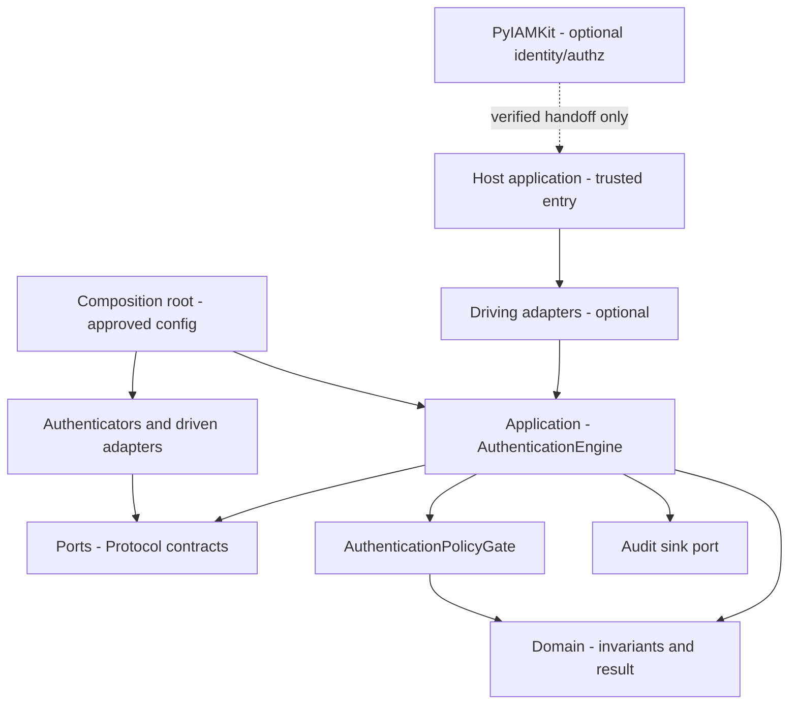
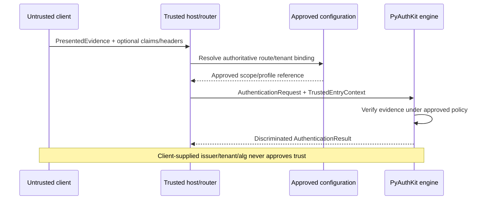
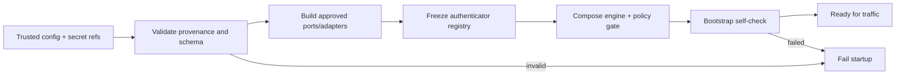
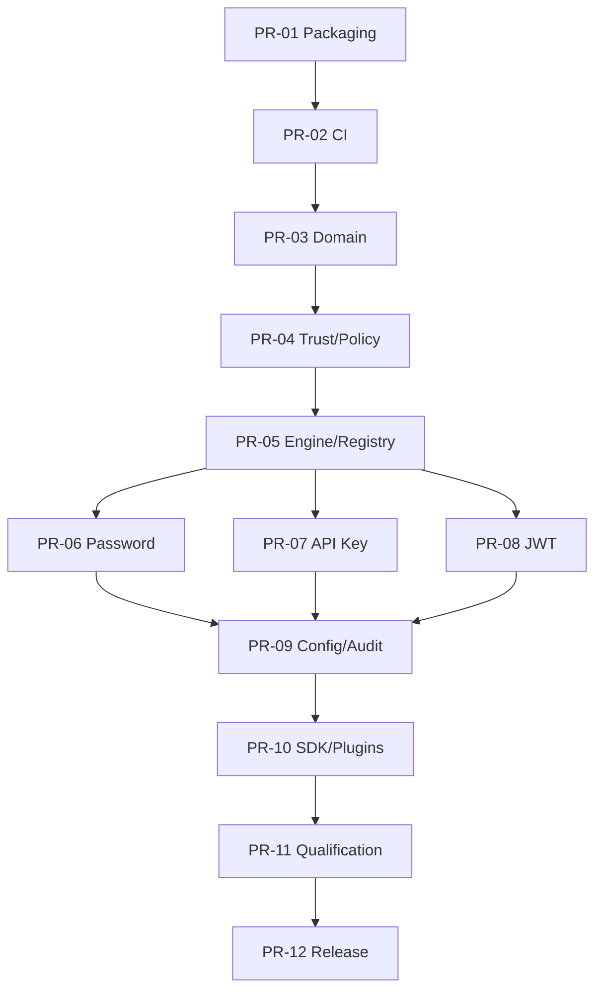

# 28_PYAUTHKIT_IMPLEMENTATION_BOOTSTRAP_PLAN

# PyAuthKit - Implementation Bootstrap Plan

> **Projet :** PyAuthKit - moteur d'authentification Python, modulaire, sécurisé et framework-agnostique.  
> **Document :** `28_PYAUTHKIT_IMPLEMENTATION_BOOTSTRAP_PLAN.md`.  
> **Version documentaire :** `0.1.0` - plan de démarrage proposé, non release logicielle.  
> **Date de référence :** 31 octobre 2026.  
> **Statut :** `PROPOSED / SPECIFIED` - aucun dépôt ni code de sécurité PyAuthKit n'est déclaré livré par ce document.  
> **Sources internes principales :** `03`, `04`-`10`, `18`, `20`, `21`, `24`-`27`, et `PYAUTHKIT_SOFTWARE_DESIGN_LEARNING_CONVENTION.md`.  
> **Langue :** français ; noms de fichiers, API Python, concepts de domaine et identifiants en anglais.  
> **Couverture d'exécution :** bootstrap M0-M2, préparation PR-01 à PR-12 ; Password/API Key/JWT restent des étapes ultérieures soumises à qualification.  
> **Objet :** transformer la feuille de route `27` en un chemin reproductible du dépôt vide au premier noyau testable, sans inventer de garanties de sécurité.

**North Star :** *Unverified evidence never becomes an authenticated principal. A test demonstration never becomes a security qualification. Problem First, Trust First, Pattern Second.*

**Avertissement impératif.** Les configurations et extraits ci-dessous sont des **candidats documentaires**. Les exemples M0 peuvent être exécutés localement après installation des outils, mais ne constituent **pas** un moteur d'authentification. Les interfaces et codes M1-M2 sont des **esquisses de design** avec dépendances et validations restant à implémenter. Un faux authenticator qui retourne un résultat positif ne valide jamais un password, une API key ou une signature JWT. Aucune conformité, aucun test end-to-end réel et aucune publication PyPI ne sont revendiqués.

---

## Guide de lecture

| Pour | Lire | Résultat pratique |
|---|---|---|
| Démarrer le dépôt | 0-17 | structure, décisions, fichiers et commandes |
| Établir un noyau minimal | 18-35 | types, résultats, trust, ports, moteur, fakes |
| Construire le processus de livraison | 36-50 | CI, qualification, PR, sécurité, releases |
| Préparer le passage en exécution | 51-69 | registres, risques, critères, pédagogie, décisions |
| Copier des gabarits contrôlés | Annexes A-H | fichiers M0, checklists, ADR, preuves, références |

## 0. Résumé exécutif

Le premier objectif **n'est pas** de réaliser immédiatement Password, API Key et JWT. Il est de pouvoir : (1) installer un wheel isolé ; (2) importer `pyauthkit` sans framework externe ; (3) manipuler des objets de domaine non dangereux ; (4) faire passer des tests d'invariants ; (5) composer des ports avec des fakes ; (6) démontrer qu'un moteur non configuré refuse plutôt qu'accepter ; (7) relier chaque preuve aux gates de `27`. Le premier incrément utile est une **tranche verticale de refus contrôlé**, pas un login démonstratif qui contourne la vérification.

**Livrable de fin de bootstrap (M0-M2)** : dépôt `src/` packagé, contrats métiers testés, composition root explicite, `Authenticator` SPI minimal, registry figé, `AuthenticationPolicyGate` incontournable, `TrustedEntryContext` construit par l'hôte, test harness négatif, workflow CI avec permissions restreintes et registre d'ADR. Cela rend possible l'ajout des authenticators *uniquement* dans PR-06 à PR-08, après revue spécifique.

**Résultat attendu M0** : le `python -m pytest`, les commandes de lint/typecheck et le build s'exécutent sur des fichiers effectivement présents. Les commandes proposées ci-dessous doivent être corrigées selon les versions d'outils approuvées avant d'être inscrites dans la CI protégée.

## 1. Documents d'autorité et ordre de précédence

1. `00`-`02` : besoin, exigences et vision produit.
2. `03`-`09` : architecture, langage du domaine, invariants, use cases, moteur.
3. `10`-`17` : mécanismes et capacités spécialisées (la plupart post-MVP).
4. `18`-`19` : ports/adapters/plugins et stockage optionnel.
5. `20`-`21` : modèle de menaces, audit et observabilité.
6. `22`-`23` : intégrations framework et passage PyAuthKit -> PyIAMKit.
7. `24`-`25` : surface API/SDK et configuration de confiance.
8. `26` : stratégie de test et preuves de qualification.
9. `27` : M0-M9, gates `GATE27-01..10` et PR-01..12.
10. `PYAUTHKIT_SOFTWARE_DESIGN_LEARNING_CONVENTION.md` : démarche pédagogique transversale.

Ce document est **subordonné** aux décisions de sécurité explicites des textes précédents. Une proposition de fichier, signature ou outil introduite ici n'actualise pas silencieusement un ADR. En cas de contradiction : documenter le conflit, proposer un ADR, bloquer le travail impacté jusqu'à résolution. Ne pas altérer rétroactivement les sources sans revue.

## 2. Problem Statement et acteurs

**Problème** : passer de spécifications nombreuses à une base de code suffisamment petite pour être comprise, mesurée et revue, sans que l'outil de scaffolding crée des raccourcis dangereux. **Acteurs** : mainteneur, contributeur Python, auditeur de sécurité, auteur d'adapter, intégrateur d'application, mainteneur de release. **Adversaires** : client non fiable, attaquant fournissant preuve/claims/headers malveillants, plugin compromis, dépendance ou CI compromise, opérateur qui configure involontairement un fallback permissif.

Le premier risque est un **faux sentiment de sécurité** : du code qui passe quelques tests ne prouve ni la résistance au rejeu, ni la validation JOSE, ni l'isolation multi-tenant, ni la tenue en concurrence. Le plan différencie systématiquement *exemple pédagogique*, *test local réussi*, *qualification d'adapter réel* et *preuve de release*.

## 3. Périmètre et non-objectifs

| Inclusion initiale M0-M2 | Exclusion initiale M0-M2 |
|---|---|
| Packaging et imports minimaux | Flux OAuth/OIDC/SAML et login social |
| Entités/VO de domaine de base | MFA, assurance NIST et step-up effectif |
| `AuthenticationRequest`, résultat discriminé | Passkeys/WebAuthn et session durable |
| Port `Authenticator`, registry, policy gate | Refresh token rotation et révocation distribuée |
| Composition root et contexte hôte trusted | Service IAM/PDP et provisioning de comptes |
| Fakes, clock, tests unitaires et contractuels | JWT issuer, signature, JWKS réellement vérifiés |
| CI, security policy, critères GO/NO-GO | Plugin tiers arbitraire téléchargé ou exécuté |

**MVP produit ultérieur** : Password, API Key et JWT **verification** (non émission JWT). **Post-MVP** : authentification fédérée, MFA, sessions, passkeys, agents, workloads, risque adaptatif, backends persistants avancés. Pas de serveur Web exigé ni de base de données obligatoire dans le core.

## 4. Terminologie et définitions de travail

| Terme | Signification dans ce plan | Confusion à éviter |
|---|---|---|
| `PresentedEvidence` | secret, token ou credential fourni | ce n'est pas un sujet vérifié |
| `ClaimedIdentity` | identité déclarée par entrée non fiable | ce n'est pas `VerifiedSubject` |
| `TrustedEntryContext` | contexte établi et transmis par l'hôte autoritatif | ce n'est pas un dictionnaire de headers client |
| `TrustedScope` | portée d'authentification approuvée | ce n'est pas le tenant auto-déclaré |
| `TrustProfile` | règles de preuve/issuer/algorithme approuvées | ne provient pas directement du JWT |
| `AuthenticatorOutcome` | résultat d'un mécanisme de vérification | ce n'est pas `AuthenticationResult` final |
| `AuthenticationPolicyGate` | décision finale AuthN après vérification | ce n'est pas un PDP AuthZ |
| `AuthenticatedPrincipal` | sujet authentifié et provenance fiable | pas automatiquement compte utilisateur ou rôle |
| `CompositionRoot` | assemblage explicite de composants | pas service locator global mutable |
| `ReleaseEvidence` | preuves rattachées à un commit et artefact | pas capture d'écran d'un test manuel |

## 5. Invariants bootstrap non négociables

1. **IB-01** : aucune entrée ne reçoit un principal authentifié sans vérification effective et gate final.
2. **IB-02** : toutes les issues `DENIED`, `ERROR`, `CHALLENGE_REQUIRED` ont un principal public absent.
3. **IB-03** : la sélection de scope, tenant, issuer, audience, algorithme et profil provient du host trusted.
4. **IB-04** : mécanisme, profile, plugin ou clé inconnu déclenche refus/erreur sûre, jamais fallback.
5. **IB-05** : l'installation du core n'exige pas FastAPI, Django, Flask, PyIAMKit, Redis ou SQLAlchemy.
6. **IB-06** : aucun log, `repr`, exception, fixture versionnée ou artifact CI ne contient un secret brut.
7. **IB-07** : les ports sont possédés par le domaine/application, les adapters dépendent de leurs contrats.
8. **IB-08** : les interfaces de test ne créent pas de chemin de succès utilisable en production.
9. **IB-09** : l'API AuthN n'accorde jamais automatiquement un rôle, une permission ou une délégation.
10. **IB-10** : aucune release n'est qualifiée sans preuve pour l'artefact exact distribué.
11. **IB-11** : la mutabilité de configuration/registry est interdite en régime de trafic sans protocole explicite.
12. **IB-12** : toute propriété temporelle, atomique ou distribuée est prouvée sur l'implémentation correspondante, non sur une fake in-memory.

## 6. Unité de livraison, niveaux de preuve et états

Un `Work Package` possède `source`, `invariants`, `threats`, `files`, `tests`, `gate` et `ADR`. Son état progresse : `PLANNED` -> `READY` -> `IMPLEMENTING` -> `IMPLEMENTED` -> `TESTED` -> `SECURITY_REVIEWED` -> `QUALIFIED` -> `RELEASED`. `BLOCKED` peut interrompre tout état ; un fichier Markdown ne fait pas passer un ticket à `TESTED`.

**Quatre niveaux de preuves** : E0 design/revue ; E1 syntaxe et tests pédagogiques locaux ; E2 tests CI + environnement identifié ; E3 tests sécurité/composants réels + artefact digest, revue et release. Les gates de publication exigent E3 sur les propriétés critiques applicables.

## 7. Architecture de démarrage et règles de dépendance



La direction de dépendance Python doit rester : `domain` indépendant ; `ports` importe éventuellement `domain` ; `application` importe `domain` et `ports` ; adapters importent les abstractions ; composition root sélectionne les implémentations. Un diagramme de modules n'est pas une garantie : une Architecture Fitness Function doit interdire les imports transverses incorrects.

## 8. Choix techniques proposés et ADR obligatoires

| Sujet | Défaut de travail proposé | Statut | Critère d'arbitrage |
|---|---|---|---|
| Source package | `src/pyauthkit` | PROPOSED | imports isolés et wheel installable |
| Python minimal | `>=3.12` | PROPOSED | compatibilité dépendances crypto et support effectif |
| Matrice prioritaire | 3.12, 3.13, 3.14 ; 3.15 à qualifier | PROPOSED | build, test, libs et wheels attestés |
| Build backend | Hatchling | PROPOSED | build wheel/sdist, maintenabilité |
| Environnements | `venv` + `pip` M0 ; `uv` facultatif | PROPOSED | reproductibilité, lock et politique équipe |
| Tests | pytest, import mode `importlib` | PROPOSED | test du wheel installé et contrôle des imports |
| Formatting/lint | Ruff | PROPOSED | cohérence et rapidité du feedback |
| Typage | mypy strict (migration progressive) | PROPOSED | exports publics et ports typés |
| CI | GitHub Actions avec SHA complets validés | PROPOSED | permissions minimales et supply chain |
| Version candidate | `0.1.0a1` pour le squelette | PROPOSED | PEP 440, pas pré-annonce de release |
| Licence | à décider avant publication | OPEN/BLOCKING | conformité et attentes consommateurs |
| Async API | `async def authenticate(...)` | PROPOSED | cohérence des ports IO et cancellation |

Python 3.15 est disponible au 31/10/2026 mais sa prise en charge par les dépendances de sécurité ne peut être déduite du seul statut de CPython. Aucun environnement n'est annoncé supporté tant que la suite de qualification n'y passe pas. Ne pas inclure Python 3.10 désormais en fin de vie. Voir sources externes en annexe.

## 9. Décisions à prendre avant le premier commit public

1. Nom du dépôt Git, namespace, visibilité et gouvernance des mainteneurs.
2. Licence, modèle de contribution et adresse de signalement des failles.
3. `requires-python`, politique de compatibilité OS et cible 3.15.
4. Backend build, stratégie de lock, politique de montée des versions dépendances.
5. Schéma d'exports publics, signature AuthN, statut des types internes.
6. Adoption de la convention Design & Learning par ADR.
7. Seuils des gates CI et procédure de dérogation (jamais de contournement P0).
8. Projet PyPI, droit d'édition, identité OIDC et protection d'environnement de release.

Une décision non prise doit apparaître dans `docs/adr/` avec `PROPOSED`, pas être cachée dans un `TODO` isolé.

## 10. Arborescence cible du dépôt

```text
pyauthkit/
├── .github/
│   ├── workflows/
│   │   ├── ci.yml
│   │   ├── security.yml              # PR-02, après qualification des outils
│   │   └── publish.yml               # PR-12, non activé au M0
│   ├── CODEOWNERS                     # propriétaire(s) à décider
│   └── dependabot.yml                 # candidat
├── docs/
│   ├── design/                        # copie ou liens vers 00-28
│   ├── adr/
│   │   ├── 0001-bootstrap-toolchain.md
│   │   ├── 0002-public-api-boundary.md
│   │   ├── 0003-trusted-host-context.md
│   │   └── 0004-security-release-gates.md
│   ├── learning/
│   │   └── design-learning-cards.md
│   └── integration/
├── examples/
│   └── README.md                      # exemples interdits comme sécurité réelle
├── scripts/
│   ├── check_architecture.py          # PR-02
│   └── check_release_evidence.py      # PR-11/12
├── src/
│   └── pyauthkit/
│       ├── __init__.py
│       ├── py.typed
│       ├── domain/
│       │   ├── __init__.py
│       │   ├── scope.py
│       │   ├── identity.py             # PR-03
│       │   ├── evidence.py             # PR-03
│       │   └── result.py               # PR-03
│       ├── ports/
│       │   ├── __init__.py
│       │   ├── authenticator.py         # PR-05
│       │   ├── clock.py                 # PR-03/05
│       │   └── audit.py                 # PR-09
│       ├── application/
│       │   ├── __init__.py
│       │   ├── engine.py                # PR-05
│       │   └── policy.py                # PR-04
│       ├── configuration/
│       │   ├── __init__.py
│       │   └── bootstrap.py             # PR-04/09
│       ├── authenticators/
│       │   ├── __init__.py
│       │   ├── password.py              # PR-06
│       │   ├── api_key.py               # PR-07
│       │   └── jwt.py                   # PR-08
│       ├── adapters/
│       │   └── __init__.py
│       ├── spi/
│       │   └── __init__.py              # PR-10
│       └── _internal/
│           └── __init__.py
├── tests/
│   ├── unit/
│   │   ├── test_package.py
│   │   ├── test_scope.py
│   │   └── test_results.py
│   ├── contracts/
│   ├── integration/
│   ├── security/
│   ├── architecture/
│   └── fixtures/
├── pyproject.toml
├── README.md
├── CHANGELOG.md
├── CONTRIBUTING.md
├── SECURITY.md
├── LICENSE                            # doit correspondre à l'ADR choisi
├── .gitignore
└── .python-version                     # optionnel
```

**Important** : l'arborescence est **cible progressive**, pas liste de fichiers à créer vides dès PR-01. Un dossier sans nécessité réelle est différé. `py.typed` annonce le typage du package distribué ; cette promesse impose des tests et un contrôle du wheel, pas un simple fichier décoratif.

## 11. Séquence de création M0 sur poste local

```bash
# Une fois le nom du dépôt et le répertoire approuvés :
mkdir pyauthkit && cd pyauthkit
git init
python3.13 -m venv .venv  # adapter au binaire réellement disponible
. .venv/bin/activate
python -m pip install --upgrade pip
mkdir -p src/pyauthkit/domain tests/unit docs/adr .github/workflows
printf '"""PyAuthKit: authentication primitives (bootstrap only)."""\n' > src/pyauthkit/__init__.py
printf '' > src/pyauthkit/domain/__init__.py
printf '' > src/pyauthkit/py.typed
# Ajouter les fichiers des annexes avant les commandes ci-dessous.
python -m pip install -e '.[dev]'
python -m pytest
python -m ruff check .
python -m ruff format --check .
python -m mypy src/pyauthkit
python -m build
```

Sur Windows, remplacer activation et chemins shell selon l'environnement ; **ne pas supposer** que `python3.13` est installé partout. Si `python -m build` ou un binaire n'est pas disponible, faire échouer la gate et déclarer l'environnement, ne pas inventer une réussite. Un `git init` local ne crée pas automatiquement le dépôt distant.

## 12. Règles du `pyproject.toml`

Le fichier candidat complet est en **Annexe A**. Décisions : `name = "pyauthkit"` est une intention (disponibilité PyPI non prouvée) ; `version = "0.1.0a1"` une version **proposée** ; `requires-python = ">=3.12"` une hypothèse de support à tester ; runtime deps vides au M0 ; dev tools dans un extra optionnel et **aucun module crypto déclaré supporté** à ce stade. Le build backend doit produire `pyauthkit-*.whl` et `*.tar.gz` installables dans un environnement propre.

**Anti-pattern** : déclarer `pyauthkit[all]` ou `PyJWT`, Django, FastAPI, Redis obligatoires dès PR-01 sans capacité qui les utilise. Les extras `password`, `jwt`, `django`, `fastapi` sont différés, ajoutés après revue de leurs contrats et contraintes de version. Le fichier `[tool.pytest.ini_options]` doit utiliser `--import-mode=importlib` sans modifier silencieusement `PYTHONPATH` pour cacher des problèmes d'installation.

## 13. README minimal, promesse publique et exemples

Le README M0 doit répondre à : **ce qui existe** (scaffold), **ce qui n'existe pas** (authentification Password/API Key/JWT), **installation en développement**, **tests**, **roadmap**, **politique de sécurité**, **statut public des API**, **limitations**. Toute illustration positive de login doit être marquée `DESIGN SKETCH / NOT PRODUCTION AUTHENTICATION` tant que la vérification réelle et ses tests n'existent pas.

Une documentation d'intégration ne peut pas afficher `AuthenticationResult(status=AUTHENTICATED)` construit arbitrairement comme preuve d'une authentification. Les guides qui démontrent les fakes doivent être clairement confinés aux tests et jamais copiés comme recette de production.

## 14. `.gitignore`, fichiers secrets et conventions Git

Ignorer : `.venv/`, `.pytest_cache/`, `.mypy_cache/`, `.ruff_cache/`, `__pycache__/`, `dist/`, `build/`, `*.egg-info/`, `.env`, `.env.*` sauf modèles explicitement non sensibles, fichiers de tokens et secrets de test locaux. Ne pas se reposer sur `.gitignore` pour protéger les secrets déjà commités : scanner l'historique, révoquer et réémettre les secrets exposés.

Préférer des PR courtes et indépendantes, commits décrivant un comportement vérifiable, `CODEOWNERS` sur `src/pyauthkit`, `pyproject.toml`, `.github/workflows/`, `SECURITY.md` et `docs/adr/`. Protection de branche avec validations requises, interdiction de forcer push, revue des changements d'authentification à impact sécurité.

## 15. Licence, sécurité, contributions et gouvernance

- **Licence** : sélectionner SPDX compatible avec l'intention produit et mettre fichier `LICENSE` réel ; ne pas publier avec licence arbitraire insérée silencieusement.
- **SECURITY.md** : canal de signalement privé, versions supportées, délais de prise en charge définis seulement après décision, pas promesse fictive.
- **CONTRIBUTING.md** : étapes d'installation, tests, nomenclature ADR, politique des fakes et traitement des données sensibles.
- **CODEOWNERS** : propriétaire(s) réels ; pas d'email ou d'utilisateur GitHub inventé.
- **Changelog** : distinguer changements d'API, comportements d'authentification et correctifs de sécurité.

## 16. Matrice de runtime Python et plateformes

| Environnement | Usage candidat | Condition de support | Note |
|---|---|---|---|
| CPython 3.12 Linux | CI de référence | wheel, pytest, dépendances, typing PASS | support à confirmer |
| CPython 3.13 Linux | CI de référence | identique, tests async | support à confirmer |
| CPython 3.14 Linux | CI de référence | identique, cryptographie future | support à confirmer |
| CPython 3.15 Linux | exploration non bloquante au départ | deps crypto compatibles et toutes gates | aucune promesse avant test |
| macOS 3.13/3.14 | dev et smoke | contrôle packaging / platform-specific | optionnel selon ressources |
| Windows 3.13/3.14 | smoke | chemins, temps, async et build | optionnel selon ressources |

Les versions micro doivent suivre la politique de mises à jour de sécurité. Une CI verte sur Linux ne certifie pas Windows/macOS. `requires-python >=3.12` est une **promesse technique potentiellement large** ; ne pas la publier tant que les versions prétendument supportées n'ont pas de couverture et de politique d'entretien.

## 17. Backend de build et vérification du wheel/sdist

Exécuter dans un venv dédié :

```bash
python -m build
python -m twine check dist/*
python -m pip install --force-reinstall --no-deps dist/pyauthkit-0.1.0a1-py3-none-any.whl
python -c 'import pyauthkit; print(pyauthkit.__file__)'
python -c 'from importlib.metadata import version; print(version("pyauthkit"))'
```

Ne pas présumer le nom exact du wheel s'il varie : l'adapter de release doit retrouver l'artefact attendu par nom/version, refuser toute ambiguïté et calculer les digests. Pour qualification, créer un **autre** environnement propre et installer l'artefact construit, sans import du checkout local. Vérifier la présence de `py.typed`, l'absence de fichiers secrets et la surface de dépendances `pip show`/métadonnées.

## 18. Premier objet exécutable M0 : `TrustedScopeRef` sans prétention d'autorité

Le fichier `scope.py` de l'annexe B définit une référence de scope immutable, vérifie qu'elle est non vide et refuse les caractères de contrôle. Il **ne** certifie **pas** que la valeur a été autorisée par l'hôte. `TrustedScopeRef("tenant-a")` est seulement une structure bien formée ; le mot `Trusted` de son nom historique doit être contextualisé : la **provenance trusted** résulte de l'objet `TrustedEntryContext` assemblé plus tard, non de la validation syntaxique du texte.

**Choix pédagogique** : utiliser une `dataclass(frozen=True, slots=True)` pour une valeur immuable. **Alternative simple** : une chaîne Python ; elle est insuffisante lorsque la confusion entre scope et tenant crée un risque observable. **Anti-pattern** : donner un booléen `trusted=True` à une requête HTTP et le considérer autoritatif.

## 19. Distinguer les objets de domaine des DTO de transport

L'adapter reçoit des octets, en-têtes ou corps HTTP non fiables ; un DTO de transport les transporte sous limites de taille ; le domaine représente un `AuthenticationRequest` sans y attribuer la confiance ; le contexte hôte distinct porte les références de portée approuvées. Ne jamais rendre la présence du type `AuthenticationRequest` synonyme de sécurité.

| Concept | Créateur légitime | Invariant / menace | Première PR |
|---|---|---|---|
| `ClaimedIdentity` | adaptateur d'entrée | identité déclarée, jamais vérifiée | PR-03 |
| `PresentedEvidence` | adaptateur d'entrée | données sensibles redacted, taille bornée | PR-03 |
| `AuthenticationRequest` | use case / adapter | seul l'input, pas autorité de trust | PR-03 |
| `TrustedEntryContext` | composition hôte validée | tenant/scope/profile préétablis | PR-04 |
| `AuthenticatorOutcome` | authenticator approuvé | mécanisme vérifie une preuve | PR-05 |
| `AuthenticationResult` | moteur après policy gate | succès discriminé, provenance | PR-03/05 |
| `AuthenticatedPrincipal` | chemin interne approuvé | seulement après décision finale | PR-03/05 |

## 20. Stratégie des résultats discriminés

La solution cible sépare `AuthenticationSuccess`, `AuthenticationDenied`, `AuthenticationError` et, post-MVP, `ChallengeRequired` sous une union typée. Un résultat négatif ne doit **physiquement** pas posséder un champ `principal` utilisable ; un seul dataclass avec `principal: Optional` est plus facile à mal construire. Le constructeur d'un `AuthenticationSuccess` n'est cependant pas un mécanisme cryptographique : les contrôles de provenance s'appliquent aux chemins de création internes et à l'exposition publique.

Les tests doivent vérifier : (1) tous les refus n'exposent pas de principal ; (2) la sérialisation ne divulgue aucune preuve ; (3) un `AuthenticatorOutcome` positif simulé ne devient pas un succès public sans le gate ; (4) les exceptions inattendues se terminent en `AuthenticationError` contrôlé ou propagation explicitement approuvée, jamais `success=True` par défaut.

## 21. Modèle de preuve : origine, référence et attestation

`VerificationProvenance` doit préciser au minimum le mécanisme, un identifiant de profil **approuvé**, une référence de provider/key non sensible lorsque légitime, les horodatages contrôlés et un identifiant de correlation opaque. Cela n'autorise pas à recopier un JWT, un password, une API key, un access token ou un cookie de session dans la provenance. Les détails de provenance sensibles sont réservés à un sink autorisé selon `21`.

La provenance et la fraîcheur ont une dimension temporelle : le temps des tests est injecté ; l'horloge murale et monotone peuvent avoir des rôles différents ; ne pas utiliser naïvement `datetime.now()` partout ni déduire la validité d'un token sans les règles du profil. Ces considérations sont préparées dès M1, pas entièrement implémentées.

## 22. `TrustedEntryContext` : autorité apportée par l'hôte



**Règle** : l'hôte peut choisir un `TrustedScope` par route, domaine validé, configuration serveur ou autre signal autoritatif contrôlé. Il **ne** fait pas confiance à `X-Tenant`, `iss`, `kid`, `alg`, au chemin d'un plugin ou à une propriété de JWT non vérifiée pour élargir la confiance. L'absence de binding autoritatif est une erreur de configuration et interdit une authentification positive.

**Bootstrap path** : `configuration/bootstrap.py` reçoit un mapping approuvé et émet un snapshot immuable. Une requête qui ne correspond à aucune route approuvée échoue. Le constructeur du contexte doit être possédé par la couche hôte/composition ; la protection n'est pas uniquement basée sur un préfixe `_` Python.

## 23. `TrustProfile` et `TrustProfileResolver` avant les authenticators

Le résolveur doit être testé avec deux profils distincts ayant des issuers ou audiences potentiellement ambigus. Il sélectionne un profil **autorisé par le contexte hôte**, pas en recopiant la valeur `iss` du JWT. Les tokens non valides sont ensuite vérifiés contre cette sélection ; le `kid` éventuel peut désigner une clé *à l'intérieur* du profil approuvé, jamais configurer une nouvelle origine réseau arbitraire.

**Contrats candidats** : `resolve(trusted_entry, method) -> ApprovedTrustProfile` ; `UnknownProfile`, `DisabledMethod`, `CrossScopeBinding` se transforment en refus ou erreur sûre suivant la taxonomie `09` et `24`. **Gate** : aucun test adversarial `untrusted issuer -> trusted profile` ne doit aboutir à une sélection de confiance.

## 24. `Authenticator` SPI minimal et source des ports

La convention Python `typing.Protocol` suffit si le port exprime une vraie variation :

```python
# DESIGN SKETCH - a contract only; it does not authenticate anything.
from typing import Protocol

class Authenticator(Protocol):
    async def verify(self, *, evidence: object, context: object) -> object:
        """Return an internal outcome, never a public AuthN decision."""
        ...
```

La signature réelle devra remplacer les `object` par `PresentedEvidence`, `VerificationContext` et `AuthenticatorOutcome` définis dans `05`, `09`, `10` et `24`. On **n'insère pas** ces `object` comme API publique définitive. Ce contraste est volontaire pour distinguer interface pédagogique et contrat qualifié.

Un port ne doit pas importer SQLAlchemy, Django ORM, Redis ou client OpenID comme dépendance centrale. L'implementation réutilise l'interface *sans* héritage forcé, avec contract tests partagés exécutés pour chaque adapter.

## 25. Registry immuable et sélection déterministe

`AuthenticatorRegistry` reçoit des implémentations explicites durant le bootstrap ; il valide la présence de méthodes reconnues, l'absence de collision et les combinaisons scope/méthode/profil. Il est figé **avant** de recevoir du trafic. La fonction `resolve(method, profile_id)` n'effectue pas de téléchargement ni de découverte plugin depuis la requête.

**Cas tests** : registry vide -> refus ; `method=password` non enregistré -> refus ; deux implémentations pour la même clé -> configuration invalide ; mutation après freeze -> erreur ; méthode déclarée désactivée -> refus ; plugin non admis -> jamais appelé. **Design pressure** : Strategy plus Registry est justifié par la coexistence Password/API Key/JWT ; un Service Locator global serait inutile et obscurcirait la chaîne d'autorité.

## 26. `AuthenticationPolicyGate` obligatoire

Un authenticator ne fabrique qu'un `AuthenticatorOutcome`. Le gate applique les règles d'entrée (méthode autorisée, scope approuvé), valide la cohérence entre outcome et profil, puis décide si la preuve vérifiée peut devenir un résultat AuthN. Le gate n'autorise pas une ressource, une opération métier, un rôle ou une délégation.

```text
Input untrusted
  -> limits + syntax
  -> host-established trusted scope/profile
  -> registry resolve (no fallback)
  -> authenticator verification (internal outcome)
  -> policy gate (mandatory)
  -> result normalization + safe audit
  -> AuthenticationResult
```

Dans la première fake `Authenticator`, injecter volontairement un `outcome` positif simulé et vérifier qu'un contexte de trust absent ou une policy de refus empêchent toujours un `AuthenticationSuccess`. La fake ne peut être enregistrée depuis la composition de production et sa présence dans `tests/` est contrôlée au packaging.

## 27. Premier `AuthenticationEngine` : fail-closed d'abord

**Tranche T0** : engine sans authenticator = `AuthenticationDenied` ou `AuthenticationError` selon contrat ; aucune valeur `AuthenticatedPrincipal`. **Tranche T1** : engine + registry de fake qui refuse ; sortie négative prédictible. **Tranche T2** : fake outcome positif mais policy gate négatif ; sortie publique négative. **Tranche T3** : simulation en environnement test d'un gate positif sur preuve fake ; marquer explicitement *test interne d'orchestration, pas authentification de production*, et empêcher toute installation de la fake dans un package de release.

**No-GO** : un moteur minimal qui retourne un succès si `password == "admin"`, si `token.startswith("ey")`, si une API key possède seulement un préfixe ou si la signature JWT n'a pas été vérifiée. Aucun `TODO` de sécurité ne peut être remplacé par un `return success` transitoire.

## 28. Clock, timeouts et annulation

Préparer un port `Clock` pour tests déterministes ; ne pas généraliser un scheduler. `asyncio.CancelledError` doit conserver la sémantique d'annulation de l'application, sans déclencher de succès ; les erreurs d'IO sont converties selon politique de fail-closed et journalisées sans secrets. Les budgets de timeout sont explicitement associés aux ports externes (credential store, audit sink, key resolver) et à la fin de vie de la requête.

**M0-M2** : un fake `Clock` et une séquence d'échec suffisent. **M3-M5** : tester expiration, skew approuvé, rotation de clé et état des credentials avec des bibliothèques et implémentations réelles. **Post-MVP** : exigences de transaction et réplication selon `19` ; aucune fake ne prouve l'atomicité distribuée.

## 29. Audit minimal et redaction avant logger

Une décision produit des événements de sécurité typés *sans* secrets. Le moteur reste utilisable en absence de SIEM, mais la politique `audit required` doit spécifier si l'indisponibilité du sink bloque la décision. Les logs de diagnostic, métriques, traces et audit durable ont des garanties différentes selon `21` ; un `print(result)` ne constitue pas un audit. Le `repr` et les exceptions des value objects d'evidence sont testés contre les fuites accidentelles.

**Étapes** : M1 modèles redacted ; M2 interface `AuthenticationEventSink` candidate ; PR-09 implémentation et policy de durabilité documentée ; PR-11 tests de panne, suppression, ordre et éventuel outbox selon stockage retenu. Ne pas envoyer les valeurs des tokens dans les attributs OpenTelemetry ni dans les labels de métriques.

## 30. Politique des fakes, stubs, spies et fixtures

| Type | Usage autorisé | Limite |
|---|---|---|
| Fake credential store in-memory | tests de contrats unitaires | ne prouve ni durabilité ni isolation process |
| Fake `Authenticator` | séquencement et gate | ne prouve aucun secret/hash/crypto |
| Spy audit sink | présence et contenu d'un événement | ne prouve pas sa livraison durable |
| Fake clock | expiration déterministe | ne prouve pas l'horloge de l'hôte |
| Fake JWKS source | simulation de résolution | ne prouve pas le comportement réseau/SSRF |
| Real PostgreSQL/Redis in CI | tests d'adapters ultérieurs | nécessite configuration et fault injection spécifiques |

**Règle d'assemblage** : tous les fakes demeurent dans `tests/` ou dans un package de test explicitement non distribué. Un test vérifie que `wheel` et `sdist` ne les incluent pas par inadvertance.

## 31. Contrats du premier vertical slice négatif

| Scénario | Given | When | Then |
|---|---|---|---|
| `VS28-01` | registry vide | requête sous scope approuvé | résultat non authentifié |
| `VS28-02` | fake qui refuse | evidence quelconque | aucun principal |
| `VS28-03` | fake outcome accepté + gate refuse | exécution engine | aucun principal |
| `VS28-04` | méthode absente | sélection de méthode | refus, pas fallback |
| `VS28-05` | entrée `tenant-B` et binding `tenant-A` | requête | refus cross-scope |
| `VS28-06` | timeout sur port | vérification | pas de succès ; event redacted |
| `VS28-07` | anomalie syntaxique dans preuve | parse request | refus contrôlé, pas trace secret |
| `VS28-08` | provider de key non autorisé | bootstrap | config refusée avant trafic |
| `VS28-09` | plugin découvert non admis | composition | plugin non exécuté |
| `VS28-10` | wheel core dans venv propre | import `pyauthkit` | aucun framework imposé |

Chaque cas produit un `test_id`, un oracle indépendant, un commit SHA et un résultat CI **quand il sera réellement exécuté**. La présence du scénario dans cette table n'est pas une preuve d'exécution.

## 32. Contrats de type et politique de surface publique

Le package racine `pyauthkit` expose uniquement des symboles approuvés via `24`. `domain.*` peut être interne tant que son contrat n'est pas figé. Les classes `InternalVerifiedSubject` ou des constructeurs privés sont utiles pour réduire les erreurs, mais **Python ne fournit pas de frontière de sécurité intrinsèque contre un code appelant hostile dans le même processus**. La sécurité repose sur la provenance, la décision du gate et la chaîne de configuration approuvée.

Les annotations `Protocol`, `Literal`, `Enum`, `dataclass`, `TypedDict` et exceptions doivent signaler l'intention sans multiplier les abstractions. `mypy` strict sur le noyau ne démontre pas la validité d'une preuve ; les tests négatifs restent nécessaires. Les changements d'exports doivent être versionnés et testés sur wheel propre.

## 33. `CompositionRoot` et interdiction de la magie d'initialisation

Le bootstrap assemble explicitement : config validée -> approved trust profiles -> credential/key resolvers -> authenticators -> registry figé -> policy gate -> audit sink -> engine. Il ne découvre pas arbitrairement les entry points en production et ne lit pas `.env` à l'import de la bibliothèque. Une factory publique future peut encapsuler cet assemblage, mais sans cacher les décisions de sécurité.



La décision `READY` est un signal de bootstrap, pas un certificat de conformité. Le readiness check ne déclenche jamais une authentification réelle avec secrets de production en les imprimant dans les logs.

## 34. Multi-tenancy : commencer sans fuite entre scopes

Même si le MVP a un seul tenant, les identifiants et les lookups doivent permettre de représenter un `TrustedScope` et d'éviter les caches globaux non segmentés. Un test positif tenant A ne dispense pas d'un test négatif tenant B. Les modifications multi-tenant sont fail-closed et auditables. Les contextes sont construits par l'hôte, non déduits d'un texte `tenant_id` de la requête.

**Piège de conception** : un store qui utilise `credential_id` seul au lieu de `(scope, credential_id)` pourrait accepter une clé de tenant A en tenant B. Les fake stores aident à faire apparaître la signature de port nécessaire, mais seule une integration réelle peut prouver l'isolation transactionnelle de la future base.

## 35. Architecture Fitness Functions dès PR-02

Le premier script d'architecture doit détecter au minimum : `domain` important `adapters` ; `domain` important FastAPI/Django/Flask ; présence de `tests/fixtures` dans un wheel ; `application` important un provider concret ; dépendance obligatoire à `PyIAMKit` ; exports publics non approuvés ; activation de plugin à l'import. Un import graph statique est incomplet avec imports dynamiques : compléter par un smoke test du wheel minimal dans un environnement isolé et revue d'entry points.

**Ne pas utiliser** une règle AST qui inspecte uniquement des noms de dossiers comme preuve de non-fuite cryptographique. Les règles structurelles servent de garde-fous d'architecture, pas de moteur d'analyse de sécurité.

## 36. CI minimale : jobs, permissions et frontières

Pipeline candidat : PR -> `lint` -> `typecheck` -> `unit` -> `build` -> `smoke-wheel` -> `architecture` -> `dependency/secret scan` -> synthèse. Les jobs PR ne reçoivent ni secret PyPI ni capacité `id-token: write`. Les événements `pull_request_target` ne doivent pas exécuter du code de PR non fiable avec permissions élevées. Les versions d'actions tiers doivent être figées par SHA complet de commit **réellement vérifié**, jamais par valeur inventée.

Le workflow de **l'annexe E** utilise des placeholders de SHA et n'est **pas activable tel quel** : il faut les remplacer par des SHA publiés/validés, vérifier la provenance et protéger le fichier par CODEOWNERS. L'annexe constitue un template de revue, pas une configuration CI annoncée fonctionnelle.

## 37. Définition des branches et protections

`main` doit être protégé, les PR obligatoires, les forks traités comme non fiables, la revue des modifications `.github/` et `pyproject.toml` renforcée. Ne pas exposer d'identifiants ou secrets de production aux jobs PR. Les permissions de `GITHUB_TOKEN` se limitent à `contents: read` par défaut ; une publication utilisera un job séparé, conditionné à une validation de release, avec OIDC et permissions minimales.

**Failure semantics** : une CI indisponible ou un scan critique `INCONCLUSIVE` n'est pas un PASS ; une exception ne peut être acceptée que par décision documentée lorsque la propriété est réellement non applicable et que la revue sécurité est faite.

## 38. Scans et sécurité de supply chain

| Contrôle | Application | Gate à partir de | Risque non couvert |
|---|---|---|---|
| Secret scanning | code, historique, fixtures, workflows | PR-02 | secrets générés après scan |
| Dependency audit | contraintes et lock résolu | PR-02, puis chaque PR | vulnérabilités inconnues |
| SAST | patterns Python et YAML | PR-02 | erreurs métier/cryptographie |
| SBOM | artefact de release | PR-11/12 | ne prouve pas l'absence de vulnérabilité |
| Sign/attestation | wheel/sdist et provenance CI | PR-12 | CI ou identité de publish compromise |
| Pin actions | sources des actions GitHub | PR-02 | SHA connu mais malveillant |
| Hash/digest | artefact publié | PR-12 | binaire qualifié autre que publié |

Éviter la dépendance à un scanner unique comme critère suffisant de sécurité. Les alertes P0 bloquent ; les P1 applicables suivent la politique `26/27`. Les exceptions de scanners sont datées, documentées, limitées en portée et revues.

## 39. Nomenclature et organisation des tests

`tests/unit` : objets purs, invariants, erreurs, redaction, faux clock. `tests/contracts` : suites partagées des ports. `tests/integration` : adapters réels, packaging, CI. `tests/security` : vecteurs adversariaux, bypass, isolation, fuite de secrets. `tests/architecture` : imports et packaging. L'option `--import-mode=importlib` évite une classe d'effets indésirables de manipulation des chemins d'import ; un editable install et des smoke tests du wheel complètent la vérification.

**Markers proposés** : `unit`, `contract`, `integration`, `security`, `architecture`, `slow`. Chaque marker possède une définition dans `pyproject.toml`; les tests de sécurité P0 ne doivent pas être exclus silencieusement du workflow principal. Les fixtures commitées sont synthétiques et ne doivent contenir ni identifiants de production ni JWT réels.

## 40. Test harness async et injection d'échec

Éviter `asyncio.run()` à l'intérieur d'une boucle déjà en cours. Utiliser l'outillage async pytest approuvé, vérifier la policy de plugin et injecter via ports les erreurs `TimeoutError`, `ConnectionError`, annulation, données incohérentes et absence de profil. Tester séparément **bug du code**, **refus métier** et **indisponibilité infrastructure** ; les trois ne doivent pas être aplatis en un même succès ou en une exception contenant les secrets.

Les tests de concurrence futurs sur challenges/refresh tokens exigent des drivers et stores réels, des barrières de synchronisation et des oracles de consommations uniques. Les opérations in-memory du bootstrap ne peuvent pas établir des garanties de persistance distribuée.

## 41. Property-based tests et negative-first

Chaque invariant P0 est formulé de manière falsifiable. Exemples : « pour tout identifiant de scope invalide, la construction refuse sans émettre de principal » ; « pour toute méthode non enregistrée, aucune résolution ne retourne un authenticator » ; « pour tout résultat non authentifié, aucun principal n'est accessible ». Hypothesis est candidat, mais la suite minimale commence par exemples déterministes explicites, avant de générer de grandes familles de cas.

Ne pas écrire un oracle qui réutilise simplement la même fonction que le code testé. Les tests adversariaux JWT/Password/API Key ultérieurs doivent utiliser vecteurs indépendants et documents normatifs approuvés. Les métriques de couverture ne remplacent pas la matrice de risques.

## 42. Gates de qualité avant fusion

| Gate locale | Critère observable | Preuve enregistrée |
|---|---|---|
| Q28-01 | format/lint passent | commandes, version outil, CI URL |
| Q28-02 | typecheck du scope ciblé | log mypy, liste des exclusions |
| Q28-03 | tests unitaires et négatifs passent | rapport JUnit ou sortie CI |
| Q28-04 | wheel et sdist construits | chemins, SHA256 |
| Q28-05 | wheel isolé importable sans extras | venv smoke, deps installées |
| Q28-06 | scan secrets/deps sans P0 applicable | rapports triés et signés |
| Q28-07 | Architecture Fitness Functions passent | liste des règles exécutées |
| Q28-08 | revue du changement et ADR | approbations et risques résiduels |

Toute preuve doit identifier commit, outil/version, environnement et date. **Ne pas cocher ces gates dans ce document** : il n'existe pas de résultat d'exécution du futur repo PyAuthKit.

## 43. PR-01 - Packaging, imports et premiers tests

**Source** : `27 §13`, `WP27-001..003`. **Portée** : `pyproject.toml`, `src/pyauthkit/__init__.py`, `src/pyauthkit/domain/scope.py`, `py.typed`, `README.md`, `tests/unit/test_package.py`, `tests/unit/test_scope.py`, `.gitignore`, décision initiale de licence et `SECURITY.md`. **Hors portée** : `AuthenticationEngine`, fake positif ou mécanisme crypto.

**DoR** : nom de package et visibilité décidés, licence au moins dans un ADR, runtime Python choisi comme hypothèse de travail. **DoD** : `pip install -e '.[dev]'`, tests M0, `python -m build`, installation de wheel propre et import hors checkout. **Gate** : `GATE27-01` et Q28-01..05. **NO-GO** si le core impose un framework ou si le sdist oublie ses fichiers nécessaires.

## 44. PR-02 - CI, quality et supply chain

**Source** : `27 §54-56`, `WP27-004..006`, `20`, `26`. **Portée** : workflow PR, lint/typecheck/pytest/build/smoke, tests d'architecture, secret scanning et analyse de dépendances, configuration branch protection et CODEOWNERS. Les SHA d'actions sont remplacés par des valeurs vérifiées avant de pousser le workflow, puis maintenus par politique de mise à jour.

**DoR** : PR-01 merge, runners et versions Python définis, sécurité repo configurée. **DoD** : PR factice échouant volontairement à un test prouve que la CI bloque ; workflow PR sans secrets de release ; mise à jour d'un fichier `domain` important `django` doit casser la fitness. **Gate** : `GATE27-01` + Q28-06..08.

## 45. PR-03 - Domain Kernel et résultats discriminés

**Source** : `04`-`09`, `24`, `26`, `WP27-007..012`. **Portée** : `ClaimedIdentity`, `PresentedEvidence`, scope refs, result union, erreurs sûres, fixtures synthétiques, tests unitaires/property-based. `VerifiedSubject` et `AuthenticatedPrincipal` seront créés uniquement dans une zone de confiance interne après approbation de leur provenance ; aucune API publique de `mark_verified()` ne doit être offerte à l'entrée.

**DoR** : PR-02 et contrats modèle revus. **DoD** : non-succès sans principal ; `repr`/logs sans evidence ; sérialisation explicite sans secrets ; liens entre états et tests. **Gate** : `GATE27-02`. **NO-GO** si une entrée client peut directement construire une décision considérée authentifiée.

## 46. PR-04 - Trusted Host Context et policy gate

**Source** : `07`, `09`, `20`, `23`, `25`, `WP27-016..017`. **Portée** : résolution de trusted scope/profile, validation bootstrap, `AuthenticationPolicyGate`, refus des méthodes désactivées et configurations incohérentes. Ce lot **précède** toute authentification positive réelle.

**DoD** : les headers non fiables et claims JWT ne peuvent choisir ni scope ni source de clé ; default deny et no fallback ; test de requête cross-tenant ; gate incontournable. **Gate** : `GATE27-03`. **Risque** : une factory de contexte acceptant n'importe quel `tenant_id` ne constitue pas une autorité trusted.

## 47. PR-05 - Engine, ports, registry et fake-first

**Source** : `09`, `10`, `18`, `24`, `27`, `WP27-013..015`, `WP27-018`. **Portée** : `async AuthenticationEngine`, `Authenticator` port, outcome interne, registry immutable, clock et audit sink minimal, erreurs/annulation, tests de substitution des adapters et compositional wiring. **DoD** : premier vertical slice négatif reproductible (`VS28-01..10` applicables).

**Gate** : `GATE27-03` + Q28-02..08. **NO-GO** si le fake peut être importé et utilisé comme vérificateur de production, si le registry mute après bootstrap ou si une issue exceptionnelle retourne un principal.

## 48. PR-06 - Password Authenticator (M3, non bootstrap initial)

**Source** : `10`, `19`, `20`, `27 §16`, `WP27-019..022`. **Livrables** : port de credential lookup scope-bound, adapter de hash/verify **via bibliothèque éprouvée**, comparaison sûre, interprétation `inactive`/`absent`, redaction, traitement d'énumération, limites de ressources et timeouts. **Tests** : vecteurs positifs/négatifs, format hachage inattendu, migration de paramètres approuvée, indisponibilité du store, scope étranger, secrets dans `repr`/telemetry. **Gate** : `GATE27-04`.

Ne jamais remplacer un KDF par `hashlib.sha256(password)` et ne pas conserver les mots de passe en clair. Le choix Argon2id et les paramètres viennent d'une revue sécurité et d'un benchmark représentatif, pas d'une valeur magique non justifiée copiée du document.

## 49. PR-07 - API Key Authenticator (M4)

**Source** : `10`, `19`, `20`, `27 §17`, `WP27-023..026`. **Livrables** : sélection scope-bound, lookup/empreinte de clé approuvés, statut et expiration, révocation, comparaison de preuve, audit redacted. **Tests** : suffixe/prefixe seul refusé, clé absente/inactive/expired/révoquée, race de révocation, tenant étranger, corruption de record, timeout. **Gate** : `GATE27-05`.

L'atomicité de la révocation dépend du store et de son modèle de cohérence. Les tests sur fake ne satisfont pas un contrat `read-after-revoke` distribué.

## 50. PR-08 - JWT verification (M5)

**Source** : `10`, `14`, `20`, `25`, `27 §18`, `WP27-027..031`. **Livrables** : validation JOSE par bibliothèque maintenue, trust profile présélectionné, algorithmes explicitement admis, issuer/audience/type/temps vérifiés, clé sélectionnée uniquement parmi les sources approuvées, caches isolés par profil, protection SSRF/JWKS. **Tests** : `alg=none`, algorithm confusion, mauvaise audience, mauvais issuer, expiry/nbf, `kid` inconnu, injection `jku`, rotation, fuite cross-issuer, key mismatch. **Gate** : `GATE27-06`.

Un JWT qui se décode et dont `sub` existe n'est **pas** un JWT authentifié. Le mécanisme du MVP **vérifie** des tokens, il ne devient pas un émetteur par accident.

## 51. PR-09 - Config immuable et audit minimal (M6)

**Source** : `21`, `25`, `27 §19`, `WP27-033..038` selon découpage de `27`. **Livrables** : validation de provenance des sources, snapshots immuables et versionnés, références de secrets, refus de config invalide, événement d'audit minimisé, policy de livraison en erreur. **Gate** : `GATE27-07`.

**No-GO** : config client choisissant un secret ou un trust profile, logs contenant le token, hot reload modifiant des profils en place sans protocole d'activation, audit obligatoire traité best-effort sans décision explicite.

## 52. PR-10 - SPI, plugin admission et usage consumer (M7)

**Source** : `18`, `22`-`24`, `27 §20`. **Livrables** : SPI documentée, registry capabilities, allow-list et validation des plugins, documentation Python pure, exemples fail-closed et tests du wheel minimal. **Gate** : `GATE27-08`.

`importlib.metadata.entry_points` peut trouver des candidats, mais la découverte ne vaut jamais autorisation ni isolation. Ne charger les extensions approuvées qu'après vérification de leur origine, version, capacités et configuration ; les dépendances optionnelles sont résolues explicitement.

## 53. PR-11 - Qualification sécurité et release candidate (M8)

**Source** : `20`, `26`, `27 §21`, `GATE27-09`. **Livrables** : preuves des tests P0/P1 applicables, matrice de risques, vecteurs indépendants, tests wheel/sdist, scans sécurité, vérification de compatibilité, revue API, documentation des limitations, release candidate et manifeste de preuve.

Les suites post-MVP sont marquées `NOT_APPLICABLE` avec justification si elles ne sont pas livrées. Ne pas marquer PASS un test non écrit, désactivé, passé sur fake ou exécuté contre un artefact différent.

## 54. PR-12 - Release contrôlée et transfert en maintenance (M9)

**Source** : `27 §22`, `GATE27-10`. **Livrables** : décision GO/NO-GO formelle, tag, build unique ou provenance de build, hashes wheel/sdist, artefact de release, PyPI trusted publishing OIDC si adopté, changelog, security policy, communication de portée du MVP et procédure de retrait. **Publication exclusivement après** la vérification des SHA d'actions, permissions et environnements protégés.

**NO-GO** : mismatch du digest entre artefact qualifié et publié ; identité de publish non bornée au projet/workflow/environnement ; statut de test P0 inconclusive ; prétention à une fonctionnalité post-MVP non qualifiée.

## 55. Dépendances des PR et ordre minimal



Le graphe est **relatif**, sans délais calendaires inventés. Les PR-06, 07 et 08 peuvent avancer en parallèle après stabilisation M2, mais leurs risques cryptographiques et de trust restent distincts. La préparation des tests sécurité commence avant elles. Les PR peuvent être scindées si la revue l'exige, sans contourner leurs gates.

## 56. Matrice PR / Milestone / Gate / preuve

| PR | Milestone | Gate `27` | Preuve minimale de sortie |
|---|---|---|---|
| 01 | M0 | GATE27-01 | wheel minimal, import isolé, tests M0 |
| 02 | M0 | GATE27-01 | CI bloque échec, permissions et scans |
| 03 | M1 | GATE27-02 | invariants types/résultats + negative tests |
| 04 | M2 | GATE27-03 | autorité host, policy always called |
| 05 | M2 | GATE27-03 | test fake-first, registry immutable |
| 06 | M3 | GATE27-04 | vectors Password et failure semantics |
| 07 | M4 | GATE27-05 | tests revocation/expiry/scope |
| 08 | M5 | GATE27-06 | JOSE independent vectors et trust strict |
| 09 | M6 | GATE27-07 | snapshots/config/audit minimisé |
| 10 | M7 | GATE27-08 | SPI, plugin admission, wheel consumer |
| 11 | M8 | GATE27-09 | evidence manifest + revue sécurité |
| 12 | M9 | GATE27-10 | digest release = digest qualifié |

## 57. Definition of Ready et Definition of Done

**DoR pour M0-M2** : besoin relié à `00-27`, source d'autorité identifiée, trust boundary, invariants, cas positifs/négatifs, menace P0/P1, exemple le plus simple, pattern justifié, décision ADR et oracle de test indépendant. **DoD pour M0-M2** : code revu, tests réellement exécutés, linter/typecheck, wheel installé et importé, tests de redaction, architecture fitness, contrat d'erreur, limitation des dépendances, documentation mise à jour et lien de preuve.

Une PR de sécurité n'est pas « done » parce que le happy path fonctionne. La réussite doit également documenter le comportement des inconnus, corruptions, refus, timeouts et erreurs de dépendance.

## 58. Règles GO/NO-GO et blocage P0

Une gate reste `NO_GO` si : (a) test P0 non exécuté, échec ou sans oracle ; (b) preuve favorable issue uniquement d'une fake là où une crypto/bdd réelle est requise ; (c) trame trust non validée ; (d) secret dans logs, artifacts ou traces ; (e) mécanisme non qualifié activable par défaut ; (f) mismatch digest ; (g) reviewer ou propriétaire du risque manquant. Aucun seuil de couverture global ne neutralise ces critères.

Les dérogations de couverture ne sont possibles que pour des tests explicitement **hors périmètre**, documentés et approuvés ; une propriété P0 applicable ne devient pas « hors périmètre » par suppression du code de test.

## 59. Stratégie de versionnage et release trains

Le tableau du `27` est repris comme **hypothèse** : `0.1.0a1` M0-M1, `0.1.0a2` M2-M3, `0.1.0a3` M4-M5, `0.1.0b1` M6-M7, `0.1.0rc1` M8, `0.1.0` M9. Les versions ne sont pas des artefacts déjà publiés. Une alpha peut être une livraison de package testable, mais doit annoncer sans ambiguïté les capacités non présentes et les garanties non qualifiées.

Ne pas exposer de compatibilité stable avant l'ADR d'API. Un changement de sémantique `AuthenticationResult` ou de contrat `Authenticator` doit avoir tests de compatibilité, changelog, plan de migration et garde de refus si confiance élargie.

## 60. Plan d'apprentissage délibéré par itération

Chaque PR structurante contient **au minimum une Design Learning Card** : le problème utilisateur et sa menace, la contrainte du contexte Authentication, l'invariant, les options simples, les forces qui justifient un pattern, la solution Python naturelle, les tests négatifs, les preuves et le statut. Une rétrospective compare le design choisi à une solution de complexité moindre et identifie les abstractions à supprimer.

**Patterns avec justification possible** : Strategy pour plusieurs mécanismes, Adapter pour stores/clients externes, Factory pour composition sous config approuvée, Repository pour persistance propriétaire, Facade pour SDK ergonomique, Domain Event pour événements d'audit. **Patterns non automatiques** : Abstract Factory partout, CQRS, Event Sourcing, Microservices, FSM généralisée, DI container réflexif. La taxonomie n'est pas un objectif en soi.

## 61. Gestion des changements d'API et contrôle du naming

`Authenticator` est un port de vérification, `AuthenticationEngine` est une orchestration applicative, `AuthenticationPolicyGate` est un gardien de décision, `TrustedEntryContext` est un contrat d'autorité hôte, `AuthenticationResult` est le résultat final. Ne pas nommer des classes `StrategyPattern`, `AdapterPattern` ou `SecurityManager` génériques. Des noms du domaine rendent le code et les revues plus exacts.

Les noms exacts, modules et signatures sont encore **PROPOSED**. Toute stabilisation s'effectue par ADR du `24`, accompagnée de tests de compatibilité et d'un exemple consommateur qui n'importe pas de chemins internes.

## 62. Gestion des secrets en développement

Les tests utilisent secrets synthétiques, générés ou fixtures statiques *non réelles* à faible enjeu. Un test d'exemple « password » ne doit pas afficher la valeur ni la stocker en log, même s'il s'agit d'une fixture. Les variables CI sensibles ne sont pas utilisées par des workflows PR. La configuration d'un secret manager de production n'appartient pas au M0, mais l'API `SecretRef` doit empêcher les dumps accidentels.

Lorsqu'une fuite est suspectée : bloquer la release, identifier l'exposition, révoquer/faire tourner les credentials touchés, retirer les logs accessibles et documenter le risque résiduel. Effacer une ligne Git ne remplace pas la rotation.

## 63. Gestion des dépendances et locks

Une bibliothèque Python ne doit pas supposer que le lock de développement représente toutes les combinaisons valides chez ses consommateurs. Déclarer des contraintes runtime supportées dans `pyproject.toml`, conserver un environnement résolu reproductible pour CI/qualif, mettre à jour les dépendances selon surveillance des vulnérabilités et limiter les extras. Le choix entre `uv.lock`, constraints `pip-tools` ou autre reste un ADR ; l'exemple `venv/pip` fourni fonctionne sans l'imposer.

Documenter le chemin de correction d'un CVE, l'impact sur matrices Python, la politique de hashes et la requalification des artefacts. Un warning de scanner ne peut être silencieusement ignoré au prétexte que la dépendance est « de développement » si elle exécute du code dans les jobs privilégiés.

## 64. Publication PyPI, Trusted Publishing et attestations

La publication est **séparée** du pipeline PR. Le publisher OIDC doit être préalablement configuré côté PyPI pour le dépôt et le workflow précis, puis un job de publication sur environnement protégé reçoit `id-token: write` pour son usage limité. `twine upload` avec token longue durée n'est pas la stratégie préférée ; tester d'abord avec un environnement non productif approuvé et **ne pas créer automatiquement de projet PyPI** par ce document.

Le tag Git, la version wheel, le SHA256 de l'artefact qualifié et celui de l'artefact publié doivent être corrélés. Si le build est refait après qualification, il faut établir et vérifier la correspondance des artefacts ou refaire les tests ; ne pas présumer qu'un rebuild a la même empreinte.

## 65. Logs, métriques et preuve de release

**Logs** : données réduites, contextualisation, pas de secret dans `str`, `repr`, traceback rendu public ou telemetry. **Metrics** : compteurs de `authenticated/denied/error` par méthode approuvée, cardinalité bornée, sans identifiants de token. **Traces** : corrélation hôte/runtime sans payload de preuve. **Audit** : faits métier de sécurité distincts des traces. **Release evidence** : résultats horodatés, commit, env, tool versions, SHA256 des artefacts et revue explicite.

Les outils d'observabilité et la CI ne doivent jamais être traités comme des autorités d'authentification : ils constatent, diagnostiquent et soutiennent la preuve, sans accorder la confiance.

## 66. Conformité, normes et limitations revendicables

Le document **s'inspire** de référentiels OWASP, NIST et spécifications IETF, sans prétendre satisfaire une certification. Exemples : OWASP ASVS comme catalogue de contrôles, NIST SP 800-63B-4 pour exigences et assurance des authenticators, RFC 9700 pour OAuth (surtout post-MVP), RFC 7519 et RFC 8725 pour JWT/Bearer selon périmètre, recommandations PyPA et Python pour packaging. Le contexte et la version normative sont documentés dans `20` et `26` ; adapter la matrice des exigences au mécanisme effectivement implémenté.

Ne pas affirmer AAL2/AAL3 sur le seul type d'authenticator, ne pas revendiquer OAuth/OIDC sur le simple usage d'un JWT et ne pas attribuer à la bibliothèque la conformité RGPD de son application hôte.

## 67. Retours en arrière et gestion d'incident de bootstrap

Si le wheel construit tire une dépendance interdite, revient à une ancienne configuration ou accepte une fake de production, bloquer le merge, enregistrer le test de régression et corriger le graphe de composition. Si une publication compromise survient : arrêter la promotion, documenter la version affectée, limiter son installation si les mécanismes le permettent, émettre un correctif et une advisory selon la politique de sécurité ; un simple `git revert` ne retire pas les artefacts installés.

Une erreur d'ADR doit être corrigée par ADR amendé et migration ; ne pas supprimer l'historique des décisions sans revue.

## 68. Matrice de risques de livraison

| ID | Risque | Impact | Contrôle préventif | Preuve attendue |
|---|---|---|---|---|
| R28-01 | façade positive avant preuve réelle | critique | fake negative-first | test policy-gate |
| R28-02 | entrée tenant/issuer choisit trust | critique | host binding approuvé | tests cross-scope/claims |
| R28-03 | JWT décodé traité comme vérifié | critique | JOSE lib + profile strict | vecteurs adversariaux |
| R28-04 | secret fuite dans repr/logs | élevé | redaction par construction | tests logs/exceptions |
| R28-05 | plugin installé auto-chargé | élevé | allow-list et freeze | test discovery != activation |
| R28-06 | wheel différent du testé | critique | digest et attestation | release evidence |
| R28-07 | lock de dev présenté comme conformité | moyen | matrix test | smoke wheel et deps |
| R28-08 | import framework depuis domain | moyen | import graph | architecture fitness |
| R28-09 | timeout converti en succès | critique | fail-closed et test fault | test injection échec |
| R28-10 | simulation cache/store confondue avec réel | élevé | qualification adapter réel | tests integration |
| R28-11 | dépendance vulnérable dans CI | élevé | pin, scan, revue | rapport supply chain |
| R28-12 | pattern décoratif et coût de maintenance | moyen | Alternative simple + LC | revue de design |

## 69. Definition of Ready pour lancer la première PR

La première PR peut être ouverte lorsque : nom et emplacement du dépôt choisis ; licence/SECURITY.md traités ou clairement bloquants ; `pyproject.toml` approuvé comme hypothèse et Python installé ; fichiers M0 des annexes copiés ; aucune API d'authentification prétendument fonctionnelle dans le README ; liste des tests acceptée ; politique d'approbation et reviewers identifiés. Les sujets non bloquants restent visibles en ADR ; ceux qui déterminent directement l'autorité de trust sont bloquants avant PR-04.

**Next actionable unit** : PR-01, `WP27-001..003`, `GATE27-01`, en suivant l'ordre de commandes de l'annexe H. Aucun calendrier n'est présumé.

## 70. Synthèse de fin de conception et décision proposée

L'ensemble `00`-`28` et la convention Design & Learning forment un dossier de conception initiale. La sortie ne consiste **pas** à « terminer PyAuthKit » : elle consiste à disposer d'un plan rigoureux pour construire, tester et qualifier progressivement le moteur. Une *readiness review* finale doit accepter les ADR bloquants, approuver le scope M0-M2, fixer les propriétaires de revues et ouvrir la PR-01.

**Décision recommandée** : accepter comme point de départ la structure `src/`, le domaine minimal négatif, la policy avant succès, la CI reproductible et les gates de `27`. Écarter toute extension du MVP avant que le cycle Password/API Key/JWT ne soit qualifié selon `26`.

---

# Registres opérationnels

## 71. Work Packages M0-M2 (`WP28-*`)

Les work packages ci-dessous sont **candidats**, chacun correspond à un livrable observable et non à une preuve de code. La table conserve les `WP27` de niveau roadmap comme source d'autorité.

| ID | PR | Livrable | Critère de preuve | Source |
|---|---|---|---|---|
| WP28-001 | 01 | licence et SECURITY policy | revue juridique/mainteneur | WP27-001 |
| WP28-002 | 01 | src package + build metadata | wheel importable isolé | WP27-002 |
| WP28-003 | 01 | choix Python et CI matrix | ADR + env list | WP27-003 |
| WP28-004 | 01 | README avec limites claires | non-promesse AuthN | 24, 27 |
| WP28-005 | 01 | `TrustedScopeRef` syntactic VO | unit negative | 05, 07 |
| WP28-006 | 01 | base pytest + tests package | logs exécution | 26 |
| WP28-007 | 01 | sdist et wheel smoke | fresh venv, SHA | 27 |
| WP28-008 | 02 | workflow PR sans privilege | revue GitHub | WP27-005 |
| WP28-009 | 02 | Ruff/mypy/pytest gates | CI fail/pass demonstration | WP27-004 |
| WP28-010 | 02 | scan secrets et deps | raport lié commit | WP27-006 |
| WP28-011 | 02 | arch fitness import graph | violation injectée détectée | 18, 26 |
| WP28-012 | 03 | `ClaimedIdentity` et evidence | untrusted/redaction tests | WP27-007 |
| WP28-013 | 03 | `VerificationProvenance` | no raw token | 09, 21 |
| WP28-014 | 03 | résultat discriminé | non-success no principal | WP27-009 |
| WP28-015 | 03 | inner subject construction | review trust provenance | WP27-008 |
| WP28-016 | 03 | tests property/negative | oracle indépendant | 26 |
| WP28-017 | 04 | host binding | client claims rejected | WP27-017 |
| WP28-018 | 04 | approved trust profile resolver | unknown profile NO-GO | 09, 25 |
| WP28-019 | 04 | immutable config snapshot | change denied | 25 |
| WP28-020 | 04 | policy gate | forced negative tests | WP27-016 |
| WP28-021 | 05 | Authenticator port | contract fakes | WP27-014 |
| WP28-022 | 05 | immutable registry | duplicate/unknown rejects | WP27-015 |
| WP28-023 | 05 | async engine | fake negative-first | WP27-013 |
| WP28-024 | 05 | timeout/cancellation | fault injection | WP27-018 |
| WP28-025 | 05 | audit sink interface | absence of raw secrets | 21 |
| WP28-026 | 05 | composition root | only approved plugins | 18, 25 |
| WP28-027 | 05 | isolated consumer test | core independent frameworks | 22, 24 |
| WP28-028 | 05 | threat/ADR review and gate | CI evidence + reviewer | 20, 26 |

## 72. Exigences de bootstrap (`BS28-REQ-*`)

| ID | Exigence vérifiable | Criticité | Source | Premier gate |
|---|---|---|---|---|
| BS28-REQ-001 | distribution s'installe depuis wheel isolé | P0 | 27 §13 | 01 |
| BS28-REQ-002 | import du core sans frameworks Web | P0 | 18, 22 | 01 |
| BS28-REQ-003 | sources et metadata build sont dans le sdist | P1 | 24 | 01 |
| BS28-REQ-004 | versions Python annoncées ont une CI définie | P1 | 26 | 01 |
| BS28-REQ-005 | aucune fonctionnalité AuthN fictive annoncée supportée | P0 | 09, 27 | 01 |
| BS28-REQ-006 | security policy et licence avant release publique | P1 | 20, 27 | 01 |
| BS28-REQ-007 | CI PR sans secret de publication | P0 | 20, 26 | 02 |
| BS28-REQ-008 | actions tierces pin sur SHA vérifié | P1 | 20 | 02 |
| BS28-REQ-009 | tests négatifs bloquent le merge | P0 | 26 | 02 |
| BS28-REQ-010 | architecture domain reste indépendante | P0 | 03, 18 | 02 |
| BS28-REQ-011 | secrets exclus du code et des logs | P0 | 20, 21 | 02 |
| BS28-REQ-012 | dépendances sont scannées et revues | P1 | 20, 26 | 02 |
| BS28-REQ-013 | `PresentedEvidence` reste untrusted | P0 | 05, 07 | 03 |
| BS28-REQ-014 | `ClaimedIdentity` ne vaut pas vérification | P0 | 04, 07 | 03 |
| BS28-REQ-015 | non-success ne possède pas de principal public | P0 | 09, 24 | 03 |
| BS28-REQ-016 | représentations d'evidence sont redacted | P0 | 10, 21 | 03 |
| BS28-REQ-017 | policy de temps explicite, testable | P1 | 09, 13 | 03 |
| BS28-REQ-018 | exceptions discriminent refus/erreur technique | P0 | 09, 24 | 03 |
| BS28-REQ-019 | scope/profile provient d'une autorité hôte | P0 | 09, 25 | 04 |
| BS28-REQ-020 | client claims ne sélectionnent pas trust | P0 | 20, 25 | 04 |
| BS28-REQ-021 | no fallback pour unknown profile | P0 | 07, 09 | 04 |
| BS28-REQ-022 | snapshots immuables avant trafic | P1 | 25 | 04 |
| BS28-REQ-023 | policy gate est obligatoire avant AuthN success | P0 | 09, 27 | 04 |
| BS28-REQ-024 | policy gate ne décide aucune permission IAM | P0 | 23 | 04 |
| BS28-REQ-025 | Authenticator expose outcome interne seulement | P0 | 09, 10 | 05 |
| BS28-REQ-026 | registry refuse collisions et méthodes absentes | P0 | 18 | 05 |
| BS28-REQ-027 | registry figé après bootstrap | P1 | 18, 25 | 05 |
| BS28-REQ-028 | moteur rejette fake-positive sans policy | P0 | 09 | 05 |
| BS28-REQ-029 | timeouts/annulations n'impliquent aucun succès | P0 | 09, 20 | 05 |
| BS28-REQ-030 | fakes ne sont pas livrées dans wheel prod | P0 | 18, 26 | 05 |
| BS28-REQ-031 | audit non sensible par construction | P0 | 21 | 05 |
| BS28-REQ-032 | PyIAMKit facultatif | P0 | 23 | 05 |
| BS28-REQ-033 | plugins découverts ne sont pas auto-activés | P0 | 18 | 05 |
| BS28-REQ-034 | wheel qualifié correspond à version commit | P0 | 26, 27 | 05/12 |
| BS28-REQ-035 | preuves CI associent run, versions, commit | P1 | 26 | 02/05 |
| BS28-REQ-036 | chaque choix structurant renvoie à un ADR | P1 | convention | 01/05 |

## 73. Registre des invariants (`BS28-INV-*`)

Chaque invariant exprime une propriété testable candidate. Les codes sont spécifiques au bootstrap et n'annulent pas `07` ou `26`.

| ID | Propriété de sécurité ou de conception | Test initial |
|---|---|---|
| BS28-INV-001 | Toute evidence non vérifiée reste untrusted. | adversarial domain |
| BS28-INV-002 | Toute claimed identity reste non vérifiée avant mécanisme. | domain negative |
| BS28-INV-003 | Tout non-success possède zéro principal utilisable. | result property |
| BS28-INV-004 | Une sortie authentifiée exige gate final effectivement positif. | engine sequence |
| BS28-INV-005 | Aucun profile non reconnu n'est sélectionné. | resolver negative |
| BS28-INV-006 | Aucun fallback vers autre méthode n'est possible. | registry negative |
| BS28-INV-007 | Un tenant client ne détermine pas TrustedScope. | cross-tenant negative |
| BS28-INV-008 | Un issuer de JWT non vérifié ne détermine pas le profile. | trust resolver |
| BS28-INV-009 | Une clé non approuvée ne peut devenir autorité. | key resolver |
| BS28-INV-010 | Un plugin découvert n'est pas activé implicitement. | plugin admission |
| BS28-INV-011 | Aucun secret brut n'apparaît dans repr. | redaction test |
| BS28-INV-012 | Aucun secret brut n'apparaît dans str d'une erreur. | redaction test |
| BS28-INV-013 | Aucun secret brut n'apparaît dans audit event. | event test |
| BS28-INV-014 | Aucun secret brut n'apparaît dans telemetry. | observability test |
| BS28-INV-015 | Le core fonctionne sans PyIAMKit. | isolated wheel test |
| BS28-INV-016 | Le core fonctionne sans framework web. | isolated wheel test |
| BS28-INV-017 | Domain n'importe pas les adapters. | architecture fitness |
| BS28-INV-018 | Les ports n'importent pas de client concret. | architecture fitness |
| BS28-INV-019 | Chaque authenticator reçoit un contexte de vérification établi. | contract test |
| BS28-INV-020 | Un outcome positif n'est pas un résultat final positif. | gate sequence |
| BS28-INV-021 | Unknown method entraîne refus contrôlé. | registry negative |
| BS28-INV-022 | Collision registry est refusée au bootstrap. | registry construction |
| BS28-INV-023 | Après freeze le registry ne peut muter. | registry mutation |
| BS28-INV-024 | Snapshot de config est immuable durant la requête. | config test |
| BS28-INV-025 | Une configuration invalide interdit le démarrage. | bootstrap negative |
| BS28-INV-026 | Un échec de lookup ne devient jamais success. | fault injection |
| BS28-INV-027 | Un timeout ne devient jamais success. | async fault injection |
| BS28-INV-028 | Une annulation ne devient jamais success. | async cancellation |
| BS28-INV-029 | Une fake de test est absente du wheel distribué. | artifact inspection |
| BS28-INV-030 | Une release n'active que les capacités qualifiées. | release manifest test |
| BS28-INV-031 | Le digest qualifié désigne l'artefact distribué. | artifact digest check |
| BS28-INV-032 | Les dépendances de release sont approuvées. | dependency review |
| BS28-INV-033 | Aucune action non pinnée n'entre en CI protégée. | workflow static check |
| BS28-INV-034 | Un workflow PR n'obtient aucun credential de publish. | permissions review |
| BS28-INV-035 | Une gate P0 inconclusive impose NO-GO. | gate decision table |
| BS28-INV-036 | Le scope des lookups credential est obligatoire. | credential contract |
| BS28-INV-037 | Une ref de tenant cross-scope est refusée. | negative tenant matrix |
| BS28-INV-038 | Une version Python supportée passe ses tests dédiés. | matrix evidence |
| BS28-INV-039 | Les erreurs publiques révèlent une information minimisée. | error mapping test |
| BS28-INV-040 | L'autorisation IAM n'est pas présumée par AuthN. | handoff contract |

## 74. Catalogue de tests candidats (`BS28-TST-*`)

Le tableau propose un **oracle distinct** pour chaque cas ; `NOT_RUN` est le statut initial de toutes les entrées. Le statut PASS exige lien CI, environnement, commit, code exécuté et type d'adapter ; un test sur fake ne qualifie pas un backend réel.

| ID | PR | Cas / stimulus | Oracle attendu | Statut initial |
|---|---|---|---|---|
| BS28-TST-001 | 01 | wheel installé dans venv propre | import pyauthkit sans PYTHONPATH du checkout | NOT_RUN |
| BS28-TST-002 | 01 | sdist reconstruit un wheel importable | build + smoke install depuis sdist | NOT_RUN |
| BS28-TST-003 | 01 | metadata version correspond au package | importlib.metadata == project version | NOT_RUN |
| BS28-TST-004 | 01 | py.typed présent dans wheel | inspection zip wheel | NOT_RUN |
| BS28-TST-005 | 01 | README annonce absence AuthN effective | assertion revue docs | NOT_RUN |
| BS28-TST-006 | 01 | import ne requiert FastAPI/Django | env sans ces packages | NOT_RUN |
| BS28-TST-007 | 01 | import ne requiert PyIAMKit | env sans PyIAMKit | NOT_RUN |
| BS28-TST-008 | 01 | installation sans extras démarre | pip install --no-deps wheel | NOT_RUN |
| BS28-TST-009 | 01 | package n'embarque pas tests fakes | inspection wheel | NOT_RUN |
| BS28-TST-010 | 01 | package n'embarque pas fichiers secrets | inspection wheel/sdist | NOT_RUN |
| BS28-TST-011 | 02 | test unitaire falsifié bloque PR | job required red | NOT_RUN |
| BS28-TST-012 | 02 | lint invalide bloque PR | job required red | NOT_RUN |
| BS28-TST-013 | 02 | format invalide bloque PR | job required red | NOT_RUN |
| BS28-TST-014 | 02 | import domaine vers adapter interdit | architecture fitness red | NOT_RUN |
| BS28-TST-015 | 02 | import core de framework interdit | architecture fitness red | NOT_RUN |
| BS28-TST-016 | 02 | workflow PR sans id-token write | YAML static audit | NOT_RUN |
| BS28-TST-017 | 02 | SHA action tiers complet | workflow policy scan | NOT_RUN |
| BS28-TST-018 | 02 | fuite secret synthétique détectée | secret scanner demo | NOT_RUN |
| BS28-TST-019 | 02 | vulnérabilité démo fait échouer gate | dependency scan fixture | NOT_RUN |
| BS28-TST-020 | 02 | métadonnées run et versions conservées | CI artifact verification | NOT_RUN |
| BS28-TST-021 | 03 | scope vide refusé | ValueError contrôlée | NOT_RUN |
| BS28-TST-022 | 03 | scope avec caractère NUL refusé | ValueError contrôlée | NOT_RUN |
| BS28-TST-023 | 03 | scope valide immuable | mutation rejetée | NOT_RUN |
| BS28-TST-024 | 03 | claimed identity n'est pas verified subject | type/flow negative | NOT_RUN |
| BS28-TST-025 | 03 | raw evidence non présent repr | assert negative substrings | NOT_RUN |
| BS28-TST-026 | 03 | raw evidence non présent str erreur | assert negative substrings | NOT_RUN |
| BS28-TST-027 | 03 | Denied sans attribut principal | structural assertion | NOT_RUN |
| BS28-TST-028 | 03 | Error sans attribut principal | structural assertion | NOT_RUN |
| BS28-TST-029 | 03 | ChallengeRequired sans principal | post-MVP contract candidate | NOT_RUN |
| BS28-TST-030 | 03 | sérialisation whitelist ne publie pas token | schema test | NOT_RUN |
| BS28-TST-031 | 04 | X-Tenant client rejeté comme autorité | scope binding unchanged | NOT_RUN |
| BS28-TST-032 | 04 | JWT iss client non autoritatif | profile unchanged | NOT_RUN |
| BS28-TST-033 | 04 | kid non connu ne change pas trust | key resolver negative | NOT_RUN |
| BS28-TST-034 | 04 | profile absent fail-closed | no authenticated result | NOT_RUN |
| BS28-TST-035 | 04 | profile désactivé fail-closed | no authenticated result | NOT_RUN |
| BS28-TST-036 | 04 | binding tenant croisé rejeté | cross-tenant matrix | NOT_RUN |
| BS28-TST-037 | 04 | policy gate reçoit outcome vérifié | spy asserts call order | NOT_RUN |
| BS28-TST-038 | 04 | policy gate refuse si méthode interdite | denial | NOT_RUN |
| BS28-TST-039 | 04 | policy gate ne rend aucune permission IAM | result API inspection | NOT_RUN |
| BS28-TST-040 | 04 | snapshot config non modifiable en vol | mutation rejected | NOT_RUN |
| BS28-TST-041 | 05 | registry vide refuse unknown method | Denied, no principal | NOT_RUN |
| BS28-TST-042 | 05 | registry collision refuse le bootstrap | configuration error | NOT_RUN |
| BS28-TST-043 | 05 | registry freeze refuse mutation | mutation error | NOT_RUN |
| BS28-TST-044 | 05 | fake négatif ne produit aucun principal | Denied | NOT_RUN |
| BS28-TST-045 | 05 | fake positif plus gate négatif refuse | Denied | NOT_RUN |
| BS28-TST-046 | 05 | port lève exception de runtime | Error without principal | NOT_RUN |
| BS28-TST-047 | 05 | port dépasse deadline | timeout, not success | NOT_RUN |
| BS28-TST-048 | 05 | cancelled task ne retourne pas success | cancellation preserved | NOT_RUN |
| BS28-TST-049 | 05 | faux provider inconnu pas exécuté | spy calls == 0 | NOT_RUN |
| BS28-TST-050 | 05 | correlation audit ne contient pas evidence | event content check | NOT_RUN |
| BS28-TST-051 | 06 | password incorrect est refusé | KDF verifier negative | NOT_RUN |
| BS28-TST-052 | 06 | password correct via hash reconnu | independent vector | NOT_RUN |
| BS28-TST-053 | 06 | credential absent refuse sans fuite | negative response | NOT_RUN |
| BS28-TST-054 | 06 | credential inactive refuse | negative response | NOT_RUN |
| BS28-TST-055 | 06 | lookup cross-tenant refuse | store isolation | NOT_RUN |
| BS28-TST-056 | 06 | format de hash invalide refuse | negative vector | NOT_RUN |
| BS28-TST-057 | 06 | backend KDF indisponible n'accepte pas | fault injection | NOT_RUN |
| BS28-TST-058 | 06 | KDF paramètres sous politique approuvée | configuration test | NOT_RUN |
| BS28-TST-059 | 06 | réponse ne divulgue pas secret | redaction scan | NOT_RUN |
| BS28-TST-060 | 06 | assertions d'énumération sous profil | timing/message review | NOT_RUN |
| BS28-TST-061 | 07 | API key absente refuse | negative | NOT_RUN |
| BS28-TST-062 | 07 | API key inconnue refuse | negative | NOT_RUN |
| BS28-TST-063 | 07 | prefix seul refuse | negative | NOT_RUN |
| BS28-TST-064 | 07 | API key expirée refuse | time fake + store réel | NOT_RUN |
| BS28-TST-065 | 07 | API key révoquée refuse | stateful integration | NOT_RUN |
| BS28-TST-066 | 07 | API key mauvais tenant refuse | isolation integration | NOT_RUN |
| BS28-TST-067 | 07 | API key inactive refuse | negative | NOT_RUN |
| BS28-TST-068 | 07 | clé altérée refuse | cryptographic comparison | NOT_RUN |
| BS28-TST-069 | 07 | backend de statut indisponible refuse | fault injection | NOT_RUN |
| BS28-TST-070 | 07 | révocation concurrente respecte contrat | real store concurrency | NOT_RUN |
| BS28-TST-071 | 08 | JWT alg none refuse | independent JOSE vector | NOT_RUN |
| BS28-TST-072 | 08 | JWT signature fausse refuse | independent JOSE vector | NOT_RUN |
| BS28-TST-073 | 08 | JWT mauvais issuer refuse | trusted profile | NOT_RUN |
| BS28-TST-074 | 08 | JWT mauvaise audience refuse | trusted profile | NOT_RUN |
| BS28-TST-075 | 08 | JWT token expiré refuse | clock + JOSE | NOT_RUN |
| BS28-TST-076 | 08 | JWT nbf dans le futur refuse | clock + JOSE | NOT_RUN |
| BS28-TST-077 | 08 | JWT type inattendu refuse | type policy | NOT_RUN |
| BS28-TST-078 | 08 | JWT jku non approuvé ne fait pas SSRF | network guard | NOT_RUN |
| BS28-TST-079 | 08 | JWT kid inconnu refuse | approved key source | NOT_RUN |
| BS28-TST-080 | 08 | JWT clés issuer A refusées en B | cross-profile suite | NOT_RUN |
| BS28-TST-081 | 09/10 | config non autorisée refuse startup | bootstrap negative | NOT_RUN |
| BS28-TST-082 | 09/10 | secret ref malformée refuse | schema negative | NOT_RUN |
| BS28-TST-083 | 09/10 | config snapshot mutable refuse | mutation test | NOT_RUN |
| BS28-TST-084 | 09/10 | plugin seulement découvert non chargé | spy negative | NOT_RUN |
| BS28-TST-085 | 09/10 | plugin non allow-list refuse | plugin admission | NOT_RUN |
| BS28-TST-086 | 09/10 | plugin collision refuse | registry negative | NOT_RUN |
| BS28-TST-087 | 09/10 | audit event ne contient pas token | serialized event check | NOT_RUN |
| BS28-TST-088 | 09/10 | audit sink erreur applique policy déclarée | fault policy matrix | NOT_RUN |
| BS28-TST-089 | 09/10 | métrique n'utilise pas d'identifiant de token | cardinality scan | NOT_RUN |
| BS28-TST-090 | 09/10 | import de SDK ne déclenche aucun réseau | network spy | NOT_RUN |
| BS28-TST-091 | 11/12 | manifeste lie commit et artefact | metadata check | NOT_RUN |
| BS28-TST-092 | 11/12 | manifest tests NOT_RUN donne NO_GO | gate checker | NOT_RUN |
| BS28-TST-093 | 11/12 | manifest P0 FAIL donne NO_GO | gate checker | NOT_RUN |
| BS28-TST-094 | 11/12 | manifest P0 inconclusive donne NO_GO | gate checker | NOT_RUN |
| BS28-TST-095 | 11/12 | mauvais SHA256 bloque publication | digest check | NOT_RUN |
| BS28-TST-096 | 11/12 | artefact wheel ciblé existe | filesystem check | NOT_RUN |
| BS28-TST-097 | 11/12 | version tag correspond metadata | PEP 440 check | NOT_RUN |
| BS28-TST-098 | 11/12 | publish job distinct de PR | workflow static check | NOT_RUN |
| BS28-TST-099 | 11/12 | OIDC publication bornée environnement | PyPI config review | NOT_RUN |
| BS28-TST-100 | 11/12 | capacité non qualifiée non annoncée | manifest/docs diff | NOT_RUN |

**Total proposé : 100 tests candidats, dont une partie post-bootstrap ou post-MVP ; aucun n'est réputé exécuté.**

## 75. Menaces et réponses candidates (`BS28-THR-*`)

| ID | Catégorie | Scénario | Contre-mesure et test |
|---|---|---|---|
| BS28-THR-001 | Spoofing | identité déclarée devient VerifiedSubject | gate et negative tests |
| BS28-THR-002 | Spoofing | en-tête tenant auto-approuve trust | host binding |
| BS28-THR-003 | Spoofing | issuer non vérifié contrôle algorithme | trusted profile |
| BS28-THR-004 | Tampering | registry remanié pendant trafic | freeze et mutation test |
| BS28-THR-005 | Tampering | configuration change profil sans revue | immutable snapshots |
| BS28-THR-006 | Tampering | artefact publié différent du testé | digest gate |
| BS28-THR-007 | Repudiation | audit absent sans décision d'échec | audit policy |
| BS28-THR-008 | Repudiation | preuve CI sans commit | evidence manifest |
| BS28-THR-009 | Information Disclosure | secret présent dans repr | redaction unit |
| BS28-THR-010 | Information Disclosure | JWT complet en trace | telemetry contract |
| BS28-THR-011 | Information Disclosure | credential apparait dans artifact | artifact scan |
| BS28-THR-012 | Information Disclosure | faux test exporte un token | fixture scan |
| BS28-THR-013 | Denial of Service | KDF coûteux non borné | resource policy |
| BS28-THR-014 | Denial of Service | key resolver HTTP bloquant sans timeout | deadline contract |
| BS28-THR-015 | Denial of Service | provider de secrets échoue et code accepte | fault negative |
| BS28-THR-016 | Elevation of Privilege | fake authenticator packagée comme réelle | wheel inspection |
| BS28-THR-017 | Elevation of Privilege | plugin tiers auto-activé | allow-list validation |
| BS28-THR-018 | Elevation of Privilege | AuthN interprétée comme permission | handoff policy |
| BS28-THR-019 | Supply Chain | action GitHub non pinnée modifiée | SHA review |
| BS28-THR-020 | Supply Chain | package transitive vulnérable | dependency audit |
| BS28-THR-021 | Supply Chain | OIDC publisher non borné | environment restrictions |
| BS28-THR-022 | Cross-Tenant | credential clé tenant A valide en B | store boundary |
| BS28-THR-023 | Temporal | token expiré accepté par clock erronée | independent vectors |
| BS28-THR-024 | Operational | CI skip de test P0 traité PASS | gate checker |

## 76. Architecture Fitness Functions (`BS28-FIT-*`)

| ID | Règle automatisable candidate | Méthode | Gate |
|---|---|---|---|
| BS28-FIT-001 | Domain n'importe pas application | AST/import graph | PR-02 |
| BS28-FIT-002 | Domain n'importe pas adapters | AST/import graph | PR-02 |
| BS28-FIT-003 | Domain n'importe pas frameworks web | AST/import graph | PR-02 |
| BS28-FIT-004 | Ports n'importent pas stores concrets | AST/import graph | PR-02 |
| BS28-FIT-005 | Application ne dépend pas de SQLAlchemy | AST/import graph | PR-02 |
| BS28-FIT-006 | Core ne dépend pas de PyIAMKit | wheel smoke | PR-01 |
| BS28-FIT-007 | Core ne dépend pas de Redis | wheel smoke | PR-01 |
| BS28-FIT-008 | Core n'appelle pas de réseau à l'import | network spy | PR-05 |
| BS28-FIT-009 | Tests/fakes ne sont pas dans wheel | archive inventory | PR-01 |
| BS28-FIT-010 | Secrets de fixtures ne sont pas dans dist | scan archive | PR-02 |
| BS28-FIT-011 | Les exports publics restent approuvés | API surface snapshot | PR-03 |
| BS28-FIT-012 | Les plugins ne sont pas chargés à l'import | entry point spy | PR-05 |
| BS28-FIT-013 | Registry est figé à readiness | mutability test | PR-05 |
| BS28-FIT-014 | Aucun resultat négatif n'a de principal | structural test | PR-03 |
| BS28-FIT-015 | Chaque décision success passe par policy gate | orchestration spy | PR-05 |
| BS28-FIT-016 | Seuls les profils du bootstrap sont resolvables | resolver contract | PR-04 |
| BS28-FIT-017 | CI permissions par défaut au minimum | workflow YAML scan | PR-02 |
| BS28-FIT-018 | PR jobs n'ont pas id-token write | workflow YAML scan | PR-02 |
| BS28-FIT-019 | Actions CI référencées par SHA approuvé | workflow lint | PR-02 |
| BS28-FIT-020 | Manifest de release n'annonce que capacités qualifiées | evidence checker | PR-12 |

Une fitness function structurelle ne prouve pas une propriété cryptographique. Les contrôles adversariaux JWT et Password restent autonomes et obligatoires lorsque leurs mécanismes sont activés.

## 77. Backlog de décisions ADR (`ADR28-*`)

Les décisions sont `OPEN` jusqu'à revue. La colonne « option » suggère un défaut de travail sans déclarer son adoption.

| ID | Sujet à arbitrer | Option de travail | Première dépendance | Statut |
|---|---|---|---|---|
| ADR28-001 | Nom/organisation du dépôt | pyauthkit repository | PR-01 | OPEN |
| ADR28-002 | Licence SPDX | choix explicite avant publication | PR-01 | OPEN |
| ADR28-003 | Version Python minimale | >=3.12 | PR-01 | OPEN |
| ADR28-004 | Python 3.15 support | exploratoire avant qualification | PR-02 | OPEN |
| ADR28-005 | Backend de build | Hatchling | PR-01 | OPEN |
| ADR28-006 | Gestionnaire d'environnements | venv/pip d'abord, uv facultatif | PR-01 | OPEN |
| ADR28-007 | Lock/reproducibilité CI | constraints/lock approuvés | PR-02 | OPEN |
| ADR28-008 | Format + lint | Ruff | PR-02 | OPEN |
| ADR28-009 | Typechecker | mypy strict par module | PR-02 | OPEN |
| ADR28-010 | Framework de tests | pytest importlib mode | PR-01 | OPEN |
| ADR28-011 | Types de résultat discriminés | union explicite | PR-03 | OPEN |
| ADR28-012 | Détention de TrustedEntryContext | host composition root | PR-04 | OPEN |
| ADR28-013 | Signature publique de authenticate | async def | PR-05 | OPEN |
| ADR28-014 | Mécanisme d'internal verified factory | gate + scope authority | PR-05 | OPEN |
| ADR28-015 | Contrat Authenticator SPI | Protocol et outcome interne | PR-05 | OPEN |
| ADR28-016 | Identifiants registry | method + approved profile | PR-05 | OPEN |
| ADR28-017 | Politique erreur/denial | discriminated errors | PR-03 | OPEN |
| ADR28-018 | Deadline et cancellation | explicit async semantics | PR-05 | OPEN |
| ADR28-019 | Adapter KDF Password | bibliothèque éprouvée à sélectionner | PR-06 | OPEN |
| ADR28-020 | Comparaison/hashing API keys | revue security et storage | PR-07 | OPEN |
| ADR28-021 | Lib JOSE et policy alg | dépendances éprouvées | PR-08 | OPEN |
| ADR28-022 | Configuration secrets | SecretRef et provider allow-list | PR-09 | OPEN |
| ADR28-023 | Plugins et discovery | opt-in + allow-list | PR-10 | OPEN |
| ADR28-024 | Politique release OIDC | Trusted Publishing, environnement protégé | PR-12 | OPEN |

Chaque ADR inclura contexte/threat, alternatives dont la solution simple, décision, impact API, risque résiduel, tests associés et date/reviewer. Une décision `OPEN` ne peut être traitée comme un consensus déjà établi.

## 78. Design Learning Cards (`LC28-*`)

### LC28-01 - Bootstrap package

- **Problem / Actor** : Un package non installable rend les tests trompeurs.
- **Bounded Context / Authority** : PyAuthKit Authentication ; hôte autoritatif lorsque la confiance d'entrée est en cause.
- **Trust Boundary / Invariant** : src layout et wheel isolé.
- **Design Pressure** : empêcher une erreur de responsabilité ou un faux positif de qualification.
- **Principles** : SRP, DIP, KISS, YAGNI selon besoin observable ; pas de pattern obligé.
- **Pattern classification** : Package/Build architecture, seulement si ses propriétés sont visibles dans le code.
- **Simplest alternative / trade-off** : flat layout non testé ; à revoir si la complexité n'est pas justifiée.
- **Python mechanism** : contrats typés, composition explicite, tests pytest et imports contrôlés appropriés au cas.
- **Failure semantics / Threat** : refus contrôlé ou bootstrap NO-GO, sans divulgation de secret.
- **Tests & Evidence** : pip install dist wheel puis import ; pas de preuve exécutée dans ce document.
- **ADR / Implementation status** : PR-01, `PROPOSED / NOT_IMPLEMENTED`.

### LC28-02 - ScopeRef

- **Problem / Actor** : Une simple string cache les erreurs de portée.
- **Bounded Context / Authority** : PyAuthKit Authentication ; hôte autoritatif lorsque la confiance d'entrée est en cause.
- **Trust Boundary / Invariant** : ref validée mais non autoritative.
- **Design Pressure** : empêcher une erreur de responsabilité ou un faux positif de qualification.
- **Principles** : SRP, DIP, KISS, YAGNI selon besoin observable ; pas de pattern obligé.
- **Pattern classification** : Value Object, seulement si ses propriétés sont visibles dans le code.
- **Simplest alternative / trade-off** : string brute ; à revoir si la complexité n'est pas justifiée.
- **Python mechanism** : contrats typés, composition explicite, tests pytest et imports contrôlés appropriés au cas.
- **Failure semantics / Threat** : refus contrôlé ou bootstrap NO-GO, sans divulgation de secret.
- **Tests & Evidence** : rejet vide/control chars ; pas de preuve exécutée dans ce document.
- **ADR / Implementation status** : PR-01, `PROPOSED / NOT_IMPLEMENTED`.

### LC28-03 - Result discriminated

- **Problem / Actor** : Le bool success et principal optional créent un état invalide.
- **Bounded Context / Authority** : PyAuthKit Authentication ; hôte autoritatif lorsque la confiance d'entrée est en cause.
- **Trust Boundary / Invariant** : types distincts sans principal négatif.
- **Design Pressure** : empêcher une erreur de responsabilité ou un faux positif de qualification.
- **Principles** : SRP, DIP, KISS, YAGNI selon besoin observable ; pas de pattern obligé.
- **Pattern classification** : Result type, seulement si ses propriétés sont visibles dans le code.
- **Simplest alternative / trade-off** : dataclass global nullable ; à revoir si la complexité n'est pas justifiée.
- **Python mechanism** : contrats typés, composition explicite, tests pytest et imports contrôlés appropriés au cas.
- **Failure semantics / Threat** : refus contrôlé ou bootstrap NO-GO, sans divulgation de secret.
- **Tests & Evidence** : non-success no principal ; pas de preuve exécutée dans ce document.
- **ADR / Implementation status** : PR-03, `PROPOSED / NOT_IMPLEMENTED`.

### LC28-04 - Trusted host context

- **Problem / Actor** : Le client peut usurper tenant/issuer.
- **Bounded Context / Authority** : PyAuthKit Authentication ; hôte autoritatif lorsque la confiance d'entrée est en cause.
- **Trust Boundary / Invariant** : authority depuis host seulement.
- **Design Pressure** : empêcher une erreur de responsabilité ou un faux positif de qualification.
- **Principles** : SRP, DIP, KISS, YAGNI selon besoin observable ; pas de pattern obligé.
- **Pattern classification** : Trust Boundary, seulement si ses propriétés sont visibles dans le code.
- **Simplest alternative / trade-off** : headers copiés ; à revoir si la complexité n'est pas justifiée.
- **Python mechanism** : contrats typés, composition explicite, tests pytest et imports contrôlés appropriés au cas.
- **Failure semantics / Threat** : refus contrôlé ou bootstrap NO-GO, sans divulgation de secret.
- **Tests & Evidence** : cross-tenant rejection ; pas de preuve exécutée dans ce document.
- **ADR / Implementation status** : PR-04, `PROPOSED / NOT_IMPLEMENTED`.

### LC28-05 - Policy gate

- **Problem / Actor** : Verifier positif ≠ admission finale.
- **Bounded Context / Authority** : PyAuthKit Authentication ; hôte autoritatif lorsque la confiance d'entrée est en cause.
- **Trust Boundary / Invariant** : policy toujours évaluée.
- **Design Pressure** : empêcher une erreur de responsabilité ou un faux positif de qualification.
- **Principles** : SRP, DIP, KISS, YAGNI selon besoin observable ; pas de pattern obligé.
- **Pattern classification** : Policy object, seulement si ses propriétés sont visibles dans le code.
- **Simplest alternative / trade-off** : return outcome as success ; à revoir si la complexité n'est pas justifiée.
- **Python mechanism** : contrats typés, composition explicite, tests pytest et imports contrôlés appropriés au cas.
- **Failure semantics / Threat** : refus contrôlé ou bootstrap NO-GO, sans divulgation de secret.
- **Tests & Evidence** : positive fake + negative gate ; pas de preuve exécutée dans ce document.
- **ADR / Implementation status** : PR-04, `PROPOSED / NOT_IMPLEMENTED`.

### LC28-06 - Authenticator port

- **Problem / Actor** : Trois mécanismes doivent se substituer.
- **Bounded Context / Authority** : PyAuthKit Authentication ; hôte autoritatif lorsque la confiance d'entrée est en cause.
- **Trust Boundary / Invariant** : Protocol minimal et typé.
- **Design Pressure** : empêcher une erreur de responsabilité ou un faux positif de qualification.
- **Principles** : SRP, DIP, KISS, YAGNI selon besoin observable ; pas de pattern obligé.
- **Pattern classification** : Strategy via Port, seulement si ses propriétés sont visibles dans le code.
- **Simplest alternative / trade-off** : grand if-else monolithique ; à revoir si la complexité n'est pas justifiée.
- **Python mechanism** : contrats typés, composition explicite, tests pytest et imports contrôlés appropriés au cas.
- **Failure semantics / Threat** : refus contrôlé ou bootstrap NO-GO, sans divulgation de secret.
- **Tests & Evidence** : shared contract tests ; pas de preuve exécutée dans ce document.
- **ADR / Implementation status** : PR-05, `PROPOSED / NOT_IMPLEMENTED`.

### LC28-07 - Registry

- **Problem / Actor** : Sélection dynamique doit être déterministe.
- **Bounded Context / Authority** : PyAuthKit Authentication ; hôte autoritatif lorsque la confiance d'entrée est en cause.
- **Trust Boundary / Invariant** : registry figé et explicite.
- **Design Pressure** : empêcher une erreur de responsabilité ou un faux positif de qualification.
- **Principles** : SRP, DIP, KISS, YAGNI selon besoin observable ; pas de pattern obligé.
- **Pattern classification** : Registry, seulement si ses propriétés sont visibles dans le code.
- **Simplest alternative / trade-off** : service locator mutable ; à revoir si la complexité n'est pas justifiée.
- **Python mechanism** : contrats typés, composition explicite, tests pytest et imports contrôlés appropriés au cas.
- **Failure semantics / Threat** : refus contrôlé ou bootstrap NO-GO, sans divulgation de secret.
- **Tests & Evidence** : collision and unknown tests ; pas de preuve exécutée dans ce document.
- **ADR / Implementation status** : PR-05, `PROPOSED / NOT_IMPLEMENTED`.

### LC28-08 - Clock

- **Problem / Actor** : Le temps wall clock rend les tests flaky.
- **Bounded Context / Authority** : PyAuthKit Authentication ; hôte autoritatif lorsque la confiance d'entrée est en cause.
- **Trust Boundary / Invariant** : clock injectée pour oracles.
- **Design Pressure** : empêcher une erreur de responsabilité ou un faux positif de qualification.
- **Principles** : SRP, DIP, KISS, YAGNI selon besoin observable ; pas de pattern obligé.
- **Pattern classification** : Dependency Injection, seulement si ses propriétés sont visibles dans le code.
- **Simplest alternative / trade-off** : global datetime.now ; à revoir si la complexité n'est pas justifiée.
- **Python mechanism** : contrats typés, composition explicite, tests pytest et imports contrôlés appropriés au cas.
- **Failure semantics / Threat** : refus contrôlé ou bootstrap NO-GO, sans divulgation de secret.
- **Tests & Evidence** : expiry boundaries ; pas de preuve exécutée dans ce document.
- **ADR / Implementation status** : PR-05, `PROPOSED / NOT_IMPLEMENTED`.

### LC28-09 - Fake vs real

- **Problem / Actor** : Un happy path fake peut tromper sur la sécurité.
- **Bounded Context / Authority** : PyAuthKit Authentication ; hôte autoritatif lorsque la confiance d'entrée est en cause.
- **Trust Boundary / Invariant** : fakes test-only et anti-release check.
- **Design Pressure** : empêcher une erreur de responsabilité ou un faux positif de qualification.
- **Principles** : SRP, DIP, KISS, YAGNI selon besoin observable ; pas de pattern obligé.
- **Pattern classification** : Test Double, seulement si ses propriétés sont visibles dans le code.
- **Simplest alternative / trade-off** : mock de la crypto pour qualif ; à revoir si la complexité n'est pas justifiée.
- **Python mechanism** : contrats typés, composition explicite, tests pytest et imports contrôlés appropriés au cas.
- **Failure semantics / Threat** : refus contrôlé ou bootstrap NO-GO, sans divulgation de secret.
- **Tests & Evidence** : wheel exclusion ; pas de preuve exécutée dans ce document.
- **ADR / Implementation status** : PR-05, `PROPOSED / NOT_IMPLEMENTED`.

### LC28-10 - Composition root

- **Problem / Actor** : Imports implicites cachent provenance trust.
- **Bounded Context / Authority** : PyAuthKit Authentication ; hôte autoritatif lorsque la confiance d'entrée est en cause.
- **Trust Boundary / Invariant** : assembly explicite après validation.
- **Design Pressure** : empêcher une erreur de responsabilité ou un faux positif de qualification.
- **Principles** : SRP, DIP, KISS, YAGNI selon besoin observable ; pas de pattern obligé.
- **Pattern classification** : Composition Root, seulement si ses propriétés sont visibles dans le code.
- **Simplest alternative / trade-off** : global module import side effects ; à revoir si la complexité n'est pas justifiée.
- **Python mechanism** : contrats typés, composition explicite, tests pytest et imports contrôlés appropriés au cas.
- **Failure semantics / Threat** : refus contrôlé ou bootstrap NO-GO, sans divulgation de secret.
- **Tests & Evidence** : fail startup tests ; pas de preuve exécutée dans ce document.
- **ADR / Implementation status** : PR-05, `PROPOSED / NOT_IMPLEMENTED`.

### LC28-11 - Security gates

- **Problem / Actor** : Un taux de couverture masque un bypass P0.
- **Bounded Context / Authority** : PyAuthKit Authentication ; hôte autoritatif lorsque la confiance d'entrée est en cause.
- **Trust Boundary / Invariant** : risk-based gate et NO-GO.
- **Design Pressure** : empêcher une erreur de responsabilité ou un faux positif de qualification.
- **Principles** : SRP, DIP, KISS, YAGNI selon besoin observable ; pas de pattern obligé.
- **Pattern classification** : Quality Gate, seulement si ses propriétés sont visibles dans le code.
- **Simplest alternative / trade-off** : coverage 100% suffit ; à revoir si la complexité n'est pas justifiée.
- **Python mechanism** : contrats typés, composition explicite, tests pytest et imports contrôlés appropriés au cas.
- **Failure semantics / Threat** : refus contrôlé ou bootstrap NO-GO, sans divulgation de secret.
- **Tests & Evidence** : test fail blocks PR ; pas de preuve exécutée dans ce document.
- **ADR / Implementation status** : PR-02/11, `PROPOSED / NOT_IMPLEMENTED`.

### LC28-12 - Release evidence

- **Problem / Actor** : Build testé et wheel publié peuvent diverger.
- **Bounded Context / Authority** : PyAuthKit Authentication ; hôte autoritatif lorsque la confiance d'entrée est en cause.
- **Trust Boundary / Invariant** : digest, provenance et manifest.
- **Design Pressure** : empêcher une erreur de responsabilité ou un faux positif de qualification.
- **Principles** : SRP, DIP, KISS, YAGNI selon besoin observable ; pas de pattern obligé.
- **Pattern classification** : Supply-chain attestation, seulement si ses propriétés sont visibles dans le code.
- **Simplest alternative / trade-off** : rebuild supposé identique ; à revoir si la complexité n'est pas justifiée.
- **Python mechanism** : contrats typés, composition explicite, tests pytest et imports contrôlés appropriés au cas.
- **Failure semantics / Threat** : refus contrôlé ou bootstrap NO-GO, sans divulgation de secret.
- **Tests & Evidence** : hash mismatch blocks release ; pas de preuve exécutée dans ce document.
- **ADR / Implementation status** : PR-12, `PROPOSED / NOT_IMPLEMENTED`.

## 79. Scénarios d'acceptation (`ACC28-*`)

| ID | Given | When | Then / oracle indépendant |
|---|---|---|---|
| ACC28-001 | venv propre sans framework Web | installer wheel M0 | import pyauthkit réussit |
| ACC28-002 | package src local | construire sdist et wheel | les deux archives incluent package et py.typed |
| ACC28-003 | unittest volontairement cassé | ouvrir PR | job de test devient required red |
| ACC28-004 | scope ref vide | construire Value Object | rejet sans données sensibles |
| ACC28-005 | scope ref contient NUL | construire Value Object | rejet contrôlé |
| ACC28-006 | mécanisme absent dans registry | appeler engine | Denied/Error sans principal |
| ACC28-007 | fake positive et policy DENY | appeler engine | aucun AuthSuccess |
| ACC28-008 | claim iss de token non fiable | résoudre TrustProfile | profil ne change pas |
| ACC28-009 | configuration trust invalide | démarrer engine | bootstrap refuse READY |
| ACC28-010 | plugin installé non admis | assembler registry | plugin non chargé |
| ACC28-011 | port credential lève timeout | appeler engine | jamais AuthSuccess |
| ACC28-012 | fake présente dans tests | inspecter wheel | fake absente du package |
| ACC28-013 | manifest avec P0 NOT_RUN | revoir release | NO-GO |
| ACC28-014 | SHA wheel diffère SHA manifest | lancer publish guard | publication refusée |
| ACC28-015 | API publique n'expose aucune permission | inspecter AuthN Result | pas de role ou authz claim |
| ACC28-016 | nouveau commit modifie le code | réutiliser ancien rapport CI | preuve non applicable |

## 80. Tableau de bord de passage de la documentation au code

| Indicateur | Valeur initiale honnête | Premier événement de changement |
|---|---|---|
| Spécification initiale | documents 00-28 + convention | revue documentaire |
| Dépôt réel | NON VERIFIE | git remote et premier commit examinés |
| Wheel M0 | NON CONSTRUIT | build puis smoke en venv isolé |
| CI required checks | NON CONFIGURES | PR-02 merge + branch rules |
| GATE27-01 | NOT_RUN | wheel minimal qualifié |
| GATE27-02/03 | NOT_RUN | domain + engine tests |
| GATE27-04/05/06 | NOT_RUN | Password/API Key/JWT verified |
| GATE27-07/08 | NOT_RUN | config/audit/plugins |
| GATE27-09/10 | NOT_RUN | release evidence vérifiée |
| MVP released | NON | publication avec GO/NO-GO positif |

**Règle de mise à jour** : chaque indicateur ne change que sur preuve vérifiable. Le nombre de documents finalisés ne donne aucun score d'implémentation, de couverture ou de conformité. Le prochain acte recommandé est de faire accepter les ADR bloquants puis de démarrer PR-01.


---

# Annexes : gabarits à copier sous revue

## Annexe A - `pyproject.toml` candidat pour PR-01

**Statut** : exemple de configuration M0, à copier après arbitrage de nom, licence, versions et outillage. La liste de dépendances runtime vide est intentionnelle : ce bootstrap ne sait pas vérifier un password, une API key ou un JWT.

```toml
[build-system]
requires = ["hatchling>=1.27,<2"]
build-backend = "hatchling.build"

[project]
name = "pyauthkit"
version = "0.1.0a1"
description = "Modular Python authentication engine (bootstrap only)"
readme = "README.md"
requires-python = ">=3.12"
keywords = ["python", "authentication", "security"]
classifiers = [
  "Development Status :: 2 - Pre-Alpha",
  "Programming Language :: Python :: 3",
  "Topic :: Security",
]
dependencies = []

[project.optional-dependencies]
dev = [
  "build>=1.2",
  "mypy>=1.13",
  "pytest>=8",
  "ruff>=0.9",
  "twine>=6",
]

[tool.hatch.build.targets.wheel]
packages = ["src/pyauthkit"]

[tool.ruff]
target-version = "py312"
line-length = 100

[tool.ruff.lint]
select = ["E4", "E7", "E9", "F", "I", "B", "UP"]

[tool.pytest.ini_options]
addopts = ["--import-mode=importlib", "--strict-markers", "-ra"]
testpaths = ["tests"]
markers = [
  "unit: isolated domain and application tests",
  "contract: shared adapter contract tests",
  "integration: tests involving real components",
  "security: security-oriented negative tests",
  "architecture: import and package boundary checks",
  "slow: intentional long-running qualification tests",
]

[tool.mypy]
python_version = "3.12"
strict = true
files = ["src/pyauthkit"]
```

**Précisions** : (a) les versions minimales d'outillage illustrent le mécanisme de déclaration, elles ne sont pas un inventaire de versions approuvées en 2026 ; (b) le choix de licence est volontairement laissé ouvert ; (c) la distribution ne peut pas prétendre supporter Python 3.12-3.14 sans exécution de tests sur ces environnements ; (d) `python -m build` utilise le backend Hatchling, installé automatiquement dans un environnement de build isolé si la machine autorise sa résolution.

## Annexe B - Fichiers M0 réellement simples et testables

**Fichier : `src/pyauthkit/__init__.py`**

```python
"""PyAuthKit package bootstrap.

No authentication mechanism is implemented or claimed in this release slice.
"""

__version__ = "0.1.0a1"
```

**Fichier : `src/pyauthkit/domain/scope.py`**

```python
"""Syntactic scope references, not proof of trusted provenance."""

import re
from dataclasses import dataclass

_SCOPE_PATTERN = re.compile(r"[A-Za-z0-9][A-Za-z0-9._:-]{0,127}\Z")


@dataclass(frozen=True, slots=True)
class TrustedScopeRef:
    """A well-formed scope reference; host authority is checked elsewhere."""

    value: str

    def __post_init__(self) -> None:
        if not isinstance(self.value, str) or not _SCOPE_PATTERN.fullmatch(self.value):
            raise ValueError("invalid scope reference")
```

**Fichier : `src/pyauthkit/domain/__init__.py`** : fichier vide. **Fichier : `src/pyauthkit/py.typed`** : fichier vide destiné au wheel. Le nom `TrustedScopeRef` vient du langage des contrats précédents ; **la seule création de cette instance n'accorde aucun trust**. Le véritable `TrustedEntryContext` de PR-04 doit résoudre la provenance depuis la configuration hôte.

**Fichier : `tests/unit/test_package.py`**

```python
from importlib.metadata import version

import pyauthkit


def test_package_version_matches_metadata() -> None:
    assert pyauthkit.__version__ == version("pyauthkit")
```

**Fichier : `tests/unit/test_scope.py`**

```python
from dataclasses import FrozenInstanceError

import pytest

from pyauthkit.domain.scope import TrustedScopeRef


def test_scope_reference_accepts_safe_identifier() -> None:
    scope = TrustedScopeRef("tenant-a:production")
    assert scope.value == "tenant-a:production"


@pytest.mark.parametrize("value", ["", " ", "tenant/a", "tenant\nA", "\x00"])
def test_scope_reference_rejects_invalid_strings(value: str) -> None:
    with pytest.raises(ValueError, match="invalid scope reference"):
        TrustedScopeRef(value)


def test_scope_reference_is_immutable() -> None:
    scope = TrustedScopeRef("tenant-a")
    with pytest.raises(FrozenInstanceError):
        scope.value = "tenant-b"  # type: ignore[misc]
```

Le bloc M0 teste uniquement **forme du scope, import et metadata**. Il ne vérifie aucune autorisation de tenant. La validation de version nécessite installation editable/wheel ; son échec sans installation n'est pas une preuve d'erreur métier.

## Annexe C - `README.md`, `.gitignore`, `SECURITY.md` minimaux

**README.md à adapter avant publication :**

```markdown
# PyAuthKit

Modular Python authentication framework - early implementation bootstrap.

## Current status

Only package scaffolding and limited domain primitives are targeted in PR-01.
Password, API Key and JWT authentication are NOT IMPLEMENTED by this milestone.
No production security guarantee is implied.

## Local development

python -m pip install -e '.[dev]'
python -m pytest
python -m ruff check .
python -m ruff format --check .
python -m mypy src/pyauthkit
python -m build

## Design

Read the PyAuthKit docs 00-28, the Software Design & Learning Convention,
and the ADRs in docs/adr.

## Security

Follow SECURITY.md for private reports. Do not submit production credentials
in public issues, examples or test fixtures.
```

**`.gitignore` :**

```gitignore
.venv/
__pycache__/
*.py[cod]
.pytest_cache/
.mypy_cache/
.ruff_cache/
dist/
build/
*.egg-info/
.env
.env.*
!.env.example
*.pem
*.key
```

**SECURITY.md candidat (contacts à compléter, ne pas inventer d'adresse) :**

```markdown
# Security Policy

## Supported versions

No production-supported version is claimed during the bootstrap phase.

## Reporting a vulnerability

Use the repository's private security advisory channel after it is enabled.
If it is unavailable, the maintainer must publish a reviewed private contact.
Do not include credentials, tokens or personal data in a public report.

## Handling

The maintainer will triage reports and document impact, mitigations and release
status. Response targets are set only when governance explicitly approves them.
```

`*.pem` et `*.key` dans `.gitignore` sont un filet de sécurité, pas une preuve d'absence de secrets. Les fixtures de certificats purement publiques utilisées plus tard exigent un emplacement explicite et une revue ; il faut également vérifier l'historique Git et les artefacts, et pas uniquement le working tree.

## Annexe D - Pseudocode M1-M2 du moteur, **non exécutable comme AuthN**

Les types sont volontairement incomplets ; ils sont **des contrats à finaliser** par PR-03 à PR-05, non un fichier à copier tel quel.

```python
# DESIGN SKETCH ONLY - NOT A WORKING AUTHENTICATION ENGINE.
# Untrusted request cannot manufacture a verified subject or trusted context.

class AuthenticationEngine:
    def __init__(self, registry, policy_gate, audit_sink):
        self._registry = registry
        self._policy_gate = policy_gate
        self._audit_sink = audit_sink

    async def authenticate(self, request, *, trusted_entry):
        # 1. Check request shape, limits, and approved host binding.
        # 2. Resolve an approved profile before examining token claims for trust.
        # 3. Resolve a registered authenticator without fallback.
        # 4. Obtain internal AuthenticatorOutcome, never a public success.
        # 5. Always pass that outcome through AuthenticationPolicyGate.
        # 6. Normalize discriminated public result, with no principal on failure.
        # 7. Emit a redacted audit event under the configured failure policy.
        raise NotImplementedError("proposal only; fail before authentication")
```

**Tests à écrire avant d'effacer `NotImplementedError`** : registry vide, method unknown, scope absent, profile non approuvé, policy refus, fake positive sans gate, timeout credential store, cancellation, audit error. Un moteur qui lève toujours une erreur est **non opérationnel**, mais reste préférable à un moteur qui accepte sans preuve. Le choix des types concrets doit être décidé avec les docs `09`, `18`, `24` et `25`.

## Annexe E - Template `.github/workflows/ci.yml` avec pins obligatoires

**NE PAS COMMITER TEL QUEL** : remplacez `REPLACE_WITH_APPROVED_40_CHAR_COMMIT_SHA` par le **vrai** SHA complet de chaque action après vérification officielle, et vérifiez la version du runner. Ce placeholder est intentionnel et rend le workflow non fonctionnel ; il n'est pas un hash inventé.

```yaml
name: PyAuthKit CI (template, not activated)

on:
  pull_request:
  push:
    branches: [main]

permissions:
  contents: read

jobs:
  checks:
    runs-on: ubuntu-latest
    strategy:
      fail-fast: false
      matrix:
        python-version: ["3.12", "3.13", "3.14"]
    steps:
      - name: Checkout
        uses: actions/checkout@REPLACE_WITH_APPROVED_40_CHAR_COMMIT_SHA
      - name: Setup Python
        uses: actions/setup-python@REPLACE_WITH_APPROVED_40_CHAR_COMMIT_SHA
        with:
          python-version: ${{ matrix.python-version }}
      - name: Install dev dependencies
        run: python -m pip install -e '.[dev]'
      - name: Lint and format
        run: |
          python -m ruff check .
          python -m ruff format --check .
      - name: Typecheck
        run: python -m mypy src/pyauthkit
      - name: Unit tests
        run: python -m pytest tests/unit
      - name: Build
        run: python -m build
      - name: Check package metadata
        run: python -m twine check dist/*
```

Ce pipeline ne contient **pas encore** les jobs contract/security/arch/smoke wheel en environnement isolé : ils doivent être ajoutés dans PR-02/05/11 selon les critères du document. La configuration de pinning est obligatoire ; ne substituez pas automatiquement une étiquette mouvante `@main`. Le commit SHA protège d'une modification silencieuse de tag, mais ne prouve pas à lui seul l'innocuité d'une action tierce.

## Annexe F - Modèles d'ADR et de PR

**`docs/adr/0001-bootstrap-toolchain.md` :**

```markdown
# ADR-0001 - Bootstrap toolchain

- Status: PROPOSED
- Context: Need a minimal, testable Python authentication package.
- Trust Boundary: Build and CI code are supply-chain inputs.
- Invariants: No unsafe AuthN success; independent core; reproducible evidence.
- Alternatives: hatchling vs setuptools vs other approved backends.
- Recommendation: hatchling + src layout, subject to review.
- Why this is needed now: PR-01 cannot build without a backend.
- Simplest rejected option: copy source files without a distributable package.
- Risks: transient package resolution, insufficient dependency policy.
- Verification: wheel/sdist build, isolated venv import, metadata check.
- Backward compatibility: no stable API announced.
- Decision: OPEN until maintainer/security reviewer approval.
- Reviewed by: PENDING
- Date: PENDING
```

**Pull Request template à adapter :**

```markdown
## Problem and source
- Design docs / ADR:
- Work package / milestone:
- Affected trust boundary:

## Safety
- Positive and negative invariants:
- Failure semantics:
- Threats / residual risks:
- Handling of secrets and PII:

## Design & Learning
- Simplest alternative:
- Justified pattern (or none):
- Trade-off and learning card:

## Evidence
- Tests actually run (commands and versions):
- CI URL, commit SHA, environment:
- Wheel/digest when applicable:
- Gate and status: PASS | FAIL | BLOCKED | NOT_RUN

## Review
- API/backward compatibility:
- Security reviewer and decision:
```

**Principes** : ne cocher que les contrôles réellement exécutés, ne pas coller d'extrait de secret pour démontrer sa non-divulgation, et lier explicitement les résultats de test à une version du code.

## Annexe G - Release evidence manifest (exemple `NO_GO`)

```json
{
  "project": "pyauthkit",
  "document": "28_PYAUTHKIT_IMPLEMENTATION_BOOTSTRAP_PLAN.md",
  "release_candidate": "0.1.0a1",
  "status": "EXAMPLE_ONLY_NOT_EXECUTED",
  "commit_sha": null,
  "artifact_sha256": null,
  "python_versions": [],
  "capabilities_qualified": [],
  "tests": [
    {"id": "BS28-TST-001", "status": "NOT_RUN", "ci_url": null}
  ],
  "security_review": {
    "reviewer": null,
    "decision": "NO_GO",
    "reviewed_at": null
  },
  "limitations": [
    "No authentication mechanism has been implemented by this document",
    "No security claim is supported by this example"
  ]
}
```

Un validateur de release doit refuser `NOT_RUN`, `FAIL`, `INCONCLUSIVE` sur un P0 applicable, null digest, mauvais commit, capacités non qualifiées, statut `EXAMPLE_ONLY` et `NO_GO`. Ce fichier ne doit pas être pris pour une attestation de conformité ni publié comme rapport d'une exécution passée.

## Annexe H - Runbook du premier commit et des 5 premières PR

**Phase 0 - décision humaine :**

1. Valider nom du dépôt, visibilité, licence et contacts sécurité.
2. Approuver ADR de toolchain (`ADR28-005`) et limites de runtime (`ADR28-003`).
3. Vérifier la disponibilité de Python et les outils d'installation dans un environnement propre.
4. Désigner les reviewers et les règles branch protection.

**Phase 1 - PR-01 :**

```bash
python -m pip install -e '.[dev]'
python -m pytest tests/unit
python -m ruff check .
python -m ruff format --check .
python -m mypy src/pyauthkit
python -m build
python -m twine check dist/*
# Dans un environnement propre distinct :
# python -m pip install path/to/pyauthkit-0.1.0a1-py3-none-any.whl
# python -c 'import pyauthkit'
```

**Phase 2 - PR-02 :** ajouter workflow pinning après vérification, scanners, tests d'architecture et preuve qu'un test rouge bloque la fusion. Ne pas activer un publish workflow ou `id-token: write` sur PR.

**Phase 3 - PR-03 :** implémenter types/domain selon `07` et `24`, tests négatifs principal/redaction et run de property testing. Construire wheel pour vérifier l'absence de fakes.

**Phase 4 - PR-04 :** introduire `TrustedEntryContext` établi par l'hôte, approved profiles et `AuthenticationPolicyGate`; démontrer que claims/headers non fiables ne peuvent élargir trust.

**Phase 5 - PR-05 :** ajouter ports, registry figé et engine async avec fake-first, scénarios de refus, injection de pannes, audit minimal. Passer `GATE27-03` avant d'ouvrir PR-06 (Password).

**Critères de pause** : si un test P0 échoue, si un ADR trust est ouvert, si un secret fuit, si le wheel contient un fake de production ou si les preuves CI manquent, stopper la progression du lot impacté et enregistrer `BLOCKED/NO_GO`. Ne pas contourner par suppression de tests.

## Annexe I - Checklist manuelle de revue sécurité M0-M2

- [ ] Aucun chemin de succès AuthN sans vérification et policy.
- [ ] Absence de secret dans `repr`, logs, exceptions et artifacts.
- [ ] Contextes hôte non créés à partir des seuls headers/claims clients.
- [ ] Registry figé et résolution sans fallback.
- [ ] Fakes sous tests seulement, exclus des distributions.
- [ ] Domain sans import adapters/frameworks/PyIAMKit.
- [ ] CI PR sans secrets de publication et permissions minimales.
- [ ] Actions tierces pinnées par SHA réels revus.
- [ ] Wheel et sdist installables et inspectés dans un venv distinct.
- [ ] Tests adversariaux bloquants, non désactivés.
- [ ] Docs / ADR en phase avec API candidate et limitations.
- [ ] Preuves conservées avec commit, tool versions et environment.
- [ ] Aucun statut `QUALIFIED` sans artefact et preuve de release correspondante.

Les cases ci-dessus sont volontairement **non cochées** : elles servent de modèle de revue pour le futur dépôt, pas d'affirmation sur une implémentation actuelle.

## Annexe J - Références officielles et limites de consultation

Références externes consultées pour le bootstrap au 31 octobre 2026. Elles justifient l'existence d'outils et de conventions, non la qualification du futur PyAuthKit.

1. Python Packaging User Guide, *Packaging Python Projects* : https://packaging.python.org/en/latest/tutorials/packaging-projects/ ; `pyproject.toml`, wheel/sdist et backends.
2. Python Packaging User Guide, *src layout vs flat layout* : https://packaging.python.org/en/latest/discussions/src-layout-vs-flat-layout/ ; isolation de l'import du checkout.
3. pytest, *Good Integration Practices* : https://docs.pytest.org/en/stable/explanation/goodpractices.html ; layout `src` et `--import-mode=importlib`.
4. Ruff, *Configuring Ruff* : https://docs.astral.sh/ruff/configuration/ ; lint et format sous `pyproject.toml`.
5. Python Developer's Guide, *Status of Python versions* : https://devguide.python.org/versions/ ; vérifier dates et statuts de support, sans les confondre avec compatibilité du produit.
6. GitHub Docs, *Secure use reference* : https://docs.github.com/en/actions/reference/security/secure-use ; permissions minimales et risques des workflows.
7. GitHub Docs, *Configuring OpenID Connect in PyPI* : https://docs.github.com/en/actions/how-tos/secure-your-work/security-harden-deployments/oidc-in-pypi ; OIDC publication.
8. PyPI User Documentation, *Trusted Publishing* : https://docs.pypi.org/trusted-publishers/ ; protection des publishers.
9. uv, *Working on projects* : https://docs.astral.sh/uv/guides/projects/ ; option future de gestion d'environnement.
10. OWASP ASVS : https://owasp.org/www-project-application-security-verification-standard/ ; cadre de contrôles, pas conformité automatique.
11. NIST SP 800-63B : https://pages.nist.gov/800-63-4/sp800-63b.html ; exigences d'authenticators selon applicable.
12. RFC 9700, *Best Current Practice for OAuth 2.0 Security* : https://www.rfc-editor.org/rfc/rfc9700.html ; périmètre fédération/post-MVP.

**Références internes indispensables** : `07` Domain Invariants, `09` Engine, `10` Authenticator/Credential, `18` Ports & Plugins, `20` Threat Model, `21` Audit, `23` PyIAMKit handoff, `24` Public API, `25` Configuration, `26` Qualification, `27` Roadmap et `PYAUTHKIT_SOFTWARE_DESIGN_LEARNING_CONVENTION.md`.

## Annexe K - Journal documentaire et restrictions de portée

| Révision documentaire | Objet | Effet sur le produit |
|---|---|---|
| `0.1.0` - 31/10/2026 | définition du bootstrap M0-M2 et passage PR-01..12 | aucun code ni release PyAuthKit revendiqué |

**Règle de clôture** : la création de `28` termine la série de **29 documents numérotés de `00` à `28`, plus la convention transversale**, soit 30 documents initiaux si chacun est effectivement présent. Cette fin documentaire ouvre le travail de code et d'ADR, elle ne clôt ni les tests ni les menaces ni les évolutions futures.

---

**Décision finale proposée :** `READY_FOR_BOOTSTRAP_REVIEW`, **pas** `READY_FOR_PRODUCTION`. Une fois les ADR initiaux approuvés et PR-01 ouverte, l'évolution future sera documentée dans les ADR, changelogs, rapports de qualification et plans de version, sans faire passer les exemples de ce fichier pour une bibliothèque d'authentification opérationnelle.
